# barq architecture

[中文版](ARCHITECTURE.zh-CN.md)

One document, top down: why barq exists, the whole system, each pipeline stage
in data-flow order, the cross-cutting concerns, then what is planned. Section
numbers are identical in the Chinese version, so `docs/ARCHITECTURE.md §7.3` in a
code comment works for both.

The code is authoritative; claims were checked against commit `be1f38c`.
Measured numbers are observations on the stated machine, not guarantees.
Diagrams are generated by `python docs/img/generate.py`.

---

## Contents

0. [Conventions](#0-conventions)
1. [Goals and motivation](#1-goals-and-motivation)
2. [System overview](#2-system-overview)
3. [Foundations: barq-core and barq-model](#3-foundations-barq-core-and-barq-model)
4. [Data layer: barq-data and barq.data](#4-data-layer-barq-data-and-barqdata)
5. [Factor expressions: barq-expr](#5-factor-expressions-barq-expr)
6. [Signals](#6-signals)
7. [Execution kernel: barq-exec](#7-execution-kernel-barq-exec)
8. [Simulation loops: barq-sim](#8-simulation-loops-barq-sim)
9. [Records: barq-records](#9-records-barq-records)
10. [Analysis: barq-analysis](#10-analysis-barq-analysis)
11. [Parallelism](#11-parallelism)
12. [Python layer: barq-py](#12-python-layer-barq-py)
13. [Research layer: research/barq_lab](#13-research-layer-researchbarq_lab)
14. [Verification](#14-verification)
15. [Benchmarks and performance](#15-benchmarks-and-performance)
16. [Development workflow](#16-development-workflow)
17. [Roadmap and known gaps](#17-roadmap-and-known-gaps)
- [Appendix A. Licensing and provenance](#appendix-a-licensing-and-provenance)
- [Appendix B. Glossary](#appendix-b-glossary)
- [Appendix C. File index](#appendix-c-file-index)

---

## 0. Conventions

| | |
|---|---|
| Rows / columns | rows are time (bars); columns are symbols, or (parameter set, symbol) pairs |
| Storage | column-major: `(row, col)` is `data[col * n_rows + row]`; one column is one contiguous slice |
| Names | paths from the repo root; `path.rs:function` points at a function |
| Reference | vectorbt 1.1.0 for execution, simulation, records, analysis; Qlib for factor expressions |
| Phase 1 / 2 | the vectorized tier (exists) / the event-driven tier (planned, nothing implemented) |

---

## 1. Goals and motivation

### 1.1 What barq is for

1. **Parallel parameter sweeps**: thousands of parameter sets as independent columns of one run.
2. **Parallel backtests across symbols or multi-asset accounts**: a shared account is a contiguous group of columns (§8.3).
3. **Factor expressions at scale**: Qlib-style expressions (§5) over whole panels, feeding signals and simulation directly.

Secondary: strategies written in NautilusTrader's style later (source-level portability, §17.1).

### 1.2 Two findings that shaped the design

| Finding | Evidence | Consequence |
|---|---|---|
| Porting a branchy loop to Rust buys nothing | vectorbt's own Rust backend: `simulate_from_orders` **0.73×–1.15×** vs Numba, but **6–10×** on vectorizable ops (`diff`, `pct_change`, shifts at 1000×100); barq's harness reproduces 0.74×–0.82× (§15.1) | speed must come from design, not the compiler |
| The event-driven reference cannot sweep in parallel | NautilusTrader `BacktestNode::run()` is a sequential `for`; state is `Rc<RefCell<..>>` behind a global message bus; ~1.2–1.9 µs/event | parallelism is the opening |

Result (§15.1): the loop is 2.6×–3.3× faster than vectorbt's Numba loop on one
thread, 9.7×–12.1× on 4 threads. How much each design choice (column-major scans,
stack-local state, `FlexArray` scalar fast path, threads) contributes is not measured.

### 1.3 What barq is not

- Not event-driven yet: no order book, ticks or latency model; execution is on bars.
- Not a data vendor: library crates never download or write; network code lives in `examples/`.
- Not an allocator or risk system: sizing is what the caller asks for.

---

## 2. System overview

### 2.1 The pipeline

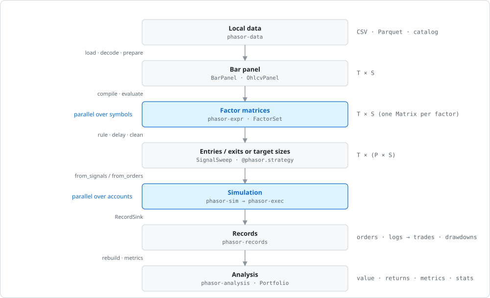

Every arrow is a function call on in-memory arrays; there is no dataframe
between stages. Factors are `Matrix`, parameters are borrowed through `FlexArray`
(§3.3), records are struct-of-arrays (§9).

### 2.2 Two tiers, unified by records and one execution kernel

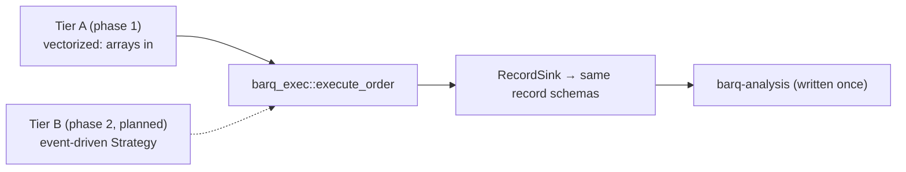

Nanoseconds per column-bar versus microseconds per event: the vectorized tier
cannot be realistic and the event tier cannot be fast. They share output and
kernel instead, so a sweep can be validated against a replay column by column.
Phase 1 therefore keeps two constraints: the kernel runs for a single bar in
isolation, and records are written through the `RecordSink` trait (§9.3).

vectorbt's Rust backend refuses callback functions, so `from_order_func` stays in
Numba. `order_func_nb(OrderContext) -> Order` and Nautilus's `on_bar` have the same
shape; in Rust that is a monomorphized trait call, so a Nautilus-style API can
double as a native `from_order_func`.

### 2.3 Crates

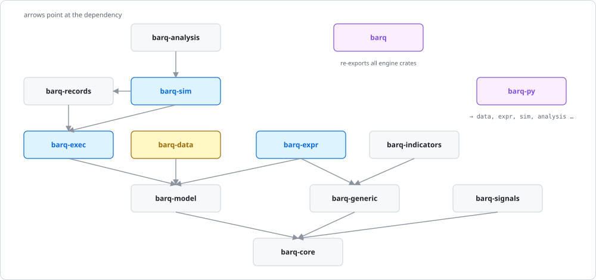

| Crate | Role |
|---|---|
| `barq-core` | `Matrix`, `FlexArray`, column labels, float tolerances, `Error` (§3); no external deps |
| `barq-model` | execution enums, ids, `BarType`, `OhlcvPanel`, fixed-point `Price`/`Quantity` (§3.6) |
| `barq-generic` | rolling / expanding / EWM windows, shifts, fills, crossovers |
| `barq-signals` | signal cleaning, exit generation, ranks, ranges (§6.2) |
| `barq-indicators` | MA, MSTD, BBANDS, RSI, STOCH, MACD, ATR, OBV with sweeps (§6.4) |
| `barq-expr` | expression parser, graph compiler, native + Polars backends, Alpha158/360 (§5) |
| `barq-exec` | the order execution kernel (§7) |
| `barq-records` | record schemas, sinks, trades, drawdowns, mapped arrays (§9) |
| `barq-sim` | `from_orders` / `from_signals` loops, stops, groups, parallel runners (§8) |
| `barq-analysis` | `Portfolio`, value/returns chain, metrics, stats, aggregation (§10) |
| `barq-data` | CSV / Parquet / catalog → Arrow → panels, point-in-time alignment (§4) |
| `barq` | façade, `prelude`, `SignalSweep` (§6.1); feature `data` adds barq-data |
| `barq-py` | PyO3 extension `barq._barq` + Python package `barq` (§12) |

External runtime dependencies: `rayon` (barq-expr), optional `polars` 0.46
(barq-expr), `arrow-*`/`parquet` 59 + `csv` (barq-data), `pyo3`/`numpy` 0.29
(barq-py). barq-sim uses only `std::thread::scope`.

### 2.4 Scope decisions

| Decision | Detail |
|---|---|
| Accounts independent by default | every column has its own cash; `cash_sharing` + `group_lens` makes contiguous columns one account (§8.3) |
| Orders sequential within an account | a call sequence per bar; `call_seq="auto"` puts sells before buys |
| Metrics per account, records per symbol | returns come from account equity; orders/trades/logs keep their column |
| Bars only | funding, news etc. enter as factor inputs via point-in-time alignment (§4.4) |
| Rust engine, Python boundary | schemas, strings and callbacks stay outside the loops; decoders run at load time |
| Sweeps do not copy prices | OHLCV stays `[T, S]`; `FlexArray::MappedColumns` (`column_map`) maps sweep columns to it (§3.3) |

---

## 3. Foundations: barq-core and barq-model

### 3.1 The column axis

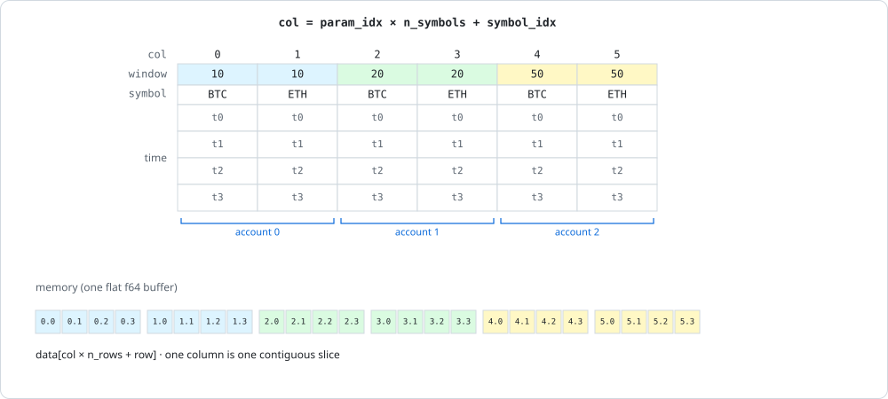

- Parameter labels **repeat** (`Level::repeat`), symbol labels **tile** (`Level::tile`), in `crates/barq-core/src/columns.rs`.
- **Contiguity**: one parameter set occupies adjacent columns, so a shared account is a slice (`group_lens=[2,2,2]`). The simulator only needs shape and group lengths.
- The layout is a constructor convention (`Level`, `column_of`, `SignalSweep`, `barq.strategy.sweep`), pinned by `one_parameter_combination_occupies_contiguous_columns`, not checked at runtime.
- **Labels**: `Columns { levels, n_cols }`; `Label = Int | Float | Str | Bool` (floats by bit pattern). `group_indices(level)` drives by-parameter aggregation (§10.5).

### 3.2 Memory layout

- `Matrix { data: Vec<f64>, n_rows, n_cols }`; `column(c)` is a zero-copy `&[f64]`.
- Column-major because the column is the unit of work: a simulation scans one column (or adjacent group), a factor is evaluated one symbol at a time (§5.4), a thread owns a range of columns.
- `OhlcvPanel` is struct-of-arrays (one buffer per field; empty = not provided).
- NumPy defaults to row-major, so every array crossing into Rust must be Fortran-ordered (§12.2).

### 3.3 Broadcasting with `FlexArray`

Materializing every parameter would cost `T × C × 8` bytes each (1.6 GB at
100k × 2,000). `FlexArray<'a, T>` borrows what it was given:

| Variant | `get(row, col)` reads |
|---|---|
| `Scalar(T)` | the value (no memory access) |
| `PerColumn(&[T])` | `values[col]` |
| `PerRow(&[T])` | `values[row]` |
| `MappedColumns { data, n_rows, columns }` | `data[columns[col] * n_rows + row]` |
| `Full { data, n_rows }` | `data[col * n_rows + row]` |

`get` is one inlined match; `varies_by_row()` lets loops hoist per-column
constants. Checked constructors return `Error::FlexLen`. `MappedColumns` is what
makes sweeps cheap: 50 parameter sets × 100 symbols address 5,000 logical price
columns while only 100 exist (`column_map` in Python).

### 3.4 The float tolerance layer

`crates/barq-core/src/math.rs`:

| Item | Rule |
|---|---|
| `REL_TOL`, `ABS_TOL` | `1e-9`, `1e-12`, as the reference |
| `is_close(a, b)` | PEP 485, except **NaN and ±inf are never close, not even `inf` to `inf`**: infinity is a live sentinel (`size=+inf` = all you can, `price=+inf` = close) |
| `is_close_or_less`, `is_less` | used for every affordability decision, never raw `<=` (§7.5) |
| `add(a, b)` | returns exactly `0.0` when the sum is close to zero; all balance updates use it, so no `1e-17` dust |
| `clippy::float_cmp = "deny"` | `==` on floats needs a local `#[allow]` with a reason |

### 3.5 Errors versus rejections

- `Err(Error::{Broadcast, FlexLen, UnknownLevel, LevelWidth, Invariant})` means an invariant broke (negative cash, bad parameter); the run stops.
- **A rejected order is never an `Err`**: it is an `OrderResult` with `status = Ignored | Rejected` and a `status_info` reason (§7.6), recorded in logs (§9.4).

### 3.6 Domain model (barq-model)

| Item | Detail |
|---|---|
| Execution enums (`enums.rs`) | `#[repr(i8)]`, discriminants pinned by a test (records store integers): `SizeType`, `Direction`, `OrderSide`, `OrderStatus`, `StatusInfo` (14 reasons), `CashFlowKind`, plus signal, stop and record enums with vectorbt semantics |
| Ids (`ids.rs`) | `Symbol`, `Venue` (`Arc<str>`), `InstrumentId` shown as `SYMBOL.VENUE`; not interned yet (§17.4) |
| `BarType` (`bar.rs`) | `SYMBOL.VENUE-STEP-AGGREGATION-PRICE-SOURCE`, parsed with `rsplitn(5, '-')`; the catalog key (§4.1) |
| Fixed point (`types.rs`) | `Price { raw: i64 }`, `Quantity { raw: u64 }`, 9 decimals, Nautilus shape; for phase 2 (phase 1 is `f64`) |

Execution semantics follow vectorbt; value and identifier types follow NautilusTrader.

---

## 4. Data layer: barq-data and barq.data

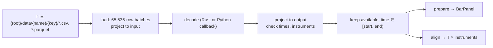

`crates/barq-data/src/lib.rs` never downloads and never writes; downloaders are
in `examples/` (`binance.py`, `fetch.py`, `download_binance_vision.py`).

### 4.1 Catalog layout

`<root>/data/<name>/<key>/*.csv | *.parquet`. `name` is the dataset (`bars`,
`funding`, `news`); `key` is a `BarType` for bars or an `InstrumentId` otherwise.
`catalog(root, name, keys)` lists files sorted. Python's default root is
`~/.cache/barq/catalog`.

### 4.2 Schema and loading

`DataSchema { name, input, output, event_time, available_time, instrument }`:

| Field | Meaning |
|---|---|
| `input` / `output` | Arrow schema read from files / after decoding |
| `event_time`, `available_time` | `UInt64` UTC ns; **every filter and join uses `available_time`** — this is what prevents look-ahead on late-published data |
| `instrument` | `Source` (from the key), `Columns { symbol, venue }` (per row), or `Global` |

`load(schema, items, start, end, decode)` returns `Dataset { schema, keys, batches }`.

### 4.3 Bars to a panel

`Dataset::prepare()` → `BarPanel { time, bar_types, values: OhlcvPanel }`. Time
axis = sorted union of `available_time`; missing bar = NaN; duplicate bar = error.

### 4.4 Point-in-time alignment of auxiliary data

`Dataset::align(time, instruments, field, window, empty)`:

| Mode | Value at time `t` |
|---|---|
| no window (as-of) | last value with `available_time <= t` |
| `(width, agg)`, agg = `Sum`, `Count` or `Mean` | aggregate of `(t - width, t]`, non-finite skipped, `empty` if none |

Global events broadcast to every instrument. Python: `Dataset.asof(panel, field=…)`,
`Dataset.window(panel, field=…, window="30m", agg="mean")`; see `examples/multi_data.py`.

### 4.5 The Python data API

`crates/barq-py/python/barq/data.py`: `DataSchema(...)`, `files({key: path})`,
`Catalog(root, schemas).source(name, keys)` → `.load(start, end)` / `.prepare()`.
`BarPanel` exposes `(T, S)` Fortran arrays, `instruments`, `coverage()`. Loading,
`prepare` and `align` release the GIL; a Python decoder re-acquires it per batch.

---

## 5. Factor expressions: barq-expr

```rust
let factors = FactorSet::compile([("trend", "$close / Mean($close, 20) - 1")])?;
let values = factors.evaluate(&FactorInputs::from_ohlcv(&panel)?)?;
let trend: &Matrix = values.get("trend").unwrap();   // time × symbol
```

A factor is information, not a decision; turning it into orders is §6.

### 5.1 The language

- **Fields** `$name`: OHLCV from `from_ohlcv`, anything else via `with_field(name, &[f64])`.
- **Operators**, low → high: `|`, `&`, comparisons, `+ -`, `* /`, unary, `**` (right-assoc). Booleans are `1.0`/`0.0`.

| Group | Functions | Notes |
|---|---|---|
| Elementwise | `Abs Sign Log Not`; `Add Sub Mul Div Power Gt Ge Lt Le Eq Ne And Or`; `Greater Less`; `If(c, a, b)` | operator and function spellings are the same node |
| Shift | `Ref(x, n)`, `Delta(x, n)` | row-based; negative `Ref` reads the future → `uses_future()` |
| Smoothing | `EMA(x, p)` | `p < 1` alpha, `p >= 1` span, `0` expanding |
| Rolling `(x, N)` | `Mean Sum Std Var Max Min Med Mad Count Skew Kurt WMA Rank IdxMax IdxMin Slope Rsquare Resi` | `Rank` is time-series; `IdxMax/Min` 1-based |
| Rolling `(x, N, q)` | `Quantile` | linear interpolation |
| Pairwise `(x, y, N)` | `Corr Cov` | |

Window rules: `min_periods = 1`, `N = 0` is expanding, NaN stays NaN; parameters
must be literals. `alpha158()` / `alpha360()` compile Qlib's feature sets (need an
explicit `vwap`; no normalization or labels). Not supported yet: cross-sectional
operators, cross-instrument references, masks (§5.7).

### 5.2 Parsing

`parse.rs`: source ≤ 16 KiB, Pratt parser, depth ≤ 128, `validate` checks names
and arity. The `Expression` tree is kept for `required_fields()`, `uses_future()`
and the Polars backend.

### 5.3 Compiling to a dependency graph

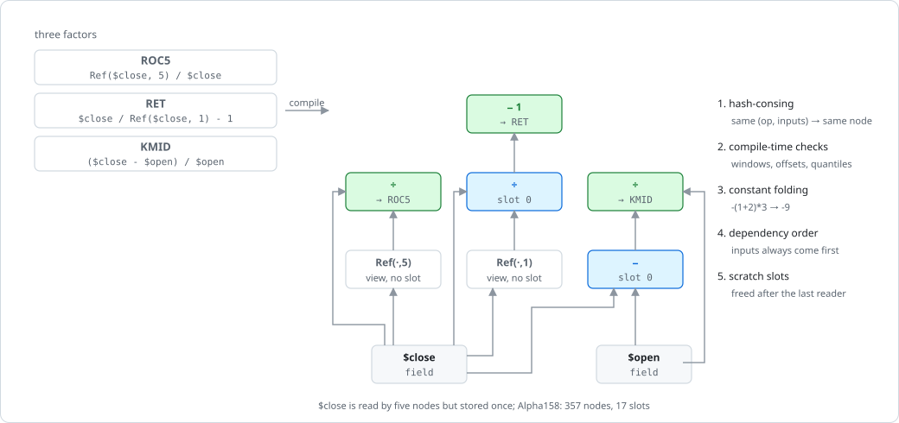

`graph.rs` builds one `Graph` for the whole set:

1. **Hash-consing** on `(Op, inputs)`: `Ref($close, 1)` used by dozens of Alpha158 factors is one node; `a+b` and `Add(a,b)` are one node.
2. **Compile-time validation** into typed ops (`Ref(i64)`, `Rolling(kind, Window)`, …); errors name the factor.
3. **Constant folding** of all-literal elementwise nodes.
4. **Dependency order**: nodes are appended after their inputs.
5. **Views**: `Ref(x, k)` with `k ≥ 0` is not computed; it is `x` read `k` rows late, and elementwise operators read it through the offset (Alpha360 is 354 such nodes).
6. **Slot scheduling** (`Graph::schedule`): a slot is freed after its last reader; a node never reuses an input's slot; a node nothing reads is written straight into its factor's output and takes no slot.

Alpha158 → 357 nodes, 17 slots, 148 written directly; Alpha360 → 722 nodes, 1 slot.

### 5.4 Native evaluation

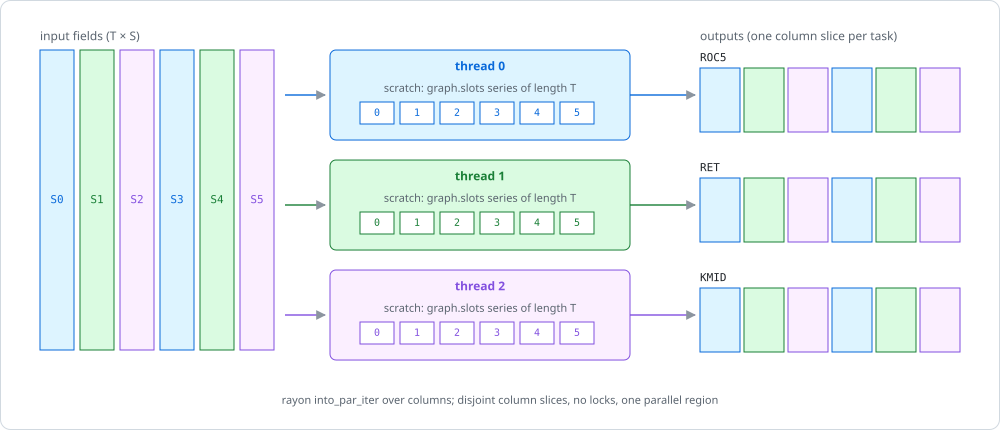

`eval.rs:evaluate`:

1. Resolve all fields first (the parallel part has no error path).
2. Allocate one buffer per output separately, so pages are zeroed lazily by the writing thread (one cloned zero buffer cost 350 ms serially).
3. Split every output into per-column `&mut` slices; task `c` owns column `c` of every output — no locks, no `unsafe`.
4. `into_par_iter().for_each_init`: `run_column` walks the nodes; fields are borrowed, literals broadcast, elementwise ops dispatch outside the loop (`binary_series`), time-series ops call §5.5.

Intermediates are one symbol's series (~20 KB at 2,520 rows), so peak memory is
essentially the outputs. `each_symbol_evaluates_exactly_as_it_would_alone` pins bit-identity.

### 5.5 Kernels

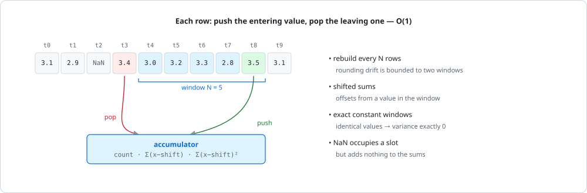

| Operators | Kernel | Cost / row |
|---|---|---|
| `Mean` | prefix sums (`barq_generic::rolling`) | O(1) |
| `Max Min` | monotonic deque | amortized O(1) |
| `Sum Std Var Skew Kurt WMA Slope Rsquare Resi Corr Cov` | incremental accumulators (`window.rs`) | O(1) |
| `Quantile Med Rank Mad` | sorted ring for windows ≤ 256, else Fenwick tree over sorted positions (`order.rs`) | O(window) shift / O(log n) |
| `IdxMax IdxMin` | monotonic queue (`order.rs:rolling_arg_extreme`) | amortized O(1) |
| `Count` | `Count` accumulator (`window.rs`) | O(1) |
| `EMA` | recurrence | O(1); `EMA(x, 0)` O(n) |

Why each accumulator trick exists: **rebuild every window** bounds rounding drift
to two windows at O(n) total; **shifted sums** avoid cancellation of large
squares; **constant-window detection** gives exactly zero variance where Qlib tests
`== 0`. The Fenwick tree works on integer positions, so `Quantile/Med/Rank` are
bit-identical to sorting. Every kernel is tested against a full rescan (`1e-9`)
on NaN runs, constant runs and large levels; Qlib fixtures pin the end result (§14.3).

### 5.6 The Polars backend

Feature `polars`: `set.evaluate_with(&inputs, &PolarsBackend)`. Long frame,
`.over(symbol)`, batches of 64 factors, `rolling_map` for Qlib-specific ops. Use:
an independent cross-check (Qlib fixtures run on both).

| Panel | Workload | Native | Polars | Ratio |
|---|---|---:|---:|---:|
| 1024 × 16 | 4 elementwise | 0.3 ms | 5.0 ms | 15× |
| 2520 × 200 | 6 rolling (w=20) | 31 ms | 102 ms | 3.3× |
| 2520 × 200 | Alpha158 | 0.60 s | 6.2 s | 10× |
| 2520 × 200 | Alpha360 | 0.41 s | 2.7 s | 6.7× |
| 2520 × 500 | Alpha158 | 1.5 s | 19.4 s | 13× |

(4 threads, best of 3.) Costs: regrouping per operator, O(window) UDFs, no
sharing across batches, `Option<f64>` conversions.

### 5.7 Memory, limits and planned work

| Alpha158 (4-core dev container) | Result |
|---|---|
| 2520 × 200 | ~0.8–1.0 s |
| 2520 × 16 | ~75 ms (160 ms before the graph) |
| peak RSS 2520 × 500 | ~1.6 GB, almost all outputs |

Limits: all outputs are held at once (5,000 × 2,520 would need ~16 GB → batched
output); per-symbol parallelism is valid only while every op reads one symbol
(cross-sectional ops need stages). Both in §17.2.

---

## 6. Signals

**The rule that matters: delay.** A factor from bar `t`'s close is known after
bar `t`; trading on it at `t` is look-ahead. Every helper delays by default or
takes the delay as a parameter (`crates/barq/tests/factor_path.rs`).

### 6.1 `SignalSweep` (Rust)

`barq::sweep::SignalSweep::from_factor((name, &Matrix), symbols, cases, delay, rule)`:
`rule(factor[row - delay, symbol], &params) -> (entry, exit)` for every case ×
symbol; first `delay` rows and non-finite scores emit nothing; columns labelled
`factor`/`case` (repeat) × `symbol` (tile). `args(&swept_close)` returns a
ready `FromSignals`. Example: `crates/barq/examples/factor_sweep.rs`.

### 6.2 barq-signals

Column-major `&[bool]` utilities: `clean_enex` (strict alternation), `generate_exits`,
`exit_after`, `exit_on`, `generate_alternating`, ranks (`signal_rank`,
`partition_rank`, …), ranges → `RangeRecords`. No random generators.

### 6.3 Python function strategies

```python
@barq.strategy
def ma_cross(data, fast, slow):
    f = barq.factors(data, fast=f"Mean($close, {fast})", slow=f"Mean($close, {slow})")
    return barq.crossed_above(f["fast"], f["slow"]), barq.crossed_above(f["slow"], f["fast"])

pf = ma_cross.sweep(panel, params=[{"fast": 5, "slow": 20}, …], threads=4)
```

`factors` rejects expressions that read the future. `.sweep(..., signal_delay=1)`
calls the function per parameter set, delays, concatenates columns
(`param_idx * S + symbol`), passes `column_map = tile(arange(S), n_params)`, sets
`group_lens = [S] * n_params` with `cash_sharing=True`, and calls `from_signals`.

### 6.4 Indicators

`barq-indicators`: `ma mstd bbands rsi stoch macd true_range/atr obv` over
parameter grids with the §3.1 layout (`column_of = comb * n_input + input_col`)
and shared-intermediate caches. Rust only, single-threaded.

---

## 7. Execution kernel: barq-exec

`execute_order(state, order, reject_draw)` in `crates/barq-exec/src/kernel.rs`
executes one order against one account at one bar. Both loops call it, and phase 2 will.

### 7.1 State and request

| Type | Fields |
|---|---|
| `ExecuteOrderState` | `cash, position (signed), debt, free_cash` |
| `ProcessOrderState` | + `val_price, value`, record counters |
| `Order` | `size=+inf, price=+inf, size_type=Amount, direction=Both, fees, fixed_fees, slippage, min_size=0, max_size=+inf, size_granularity=NaN, reject_prob, lock_cash, allow_partial=true, raise_reject, log` |
| `OrderResult` | `size, price, fees, side, status, status_info` |

`debt` = short proceeds at entry price; opening a short moves `free_cash` by
`proceeds − 2 × short_value` (collateral). It is path-dependent, so it is explicit state.

### 7.2 Validation

1. Zero-snap state values that are `is_close` to 0.
2. NaN size / NaN price → `Ignored` (before validation).
3. `validate_bar`: finite non-negative cash and debt, finite position, price > 0, direction consistent with position.
4. `param_violation`: fees finite, slippage ≥ 0, sizes positive, `reject_prob ∈ [0,1]`.

Violations are `Err(Invariant)`. `ValidatedOrder` caches step 4 per column and
swaps only per-bar fields (`set_bar`): +30% sparse / +22% dense in `benchmarks/README.md`.

### 7.3 The size cascade

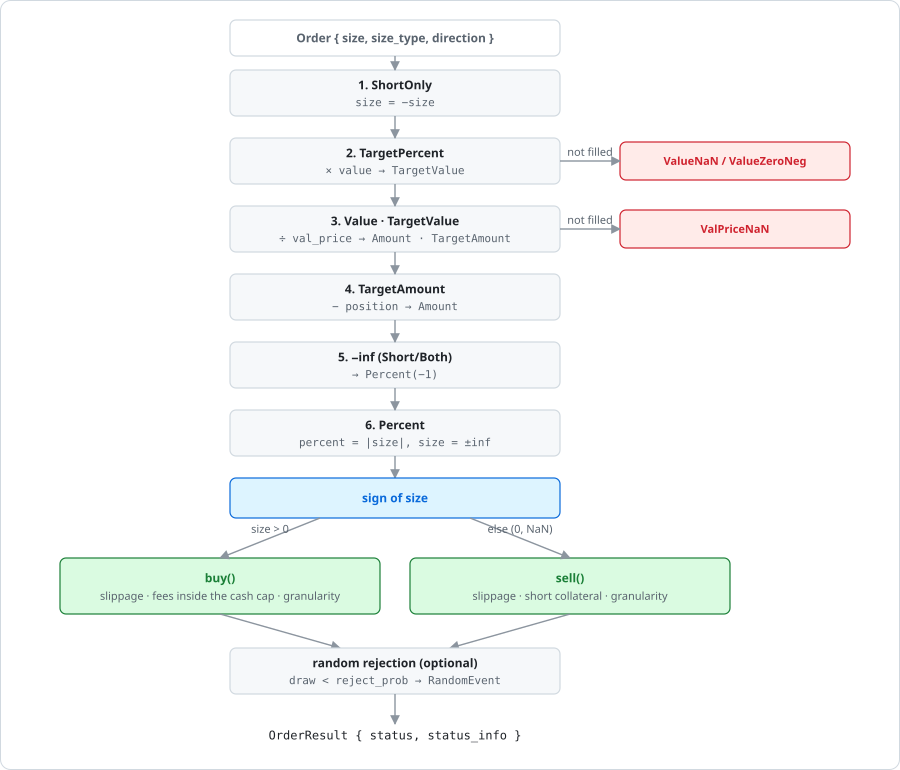

Each stage rewrites the size type; only `Amount` reaches dispatch. Zero and NaN
take the sell branch, as in the reference.

### 7.4 Buying and selling

| | Buy | Sell |
|---|---|---|
| price | `price × (1 + slippage)` | `price × (1 − slippage)` |
| cap | cash (or `lock_cash` closed form over `free_cash`), × `percent`; `ShortOnly` covers only | `LongOnly` caps at position; shorts bounded by `free_cash` + long proceeds |
| fees | inside the cash cap; if unaffordable back-solve `(cash_limit − fixed_fees) / (1 + fees)`, then **granularity again** | `CantCoverFees` if proceeds net of fees < 0 |
| checks | `max_size`, `SizeZero`, `MinSizeNotReached`, `PartialFill` | same + `NoOpenPosition`, `NoCashShort` |
| debt | covering releases debt, adds `2 × debt_diff` to `free_cash` | a new short adds debt, reserves `2 × short_value` |

### 7.5 Why the tolerance matters here

Affordability is `is_close_or_less(total_req_cash, cash_limit)`, not `<=`. They
differ only inside `1e-9`, and a mutation swapping them first survived.
`size_granularity` turns that into a whole unit (5.0 vs 4.0), so boundary
fixtures built with `math.nextafter` now catch it (§14.4).

### 7.6 Outcomes and rejection reasons

`OrderStatus`: `Filled | Ignored | Rejected`. `StatusInfo` (14): `SizeNaN PriceNaN
ValPriceNaN ValueNaN ValueZeroNeg SizeZero NoCashShort NoCashLong NoOpenPosition
MaxSizeExceeded RandomEvent CantCoverFees MinSizeNotReached PartialFill`.
`raise_reject` turns a rejection into an error. `reject_prob` takes a
caller-supplied draw (deterministic in parallel); no loop wires it yet (§17.4).

---

## 8. Simulation loops: barq-sim

Two loops (orders, signals), each plain / logged / serial / parallel.

### 8.1 `from_orders`

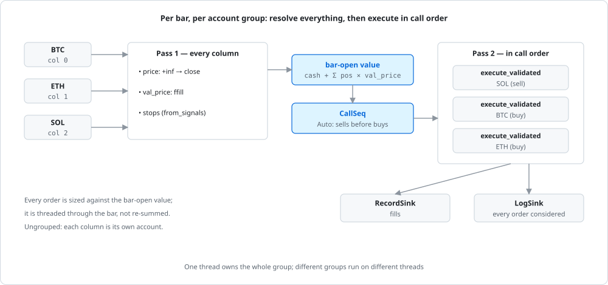

`FromOrders<'a>` holds every input as a `FlexArray` (one element = one order
request, NaN size = none). Per group (`simulate_group`): build `ValidatedOrder`s
once per column; per bar resolve prices (`+inf` → close, `-inf` → previous
close), compute the bar-open value, resolve the call sequence, execute. With
`update_value` the value is re-marked after each fill. Entry points:
`simulate_from_orders[_logged][_parallel]`, `Portfolio::from_orders(&args, threads)`.

### 8.2 `from_signals`

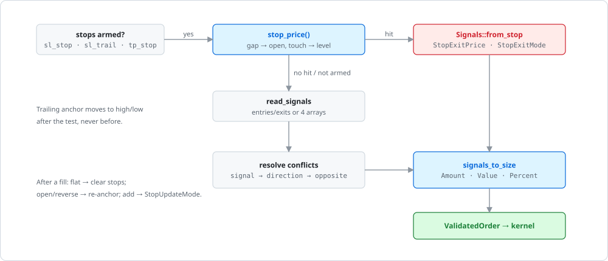

- Defaults: `init_cash = 100`, `LongOnly`, `size = +inf`, `min_size = 1e-8`, conflicts `Ignore`, `upon_opposite_entry = ReverseReduce`, stops off, `stop_exit_price = StopLimit`, `upon_stop_update = Override`.
- Signal conventions (OR-merged): `entries/exits + direction` (in `Both`, exit = short entry), or four explicit arrays.
- Conflicts: `resolve_signal_conflict` → `resolve_dir_conflict` → `resolve_opposite_entry`.
- `signals_to_size` accepts only `Amount | Value | Percent`.
- The stages in `signals.rs` are pure functions, tested exhaustively (§14.3).

### 8.3 Groups, cash sharing and call order

| Item | Detail |
|---|---|
| `Groups { lens, starts, of_col }` | `ungrouped(n)` default; `from_lens` validates coverage; cash from `init_cash` at the first column |
| `CallSeq` | `Default` (layout), `Auto` (by `approx_order_value`, stable, NaN last → sells first), `Explicit(&[usize])` |
| Parallel unit | the group; one portfolio of every symbol is one unit on one thread |
| Record order | shared groups emit in execution order; analysis re-sorts by `(col, idx)` |

### 8.4 Defaults, logging and sinks

- `DEFAULT_MIN_SIZE = 1e-8` (reference) vs kernel default `0.0`; logs found the difference (§9.4).
- Logged variants write one row per order *considered*; off by default (a log row is ~5× an order record). A test asserts logging does not change orders.
- Both loops build each column's `ValidatedOrder` once (a second, slippage-free one for stops resting at their level in `from_signals`) and rebuild per bar only when a parameter varies by row; a bar with no signal and no armed stop skips sizing.
- Both loops are generic over `SinkBuffer` (§9.3).

### 8.5 Cash flows outside fills

Both loops take `cash_deposits` and `cash_earnings` (`crates/barq-sim/src/cash.rs`).
The defaults are a scalar zero, detected once per group, so a run without them
does no extra work per bar.

| Input | Booked | Read at | Record kind |
|---|---|---|---|
| `cash_deposits` | bar open, before prices are resolved and orders sized | the group's first column, like `init_cash` | `Deposit` |
| `cash_earnings` | bar close, after every order, including bars with no signal | each column, in layout order | `Earning` |

- A deposit is in the bar's valuation, so a target-sized order on the same bar invests it.
- A negative amount is capped at `max(free_cash, 0)`, so cash never goes below zero; the amount actually applied is what is recorded.
- `NaN` means no flow; `±inf` is an error.
- vectorbt 1.1.0 has no counterpart, so there is no fixture. `crates/barq-analysis/tests/cash_flows.rs` checks hand-calculated accounts, checks that every logged order's cash and free cash equal the balances rebuilt from records (§10.2), ungrouped and shared, and checks thread invariance.

---

## 9. Records: barq-records

The contract between simulation and analysis, and between tiers. All struct-of-arrays.

### 9.1 Schemas

| Record | Fields | Row = |
|---|---|---|
| `OrderRecords` | `col, idx, size, price, fees, side` | one fill |
| `LogRecords` | 37: before-state, `req_*`, `new_*`, `res_*`, `order_id` | one order considered |
| `TradeRecords` | `col, size, entry_*, exit_*, pnl, ret, direction, status, parent_id` | derived (§9.5) |
| `DrawdownRecords` | `col, peak/start/valley/end idx, peak/valley/end val, status` | derived (§9.6) |
| `RangeRecords` | start / end / status | barq-signals ranges |
| `CashRecords` | `col, idx, amount, kind` | one cash flow that was not a fill (§8.5) |

`CashRecords` travel inside `OrderRecords` as its `cash` field, so sinks
(`RecordSink::push_cash`), merges, sorting and the `Portfolio` constructors
carry them with no new plumbing; `len()` and `ids()` count fills only.

Ids are implicit (position after merge). Records are grouped by column with
ascending rows; shared groups are re-sorted by analysis.

### 9.2 Merging per-thread buffers

Buffers are concatenated in chunk order (`OrderRecords::concat`,
`Journal::concat`) and `order_id` is re-based, so output does not depend on the
thread count (diagram in §11.2).

### 9.3 Sinks

`RecordSink::push_order`, `LogSink` (no-op for plain records),
`SinkBuffer: RecordSink + LogSink + Send` (`with_capacity`, `merge`), implemented
by `OrderRecords` and `Journal { orders, logs }`. Traits let phase 2 reuse the
records without the preallocated storage. Buffers are preallocated to the worst
case; doubling growth cost ~15% of dense throughput.

### 9.4 Logs and what exposing them found

`reasons()` and `reason_counts(col, n_cols)` answer "why didn't it trade". Compare
logs field by field (NaN `res_*` break `==`). Diffing logs against the reference
found two bugs: default `min_size` `0.0` instead of `1e-8`, and `order_id` not
re-based across groups in the serial path.

### 9.5 Three views of trades

| View | One record per | Allocation |
|---|---|---|
| `entry_trades` | entry fill | exits FIFO |
| `exit_trades` | exit fill | entries averaged |
| `positions` | position | trades grouped by `parent_id` |

The views legitimately disagree on counts and win rates. Open trades are marked
at the last close; input must be sorted.

### 9.6 Mapped arrays and drawdowns

- `ColMap::build` is a stable counting sort with a zero-copy fast path when records are already contiguous.
- `MappedArray`: `count sum mean min max std idxmax idxmin reduce top_n_mask value_counts stack_expand`, skipping missing like the reference.
- `find_drawdowns` → one record per episode (`Active` / `Recovered`).
- **Durations**: closed range `end − start`, open range `end − start + 1` (one rule for both would bias averages by up to a bar).

---

## 10. Analysis: barq-analysis

### 10.1 `Portfolio`

Stores only order records, borrowed close, shape, groups, initial cash, optional
benchmark and `Scoring { ann_factor, risk_free, trades_type, incl_open }`.
Everything else is derived lazily into `OnceLock`s (so `Sync`, each series computed
once). Constructors: `from_records`, `from_grouped_records` (re-sorts shared
groups), `from_orders` / `from_signals` (run the simulation).

### 10.2 The rebuild chain

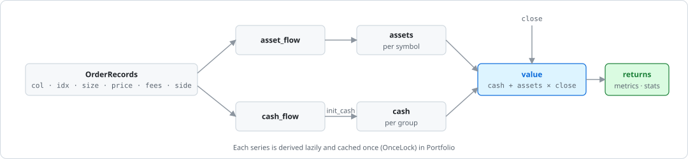

- `cash_flow` and `free_cash_flow` add the `CashRecords` amounts to the fills' flows.
- A deposit is not a return: `returns[t] = value[t] / (value[t−1] + deposit[t]) − 1`, the first bar measured from `init_cash + deposit[0]`. Without deposits the chain is unchanged, bit for bit.
- With deposits, an account's total return compounds the per-bar returns instead of `end / init − 1`, and drawdowns are found on `init_cash × Π(1 + r)` instead of the value curve, so a withdrawal is not a drawdown.

### 10.3 Metrics

| Kind | Items |
|---|---|
| Returns (`metrics.rs`) | `total_return annualized_return annualized_volatility max_drawdown sharpe sortino calmar omega tail_ratio downside_risk value_at_risk cond_value_at_risk` |
| Benchmark (`benchmark.rs`) | `information_ratio beta alpha capture up_capture down_capture` |
| Rolling (`rolling.rs`) | rolling version of each |
| Trades | `TradeStats { count winning losing win_rate profit_factor expectancy sqn total_pnl best worst }` |

### 10.4 The stats registry

`stats.rs`: 28 `DEFAULT_METRICS` with key, title, tags and compute function;
`benchmark_metrics()` adds four. `Select::{all, with_tags, keys, without_tags}`.
Titles and order match vectorbt's `Portfolio.stats()`, pinned row by row (§14.3).

### 10.5 Aggregating sweeps

- `traded_only(values)` masks accounts that never traded. **Pitfall:** zero volatility can give `+inf` Sharpe, which a naive argmax picks (`crates/barq/tests/sweep.rs`).
- `group_by(columns, level, values, Reduce::…)` reduces per label; `best_column` names the winner (`window=20, symbol=BTC`).

---

## 11. Parallelism

### 11.1 Every parallel site

| Where | Mechanism | Unit |
|---|---|---|
| barq-sim `simulate_into_parallel` | `std::thread::scope`, contiguous chunks | account group |
| barq-expr `eval.rs:evaluate` | rayon `into_par_iter().for_each_init` | one symbol through the whole graph |
| barq-expr Polars backend | Polars pool | lazy frames |
| barq-py `lib.rs`, `expr.rs`, `data.rs` | `py.detach` (GIL released) | — |

Everything else is single-threaded.

### 11.2 The simulator

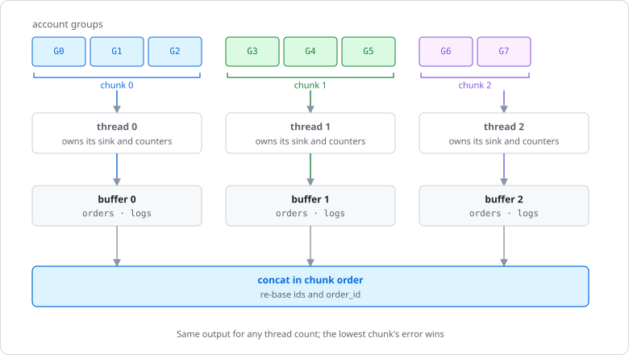

- `n_threads` clamped to `[1, n_groups]`; `Groups::chunks` cuts contiguous runs at fractions of the total column count, so every thread gets work and a wide group is its own run. No shared mutable state, no reduction.
- Buffers are preallocated to a fill bound (cells with a usable size; twice the set signal cells), not to `n_rows × n_cols`. Above 65,536 fills the merge copies the parts in parallel (`OrderRecords::concat`).
- Serial and threaded output are bit-identical (tested); the lowest failing chunk's error wins.
- Scoped threads, not a pool: they force `Sync` inputs and column-local state; tasks are 10⁴–10⁶ iterations, so scheduling cost is noise.

`cargo run --release --example scaling -p barq-sim` (20,000 × 256, 4-core Xeon):

| Workload | 1 thread | 4 threads | Speedup |
|---|---:|---:|---:|
| sparse (1 fill / 20 bars) | 33 M elem/s | 121 M elem/s | 3.62× (90%) |
| dense (every bar) | 15 M elem/s | 25 M elem/s | 1.63× (41%) |

Dense is memory-bound (~245 MB of record writes); pure compute scales 3.96×.

### 11.3 Factor evaluation

See §5.4. Scaling is bounded by the number of symbols (16 symbols → at most 16
tasks) and by uneven per-symbol work.

### 11.4 Why threads and not SIMD for the loops

- Along time: impossible (`state[t] = f(state[t−1], bar[t])`).
- Across columns: the kernel branches (cascade, dispatch, fee back-solve, ~13 checks, 14 early exits, scatter writes); 4–8 lanes vs thousands of columns.

SIMD belongs in factor and analysis kernels, after layout and autovectorization.

### 11.5 The `Send` constraint

No `Rc`, no `RefCell`, no process-global state (only `OnceLock` caches in
`Portfolio`). Nautilus's `Rc<RefCell>` + message-bus singleton is exactly what
forces its sequential run. Phase 2 must use arena-and-index ownership, routing as
an engine field.

---

## 12. Python layer: barq-py

### 12.1 Packaging

One wheel: Rust extension `barq._barq` (PyO3 0.29, `abi3-py39`, maturin) + package
`crates/barq-py/python/barq/`. Extras: `data` (pyarrow), `test` (pytest, vectorbt 1.1.0).

### 12.2 Arrays cross without copies — and must be Fortran-ordered

`array.rs:columns_of` borrows a 2-D `float64` array as a column-major slice and
**rejects C-ordered arrays** (reading row-major as column-major silently swaps
time and symbols). Wrappers call `np.asfortranarray`; tests assert borrowed arrays
are never written. 1-D arrays are ambiguous, so each call site states
`OneDim::{PerRow, PerColumn}`; simulation parameters treat 1-D as per column.

### 12.3 Simulation entry points

`barq.from_signals(close, entries, exits, *, …)` and `barq.from_orders(close, *, size, …)`
mirror the Rust structs: every parameter is scalar, per-column 1-D or `(T, C)`;
`cash_sharing` / `group_lens`; `call_seq` in `"default" | "auto"`; `column_map`
(prices `[T, S]`, signals `[T, C]`, `Portfolio.price_nbytes` reports retained
price memory); stops need `high` and `low`. `cash_deposits` and `cash_earnings`
read a 1-D array as one value per bar; a shared run's `cash_deposits` matrix is
`(T, n_groups)`, mapped onto columns without copying. `Portfolio.cash_records()`
returns what was applied.

### 12.4 Other bindings

`barq.FactorSet` (`compile`, `evaluate`, `required_fields`, `uses_future`),
`barq.Expression`, `alpha158()`, `alpha360()` (native backend only);
`crossed_above`, `factors`, `@barq.strategy`; `barq.data` (decoders get
`pyarrow.RecordBatch` via the Arrow C Data Interface — `arrow.rs`, the only
`unsafe`); `InstrumentId`, `BarType`.

### 12.5 `barq.Portfolio` and the GIL

- Owns records (sorted once for shared groups), close at source width, column map, groups, scoring, and a `barq_analysis::Cache` that every method's borrowing Rust `Portfolio` reads and fills (`Portfolio::from_borrowed`), so a value curve derived for one call serves the next; `clear_cache()` releases it.
- Records come back as dicts of NumPy arrays (`orders()`, `trades()`, `logs()`, `reason_counts(col)`).
- **GIL**: factor evaluation, data loading, `from_signals` / `from_orders` and every `Portfolio` derivation release it (`py.detach`); only the NumPy conversions hold it.
- Not exposed: rolling metrics, drawdown records, indicators, barq-signals, `CallSeq::Explicit`, Polars.

---

## 13. Research layer: research/barq_lab


A separate package (`barq-lab`). The model writes hypotheses and specs; a fixed
protocol decides. The model never sees results, so it cannot fit the data; a
healthy pipeline mostly rejects.

### 13.1 Components

| Component | Detail |
|---|---|
| Ledger (`protocol/ledger.py`) | append-only `ledger.jsonl` in its own git repo, SHA-256 chained, each append committed; counts N and OOS batches |
| Policy (`policy.py`) | periods, data (Binance 1h BTC/ETH/SOL/BNB), costs (fees 0.001, slippage 0.0005), gate, OOS budget (3 batches, 90 days apart), forward rules; versioned by hash |
| Pipeline version (`versions.py`) | hash of policy + judging code; judging changes mark results stale, prompt changes do not |
| Cards and specs | mechanism, horizon, fixed direction; dates and named events rejected; spec parser mirrors `parse.rs:validate` (tested) |

### 13.2 Workflow

`propose` (titles of past tries only) → `review` → `approve` (contract check:
compiles, not NaN-dominated, **prefix-consistent** = no look-ahead, smoke run) →
`run` (once in-sample; failures count toward N) → `oos` → `forward` (retire at
z < −2) → `report`. `calibrate` runs negative controls, including a deliberate
future leak that must be rejected.

### 13.3 The harness and its use of barq

`types/factor_ts/harness.py`: `FactorSet.compile`, reject `uses_future`, quantized
target weights decided at `t`, executed at `t + 1`, then **one**
`barq.from_orders(..., size_type="targetpercent", cash_sharing=True, call_seq="auto", column_map=…, threads=4)`
over every member × cost multiplier (0×, 1×, 2×). Gate: t-stat above the
Bonferroni bound `Φ⁻¹(1 − α/2N)`, t ≤ 8 (else suspected look-ahead), positive
Sharpe at 2× costs, consistency across members and assets.

---

## 14. Verification

### 14.1 Differential testing against committed fixtures

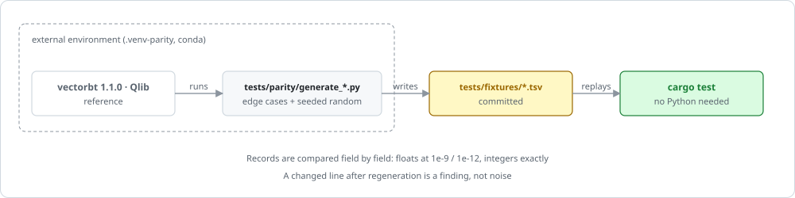

- Inputs: hand-picked edge cases + seeded random cases (seed `20260918`), not property-based, so a regenerated diff is a finding.
- Records compared field by field: floats with `agree` (both NaN, same-sign inf, or `is_close`), integers exactly.
- Format: TSV + `#` header comments; arrays `;`-separated, outputs `|`-separated; broadcast prefixes `s:` `c:` `r:` `f:`; `shared_accounts.json` holds whole cases.

### 14.2 Granularity: one call, a sequence, a pipeline

| Test | Catches |
|---|---|
| `barq-exec/tests/parity.rs` | one kernel call → names the broken cascade stage |
| `barq-exec/tests/parity_sequence.rs` | chained calls, own outputs fed forward → state threading, residue |
| `barq-analysis/tests/parity_analysis.rs` | orders → value → metrics end to end (cannot localize) |

### 14.3 Parity tests by layer

| Test | Fixture (rows) | Tolerance |
|---|---|---|
| `barq-exec/tests/parity.rs` | `execute_order.tsv` (474) | `agree` |
| `barq-exec/tests/parity_sequence.rs` | `order_sequence.tsv` (1,504 steps) | `agree` |
| `barq-sim/tests/parity_from_orders.rs` | `from_orders.tsv` (290) | `agree`, field by field |
| `barq-sim/tests/parity_from_signals.rs` | `from_signals.tsv` (181) | `agree` |
| `barq-sim/tests/parity_signals.rs` | `signals.tsv` (5,088, exhaustive) | `is_close` |
| `barq-sim/tests/parity_cash_sharing.rs` | `cash_sharing.tsv` (48) | 1e-9 rel |
| `barq-records/tests/parity_trades.rs` | `trades.tsv` (267) | `is_close`, ints exact |
| `barq-records/tests/parity_drawdowns.rs` | `drawdowns.tsv` (998) | 1e-12 rel |
| `barq-records/tests/parity_mapped.rs` | `mapped.tsv` (28,367) | 1e-12 rel |
| `barq-generic/tests/parity_generic.rs` | `generic.tsv` (1,650) | `is_close` |
| `barq-indicators/tests/parity_indicators.rs` | `indicators.tsv` (480) | `is_close`; sweeps bit-identical |
| `barq-signals/tests/parity_signals_gen.rs` | `signals_gen.tsv` (5,782) | exact / 1e-12 |
| `barq-analysis/tests/parity_analysis.rs` | `analysis.tsv` (37) | `is_close` |
| `barq-analysis/tests/parity_metrics.rs` | `metrics.tsv` (2,047) | 1e-9 rel |
| `barq-analysis/tests/parity_stats.rs` | `stats.tsv` (72) | 1e-9 rel; titles exact |
| `barq-expr/tests/parity_qlib.rs` | `qlib_alpha158.tsv` (240), `qlib_alpha360.tsv` (64) | 1e-6 (1e-4 `CORR*/CORD*`); both backends |

Structural tests: `crates/barq/tests/{sweep,factor_sweep,factor_path}.rs`,
`crates/barq-analysis/tests/shared_accounts.rs`, barq-expr unit tests (§5.5).

### 14.4 Mutation testing

Mutations applied by hand; survivors argued unreachable or equivalent; matrix in
`tests/parity/README.md` (e.g. generic 24/25, indicators 24/24, analysis 43/47).
Lesson from the kernel: the one survivor (`is_close_or_less` → `<=`) differs only
below `1e-9`; the fix was boundary fixtures plus a discrete amplifier
(`size_granularity`, §7.5). The zero-snap has two redundant mechanisms; only the
sequence harness catches removing both.

### 14.5 Python tests

`crates/barq-py/tests/`: `test_bindings.py` (differential against live vectorbt +
structural: thread determinism, C-order refusal, no writes to borrowed arrays),
`test_shared_accounts.py` (48 committed cases, also on 3 threads), plus
`test_column_map`, `test_data`, `test_examples`, `test_expressions`,
`test_strategy`. vectorbt-dependent tests skip without it; install
`crates/barq-py[test]` to run them.

### 14.6 Regenerating fixtures

```bash
python -m venv .venv-parity
.venv-parity/bin/pip install "vectorbt==1.1.0" "plotly<6"
for g in tests/parity/generate_*.py; do .venv-parity/bin/python "$g"; done
cargo test --workspace
```

Qlib generators run in a Qlib conda env with a deterministic fake provider (no
downloads). Read the diff afterwards; see `tests/parity/README.md`.

---

## 15. Benchmarks and performance

### 15.1 Execution loop against vectorbt

```bash
cargo run --release --example bench -p barq-sim      # → benchmarks/results/barq.tsv
.venv-parity/bin/python benchmarks/bench_vectorbt.py  # → benchmarks/results/vectorbt.tsv
python benchmarks/compare.py [--check-baseline]
```

| Rule | Why |
|---|---|
| 10 `from_orders` workloads (`workloads.tsv`) | vary fill rate, aspect ratio, per-bar work |
| checksums must match | same work or no comparison |
| time `simulate_from_orders_nb` directly | vectorbt's wrapper costs ~2× (once reported 5.3× instead of 2.7×) |
| best of 7 at 1, 2, all threads | thread count must not change results |
| gate: 10% on single-thread rows | 4-thread noise reached 47% |

| Comparison (4-core Xeon 2.1 GHz, 3 sittings) | Median range |
|---|---|
| barq vs vectorbt Numba | 2.6×–3.3× |
| barq vs vectorbt Rust | 3.5×–4.9× |
| barq 4 threads vs vectorbt Numba | 9.7×–12.1× |
| vectorbt Rust vs vectorbt Numba | 0.74×–0.82× |

Ranges, because the Numba loop loses more to a busy machine than barq does.

### 15.2 Other performance tools

| Command | Measures |
|---|---|
| `cargo run --release --example bench -p barq-sim` | `from_orders` and `from_signals` workloads for the regression gate |
| `uv run python benchmarks/bench_python.py` | the Python layer: signals, sweep wrapper, `Portfolio` reads |
| `cargo run --release --example scaling -p barq-sim` | thread scaling (§11.2) |
| `cargo run --release --example scale -p barq-expr -- <rows> <cols> [ops\|sets]` | per-operator, Alpha158 and Alpha360 wall-clock with peak RSS |
| `cargo bench -p barq-expr --features polars` | native vs Polars (§5.6) |

### 15.3 Factor engine history

| Change (Alpha158, 4 threads) | Effect |
|---|---|
| O(1) rolling kernels, column-parallel ops, GIL released | 2520×200: 7.87 s → 0.96 s |
| release intermediates, broadcast literals, borrow fields | RSS 2520×500: 3.5 → 1.7 GB |
| O(log n) order statistics, monotonic queues | 2520×200: 860 → 629 ms |
| dependency graph, per-symbol parallel eval | ~−20%; 2520×16: 160 → 75 ms |
| sorted-ring order statistics, `Ref` views, direct output writes, fixed scratch | 2520×200: 576 → 448 ms; 20000×16: 418 → 270 ms (Alpha360 280 → 225 ms) |

---

## 16. Development workflow

### 16.1 Toolchain and configuration

| | |
|---|---|
| `mise.toml` | Rust 1.96.0, Python 3.14.6, uv 0.11.33 |
| `Cargo.toml` | edition 2024, `rust-version = 1.85`; lints `unsafe_code = deny`, `clippy::float_cmp = deny`; release `lto`, `codegen-units = 1` |
| Features | `barq-expr/polars`; `barq/data`, `barq/polars` |
| Python | uv workspace `barq-dev` (editable `barq[data]`), ruff, pyright |

### 16.2 Commands

```bash
cargo test --workspace
cargo clippy --workspace --all-targets -- -D warnings
cargo fmt --check
cargo test -p barq-expr --features polars
uv sync                                   # build + install barq into .venv
uv run --with pytest python -m pytest crates/barq-py/tests -q
python docs/img/generate.py               # regenerate the diagrams in this document
```

No CI configuration yet.

### 16.3 Examples

| Example | Shows |
|---|---|
| `examples/sweep.py` | `@barq.strategy` MA cross, 7 params × 4 symbols on 4 threads |
| `examples/portfolio.py` | shared-cash rebalancing; per-parameter shared accounts |
| `examples/multi_data.py` | bars + funding + news, as-of / windowed alignment, `column_map` |
| `examples/crypto.py` | MA sweep on Binance klines with a custom decoder |
| `examples/fetch.py`, `binance.py`, `download_binance_vision.py` | example-only downloaders |
| `crates/barq/examples/factor_sweep.rs` | Rust: factor → `SignalSweep` → `from_signals` |

---

## 17. Roadmap and known gaps

### 17.1 Phase 2: an event-driven tier with a NautilusTrader-compatible API

Design target; nothing exists yet.

| Topic | Plan |
|---|---|
| Compatibility | source-level: change imports, keep names and signatures, no linking (Appendix A) |
| Target | NautilusTrader **v2** (`on_quote`, `on_trade`, `on_book*`, split `on_*_event`, `publish_message`, `BarType` enum) |
| Shape | struct with `core: StrategyCore` + user state, `barq_strategy!` macro, `DataActor` with `on_start` / `on_bar` |
| Minimum surface | `Strategy::new`, `cache.instrument()`, `order_factory.market()`, `submit_order`, `close_all_positions`, `portfolio.is_net_*`, `subscribe_bars`, indicators, `on_start/on_bar/on_stop` |
| Sweep API | `ParamGrid::new().sweep(…).per_instrument([...])`; `Portfolio::from_strategy::<S>(&data, grid).run()` returns the same `Portfolio` |
| Bar matching | L1 book; each bar → 4 ticks O → H → L → C (nearer extreme first) |
| Already honoured | single-bar kernel (§7), `RecordSink` (§9.3), no `Rc`/globals (§11.5); open-position lookup must be indexed |

### 17.2 Factor engine

- Batched output into a sink or Arrow/Parquet (bounded peak memory).
- Cross-sectional operators (`CSRank`, `CSZScore`, neutralization) in graph stages.
- More elementwise ops (`Exp`, `Sqrt`, `Clip`, `FillNa`, `IsNan`, masks).
- Parallelism within a symbol for narrow panels.
- Polars backend only if a downstream Polars pipeline needs it.

### 17.3 Ideas to evaluate

Automatic parameter search with a validation period; cross-run factor caching
(measure reuse first); declarative trading rules over named factors.

### 17.4 Known issues

None affects correctness of results.

| Issue | Where |
|---|---|
| `reject_prob` not wired in either loop | §7.6 |
| `CallSeq::Explicit` not exposed to Python | §12.3 |
| `Symbol` / `Venue` not interned despite a module comment | §3.6 |
| stale comments: barq-analysis says no cash sharing; `from_orders.rs` justifies scoped threads by a missing mirror | crate docs |
| `propose.py` cites `tests/test_propose.py`; the check is `research/tests/test_pipeline.py::test_proposals_never_see_results` | research |
| the two Qlib fixtures used different Qlib/NumPy/pandas versions | fixture headers |

---

## Appendix A. Licensing and provenance

barq is Apache-2.0. Both references are specifications and test oracles; **no
code is copied**.

| Reference | Licence | Consequence |
|---|---|---|
| NautilusTrader | LGPL-3.0-only | not linked (static Rust linking would require relinkable objects); a clean-room API with the same method names is allowed |
| vectorbt | Apache-2.0 + Commons Clause | no code copied; reimplementing documented behaviour is allowed |
| `nautilus-plugin` | — | guest SDK only (zero-sized host tables); ships strategies *into* Nautilus, cannot replace the engine |

Rules: read, do not copy; fixtures may derive from upstream tests as data only;
docs cite paths and short quotes. References run only in external environments
(`.venv-parity`, Qlib conda, editable vectorbt) and are not dependencies; vectorbt
appears only in the optional `test` extra.

## Appendix B. Glossary

| Term | Meaning |
|---|---|
| column | one simulated series: a symbol, or a (parameter set, symbol) pair (§3.1) |
| account / group | columns sharing cash; ungrouped = one account per column (§8.3) |
| call sequence | execution order of a shared account's columns within a bar |
| fill | an executed order; one `OrderRecords` row |
| log row | one order considered, with before/after state (§9.1) |
| rejection | an unfillable order, returned as a status, not an error (§3.5) |
| factor | a named expression producing a time × symbol matrix (§5) |
| node / slot | a deduplicated graph operation / its reusable scratch series (§5.3) |
| `column_map` | logical column → source price column (§3.3) |
| phase 1 / phase 2 | vectorized tier (exists) / event-driven tier (planned) |

## Appendix C. File index

| Topic | Files | Section |
|---|---|---|
| matrix, broadcasting, labels, tolerances, errors | `crates/barq-core/src/{matrix,flex,columns,math,error}.rs` | §3 |
| enums, ids, bars, fixed point | `crates/barq-model/src/{enums,ids,bar,types}.rs` | §3.6 |
| data loading and alignment | `crates/barq-data/src/lib.rs`, `crates/barq-py/python/barq/data.py` | §4 |
| expressions | `crates/barq-expr/src/{parse,graph,eval,window,order,polars_backend,alpha158,alpha360}.rs` | §5 |
| signals, sweeps, indicators | `crates/barq/src/sweep.rs`, `crates/barq-signals/src`, `crates/barq-indicators/src`, `crates/barq-py/python/barq/strategy.py` | §6 |
| execution kernel | `crates/barq-exec/src/{types,kernel}.rs` | §7 |
| simulation | `crates/barq-sim/src/{from_orders,from_signals,signals,groups,cash}.rs` | §8 |
| records | `crates/barq-records/src/{lib,cash,logs,trades,mapped,drawdowns}.rs` | §9 |
| analysis | `crates/barq-analysis/src/{portfolio,series,metrics,benchmark,rolling,stats,trade_stats,aggregate}.rs` | §10 |
| Python bindings | `crates/barq-py/src/{lib,array,params,parse,expr,data,arrow}.rs`, `crates/barq-py/python/barq/` | §12 |
| research protocol | `research/barq_lab/` | §13 |
| parity harness | `tests/parity/`, `tests/fixtures/`, `crates/*/tests/` | §14 |
| benchmarks | `benchmarks/`, `crates/barq-sim/examples/{bench,scaling}.rs`, `crates/barq-expr/{examples/scale.rs,benches/backends.rs}` | §15 |
| diagrams | `docs/img/generate.py` → `docs/img/{en,zh}/*.svg` | — |
