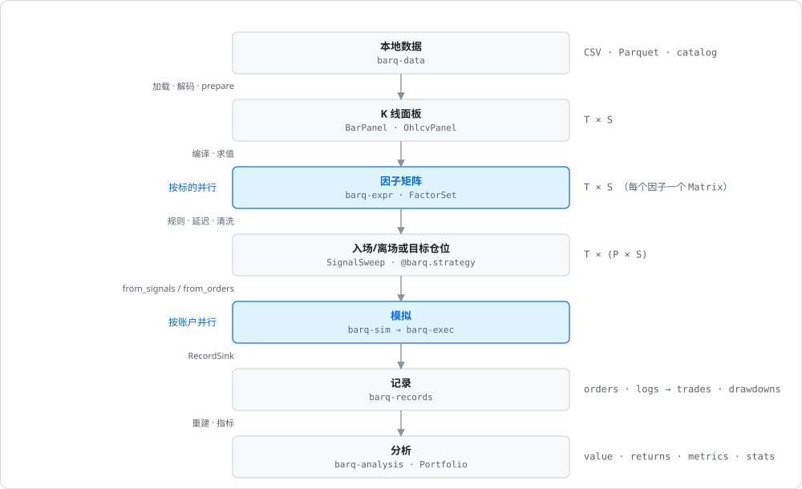
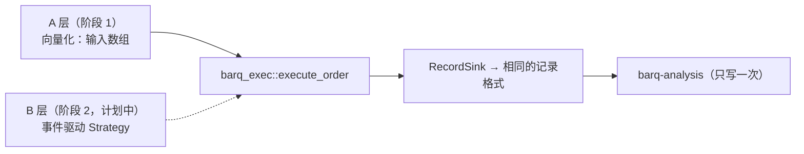
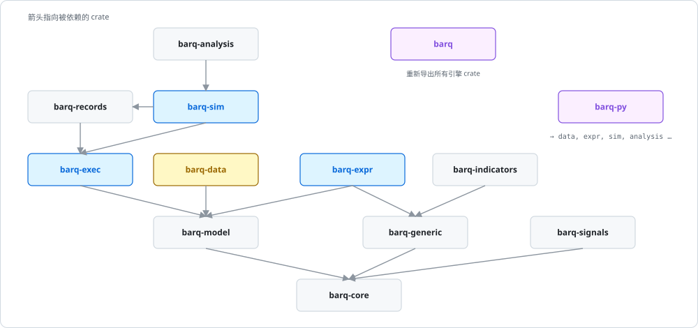
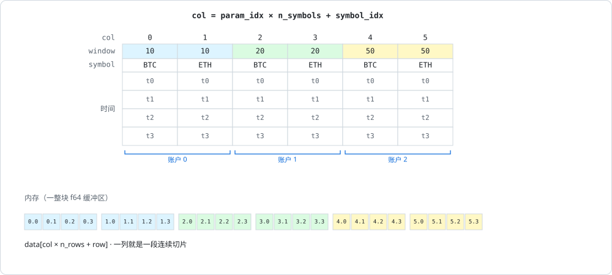
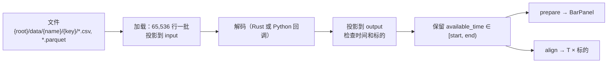
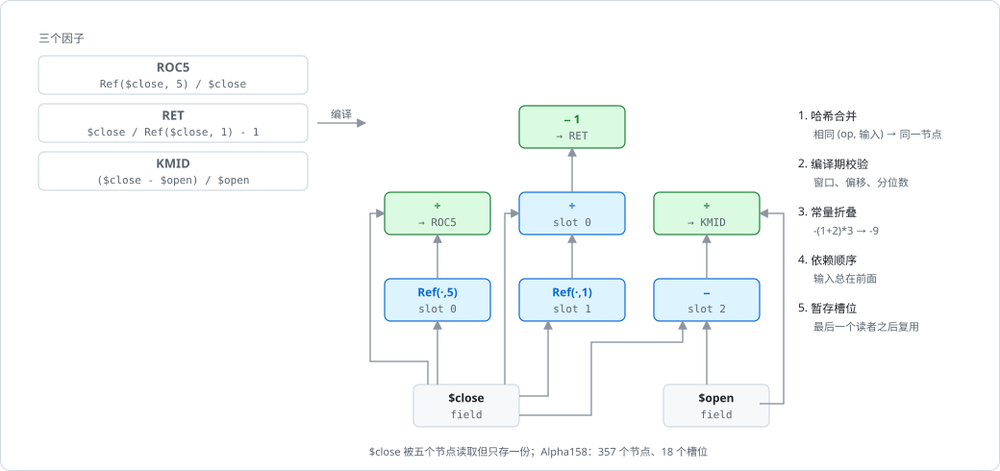
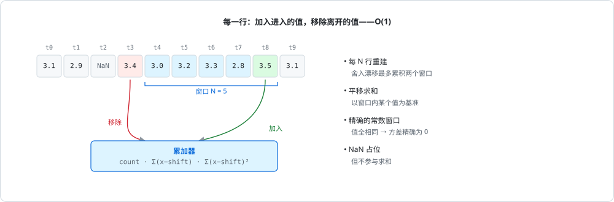
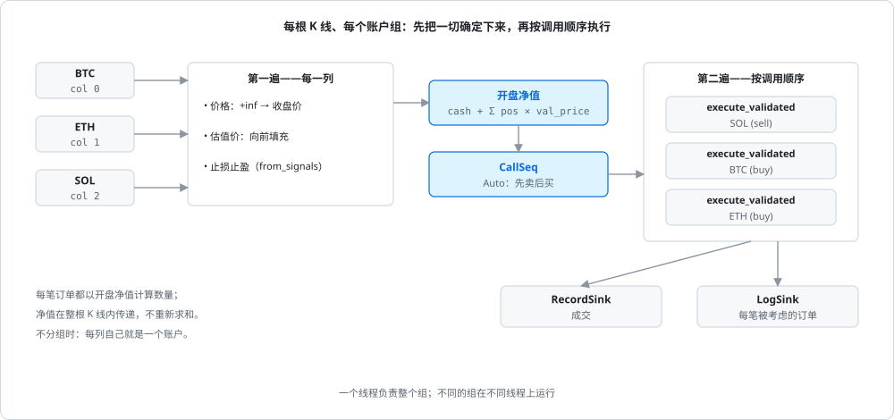
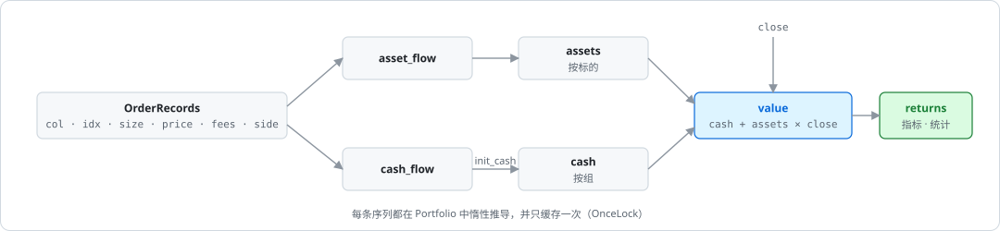
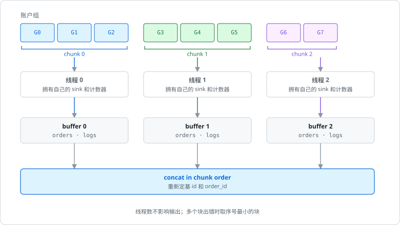

# barq 架构

[English](ARCHITECTURE.md)

唯一的架构文档，自顶向下：barq 为什么存在、系统全貌、按数据流顺序讲每个阶段、横切问题，最后是计划。中英文章节编号一致，代码注释里的 `docs/ARCHITECTURE.md §7.3` 对两个版本都成立。

以代码为准，本文对照提交 `be1f38c` 核对过。实测数字是特定机器上的观测，不是保证。图由 `python docs/img/generate.py` 生成。

---

## 目录

0. [约定](#0-约定)
1. [目标与动机](#1-目标与动机)
2. [系统总览](#2-系统总览)
3. [基础层 barq-core 与 barq-model](#3-基础层-barq-core-与-barq-model)
4. [数据层 barq-data 与 barq.data](#4-数据层-barq-data-与-barqdata)
5. [因子表达式 barq-expr](#5-因子表达式-barq-expr)
6. [信号](#6-信号)
7. [撮合内核 barq-exec](#7-撮合内核-barq-exec)
8. [模拟循环 barq-sim](#8-模拟循环-barq-sim)
9. [记录 barq-records](#9-记录-barq-records)
10. [分析 barq-analysis](#10-分析-barq-analysis)
11. [并行](#11-并行)
12. [Python 层 barq-py](#12-python-层-barq-py)
13. [研究层 research/barq_lab](#13-研究层-researchbarq_lab)
14. [验证](#14-验证)
15. [基准测试与性能](#15-基准测试与性能)
16. [开发流程](#16-开发流程)
17. [路线图与已知缺口](#17-路线图与已知缺口)
- [附录 A 许可与代码来源](#附录-a-许可与代码来源)
- [附录 B 术语表](#附录-b-术语表)
- [附录 C 文件索引](#附录-c-文件索引)

---

## 0. 约定

| | |
|---|---|
| 行 / 列 | 行是时间（K 线）；列是标的，或"参数组 × 标的" |
| 存储 | 列主序：`(row, col)` 在 `data[col * n_rows + row]`；一列是一段连续切片 |
| 命名 | 路径相对仓库根目录；`path.rs:function` 指某文件中的函数 |
| 参考实现 | 撮合、模拟、记录、分析对齐 vectorbt 1.1.0；因子表达式对齐 Qlib |
| 阶段 1 / 2 | 向量化层（已有）/ 事件驱动层（计划中，尚无实现） |

---

## 1. 目标与动机

### 1.1 barq 用来做什么

1. **并行参数扫描**：成千上万组参数作为同一次运行里相互独立的列。
2. **跨标的或多资产账户的并行回测**：共享账户是一组相邻的列（§8.3）。
3. **大规模因子表达式**：Qlib 风格表达式（§5）在整个面板上求值，直接接到信号和模拟。

次要目标：以后能用 NautilusTrader 的写法写策略（源码级可移植，§17.1）。

### 1.2 决定设计的两个发现

| 发现 | 依据 | 结论 |
|---|---|---|
| 把分支密集的循环改写成 Rust 并不会更快 | vectorbt 自带的 Rust 后端：`simulate_from_orders` 相对 Numba **0.73×–1.15×**，但可向量化的操作（1000×100 上的 `diff`、`pct_change`、平移）**6–10×**；barq 的基准复现了 0.74×–0.82×（§15.1） | 速度要靠设计，不靠编译器 |
| 事件驱动的参考实现在结构上无法并行扫描 | NautilusTrader 的 `BacktestNode::run()` 是顺序 `for`；状态是全局消息总线后面的 `Rc<RefCell<..>>`；每个事件约 1.2–1.9 µs | 并行就是机会所在 |

结果（§15.1）：单线程比 vectorbt 的 Numba 循环快 2.6×–3.3×，4 线程快 9.7×–12.1×。各项设计（列主序扫描、栈上状态、`FlexArray` 标量快路径、多线程）分别贡献多少，尚未测量。

### 1.3 barq 不是什么

- 暂时不是事件驱动引擎：没有订单簿、tick 和延迟模型，按 K 线撮合。
- 不是数据供应商：库 crate 从不下载或写数据，网络代码只在 `examples/`。
- 不是资金分配或风控系统：仓位大小由调用方决定。

---

## 2. 系统总览

### 2.1 流水线



每个箭头都是对内存数组的函数调用，阶段之间没有 dataframe。因子是 `Matrix`，参数通过 `FlexArray` 借用（§3.3），记录是数组结构体（§9）。

### 2.2 两层，由记录和同一个撮合内核统一



向量化层每列每根 K 线是纳秒级，事件驱动层每个事件是微秒级：前者做不到逼真，后者做不到快。两层改为共享输出和内核，于是一次扫描可以和一次回放逐列对照。所以阶段 1 保留两条约束：内核能对单根 K 线独立调用；记录通过 `RecordSink` trait 写出（§9.3）。

vectorbt 的 Rust 后端不支持回调函数，`from_order_func` 只能留在 Numba。`order_func_nb(OrderContext) -> Order` 和 Nautilus 的 `on_bar` 形状相同，在 Rust 里是单态化的 trait 调用，所以 Nautilus 风格的 API 可以同时充当原生的 `from_order_func`。

### 2.3 Crate 划分



| Crate | 职责 |
|---|---|
| `barq-core` | `Matrix`、`FlexArray`、列标签、浮点容差、`Error`（§3）；无外部依赖 |
| `barq-model` | 撮合枚举、id、`BarType`、`OhlcvPanel`、定点 `Price`/`Quantity`（§3.6） |
| `barq-generic` | 滚动 / 扩展 / EWM 窗口、平移、填充、交叉 |
| `barq-signals` | 信号清洗、生成离场、排名、区间（§6.2） |
| `barq-indicators` | MA、MSTD、BBANDS、RSI、STOCH、MACD、ATR、OBV 及参数扫描（§6.4） |
| `barq-expr` | 表达式解析、图编译、原生与 Polars 后端、Alpha158/360（§5） |
| `barq-exec` | 下单撮合内核（§7） |
| `barq-records` | 记录格式、sink、成交、回撤、mapped array（§9） |
| `barq-sim` | `from_orders` / `from_signals` 循环、止损止盈、分组、并行执行（§8） |
| `barq-analysis` | `Portfolio`、净值/收益链、指标、统计、汇总（§10） |
| `barq-data` | CSV / Parquet / catalog → Arrow → 面板，按时点对齐（§4） |
| `barq` | 门面、`prelude`、`SignalSweep`（§6.1）；`data` feature 引入 barq-data |
| `barq-py` | PyO3 扩展 `barq._barq` + Python 包 `barq`（§12） |

外部运行时依赖：`rayon`（barq-expr）、可选 `polars` 0.46（barq-expr）、`arrow-*`/`parquet` 59 + `csv`（barq-data）、`pyo3`/`numpy` 0.29（barq-py）。barq-sim 只用 `std::thread::scope`。

### 2.4 范围决策

| 决策 | 说明 |
|---|---|
| 账户默认相互独立 | 每列有自己的现金；`cash_sharing` + `group_lens` 让相邻的列共用一个账户（§8.3） |
| 账户内订单顺序执行 | 每根 K 线有调用顺序；`call_seq="auto"` 先卖后买 |
| 指标按账户，记录按标的 | 收益来自账户净值；订单/成交/日志保留各自的列 |
| 只支持 K 线 | 资金费率、新闻等通过按时点对齐作为因子输入（§4.4） |
| Rust 引擎，Python 边界 | schema、字符串和回调都在循环之外；解码器在加载时运行 |
| 扫描不复制价格 | OHLCV 保持 `[T, S]`；`FlexArray::MappedColumns`（`column_map`）把扫描列映射过去（§3.3） |

---

## 3. 基础层 barq-core 与 barq-model

### 3.1 列轴



- 参数标签**重复**（`Level::repeat`），标的标签**平铺**（`Level::tile`），见 `crates/barq-core/src/columns.rs`。
- **相邻性**：一组参数占相邻的列，所以共享账户就是一个切片（`group_lens=[2,2,2]`）。模拟器只需要形状和分组长度。
- 这个布局是构造函数的约定（`Level`、`column_of`、`SignalSweep`、`barq.strategy.sweep`），由 `one_parameter_combination_occupies_contiguous_columns` 测试固定，运行时不检查。
- **标签**：`Columns { levels, n_cols }`；`Label = Int | Float | Str | Bool`（浮点按位比较）。`group_indices(level)` 支撑按参数汇总（§10.5）。

### 3.2 内存布局

- `Matrix { data: Vec<f64>, n_rows, n_cols }`；`column(c)` 是零拷贝的 `&[f64]`。
- 用列主序是因为列是工作单位：模拟扫一列（或一组相邻列），因子一次算一个标的（§5.4），一个线程拥有一段列。
- `OhlcvPanel` 是数组结构体（每个字段一块缓冲区，空表示未提供）。
- NumPy 默认行主序，所以传进 Rust 的数组都必须是 Fortran 序（§12.2）。

### 3.3 用 `FlexArray` 做广播

把每个参数都展开，每个要 `T × C × 8` 字节（100k × 2,000 就是 1.6 GB）。`FlexArray<'a, T>` 只借用传入的东西：

| 变体 | `get(row, col)` 读的是 |
|---|---|
| `Scalar(T)` | 这个值（不访问内存） |
| `PerColumn(&[T])` | `values[col]` |
| `PerRow(&[T])` | `values[row]` |
| `MappedColumns { data, n_rows, columns }` | `data[columns[col] * n_rows + row]` |
| `Full { data, n_rows }` | `data[col * n_rows + row]` |

`get` 是一次内联的 match；`varies_by_row()` 让循环把每列常量提到循环外。带检查的构造函数返回 `Error::FlexLen`。`MappedColumns` 让扫描变得便宜：50 组参数 × 100 个标的对应 5,000 个逻辑价格列，但内存里只有 100 列（Python 里叫 `column_map`）。

### 3.4 浮点容差层

`crates/barq-core/src/math.rs`：

| 项 | 规则 |
|---|---|
| `REL_TOL`、`ABS_TOL` | `1e-9`、`1e-12`，与参考实现一致 |
| `is_close(a, b)` | PEP 485，唯一例外：**NaN 和 ±inf 永远不"接近"，`inf` 与 `inf` 也不**。无穷是有意义的哨兵值（`size=+inf` 表示能买多少买多少，`price=+inf` 表示用收盘价） |
| `is_close_or_less`、`is_less` | 所有"买不买得起"的判断都用它们，从不直接用 `<=`（§7.5） |
| `add(a, b)` | 和接近 0 时精确返回 `0.0`；所有余额更新都用它，所以不会残留 `1e-17` |
| `clippy::float_cmp = "deny"` | 对浮点用 `==` 必须局部 `#[allow]` 并写明理由 |

### 3.5 错误与拒单的区别

- `Err(Error::{Broadcast, FlexLen, UnknownLevel, LevelWidth, Invariant})` 表示不变量被破坏（负现金、非法参数），运行停止。
- **拒单从来不是 `Err`**：它是 `OrderResult`，`status = Ignored | Rejected`，`status_info` 给出原因（§7.6），并记录在日志中（§9.4）。

### 3.6 领域模型（barq-model）

| 项 | 说明 |
|---|---|
| 撮合枚举（`enums.rs`） | `#[repr(i8)]`，判别值由测试固定（记录里存整数）：`SizeType`、`Direction`、`OrderSide`、`OrderStatus`、`StatusInfo`（14 种原因）、`CashFlowKind`，以及语义同 vectorbt 的信号、止损、记录枚举 |
| Id（`ids.rs`） | `Symbol`、`Venue`（`Arc<str>`），`InstrumentId` 显示为 `SYMBOL.VENUE`；尚未驻留（§17.4） |
| `BarType`（`bar.rs`） | `SYMBOL.VENUE-STEP-AGGREGATION-PRICE-SOURCE`，用 `rsplitn(5, '-')` 解析；catalog 的键（§4.1） |
| 定点数（`types.rs`） | `Price { raw: i64 }`、`Quantity { raw: u64 }`，9 位小数，形状同 Nautilus；为阶段 2 准备（阶段 1 全用 `f64`） |

撮合语义跟随 vectorbt；数值和标识类型跟随 NautilusTrader。

---

## 4. 数据层 barq-data 与 barq.data



`crates/barq-data/src/lib.rs` 从不下载也从不写入；下载代码在 `examples/`（`binance.py`、`fetch.py`、`download_binance_vision.py`）。

### 4.1 Catalog 目录布局

`<root>/data/<name>/<key>/*.csv | *.parquet`。`name` 是数据集（`bars`、`funding`、`news`）；`key` 对 K 线是 `BarType`，其他数据是 `InstrumentId`。`catalog(root, name, keys)` 返回排好序的文件。Python 默认根目录是 `~/.cache/barq/catalog`。

### 4.2 Schema 与加载

`DataSchema { name, input, output, event_time, available_time, instrument }`：

| 字段 | 含义 |
|---|---|
| `input` / `output` | 从文件读取的 Arrow schema / 解码后的 schema |
| `event_time`、`available_time` | `UInt64` UTC 纳秒；**所有过滤和连接都用 `available_time`**，这样延迟发布的数据不会造成未来函数 |
| `instrument` | `Source`（由键决定）、`Columns { symbol, venue }`（逐行）或 `Global` |

`load(schema, items, start, end, decode)` 返回 `Dataset { schema, keys, batches }`。

### 4.3 从 K 线到面板

`Dataset::prepare()` → `BarPanel { time, bar_types, values: OhlcvPanel }`。时间轴是所有 `available_time` 的有序并集；缺失的 K 线为 NaN；重复的 K 线报错。

### 4.4 辅助数据的按时点对齐

`Dataset::align(time, instruments, field, window, empty)`：

| 模式 | 时刻 `t` 的值 |
|---|---|
| 无窗口（as-of） | 最后一个 `available_time <= t` 的值 |
| `(width, agg)`，agg 为 `Sum`、`Count` 或 `Mean` | 对 `(t - width, t]` 聚合，跳过非有限值，没有值时用 `empty` |

全局事件广播到所有标的。Python：`Dataset.asof(panel, field=…)`、`Dataset.window(panel, field=…, window="30m", agg="mean")`；见 `examples/multi_data.py`。

### 4.5 Python 数据 API

`crates/barq-py/python/barq/data.py`：`DataSchema(...)`、`files({key: path})`、`Catalog(root, schemas).source(name, keys)` → `.load(start, end)` / `.prepare()`。`BarPanel` 提供 `(T, S)` 的 Fortran 数组、`instruments`、`coverage()`。加载、`prepare` 和 `align` 会释放 GIL；Python 解码器每批重新获取。

---

## 5. 因子表达式 barq-expr

```rust
let factors = FactorSet::compile([("trend", "$close / Mean($close, 20) - 1")])?;
let values = factors.evaluate(&FactorInputs::from_ohlcv(&panel)?)?;
let trend: &Matrix = values.get("trend").unwrap();   // 时间 × 标的
```

因子是信息，不是决策；把它变成订单是 §6 的事。

### 5.1 语言

- **字段** `$name`：OHLCV 来自 `from_ohlcv`，其他字段用 `with_field(name, &[f64])` 加入。
- **运算符**（优先级由低到高）：`|`、`&`、比较、`+ -`、`* /`、一元、`**`（右结合）。布尔结果为 `1.0`/`0.0`。

| 类别 | 函数 | 说明 |
|---|---|---|
| 逐元素 | `Abs Sign Log Not`；`Add Sub Mul Div Power Gt Ge Lt Le Eq Ne And Or`；`Greater Less`；`If(c, a, b)` | 运算符写法和函数写法是同一个节点 |
| 平移 | `Ref(x, n)`、`Delta(x, n)` | 按行；`Ref` 为负读取未来 → `uses_future()` |
| 平滑 | `EMA(x, p)` | `p < 1` 为 alpha，`p >= 1` 为 span，`0` 为扩展窗口 |
| 滚动 `(x, N)` | `Mean Sum Std Var Max Min Med Mad Count Skew Kurt WMA Rank IdxMax IdxMin Slope Rsquare Resi` | `Rank` 是时序排名；`IdxMax/Min` 从 1 开始 |
| 滚动 `(x, N, q)` | `Quantile` | 线性插值 |
| 成对 `(x, y, N)` | `Corr Cov` | |

窗口规则：`min_periods = 1`，`N = 0` 为扩展窗口，NaN 保持 NaN；参数必须是字面量。`alpha158()` / `alpha360()` 编译 Qlib 的特征集（需要显式的 `vwap`；不含归一化和标签）。暂不支持：截面算子、跨标的引用、掩码（§5.7）。

### 5.2 解析

`parse.rs`：源码 ≤ 16 KiB，Pratt 解析器，嵌套深度 ≤ 128，`validate` 检查函数名和参数个数。`Expression` 树保留下来，供 `required_fields()`、`uses_future()` 和 Polars 后端使用。

### 5.3 编译成依赖图



`graph.rs` 为整个因子集构建一张 `Graph`：

1. **哈希合并**，键为 `(Op, inputs)`：Alpha158 中几十个因子都用到的 `Ref($close, 1)` 只是一个节点；`a+b` 和 `Add(a,b)` 也是同一个节点。
2. **编译期校验**，参数解析成带类型的算子（`Ref(i64)`、`Rolling(kind, Window)` 等）；报错信息带上因子名。
3. **常量折叠**：操作数全为字面量的逐元素节点。
4. **依赖顺序**：节点总是追加在其输入之后。
5. **视图**：`k ≥ 0` 的 `Ref(x, k)` 不计算，它就是延后 `k` 行读取的 `x`，逐元素算子通过偏移直接读（Alpha360 有 354 个这样的节点）。
6. **槽位调度**（`Graph::schedule`）：槽位在最后一个读者之后释放；节点不会复用自己输入的槽位；没有任何节点读取的节点直接写进因子输出，不占槽位。

Alpha158 → 357 个节点、17 个槽位、148 个直接写输出；Alpha360 → 722 个节点、1 个槽位。

### 5.4 原生求值


`eval.rs:evaluate`：

1. 先解析所有字段（并行部分没有出错路径）。
2. 每个输出单独分配，页面由写入它的线程惰性清零（克隆一个全零缓冲区曾串行耗费 350 ms）。
3. 把每个输出切成逐列的 `&mut` 切片；任务 `c` 拥有每个输出的第 `c` 列，不用锁，也不用 `unsafe`。
4. `into_par_iter().for_each_init`：`run_column` 按顺序走节点；字段直接借用，字面量广播，逐元素运算在循环外分派（`binary_series`），时序运算调用 §5.5 的核心。

中间结果是单个标的的序列（2,520 行约 20 KB），所以峰值内存基本就是输出本身。`each_symbol_evaluates_exactly_as_it_would_alone` 保证逐位一致。

### 5.5 计算核心



| 算子 | 实现 | 每行代价 |
|---|---|---|
| `Mean` | 前缀和（`barq_generic::rolling`） | O(1) |
| `Max Min` | 单调双端队列 | 均摊 O(1) |
| `Sum Std Var Skew Kurt WMA Slope Rsquare Resi Corr Cov` | 增量累加器（`window.rs`） | O(1) |
| `Quantile Med Rank Mad` | 窗口 ≤ 256 用有序环缓冲，否则用基于排序位置的树状数组（`order.rs`） | O(window) 移位 / O(log n) |
| `IdxMax IdxMin` | 单调队列（`order.rs:rolling_arg_extreme`） | 均摊 O(1) |
| `Count` | `Count` 累加器（`window.rs`） | O(1) |
| `EMA` | 递推 | O(1)；`EMA(x, 0)` 为 O(n) |

累加器的几个处理各有原因：**每个窗口重建一次**把舍入漂移限制在两个窗口内，总代价仍是 O(n)；**平移求和**避免大数平方相减的抵消；**常量窗口检测**在 Qlib 做 `== 0` 判断的地方给出精确的零方差。树状数组只处理整数位置，所以 `Quantile/Med/Rank` 与排序结果逐位一致。每个核心都在 NaN 段、常量段、高价位小波动等序列上与全量重算比对（`1e-9`）；最终结果由 Qlib 测试夹具固定（§14.3）。

### 5.6 Polars 后端

`polars` feature：`set.evaluate_with(&inputs, &PolarsBackend)`。长表格式，`.over(symbol)`，每批 64 个因子，Qlib 特有算子用 `rolling_map`。用途：独立的交叉验证（Qlib 夹具在两个后端上都跑）。

| 面板 | 负载 | 原生 | Polars | 倍数 |
|---|---|---:|---:|---:|
| 1024 × 16 | 4 个逐元素因子 | 0.3 ms | 5.0 ms | 15× |
| 2520 × 200 | 6 个滚动因子（w=20） | 31 ms | 102 ms | 3.3× |
| 2520 × 200 | Alpha158 | 0.60 s | 6.2 s | 10× |
| 2520 × 200 | Alpha360 | 0.41 s | 2.7 s | 6.7× |
| 2520 × 500 | Alpha158 | 1.5 s | 19.4 s | 13× |

（4 线程，取 3 次最好。）开销来自：每个算子都要重新分组、O(window) 的 UDF、批次之间无法共享、`Option<f64>` 转换。

### 5.7 内存、限制与计划

| Alpha158（4 核开发容器） | 结果 |
|---|---|
| 2520 × 200 | 约 0.8–1.0 s |
| 2520 × 16 | 约 75 ms（依赖图之前 160 ms） |
| 2520 × 500 峰值 RSS | 约 1.6 GB，几乎全是输出 |

限制：所有输出同时驻留内存（5,000 × 2,520 需要约 16 GB → 需要分批输出）；按标的并行只在每个算子只读单个标的时成立（截面算子需要分阶段）。两者见 §17.2。

---

## 6. 信号

**唯一关键的规则：延迟。** 用第 `t` 根 K 线收盘价算出的因子，要等第 `t` 根收盘后才知道；在 `t` 上用它交易就是未来函数。所有辅助函数都默认延迟，或者把延迟作为参数（`crates/barq/tests/factor_path.rs`）。

### 6.1 `SignalSweep`（Rust）

`barq::sweep::SignalSweep::from_factor((name, &Matrix), symbols, cases, delay, rule)`：对每个 case × 标的调用 `rule(factor[row - delay, symbol], &params) -> (entry, exit)`；前 `delay` 行和非有限分数不产生信号；列标签为 `factor`/`case`（重复）× `symbol`（平铺）。`args(&swept_close)` 返回填好的 `FromSignals`。示例：`crates/barq/examples/factor_sweep.rs`。

### 6.2 barq-signals

列主序 `&[bool]` 工具：`clean_enex`（严格交替）、`generate_exits`、`exit_after`、`exit_on`、`generate_alternating`、排名（`signal_rank`、`partition_rank` 等）、区间 → `RangeRecords`。刻意不提供随机信号生成。

### 6.3 Python 函数式策略

```python
@barq.strategy
def ma_cross(data, fast, slow):
    f = barq.factors(data, fast=f"Mean($close, {fast})", slow=f"Mean($close, {slow})")
    return barq.crossed_above(f["fast"], f["slow"]), barq.crossed_above(f["slow"], f["fast"])

pf = ma_cross.sweep(panel, params=[{"fast": 5, "slow": 20}, …], threads=4)
```

`factors` 拒绝读取未来的表达式。`.sweep(..., signal_delay=1)` 对每组参数调用一次函数、延迟信号、按 `param_idx * S + symbol` 拼接列、传入 `column_map = tile(arange(S), n_params)`、在 `cash_sharing=True` 时设置 `group_lens = [S] * n_params`，然后调用 `from_signals`。

### 6.4 技术指标

`barq-indicators`：`ma mstd bbands rsi stoch macd true_range/atr obv`，在参数网格上计算，列布局同 §3.1（`column_of = comb * n_input + input_col`），共享中间结果有缓存。只有 Rust 接口，单线程。

---

## 7. 撮合内核 barq-exec

`crates/barq-exec/src/kernel.rs` 中的 `execute_order(state, order, reject_draw)` 在一根 K 线上对一个账户执行一笔订单。两个模拟循环都调用它，阶段 2 也会。

### 7.1 状态与请求

| 类型 | 字段 |
|---|---|
| `ExecuteOrderState` | `cash, position（有符号）, debt, free_cash` |
| `ProcessOrderState` | 加上 `val_price, value` 和记录计数器 |
| `Order` | `size=+inf, price=+inf, size_type=Amount, direction=Both, fees, fixed_fees, slippage, min_size=0, max_size=+inf, size_granularity=NaN, cash_limit=+inf, reject_prob, lock_cash, allow_partial=true, raise_reject, log` |
| `OrderResult` | `size, price, fees, side, status, status_info` |

`debt` 是空头按开仓价计的卖出所得；开空使 `free_cash` 变化 `proceeds − 2 × short_value`（保证金）。它依赖路径，无法从现金和持仓推出，所以是显式状态。

### 7.2 校验

1. 把接近 0 的状态值精确置零。
2. size 或 price 为 NaN → `Ignored`（在校验之前）。
3. `validate_bar`：现金和负债有限且非负，持仓有限，价格 > 0，方向与持仓一致。
4. `param_violation`：费用有限，滑点 ≥ 0，数量上下限为正，`reject_prob ∈ [0,1]`，`cash_limit ≥ 0`。

违反即 `Err(Invariant)`。`ValidatedOrder` 对每列缓存第 4 步，只替换每根 K 线变化的字段（`set_bar`）：`benchmarks/README.md` 记录稀疏 +30%、稠密 +22%。

### 7.3 数量换算链


每一步都改写数量类型，只有 `Amount` 进入分派。0 和 NaN 走卖出分支，与参考实现一致。

### 7.4 买入与卖出

| | 买入 | 卖出 |
|---|---|---|
| 价格 | `price × (1 + slippage)` | `price × (1 − slippage)` |
| 上限 | 现金（或 `lock_cash` 下基于 `free_cash` 的闭式解），乘 `percent`；`ShortOnly` 只能平空 | `LongOnly` 不超过持仓；开空受 `free_cash` + 多头卖出所得限制 |
| 费用 | 包含在现金上限内；买不起时反解 `(cash_limit − fixed_fees) / (1 + fees)`，然后**再次按粒度取整** | 扣费后所得为负则 `CantCoverFees` |
| 检查 | `max_size`、`SizeZero`、`MinSizeNotReached`、`PartialFill` | 同左，另有 `NoOpenPosition`、`NoCashShort` |
| 负债 | 平空按比例释放负债，并把 `2 × debt_diff` 加回 `free_cash` | 新开空头增加负债，冻结 `2 × short_value` |

### 7.5 为什么容差在这里很重要

买不买得起由 `is_close_or_less(total_req_cash, cash_limit)` 决定，而不是 `<=`。两者只在 `1e-9` 以内有差别，把一个换成另一个的变异最初没被测试发现。`size_granularity` 把这个差别放大成一整个单位（成交 5.0 还是 4.0），所以现在用 `math.nextafter` 构造的边界夹具能抓住它（§14.4）。

### 7.6 结果与拒单原因

`OrderStatus`：`Filled | Ignored | Rejected`。`StatusInfo`（14 种）：`SizeNaN PriceNaN ValPriceNaN ValueNaN ValueZeroNeg SizeZero NoCashShort NoCashLong NoOpenPosition MaxSizeExceeded RandomEvent CantCoverFees MinSizeNotReached PartialFill`。`raise_reject` 把拒单变成错误。`reject_prob` 使用调用方提供的随机数。两个循环用 SplitMix64 从 `(seed, row, col)` 算出这个数（`crates/barq-sim/src/random.rs`），只在概率不为 0 时计算，所以结果和线程数、分组都无关。`cash_limit`（参考实现没有，也不在日志格式里）限制一笔买单最多花多少现金，在 `percent` 之前生效；卖单和做空不受影响。

---

## 8. 模拟循环 barq-sim

两个循环（订单、信号），各有普通 / 带日志 / 串行 / 并行版本。

### 8.1 `from_orders`



`FromOrders<'a>` 把每个输入都存为 `FlexArray`（一个元素 = 一个下单请求，size 为 NaN 表示不下单）。每个组（`simulate_group`）：每列构建一次 `ValidatedOrder`；每根 K 线确定价格（`+inf` → 收盘价，`-inf` → 上一根收盘价）、计算开盘净值、确定调用顺序、执行。开启 `update_value` 时每笔成交后重新估值。入口：`simulate_from_orders[_logged][_parallel]`、`Portfolio::from_orders(&args, threads)`。

### 8.2 `from_signals`


- 默认值：`init_cash = 100`、`LongOnly`、`size = +inf`、`min_size = 1e-8`、冲突一律 `Ignore`、`upon_opposite_entry = ReverseReduce`、止损关闭、`stop_exit_price = StopLimit`、`upon_stop_update = Override`。
- 两种信号约定（按或合并）：`entries/exits + direction`（`Both` 下离场信号即开空），或四个显式数组。
- 冲突解决：`resolve_signal_conflict` → `resolve_dir_conflict` → `resolve_opposite_entry`。
- `signals_to_size` 只接受 `Amount | Value | Percent`。
- `signals.rs` 中的各阶段是纯函数，单独穷举测试（§14.3）。

### 8.3 分组、共享现金与调用顺序

| 项 | 说明 |
|---|---|
| `Groups { lens, starts, of_col }` | 默认 `ungrouped(n)`；`from_lens` 检查是否覆盖所有列；现金取组内第一列的 `init_cash` |
| `CallSeq` | `Default`（布局顺序）、`Auto`（按 `approx_order_value` 稳定排序，NaN 在后 → 先卖）、`Explicit(&[usize])` |
| 并行单位 | 组；持有所有标的的单个组合就是一个单位，只能在一个线程上跑 |
| 记录顺序 | 共享组按执行顺序输出；分析层按 `(col, idx)` 重新排序 |

### 8.4 默认值、日志与 sink

- `DEFAULT_MIN_SIZE = 1e-8`（参考实现）与内核默认 `0.0` 不同；是日志发现的这个差异（§9.4）。
- 带日志的版本为每笔*被考虑*的订单写一行；默认关闭（一行日志约为订单记录的 5 倍宽）。有测试断言开日志不改变订单。
- 两个循环都为每列只构建一次 `ValidatedOrder`（`from_signals` 另建一个无滑点的版本给挂在触发价上的止损用），只在参数逐行变化时每根 K 线重建；没有信号也没有布置止损的 K 线跳过数量计算。
- 两个循环都对 `SinkBuffer` 泛型（§9.3）。

### 8.5 成交之外的现金流

两个循环都接受 `cash_deposits`、`cash_dividends` 和 `cash_earnings`（`crates/barq-sim/src/cash.rs`）。默认值是标量 0，每个账户组只判断一次，不用时每根 K 线没有额外开销。

| 输入 | 入账时点 | 读取位置 | 记录类型 |
|---|---|---|---|
| `cash_deposits` | K 线开盘，在解析价格和计算下单量之前 | 账户组的第一列，和 `init_cash` 相同 | `Deposit` |
| `cash_dividends` | K 线开盘，在入金之后；每股金额 × 当根 K 线下单之前的持仓（空头支付） | 每一列；Python 里和价格同形状，经过 `column_map` | `Dividend` |
| `cash_earnings` | K 线收盘，在所有订单之后；没有信号的 K 线也入账 | 每一列，按布局顺序 | `Earning` |

- 入金计入当根 K 线的估值，所以同一根 K 线上按目标仓位下的单会把它投进去。
- 负数金额最多扣到 `max(free_cash, 0)`，现金不会变成负数；记录里存的是实际入账的金额。
- `NaN` 表示没有现金流；`±inf` 报错。
- vectorbt 1.1.0 没有对应功能，所以没有 fixture。`crates/barq-analysis/tests/cash_flows.rs` 检查手算的账户；检查每一条订单日志里的现金和可用现金，等于从记录重建出来的余额（§10.2），覆盖独立账户和共享账户；并检查线程数不影响结果。

---

## 9. 记录 barq-records

模拟与分析之间、两层之间的契约。全部是数组结构体。

### 9.1 记录格式

| 记录 | 字段 | 一行代表 |
|---|---|---|
| `OrderRecords` | `col, idx, size, price, fees, side` | 一笔成交 |
| `LogRecords` | 37 个：执行前状态、`req_*`、`new_*`、`res_*`、`order_id` | 一笔被考虑的订单 |
| `TradeRecords` | `col, size, entry_*, exit_*, pnl, ret, direction, status, parent_id` | 推导得出（§9.5） |
| `DrawdownRecords` | `col, peak/start/valley/end idx, peak/valley/end val, status` | 推导得出（§9.6） |
| `RangeRecords` | start / end / status | barq-signals 的区间 |
| `CashRecords` | `col, idx, amount, kind` | 一笔不是成交的现金流（§8.5） |

`CashRecords` 作为 `OrderRecords` 的 `cash` 字段存放，所以 sink（`RecordSink::push_cash`）、合并、排序和 `Portfolio` 的构造函数不用新增接口就会带上它；`len()` 和 `ids()` 只数成交。

id 是隐式的（合并后的位置）。记录按列分组、行号递增；共享组由分析层重新排序。

### 9.2 合并每个线程的缓冲区

缓冲区按块的顺序拼接（`OrderRecords::concat`、`Journal::concat`），并重新定基 `order_id`，所以输出与线程数无关（图见 §11.2）。

### 9.3 Sink

`RecordSink::push_order`、`LogSink`（普通记录上为空操作）、`SinkBuffer: RecordSink + LogSink + Send`（`with_capacity`、`merge`），由 `OrderRecords` 和 `Journal { orders, logs }` 实现。用 trait 是为了让阶段 2 复用记录层而不继承预分配存储。缓冲区按最坏情况预分配；按倍增扩容会损失约 15% 的稠密吞吐。

### 9.4 日志，以及公开日志发现的问题

`reasons()` 和 `reason_counts(col, n_cols)` 回答"为什么没成交"。日志要逐字段比较（NaN 的 `res_*` 会让 `==` 失效）。把日志与参考实现对比时发现了两个缺陷：默认 `min_size` 是 `0.0` 而不是 `1e-8`；串行路径上 `order_id` 没有跨组重新定基。

### 9.5 成交的三种视图

| 视图 | 每条记录对应 | 分配方式 |
|---|---|---|
| `entry_trades` | 一笔入场成交 | 离场先进先出 |
| `exit_trades` | 一笔离场成交 | 入场取平均 |
| `positions` | 一个持仓 | 按 `parent_id` 合并成交 |

三种视图在笔数和胜率上本来就可能不同。未平仓的按最后收盘价计；输入必须已排序。

### 9.6 Mapped array 与回撤

- `ColMap::build` 是稳定计数排序；记录已按列连续时走零拷贝快路径。
- `MappedArray`：`count sum mean min max std idxmax idxmin reduce top_n_mask value_counts stack_expand`，与参考实现一样跳过缺失值。
- `find_drawdowns` → 每段回撤一条记录（`Active` / `Recovered`）。
- **持续时间**：已结束的区间为 `end − start`，未结束的为 `end − start + 1`（两者用同一规则会让平均值最多偏一根 K 线）。

---

## 10. 分析 barq-analysis

### 10.1 `Portfolio`

只保存订单记录、借用的收盘价、形状、分组、初始现金、可选基准和 `Scoring { ann_factor, risk_free, trades_type, incl_open }`。其他一切都惰性推导并缓存在 `OnceLock` 中（因此是 `Sync`，每条序列只算一次）。构造：`from_records`、`from_grouped_records`（共享组重新排序）、`from_orders` / `from_signals`（运行模拟）。

### 10.2 重建链



- `cash_flow` 和 `free_cash_flow` 在成交的现金流上加上 `CashRecords` 的金额。
- 入金不算收益：`returns[t] = value[t] / (value[t−1] + deposit[t]) − 1`，第一根 K 线从 `init_cash + deposit[0]` 算起。没有入金时重建链不变，逐位一致。
- 有入金时，账户总收益改为把每根 K 线的收益连乘，不再用 `end / init − 1`；回撤在 `init_cash × Π(1 + r)` 上计算，不在净值曲线上算，所以出金不算回撤。

### 10.3 指标

| 类别 | 内容 |
|---|---|
| 收益（`metrics.rs`） | `total_return annualized_return annualized_volatility max_drawdown sharpe sortino calmar omega tail_ratio downside_risk value_at_risk cond_value_at_risk` |
| 基准（`benchmark.rs`） | `information_ratio beta alpha capture up_capture down_capture` |
| 滚动（`rolling.rs`） | 以上每项的滚动版本 |
| 成交 | `TradeStats { count winning losing win_rate profit_factor expectancy sqn total_pnl best worst }` |

### 10.4 统计注册表

`stats.rs`：28 个 `DEFAULT_METRICS`，各有键、标题、标签和计算函数；`benchmark_metrics()` 另加 4 个。`Select::{all, with_tags, keys, without_tags}`。标题和顺序与 vectorbt 的 `Portfolio.stats()` 一致，逐行固定（§14.3）。

### 10.5 扫描结果汇总

- `traded_only(values)` 把从未交易的账户置为 NaN。**陷阱：**零波动率可能得到 `+inf` 的夏普，简单的 argmax 会选中它（`crates/barq/tests/sweep.rs`）。
- `group_by(columns, level, values, Reduce::…)` 按标签汇总；`best_column` 给出胜出者（`window=20, symbol=BTC`）。

---

## 11. 并行

### 11.1 所有并行的地方

| 位置 | 机制 | 单位 |
|---|---|---|
| barq-sim `simulate_into_parallel` | `std::thread::scope`，连续分块 | 账户组 |
| barq-expr `eval.rs:evaluate` | rayon `into_par_iter().for_each_init` | 一个标的跑完整张图 |
| barq-expr Polars 后端 | Polars 线程池 | lazy frame |
| barq-py `lib.rs`、`expr.rs`、`data.rs` | `py.detach`（释放 GIL） | — |

其余都是单线程。

### 11.2 模拟器



- `n_threads` 限制在 `[1, n_groups]`；`Groups::chunks` 按总列数的等分点切出连续的块，每个线程都有活干，宽的组自成一块。没有共享可变状态，也没有归约。
- 缓冲区按成交上界预分配（size 可用的单元数；信号置位单元数的两倍），而不是 `n_rows × n_cols`。超过 65,536 笔成交时合并阶段并行拷贝（`OrderRecords::concat`）。
- 串行与多线程输出逐位一致（有测试）；多个块出错时取序号最小的块。
- 用作用域线程而不是线程池：它强制输入为 `Sync`、状态局部于列；单个任务 10⁴–10⁶ 次迭代，调度开销可以忽略。

`cargo run --release --example scaling -p barq-sim`（20,000 × 256，4 核 Xeon）：

| 负载 | 1 线程 | 4 线程 | 加速 |
|---|---:|---:|---:|
| 稀疏（每 20 根 1 笔成交） | 33 M 元素/s | 121 M 元素/s | 3.62×（90%） |
| 稠密（每根都成交） | 15 M 元素/s | 25 M 元素/s | 1.63×（41%） |

稠密负载受内存带宽限制（约 245 MB 的记录写入）；纯计算可扩展到 3.96×。

### 11.3 因子求值

见 §5.4。扩展性受标的数量限制（16 个标的最多 16 个任务），也受各标的工作量不均的影响。

### 11.4 为什么模拟循环用多线程而不是 SIMD

- 沿时间方向：不可能（`state[t] = f(state[t−1], bar[t])`）。
- 跨列方向：内核分支密集（换算链、分派、费用反解、约 13 项检查、14 种提前退出、分散写入），而且 4–8 条通道对上的是成千上万列。

SIMD 适合因子和分析核心，先做好布局和自动向量化。

### 11.5 `Send` 约束

没有 `Rc`、没有 `RefCell`、没有进程级全局状态（只有 `Portfolio` 内部的 `OnceLock` 缓存）。Nautilus 的 `Rc<RefCell>` 加消息总线单例正是迫使它顺序运行的原因。阶段 2 必须用 arena + 索引的所有权方式，消息路由作为引擎字段。

---

## 12. Python 层 barq-py

### 12.1 打包

一个 wheel：Rust 扩展 `barq._barq`（PyO3 0.29、`abi3-py39`、maturin）+ Python 包 `crates/barq-py/python/barq/`。可选依赖：`data`（pyarrow）、`test`（pytest、vectorbt 1.1.0）。

### 12.2 数组不复制地传递——并且必须是 Fortran 序

`array.rs:columns_of` 把二维 `float64` 数组借用为列主序切片，并**拒绝 C 序数组**（把行主序当列主序读会悄悄对调时间和标的）。包装函数调用 `np.asfortranarray`；有测试断言借用的数组从不被写入。一维数组有歧义，所以每个调用点都声明 `OneDim::{PerRow, PerColumn}`；模拟参数把一维当作每列一个值。

### 12.3 模拟入口

`barq.from_signals(close, entries, exits, *, …)` 和 `barq.from_orders(close, *, size, …)` 对应 Rust 结构体：每个参数可以是标量、每列一维数组或 `(T, C)`；`cash_sharing` / `group_lens`；`call_seq` 取 `"default" | "auto"`；`column_map`（价格 `[T, S]`、信号 `[T, C]`，`Portfolio.price_nbytes` 报告保留的价格内存）；止损需要 `high` 和 `low`。`cash_deposits` 和 `cash_earnings` 的一维数组表示每根 K 线一个值；共享账户的 `cash_deposits` 矩阵是 `(T, n_groups)`，不复制，直接映射到各列。`Portfolio.cash_records()` 返回实际入账的金额。

### 12.4 其他绑定

`barq.FactorSet`（`compile`、`evaluate`、`required_fields`、`uses_future`）、`barq.Expression`、`alpha158()`、`alpha360()`（只有原生后端）；`crossed_above`、`factors`、`@barq.strategy`；`barq.data`（解码器通过 Arrow C Data Interface 拿到 `pyarrow.RecordBatch`，即 `arrow.rs`，唯一的 `unsafe`）；`InstrumentId`、`BarType`。

### 12.5 `barq.Portfolio` 与 GIL

- 持有记录（共享组时只排序一次）、源宽度的收盘价、列映射、分组、评分设置，以及一个 `barq_analysis::Cache`：每个方法借用的 Rust `Portfolio`（`Portfolio::from_borrowed`）读写它，一次调用算出的净值曲线下次直接用；`clear_cache()` 释放。
- 记录以 NumPy 数组组成的 dict 返回（`orders()`、`trades()`、`logs()`、`reason_counts(col)`）。
- **GIL**：因子求值、数据加载、`from_signals` / `from_orders` 和所有 `Portfolio` 推导都释放（`py.detach`）；只有 NumPy 转换持有。
- 未公开：滚动指标、回撤记录、技术指标、barq-signals、`CallSeq::Explicit`、Polars。

---

## 13. 研究层 research/barq_lab


独立的包（`barq-lab`）。模型写假设和规格，由固定的协议裁决。模型看不到任何结果，所以无法拟合数据；健康的流程大多数时候是拒绝。

### 13.1 组成部分

| 组件 | 说明 |
|---|---|
| 账本（`protocol/ledger.py`） | 只追加的 `ledger.jsonl`，放在单独的 git 仓库里，SHA-256 链式，每次追加都提交；统计 N 和已用的样本外批次 |
| 策略（`policy.py`） | 时间段、数据（Binance 1h BTC/ETH/SOL/BNB）、成本（费率 0.001、滑点 0.0005）、门槛、样本外预算（3 批，间隔 90 天）、前向规则；按哈希版本化 |
| 流水线版本（`versions.py`） | 策略 + 评判代码的哈希；改评判代码会让旧结果失效，改提示词不会 |
| 卡片与规格 | 机制、周期、固定方向；拒绝日期和具名事件；规格解析器与 `parse.rs:validate` 一致（有测试） |

### 13.2 工作流程

`propose`（只看得到以往尝试的标题）→ `review` → `approve`（契约检查：能编译、不被 NaN 主导、**前缀一致** = 无未来函数、冒烟回测）→ `run`（样本内只跑一次；失败也计入 N）→ `oos` → `forward`（z < −2 时淘汰）→ `report`。`calibrate` 运行阴性对照，包括一个必须被拒绝的故意泄露未来的样本。

### 13.3 评估框架及其对 barq 的使用

`types/factor_ts/harness.py`：`FactorSet.compile`，拒绝 `uses_future`，量化目标权重在 `t` 决定、`t + 1` 执行，然后**一次** `barq.from_orders(..., size_type="targetpercent", cash_sharing=True, call_seq="auto", column_map=…, threads=4)` 覆盖所有成员 × 成本倍数（0×、1×、2×）。门槛：t 统计量超过 Bonferroni 界 `Φ⁻¹(1 − α/2N)`，t ≤ 8（否则怀疑未来函数），2 倍成本下夏普为正，成员和资产之间一致。

---

## 14. 验证

### 14.1 与已提交测试夹具做差分测试


- 输入：手选的边界情况 + 固定种子的随机情况（种子 `20260918`），不用基于属性的测试，所以重新生成后的差异本身就是发现。
- 记录逐字段比较：浮点用 `agree`（都为 NaN、同号无穷，或 `is_close`），整数精确相等。
- 格式：TSV + `#` 注释头；数组用 `;` 分隔，多个输出用 `|` 分隔；广播前缀 `s:` `c:` `r:` `f:`；`shared_accounts.json` 存完整用例。

### 14.2 粒度：一次调用、一串调用、整条流水线

| 测试 | 能发现 |
|---|---|
| `barq-exec/tests/parity.rs` | 单次内核调用 → 指出是换算链哪一步坏了 |
| `barq-exec/tests/parity_sequence.rs` | 串联调用，用自己的输出往下传 → 状态传递、残差 |
| `barq-analysis/tests/parity_analysis.rs` | 订单 → 净值 → 指标端到端（无法定位） |

### 14.3 各层的一致性测试

| 测试 | 夹具（行数） | 容差 |
|---|---|---|
| `barq-exec/tests/parity.rs` | `execute_order.tsv`（474） | `agree` |
| `barq-exec/tests/parity_sequence.rs` | `order_sequence.tsv`（1,504 步） | `agree` |
| `barq-sim/tests/parity_from_orders.rs` | `from_orders.tsv`（290） | `agree`，逐字段 |
| `barq-sim/tests/parity_from_signals.rs` | `from_signals.tsv`（181） | `agree` |
| `barq-sim/tests/parity_signals.rs` | `signals.tsv`（5,088，穷举） | `is_close` |
| `barq-sim/tests/parity_cash_sharing.rs` | `cash_sharing.tsv`（48） | 相对 1e-9 |
| `barq-records/tests/parity_trades.rs` | `trades.tsv`（267） | `is_close`，整数精确 |
| `barq-records/tests/parity_drawdowns.rs` | `drawdowns.tsv`（998） | 相对 1e-12 |
| `barq-records/tests/parity_mapped.rs` | `mapped.tsv`（28,367） | 相对 1e-12 |
| `barq-generic/tests/parity_generic.rs` | `generic.tsv`（1,650） | `is_close` |
| `barq-indicators/tests/parity_indicators.rs` | `indicators.tsv`（480） | `is_close`；扫描逐位一致 |
| `barq-signals/tests/parity_signals_gen.rs` | `signals_gen.tsv`（5,782） | 精确 / 1e-12 |
| `barq-analysis/tests/parity_analysis.rs` | `analysis.tsv`（37） | `is_close` |
| `barq-analysis/tests/parity_metrics.rs` | `metrics.tsv`（2,047） | 相对 1e-9 |
| `barq-analysis/tests/parity_stats.rs` | `stats.tsv`（72） | 相对 1e-9；标题精确 |
| `barq-expr/tests/parity_qlib.rs` | `qlib_alpha158.tsv`（240）、`qlib_alpha360.tsv`（64） | 1e-6（`CORR*/CORD*` 为 1e-4）；两个后端 |

结构性测试：`crates/barq/tests/{sweep,factor_sweep,factor_path}.rs`、`crates/barq-analysis/tests/shared_accounts.rs`、barq-expr 单元测试（§5.5）。

### 14.4 变异测试

手工施加变异；存活的变异都论证为不可达或等价；矩阵见 `tests/parity/README.md`（如 generic 24/25、indicators 24/24、analysis 43/47）。内核的教训：唯一存活的变异（`is_close_or_less` → `<=`）只在 `1e-9` 以下有差别；修复方法是边界夹具加一个离散放大器（`size_granularity`，§7.5）。置零有两套冗余机制；只有串联测试能发现两者都被移除的情况。

### 14.5 Python 测试

`crates/barq-py/tests/`：`test_bindings.py`（与在线 vectorbt 的差分测试 + 结构性测试：线程确定性、拒绝 C 序、不写借用的数组），`test_shared_accounts.py`（48 个已提交用例，也在 3 线程下跑），以及 `test_column_map`、`test_data`、`test_examples`、`test_expressions`、`test_strategy`。依赖 vectorbt 的测试在未安装时跳过；安装 `crates/barq-py[test]` 后才能运行。

### 14.6 重新生成测试夹具

```bash
python -m venv .venv-parity
.venv-parity/bin/pip install "vectorbt==1.1.0" "plotly<6"
for g in tests/parity/generate_*.py; do .venv-parity/bin/python "$g"; done
cargo test --workspace
```

Qlib 生成器在 Qlib 的 conda 环境中运行，用确定性的假数据源（不下载数据）。生成后要读 diff；详见 `tests/parity/README.md`。

---

## 15. 基准测试与性能

### 15.1 模拟循环对比 vectorbt

```bash
cargo run --release --example bench -p barq-sim      # → benchmarks/results/barq.tsv
.venv-parity/bin/python benchmarks/bench_vectorbt.py  # → benchmarks/results/vectorbt.tsv
python benchmarks/compare.py [--check-baseline]
```

| 规则 | 原因 |
|---|---|
| 10 个 `from_orders` 负载（`workloads.tsv`） | 改变成交率、形状和每根 K 线的工作量 |
| 校验和必须一致 | 工作量不同就不比 |
| 直接计时 `simulate_from_orders_nb` | vectorbt 的包装层约占 2 倍（曾因此报出 5.3× 而不是 2.7×） |
| 在 1、2、全部线程下取 7 次最好 | 线程数不能改变结果 |
| 门禁：单线程行 10% | 4 线程噪声曾达 47% |

| 对比（4 核 Xeon 2.1 GHz，3 次测量） | 中位数范围 |
|---|---|
| barq 对 vectorbt Numba | 2.6×–3.3× |
| barq 对 vectorbt Rust | 3.5×–4.9× |
| barq 4 线程对 vectorbt Numba | 9.7×–12.1× |
| vectorbt Rust 对 vectorbt Numba | 0.74×–0.82× |

给出范围，是因为机器繁忙时 Numba 循环比 barq 损失更多。

### 15.2 其他性能工具

| 命令 | 测量内容 |
|---|---|
| `cargo run --release --example bench -p barq-sim` | `from_orders` 与 `from_signals` 负载，供回归门禁 |
| `uv run python benchmarks/bench_python.py` | Python 层：信号构造、sweep 包装、`Portfolio` 读取 |
| `cargo run --release --example scaling -p barq-sim` | 线程扩展性（§11.2） |
| `cargo run --release --example scale -p barq-expr -- <rows> <cols> [ops\|sets]` | 各算子、Alpha158 与 Alpha360 的耗时及峰值 RSS |
| `cargo bench -p barq-expr --features polars` | 原生对 Polars（§5.6） |

### 15.3 因子引擎的演进

| 改动（Alpha158，4 线程） | 效果 |
|---|---|
| O(1) 滚动核心、按列并行、释放 GIL | 2520×200：7.87 s → 0.96 s |
| 用完即释放中间结果、广播字面量、借用字段 | 2520×500 RSS：3.5 → 1.7 GB |
| O(log n) 顺序统计、单调队列 | 2520×200：860 → 629 ms |
| 依赖图、按标的并行求值 | 约 −20%；2520×16：160 → 75 ms |
| 有序环顺序统计、`Ref` 视图、直接写输出、固定暂存 | 2520×200：576 → 448 ms；20000×16：418 → 270 ms（Alpha360 280 → 225 ms） |

---

## 16. 开发流程

### 16.1 工具链与配置

| | |
|---|---|
| `mise.toml` | Rust 1.96.0、Python 3.14.6、uv 0.11.33 |
| `Cargo.toml` | edition 2024、`rust-version = 1.85`；lint `unsafe_code = deny`、`clippy::float_cmp = deny`；release 开 `lto`、`codegen-units = 1` |
| Feature | `barq-expr/polars`；`barq/data`、`barq/polars` |
| Python | uv 工作区 `barq-dev`（可编辑安装 `barq[data]`），ruff，pyright |

### 16.2 常用命令

```bash
cargo test --workspace
cargo clippy --workspace --all-targets -- -D warnings
cargo fmt --check
cargo test -p barq-expr --features polars
uv sync                                   # 构建并把 barq 安装进 .venv
uv run --with pytest python -m pytest crates/barq-py/tests -q
python docs/img/generate.py               # 重新生成本文的图
```

目前没有 CI 配置。

### 16.3 示例

| 示例 | 演示内容 |
|---|---|
| `examples/sweep.py` | `@barq.strategy` 均线交叉，7 组参数 × 4 个标的，4 线程 |
| `examples/portfolio.py` | 共享现金再平衡；每组参数一个共享账户 |
| `examples/multi_data.py` | K 线 + 资金费率 + 新闻，as-of / 窗口对齐，`column_map` |
| `examples/crypto.py` | 自定义解码器读取 Binance K 线做均线扫描 |
| `examples/fetch.py`、`binance.py`、`download_binance_vision.py` | 仅示例用的下载器 |
| `crates/barq/examples/factor_sweep.rs` | Rust：因子 → `SignalSweep` → `from_signals` |

---

## 17. 路线图与已知缺口

### 17.1 阶段 2：带 NautilusTrader 兼容 API 的事件驱动层

设计目标，尚无任何实现。

| 主题 | 计划 |
|---|---|
| 兼容性 | 源码级：改 import，保留名字和签名，不链接（附录 A） |
| 目标版本 | NautilusTrader **v2**（`on_quote`、`on_trade`、`on_book*`、拆分的 `on_*_event`、`publish_message`、`BarType` 枚举） |
| 形状 | 持有 `core: StrategyCore` + 用户状态的结构体，`barq_strategy!` 宏，实现 `DataActor` 的 `on_start` / `on_bar` |
| 最小接口 | `Strategy::new`、`cache.instrument()`、`order_factory.market()`、`submit_order`、`close_all_positions`、`portfolio.is_net_*`、`subscribe_bars`、指标、`on_start/on_bar/on_stop` |
| 扫描 API | `ParamGrid::new().sweep(…).per_instrument([...])`；`Portfolio::from_strategy::<S>(&data, grid).run()` 返回同样的 `Portfolio` |
| K 线撮合 | L1 订单簿；每根 K 线拆成 O → H → L → C 四个 tick（离开盘价近的极值在前） |
| 已经遵守的约束 | 单根 K 线可调用的内核（§7）、`RecordSink`（§9.3）、无 `Rc`/全局状态（§11.5）；查找持仓必须走索引 |

### 17.2 因子引擎

- 分批输出到 sink 或 Arrow/Parquet（峰值内存有界）。
- 截面算子（`CSRank`、`CSZScore`、中性化）按图分阶段执行。
- 更多逐元素算子（`Exp`、`Sqrt`、`Clip`、`FillNa`、`IsNan`、掩码）。
- 窄面板上的单标的内部并行。
- 只有下游有 Polars 流水线时才值得优化 Polars 后端。

### 17.3 待评估的想法

带验证期的自动参数搜索；跨运行的因子缓存（先测复用率）；按名字引用因子的声明式交易规则。

### 17.4 已知问题

都不影响结果的正确性。

| 问题 | 位置 |
|---|---|
| `CallSeq::Explicit` 未公开给 Python | §12.3 |
| `Symbol` / `Venue` 未驻留，但模块注释说已驻留 | §3.6 |
| 过时注释：barq-analysis 说不支持共享现金；`from_orders.rs` 用镜像不可用来解释作用域线程 | crate 文档 |
| `propose.py` 引用 `tests/test_propose.py`，实际检查在 `research/tests/test_pipeline.py::test_proposals_never_see_results` | research |
| 两个 Qlib 夹具使用了不同版本的 Qlib/NumPy/pandas | 夹具文件头 |

---

## 附录 A 许可与代码来源

barq 采用 Apache-2.0。两个参考实现只作为规格和测试预言机；**没有复制任何代码**。

| 参考 | 许可 | 结果 |
|---|---|---|
| NautilusTrader | LGPL-3.0-only | 不链接（Rust 静态链接会要求提供可重新链接的目标文件）；同名方法的净室 API 是允许的 |
| vectorbt | Apache-2.0 + Commons Clause | 不复制代码；按文档行为重新实现是允许的 |
| `nautilus-plugin` | — | 只是 guest SDK（host 表为零大小）；用于把策略放*进* Nautilus，无法替换引擎 |

规则：可以读，不能抄；夹具只能以数据形式来自上游测试；文档只引用路径和短句。参考实现只在外部环境中运行（`.venv-parity`、Qlib conda、可编辑的 vectorbt），不是依赖；vectorbt 只出现在可选的 `test` extra 中。

## 附录 B 术语表

| 术语 | 含义 |
|---|---|
| 列 | 一条被模拟的序列：一个标的，或一个"参数组 × 标的"（§3.1） |
| 账户 / 组 | 共享现金的列；不分组即每列一个账户（§8.3） |
| 调用顺序 | 共享账户内各列在一根 K 线里的执行顺序 |
| 成交 | 一笔已执行的订单；一行 `OrderRecords` |
| 日志行 | 一笔被考虑的订单，含执行前后状态（§9.1） |
| 拒单 | 无法成交的订单，以状态返回而不是错误（§3.5） |
| 因子 | 产生"时间 × 标的"矩阵的具名表达式（§5） |
| 节点 / 槽位 | 图中去重后的运算 / 可复用的暂存序列（§5.3） |
| `column_map` | 逻辑列 → 源价格列（§3.3） |
| 阶段 1 / 阶段 2 | 向量化层（已有）/ 事件驱动层（计划中） |

## 附录 C 文件索引

| 主题 | 文件 | 章节 |
|---|---|---|
| 矩阵、广播、标签、容差、错误 | `crates/barq-core/src/{matrix,flex,columns,math,error}.rs` | §3 |
| 枚举、id、K 线、定点数 | `crates/barq-model/src/{enums,ids,bar,types}.rs` | §3.6 |
| 数据加载与对齐 | `crates/barq-data/src/lib.rs`、`crates/barq-py/python/barq/data.py` | §4 |
| 表达式 | `crates/barq-expr/src/{parse,graph,eval,window,order,polars_backend,alpha158,alpha360}.rs` | §5 |
| 信号、扫描、指标 | `crates/barq/src/sweep.rs`、`crates/barq-signals/src`、`crates/barq-indicators/src`、`crates/barq-py/python/barq/strategy.py` | §6 |
| 撮合内核 | `crates/barq-exec/src/{types,kernel}.rs` | §7 |
| 模拟 | `crates/barq-sim/src/{from_orders,from_signals,signals,groups,cash}.rs` | §8 |
| 记录 | `crates/barq-records/src/{lib,cash,logs,trades,mapped,drawdowns}.rs` | §9 |
| 分析 | `crates/barq-analysis/src/{portfolio,series,metrics,benchmark,rolling,stats,trade_stats,aggregate}.rs` | §10 |
| Python 绑定 | `crates/barq-py/src/{lib,array,params,parse,expr,data,arrow}.rs`、`crates/barq-py/python/barq/` | §12 |
| 研究协议 | `research/barq_lab/` | §13 |
| 一致性测试框架 | `tests/parity/`、`tests/fixtures/`、`crates/*/tests/` | §14 |
| 基准测试 | `benchmarks/`、`crates/barq-sim/examples/{bench,scaling}.rs`、`crates/barq-expr/{examples/scale.rs,benches/backends.rs}` | §15 |
| 图 | `docs/img/generate.py` → `docs/img/{en,zh}/*.svg` | — |
