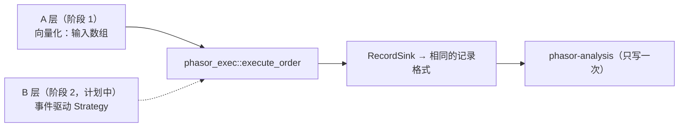
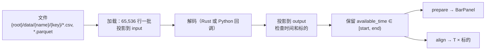

# phasor 架构

[English](ARCHITECTURE.md)

唯一的架构文档，自顶向下：phasor 为什么存在、系统全貌、按数据流顺序讲每个阶段、横切问题，最后是计划。中英文章节编号一致，代码注释里的 `docs/ARCHITECTURE.md §7.3` 对两个版本都成立。

以代码为准，本文对照提交 `be1f38c` 核对过。实测数字是特定机器上的观测，不是保证。图由 `python docs/img/generate.py` 生成。
配套的源码知识库（阅读顺序、各模块核心算法、类图与时序图、练习、延伸资料）在 [phasor-docs](https://phasor-docs.vercel.app)（仓库 [nivalume/phasor-docs](https://github.com/nivalume/phasor-docs)）。

---

## 目录

0. [约定](#0-约定)
1. [目标与动机](#1-目标与动机)
2. [系统总览](#2-系统总览)
3. [基础层 phasor-core 与 phasor-model](#3-基础层-phasor-core-与-phasor-model)
4. [数据层 phasor-data 与 phasor.data](#4-数据层-phasor-data-与-phasordata)
5. [因子表达式 phasor-expr](#5-因子表达式-phasor-expr)
6. [信号](#6-信号)
7. [撮合内核 phasor-exec](#7-撮合内核-phasor-exec)
8. [模拟循环 phasor-sim](#8-模拟循环-phasor-sim)
9. [记录 phasor-records](#9-记录-phasor-records)
10. [分析 phasor-analysis](#10-分析-phasor-analysis)
11. [并行](#11-并行)
12. [Python 层 phasor-py](#12-python-层-phasor-py)
13. [研究层 research/phasor_lab](#13-研究层-researchphasor_lab)
14. [验证](#14-验证)
15. [基准测试与性能](#15-基准测试与性能)
16. [开发流程](#16-开发流程)
17. [路线图与已知缺口](#17-路线图与已知缺口)
- [附录 A 许可与代码来源](#附录-a-许可与代码来源)
- [附录 B 术语表](#附录-b-术语表)
- [附录 C 文件索引](#附录-c-文件索引)

---

## 0. 约定

| | |
|---|---|
| 行 / 列 | 行是时间（K 线）；列是标的，或"参数组 × 标的" |
| 存储 | 列主序：`(row, col)` 在 `data[col * n_rows + row]`；一列是一段连续切片 |
| 命名 | 路径相对仓库根目录；`path.rs:function` 指某文件中的函数 |
| 参考实现 | 撮合、模拟、记录、分析对齐 vectorbt 1.1.0；因子表达式对齐 Qlib |
| 阶段 1 / 2 | 向量化层（已有）/ 事件驱动层（计划中，尚无实现） |

---

## 1. 目标与动机

### 1.1 phasor 用来做什么

1. **并行参数扫描**：成千上万组参数作为同一次运行里相互独立的列。
2. **跨标的或多资产账户的并行回测**：共享账户是一组相邻的列（§8.3）。
3. **大规模因子表达式**：Qlib 风格表达式（§5）在整个面板上求值，直接接到信号和模拟。

次要目标：以后能用 NautilusTrader 的写法写策略（源码级可移植，§17.1）。

### 1.2 决定设计的两个发现

| 发现 | 依据 | 结论 |
|---|---|---|
| 把分支密集的循环改写成 Rust 并不会更快 | vectorbt 自带的 Rust 后端：`simulate_from_orders` 相对 Numba **0.73×–1.15×**，但可向量化的操作（1000×100 上的 `diff`、`pct_change`、平移）**6–10×**；phasor 的基准复现了 0.74×–0.82×（§15.1） | 速度要靠设计，不靠编译器 |
| 事件驱动的参考实现在结构上无法并行扫描 | NautilusTrader 的 `BacktestNode::run()` 是顺序 `for`；状态是全局消息总线后面的 `Rc<RefCell<..>>`；每个事件约 1.2–1.9 µs | 并行就是机会所在 |

结果（§15.1）：单线程比 vectorbt 的 Numba 循环快 2.6×–3.3×，4 线程快 9.7×–12.1×。各项设计（列主序扫描、栈上状态、`FlexArray` 标量快路径、多线程）分别贡献多少，尚未测量。

### 1.3 phasor 不是什么

- 暂时不是事件驱动引擎：没有订单簿、tick 和延迟模型，按 K 线撮合。
- 不是数据供应商：库 crate 从不下载或写数据，网络代码只在 `examples/`。
- 不是资金分配或风控系统：仓位大小由调用方决定。

---

## 2. 系统总览

### 2.1 流水线


每个箭头都是对内存数组的函数调用，阶段之间没有 dataframe。因子是 `Matrix`，参数通过 `FlexArray` 借用（§3.3），记录是数组结构体（§9）。

### 2.2 两层，由记录和同一个撮合内核统一



向量化层每列每根 K 线是纳秒级，事件驱动层每个事件是微秒级：前者做不到逼真，后者做不到快。两层改为共享输出和内核，于是一次扫描可以和一次回放逐列对照。所以阶段 1 保留两条约束：内核能对单根 K 线独立调用；记录通过 `RecordSink` trait 写出（§9.3）。

vectorbt 的 Rust 后端不支持回调函数，`from_order_func` 只能留在 Numba。`order_func_nb(OrderContext) -> Order` 和 Nautilus 的 `on_bar` 形状相同，在 Rust 里是单态化的 trait 调用，所以 Nautilus 风格的 API 可以同时充当原生的 `from_order_func`。

### 2.3 Crate 划分


| Crate | 职责 |
|---|---|
| `phasor-core` | `Matrix`、`FlexArray`、列标签、浮点容差、`Error`（§3），按 `(seed, row, col)` 取的带种子随机数；无外部依赖 |
| `phasor-model` | 撮合枚举、id、`BarType`、`OhlcvPanel`、定点 `Price`/`Quantity`（§3.6） |
| `phasor-generic` | 滚动 / 扩展 / EWM 窗口、平移、填充、交叉；带种子的合成价格（`random_walk`、`gbm`、`ohlc_from_close`） |
| `phasor-signals` | 信号清洗、生成离场、排名、区间（§6.2） |
| `phasor-indicators` | MA、MSTD、BBANDS、RSI、STOCH、MACD、ATR、OBV 及参数扫描（§6.4） |
| `phasor-expr` | 表达式解析、图编译、原生与 Polars 后端、Alpha158/360（§5） |
| `phasor-exec` | 下单撮合内核（§7） |
| `phasor-records` | 记录格式、sink、成交、回撤、mapped array（§9） |
| `phasor-sim` | `from_orders` / `from_signals` 循环、止损止盈、分组、并行执行（§8） |
| `phasor-analysis` | `Portfolio`、净值/收益链、指标、统计、汇总（§10） |
| `phasor-data` | CSV / Parquet / catalog → Arrow → 面板，按时点对齐（§4） |
| `phasor` | 门面、`prelude`、`SignalSweep`（§6.1）；`data` feature 引入 phasor-data |
| `phasor-py` | PyO3 扩展 `phasor._phasor` + Python 包 `phasor`（§12） |

外部运行时依赖：`rayon`（phasor-expr）、可选 `polars` 0.46（phasor-expr）、`arrow-*`/`parquet` 59 + `csv`（phasor-data）、`pyo3`/`numpy` 0.29（phasor-py）。phasor-sim 只用 `std::thread::scope`。

### 2.4 范围决策

| 决策 | 说明 |
|---|---|
| 账户默认相互独立 | 每列有自己的现金；`cash_sharing` + `group_lens` 让相邻的列共用一个账户（§8.3） |
| 账户内订单顺序执行 | 每根 K 线有调用顺序；`call_seq="auto"` 先卖后买 |
| 指标按账户，记录按标的 | 收益来自账户净值；订单/成交/日志保留各自的列 |
| 只支持 K 线 | 资金费率、新闻等通过按时点对齐作为因子输入（§4.4） |
| Rust 引擎，Python 边界 | schema、字符串和回调都在循环之外；解码器在加载时运行 |
| 扫描不复制价格 | OHLCV 保持 `[T, S]`；`FlexArray::MappedColumns`（`column_map`）把扫描列映射过去（§3.3） |

---

## 3. 基础层 phasor-core 与 phasor-model

### 3.1 列轴


- 参数标签**重复**（`Level::repeat`），标的标签**平铺**（`Level::tile`），见 `crates/phasor-core/src/columns.rs`。
- **相邻性**：一组参数占相邻的列，所以共享账户就是一个切片（`group_lens=[2,2,2]`）。模拟器只需要形状和分组长度。
- 这个布局是构造函数的约定（`Level`、`column_of`、`SignalSweep`、`phasor.strategy.sweep`），由 `one_parameter_combination_occupies_contiguous_columns` 测试固定，运行时不检查。
- **标签**：`Columns { levels, n_cols }`；`Label = Int | Float | Str | Bool`（浮点按位比较）。`group_indices(level)` 支撑按参数汇总（§10.5）。

### 3.2 内存布局

- `Matrix { data: Vec<f64>, n_rows, n_cols }`；`column(c)` 是零拷贝的 `&[f64]`。
- 用列主序是因为列是工作单位：模拟扫一列（或一组相邻列），因子一次算一个标的（§5.4），一个线程拥有一段列。
- `OhlcvPanel` 是数组结构体（每个字段一块缓冲区，空表示未提供）。
- NumPy 默认行主序，所以传进 Rust 的数组都必须是 Fortran 序（§12.2）。

### 3.3 用 `FlexArray` 做广播

把每个参数都展开，每个要 `T × C × 8` 字节（100k × 2,000 就是 1.6 GB）。`FlexArray<'a, T>` 只借用传入的东西：

| 变体 | `get(row, col)` 读的是 |
|---|---|
| `Scalar(T)` | 这个值（不访问内存） |
| `PerColumn(&[T])` | `values[col]` |
| `PerRow(&[T])` | `values[row]` |
| `MappedColumns { data, n_rows, columns }` | `data[columns[col] * n_rows + row]` |
| `Full { data, n_rows }` | `data[col * n_rows + row]` |

`get` 是一次内联的 match；`varies_by_row()` 让循环把每列常量提到循环外。带检查的构造函数返回 `Error::FlexLen`。`MappedColumns` 让扫描变得便宜：50 组参数 × 100 个标的对应 5,000 个逻辑价格列，但内存里只有 100 列（Python 里叫 `column_map`）。

### 3.4 浮点容差层

`crates/phasor-core/src/math.rs`：

| 项 | 规则 |
|---|---|
| `REL_TOL`、`ABS_TOL` | `1e-9`、`1e-12`，与参考实现一致 |
| `is_close(a, b)` | PEP 485，唯一例外：**NaN 和 ±inf 永远不"接近"，`inf` 与 `inf` 也不**。无穷是有意义的哨兵值（`size=+inf` 表示能买多少买多少，`price=+inf` 表示用收盘价） |
| `is_close_or_less`、`is_less` | 所有"买不买得起"的判断都用它们，从不直接用 `<=`（§7.5） |
| `add(a, b)` | 和接近 0 时精确返回 `0.0`；所有余额更新都用它，所以不会残留 `1e-17` |
| `clippy::float_cmp = "deny"` | 对浮点用 `==` 必须局部 `#[allow]` 并写明理由 |

### 3.5 错误与拒单的区别

- `Err(Error::{Broadcast, FlexLen, UnknownLevel, LevelWidth, Invariant})` 表示不变量被破坏（负现金、非法参数），运行停止。
- **拒单从来不是 `Err`**：它是 `OrderResult`，`status = Ignored | Rejected`，`status_info` 给出原因（§7.6），并记录在日志中（§9.4）。

### 3.6 领域模型（phasor-model）

| 项 | 说明 |
|---|---|
| 撮合枚举（`enums.rs`） | `#[repr(i8)]`，判别值由测试固定（记录里存整数）：`SizeType`、`Direction`、`OrderSide`、`OrderStatus`、`StatusInfo`（15 种原因）、`LeverageMode`、`CashFlowKind`，以及语义同 vectorbt 的信号、止损、记录枚举 |
| Id（`ids.rs`） | `Symbol`、`Venue`（`Arc<str>`），`InstrumentId` 显示为 `SYMBOL.VENUE`；尚未驻留（§17.4） |
| `BarType`（`bar.rs`） | `SYMBOL.VENUE-STEP-AGGREGATION-PRICE-SOURCE`，用 `rsplitn(5, '-')` 解析；catalog 的键（§4.1） |
| 定点数（`types.rs`） | `Price { raw: i64 }`、`Quantity { raw: u64 }`，9 位小数，形状同 Nautilus；为阶段 2 准备（阶段 1 全用 `f64`） |

撮合语义跟随 vectorbt；数值和标识类型跟随 NautilusTrader。

---

## 4. 数据层 phasor-data 与 phasor.data



`crates/phasor-data/src/lib.rs` 从不下载也从不写入；下载代码在 `examples/`（`binance.py`、`fetch.py`、`download_binance_vision.py`）。

### 4.1 Catalog 目录布局

`<root>/data/<name>/<key>/*.csv | *.parquet`。`name` 是数据集（`bars`、`funding`、`news`）；`key` 对 K 线是 `BarType`，其他数据是 `InstrumentId`。`catalog(root, name, keys)` 返回排好序的文件。Python 默认根目录是 `~/.cache/phasor/catalog`。

### 4.2 Schema 与加载

`DataSchema { name, input, output, event_time, available_time, instrument }`：

| 字段 | 含义 |
|---|---|
| `input` / `output` | 从文件读取的 Arrow schema / 解码后的 schema |
| `event_time`、`available_time` | `UInt64` UTC 纳秒；**所有过滤和连接都用 `available_time`**，这样延迟发布的数据不会造成未来函数 |
| `instrument` | `Source`（由键决定）、`Columns { symbol, venue }`（逐行）或 `Global` |

`load(schema, items, start, end, decode)` 返回 `Dataset { schema, keys, batches }`。

### 4.3 从 K 线到面板

`Dataset::prepare()` → `BarPanel { time, bar_types, values: OhlcvPanel }`。时间轴是所有 `available_time` 的有序并集；缺失的 K 线为 NaN；重复的 K 线报错。

### 4.4 辅助数据的按时点对齐

`Dataset::align(time, instruments, field, window, empty)`：

| 模式 | 时刻 `t` 的值 |
|---|---|
| 无窗口（as-of） | 最后一个 `available_time <= t` 的值 |
| `(width, agg)`，agg 为 `Sum`、`Count` 或 `Mean` | 对 `(t - width, t]` 聚合，跳过非有限值，没有值时用 `empty` |

全局事件广播到所有标的。Python：`Dataset.asof(panel, field=…)`、`Dataset.window(panel, field=…, window="30m", agg="mean")`；见 `examples/multi_data.py`。

### 4.5 Python 数据 API

`crates/phasor-py/python/phasor/data.py`：`DataSchema(...)`、`files({key: path})`、`Catalog(root, schemas).source(name, keys)` → `.load(start, end)` / `.prepare()`。`BarPanel` 提供 `(T, S)` 的 Fortran 数组、`instruments`、`coverage()`。加载、`prepare` 和 `align` 会释放 GIL；Python 解码器每批重新获取。

---

## 5. 因子表达式 phasor-expr

```rust
let factors = FactorSet::compile([("trend", "$close / Mean($close, 20) - 1")])?;
let values = factors.evaluate(&FactorInputs::from_ohlcv(&panel)?)?;
let trend: &Matrix = values.get("trend").unwrap();   // 时间 × 标的
```

因子是信息，不是决策；把它变成订单是 §6 的事。

### 5.1 语言

- **字段** `$name`：OHLCV 来自 `from_ohlcv`，其他字段用 `with_field(name, &[f64])` 加入。
- **运算符**（优先级由低到高）：`|`、`&`、比较、`+ -`、`* /`、一元、`**`（右结合）。布尔结果为 `1.0`/`0.0`。

| 类别 | 函数 | 说明 |
|---|---|---|
| 逐元素 | `Abs Sign Log Not`；`Add Sub Mul Div Power Gt Ge Lt Le Eq Ne And Or`；`Greater Less`；`If(c, a, b)` | 运算符写法和函数写法是同一个节点 |
| 平移 | `Ref(x, n)`、`Delta(x, n)` | 按行；`Ref` 为负读取未来 → `uses_future()` |
| 平滑 | `EMA(x, p)` | `p < 1` 为 alpha，`p >= 1` 为 span，`0` 为扩展窗口 |
| 滚动 `(x, N)` | `Mean Sum Std Var Max Min Med Mad Count Skew Kurt WMA Rank IdxMax IdxMin Slope Rsquare Resi` | `Rank` 是时序排名；`IdxMax/Min` 从 1 开始 |
| 滚动 `(x, N, q)` | `Quantile` | 线性插值 |
| 成对 `(x, y, N)` | `Corr Cov` | |

窗口规则：`min_periods = 1`，`N = 0` 为扩展窗口，NaN 保持 NaN；参数必须是字面量。`alpha158()` / `alpha360()` 编译 Qlib 的特征集（需要显式的 `vwap`；不含归一化和标签）。暂不支持：截面算子、跨标的引用、掩码（§5.7）。

### 5.2 解析

`parse.rs`：源码 ≤ 16 KiB，Pratt 解析器，嵌套深度 ≤ 128，`validate` 检查函数名和参数个数。`Expression` 树保留下来，供 `required_fields()`、`uses_future()` 和 Polars 后端使用。

### 5.3 编译成依赖图


`graph.rs` 为整个因子集构建一张 `Graph`：

1. **哈希合并**，键为 `(Op, inputs)`：Alpha158 中几十个因子都用到的 `Ref($close, 1)` 只是一个节点；`a+b` 和 `Add(a,b)` 也是同一个节点。
2. **编译期校验**，参数解析成带类型的算子（`Ref(i64)`、`Rolling(kind, Window)` 等）；报错信息带上因子名。
3. **常量折叠**：操作数全为字面量的逐元素节点。
4. **依赖顺序**：节点总是追加在其输入之后。
5. **视图**：`k ≥ 0` 的 `Ref(x, k)` 不计算，它就是延后 `k` 行读取的 `x`，逐元素算子通过偏移直接读（Alpha360 有 354 个这样的节点）。
6. **槽位调度**（`Graph::schedule`）：槽位在最后一个读者之后释放；节点不会复用自己输入的槽位；没有任何节点读取的节点直接写进因子输出，不占槽位。

Alpha158 → 357 个节点、17 个槽位、148 个直接写输出；Alpha360 → 722 个节点、1 个槽位。

### 5.4 原生求值


`eval.rs:evaluate`：

1. 先解析所有字段（并行部分没有出错路径）。
2. 每个输出单独分配，页面由写入它的线程惰性清零（克隆一个全零缓冲区曾串行耗费 350 ms）。
3. 把每个输出切成逐列的 `&mut` 切片；任务 `c` 拥有每个输出的第 `c` 列，不用锁，也不用 `unsafe`。
4. `into_par_iter().for_each_init`：`run_column` 按顺序走节点；字段直接借用，字面量广播，逐元素运算在循环外分派（`binary_series`），时序运算调用 §5.5 的核心。

中间结果是单个标的的序列（2,520 行约 20 KB），所以峰值内存基本就是输出本身。`each_symbol_evaluates_exactly_as_it_would_alone` 保证逐位一致。

### 5.5 计算核心


| 算子 | 实现 | 每行代价 |
|---|---|---|
| `Mean` | 前缀和（`phasor_generic::rolling`） | O(1) |
| `Max Min` | 单调双端队列 | 均摊 O(1) |
| `Sum Std Var Skew Kurt WMA Slope Rsquare Resi Corr Cov` | 增量累加器（`window.rs`） | O(1) |
| `Quantile Med Rank Mad` | 窗口 ≤ 256 用有序环缓冲，否则用基于排序位置的树状数组（`order.rs`） | O(window) 移位 / O(log n) |
| `IdxMax IdxMin` | 单调队列（`order.rs:rolling_arg_extreme`） | 均摊 O(1) |
| `Count` | `Count` 累加器（`window.rs`） | O(1) |
| `EMA` | 递推 | O(1)；`EMA(x, 0)` 为 O(n) |

累加器的几个处理各有原因：**每个窗口重建一次**把舍入漂移限制在两个窗口内，总代价仍是 O(n)；**平移求和**避免大数平方相减的抵消；**常量窗口检测**在 Qlib 做 `== 0` 判断的地方给出精确的零方差。树状数组只处理整数位置，所以 `Quantile/Med/Rank` 与排序结果逐位一致。每个核心都在 NaN 段、常量段、高价位小波动等序列上与全量重算比对（`1e-9`）；最终结果由 Qlib 测试夹具固定（§14.3）。

### 5.6 Polars 后端

`polars` feature：`set.evaluate_with(&inputs, &PolarsBackend)`。长表格式，`.over(symbol)`，每批 64 个因子，Qlib 特有算子用 `rolling_map`。用途：独立的交叉验证（Qlib 夹具在两个后端上都跑）。

| 面板 | 负载 | 原生 | Polars | 倍数 |
|---|---|---:|---:|---:|
| 1024 × 16 | 4 个逐元素因子 | 0.3 ms | 5.0 ms | 15× |
| 2520 × 200 | 6 个滚动因子（w=20） | 31 ms | 102 ms | 3.3× |
| 2520 × 200 | Alpha158 | 0.60 s | 6.2 s | 10× |
| 2520 × 200 | Alpha360 | 0.41 s | 2.7 s | 6.7× |
| 2520 × 500 | Alpha158 | 1.5 s | 19.4 s | 13× |

（4 线程，取 3 次最好。）开销来自：每个算子都要重新分组、O(window) 的 UDF、批次之间无法共享、`Option<f64>` 转换。

### 5.7 内存、限制与计划

| Alpha158（4 核开发容器） | 结果 |
|---|---|
| 2520 × 200 | 约 0.8–1.0 s |
| 2520 × 16 | 约 75 ms（依赖图之前 160 ms） |
| 2520 × 500 峰值 RSS | 约 1.6 GB，几乎全是输出 |

限制：所有输出同时驻留内存（5,000 × 2,520 需要约 16 GB → 需要分批输出）；按标的并行只在每个算子只读单个标的时成立（截面算子需要分阶段）。两者见 §17.2。

---

## 6. 信号

**唯一关键的规则：延迟。** 用第 `t` 根 K 线收盘价算出的因子，要等第 `t` 根收盘后才知道；在 `t` 上用它交易就是未来函数。所有辅助函数都默认延迟，或者把延迟作为参数（`crates/phasor/tests/factor_path.rs`）。

### 6.1 `SignalSweep`（Rust）

`phasor::sweep::SignalSweep::from_factor((name, &Matrix), symbols, cases, delay, rule)`：对每个 case × 标的调用 `rule(factor[row - delay, symbol], &params) -> (entry, exit)`；前 `delay` 行和非有限分数不产生信号；列标签为 `factor`/`case`（重复）× `symbol`（平铺）。`args(&swept_close)` 返回填好的 `FromSignals`。示例：`crates/phasor/examples/factor_sweep.rs`。

### 6.2 phasor-signals

列主序 `&[bool]` 工具：`clean_enex`（严格交替）、`generate_exits`、`exit_after`、`exit_on`、`generate_alternating`、排名（`signal_rank`、`partition_rank` 等）、区间 → `RangeRecords`；带种子的随机信号（`random_by_prob`、`random_n`、`random_entries_exits`），每个随机数只由 `(seed, row, col)` 决定；`labels` 里是机器学习标签（`fixed_horizon_returns`、`trend_labels`、`triple_barrier`、`pivot_labels`），它们读取未来数据，不能当作信号。

### 6.3 Python 函数式策略

```python
@phasor.strategy
def ma_cross(data, fast, slow):
    f = phasor.factors(data, fast=f"Mean($close, {fast})", slow=f"Mean($close, {slow})")
    return phasor.crossed_above(f["fast"], f["slow"]), phasor.crossed_above(f["slow"], f["fast"])

pf = ma_cross.sweep(panel, params=[{"fast": 5, "slow": 20}, …], threads=4)
```

`factors` 拒绝读取未来的表达式。`.sweep(..., signal_delay=1)` 对每组参数调用一次函数、延迟信号、按 `param_idx * S + symbol` 拼接列、传入 `column_map = tile(arange(S), n_params)`、在 `cash_sharing=True` 时设置 `group_lens = [S] * n_params`，然后调用 `from_signals`。

### 6.4 技术指标

`phasor-indicators`：`ma mstd bbands rsi stoch macd true_range/atr obv`，在参数网格上计算，列布局同 §3.1（`column_of = comb * n_input + input_col`），共享中间结果有缓存。只有 Rust 接口，单线程。

---

## 7. 撮合内核 phasor-exec

`crates/phasor-exec/src/kernel.rs` 中的 `execute_order(state, order, reject_draw)` 在一根 K 线上对一个账户执行一笔订单。两个模拟循环都调用它，阶段 2 也会。

### 7.1 状态与请求

| 类型 | 字段 |
|---|---|
| `ExecuteOrderState` | `cash, position（有符号）, debt, locked_cash, free_cash` |
| `ProcessOrderState` | 加上 `val_price, value` 和记录计数器 |
| `Order` | `size=+inf, price=+inf, size_type=Amount, direction=Both, fees, fixed_fees, slippage, min_size=0, max_size=+inf, size_granularity=NaN, leverage=1, leverage_mode=Lazy, account_type=Cash, initial_margin=NaN, margin_basis=Notional, cash_limit=+inf, reject_prob, lock_cash, allow_partial=true, raise_reject, log` |
| `OrderResult` | `size, price, fees, side, status, status_info` |

`cash` 是自有现金，借来的钱从不计入。`debt` 是这一列欠的钱：空头是按开仓价计的卖出所得，带杠杆的多头是借款。`locked_cash` 是持仓占用的自有资金：多头是成本里自己出的部分，空头是保证金（开仓时的 `市值 / leverage`）。`free_cash` 是扣除空头占用之后的自有现金，所以开空使它变化 `proceeds − short_value − short_value / leverage`，杠杆为 1 时就是参考实现的 `proceeds − 2 × short_value`。这些都依赖路径，无法从现金和持仓推出，所以是显式状态。不带杠杆时多头没有负债，空头的 `locked_cash` 等于 `debt`，这是参考实现能表达的唯一情形（§7.7）。保证金列把 `debt` 和 `locked_cash` 读作持仓成本和已押的保证金（§7.8）。

### 7.2 校验

1. 把接近 0 的状态值精确置零。
2. size 或 price 为 NaN → `Ignored`（在校验之前）。
3. `validate_bar`：现金不是 NaN 且 ≥ 0（带杠杆或有保证金列的账户允许小于 0，见 §7.7–7.8），`debt` 和 `locked_cash` 有限且非负，持仓有限，价格 > 0，方向与持仓一致。
4. `param_violation`：费用有限，滑点 ≥ 0，数量上下限为正，`leverage` 有限且 ≥ 1，`reject_prob ∈ [0,1]`，`cash_limit ≥ 0`；保证金订单另查 `initial_margin`（§7.8）。

`locked_cash` 不做置零：它只按持仓比例被读取，内核也不会在里面留下残差。`debt` 和 `locked_cash` 合在一起检查（`(debt + locked_cash).is_finite()` 且 `debt.min(locked_cash) ≥ 0`），精确的检查放在冷函数里：在 aarch64 上，每个 `!x.is_finite() || x < 0` 都会编译成约 17 条指令的整数分类，而这里每根 K 线都要跑。

违反即 `Err(Invariant)`。`ValidatedOrder` 对每列缓存第 4 步，只替换每根 K 线变化的字段（`set_bar`）：`benchmarks/README.md` 记录稀疏 +30%、稠密 +22%。

### 7.3 数量换算链


每一步都改写数量类型，只有 `Amount` 进入分派。0 和 NaN 走卖出分支，与参考实现一致。

### 7.4 买入与卖出

| | 买入 | 卖出 |
|---|---|---|
| 价格 | `price × (1 + slippage)` | `price × (1 − slippage)` |
| 上限 | 现金（或 `lock_cash` 下基于 `free_cash` 的闭式解），乘 `percent`；`ShortOnly` 只能平空 | `LongOnly` 不超过持仓；开空受 `free_cash` + 多头卖出所得限制 |
| 费用 | 包含在现金上限内；买不起时反解 `(cash_limit − fixed_fees) / (1 + fees)`，然后**再次按粒度取整**；带杠杆见 §7.7 | 扣费后所得为负则 `CantCoverFees` |
| 检查 | `max_size`、`SizeZero`、`MinSizeNotReached`、`PartialFill`、`NoCashLong` / `NoCashLeverage` | 同左，另有 `NoOpenPosition`、`NoCashShort` |
| 负债 | 平空按比例释放负债和保证金，把 `debt_diff + locked_diff` 加回 `free_cash`（杠杆为 1 时是 `2 × debt_diff`）；带杠杆的多头把借款计入 `debt` | 新开空头增加负债，冻结 `short_value + short_value / leverage`；卖出多头按比例归还负债、释放 `locked_cash` |

### 7.5 为什么容差在这里很重要

买不买得起由 `is_close_or_less(total_req_cash, cash_limit)` 决定，而不是 `<=`。两者只在 `1e-9` 以内有差别，把一个换成另一个的变异最初没被测试发现。`size_granularity` 把这个差别放大成一整个单位（成交 5.0 还是 4.0），所以现在用 `math.nextafter` 构造的边界夹具能抓住它（§14.4）。

### 7.6 结果与拒单原因

`OrderStatus`：`Filled | Ignored | Rejected`。`StatusInfo`（15 种）：`SizeNaN PriceNaN ValPriceNaN ValueNaN ValueZeroNeg SizeZero NoCashShort NoCashLong NoOpenPosition MaxSizeExceeded RandomEvent CantCoverFees MinSizeNotReached PartialFill NoCashLeverage`；前 14 种来自参考实现，`NoCashLeverage`（14）是带杠杆的买单没有自有现金可出。`raise_reject` 把拒单变成错误。`reject_prob` 使用调用方提供的随机数。两个循环用 SplitMix64 从 `(seed, row, col)` 算出这个数（`phasor_core::random::uniform`，`crates/phasor-core/src/random.rs`），只在概率不为 0 时计算，所以结果和线程数、分组都无关；自定义循环调用同一个函数，拒掉的单也相同。随机信号（§6.2）和合成价格也用这个模块取随机数。`cash_limit`（参考实现没有，也不在日志格式里）限制一笔买单最多花多少现金，在 `percent` 之前生效；卖单和做空不受影响。

### 7.7 杠杆

`Order::leverage`（≥ 1，默认 1）是每单位自有现金的购买力；参考实现没有这个参数，只相当于杠杆 1。杠杆为 1 时每笔成交都和参考实现逐位一致，由对照 fixture 检查；带杠杆的路径是单独的代码，会落在热路径上的部分都放在不内联的函数里。

| | 不带杠杆 | `leverage = λ > 1` |
|---|---|---|
| 买入做多 | 自有现金付名义金额加手续费 | 自有现金付做多部分的 `1/λ`、要平掉的空头的全部，以及全部手续费；其余借入，计入 `debt` |
| `leverage_mode` | — | `Lazy`（默认）：先用自有现金，用到上限再借（全部付得起就不借）。`Eager`：每笔都借 `1 − 1/λ` |
| `percent` | 自有现金的比例 | 自有现金的比例再乘杠杆：3 倍杠杆下 100% 买入现金三倍的仓位 |
| 卖出多头 | 所得进入现金 | 所得先按比例还这部分多头的 `debt`，并释放它占用的 `locked_cash` |
| 做空 | 冻结卖出所得 + 市值 | 冻结卖出所得 + `市值 / λ`（λ = 2 就是 Reg T 的 150%）；`lock_cash` 或按百分比下单时，数量上限是 `(free_cash − fixed_fees) / (price × (1/λ + fees))` |
| 现金为负 | 非法状态 | 多头卖出所得不够还债时账户欠款；账户还能卖出，买单被拒（订单带杠杆为 `NoCashLeverage`，否则 `NoCashLong`） |

多头借款的利息和空头的借券费是循环收的持仓费（§8.6）。维持保证金和强平只适用于保证金列（§8.7），带杠杆的现金列还没有追保。`CallSeq::Auto` 按 `approx_order_value` 排序，它没有考虑杠杆。

### 7.8 保证金账户

`Order::account_type` 说明一列怎样为交易付钱：`Cash`（默认，即上面各节）或 `Margin`，用于期货、永续和 CFD。它是整列、整次运行不变的属性，在一列中途变化会报错；同一个组里可以既有现货列又有保证金列、共享现金，现货多 + 永续空就是一个账户。参考实现没有这个参数。保证金列对同样五个状态字段有不同的读法，由 `margin_trade`（`kernel.rs`，冷函数，不内联）成交：

| | 现金列 | 保证金列 |
|---|---|---|
| 开仓 | 多头付全款，空头冻结卖出所得 + `市值 / λ`（§7.7） | 两边都从 `free_cash` 押初始保证金并付手续费；不借钱，也不收卖出所得 |
| `debt` | 多头的借款、空头的卖出所得 | 持仓成本：`abs(position) ×` 开仓均价 |
| `locked_cash` | 持仓占用的自有资金 | 已押的初始保证金，仍在 `cash` 里 |
| 平仓 | 所得进入现金，还负债 | 按均价 `debt / abs(position)` 实现盈亏，释放这部分保证金 |
| 每根 K 线 | 无 | 循环把上一根以来的盈亏结算进 `cash` 和 `free_cash`，把成本移到估值价 |
| `free_cash` | 扣除空头占用后的现金 | 权益减去所有保证金持仓的保证金 |

- **押多少。** `initial_margin` 是每开一单位押的保证金，单位由 `margin_basis` 定：`Notional`（默认）是成交价名义价值的比例，`NaN`（默认）表示 `1 / leverage`，所以只设 `leverage = 10` 就是 10 倍永续；`Unit` 是每单位数量的固定现金，即期货交易所按手公布的保证金，必须给出。保证金在成交时确定，之后改参数只影响之后的成交。两个参数都可以逐根 K 线变化。
- **能开多少。** 平仓总是允许。开仓上限是 `(free_cash + freed − fixed_fees) / (每单位保证金 + price × fees)`，`freed` 是平掉整个反向持仓会实现的盈亏和释放的保证金，所以反手可以用上它；`cash_limit` 限制这笔预算，`percent` 取"可平 + 可开"的比例。没有可用现金时开仓被拒（`NoCashLong` / `NoCashShort`）；`LongOnly`、`ShortOnly` 对另一边只能平仓（`NoOpenPosition`）。`leverage_mode` 和 `lock_cash` 不起作用：不借钱，而且每个持仓本来就冻结保证金。
- **负现金。** 手续费从现金付，亏损也可能超过现金，所以现金可以小于 0，和带杠杆的账户一样；账户仍能平仓，开仓被拒；设了维持保证金时会先被强平（§8.7）。
- **校验。** `param_violation` 对保证金订单多查两项：`initial_margin` 是 `NaN` 或有限且 > 0，`Unit` 时必须给出。`ValidatedOrder` 把保证金订单标为 `in_levered_account`。

结算由循环做（§8.4），它不是现金流：只在持仓和现金之间挪钱，不改变权益，所以不留记录。分析层只用成交就能重建同样的权益（§10.2）。

`margin_mode`（`Cross`，默认；或 `Isolated`，按列设置、整次运行不变）决定持仓用谁的保证金。全仓列按上面的方式结算。逐仓列从不把盈亏结算进账户现金：`debt` 一直是开仓时的成本，盈亏留在持仓里直到平仓，所以账户的可用现金不含它的盈亏，盈利和亏损都不含。内核对两者的处理相同。维持保证金和强平见 §8.7。

---

## 8. 模拟循环 phasor-sim

两个循环（订单、信号），各有普通 / 带日志 / 串行 / 并行版本。

### 8.1 `from_orders`


`FromOrders<'a>` 把每个输入都存为 `FlexArray`（一个元素 = 一个下单请求，size 为 NaN 表示不下单）。每个组（`simulate_group`）：每列构建一次 `ValidatedOrder`；每根 K 线确定价格（`+inf` → 收盘价，`-inf` → 上一根收盘价）、计算开盘净值、确定调用顺序、执行。开启 `update_value` 时每笔成交后重新估值。入口：`simulate_from_orders[_logged][_parallel]`、`Portfolio::from_orders(&args, threads)`。

### 8.2 `from_signals`


- 默认值：`init_cash = 100`、`LongOnly`、`size = +inf`、`min_size = 1e-8`、冲突一律 `Ignore`、`upon_opposite_entry = ReverseReduce`、止损关闭、`stop_exit_price = StopLimit`、`upon_stop_update = Override`。
- 两种信号约定（按或合并）：`entries/exits + direction`（`Both` 下离场信号即开空），或四个显式数组。
- 冲突解决：`resolve_signal_conflict` → `resolve_dir_conflict` → `resolve_opposite_entry`。
- `signals_to_size` 只接受 `Amount | Value | Percent`，和参考实现一样（`tests/fixtures/signals.tsv` 固定了这种拒绝）。`from_signals` 的目标类仓位改由 `signals_to_target` 处理（§8.14）。
- `order_type = Limit` 时信号的订单作为限价单挂出（§8.10）。
- `signals.rs` 中的各阶段是纯函数，单独穷举测试（§14.3）。

### 8.3 分组、共享现金与调用顺序

| 项 | 说明 |
|---|---|
| `Groups { lens, starts, of_col }` | 默认 `ungrouped(n)`；`from_lens` 检查是否覆盖所有列；现金取组内第一列的 `init_cash` |
| `CallSeq` | `Default`（布局顺序）、`Auto`（按 `approx_order_value` 稳定排序，NaN 在后 → 先卖）、`Explicit(&[usize])` |
| 并行单位 | 组；持有所有标的的单个组合就是一个单位，只能在一个线程上跑 |
| 记录顺序 | 共享组按执行顺序输出；分析层按 `(col, idx)` 重新排序 |

### 8.4 默认值、日志与 sink

- `DEFAULT_MIN_SIZE = 1e-8`（参考实现）与内核默认 `0.0` 不同；是日志发现的这个差异（§9.4）。
- 带日志的版本为每笔*被考虑*的订单写一行；默认关闭（一行日志约为订单记录的 5 倍宽）。有测试断言开日志不改变订单。
- 两个循环都为每列只构建一次 `ValidatedOrder`（`from_signals` 另建一个无滑点的版本给挂在触发价上的止损用），只在参数逐行变化时每根 K 线重建；没有信号也没有布置止损的 K 线跳过数量计算。
- 两个循环都对 `SinkBuffer` 泛型（§9.3）。
- 杠杆：`any_levered` 每次运行只判断一次是否有列的 `leverage` 大于 1。两个循环各有一份 `const LEV: bool` 的实例，做法同 `FLOWS`（§8.5），不带杠杆的运行里没有这段代码。带杠杆时，每笔订单都标为 `in_levered_account()`（接受负现金），K 线净值减去每个多头的负债，`update_value` 重新估值时减去这笔成交新增的负债，每笔成交记下成交后的 `debt` 和 `locked_cash`（§9.1）。带杠杆的运行里，杠杆为 1 的列和不带杠杆时成交完全相同。
- 持仓费（§8.6）也让一次运行走 `LEV` 那份实例：持仓费不管余额多少都要付，账户必须接受负现金；不用持仓费的运行里也就没有这段代码。
- 保证金列（§7.8，`crates/phasor-sim/src/margin.rs`）：`any_levered` 也把它们算进去，所以它们走 `LEV` 那份实例，每个组只读一次各列的账户类型（`margin_columns`）。每根 K 线在估值价确定之后、计算组净值之前，`settle` 把每个保证金持仓上一根以来的盈亏挪进组的 `cash` 和 `free_cash`，把成本移到估值价；`from_signals` 在没有信号的 K 线上也结算，因为共享账户里下一笔订单按它定数量。组净值里保证金持仓按 `unsettled`（相对成本的盈亏）计，而不是 `position × price`；`update_value` 重新估值时减去这笔成交新增的成本，和带杠杆多头减去新增负债一样。同一次运行里的现金列仍按 §7.7 记账。

### 8.5 成交之外的现金流

两个循环都接受 `cash_deposits`、`cash_dividends` 和 `cash_earnings`（`crates/phasor-sim/src/cash.rs`）。默认值是标量 0，每个账户组只判断一次，不用时每根 K 线没有额外开销。

| 输入 | 入账时点 | 读取位置 | 记录类型 |
|---|---|---|---|
| `cash_deposits` | K 线开盘，在解析价格和计算下单量之前 | 账户组的第一列，和 `init_cash` 相同 | `Deposit` |
| `cash_dividends` | K 线开盘，在入金之后；每股金额 × 当根 K 线下单之前的持仓（空头支付） | 每一列；Python 里和价格同形状，经过 `column_map` | `Dividend` |
| `cash_earnings` | K 线收盘，在所有订单之后；没有信号的 K 线也入账 | 每一列，按布局顺序 | `Earning` |

- 入金计入当根 K 线的估值，所以同一根 K 线上按目标仓位下的单会把它投进去。
- 负数金额最多扣到 `max(free_cash, 0)`，现金不会变成负数；记录里存的是实际入账的金额。
- `NaN` 表示没有现金流；`±inf` 报错。
- vectorbt 1.1.0 没有对应功能，所以没有 fixture。`crates/phasor-analysis/tests/cash_flows.rs` 检查手算的账户；检查每一条订单日志里的现金和可用现金，等于从记录重建出来的余额（§10.2），覆盖独立账户和共享账户；并检查线程数不影响结果。

### 8.6 持仓费

持有仓位要付或收的钱（`crates/phasor-sim/src/holding.rs`）：四种费用，按列在 K 线收盘入账，在当根订单和 `cash_earnings` 之后，按订单之后的持仓计算；`from_signals` 没有信号的 K 线也入账。参考实现没有，PRO 也没有（PRO 让用户在回调里自己写资金费）。

| 输入 | 对象 | 金额 | 记录类型 |
|---|---|---|---|
| `funding_rate` | 任何持仓 | `−position × price × rate`：费率为正时多头付、空头收 | `Funding` |
| `long_financing_rate`、`short_financing_rate` | 任何持仓 | `−|position| × price × rate`，按持仓方向取费率 | `Financing` |
| `debt_rate` | 现金列的多头 | `−debt × rate`，按借来的钱计（§7.7） | `Interest` |
| `borrow_rate` | 现金列的空头 | `−|position| × price × rate` | `BorrowFee` |

- `price` 取 `mark_price`；它是 `NaN`（默认）时取收盘价；两者都是 `NaN` 时取该列最近的估值价；都没有就不收，和结算一样。标记价格只用来算持仓费的名义价值：循环仍按 `val_price` 估值和结算，分析层仍按收盘价估值。
- 费率为正表示持仓方付出。永续资金费是"空头费率 = −多头费率"的特例，所以只有一个输入；隔夜融资有两个，因为券商对多空两边的费率不同，两边都可能付钱。保证金列既不借钱也不借券，只付资金费和隔夜融资，不付利息和借券费。
- **费率都是每根 K 线的**，覆盖到下一根 K 线为止的时间：循环里没有时钟。`phasor.rates.per_bar(annual, index, days_per_year=365)` 按 K 线的时间戳换算年化利率，所以日线周五那根算 3 天，最后一根算 0。资金费率本来就是每次结算的费率：放在收盘时刻等于结算时刻的那根 K 线上，其他 K 线为 `NaN`。
- **持仓费不封顶。** 和 `cash_earnings` 的扣款不同，它不管余额多少都要付，所以只要用了其中任何一个输入，账户就走 `LEV` 那份实例（§8.4）：现金可以小于 0，此后只能平仓不能开仓，成交记录也带上余额。杠杆为 1 的列成交和不用持仓费时完全相同，`crates/phasor-sim/tests/holding.rs` 逐位检查了这一点。
- `NaN` 或 0 表示不收，不留记录；无穷大的费率报错。默认值是标量 0，每次运行只判断一次。
- 每笔持仓费都是一条 `CashRecords`，存实际入账的金额，所以分析层不用改就会把它算进现金、可用现金、净值和收益（§10.2）。`crates/phasor-analysis/tests/holding.rs` 逐根检查：重建出来的权益等于循环定下单量时用的净值，减去当根手续费，加上当根持仓费；覆盖杠杆、保证金列和共享账户。


### 8.7 维持保证金和强平

账户撑不住保证金持仓时，交易所会把它平掉（`crates/phasor-sim/src/liquidation.rs`）。参考实现没有，PRO 也没有。每根 K 线在价格确定、全仓列结算之后，在任何估值和下单之前，对每个有保证金列且设了 `maintenance_margin` 的账户，按它带进这根 K 线的持仓做一次检查；新开的仓从下一根 K 线开始检查，和止损一样。

- **路径。** 每个有持仓的列从*起点*（这根 K 线的开盘价）走到*检查价*：给了 `mark_price` 就用它，否则用这根 K 线的不利极值（多头取最低价，空头取最高价；缺 OHLC 时用收盘价）。各列按同一个比例 `α ∈ [0, 1]` 一起走，权益 `E(α) = cash + Σ (position × p(α) − owed)` 和维持保证金 `M(α) = Σ maintenance_margin × |position| × p(α)`（按单位时是 `× |position|`，由 `margin_basis` 定）都是 `α` 的线性函数。`E(1) ≥ M(1)` 时什么也不发生；否则在 `α = g(0) / (g(0) − g(1))`（`g = E − M`）处强平，`g(0) ≤ 0` 时在开盘价强平，即跳空。只有一个持仓时，这就是通常说的强平价。
- **全仓**：检查整个账户。现金列计入权益，但从不被平；带维持保证金的全仓列一起平掉，按布局顺序，各自在路径上自己的那一点成交。没有标记价格时，对冲的两条腿各按自己的极值检查，而这两个极值不会在同一时刻出现，所以对冲账户应该给标记价格。
- **逐仓**：只检查这一列，`E(α) = locked_cash + position × p(α) − owed`；账户的检查不计它的保证金和持仓。
- **止损**（`from_signals`）：当根 K 线触发的止损是在走向极值的路上碰到的，所以这一列按检查价和止损价二者中较有利的那个检查：止损在强平价之内，止损先成交；止损在强平价之外，救不了。被强平的列当根待执行的订单作废、止损清空，因为订单是按已经不存在的持仓算的；`from_orders` 里当根订单照常执行，因为每个元素就是这根 K 线的一笔请求。
- **成交**：经内核以 `TargetAmount(0)` 在强平价成交，不加滑点，手续费为 `liquidation_fee × 名义价值`，成交记录和日志里标为 `liquidation`。
- **穿仓核销。** 逐仓列平仓后拿回的钱小于 0，或全仓账户平仓后没有全仓列和现金列的持仓、现金又少于逐仓持仓押着的保证金，说明亏损超过了账户能付的：差额按现金减逐仓保证金算，逐仓的保证金仍归逐仓持仓。差额作为一条正数的 `CashRecords(kind = Liquidation)` 记回去，就像交易所的风险保障基金承担了它。权益停在 0，收益率为 −100%。
- **校验。** `maintenance_margin` 为 `NaN` 或 0（不设），或者有限、≥ 0，`Notional` 时小于 1；`liquidation_fee` 有限且 ≥ 0。报错写明行和列。
- **开销。** 保证金运行本来就由 `any_levered` 送进 `LEV` 那份实例；检查是不内联的函数调用，由每个账户组固定的标志控制，所以没设维持保证金的保证金运行不为它付代价，没有保证金列的运行里根本没有这段代码。

`crates/phasor-sim/tests/liquidation.rs` 手算各种情形（精确的强平价、跳空和穿仓核销、空头按最高价、止损在强平价之内和之外、全仓账户一起平、逐仓列单独平以及亏损封顶、对冲按极值和按标记价格、线程数）；`crates/phasor-analysis/tests/liquidation.rs` 在有强平和穿仓核销的运行上逐根检查重建出的权益等于循环里的权益。

### 8.8 一根 K 线的先后顺序

两个循环都按下面的顺序处理一个账户的一根 K 线；`from_signals` 多了止损和信号两步。每一步读的是前面各步留下的状态。

1. **开盘**：入金，然后按带进这根 K 线的持仓付分红（§8.5）。
2. **第一遍，逐列**：确定订单价和估值价。`from_signals` 在这一步按当根的开盘价、最高价、最低价检查已布置的止损（跳空按开盘价成交）、移动跟踪止损，再检查挂着的限价单（§8.10），然后读信号、算数量。全仓保证金列按估值价结算（§8.4）。
3. **强平检查**：按带进这根 K 线的持仓，在任何估值之前（§8.7）。第 2 步触发的止损先算。
4. **估值和排序**：全组按估值价算一次净值，调用顺序决定各列的执行次序（§8.3）。
5. **第二遍**：执行订单，其中包括止损出场，按止损价成交，跳空时按开盘价。
6. **收盘**：`cash_earnings`，然后持仓费，按订单之后的持仓计算（§8.5、§8.6）。

所以即使止损按开盘价成交，它也在开盘的入金和分红之后：分红付给随后被止损平掉的那笔持仓，和除息日的规则一致；入金已经在这根 K 线下单用的现金里。当根新开的仓，从下一根 K 线开始检查止损和强平，持仓费则从开仓那根的收盘就开始收。

### 8.9 合约乘数

`multiplier` 是一单位持仓每一单位价格值多少钱：E-mini 标普 500 期货是 50，股票是 1（默认）。按列设置，同一列内不能变（`crates/phasor-sim/src/lib.rs` 的 `multipliers` 拒绝列内变化的值，也拒绝非有限或不大于 0 的值）。

- **在哪里乘。** 乘数不为 1 时，运行走 `LEV` 那份实例（`any_levered` 把它算进去），这份实例把乘了乘数的列按"价格 × 乘数"运行。内核不改：拿到 `price × m`，一笔成交的现金流就是 `size × price × m`，手续费、`Value`/`Percent`/目标类数量、按名义价值的保证金和组净值都随之正确。分红按 `position × m` 股支付；持仓费和强平路径把价格乘上乘数（§8.6、§8.7）。
- **哪些仍按合约或价格计。** 数量、`min_size`、`size_granularity`、`max_size` 和 `Unit` 保证金都按合约计。止损、`price` 和 `val_price` 是价格：`from_signals` 的列状态里估值价不乘乘数，因为止损要读它，在估值、结算、收费、执行时再乘；`from_orders` 的列状态里存的是乘过的。成交记录和日志里写回的是价格（除以 `m`，有舍入误差，乘数为 1 时逐位一致），并带上每笔成交的 `multiplier`。
- **开销。** 不设乘数的运行没有开销：默认运行根本进不了 `LEV` 那份实例，这份实例本身每个价格只多一次乘法。

`crates/phasor-analysis/tests/multiplier.rs` 在两个循环的随机运行上（现金列和保证金列、杠杆、共享账户、资金费、分红、强平）检查定义性质：乘数为 `k` 的运行，等于乘数为 1、所有按数量下单的订单放大 `k` 倍的运行，数量小 `k` 倍，现金相关的量都相同；另有手算的期货持仓、非法输入和线程数检查。

### 8.10 限价单

只在 `from_signals` 里有（`crates/phasor-sim/src/limit.rs`）。`order_type` 为 `Limit` 的信号照常算数量，然后挂在限价上，不立即执行；止损出场仍是市价单。

- **限价。** 从当根订单价偏离 `limit_delta`，买单向下、卖单向上：按比例（`delta_format = Percent`）、按价格差（`Absolute`），或直接给限价（`Target`）；`NaN` 表示就在订单价。买单在市价等于或低于限价时成交，卖单等于或高于时成交。`limit_reverse` 把两者都反过来，就是突破（止损）入场。
- **什么时候检查。** 挂出时先按订单价检查：订单价已经够到限价，当根成交。按开盘价挂出（`price = -inf`）时，还检查当根剩下的部分，即最高价和最低价；按收盘价或其他价格挂出则不检查当根，因为不知道挂出之后这根 K 线怎么走。`limit_delay` 把这些都推到下一根。之后每根 K 线从开盘价开始检查，开盘就越过限价即为跳空。
- **成交价。** `limit_order_price = Limit` 按最先够到限价的价格成交：订单价或跳空的开盘价，它们不比限价差，否则按限价。`HardLimit` 总按限价成交，`Close` 按收盘价。不加滑点：成交走止损按触发价成交时用的那个不带滑点的请求。
- **挂多久。** 挂出那根之后的 `limit_tif` 根，并且不能到 `limit_expiry` 那一行或之后；`NaN` 表示不限。按行数算，因为引擎没有时间戳。
- **优先级**：触发的止损，其次是本根够到的挂单，最后是本根的新信号。挂单按挂出时的持仓定数量，所以本列有止损或强平成交就撤单。
- **冲突**（`PendingConflictMode`：`KeepIgnore`、`KeepExecute`、`CancelIgnore`、`CancelExecute`，前半是挂着的单怎么办，后半是信号怎么办）。新信号遇到挂单时，同为买或同为卖用 `upon_adj_limit_conflict`（默认 `KeepIgnore`），否则用 `upon_opp_limit_conflict`（默认 `CancelExecute`）。保留的挂单保持原数量；新信号本身是限价单时取代旧挂单，因为每列只挂一张。止损触发的那根 K 线上的信号用 `upon_adj_stop_conflict` / `upon_opp_stop_conflict`，默认 `KeepIgnore`：止损替换信号，和原来一样。`KeepExecute` 先按止损成交，再按止损之后的持仓给信号定数量，同一根执行，即止损出场后反手或重新入场；`Cancel*` 解除止损。按当前持仓不产生订单的信号（已持多头时的多头入场），按平仓后的持仓判断方向。判定是纯函数 `signals::resolve_pending_conflict`。
- **状态。** 挂单存在列状态里（`phasor_sim::state::LimitOrder`，见下节）；挂出不经过内核、不写日志，成交时和其他订单一样写记录和日志。
- **开销。** 每个账户组只判断一次有没有列能挂限价单、或用了非 `KeepIgnore` 的止损冲突模式；`prepare_order` 按这一点有两份实例（`const PENDING`），没有的那份不含挂单相关的代码。

`crates/phasor-sim/src/limit.rs` 对限价、成交价和到期做单元测试；`crates/phasor-sim/tests/limit_orders.rs` 在五根 K 线上手算每条规则（挂单后成交、跳空时的三种成交价、立即成交和延后、突破、按开盘价挂出、有效期和到期、同方向和反方向信号、止损和强平撤单、日志），并在随机运行上检查：限价等于订单价的限价单就是不加滑点的市价单，线程数不影响结果。

### 8.11 列状态

`phasor_sim::state` 存放两个循环每列在 K 线之间带着的东西，是一个公开的纯数据结构：`ColumnState { position, debt, locked_cash, last_val_price, stops: StopState, limit: LimitOrder }`。`from_orders` 读其中账户部分，`from_signals` 全部都读。账户组的现金和可用现金仍是循环里的局部变量；等增量回测（F）要读它们时再并进来，那时状态才能用来保存和续跑。

### 8.12 价格选项

两个循环都有，`crates/phasor-sim/src/prices.rs`。默认全关，每个账户组判断一次，没用到时不读这些输入。

- **`price_type`**：`Price`（默认，`price` 及其 `±inf` 约定）、`Open` 或 `Close`，都取执行那根 K 线的价格。
- **`from_ago`**：在第 `i` 根执行的订单，是第 `i − from_ago` 根决定的：信号（或数量）、数量类型、方向和显式价格都在那一行读，那一行不存在之前什么也不执行。按名字给的价格（`±inf`、`Open`、`Close`）仍是执行那根的。Python 的 `price="nextopen"` 就是 `Open` 加 `from_ago = 1`：在一根收盘时决定，下一根开盘执行，不用到当时不可能知道的数据；`"nextclose"` 同理。
- **`bid_price`、`ask_price`**：给了的地方，买单按卖价、卖单按买价成交，替代订单价；滑点照加。`from_signals` 定好数量就知道买卖方向；`from_orders` 按数量的正负判断，目标类数量按估值价和当前持仓比较（`prices::buys`），和内核换算数量时的比较一样。
- **`price_area_vio_mode`**：订单价超出当根最高最低价时，照常成交（`Ignore`）、截到较近的边界（`Cap`）或报错（`Error`）。作用于市价单的价格和止损的 `StopExitPrice::Price`；止损价、跳空价和限价单的成交价本来就在 K 线范围内。

### 8.13 更多止损

`from_signals`，`crates/phasor-sim/src/stops.rs`。

| 输入 | 触发条件 | 成交价 |
|---|---|---|
| `tsl_stop`、`tsl_th` | 价格从入场以来的最好价回撤 `tsl_stop`（空头反过来），前提是价格先朝有利方向走过 `tsl_th`（`NaN`/0 表示立即生效） | 触发价，或跳空的开盘价 |
| `td_stop` | 入场那根之后第 `td_stop` 根 | 开盘价 |
| `dt_stop` | 第 `dt_stop` 行 | 开盘价 |

- **一根 K 线里的先后。** 先检查时间止损（在开盘），再依次是止损、移动止损、止盈。最好价和是否生效在检查之后更新，和 `sl_trail` 一样。按行数算，因为引擎没有时间戳。
- **阶梯**（`stop_ladder = Uniform | Weighted`）：`sl_stop`、`tp_stop` 的每一行是一级，递增，最后一级之后为 `NaN`。每级平掉布置阶梯时仓位的相同份额，或与上一级距离成比例的份额，再布置下一级；最后一级平掉剩下的。加仓不重新布置阶梯。
- **止损限价单**（`stop_order_type = Limit`）：价格类止损触发后，在触发价往不利方向偏 `stop_limit_delta`（按 `delta_format`）的位置挂限价单；触发时的价格够得到就立即成交。跳空越过限价则挂着，和其他限价单一样（§8.10）。
- **状态和开销。** `StopState` 存放新止损、阶梯的级数和布置时的仓位。只有布置了这些止损的账户组才走 `stops::arm`/`stops::update` 和扩展的 `prepare_order`，否则仍是参考实现的止损逻辑。

`crates/phasor-sim/tests/price_options.rs` 和 `stop_extensions.rs` 逐项手算，`prices.rs`、`stops.rs` 里有单元测试。

### 8.14 目标仓位、订单模式和不经模拟的止损出场

- **`from_signals` 的目标类仓位**（`signals::signals_to_target`，由 `size_signals` 分派）：入场把仓位调到 `size`（做多）或 `-size`（做空）：从空仓、从反方向一笔调过去，或在 `accumulate` 允许加仓时从同方向调。出场全部平仓。订单方向是 `Direction::Both`，内核按带符号的目标计算。参考实现在这里拒绝目标类仓位，`signals_to_size` 仍然拒绝，以保持它的 fixture。
- **订单模式**（`order_mode = true`）：`size`（按 `size_type`、在 `direction` 允许的方向上）就是订单，和 `from_orders` 一样（`NaN` 或 0 表示不下单），不读信号数组；止损、限价单、冲突规则和价格选项照常适用。输入相同且没有止损时，成交和 `from_orders` 完全相同（独立账户和共享账户都测过）。
- **方向。** 限价单、买卖价和冲突判断需要在内核决定之前知道订单的买卖方向。信号的订单按做空翻转之前数量的正负判断；目标类订单就是目标的正负，所以同方向往更小的目标调整也算在这一方向上。
- **`generate_ohlc_stop_exits`**（`crates/phasor-sim/src/stop_exits.rs`，Python 在 `phasor.signals`）：每个入场在收盘布置止损，用 `stops::test` 和 `stops::trail` 逐根检查，返回出场、触发价和止损类型。`wait` 推迟第一次检查，`until_next` 到下一个入场就停，`skip_until_exit` 跳过出场之前的入场。`until_next = false`、`skip_until_exit = true` 时，结果就是 `from_signals` 对同样入场的止损出场，多空都是；`crates/phasor-sim/tests/signals_extensions.rs` 在随机行情上用全部止损类型逐笔核对。

---

## 9. 记录 phasor-records

模拟与分析之间、两层之间的契约。全部是数组结构体。

### 9.1 记录格式

| 记录 | 字段 | 一行代表 |
|---|---|---|
| `OrderRecords` | `col, idx, size, price, fees, side`；成交后的 `debt, locked_cash`，`margin` 和 `isolated`（这列的账户类型和保证金模式），`liquidation` 和 `multiplier`（§8.9），只在带杠杆、有保证金列或设了乘数的运行里有（否则为空，此时乘数都是 1；`push_balances` 用一个 `Balances` 传入） | 一笔成交 |
| `LogRecords` | 46 个：执行前状态、`req_*`、`new_*`、`res_*`、`order_id`；参考实现的 37 个，加上 `locked_cash`、`new_locked_cash`、`req_leverage`、`req_leverage_mode`、`req_account_type`、`req_initial_margin`、`req_margin_basis`、`liquidation`、`multiplier` | 一笔被考虑的订单，或一次强平 |
| `TradeRecords` | `col, size, entry_*, exit_*, pnl, ret, direction, status, parent_id, multiplier`；`pnl` 乘了乘数，`ret` 不受影响 | 推导得出（§9.5） |
| `DrawdownRecords` | `col, peak/start/valley/end idx, peak/valley/end val, status` | 推导得出（§9.6） |
| `RangeRecords` | start / end / status | phasor-signals 的区间 |
| `CashRecords` | `col, idx, amount, kind`；`kind` 是 `Deposit`、`Earning`、`Dividend`（§8.5），或 `Funding`、`Financing`、`Interest`、`BorrowFee`（§8.6），或 `Liquidation`（§8.7） | 一笔不是成交的现金流 |

`CashRecords` 作为 `OrderRecords` 的 `cash` 字段存放，所以 sink（`RecordSink::push_cash`）、合并、排序和 `Portfolio` 的构造函数不用新增接口就会带上它；`len()` 和 `ids()` 只数成交。

id 是隐式的（合并后的位置）。记录按列分组、行号递增；共享组由分析层重新排序。

### 9.2 合并每个线程的缓冲区

缓冲区按块的顺序拼接（`OrderRecords::concat`、`Journal::concat`），并重新定基 `order_id`，所以输出与线程数无关（图见 §11.2）。

### 9.3 Sink

`RecordSink::push_order`、`LogSink`（普通记录上为空操作）、`SinkBuffer: RecordSink + LogSink + Send`（`with_capacity`、`merge`），由 `OrderRecords` 和 `Journal { orders, logs }` 实现。用 trait 是为了让阶段 2 复用记录层而不继承预分配存储。缓冲区按最坏情况预分配；按倍增扩容会损失约 15% 的稠密吞吐。

### 9.4 日志，以及公开日志发现的问题

`reasons()` 和 `reason_counts(col, n_cols)` 回答"为什么没成交"。日志要逐字段比较（NaN 的 `res_*` 会让 `==` 失效）。把日志与参考实现对比时发现了两个缺陷：默认 `min_size` 是 `0.0` 而不是 `1e-8`；串行路径上 `order_id` 没有跨组重新定基。

### 9.5 成交的三种视图

| 视图 | 每条记录对应 | 分配方式 |
|---|---|---|
| `entry_trades` | 一笔入场成交 | 离场先进先出 |
| `exit_trades` | 一笔离场成交 | 入场取平均 |
| `positions` | 一个持仓 | 按 `parent_id` 合并成交 |

三种视图在笔数和胜率上本来就可能不同。未平仓的按最后收盘价计；输入必须已排序。

### 9.6 Mapped array 与回撤

- `ColMap::build` 是稳定计数排序；记录已按列连续时走零拷贝快路径。
- `MappedArray`：`count sum mean min max std idxmax idxmin reduce top_n_mask value_counts stack_expand`，与参考实现一样跳过缺失值。
- `find_drawdowns` → 每段回撤一条记录（`Active` / `Recovered`）。
- `excursions` → 每笔交易的 MAE/MFE（价格距离和收益率），区间为入场到出场（未平仓到最后一根 K 线），high/low 缺失时用收盘价；`edge_ratio`。
- **持续时间**：已结束的区间为 `end − start`，未结束的为 `end − start + 1`（两者用同一规则会让平均值最多偏一根 K 线）。

---

## 10. 分析 phasor-analysis

### 10.1 `Portfolio`

只保存订单记录、借用的收盘价、形状、分组、初始现金、可选基准和 `Scoring { ann_factor, risk_free, trades_type, incl_open }`。其他一切都惰性推导并缓存在 `OnceLock` 中（因此是 `Sync`，每条序列只算一次）。构造：`from_records`、`from_grouped_records`（共享组重新排序）、`from_orders` / `from_signals`（运行模拟）。

### 10.2 重建链


- `cash_flow` 和 `free_cash_flow` 在成交的现金流上加上 `CashRecords` 的金额。除了入金，每种现金流都算收益，持仓费也是；`cash_flow_by_kind`（`Portfolio::cash_flow_by_kind`）按 K 线和列给出某一种。
- 入金不算收益：`returns[t] = value[t] / (value[t−1] + deposit[t]) − 1`，第一根 K 线从 `init_cash + deposit[0]` 算起。没有入金时重建链不变，逐位一致。
- 有入金时，账户总收益改为把每根 K 线的收益连乘，不再用 `end / init − 1`；回撤在 `init_cash × Π(1 + r)` 上计算，不在净值曲线上算，所以出金不算回撤。
- 杠杆：成交的现金流按全价计，所以 `cash()` 是自有现金减去多头借款，可以小于 0，而 `value()` 仍是权益。空头的保证金随 λ 变化后，`free_cash` 无法只从成交重建，所以带杠杆的运行里 `free_cash_flow` 读取每笔成交记下的 `debt + locked_cash` 作为空头的占用（带杠杆的多头不占用）。因此 2 倍多头的 `gross_exposure` 是 2。
- 保证金列：成交同样按全价计现金流，所以 `value = cash + position × close` 就是逐根结算累加出来的权益，`value()` 不用改。`free_cash_flow` 把保证金列成交的 `locked_cash` 当作占用，多空都一样；`Portfolio::free_cash` 再把每个保证金列的 `position × close` 加回它的账户，因为账户从没付过这笔钱：可用现金就是权益减已押保证金，和模拟里的数一致。`gross_exposure` 以此为分母，分子按整张合约的市值计。逐仓列的盈亏不是可用现金，所以 `free_cash` 对它加回的是带符号的成本，即它最后一笔成交记下的 `debt`，而不是 `position × close`。强平是一笔成交，穿仓核销是一条现金记录，都不用改。
- 合约乘数（§8.9）：成交的现金流是 `size × price × multiplier`，持仓市值是 `position × close × multiplier`，每列的乘数从它的成交记录读出（`series::multipliers`；全为 1 时返回 `None`，重建链和以前一样）。`free_cash` 里保证金列加回的 `position × close` 也同样乘上乘数。

### 10.3 指标

| 类别 | 内容 |
|---|---|
| 收益（`metrics.rs`） | `total_return annualized_return annualized_volatility max_drawdown sharpe sortino calmar omega tail_ratio downside_risk value_at_risk cond_value_at_risk` |
| 基准（`benchmark.rs`） | `information_ratio beta alpha capture up_capture down_capture` |
| 滚动（`rolling.rs`） | 以上每项的滚动版本 |
| 成交 | `TradeStats { count winning losing win_rate profit_factor expectancy sqn total_pnl best worst }` |
| 敞口（`Portfolio`） | 按标的的 `allocations`；按账户的 `long_exposure short_exposure net_exposure gross_long_short`，分母是账户总净值（`gross_exposure` 的分母是可用现金加持仓市值）；`position_coverage` |
| 稳健性（`robust.rs`） | `norm_cdf norm_ppf probabilistic_sharpe expected_max_sharpe deflated_sharpe pbo_cscv`（Bailey 与 López de Prado；按单期计算 Sharpe；PBO 按样本内平均收益选出最优列，最多 16 段） |
| 事件（`events.rs`） | 每个事件前后的价格路径 `forward_paths`（靠近边界的事件保留，用 NaN 补齐），`mean_path median_path hit_rate`；读取未来数据，只用于分析 |

### 10.4 统计注册表

`stats.rs`：28 个 `DEFAULT_METRICS`，各有键、标题、标签和计算函数；`benchmark_metrics()` 另加 4 个。`Select::{all, with_tags, keys, without_tags}`。标题和顺序与 vectorbt 的 `Portfolio.stats()` 一致，逐行固定（§14.3）。

### 10.5 扫描结果汇总

- `traded_only(values)` 把从未交易的账户置为 NaN。**陷阱：**零波动率可能得到 `+inf` 的夏普，简单的 argmax 会选中它（`crates/phasor/tests/sweep.rs`）。
- `group_by(columns, level, values, Reduce::…)` 按标签汇总；`best_column` 给出胜出者（`window=20, symbol=BTC`）。

---

## 11. 并行

### 11.1 所有并行的地方

| 位置 | 机制 | 单位 |
|---|---|---|
| phasor-sim `simulate_into_parallel` | `std::thread::scope`，连续分块 | 账户组 |
| phasor-expr `eval.rs:evaluate` | rayon `into_par_iter().for_each_init` | 一个标的跑完整张图 |
| phasor-expr Polars 后端 | Polars 线程池 | lazy frame |
| phasor-py `lib.rs`、`expr.rs`、`data.rs` | `py.detach`（释放 GIL） | — |

其余都是单线程。

### 11.2 模拟器


- `n_threads` 限制在 `[1, n_groups]`；`Groups::chunks` 按总列数的等分点切出连续的块，每个线程都有活干，宽的组自成一块。没有共享可变状态，也没有归约。
- 缓冲区按成交上界预分配（size 可用的单元数；信号置位单元数的两倍），而不是 `n_rows × n_cols`。超过 65,536 笔成交时合并阶段并行拷贝（`OrderRecords::concat`）。
- 串行与多线程输出逐位一致（有测试）；多个块出错时取序号最小的块。
- 用作用域线程而不是线程池：它强制输入为 `Sync`、状态局部于列；单个任务 10⁴–10⁶ 次迭代，调度开销可以忽略。

`cargo run --release --example scaling -p phasor-sim`（20,000 × 256，4 核 Xeon）：

| 负载 | 1 线程 | 4 线程 | 加速 |
|---|---:|---:|---:|
| 稀疏（每 20 根 1 笔成交） | 33 M 元素/s | 121 M 元素/s | 3.62×（90%） |
| 稠密（每根都成交） | 15 M 元素/s | 25 M 元素/s | 1.63×（41%） |

稠密负载受内存带宽限制（约 245 MB 的记录写入）；纯计算可扩展到 3.96×。

### 11.3 因子求值

见 §5.4。扩展性受标的数量限制（16 个标的最多 16 个任务），也受各标的工作量不均的影响。

### 11.4 为什么模拟循环用多线程而不是 SIMD

- 沿时间方向：不可能（`state[t] = f(state[t−1], bar[t])`）。
- 跨列方向：内核分支密集（换算链、分派、费用反解、约 13 项检查、14 种提前退出、分散写入），而且 4–8 条通道对上的是成千上万列。

SIMD 适合因子和分析核心，先做好布局和自动向量化。

### 11.5 `Send` 约束

没有 `Rc`、没有 `RefCell`、没有进程级全局状态（只有 `Portfolio` 内部的 `OnceLock` 缓存）。Nautilus 的 `Rc<RefCell>` 加消息总线单例正是迫使它顺序运行的原因。阶段 2 必须用 arena + 索引的所有权方式，消息路由作为引擎字段。

---

## 12. Python 层 phasor-py

### 12.1 打包

一个 wheel：Rust 扩展 `phasor._phasor`（PyO3 0.29、`abi3-py39`、maturin）+ Python 包 `crates/phasor-py/python/phasor/`。可选依赖：`data`（pyarrow）、`test`（pytest、vectorbt 1.1.0）。

### 12.2 数组不复制地传递——并且必须是 Fortran 序

`array.rs:columns_of` 把二维 `float64` 数组借用为列主序切片，并**拒绝 C 序数组**（把行主序当列主序读会悄悄对调时间和标的）。包装函数调用 `np.asfortranarray`；有测试断言借用的数组从不被写入。一维数组有歧义，所以每个调用点都声明 `OneDim::{PerRow, PerColumn}`；模拟参数把一维当作每列一个值。

### 12.3 模拟入口

`phasor.from_signals(close, entries, exits, *, …)` 和 `phasor.from_orders(close, *, size, …)` 对应 Rust 结构体：每个参数可以是标量、每列一维数组或 `(T, C)`；`cash_sharing` / `group_lens`；`call_seq` 取 `"default" | "auto"`；`column_map`（价格 `[T, S]`、信号 `[T, C]`，`Portfolio.price_nbytes` 报告保留的价格内存）；止损需要 `high` 和 `low`。`cash_deposits` 和 `cash_earnings` 的一维数组表示每根 K 线一个值；共享账户的 `cash_deposits` 矩阵是 `(T, n_groups)`，不复制，直接映射到各列。`Portfolio.cash_records()` 返回实际入账的金额。`leverage` 和其他参数一样接受这几种形状，`leverage_mode` 取 `"lazy" | "eager"`（§7.7）；带杠杆的运行里 `orders()` 多出 `debt` 和 `locked_cash` 两列。`account_type` 取 `"cash" | "margin"` 或每列一个，`initial_margin` 接受同样几种形状，`margin_basis` 取 `"notional" | "unit"`（§7.8）；有保证金列的运行里 `orders()` 还有 `margin` 一列，`Portfolio.free_cash()` 返回重建的可用现金。持仓费（§8.6）的 `funding_rate`、`long_financing_rate`、`short_financing_rate`、`borrow_rate` 和 `mark_price` 是市场数据，和 `close` 同形状，经过 `column_map`；`debt_rate` 是参数（一维表示每根 K 线一个值）。`Portfolio.cash_flows(kind)` 返回某一种的 `(T, C)` 矩阵，`phasor.rates.per_bar` 换算年化利率。

### 12.4 其他绑定

`phasor.FactorSet`（`compile`、`evaluate`、`required_fields`、`uses_future`）、`phasor.Expression`、`alpha158()`、`alpha360()`（只有原生后端）；`crossed_above`、`factors`、`@phasor.strategy`；`phasor.data`（解码器通过 Arrow C Data Interface 拿到 `pyarrow.RecordBatch`，即 `arrow.rs`，唯一的 `unsafe`）；`InstrumentId`、`BarType`；`phasor.validation`（纯 NumPy：`rolling`、`expanding`、带 purge 和 embargo 的 `purged_kfold`，以及在训练集上选参、报告所选参数测试集得分的 `walk_forward`）。

### 12.5 `phasor.Portfolio` 与 GIL

- 持有记录（共享组时只排序一次）、源宽度的收盘价、列映射、分组、评分设置，以及一个 `phasor_analysis::Cache`：每个方法借用的 Rust `Portfolio`（`Portfolio::from_borrowed`）读写它，一次调用算出的净值曲线下次直接用；`clear_cache()` 释放。
- 记录以 NumPy 数组组成的 dict 返回（`orders()`、`trades()`、`logs()`、`reason_counts(col)`）。
- **GIL**：因子求值、数据加载、`from_signals` / `from_orders` 和所有 `Portfolio` 推导都释放（`py.detach`）；只有 NumPy 转换持有。
- 敞口和越界也是方法：`allocations()`、`long_exposure()`、`short_exposure()`、`net_exposure()`、`gross_long_short()` 返回整张 F 序矩阵，形状 `(T, C)` 或 `(T, 组数)`。它们不缓存，按列取会对每列重算整张矩阵。`position_coverage()` 每列一个值。组合只存收盘价，所以 `excursions(high, low)` 和 `edge_ratio(high, low)` 每次由调用方传入高低价；不传就只用收盘价，结果只会偏小。
- 研究函数放在组合旁边，不挂在组合上（`src/research.rs`）：`phasor.events`（事件前后路径）、`phasor.robust`（PSR、DSR、PBO）、`phasor.labels`、`phasor.signals`（带种子的随机信号）和 `phasor.synthetic`。每个函数只调一次引擎；一维输入返回一维。标签和事件路径读取未来数据，不能喂给模拟。
- 未公开：滚动指标、回撤记录、技术指标、phasor-signals 的清洗与区间、`CallSeq::Explicit`、Polars。

---

## 13. 研究层 research/phasor_lab


独立的包（`phasor-lab`）。模型写假设和规格，由固定的协议裁决。模型看不到任何结果，所以无法拟合数据；健康的流程大多数时候是拒绝。

### 13.1 组成部分

| 组件 | 说明 |
|---|---|
| 账本（`protocol/ledger.py`） | 只追加的 `ledger.jsonl`，放在单独的 git 仓库里，SHA-256 链式，每次追加都提交；统计 N 和已用的样本外批次 |
| 策略（`policy.py`） | 时间段、数据（Binance 1h BTC/ETH/SOL/BNB）、成本（费率 0.001、滑点 0.0005）、门槛、样本外预算（3 批，间隔 90 天）、前向规则；按哈希版本化 |
| 流水线版本（`versions.py`） | 策略 + 评判代码的哈希；改评判代码会让旧结果失效，改提示词不会 |
| 卡片与规格 | 机制、周期、固定方向；拒绝日期和具名事件；规格解析器与 `parse.rs:validate` 一致（有测试） |

### 13.2 工作流程

`propose`（只看得到以往尝试的标题）→ `review` → `approve`（契约检查：能编译、不被 NaN 主导、**前缀一致** = 无未来函数、冒烟回测）→ `run`（样本内只跑一次；失败也计入 N）→ `oos` → `forward`（z < −2 时淘汰）→ `report`。`calibrate` 运行阴性对照，包括一个必须被拒绝的故意泄露未来的样本。

### 13.3 评估框架及其对 phasor 的使用

`types/factor_ts/harness.py`：`FactorSet.compile`，拒绝 `uses_future`，量化目标权重在 `t` 决定、`t + 1` 执行，然后**一次** `phasor.from_orders(..., size_type="targetpercent", cash_sharing=True, call_seq="auto", column_map=…, threads=4)` 覆盖所有成员 × 成本倍数（0×、1×、2×）。门槛：t 统计量超过 Bonferroni 界 `Φ⁻¹(1 − α/2N)`，t ≤ 8（否则怀疑未来函数），2 倍成本下夏普为正，成员和资产之间一致。

---

## 14. 验证

### 14.1 与已提交测试夹具做差分测试


- 输入：手选的边界情况 + 固定种子的随机情况（种子 `20260918`），不用基于属性的测试，所以重新生成后的差异本身就是发现。
- 记录逐字段比较：浮点用 `agree`（都为 NaN、同号无穷，或 `is_close`），整数精确相等。
- 格式：TSV + `#` 注释头；数组用 `;` 分隔，多个输出用 `|` 分隔；广播前缀 `s:` `c:` `r:` `f:`；`shared_accounts.json` 存完整用例。

### 14.2 粒度：一次调用、一串调用、整条流水线

| 测试 | 能发现 |
|---|---|
| `phasor-exec/tests/parity.rs` | 单次内核调用 → 指出是换算链哪一步坏了 |
| `phasor-exec/tests/parity_sequence.rs` | 串联调用，用自己的输出往下传 → 状态传递、残差 |
| `phasor-analysis/tests/parity_analysis.rs` | 订单 → 净值 → 指标端到端（无法定位） |

### 14.3 各层的一致性测试

| 测试 | 夹具（行数） | 容差 |
|---|---|---|
| `phasor-exec/tests/parity.rs` | `execute_order.tsv`（474） | `agree` |
| `phasor-exec/tests/parity_sequence.rs` | `order_sequence.tsv`（1,504 步） | `agree` |
| `phasor-sim/tests/parity_from_orders.rs` | `from_orders.tsv`（290） | `agree`，逐字段 |
| `phasor-sim/tests/parity_from_signals.rs` | `from_signals.tsv`（181） | `agree` |
| `phasor-sim/tests/parity_signals.rs` | `signals.tsv`（5,088，穷举） | `is_close` |
| `phasor-sim/tests/parity_cash_sharing.rs` | `cash_sharing.tsv`（48） | 相对 1e-9 |
| `phasor-records/tests/parity_trades.rs` | `trades.tsv`（267） | `is_close`，整数精确 |
| `phasor-records/tests/parity_drawdowns.rs` | `drawdowns.tsv`（998） | 相对 1e-12 |
| `phasor-records/tests/parity_mapped.rs` | `mapped.tsv`（28,367） | 相对 1e-12 |
| `phasor-generic/tests/parity_generic.rs` | `generic.tsv`（1,650） | `is_close` |
| `phasor-indicators/tests/parity_indicators.rs` | `indicators.tsv`（480） | `is_close`；扫描逐位一致 |
| `phasor-signals/tests/parity_signals_gen.rs` | `signals_gen.tsv`（5,782） | 精确 / 1e-12 |
| `phasor-analysis/tests/parity_analysis.rs` | `analysis.tsv`（37） | `is_close` |
| `phasor-analysis/tests/parity_metrics.rs` | `metrics.tsv`（2,047） | 相对 1e-9 |
| `phasor-analysis/tests/parity_stats.rs` | `stats.tsv`（72） | 相对 1e-9；标题精确 |
| `phasor-expr/tests/parity_qlib.rs` | `qlib_alpha158.tsv`（240）、`qlib_alpha360.tsv`（64） | 1e-6（`CORR*/CORD*` 为 1e-4）；两个后端 |

结构性测试：`crates/phasor/tests/{sweep,factor_sweep,factor_path}.rs`、`crates/phasor-analysis/tests/shared_accounts.rs`、phasor-expr 单元测试（§5.5）。

### 14.4 变异测试

手工施加变异；存活的变异都论证为不可达或等价；矩阵见 `tests/parity/README.md`（如 generic 24/25、indicators 24/24、analysis 43/47）。内核的教训：唯一存活的变异（`is_close_or_less` → `<=`）只在 `1e-9` 以下有差别；修复方法是边界夹具加一个离散放大器（`size_granularity`，§7.5）。置零有两套冗余机制；只有串联测试能发现两者都被移除的情况。

### 14.5 Python 测试

`crates/phasor-py/tests/`：`test_bindings.py`（与在线 vectorbt 的差分测试 + 结构性测试：线程确定性、拒绝 C 序、不写借用的数组），`test_shared_accounts.py`（48 个已提交用例，也在 3 线程下跑），以及 `test_column_map`、`test_data`、`test_examples`、`test_expressions`、`test_strategy`。依赖 vectorbt 的测试在未安装时跳过；安装 `crates/phasor-py[test]` 后才能运行。

### 14.6 重新生成测试夹具

```bash
python -m venv .venv-parity
.venv-parity/bin/pip install "vectorbt==1.1.0" "plotly<6"
for g in tests/parity/generate_*.py; do .venv-parity/bin/python "$g"; done
cargo test --workspace
```

Qlib 生成器在 Qlib 的 conda 环境中运行，用确定性的假数据源（不下载数据）。生成后要读 diff；详见 `tests/parity/README.md`。

---

## 15. 基准测试与性能

### 15.1 模拟循环对比 vectorbt

```bash
cargo run --release --example bench -p phasor-sim      # → benchmarks/results/phasor.tsv
.venv-parity/bin/python benchmarks/bench_vectorbt.py  # → benchmarks/results/vectorbt.tsv
python benchmarks/compare.py [--check-baseline]
```

| 规则 | 原因 |
|---|---|
| 10 个 `from_orders` 负载（`workloads.tsv`） | 改变成交率、形状和每根 K 线的工作量 |
| 校验和必须一致 | 工作量不同就不比 |
| 直接计时 `simulate_from_orders_nb` | vectorbt 的包装层约占 2 倍（曾因此报出 5.3× 而不是 2.7×） |
| 在 1、2、全部线程下取 7 次最好 | 线程数不能改变结果 |
| 门禁：单线程行 10% | 4 线程噪声曾达 47% |

| 对比（4 核 Xeon 2.1 GHz，3 次测量） | 中位数范围 |
|---|---|
| phasor 对 vectorbt Numba | 2.6×–3.3× |
| phasor 对 vectorbt Rust | 3.5×–4.9× |
| phasor 4 线程对 vectorbt Numba | 9.7×–12.1× |
| vectorbt Rust 对 vectorbt Numba | 0.74×–0.82× |

给出范围，是因为机器繁忙时 Numba 循环比 phasor 损失更多。

### 15.2 其他性能工具

| 命令 | 测量内容 |
|---|---|
| `cargo run --release --example bench -p phasor-sim` | `from_orders` 与 `from_signals` 负载，供回归门禁 |
| `uv run python benchmarks/bench_python.py` | Python 层：信号构造、sweep 包装、`Portfolio` 读取 |
| `cargo run --release --example scaling -p phasor-sim` | 线程扩展性（§11.2） |
| `cargo run --release --example scale -p phasor-expr -- <rows> <cols> [ops\|sets]` | 各算子、Alpha158 与 Alpha360 的耗时及峰值 RSS |
| `cargo bench -p phasor-expr --features polars` | 原生对 Polars（§5.6） |

### 15.3 因子引擎的演进

| 改动（Alpha158，4 线程） | 效果 |
|---|---|
| O(1) 滚动核心、按列并行、释放 GIL | 2520×200：7.87 s → 0.96 s |
| 用完即释放中间结果、广播字面量、借用字段 | 2520×500 RSS：3.5 → 1.7 GB |
| O(log n) 顺序统计、单调队列 | 2520×200：860 → 629 ms |
| 依赖图、按标的并行求值 | 约 −20%；2520×16：160 → 75 ms |
| 有序环顺序统计、`Ref` 视图、直接写输出、固定暂存 | 2520×200：576 → 448 ms；20000×16：418 → 270 ms（Alpha360 280 → 225 ms） |

---

## 16. 开发流程

### 16.1 工具链与配置

| | |
|---|---|
| `mise.toml` | Rust 1.96.0、Python 3.14.6、uv 0.11.33 |
| `Cargo.toml` | edition 2024、`rust-version = 1.85`；lint `unsafe_code = deny`、`clippy::float_cmp = deny`；release 开 `lto`、`codegen-units = 1` |
| Feature | `phasor-expr/polars`；`phasor/data`、`phasor/polars` |
| Python | uv 工作区 `phasor-dev`（可编辑安装 `phasor[data]`），ruff，pyright |

### 16.2 常用命令

```bash
cargo test --workspace
cargo clippy --workspace --all-targets -- -D warnings
cargo fmt --check
cargo test -p phasor-expr --features polars
uv sync                                   # 构建并把 phasor 安装进 .venv
uv run --with pytest python -m pytest crates/phasor-py/tests -q
python docs/img/generate.py               # 重新生成本文的图
```

目前没有 CI 配置。

### 16.3 示例

| 示例 | 演示内容 |
|---|---|
| `examples/sweep.py` | `@phasor.strategy` 均线交叉，7 组参数 × 4 个标的，4 线程 |
| `examples/portfolio.py` | 共享现金再平衡；每组参数一个共享账户 |
| `examples/multi_data.py` | K 线 + 资金费率 + 新闻，as-of / 窗口对齐，`column_map` |
| `examples/crypto.py` | 自定义解码器读取 Binance K 线做均线扫描 |
| `examples/fetch.py`、`binance.py`、`download_binance_vision.py` | 仅示例用的下载器 |
| `crates/phasor/examples/factor_sweep.rs` | Rust：因子 → `SignalSweep` → `from_signals` |

---

## 17. 路线图与已知缺口

### 17.1 阶段 2：带 NautilusTrader 兼容 API 的事件驱动层

设计目标，尚无任何实现。

| 主题 | 计划 |
|---|---|
| 兼容性 | 源码级：改 import，保留名字和签名，不链接（附录 A） |
| 目标版本 | NautilusTrader **v2**（`on_quote`、`on_trade`、`on_book*`、拆分的 `on_*_event`、`publish_message`、`BarType` 枚举） |
| 形状 | 持有 `core: StrategyCore` + 用户状态的结构体，`phasor_strategy!` 宏，实现 `DataActor` 的 `on_start` / `on_bar` |
| 最小接口 | `Strategy::new`、`cache.instrument()`、`order_factory.market()`、`submit_order`、`close_all_positions`、`portfolio.is_net_*`、`subscribe_bars`、指标、`on_start/on_bar/on_stop` |
| 扫描 API | `ParamGrid::new().sweep(…).per_instrument([...])`；`Portfolio::from_strategy::<S>(&data, grid).run()` 返回同样的 `Portfolio` |
| K 线撮合 | L1 订单簿；每根 K 线拆成 O → H → L → C 四个 tick（离开盘价近的极值在前） |
| 已经遵守的约束 | 单根 K 线可调用的内核（§7）、`RecordSink`（§9.3）、无 `Rc`/全局状态（§11.5）；查找持仓必须走索引 |

### 17.2 因子引擎

- 分批输出到 sink 或 Arrow/Parquet（峰值内存有界）。
- 截面算子（`CSRank`、`CSZScore`、中性化）按图分阶段执行。
- 更多逐元素算子（`Exp`、`Sqrt`、`Clip`、`FillNa`、`IsNan`、掩码）。
- 窄面板上的单标的内部并行。
- 只有下游有 Polars 流水线时才值得优化 Polars 后端。

### 17.3 待评估的想法

带验证期的自动参数搜索；跨运行的因子缓存（先测复用率）；按名字引用因子的声明式交易规则。

### 17.4 已知问题

都不影响结果的正确性。

| 问题 | 位置 |
|---|---|
| `CallSeq::Explicit` 未公开给 Python | §12.3 |
| `Symbol` / `Venue` 未驻留，但模块注释说已驻留 | §3.6 |
| 过时注释：phasor-analysis 说不支持共享现金；`from_orders.rs` 用镜像不可用来解释作用域线程 | crate 文档 |
| `propose.py` 引用 `tests/test_propose.py`，实际检查在 `research/tests/test_pipeline.py::test_proposals_never_see_results` | research |
| 两个 Qlib 夹具使用了不同版本的 Qlib/NumPy/pandas | 夹具文件头 |

---

## 附录 A 许可与代码来源

phasor 采用 Apache-2.0。两个参考实现只作为规格和测试预言机；**没有复制任何代码**。

| 参考 | 许可 | 结果 |
|---|---|---|
| NautilusTrader | LGPL-3.0-only | 不链接（Rust 静态链接会要求提供可重新链接的目标文件）；同名方法的净室 API 是允许的 |
| vectorbt | Apache-2.0 + Commons Clause | 不复制代码；按文档行为重新实现是允许的 |
| `nautilus-plugin` | — | 只是 guest SDK（host 表为零大小）；用于把策略放*进* Nautilus，无法替换引擎 |

规则：可以读，不能抄；夹具只能以数据形式来自上游测试；文档只引用路径和短句。参考实现只在外部环境中运行（`.venv-parity`、Qlib conda、可编辑的 vectorbt），不是依赖；vectorbt 只出现在可选的 `test` extra 中。

## 附录 B 术语表

| 术语 | 含义 |
|---|---|
| 列 | 一条被模拟的序列：一个标的，或一个"参数组 × 标的"（§3.1） |
| 账户 / 组 | 共享现金的列；不分组即每列一个账户（§8.3） |
| 调用顺序 | 共享账户内各列在一根 K 线里的执行顺序 |
| 成交 | 一笔已执行的订单；一行 `OrderRecords` |
| 日志行 | 一笔被考虑的订单，含执行前后状态（§9.1） |
| 拒单 | 无法成交的订单，以状态返回而不是错误（§3.5） |
| 保证金列 / 结算 | 只押初始保证金、不付全款的列 / 每根 K 线把它的盈亏挪进现金（§7.8） |
| 持仓费 | K 线收盘按持仓收付的资金费、隔夜融资、借款利息或借券费（§8.6） |
| 强平 / 穿仓核销 | 交易所平掉账户撑不住的保证金持仓 / 把账户付不起的亏损记回去（§8.7） |
| 全仓 / 逐仓 | 用账户权益 / 只用自己保证金的保证金列（§7.8、§8.7） |
| 因子 | 产生"时间 × 标的"矩阵的具名表达式（§5） |
| 节点 / 槽位 | 图中去重后的运算 / 可复用的暂存序列（§5.3） |
| `column_map` | 逻辑列 → 源价格列（§3.3） |
| 阶段 1 / 阶段 2 | 向量化层（已有）/ 事件驱动层（计划中） |

## 附录 C 文件索引

| 主题 | 文件 | 章节 |
|---|---|---|
| 矩阵、广播、标签、容差、错误、带种子随机数 | `crates/phasor-core/src/{matrix,flex,columns,math,error,random}.rs` | §3、§7.6 |
| 枚举、id、K 线、定点数 | `crates/phasor-model/src/{enums,ids,bar,types}.rs` | §3.6 |
| 数据加载与对齐 | `crates/phasor-data/src/lib.rs`、`crates/phasor-py/python/phasor/data.py` | §4 |
| 表达式 | `crates/phasor-expr/src/{parse,graph,eval,window,order,polars_backend,alpha158,alpha360}.rs` | §5 |
| 信号、扫描、指标 | `crates/phasor/src/sweep.rs`、`crates/phasor-signals/src`、`crates/phasor-indicators/src`、`crates/phasor-py/python/phasor/strategy.py` | §6 |
| 撮合内核 | `crates/phasor-exec/src/{types,kernel}.rs` | §7 |
| 模拟 | `crates/phasor-sim/src/{from_orders,from_signals,signals,groups,cash,margin,holding,liquidation}.rs` | §8 |
| 记录 | `crates/phasor-records/src/{lib,cash,logs,trades,mapped,drawdowns}.rs` | §9 |
| 分析 | `crates/phasor-analysis/src/{portfolio,series,metrics,benchmark,rolling,stats,trade_stats,aggregate}.rs` | §10 |
| Python 绑定 | `crates/phasor-py/src/{lib,array,params,parse,expr,data,arrow}.rs`、`crates/phasor-py/python/phasor/`（`rates.py`：每根 K 线的费率） | §12 |
| 研究协议 | `research/phasor_lab/` | §13 |
| 一致性测试框架 | `tests/parity/`、`tests/fixtures/`、`crates/*/tests/` | §14 |
| 基准测试 | `benchmarks/`、`crates/phasor-sim/examples/{bench,scaling}.rs`、`crates/phasor-expr/{examples/scale.rs,benches/backends.rs}` | §15 |
| 图 | `docs/img/generate.py` → `docs/img/{en,zh}/*.svg` | — |
