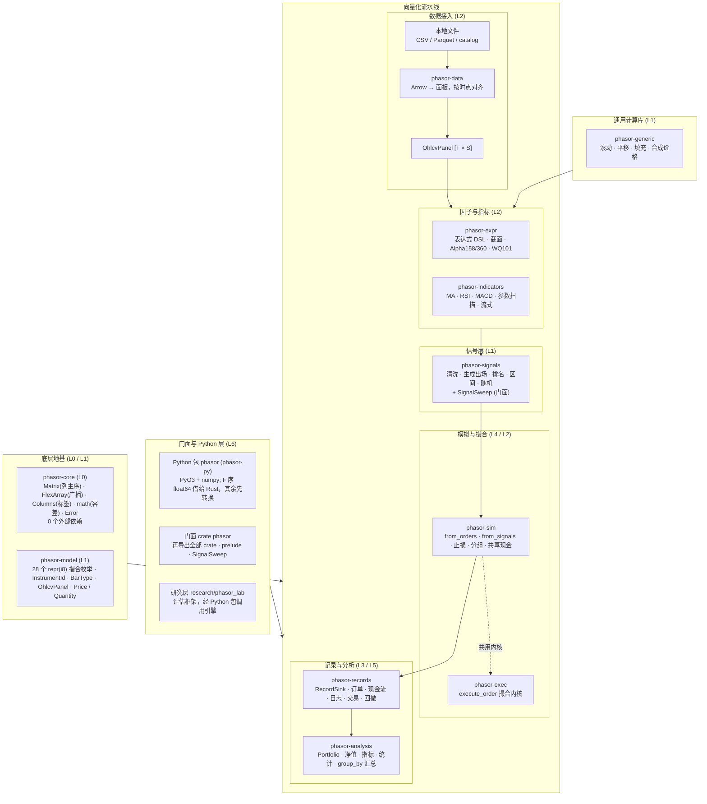
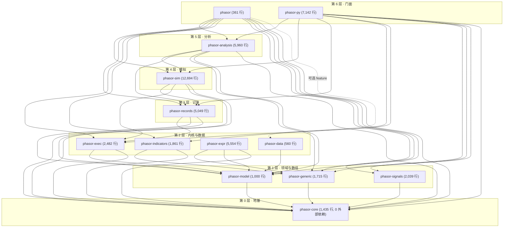
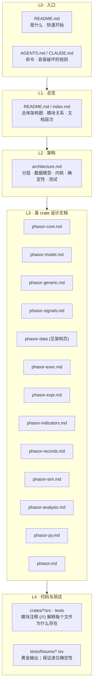

PHASOR

# 设计文档

phasor 是一个并行、因子驱动的向量化回测引擎：Rust 内核，Python 包。这里是它的 wiki 入口——先用一张图看清数据怎么流过整个引擎， 再看 13 个 crate 谁依赖谁，最后看这些文档本身怎么分层、该按什么顺序读。所有页面都是独立的 HTML，用浏览器直接打开。

> **核心特性与指标：**
> - **13 个 crate**：7 层：地基 → 领域与数组 → 内核与数据 → 记录 → 模拟 → 分析 → 门面
> - **约 4.8 万行 Rust**：各 crate src/ 合计（1d573df）；最大的是 phasor-sim（12,694 行）
> - **向量化执行**：逐列逐根 K 线的模拟循环，账户组之间并行；串行与多线程结果逐位相同
> - **架构页 + 12 个 crate 页**：系统架构讲整体；phasor-data 很小，写在架构页的数据一节

## 总体架构

每个箭头都是对内存数组的一次函数调用，阶段之间没有 dataframe。因子是 `Matrix`，参数通过 `FlexArray` 借用，记录是数组结构体。 两条模拟循环**共用**撮合内核 `phasor_exec::execute_order` 和 `RecordSink`，分析层只从记录重建，所以只写一次。 蓝色描边的框有独立页面，点击即可打开。更细的分层、数据模型、执行内核、确定性和测试见 [系统架构](architecture.md)。

#### 示意 / 说明：流水线（中）、地基（底）与门面（上）

*说明：*

虚线箭头是调用关系（门面与 Python 包调用下面的 crate）；淡蓝虚线表示每个 crate 都站在地基上。

## 模块关系图

13 个 crate 的 `[dependencies]`，从下往上分 7 层：每个 crate 只依赖比它低的层。把鼠标移到一个 crate 上， 蓝色是它（直接或间接）依赖的，橙色是依赖它的。点击固定，详情里有页面链接。

*说明：*

来源：各 crate 的 Cargo.toml。门面 phasor 对 phasor-data 的依赖在 `data` feature 之后（虚线）。行数是 `src/` 下 .rs 文件的合计（`wc -l`，1d573df）。

## 文档的层次结构

文档按“离代码多远”分层：越往上越讲**为什么**，越往下越讲**在哪一行**。设计说明写在代码的模块注释（`//!`）里；架构页把整个系统串起来，crate 页把每个 crate 拆成可交互的页面； 外部知识库 nivalume/phasor-docs 逐行带读代码，并把每一处引用钉在同一个 commit 上。

本站各页“源文件”表和正文里的代码链接都指向 phasor 的 [1d573df](https://github.com/nivalume/phasor/tree/1d573df0430fa5cd3a2416300603c7147f3c6a13)，页面里写的行号（链接里的和纯文字的）都按这个提交核对过； 本页的行数统计也取自这个提交。代码改了以后，按新提交重新核对全部行号，再把所有链接里的提交号一起换掉。

#### 示意 / 说明：从入口到代码的五层；实线是推荐的阅读方向，虚线是“引用”

*说明：*

绿色虚线：知识库直接引用代码行。

### 推荐阅读顺序

1.  **README**：引擎是什么，怎么跑起来。
2.  **本页**：一张总图，一张依赖图。
3.  **[系统架构](architecture.md)**：分层、数据模型、两条循环、记录、因子引擎、Python 层、确定性和测试，一页讲完。
4.  **crate 页，按依赖顺序**：[core](phasor-core.md) → [model](phasor-model.md) → [generic](phasor-generic.md) → [expr](phasor-expr.md) → [indicators](phasor-indicators.md) → [signals](phasor-signals.md) → [exec](phasor-exec.md) → [records](phasor-records.md) → [sim](phasor-sim.md) → [analysis](phasor-analysis.md) → [py](phasor-py.md) → [门面](phasor.md)。
5.  **知识库**：要改代码时，逐文件逐行读。

### 想知道……就去

|  |  |
|----|----|
| 整个系统怎么分层、数据怎么流 | [系统架构](architecture.md) |
| 串行和多线程为什么逐位相同 | [架构 · 并行与确定性](architecture.md#determinism) |
| 行情文件怎么读进来、怎么按时点对齐 | [架构 · 数据](architecture.md#data) |
| 为什么列主序、参数怎么不展开 | [core · FlexArray](phasor-core.md#flex) |
| 均线前几根为什么是 NaN、NaN 怎么处理 | [generic · 滚动窗口](phasor-generic.md#rolling) |
| 浮点比较为什么不能用 == | [core · 容差](phasor-core.md#math) |
| 因子表达式怎么编译、为什么快 | [expr · 编译器](phasor-expr.md#compiler) |
| 参数扫描怎么变成列、为什么一次调用 | [indicators · 扫描布局](phasor-indicators.md#sweep) |
| 订单为什么被拒、原因码 | [model · 拒单原因](phasor-model.md#status) |
| 一笔订单成交多少、手续费怎么算 | [exec · 撮合模拟器](phasor-exec.md#sim) |
| 一根 K 线里模拟做了什么 | [phasor-sim](phasor-sim.md) |
| 为什么没交易的列会排第一 | [analysis · 扫描汇总](phasor-analysis.md#sweep) |
| 成交怎么变成交易 | [phasor-records](phasor-records.md) |
| 信号怎么清洗、出场怎么生成 | [phasor-signals](phasor-signals.md) |
| NumPy 数组为什么要 F 序、参数传一维是什么意思 | [py · 参数路由](phasor-py.md#routing) |
| Rust 里一个因子怎么展开成参数 × 标的的信号列 | [门面 · SignalSweep](phasor.md#sweep) |
| 不写回调也能按风险定仓、移到保本 | [sim · 内置回调](phasor-sim.md#builtin) |
| 对任意函数扫参数、结果是不是运气 | [py · 参数搜索](phasor-py.md#params)、[py · 检验](phasor-py.md#validation) |
| 一次跑不下的长回测、分到多个进程 | [py · 分块与分布式](phasor-py.md#scale) |
| MCP 服务能读什么、不能读什么 | [py · 检索与 MCP](phasor-py.md#ai) |

### 每个 crate 的文档覆盖

| crate | 层  | 职责 | 页面 | src 行数 |
|-------|-----|------|------|----------|

## 页面

<a href="architecture.md" class="card">L2 · 架构<strong>系统架构</strong> 整个系统一页讲完：13 个 crate 的分层；列轴、列主序、FlexArray 和账户组；phasor-data 怎么读本地数据；撮合内核；两条模拟循环一根 K 线里的阶段、止损、限价单、保证金与强平、回调；记录为什么是唯一事实；状态快照与续跑；因子引擎从解析到分批输出；Python 层；并行与确定性；性能设计；测试策略。</a> <a href="phasor-core.md" class="card">L3 · 第 0 层<strong>phasor-core</strong> 地基。从“列是工作单位”推出列主序、广播和列标签；可以改参数的列轴、FlexArray、容差计算器和残差演示；类图与 11 个下游的用法。</a> <a href="phasor-model.md" class="card">L3 · 第 1 层<strong>phasor-model</strong> 领域模型。三类类型和它们的使用者；28 个枚举浏览器、拒单原因解码、InstrumentId / BarType 解析器、定点数比较的陷阱。</a> <a href="phasor-generic.md" class="card">L3 · 第 1 层<strong>phasor-generic</strong> 数组层。min_periods、NaN 缩小窗口、前瞻标注；滚动窗口实验台（含增量 vs 重算的逐位对比）、单调队列逐步演示、两种 EWM、平移填充的前瞻高亮、交叉状态机、可复现的 GBM。</a> <a href="phasor-signals.md" class="card">L3 · 第 1 层<strong>phasor-signals</strong> 信号层。状态与事件、出场窗口、零假设和标签；可以点格子的 clean_enex、出场生成、排名、区间演示，随机信号与四种标签的 JS 移植。</a> <a href="phasor-exec.md" class="card">L3 · 第 2 层<strong>phasor-exec</strong> 撮合内核。一次调用的八个阶段、数量换算链；可以改任意字段并串起来的 execute_order JS 移植（带执行轨迹）、空头账本、只差 1e-12 的容差边界、ValidatedOrder。</a> <a href="phasor-expr.md" class="card">L3 · 第 2 层<strong>phasor-expr</strong> 因子表达式。为什么要一门语言、为什么要编译；可以输入任意因子的编译器实验台（语法树、去重后的依赖图、槽位时间线、节点表）、合成面板上的求值、截面算子怎么把图切成阶段、分批输出与窄面板按因子并行、Alpha158 族浏览、WorldQuant 101 的翻译和并列标记、原生与 Polars 后端对比。</a> <a href="phasor-indicators.md" class="card">L3 · 第 2 层<strong>phasor-indicators</strong> 八个指标与参数扫描。参数 × 标的展平成一个列轴；可以改参数的扫描布局与缓存命中图、用 fixture 十种情形跑的指标实验台、RSI 100 / STOCH NaN 等退化读数；逐根更新、和批量逐位相同的流式指标。</a> <a href="phasor-records.md" class="card">L3 · 第 3 层<strong>phasor-records</strong> 记录层。八个模块与上下游；可以改成交的三种交易视图计算器、回撤和 MAE/MFE 演示；类图列出 sink、成交、日志和派生记录；分段运行的记录怎么拼成一次运行的顺序，记录的字节格式。</a> <a href="phasor-sim.md" class="card">L3 · 第 4 层<strong>phasor-sim</strong> 两条模拟循环。时间方向不能并行、共享资金把列变成组、先卖后买、止损替换信号；可以设定持仓和各种模式的信号管线、用 fixture 情形逐根重放的止损与 from_orders 实验台、两种调用顺序对照、按组切线程块；回调在一根 K 线里的位置和 row_wise；状态快照与续跑，任意切点分段和一次跑完逐位相同；内置回调（按风险定仓、移到保本、全局预算）；基准里按功能开关对照的负载。</a> <a href="phasor-analysis.md" class="card">L3 · 第 5 层<strong>phasor-analysis</strong> 分析层。只从记录重建；用 fixture 的 37 个情形逐格重放“订单 → 成交 → 净值 → 指标”、逐位一致的指标计算器、没交易的列为什么会赢、N 个噪声策略的最好夏普与 DSR、stats 表的标签筛选、按多空分开的 MAE / MFE。</a> <a href="phasor-py.md" class="card">L3 · 第 6 层<strong>phasor-py</strong> Python 包。内存序为什么要靠 stride 拒绝、借用怎么跨过 FFI；110 格实测的参数路由表（10 类参数 × 11 种传法 × 两层）、调用生命周期与 GIL、Python 回调（from_order_func、signal_func）、续跑（resume=pf）、save / load 与逐根推进的 Stepper、扫描布局与 signal_delay、字符串枚举、交叉验证切分器与显著性检验、参数搜索、组合权重、研究工具（指标、信号、收益序列、组合切片与重采样、形态搜索）、按行分块与按列分布式运行和缓存、TOML 配置与 <code>phasor</code> 命令和定时任务、文档检索与 MCP 服务、期货与外汇的辅助模块；from_signals 的内置规则。</a> <a href="phasor.md" class="card">L3 · 第 6 层<strong>phasor（门面）</strong> 门面 crate。十一个短名重新导出、feature 门控、prelude 的 78 个名字与缺口；可以改因子和情形的 SignalSweep 实验台（400 例与 Rust 逐位一致）、expand 复制价格的代价、端到端例子的实测输出。</a>
