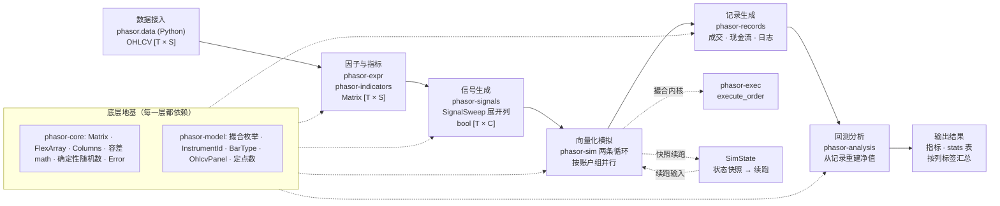
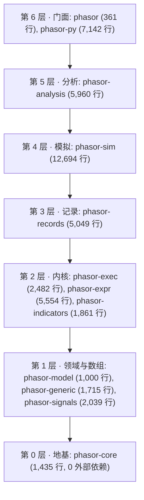
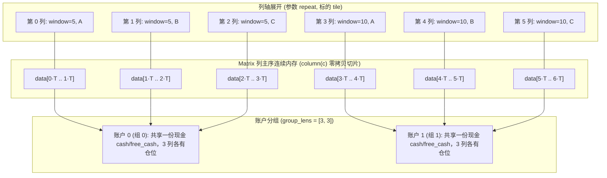
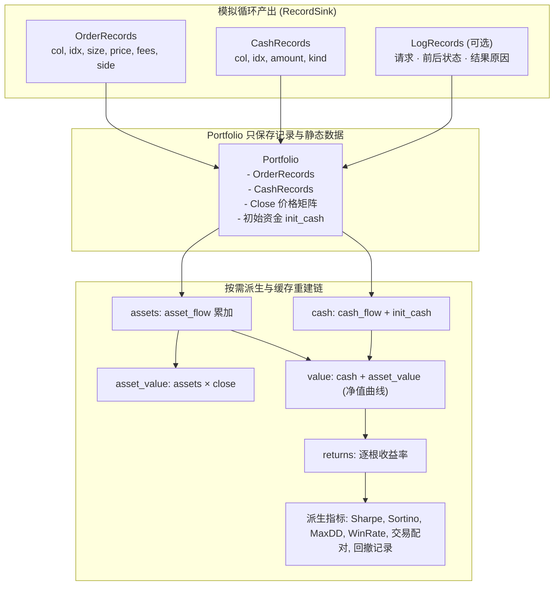
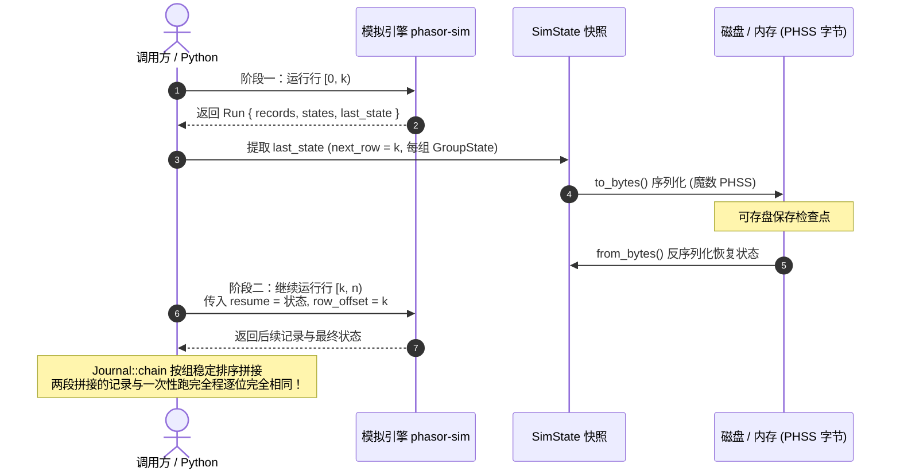
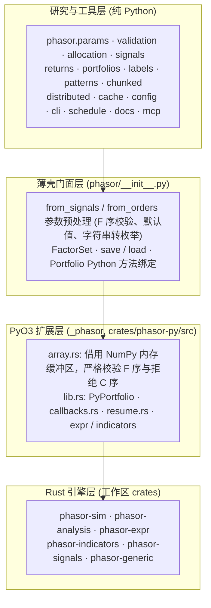
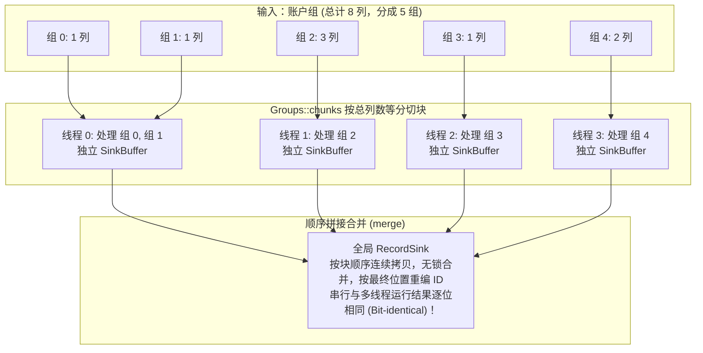

PHASOR

# 系统架构

phasor 是一个并行、因子驱动的向量化回测引擎：Rust 写的内核，一个 Python 包。这一页把整个系统串起来讲：有哪些 crate、谁依赖谁，数据在内存里怎么放， 一根 K 线里模拟做了什么，为什么分析层只读记录，怎么从一个状态接着跑，因子表达式怎么编译和执行，Python 层包了什么， 以及并行、确定性、性能和测试分别靠什么保证。每一节末尾都指向对应的 crate 页，那里有逐行的细节和可以动手的演示。

> **核心特性与指标：**
> - **12 个 crate · 7 层**：地基 → 领域与数组 → 内核 → 记录 → 模拟 → 分析 → 门面；每个 crate 只依赖更低的层
> - **列是工作单位**：参数和标的展平成同一个列轴；列（或共享现金的账户组）之间相互独立，所以按列并行
> - **记录是唯一事实**：模拟只写记录；净值、收益、指标都从记录重建。串行与多线程的记录逐位相同

<a id="overview"></a>

## 总览：一次回测的数据流

一次回测是一串对内存数组的函数调用，阶段之间没有 dataframe。行情先变成 `OhlcvPanel`（时间 × 标的），因子表达式和指标把它变成因子面板， 信号层把因子变成进场 / 出场布尔数组并展开到“参数 × 标的”的列轴上，模拟循环逐根 K 线调用撮合内核、写出记录，分析层再从记录重建账户、算指标、按列标签汇总。 状态快照让模拟可以在任意一根 K 线停下、之后接着跑。

#### 示意 / 说明：数据流（中）、地基（下）与 Python 包（上）；框可以点击



*说明：*

门面 crate 的模块文档用四句话概括了同一件事（[lib.rs:6](https://github.com/nivalume/phasor/blob/1d573df0430fa5cd3a2416300603c7147f3c6a13/crates/phasor/src/lib.rs#L6)）。最短的端到端例子是 `examples/sweep.py`：价格进去，一个参数网格，一次并行运行，结果按参数归回去。

<a id="layers"></a>

## crate 分层

工作区有 12 个 crate（[Cargo.toml:3](https://github.com/nivalume/phasor/blob/1d573df0430fa5cd3a2416300603c7147f3c6a13/Cargo.toml#L3)）。最底下的 phasor-core 只依赖 `std`；最上面的门面 phasor 和 Python 扩展 phasor-py 依赖其余全部。 中间每一层回答一个问题：数怎么存、怎么比（core）；这些数是什么（model）；数组怎么滚动、信号怎么生成（generic、signals）；一笔订单怎么成交（exec）； 因子和指标怎么算（expr、indicators）；成交怎么记下来（records）；一列或一个账户怎么逐根 K 线模拟（sim）；结果怎么看（analysis）。

#### 示意 / 说明：七层，每个框链到对应页面（本地数据在 Python 侧，见本页的[数据一节](#data)）



| crate | 直接依赖（工作区内） | 职责 |
|----|----|----|
| [phasor-core](phasor-core.md) | — | `Matrix`（列主序 f64）、`FlexArray`（不展开的广播）、`Columns`（多级列标签）、`math`（浮点容差）、`random`（按键计算的随机数）、`Error`。 |
| [phasor-model](phasor-model.md) | core | 撮合枚举（判别值固定，写进记录）、`InstrumentId` / `BarType`、`OhlcvPanel`、定点数 `Price` / `Quantity`。 |
| [phasor-generic](phasor-generic.md) | core | 滚动 / 扩展 / 指数加权窗口、平移、填充、交叉；按种子生成的合成价格。 |
| [phasor-signals](phasor-signals.md) | core | 信号清洗、生成出场、排名、区间、随机信号、标签。 |
| [phasor-exec](phasor-exec.md) | core、model | 撮合内核 `execute_order`：一笔订单在一个账户状态上成交多少、什么价、多少手续费。 |
| [phasor-expr](phasor-expr.md) | core、generic、model | 因子表达式：解析、编译成去重的图、截面算子分阶段执行；Alpha158 / Alpha360 / WorldQuant 101；可选的 Polars 后端。 |
| [phasor-indicators](phasor-indicators.md) | core、generic | 八个指标（MA、MSTD、BBANDS、RSI、STOCH、MACD、ATR、OBV）、参数扫描的列布局、逐根更新的流式版本。 |
| [phasor-records](phasor-records.md) | core、exec、model | 记录格式与 sink、三种交易视图、回撤、MAE / MFE、按列分段归约、日志、分段拼接与字节格式。 |
| [phasor-sim](phasor-sim.md) | core、exec、model、records | `from_orders` / `from_signals` 两条循环、止损止盈、限价单、共享现金与调用顺序、杠杆 / 保证金 / 强平 / 持仓费、回调与内置规则、状态快照与续跑、按组并行。 |
| [phasor-analysis](phasor-analysis.md) | core、generic、model、records、sim | `Portfolio`：从记录重建资产、现金、净值、收益；指标、stats 表、按列标签汇总、过拟合检验。 |
| [phasor](phasor.md) | 其余全部 | 门面：再导出、`prelude`、`SignalSweep`。 |
| [phasor-py](phasor-py.md) | 其余全部 | PyO3 扩展 `phasor._phasor` 与 Python 包 `phasor`。 |

交互式的依赖图（可以只看传递约简后的边）在 [wiki 首页](README.md#crates)。库 crate 不下载、不写文件；下载和缓存写在 `examples/` 里。

<a id="data-model"></a>

## 数据模型：列轴、列主序、FlexArray 与账户组

### 列轴：参数和标的是同一个维度

一次扫描是“参数组合 × 标的”。phasor 不给它们各开一个维度，而是展平成一个列轴：参数 **repeat**（同一组参数的各个标的相邻），标的 **tile**。 `Level::repeat`（[columns.rs:150](https://github.com/nivalume/phasor/blob/1d573df0430fa5cd3a2416300603c7147f3c6a13/crates/phasor-core/src/columns.rs#L150)）和 `Level::tile`（[:167](https://github.com/nivalume/phasor/blob/1d573df0430fa5cd3a2416300603c7147f3c6a13/crates/phasor-core/src/columns.rs#L167)）造出每一级标签， `Columns`（[:207](https://github.com/nivalume/phasor/blob/1d573df0430fa5cd3a2416300603c7147f3c6a13/crates/phasor-core/src/columns.rs#L207)）把它们叠成多级列标签。列一多，标签就是把结果归回参数的**唯一**办法： `Columns::group_indices`（[:304](https://github.com/nivalume/phasor/blob/1d573df0430fa5cd3a2416300603c7147f3c6a13/crates/phasor-core/src/columns.rs#L304)）按某一级分组，分析层的“每个窗口的平均夏普”就是这么算的。

### Matrix：一列是一段连续内存

所有二维数据都是列主序：`data[col * n_rows + row]`（[matrix.rs:18](https://github.com/nivalume/phasor/blob/1d573df0430fa5cd3a2416300603c7147f3c6a13/crates/phasor-core/src/matrix.rs#L18)）。模拟沿时间轴扫一列，因子沿时间轴算一个标的，列主序让这两种访问都是顺序读， `column(c)` 是零拷贝切片。NumPy 默认是行主序，所以 Python 层要么把数组转成 F 序，要么拒绝（见 [Python 层](#python)）。

#### 示意 / 说明：列轴、列主序与账户组



### FlexArray：参数不展开

模拟的每个输入（价格、费用、滑点、止损距离、下单量……）都是 `FlexArray`（[flex.rs:28](https://github.com/nivalume/phasor/blob/1d573df0430fa5cd3a2416300603c7147f3c6a13/crates/phasor-core/src/flex.rs#L28)），五种形状：标量、每列一个、每行一个、整块矩阵、 以及指向共享源矩阵的列映射（`MappedColumns`，让 8 列信号共用 2 列价格）。读的时候按 `(row, col)` 算下标，不先展开成 `n_rows × n_cols`， 所以一千个参数组合的扫描不会因为一个标量费率而多占一千份内存。`get`（[:60](https://github.com/nivalume/phasor/blob/1d573df0430fa5cd3a2416300603c7147f3c6a13/crates/phasor-core/src/flex.rs#L60)）标成 `#[inline(always)]`，标量在调用处直接返回， 其余四种才走一次 `match`——大多数运行的大多数参数是标量。

### 账户组与共享现金

默认每列是一个独立账户。`Groups`（[groups.rs:47](https://github.com/nivalume/phasor/blob/1d573df0430fa5cd3a2416300603c7147f3c6a13/crates/phasor-sim/src/groups.rs#L47)）用每组的列数（`group_lens`）把相邻的列并成一个账户：组内共用一份 `cash` / `free_cash`， 每列仍有自己的仓位、负债、估值价和止损。组内按调用顺序执行（`CallSeq`，[:180](https://github.com/nivalume/phasor/blob/1d573df0430fa5cd3a2416300603c7147f3c6a13/crates/phasor-sim/src/groups.rs#L180)）： `Default` 按布局，`Auto` 按估计的订单金额稳定排序、先卖后买，`Explicit` 每根 K 线给一个排列。组是并行的单位：组之间没有共享状态。

详见 [phasor-core · 列轴](phasor-core.md#columns)、[FlexArray](phasor-core.md#flex)、[phasor-sim · 共享资金](phasor-sim.md#sharing)。

<a id="data"></a>

## 数据：Python 层的 phasor.data

读本地数据不在 Rust 里。`phasor.data`（`crates/phasor-py/python/phasor/data.py`）在 Python 侧做四件事：把一个路径解析成要读的文件、用 pyarrow 逐批读出 Arrow `RecordBatch`、调用户的解码器、把结果拼成面板或按可用时间对齐。Rust 侧只留 `InstrumentId` 与 `BarType` 两个身份类型（`crates/phasor-py/src/data.rs`），撮合与因子拿到的始终是 NumPy 数组。它不下载、不建目录、不写文件；Binance 的下载脚本在 `examples/` 里。

### 1. 源与 schema

`Source(path, schema, instruments)` 把路径与键绑在一起，`phasor.data.load(path, schema, instruments, start=, end=)` 是一步到位的形式。路径按顺序解析，命中即停：路径是文件就用它；`path/<key>` 是文件就用它；`path/<key>` 是目录就扫这个目录；路径是目录且只给一个键就扫这个目录。所以同一次调用覆盖三种粒度——直接给文件、给某个 instrument 的目录、给按 instrument 分目录的 schema 目录。目录只在直接子文件里按扩展名取 `.csv` / `.parquet` / `.csv.gz` / `.parquet.gz`，跳过隐藏文件，按文件名排序，一个都没匹配上就报错并带上目录。键必须是单个路径组件（拒绝 `/`、`\`、`..`），因为它会被拼进路径。这里没有硬编码的目录约定：`<root>/data/<schema>/<instrument>/` 由调用方自己拼。

`DataSchema` 写明输入列、输出列、事件时间、可用时间（都是 UTC 纳秒的 uint64）以及标的从哪来：源的键、两列 symbol / venue，或全局（不属于任何标的）。

### 2. 解码

一次 `load` 逐批读文件，把每个 Arrow `RecordBatch` 交给调用方的解码器，再按 `[start, end)` 过滤。先解码再过滤，因为解码器可以改时间。键能解析成 `BarType` 的源是 K 线序列。格式由内容决定，不看文件名：前两字节是 gzip 魔数就解压，再看开头是不是 Parquet 的 `PAR1`，否则当 CSV。所以 `.csv.gz`、改了名的 gzip 文件、Parquet 内容配 `.csv` 后缀都能正确读出；gzip 的 Parquet 直接报错，因为 Parquet 自带压缩且读取需要 seek。CSV 与 Parquet 都只读 `input` 里声明的列（投影下推），文件里的其他列不会被读。

### 3. K 线面板

`Dataset.prepare` 把各个 K 线源按可用时间的并集排成行、每个 `BarType` 一列，得到 `BarPanel`（时间轴 + 五个 F 序 `[T × S]` 数组）。某个标的在某行没有 K 线就是 NaN；同一源同一时刻两根 K 线报错。

### 4. 按时点对齐

`Dataset.asof` 与 `Dataset.window` 把资金费、新闻等事件按**可用时间**对齐到目标时间轴：每个时刻取最近一个已经可用的值，或者在一个窗口里求和、计数、取均值。按可用时间而不是事件时间，所以不会读到未来。两边都用 `searchsorted` 定位，一次向量化算完，并列时间取输入顺序里的最后一行。

> 本节描述的是把读取搬到 Python 之后的接口；行号仍对应 1d573df，重钉 commit 时需重核。

<a id="kernel"></a>

## 撮合内核：phasor-exec

所有成交都经过一个函数。`execute_order(state, order, reject_draw)`（[kernel.rs:1141](https://github.com/nivalume/phasor/blob/1d573df0430fa5cd3a2416300603c7147f3c6a13/crates/phasor-exec/src/kernel.rs#L1141)）输入一个账户状态（现金、有符号仓位、负债、可用现金、估值价、组合价值）和一笔订单请求， 输出新的状态和一个结果：成交了多少、什么价、多少手续费、哪一边，或者为什么没成交。两条模拟循环、强平、初始持仓、用户回调下的单，全部走它。

### 拒绝不是错误

被忽略或被拒的订单原样返回状态，带一个 `StatusInfo` 原因（价格 NaN、钱不够、低于最小数量……）；只有不变量被破坏（负现金、非有限仓位、参数越界）才返回 `Err`。两者混在一起，模拟就会悄悄给出一条看着合理、实际错误的净值曲线。

### 纯函数，随机数由调用方给

内核不读全局状态，也不碰随机数生成器。随机拒单的那个均匀数由调用方按 `(seed, row, col)` 算好传进来；概率为 0 时根本不算。所以内核在任何线程、任何调用顺序下都给出同样的结果。

### 先归零，再比较

进入内核的现金、仓位、负债等余额先用 `is_close` 吸附到精确的 0；可负担判断用 `is_close_or_less`，所有余额更新用 `add`（[math.rs:113](https://github.com/nivalume/phasor/blob/1d573df0430fa5cd3a2416300603c7147f3c6a13/crates/phasor-core/src/math.rs#L113)）。工作区 lint 禁止对钱用 `==` / `<=`。

### 换算链与四种账户

目标百分比 → 目标价值 → 目标数量 / 数量；百分比按可用现金或持仓。买卖各写一次（[buy :91](https://github.com/nivalume/phasor/blob/1d573df0430fa5cd3a2416300603c7147f3c6a13/crates/phasor-exec/src/kernel.rs#L91)、[sell :431](https://github.com/nivalume/phasor/blob/1d573df0430fa5cd3a2416300603c7147f3c6a13/crates/phasor-exec/src/kernel.rs#L431)），手续费包含在上限内；杠杆借款和保证金列另有一条路径（[margin_trade :611](https://github.com/nivalume/phasor/blob/1d573df0430fa5cd3a2416300603c7147f3c6a13/crates/phasor-exec/src/kernel.rs#L611)）。

热路径上，一列的订单参数大多不随 K 线变化。`ValidatedOrder`（[kernel.rs:1056](https://github.com/nivalume/phasor/blob/1d573df0430fa5cd3a2416300603c7147f3c6a13/crates/phasor-exec/src/kernel.rs#L1056)）每列构造一次，把与 K 线无关的参数检查提到循环外，每根只改写随 K 线变化的几个字段， 循环里调 `execute_validated`（[:1192](https://github.com/nivalume/phasor/blob/1d573df0430fa5cd3a2416300603c7147f3c6a13/crates/phasor-exec/src/kernel.rs#L1192)）。罕见的分支（\*100 写法、借款上限、空头还款……）写成 `#[cold]` 的独立函数， 不占热路径的指令缓存。细节和可运行的 JS 移植见 [phasor-exec](phasor-exec.md)。

<a id="loops"></a>

## 两条模拟循环：phasor-sim

`from_orders` 读“每根 K 线每列下多少单”的数组；`from_signals` 读进场 / 出场（或多空四个）布尔数组，自己决定下多少单、什么时候止损。 两者结构相同：每个账户组一个 `simulate_group`，逐根 K 线推进；时间方向有硬依赖（第 i 根的状态取决于第 i−1 根），所以一列内部不能并行，也不值得用 SIMD—— 内核是一棵有十几个数据相关提前返回的分支树，SIMD 的通道几乎每根 K 线都会分叉（[lib.rs:19](https://github.com/nivalume/phasor/blob/1d573df0430fa5cd3a2416300603c7147f3c6a13/crates/phasor-sim/src/lib.rs#L19)）。

#### 示意 / 说明：一根 K 线里的阶段：from_orders（上）与 from_signals（下）；彩色框是可选功能或决定顺序的步骤

```mermaid
flowchart TD
    subgraph OrdersLoop["from_orders 一根 K 线执行阶段"]
        O1["1. 开盘现金流 (入金 · 分红)"] --> O2["2. 价格确定 (+inf → 收盘价, −inf → 上一根收盘价)"]
        O2 --> O3["3. 估值价计算 (NaN 沿用上一根)"]
        O3 --> O4["4. 保证金结算与强平检查 (沿 K 线路径找第一次跌破)"]
        O4 --> O5["5. 计算账户组净值 (每根 K 线只算一次)"]
        O5 --> O6["6. 确定订单调用顺序 (Default / Auto / Explicit)"]
        O6 --> O7["7. 执行订单 execute_validated (写成交记录与日志)"]
        O7 --> O8["8. 收盘现金流 (利息收益 · 持仓费)"]
    end

    subgraph SignalsLoop["from_signals 一根 K 线执行阶段"]
        S1["1. 价格确定 (+inf → 收盘价, −inf → 当根开盘价)"] --> S2["2. 测试止损条件 (时间止损 → 价格止损 → 移动止损 → 止盈)"]
        S2 --> S3["3. 限价挂单撮合 (判断价格是否触达, 过期则撤销)"]
        S3 --> S4["4. 信号读取与处理 (止损触发则替换, 否则读 4 个信号数组)"]
        S4 --> S5["5. 冲突消解 (进出冲突 → 多空冲突 → 反向进场)"]
        S5 --> S6["6. 目标数量计算 (signals_to_size / signals_to_target)"]
        S6 --> S7["7. 强平与下单执行 (强平优先于下单, 成交后重置止损)"]
        S7 --> S8["8. 收盘与持仓费结算 (收益结算 · 借币/持仓费扣除)"]
    end
```



*说明：*

from_orders 的一根 K 线在 `Group::run_rows`（[from_orders.rs:983](https://github.com/nivalume/phasor/blob/1d573df0430fa5cd3a2416300603c7147f3c6a13/crates/phasor-sim/src/from_orders.rs#L983)）里，两遍：先定全组的价格和估值价（[:1048](https://github.com/nivalume/phasor/blob/1d573df0430fa5cd3a2416300603c7147f3c6a13/crates/phasor-sim/src/from_orders.rs#L1048)），再按调用顺序执行（[:1204](https://github.com/nivalume/phasor/blob/1d573df0430fa5cd3a2416300603c7147f3c6a13/crates/phasor-sim/src/from_orders.rs#L1204)）。from_signals 每列先走 `prepare_order`（[from_signals.rs:898](https://github.com/nivalume/phasor/blob/1d573df0430fa5cd3a2416300603c7147f3c6a13/crates/phasor-sim/src/from_signals.rs#L898)），组循环在 `group_loop`（[:1606](https://github.com/nivalume/phasor/blob/1d573df0430fa5cd3a2416300603c7147f3c6a13/crates/phasor-sim/src/from_signals.rs#L1606)）。

### 信号管线

from_signals 把一根 K 线的信号交给 `signals.rs` 的一串纯函数：止损触发时 `from_stop` 用出场**替换**当根信号；然后依次解决同向进出冲突、多空冲突、反向进场 （[signals.rs:129](https://github.com/nivalume/phasor/blob/1d573df0430fa5cd3a2416300603c7147f3c6a13/crates/phasor-sim/src/signals.rs#L129)、[:176](https://github.com/nivalume/phasor/blob/1d573df0430fa5cd3a2416300603c7147f3c6a13/crates/phasor-sim/src/signals.rs#L176)、[:243](https://github.com/nivalume/phasor/blob/1d573df0430fa5cd3a2416300603c7147f3c6a13/crates/phasor-sim/src/signals.rs#L243)）， 最后 `size_signals`（[:530](https://github.com/nivalume/phasor/blob/1d573df0430fa5cd3a2416300603c7147f3c6a13/crates/phasor-sim/src/signals.rs#L530)）按数量类型分派给 `signals_to_size` 或目标类的 `signals_to_target`。每一步的模式都是枚举，默认值见 [phasor-sim · 默认值](phasor-sim.md#defaults)。

### 止损、止盈与限价单

开仓时按 `stop_entry_price` 锚定止损线。每根 K 线 `stops::test`（[stops.rs:137](https://github.com/nivalume/phasor/blob/1d573df0430fa5cd3a2416300603c7147f3c6a13/crates/phasor-sim/src/stops.rs#L137)）先测时间止损（在开盘），再测止损、移动止损、止盈； 开盘就跳空越过止损线时只能按开盘价成交。移动止损的锚点在测试**之后**才更新（`trail`，[:197](https://github.com/nivalume/phasor/blob/1d573df0430fa5cd3a2416300603c7147f3c6a13/crates/phasor-sim/src/stops.rs#L197)），否则一根创新高又回落的 K 线会被自己的回落止损出局。 止损、移动止损、止盈都可以是阶梯，每级平掉一部分。只有收盘价的数据缺开高低，循环用已知价格补出来，止损照样能触发。 限价单在 from_signals 里挂着：`limit::fill_price`（[limit.rs:140](https://github.com/nivalume/phasor/blob/1d573df0430fa5cd3a2416300603c7147f3c6a13/crates/phasor-sim/src/limit.rs#L140)）先测起点（下单那根是订单价，之后是开盘）是否已经越过限价，再看当根的高低范围； 有效期按行数（`limit_tif`、`limit_expiry`）。挂单和新信号冲突时怎么办由四个挂单冲突模式决定。

<a id="accounts"></a>

### 杠杆、保证金、强平与持仓费

一列可以是现金列（可以带杠杆借钱、借券做空）或保证金列（全仓或逐仓）。只要有一列用了杠杆、保证金、持仓费或不为 1 的合约乘数，整次运行就走 `const LEV: bool = true` 的那份循环实例，成交记录多带 5 列余额（负债、锁定现金、保证金标记……）；否则走不含这些代码的实例。每根 K 线：

1.  **结算。**全仓保证金列在估值价确定后把浮动盈亏结算进现金（[margin.rs:48](https://github.com/nivalume/phasor/blob/1d573df0430fa5cd3a2416300603c7147f3c6a13/crates/phasor-sim/src/margin.rs#L48)）；逐仓列不结算，盈亏留在仓位上。
2.  **强平检查。**设了维持保证金（或分档、或现金列的 `cash_maintenance_margin`）的账户，沿这根 K 线从开盘到不利极值（或标记价格）的路径求权益第一次跌破维持保证金的点（[liquidation.rs:464](https://github.com/nivalume/phasor/blob/1d573df0430fa5cd3a2416300603c7147f3c6a13/crates/phasor-sim/src/liquidation.rs#L464)）；跌破就按那个价格平仓，可以分 `liquidation_step` 部分平（最多 [ROUNDS 轮](https://github.com/nivalume/phasor/blob/1d573df0430fa5cd3a2416300603c7147f3c6a13/crates/phasor-sim/src/liquidation.rs#L541)），穿仓的部分核销。强平是一笔带 `liquidation` 标记的成交，核销是一条现金流。
3.  **下单与成交**照常经过内核。
4.  **持仓费。**收盘按订单之后的持仓收资金费、隔夜融资、借款利息、借券费（[holding.rs:128](https://github.com/nivalume/phasor/blob/1d573df0430fa5cd3a2416300603c7147f3c6a13/crates/phasor-sim/src/holding.rs#L128)），不封顶，现金可以小于 0；每一笔写成 `CashRecords`。

<a id="callbacks"></a>

### 回调与内置规则

回调不是另一套引擎：循环还是这条逐根 K 线的循环，用同一个内核、写同样的记录。`OrderFunc`（[callbacks.rs:172](https://github.com/nivalume/phasor/blob/1d573df0430fa5cd3a2416300603c7147f3c6a13/crates/phasor-sim/src/callbacks.rs#L172)）和 `SignalFunc`（[:281](https://github.com/nivalume/phasor/blob/1d573df0430fa5cd3a2416300603c7147f3c6a13/crates/phasor-sim/src/callbacks.rs#L281)）在一根 K 线的固定位置被调用（组开始、每根开始、下单、成交之后、每根结束）， 读一个只读的 `Context`，可以改写循环在那里本来要做的事：下什么单、调整止损、停止交易。默认的 `NoCallbacks` 把 `ON` 设为 `false`，那些调用点在编译后整个消失。 常用的三条规则写成了 Rust 里的一个 `SignalFunc`：`Builtin`（[builtin.rs:36](https://github.com/nivalume/phasor/blob/1d573df0430fa5cd3a2416300603c7147f3c6a13/crates/phasor-sim/src/builtin.rs#L36)）按风险定仓、移到保本、全局预算（持仓数与总敞口）， Python 直接用关键字参数打开，不经过 Python 回调。

### 初始持仓与现金流

`init_position` / `init_price` 在第一根上做一笔无手续费、无滑点的成交，经过内核；现金列另记一条 `InitialPosition` 现金流抵掉成本（[initial.rs:62](https://github.com/nivalume/phasor/blob/1d573df0430fa5cd3a2416300603c7147f3c6a13/crates/phasor-sim/src/initial.rs#L62)）。 入金和分红在开盘、价格确定之前入账，收益在收盘入账。每一种都是一条记录。

详见 [phasor-sim · 一根 K 线](phasor-sim.md#bar)、[信号管线](phasor-sim.md#pipeline)、[止损](phasor-sim.md#stops)、[回调](phasor-sim.md#callbacks)、[内置回调](phasor-sim.md#builtin)。

<a id="records"></a>

## 记录是唯一事实，分析从记录重建

phasor-records 定义模拟和分析之间的契约：不管谁算出一次运行，**出来的是同一种记录**（[lib.rs:1](https://github.com/nivalume/phasor/blob/1d573df0430fa5cd3a2416300603c7147f3c6a13/crates/phasor-records/src/lib.rs#L1)）。 记录是数组结构体：`OrderRecords`（[:212](https://github.com/nivalume/phasor/blob/1d573df0430fa5cd3a2416300603c7147f3c6a13/crates/phasor-records/src/lib.rs#L212)）每笔成交存列、行、数量、价格、费用、方向，带杠杆的运行再加余额列； `CashRecords`（[cash.rs:24](https://github.com/nivalume/phasor/blob/1d573df0430fa5cd3a2416300603c7147f3c6a13/crates/phasor-records/src/cash.rs#L24)）存不经成交的现金变动和它的种类；`LogRecords` 是可选的诊断日志，每张被考虑过的订单一行，回答“这根为什么没成交”。 模拟循环只通过 `RecordSink`（[lib.rs:52](https://github.com/nivalume/phasor/blob/1d573df0430fa5cd3a2416300603c7147f3c6a13/crates/phasor-records/src/lib.rs#L52)）写记录。

#### 示意 / 说明：记录到分析：Portfolio 只存记录、收盘价和初始资金，其余按需派生



`Portfolio`（[portfolio.rs:147](https://github.com/nivalume/phasor/blob/1d573df0430fa5cd3a2416300603c7147f3c6a13/crates/phasor-analysis/src/portfolio.rs#L147)）构造时只拿记录、收盘价、分组和初始资金。资产、现金、净值、收益、敞口、交易、回撤都是第一次被问到时才算， 算完存在缓存里；一次扫描里大多数列只会被问一个标量。重建链在 `series.rs`：`asset_flow`（[series.rs:74](https://github.com/nivalume/phasor/blob/1d573df0430fa5cd3a2416300603c7147f3c6a13/crates/phasor-analysis/src/series.rs#L74)）、 `cash_flow`（[:150](https://github.com/nivalume/phasor/blob/1d573df0430fa5cd3a2416300603c7147f3c6a13/crates/phasor-analysis/src/series.rs#L150)）、`value`（[:460](https://github.com/nivalume/phasor/blob/1d573df0430fa5cd3a2416300603c7147f3c6a13/crates/phasor-analysis/src/series.rs#L460)）、`returns`（[:503](https://github.com/nivalume/phasor/blob/1d573df0430fa5cd3a2416300603c7147f3c6a13/crates/phasor-analysis/src/series.rs#L503)）。 因为只读记录，`Portfolio::from_records`（[:173](https://github.com/nivalume/phasor/blob/1d573df0430fa5cd3a2416300603c7147f3c6a13/crates/phasor-analysis/src/portfolio.rs#L173)）可以分析任何来源的记录：文件里读回来的、分段拼起来的、Python 切片和拼接过的。

### 为什么不存状态矩阵

成交只发生在少数 K 线上，记录的大小与交易活动成正比，而不是与 行 × 列 成正比；千列扫描时差几个数量级。记录还说明了“为什么是这么多”，每一分钱都能追到一条事件。路径相关的事实（含滑点的成交价、按当时可用资金封顶的出金）事后无法从输入复原，所以必须在发生时记下来。

### 顺序与 id

记录按列主序输出：先是第 0 列的全部成交，再是第 1 列的。`id` 不在写入时分配，而是合并后的位置。每列（每组）写自己的缓冲区、没有共享计数器，缓冲区按列的顺序拼接后再编号，所以并行运行的记录和串行逐位相同（[lib.rs:14](https://github.com/nivalume/phasor/blob/1d573df0430fa5cd3a2416300603c7147f3c6a13/crates/phasor-records/src/lib.rs#L14)）。

### 派生记录

三种交易视图（按进场归属 `entry_trades`、按出场归属 `exit_trades`、按仓位聚合 `positions`）总 PnL 相同、笔数和胜率不同；回撤段 `find_drawdowns`；MAE / MFE；`MappedArray` 按列分段归约。它们都是记录的纯函数，见 [phasor-records](phasor-records.md)。

### 指标与汇总

收益指标有标量和滚动两种形式；`stats` 是一张有顺序、有标签的表，没被选中的指标不计算；`group_by` / `best_column` 按列标签把千列结果化成“每个参数一行”；PSR / DSR / PBO 估计最好的那个夏普里有多少是运气。见 [phasor-analysis](phasor-analysis.md)。

> [!NOTE]
> **规则：**任何改变现金或仓位的东西都必须是一条记录。保证金结算只在持仓和现金之间挪钱、不改变权益，是唯一不留记录的余额变动。phasor-analysis 的 `cash_flows.rs`、`holding.rs`、`liquidation.rs` 测试逐根检查：从记录重建出的现金、可用现金和权益，等于模拟循环里的值。

<a id="resume"></a>

## 状态快照与续跑

一次运行结束时交出它的状态：`SimState`（[snapshot.rs:68](https://github.com/nivalume/phasor/blob/1d573df0430fa5cd3a2416300603c7147f3c6a13/crates/phasor-sim/src/snapshot.rs#L68)）记着是哪条循环写的、下一根从哪行开始、是否带余额列，以及每个账户组的现金、可用现金和每列的 `ColumnState`（仓位、负债、估值价、止损、挂着的限价单）。`simulate_from_orders_run` / `simulate_from_signals_run` 返回 `Run { records, states, last_state }`（[:227](https://github.com/nivalume/phasor/blob/1d573df0430fa5cd3a2416300603c7147f3c6a13/crates/phasor-sim/src/snapshot.rs#L227)）。

#### 示意 / 说明：任意切点分段续跑，等于一次跑完



续跑时传 `resume`（上一段的状态）和 `row_offset`（这一段数组的第 0 行在整段历史里是第几行）。数组可以比切点早几行开始，给需要往回看的参数（上一根收盘、`from_ago`）留出窗口。 行号有两处要换算：状态里记的行（时间止损、限价单的到期行）是整段历史的绝对行，段结束时由 `rebase`（[snapshot.rs:259](https://github.com/nivalume/phasor/blob/1d573df0430fa5cd3a2416300603c7147f3c6a13/crates/phasor-sim/src/snapshot.rs#L259)）换回； 记录里的 `idx` 由 `shift_rows` 加回 `row_offset`。随机拒单的随机数用 `i + row_offset` 作行号，所以分段不改变抽到的数。 分段的记录用 `OrderRecords::chain`（[lib.rs:414](https://github.com/nivalume/phasor/blob/1d573df0430fa5cd3a2416300603c7147f3c6a13/crates/phasor-records/src/lib.rs#L414)）按组稳定排序拼接，顺序也和一次跑完的相同。

状态和组合都有字节格式（`SimState::to_bytes`，魔数 PHSS；记录的 PHOR / PHJN），所以可以存盘、换进程再续。上层的三种用法：Python 的 `resume=pf`、 `phasor.chunked`（按行分块、每块写检查点，中断后从检查点接着跑，历史变长时延长一次已跑完的运行）和 `Stepper`（逐根提出订单、记下实际成交）。 `tests/resume.rs` 在 5 个切点、两种续法、两条循环各 4 组功能上比较记录和最终状态的字节，见 [phasor-sim · 续跑](phasor-sim.md#resume)。

<a id="factors"></a>

## 因子引擎：phasor-expr

因子写成字符串（`"Mean($close, 5) / $close"`），所以可以存进配置、从 Python 传进来、和 Qlib 的公式逐字对应。`FactorSet::compile`（[lib.rs:58](https://github.com/nivalume/phasor/blob/1d573df0430fa5cd3a2416300603c7147f3c6a13/crates/phasor-expr/src/lib.rs#L58)）编译一次，`evaluate` 求值多次。

#### 示意 / 说明：解析 → 去重的图 → 槽位调度 → 分阶段 → 三条执行路径 → 分批输出

```mermaid
flowchart TD
    subgraph ParsePhase["1. 解析 (Parse)"]
        ExprStr['"Mean($close, 5) / $close"'] --> Pratt["Pratt 解析器"]
        Pratt --> AST["Expression 语法树"]
    end

    subgraph CompilePhase["2. 编译 (Graph::compile)"]
        AST --> Opt["哈希合并 · 常量折叠 · 参数校验 · 视图分析"]
        Opt --> Slots["调度槽位分配<br/>依赖顺序拓扑排序 · 最后一个读者后复用槽位"]
        Slots --> Staged["Staged::plan<br/>(含截面算子时分阶段，否则单阶段零开销)"]
    end

    subgraph EvalPhase["3. 求值 (多路径执行)"]
        direction TB
        E1["run_graph<br/>每个标的一个独立任务<br/>标的之间 Rayon 并行"]
        E2["run_parts<br/>标的少于线程数时<br/>按因子切成 ≤16 段子图"]
        E3["run_staged<br/>阶段内按标的并行<br/>阶段之间逐行跑截面算子"]
    end

    Staged --> EvalPhase
    EvalPhase --> Output["FactorValues<br/>每个因子一个 Matrix 或分批流式交付"]
```

1.  **解析。**词法 + Pratt 解析（[parse.rs:67](https://github.com/nivalume/phasor/blob/1d573df0430fa5cd3a2416300603c7147f3c6a13/crates/phasor-expr/src/parse.rs#L67)）得到 `Expression` 树，同时检查算子的元数。
2.  **哈希合并。**所有因子的树编进**一张**图（[graph.rs:191](https://github.com/nivalume/phasor/blob/1d573df0430fa5cd3a2416300603c7147f3c6a13/crates/phasor-expr/src/graph.rs#L191)）。节点由算子和输入节点确定（`intern`，[:301](https://github.com/nivalume/phasor/blob/1d573df0430fa5cd3a2416300603c7147f3c6a13/crates/phasor-expr/src/graph.rs#L301)），所以四十个 Alpha158 因子里的 `Ref($close, 1)` 只算一次。字面量运算在编译时折叠；窗口长度等参数在编译时校验，坏因子不会等到其它因子算完才报错。
3.  **视图。**`Ref(x, k)`（k ≥ 0）不计算，是 `x` 平移 k 行的视图，逐元素算子按偏移读它。Alpha360 有 354 个这样的节点，这是每个因子一遍和三遍的差别。
4.  **槽位调度。**节点按依赖顺序存放，每个被后面读到的计算节点分一个临时槽位，最后一个读者跑完就回收（[graph.rs:209](https://github.com/nivalume/phasor/blob/1d573df0430fa5cd3a2416300603c7147f3c6a13/crates/phasor-expr/src/graph.rs#L209)）。一个标的的整个因子集只需要 `Graph::slots` 列临时内存；没人读的节点直接写进因子输出。
5.  **分阶段。**截面算子（`CSRank`、`CSZScore`、行业中性化、截面回归残差……）一行要读所有标的。`Staged::plan`（[stage.rs:66](https://github.com/nivalume/phasor/blob/1d573df0430fa5cd3a2416300603c7147f3c6a13/crates/phasor-expr/src/stage.rs#L66)）给每个节点一个层级（输入的最高层级，截面节点再加一），同一层的逐标的节点是一张普通的图，层与层之间逐行跑截面算子；跨层的序列存成整块面板，最后一个读者之后释放。没有截面算子时 `plan` 返回 `None`，一点代价都没有。
6.  **执行。**`evaluate`（[eval.rs:199](https://github.com/nivalume/phasor/blob/1d573df0430fa5cd3a2416300603c7147f3c6a13/crates/phasor-expr/src/eval.rs#L199)）在三条路径里选：图被切成阶段时走 `run_staged`；标的数少于线程数且不止一个因子时走 `run_parts`，把因子按原顺序切成至多 16 段、每段单独编译，按（段，标的）并行（窄面板也能用满线程）；其余走 `run_graph`，每个标的一个任务。
7.  **分批输出。**`evaluate_batches`（[lib.rs:154](https://github.com/nivalume/phasor/blob/1d573df0430fa5cd3a2416300603c7147f3c6a13/crates/phasor-expr/src/lib.rs#L154)）每次取一批标的求值后交给调用方的 sink，峰值内存由批大小决定而不是面板大小；有截面算子时先整块算完再分批交出。

窗口统计（均值、标准差、相关、回归、偏度峰度……）用增量累加器，每个核心都和逐窗重算在 1e-9 内对过；Quantile / Med / Rank 用只存整数位置的有序结构，和排序结果逐位相同。 内置因子集：`alpha158()`、`alpha360()`（Qlib 的表达式）和 WorldQuant 101（`wq101()` 是只读量价的 82 个，`wq101_all()` 是全部 101 个）。 `ComputeBackend` 有两个实现：默认的 `NativeBackend`，和 `polars` feature 下的 `PolarsBackend`（只翻译 Qlib 的算子，用于独立交叉验证）。见 [phasor-expr](phasor-expr.md)。

<a id="indicators"></a>

## 指标、信号与流式

### 参数扫描的列布局

phasor-indicators 的八个指标都接受参数列表。`combinations`（[sweep.rs:42](https://github.com/nivalume/phasor/blob/1d573df0430fa5cd3a2416300603c7147f3c6a13/crates/phasor-indicators/src/sweep.rs#L42)）给出笛卡儿积，`sweep_columns`（[:101](https://github.com/nivalume/phasor/blob/1d573df0430fa5cd3a2416300603c7147f3c6a13/crates/phasor-indicators/src/sweep.rs#L101)）按“参数 repeat、标的 tile”造出列标签，一次调用算出全部组合；昂贵的中间结果（均值、标准差、RSI、平滑后的真实波幅……）按真正决定它的参数缓存，重复的组合直接复用。

### 流式指标

`stream.rs` 的 `Stream`（[stream.rs:486](https://github.com/nivalume/phasor/blob/1d573df0430fa5cd3a2416300603c7147f3c6a13/crates/phasor-indicators/src/stream.rs#L486)）每列一份状态，每来一根 K 线更新一次，结果和批量计算逐位相同：均值和标准差用与批量相同的前缀和形式，而不是“更准”的直接求和。适合逐根推进的场景。

### 信号层

phasor-signals 产出模拟要消费的布尔数组：`clean_enex`（[clean.rs:69](https://github.com/nivalume/phasor/blob/1d573df0430fa5cd3a2416300603c7147f3c6a13/crates/phasor-signals/src/clean.rs#L69)）把进出场清洗成严格交替，`generate_exits`（[generate.rs:70](https://github.com/nivalume/phasor/blob/1d573df0430fa5cd3a2416300603c7147f3c6a13/crates/phasor-signals/src/generate.rs#L70)）按一个选择函数生成出场（回调是泛型参数，单态化后零开销），还有排名、区间、随机信号和训练用的标签。

### SignalSweep

门面 crate 的 `SignalSweep`（[sweep.rs:20](https://github.com/nivalume/phasor/blob/1d573df0430fa5cd3a2416300603c7147f3c6a13/crates/phasor/src/sweep.rs#L20)）把一个因子按一组阈值展开成“参数 × 标的”的进出场列，并带上列标签；`expand` 把价格复制到同样的列布局。Python 端用 `column_map` 让信号列共享价格列，不复制价格。

<a id="python"></a>

## Python 层：phasor-py

Python 包是一层薄壳。计算全在 Rust 里；壳只做两件 Rust 扩展替调用方做不了的事：把数组整理成引擎读的布局，和给回一个 notebook 能打印的对象。

#### 示意 / 说明：从 Python 调用到引擎



### 绑定：借用，不复制，不猜

`array.rs` 把 NumPy 缓冲区借成 `FlexArray`。连续、F 序、float64 的数组零拷贝；C 序的二维数组直接拒绝（[array.rs:82](https://github.com/nivalume/phasor/blob/1d573df0430fa5cd3a2416300603c7147f3c6a13/crates/phasor-py/src/array.rs#L82)）——在方阵上，按列主序读一个 C 序数组会得到转置的价格序列，形状不变，回测照样跑完。拒绝放在读字节的地方，因为 `_phasor` 可以绕过壳直接导入。壳会先调 `np.asfortranarray`。

### 组合对象

`PyPortfolio`（[lib.rs:98](https://github.com/nivalume/phasor/blob/1d573df0430fa5cd3a2416300603c7147f3c6a13/crates/phasor-py/src/lib.rs#L98)）持有收盘价副本、记录、一个重建缓存和最后的状态；每个指标第一次被问时在 Rust 里重建、释放 GIL 计算，之后命中缓存。`from_signals`（[:1384](https://github.com/nivalume/phasor/blob/1d573df0430fa5cd3a2416300603c7147f3c6a13/crates/phasor-py/src/lib.rs#L1384)）和 `from_orders`（[:2105](https://github.com/nivalume/phasor/blob/1d573df0430fa5cd3a2416300603c7147f3c6a13/crates/phasor-py/src/lib.rs#L2105)）是两个入口；`resume=`、`save` / `load`、Python 回调、内置规则都从这里进。

### 研究模块

`params`（网格、随机搜索、邻居稳定性）、`validation`（时间序列切分、walk-forward、置换 / 延迟 / 打乱检验）、`allocation`（权重函数与按权重调仓）、`signals`、`returns`、`portfolios`（选账户、拼接、切行、重采样）、`labels`、`patterns`、`synthetic`、期货与外汇的辅助模块。

### 规模

`chunked`（[chunked.py:77](https://github.com/nivalume/phasor/blob/1d573df0430fa5cd3a2416300603c7147f3c6a13/crates/phasor-py/python/phasor/chunked.py#L77)）按行分块接力跑，靠续跑逐位相同；`distributed`（[distributed.py:76](https://github.com/nivalume/phasor/blob/1d573df0430fa5cd3a2416300603c7147f3c6a13/crates/phasor-py/python/phasor/distributed.py#L76)）按整组账户切列，交给线程、进程或 Ray，再拼回来，靠账户之间互不影响；`cache`（[cache.py:82](https://github.com/nivalume/phasor/blob/1d573df0430fa5cd3a2416300603c7147f3c6a13/crates/phasor-py/python/phasor/cache.py#L82)）按函数字节码和参数的摘要缓存结果，可以落盘。

### 配置、命令行、定时

`config` 读一个 TOML（数据、信号表达式、回测参数、扫描网格、输出），`phasor run / sweep / schedule / help / mcp` 是对应的命令（[cli.py:77](https://github.com/nivalume/phasor/blob/1d573df0430fa5cd3a2416300603c7147f3c6a13/crates/phasor-py/python/phasor/cli.py#L77)），`schedule` 包一层通知（文件、命令）。库本身不发网络请求。

### 文档检索与 MCP

`phasor.docs` 在本地给包里的文档字符串建 BM25 索引；`phasor.mcp`（[mcp.py:92](https://github.com/nivalume/phasor/blob/1d573df0430fa5cd3a2416300603c7147f3c6a13/crates/phasor-py/python/phasor/mcp.py#L92)）把查文档、查 API、读源码、跑小回测做成四个 MCP 工具，走 stdio。它读不到 `research/`：连上来的模型可以学会用引擎，看不到研究结果。

参数怎么路由（标量 / 每列 / 每行 / 整块）、默认值、回调的 GIL、续跑、各研究模块的细节见 [phasor-py](phasor-py.md)。

<a id="determinism"></a>

## 并行与确定性

引擎的硬约束：每个引擎实例都是 `Send`，没有全局状态（[lib.rs:9](https://github.com/nivalume/phasor/blob/1d573df0430fa5cd3a2416300603c7147f3c6a13/crates/phasor-sim/src/lib.rs#L9)）。所以参数扫描是一个进程里的多个线程，而不是多个进程；串行和多线程的运行产出逐位相同的记录。

#### 示意 / 说明：账户组切成连续的块，每个线程一块；合并按块的顺序



| 保证 | 怎么做到的 |
|----|----|
| 模拟与线程数无关 | `Groups::chunks`（[groups.rs:156](https://github.com/nivalume/phasor/blob/1d573df0430fa5cd3a2416300603c7147f3c6a13/crates/phasor-sim/src/groups.rs#L156)）按总列数的等分点把连续的组切成块，每个线程用 `std::thread::scope` 跑一块（[from_orders.rs:2104](https://github.com/nivalume/phasor/blob/1d573df0430fa5cd3a2416300603c7147f3c6a13/crates/phasor-sim/src/from_orders.rs#L2104)），写自己的 `SinkBuffer`；合并按块的顺序拼接、拼完再编号。不用工作窃取的线程池，因为组的数目和大小在开始前就知道。 |
| 随机数与调用顺序无关 | `phasor_core::random`（[random.rs:1](https://github.com/nivalume/phasor/blob/1d573df0430fa5cd3a2416300603c7147f3c6a13/crates/phasor-core/src/random.rs#L1)）按键计算：每个随机数是 `(seed, row, col)`（加一个 salt）经 SplitMix64 链式混合的纯函数。第 c 列的值不取决于它是单独生成还是扫描里的第一千列，也不取决于线程怎么交错。随机拒单、随机信号、合成价格都用它。 |
| 因子与线程数无关 | 逐标的的图在任何线程上算出同样的值；截面算子的一行只由这一行决定，行内按标的顺序累加，排名和分组用 `total_cmp` 再按下标的稳定排序；按因子切分（`run_parts`）只是让共享节点多算几次。 |
| 分段与一次跑完相同 | 状态快照带着全部列状态；行号换算和随机数的行号都按整段历史算；拼接按组稳定排序（见[续跑](#resume)）。 |
| 测试 | 每个带新状态的功能都有“串行与并行逐位相同”的测试：`parallel_matches_serial_exactly`（[from_orders.rs:2235](https://github.com/nivalume/phasor/blob/1d573df0430fa5cd3a2416300603c7147f3c6a13/crates/phasor-sim/src/from_orders.rs#L2235)）、杠杆、保证金、强平、持仓费、限价单、扩展止损、初始持仓、现金流各一个，因子引擎有 `thread_count_does_not_change_staged_results`（[cross_section.rs:160](https://github.com/nivalume/phasor/blob/1d573df0430fa5cd3a2416300603c7147f3c6a13/crates/phasor-expr/tests/cross_section.rs#L160)）。 |

<a id="performance"></a>

## 性能设计

速度不来自把一次运行向量化，而来自：编译后的内核、栈上的状态、列主序（一列是一段连续切片）、以及列之间的并行。单列不能用多于一个线程；稀疏负载（少数 K 线成交）受计算限制，随线程数近乎线性扩展， 稠密负载（每根都写记录）受内存带宽限制，扩展得少。

### 关掉的功能几乎不花钱

一个关着的功能最多让循环多花 3% 的指令。可选功能（现金流、杠杆与保证金、限价单、扩展止损、回调）用 `const` 泛型参数（`FLOWS`、`LEV`、`EXTENDED`、回调的 `ON`）实例化出不同的循环，没用到的那份代码根本不在热路径里。`benchmarks/instructions.py` 在 callgrind 下数指令，和基准提交比较，某条循环的几何平均增加超过 3% 就失败。

### 冷路径与标量快路径

少见的分支写成 `#[cold]` / `#[inline(never)]` 的独立函数（内核的借款上限、\*100 写法、空头还款，循环的强平、挂单测试、回调下单），常见路径保持紧凑；`FlexArray::get` 的标量分支在调用处直接返回。

### 每列一次，而不是每根一次

`ValidatedOrder` 每列构造一次、把与 K 线无关的参数检查提到循环外；记录缓冲区按成交上界预分配（可下单的格子数，或信号置位格数的两倍），而不是 `n_rows × n_cols`。

### 基准与回归门

`cargo run --release --example bench -p phasor-sim` 读 `benchmarks/workloads.tsv` 和 `workloads_signals.tsv`，按公式生成输入，输出带校验和与成交数；`compare.py` 发现同一负载做的事不同就中止，并以单线程行、10% 阈值对 `baseline.tsv` 做回归检查。

<a id="testing"></a>

## 测试策略

`cargo test --workspace` 不需要 Python：它回放提交在 `tests/fixtures/` 里的**黄金输出**——引擎已文档化行为的预期结果。回放失败说明引擎的输出变了； 黄金文件不能为了让改动通过而重新生成。没有黄金文件的地方用手算场景、性质测试和变异检查。

| 黄金输出 | 回放的测试 | 覆盖什么 |
|----|----|----|
| execute_order.tsv · order_sequence.tsv | [phasor-exec/tests/golden.rs](https://github.com/nivalume/phasor/blob/1d573df0430fa5cd3a2416300603c7147f3c6a13/crates/phasor-exec/tests/golden.rs) · [golden_sequence.rs](https://github.com/nivalume/phasor/blob/1d573df0430fa5cd3a2416300603c7147f3c6a13/crates/phasor-exec/tests/golden_sequence.rs) | 内核的单次调用（每一种可达的拒单原因、数量类型、方向、不变量错误、容差边界）和链式调用（状态逐步传递） |
| from_orders · from_signals · signals · cash_sharing | phasor-sim/tests/golden\_\*.rs | 两条循环、信号管线的五个纯函数、共享现金的两种调用顺序；并检查并行与串行逐位相同 |
| trades · drawdowns · mapped | phasor-records/tests/golden\_\*.rs | 三种交易视图、回撤段（穷举短路径）、按列归约（穷举小分配） |
| analysis · metrics · stats · margin | phasor-analysis/tests/golden\_\*.rs | 订单到净值到指标的端到端情形、18 个指标及滚动形式、stats 表、保证金账户的逐根权益与手续费 |
| generic · indicators · signals_gen | 各 crate 的 golden\_\*.rs | 窗口函数的边界序列、八个指标、长度 ≤ 6 的全部布尔数组 |
| qlib_alpha158 · qlib_alpha360 | [phasor-expr/tests/parity_qlib.rs](https://github.com/nivalume/phasor/blob/1d573df0430fa5cd3a2416300603c7147f3c6a13/crates/phasor-expr/tests/parity_qlib.rs) | Qlib 的 Alpha158 / Alpha360 在确定性面板上的输出，原生和 Polars 两个后端各跑一遍 |
| wq101.tsv | [phasor-expr/tests/wq101.rs](https://github.com/nivalume/phasor/blob/1d573df0430fa5cd3a2416300603c7147f3c6a13/crates/phasor-expr/tests/wq101.rs) | WorldQuant 101（论文 arXiv:1601.00991 附录 A），预期值来自生成脚本里独立的 NumPy 解释器；依赖并列的格子标 `~`、不比较 |
| shared_accounts.json | crates/phasor-py/tests/test_shared_accounts.py | 共享账户经 Python API 的运行 |

### 黄金输出怎么写

逐字段比较记录，不比较汇总（四位小数一致的净值曲线能藏住符号错误和差一的下标）；浮点用紧容差，整数、枚举、NaN 与无穷的位置精确比较。情形故意别扭：缺口、常数序列、短窗口、跨数量级。每套还有覆盖测试，黄金文件不再走到某个分支时就失败。只有来自外部库或独立解释器的三份有生成脚本（[tests/generators/](https://github.com/nivalume/phasor/blob/1d573df0430fa5cd3a2416300603c7147f3c6a13/tests/generators/README.md)）。

### 性质测试

没有黄金文件的功能各有手算场景和性质：默认参数逐位不变；现金和净值能从记录重建；乘数为 k 等于数量放大 k 倍；任意切点续跑等于一次跑完；1、3、N 个线程结果相同；随机信号的数量、交替、频率、种子、列独立。

### 变异检查

相信一套测试之前，先故意改坏代码：翻一个符号、去掉一次归零、把容差比较换成 `<=`，确认有测试失败。能被区分的存活变异要补一个情形；差别小于比较容差的，用单元测试直接比较位模式。存活且无法区分的变异在模块注释里论证为等价。

仓库的 `skills/phasor-testing` 写了排查黄金测试失败的步骤；`cargo clippy --workspace --all-targets -- -D warnings` 和 `cargo fmt --check` 也是必过的检查，Python 包另有 pytest 测试（[crates/phasor-py/tests](https://github.com/nivalume/phasor/tree/1d573df0430fa5cd3a2416300603c7147f3c6a13/crates/phasor-py/tests)）。

<a id="reading"></a>

## 读码顺序

1.  **地基：**[phasor-core](phasor-core.md)（列轴、FlexArray、容差）→ [phasor-model](phasor-model.md)（枚举与拒单原因）。
2.  **一笔订单：**[phasor-exec](phasor-exec.md)，从 `execute_order` 读到换算链。
3.  **一根 K 线：**[phasor-sim](phasor-sim.md)，先 from_orders 的 `run_rows`，再 from_signals 的 `prepare_order`。
4.  **一次运行的产物：**[phasor-records](phasor-records.md) → [phasor-analysis](phasor-analysis.md)。
5.  **输入从哪来：**[phasor-generic](phasor-generic.md)、[phasor-indicators](phasor-indicators.md)、[phasor-expr](phasor-expr.md)、[phasor-signals](phasor-signals.md)，本页的[数据](#data)一节。
6.  **怎么用：**[门面](phasor.md)和 [phasor-py](phasor-py.md)。

## 源文件

<table>
<thead>
<tr>
<th>文件</th>
<th>本页用到的内容</th>
</tr>
</thead>
<tbody>
<tr>
<td colspan="2" class="small">行号对应 <a href="https://github.com/nivalume/phasor/tree/1d573df0430fa5cd3a2416300603c7147f3c6a13">1d573df</a>。</td>
</tr>
<tr>
<td class="mono"><a href="https://github.com/nivalume/phasor/blob/1d573df0430fa5cd3a2416300603c7147f3c6a13/Cargo.toml">Cargo.toml</a></td>
<td>工作区成员、共享依赖、工作区 lint（<code>unsafe_code = "deny"</code>、<code>clippy::float_cmp</code>）。</td>
</tr>
<tr>
<td class="mono"><a href="https://github.com/nivalume/phasor/blob/1d573df0430fa5cd3a2416300603c7147f3c6a13/crates/phasor/src/lib.rs">crates/phasor/src/lib.rs</a></td>
<td>门面的模块文档、再导出、prelude。</td>
</tr>
<tr>
<td class="mono"><a href="https://github.com/nivalume/phasor/blob/1d573df0430fa5cd3a2416300603c7147f3c6a13/crates/phasor-core/src/columns.rs">phasor-core/src/columns.rs</a> · <a href="https://github.com/nivalume/phasor/blob/1d573df0430fa5cd3a2416300603c7147f3c6a13/crates/phasor-core/src/flex.rs">flex.rs</a> · <a href="https://github.com/nivalume/phasor/blob/1d573df0430fa5cd3a2416300603c7147f3c6a13/crates/phasor-core/src/matrix.rs">matrix.rs</a> · <a href="https://github.com/nivalume/phasor/blob/1d573df0430fa5cd3a2416300603c7147f3c6a13/crates/phasor-core/src/math.rs">math.rs</a> · <a href="https://github.com/nivalume/phasor/blob/1d573df0430fa5cd3a2416300603c7147f3c6a13/crates/phasor-core/src/random.rs">random.rs</a></td>
<td>列标签、广播、列主序矩阵、容差、按键计算的随机数。</td>
</tr>
<tr>
<td class="mono"><a href="https://github.com/nivalume/phasor/blob/1d573df0430fa5cd3a2416300603c7147f3c6a13/crates/phasor-py/python/phasor/data.py">phasor-py/python/phasor/data.py</a> · <a href="https://github.com/nivalume/phasor/blob/1d573df0430fa5cd3a2416300603c7147f3c6a13/crates/phasor-py/src/data.rs">src/data.rs</a></td>
<td>Source、resolve、DataSchema、load、prepare / asof / window。</td>
</tr>
<tr>
<td class="mono"><a href="https://github.com/nivalume/phasor/blob/1d573df0430fa5cd3a2416300603c7147f3c6a13/crates/phasor-exec/src/kernel.rs">phasor-exec/src/kernel.rs</a></td>
<td>execute_order、ValidatedOrder、execute_validated、买卖与保证金路径。</td>
</tr>
<tr>
<td class="mono"><a href="https://github.com/nivalume/phasor/blob/1d573df0430fa5cd3a2416300603c7147f3c6a13/crates/phasor-sim/src/lib.rs">phasor-sim/src/lib.rs</a> · <a href="https://github.com/nivalume/phasor/blob/1d573df0430fa5cd3a2416300603c7147f3c6a13/crates/phasor-sim/src/from_orders.rs">from_orders.rs</a> · <a href="https://github.com/nivalume/phasor/blob/1d573df0430fa5cd3a2416300603c7147f3c6a13/crates/phasor-sim/src/from_signals.rs">from_signals.rs</a> · <a href="https://github.com/nivalume/phasor/blob/1d573df0430fa5cd3a2416300603c7147f3c6a13/crates/phasor-sim/src/groups.rs">groups.rs</a></td>
<td>为什么不用 SIMD、两条循环、按组并行与调用顺序。</td>
</tr>
<tr>
<td class="mono"><a href="https://github.com/nivalume/phasor/blob/1d573df0430fa5cd3a2416300603c7147f3c6a13/crates/phasor-sim/src/signals.rs">phasor-sim/src/signals.rs</a> · <a href="https://github.com/nivalume/phasor/blob/1d573df0430fa5cd3a2416300603c7147f3c6a13/crates/phasor-sim/src/stops.rs">stops.rs</a> · <a href="https://github.com/nivalume/phasor/blob/1d573df0430fa5cd3a2416300603c7147f3c6a13/crates/phasor-sim/src/limit.rs">limit.rs</a></td>
<td>信号管线、止损、限价单。</td>
</tr>
<tr>
<td class="mono"><a href="https://github.com/nivalume/phasor/blob/1d573df0430fa5cd3a2416300603c7147f3c6a13/crates/phasor-sim/src/margin.rs">phasor-sim/src/margin.rs</a> · <a href="https://github.com/nivalume/phasor/blob/1d573df0430fa5cd3a2416300603c7147f3c6a13/crates/phasor-sim/src/liquidation.rs">liquidation.rs</a> · <a href="https://github.com/nivalume/phasor/blob/1d573df0430fa5cd3a2416300603c7147f3c6a13/crates/phasor-sim/src/holding.rs">holding.rs</a> · <a href="https://github.com/nivalume/phasor/blob/1d573df0430fa5cd3a2416300603c7147f3c6a13/crates/phasor-sim/src/initial.rs">initial.rs</a></td>
<td>保证金结算、强平、持仓费、初始持仓。</td>
</tr>
<tr>
<td class="mono"><a href="https://github.com/nivalume/phasor/blob/1d573df0430fa5cd3a2416300603c7147f3c6a13/crates/phasor-sim/src/callbacks.rs">phasor-sim/src/callbacks.rs</a> · <a href="https://github.com/nivalume/phasor/blob/1d573df0430fa5cd3a2416300603c7147f3c6a13/crates/phasor-sim/src/builtin.rs">builtin.rs</a> · <a href="https://github.com/nivalume/phasor/blob/1d573df0430fa5cd3a2416300603c7147f3c6a13/crates/phasor-sim/src/snapshot.rs">snapshot.rs</a></td>
<td>回调、内置规则、状态快照与 Run。</td>
</tr>
<tr>
<td class="mono"><a href="https://github.com/nivalume/phasor/blob/1d573df0430fa5cd3a2416300603c7147f3c6a13/crates/phasor-records/src/lib.rs">phasor-records/src/lib.rs</a> · <a href="https://github.com/nivalume/phasor/blob/1d573df0430fa5cd3a2416300603c7147f3c6a13/crates/phasor-records/src/cash.rs">cash.rs</a></td>
<td>记录格式、RecordSink、顺序与 id、chain。</td>
</tr>
<tr>
<td class="mono"><a href="https://github.com/nivalume/phasor/blob/1d573df0430fa5cd3a2416300603c7147f3c6a13/crates/phasor-analysis/src/portfolio.rs">phasor-analysis/src/portfolio.rs</a> · <a href="https://github.com/nivalume/phasor/blob/1d573df0430fa5cd3a2416300603c7147f3c6a13/crates/phasor-analysis/src/series.rs">series.rs</a></td>
<td>Portfolio 与重建链。</td>
</tr>
<tr>
<td class="mono"><a href="https://github.com/nivalume/phasor/blob/1d573df0430fa5cd3a2416300603c7147f3c6a13/crates/phasor-expr/src/lib.rs">phasor-expr/src/lib.rs</a> · <a href="https://github.com/nivalume/phasor/blob/1d573df0430fa5cd3a2416300603c7147f3c6a13/crates/phasor-expr/src/parse.rs">parse.rs</a> · <a href="https://github.com/nivalume/phasor/blob/1d573df0430fa5cd3a2416300603c7147f3c6a13/crates/phasor-expr/src/graph.rs">graph.rs</a> · <a href="https://github.com/nivalume/phasor/blob/1d573df0430fa5cd3a2416300603c7147f3c6a13/crates/phasor-expr/src/stage.rs">stage.rs</a> · <a href="https://github.com/nivalume/phasor/blob/1d573df0430fa5cd3a2416300603c7147f3c6a13/crates/phasor-expr/src/eval.rs">eval.rs</a></td>
<td>因子引擎的编译与执行。</td>
</tr>
<tr>
<td class="mono"><a href="https://github.com/nivalume/phasor/blob/1d573df0430fa5cd3a2416300603c7147f3c6a13/crates/phasor-indicators/src/sweep.rs">phasor-indicators/src/sweep.rs</a> · <a href="https://github.com/nivalume/phasor/blob/1d573df0430fa5cd3a2416300603c7147f3c6a13/crates/phasor-indicators/src/stream.rs">stream.rs</a> · <a href="https://github.com/nivalume/phasor/blob/1d573df0430fa5cd3a2416300603c7147f3c6a13/crates/phasor-signals/src/clean.rs">phasor-signals/src/clean.rs</a> · <a href="https://github.com/nivalume/phasor/blob/1d573df0430fa5cd3a2416300603c7147f3c6a13/crates/phasor-signals/src/generate.rs">generate.rs</a> · <a href="https://github.com/nivalume/phasor/blob/1d573df0430fa5cd3a2416300603c7147f3c6a13/crates/phasor/src/sweep.rs">phasor/src/sweep.rs</a></td>
<td>扫描布局、流式指标、信号、SignalSweep。</td>
</tr>
<tr>
<td class="mono"><a href="https://github.com/nivalume/phasor/blob/1d573df0430fa5cd3a2416300603c7147f3c6a13/crates/phasor-py/src/array.rs">phasor-py/src/array.rs</a> · <a href="https://github.com/nivalume/phasor/blob/1d573df0430fa5cd3a2416300603c7147f3c6a13/crates/phasor-py/src/lib.rs">lib.rs</a> · <a href="https://github.com/nivalume/phasor/blob/1d573df0430fa5cd3a2416300603c7147f3c6a13/crates/phasor-py/python/phasor/chunked.py">chunked.py</a> · <a href="https://github.com/nivalume/phasor/blob/1d573df0430fa5cd3a2416300603c7147f3c6a13/crates/phasor-py/python/phasor/distributed.py">distributed.py</a> · <a href="https://github.com/nivalume/phasor/blob/1d573df0430fa5cd3a2416300603c7147f3c6a13/crates/phasor-py/python/phasor/cache.py">cache.py</a> · <a href="https://github.com/nivalume/phasor/blob/1d573df0430fa5cd3a2416300603c7147f3c6a13/crates/phasor-py/python/phasor/cli.py">cli.py</a> · <a href="https://github.com/nivalume/phasor/blob/1d573df0430fa5cd3a2416300603c7147f3c6a13/crates/phasor-py/python/phasor/mcp.py">mcp.py</a></td>
<td>Python 绑定与 Python 包。</td>
</tr>
<tr>
<td class="mono"><a href="https://github.com/nivalume/phasor/blob/1d573df0430fa5cd3a2416300603c7147f3c6a13/benchmarks/README.md">benchmarks/README.md</a> · <a href="https://github.com/nivalume/phasor/blob/1d573df0430fa5cd3a2416300603c7147f3c6a13/tests/generators/README.md">tests/generators/README.md</a></td>
<td>基准与回归门；黄金输出与生成脚本。</td>
</tr>
</tbody>
</table>
