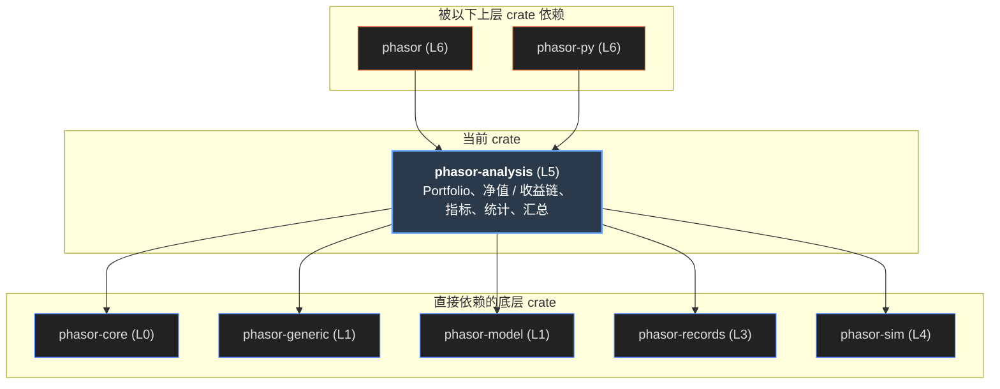

# phasor-analysis

分析层。它只读**记录**，不读模拟状态：从成交记录、收盘价和初始资金重建出资产、现金、净值和收益，再把它们化成指标；把成千上万列的指标按列标签汇总成答案； 并且提醒你，一千组参数里最好的那个夏普，有多少是运气。因为只读记录，两条模拟循环、强平、续跑写出的结果都由同一个分析层读。

> **核心特性与指标：**
> - **只存 4 样东西**：成交记录、收盘价（借用）、初始资金、形状；其余全部按需重建并缓存在 OnceLock 里，Portfolio 因此是 Sync
> - **2,047 + 37 条，逐位 / 逐格一致**：这个页面的移植复现 metrics.tsv 全部 2,047 行（5,287 个值，逐位）和 analysis.tsv 全部 37 个端到端情形（订单 → 成交 → 净值 → 指标）
> - **28 + 5 个统计项**：stats() 的表：顺序、标题和百分比缩放由黄金输出钉住；按 Tag 选择，没被要的指标不会被计算

## 从第一性原理看：分析层该从哪里读、算什么

先不看代码。一次回测结束后，“它表现得怎么样”这个问题，需要先回答下面几件事。

### 1. 只从记录重建

模拟循环可以把现金、仓位、净值整条存下来，但一次扫描有几千列，每列再存六条序列，内存就是数据本身的好几倍——而大多数列最后只会被问一个数（夏普）。 反过来，**成交记录**本身就是完整的账本：现金、仓位、负债都是成交序列的函数。所以只存记录和价格，其他都在被问到时重建。 这也让分析层不依赖“是谁产生的记录”：向量化层和事件驱动层写同一种记录，就共用同一个分析层。仓库的规则也由此而来：**任何改变现金或仓位的东西都必须是一条记录**。

### 2. 收益序列要诚实

第一根 K 线的收益要相对**初始资金**算，否则第一根上的交易成本就看不见了。入金不是收益、出金不是亏损，所以入金要先加进“期初”再算收益。 空头账户的净值可能为负，此时收益的符号要翻转，否则亏损越来越大读起来像是在赚钱。净值从 0 开始时没有比率可算，得到带符号的无穷大。

### 3. NaN 是缺失，退化是答案

缺一根 K 线不该让整列指标变成 NaN，所以每个归约都跳过 NaN。但另一类特殊值不能跳过：一列从未交易，收益恒为 0、波动为 0，夏普是 **+∞**（0/0 被定义成 +∞）， 而这意味着**没有交易的列会排在扫描第一名**。这不是 bug，是一个必须让人看见的结果；正确的做法是在排名前把不满足前提的列屏蔽成 NaN。

### 4. 一千个数还不是答案

扫描产出的是每列一个指标。人们真正问的是“哪个窗口最好”“这个因子在各个标的上都有效吗”——全是“按某一层标签分组、组内归约”。所以列标签放在地基里，分析层用 `group_indices` 汇总。

### 5. 最好的那个有多少是运气

试了一千组参数、报告最大的夏普，测到的是一千个噪声估计的最大值。Bailey 与 López de Prado 给出的修正：概率夏普（PSR）考虑样本长度和收益的偏度、厚尾； “N 个毫无价值的试验里最好的那个靠运气能有多高”有近似公式；去偏夏普（DSR）就是拿这个运气上限而不是 0 当基准的 PSR。PBO 则直接估计“样本内的冠军在样本外低于中位数”的概率。

### 6. 年化因子是一个选择

默认 365（加密市场每天都交易）。日线股票应当约 252；用错会让每个年化数字偏大或偏小约 20%。它和无风险利率、用哪种交易视图、是否计入未平仓交易一起放在 `Scoring` 里——改它们不需要重跑模拟。

| 第一性原理的问题 | phasor-analysis 的回答 | 小节 |
|----|----|----|
| 从记录重建 | `series.rs`：asset_flow → assets，cash_flow → cash，× close → value → returns；`Portfolio` 按需重建、`OnceLock` 缓存 | [重建链](#chain) |
| 诚实的收益 | `period_return`（0 起点 → ±∞，负起点翻转符号）；第一根相对 init_cash；`returns_with_deposits` | [重建链](#chain) |
| NaN 与退化 | 所有归约跳过 NaN；夏普 std = 0 → +∞，Calmar 回撤 = 0 → NaN，Sortino 的 len \< 2 护栏 | [退化读数](#degenerate) |
| 按层汇总 | `group_by(columns, values, level, Reduce)`、`best_column`、`argmax`；NaN 跳过，∞ 不跳过 | [扫描汇总](#sweep) |
| 运气 | `robust.rs`：probabilistic_sharpe、expected_max_sharpe、deflated_sharpe、pbo_cscv | [过拟合](#robust) |
| 一张表 | `stats.rs` 的注册表：28 个默认项 + 5 个基准项，`Select` 按 `Tag` 选择 | [stats 表](#stats) |
| 评分选择 | `Scoring { ann_factor = 365, risk_free = 0, trades_type = ExitTrades, incl_open = false }` | [Portfolio](#portfolio) |

## 依赖图

它是工作区里最“高”的库 crate：依赖 core、generic、model、records、sim。中间是十一个模块，右边是使用者。点任一节点，只保留相关的线。

#### 示意 / 说明：线的颜色 = 被用到的模块

*说明：*

来源：Cargo.toml 与 `src/` 中的 `use`。phasor-sim 只被 `Portfolio` 用到：`Groups`（共享资金的分组）和两个便利构造器 `from_orders / from_signals`。

## 重建链：从成交记录到净值

下面用 `tests/fixtures/analysis.tsv` 里的 37 个真实情形。每根 K 线的下单量先经过 [phasor-exec](phasor-exec.md) 内核的移植（价格 = 估值价 = 当根收盘、独立账户）， 得到成交记录；再走 `series.rs` 的重建链。最下面两行是黄金输出里的净值，以及逐格是否一致。

#### 示意 / 说明：orders → asset_flow / cash_flow → assets / cash → asset_value → value → returns → 指标

| 指标（ann = 365） | 本页重算 | 黄金输出 | 一致 |
|-------------------|----------|----------|------|

*说明：*

### 累加用 math::add

同一根 K 线上可能有多笔成交，所以 asset_flow / cash_flow 是累加而不是赋值；用容差加法，一根 K 线里的一来一回留下的是精确的 0，而不是 1e-16 的“仓位”。

### free_cash 也能从记录重放

`free_cash_flow` 从成交序列重放内核的 debt 账本（开空冻结 2 × 空头价值、平空按均价释放），所以总敞口 `|资产值| / (|资产值| + free_cash)` 也不需要从模拟里带出状态。多头列上 cash 与 free_cash 完全相同，所以这个差别要靠做空的 fixture 才能抓住。逐仓列的资金费和隔夜融资从它自己的保证金付，不动可用现金：`isolated_charges` 按行收集这些记录，重放时从占用里扣，入账时跳过。

### 多空分开计

一次穿过零的反手不是一步，而是两步：旧方向平掉、新方向开出。`long_size / short_size` 把它拆开，所以“多头敞口变了多少”在反手的 K 线上也有答案。

## 指标计算器

`metrics.rs`、`benchmark.rs`、`percentile.rs` 和 `rolling.rs` 的移植，在 `metrics.tsv` 的 2,047 行上逐位一致。输入一列收益（可写 `nan`），可选一列基准。

#### 示意 / 说明：标量指标与滚动形式

收益（分号分隔） 基准收益（可空；与收益等长）

| 指标 | 值  |
|------|-----|

> **图表：滚动指标**

*说明：*

## 退化读数：是答案，不是意外

每张卡片都是用上面的移植现场算的。

## 扫描汇总：group_by、best_column，以及从未交易的那一列

一个小扫描：若干条随机游走价格 × 若干个均线窗口；策略是“上一根收盘在均线之上就满仓（TargetPercent = 1），否则空仓”，每次目标变化才下单。 每列都真的走一遍上面的内核 + 重建链，得到夏普；再按 `window` 或 `symbol` 分组归约。窗口比序列还长的那组，均线全是 NaN，从不交易，夏普是 +∞。

#### 示意 / 说明：from_orders（内核移植）→ returns → sharpe_ratio → group_by / best_column，JS 移植

| col | window | symbol | 成交 | 总收益 | Sharpe |
|-----|--------|--------|------|--------|--------|

| window | Mean(Sharpe) |
|--------|--------------|

*说明：*

## 过拟合：最好的那个有多少是运气

生成 N 个**毫无价值**的策略（每个都是均值为 0 的随机收益），算出每个的单期夏普，取最大的那个。`expected_max_sharpe(N, V)` 预测这个最大值靠运气能有多高； 概率夏普（PSR，基准 0）说“它的真实夏普大于 0”的概率，去偏夏普（DSR）把基准换成运气上限。下面三个函数是 `robust.rs` 的移植（`norm_cdf / norm_ppf` 与 Rust 测试里的已知值一致）。

#### 示意 / 说明：probabilistic_sharpe · expected_max_sharpe · deflated_sharpe，JS 移植

> **图表：试验夏普分布**

*说明：*

### 单期夏普

这个模块里所有夏普都是**未年化**的单期比率（均值 / 样本标准差），公式就是按这个单位写的；传给 `deflated_sharpe` 的试验夏普必须和收益同一单位。

### PSR 的分母

`1 − γ₃·SR + (γ₄ − 1)/4 · SR²`，γ₃ 是偏度、γ₄ 是（非超额）峰度，都用总体中心矩。负偏、厚尾会让同样的夏普更不可信。分母不为正时返回 NaN 而不是一个看起来自信的概率。

### PBO（CSCV）

把行切成偶数个块（最多 16 个），枚举所有“一半做样本内、一半做样本外”的组合；对每种切法，看样本内冠军在样本外的相对名次。冠军落在中位数以下的比例就是 PBO。纯噪声约 0.5。

## stats()：一张有顺序、有标签的表

`stats(input, select)` 回答人们打开回测时的第一个问题：“它表现得怎么样”。顺序、标题和百分比缩放是固定的，由 `stats.tsv` 钉住——包括最大回撤以**正**的百分比报告，而这个 crate 里其他回撤数字都是负的。 点标签筛选（`Select::with_tags`）；没被选中的指标根本不会被计算。缺输入（没有基准、没有价格）时是 `Value::Missing`，打印成 “—”，而不是一个像测量值的 0。

| \#  | key | title | tags |
|-----|-----|-------|------|

## Portfolio：只存四样东西

### 存什么

成交记录（含 `CashRecords`）、收盘价（**借用**，扫描的价格矩阵是系统里最大的东西）、初始资金、形状，以及可选的基准。`from_records`、`from_grouped_records`（共享资金分组）、`from_borrowed`（Python 层借入一份 `Cache`），另有直接跑模拟的 `from_orders / from_signals`。

### 算什么

assets、cash、free_cash、asset_value、value、returns、deposits、gross / long / short / net exposure、allocations、trades、drawdowns……每个都在第一次被问到时算一次，存进 `Cache` 里对应的 `OnceLock`。不是 `RefCell`，所以多个线程可以从同一个 Portfolio 并行算不同列的指标。

### 账户分组

仓位和交易始终按标的；现金、净值和收益类指标按共享资金分组，初始资金每组只算一次。独立列就是大小为 1 的组。

### Scoring

`ann_factor = 365`、`risk_free = 0`、`trades_type = ExitTrades`、`incl_open = false`。改评分方式用 `with_scoring`，缓存的重建结果仍然有效，不需要重跑模拟。

### MAE / MFE 按多空：excursion_stats

`excursions(high, low)` 按交易算最大不利 / 有利偏移（窗口、缺 high / low 时退回收盘价都是 phasor-records 的 `excursions`）；`edge_ratio` 按账户给一个比值。`excursion_stats(high, low, account)` 把一个账户的交易按方向（0 多、1 空）分开，给 `avg_mae_long`、`avg_mfe_long`、`edge_ratio_long` 和空头三项：均值都是收益率，edge = mean(MFE) / −mean(MAE)，MAE 均值不小于 0 或这一边没有交易时为 NaN。键名就是 stats 表里的键名。

### 谁用 excursion_stats

只有 phasor-py：`pf.stats(high=, low=)` 给了 high / low 时，在 `py.detach` 里调它，把六项追加在 stats 表的后面（stats 表本身不读 high / low）。交易的下标和 `account_trades` 的下标一一对应：后者是 `trades()` 的拷贝，只把列号换成账户号，所以可以用同一个下标去读 `Excursions`。

## 验证

### tests/golden_metrics.rs · metrics.tsv

2,047 行：18 个标量指标的各种参数（年化因子、无风险利率、要求收益、截断、ddof），以及每个指标的滚动形式（各 20 行）。空序列、单根、含 NaN、含无穷、全正、全负、常数……这个页面的移植 5,287 个值逐位相同。

### tests/golden_analysis.rs · analysis.tsv

37 个端到端情形：买入持有、做空往返、带成本、目标百分比、两列一列空闲、24 个随机扫描。检查净值、收益、8 个收益指标和交易统计（交易数、胜率、盈亏比、期望、总盈亏）。本页复现前三项；交易统计需要 phasor-records 的交易视图，本页没有移植。

### tests/golden_stats.rs · stats.tsv

9 种情形 × 8 个参数组合的整张 stats 表（标题和数值），包括 “never traded”、“flat price”、“still holding”。

### tests/golden_margin.rs · margin.tsv

保证金账户的黄金输出：线性永续合约（taker 费率 0.018%，10 倍杠杆，净额持仓），按一份事先排好的市价单序列下单（含反手），4 组共 500 根 K 线、176 笔成交。fixture 里每根是那根按收盘价的成交、手续费，以及下单前的预期权益。phasor 在一个保证金列上按同样的数量、价格和费率重放：每笔手续费一致，每根重建出的净值加上那根的手续费等于预期权益（预期金额舍入到 8 位小数，所以净值容差 1e-6、手续费 1e-7）。不能为了让改动通过而重新生成。

### 其他测试

`cash_flows.rs`（入金不是收益、出金封顶于可用现金）、`exposure.rs`（空头的总敞口）、`shared_accounts.rs`（共享资金分组）、`leverage.rs` 和 `margin.rs`（借钱的多头、保证金列的权益和可用现金）、`holding.rs` 和 `liquidation.rs`（持仓费、强平、穿仓核销、逐仓的可用现金；两份各有一个性质测试，逐根检查重建出的权益等于模拟循环里的权益；liquidation.rs 还覆盖部分、分档和现金列的强平，并对照循环的日志检查逐仓列重建出的可用现金）、`multiplier.rs`（乘数为 k 的运行等于数量放大 k 倍的运行，两个循环都测）。变异检查里存活的几个变异在各自的模块注释里论证为等价（例如 Sharpe 的 len \< 2 护栏）。

## 谁依赖它，用来做什么

| 使用者 | 用到的模块 | 用来做什么 |
|--------|------------|------------|

## 不能绕开的规则

### 改变现金或仓位的必须是记录

分析层只从记录重建。一个只改了模拟状态、没有写记录的现金流（利息、分红、资金费），在这里就不存在——净值会悄悄错。入金、收益、分红、四种持仓费、强平核销和初始持仓的成本都走 `CashRecords`，强平本身是一笔成交；所以这一层不用为它们改代码，`cash_flow_by_kind` 只是按种类把它们摆成矩阵。除了入金和初始持仓的成本（`is_deposit`，`deposits` 按它取），每种都算收益。

### 排名之前先屏蔽

从未交易的列夏普是 +∞，会成为 `best_column`。这一层故意不替你丢掉它；调用方要说清楚在排什么：把不满足前提（例如 0 笔交易）的列设成 NaN。`examples/sweep.py` 和 `crates/phasor/tests/sweep.rs` 固定了两种结果。

### 拼写也是语义

百分位必须写成 `lower·(1 − m) + upper·m`，不是教科书的 `lower + m·(upper − lower)`；最后一位的差别正是黄金输出抓到的。冗余的护栏（Sharpe 的 len \< 2）也保留，注释说明了哪个有用、哪个是冗余的。

### 基准按列，不按扫描

列 c 的基准是“该列标的”的买入持有收益，基准数组要和标的一样 tile。把一个标的的基准用于所有列是这一层检测不到的错误。`fixtures/*.tsv` 不能为了让改动通过而重新生成。

## 源文件

<table>
<thead>
<tr>
<th>文件</th>
<th>内容</th>
</tr>
</thead>
<tbody>
<tr>
<td colspan="2" class="small">行号对应 <a href="https://github.com/nivalume/phasor/tree/1d573df0430fa5cd3a2416300603c7147f3c6a13">1d573df</a>；其余条目只写符号名。</td>
</tr>
<tr>
<td class="mono"><a href="https://github.com/nivalume/phasor/blob/1d573df0430fa5cd3a2416300603c7147f3c6a13/crates/phasor-analysis/src/lib.rs">crates/phasor-analysis/src/lib.rs</a></td>
<td>“与层无关”“按层汇总是主要功能”“惰性重建”；Status 一节（已过时，见上）。</td>
</tr>
<tr>
<td class="mono"><a href="https://github.com/nivalume/phasor/blob/1d573df0430fa5cd3a2416300603c7147f3c6a13/crates/phasor-analysis/src/series.rs">src/series.rs</a></td>
<td>asset_flow（<a href="https://github.com/nivalume/phasor/blob/1d573df0430fa5cd3a2416300603c7147f3c6a13/crates/phasor-analysis/src/series.rs#L74">:74</a>）、assets、multipliers（<a href="https://github.com/nivalume/phasor/blob/1d573df0430fa5cd3a2416300603c7147f3c6a13/crates/phasor-analysis/src/series.rs#L132">:132</a>，每列的合约乘数，从成交记录读，全为 1 时是 None；cash_flow 和 asset_value 按它乘）、cash_flow、deposits、cash_flow_by_kind（<a href="https://github.com/nivalume/phasor/blob/1d573df0430fa5cd3a2416300603c7147f3c6a13/crates/phasor-analysis/src/series.rs#L202">:202</a>，某一种现金流的矩阵）、free_cash_flow（<a href="https://github.com/nivalume/phasor/blob/1d573df0430fa5cd3a2416300603c7147f3c6a13/crates/phasor-analysis/src/series.rs#L251">:251</a>）、is_holding_charge 与 isolated_charges（<a href="https://github.com/nivalume/phasor/blob/1d573df0430fa5cd3a2416300603c7147f3c6a13/crates/phasor-analysis/src/series.rs#L327">:327</a>，逐仓列的资金费和隔夜融资）、levered_free_cash_flow（<a href="https://github.com/nivalume/phasor/blob/1d573df0430fa5cd3a2416300603c7147f3c6a13/crates/phasor-analysis/src/series.rs#L354">:354</a>，带余额的运行按记录里的 debt、locked_cash 算占用）、gross_exposure、cash、asset_value、value、period_return（<a href="https://github.com/nivalume/phasor/blob/1d573df0430fa5cd3a2416300603c7147f3c6a13/crates/phasor-analysis/src/series.rs#L481">:481</a>）、returns、returns_with_deposits、compounded_value、returns_from_orders。</td>
</tr>
<tr>
<td class="mono"><a href="https://github.com/nivalume/phasor/blob/1d573df0430fa5cd3a2416300603c7147f3c6a13/crates/phasor-analysis/src/metrics.rs">src/metrics.rs</a> · <a href="https://github.com/nivalume/phasor/blob/1d573df0430fa5cd3a2416300603c7147f3c6a13/crates/phasor-analysis/src/benchmark.rs">benchmark.rs</a> · <a href="https://github.com/nivalume/phasor/blob/1d573df0430fa5cd3a2416300603c7147f3c6a13/crates/phasor-analysis/src/percentile.rs">percentile.rs</a> · <a href="https://github.com/nivalume/phasor/blob/1d573df0430fa5cd3a2416300603c7147f3c6a13/crates/phasor-analysis/src/rolling.rs">rolling.rs</a></td>
<td>标量收益指标（DAILY = 365、VAR_CUTOFF = 0.05）；相对基准的指标；固定拼写的百分位；每个指标的滚动形式（经 rolling_apply_1d）。</td>
</tr>
<tr>
<td class="mono"><a href="https://github.com/nivalume/phasor/blob/1d573df0430fa5cd3a2416300603c7147f3c6a13/crates/phasor-analysis/src/robust.rs">src/robust.rs</a></td>
<td>erfc、norm_cdf、norm_ppf（Acklam + 一步 Halley）、probabilistic_sharpe、expected_max_sharpe、deflated_sharpe、pbo_cscv（MAX_PBO_SPLITS = 16）。</td>
</tr>
<tr>
<td class="mono"><a href="https://github.com/nivalume/phasor/blob/1d573df0430fa5cd3a2416300603c7147f3c6a13/crates/phasor-analysis/src/aggregate.rs">src/aggregate.rs</a> · <a href="https://github.com/nivalume/phasor/blob/1d573df0430fa5cd3a2416300603c7147f3c6a13/crates/phasor-analysis/src/trade_stats.rs">trade_stats.rs</a> · <a href="https://github.com/nivalume/phasor/blob/1d573df0430fa5cd3a2416300603c7147f3c6a13/crates/phasor-analysis/src/events.rs">events.rs</a></td>
<td>Reduce、group_by、best_column、argmax / argmin；按列的交易统计（持平的交易既不算赢也不算输）；事件研究（读未来，只用于决定要不要模拟）。</td>
</tr>
<tr>
<td class="mono"><a href="https://github.com/nivalume/phasor/blob/1d573df0430fa5cd3a2416300603c7147f3c6a13/crates/phasor-analysis/src/stats.rs">src/stats.rs</a> · <a href="https://github.com/nivalume/phasor/blob/1d573df0430fa5cd3a2416300603c7147f3c6a13/crates/phasor-analysis/src/portfolio.rs">portfolio.rs</a></td>
<td>Value、Tag、StatsInput、Metric、Select、stats、默认与基准注册表；Scoring（<a href="https://github.com/nivalume/phasor/blob/1d573df0430fa5cd3a2416300603c7147f3c6a13/crates/phasor-analysis/src/portfolio.rs#L57">portfolio.rs:57</a>）、Cache（<a href="https://github.com/nivalume/phasor/blob/1d573df0430fa5cd3a2416300603c7147f3c6a13/crates/phasor-analysis/src/portfolio.rs#L99">:99</a>）、Portfolio（<a href="https://github.com/nivalume/phasor/blob/1d573df0430fa5cd3a2416300603c7147f3c6a13/crates/phasor-analysis/src/portfolio.rs#L147">:147</a>）：from_records（<a href="https://github.com/nivalume/phasor/blob/1d573df0430fa5cd3a2416300603c7147f3c6a13/crates/phasor-analysis/src/portfolio.rs#L173">:173</a>）、from_grouped_records（<a href="https://github.com/nivalume/phasor/blob/1d573df0430fa5cd3a2416300603c7147f3c6a13/crates/phasor-analysis/src/portfolio.rs#L201">:201</a>）、from_borrowed（<a href="https://github.com/nivalume/phasor/blob/1d573df0430fa5cd3a2416300603c7147f3c6a13/crates/phasor-analysis/src/portfolio.rs#L241">:241</a>）、account_trades（<a href="https://github.com/nivalume/phasor/blob/1d573df0430fa5cd3a2416300603c7147f3c6a13/crates/phasor-analysis/src/portfolio.rs#L360">:360</a>）、buy_and_hold（<a href="https://github.com/nivalume/phasor/blob/1d573df0430fa5cd3a2416300603c7147f3c6a13/crates/phasor-analysis/src/portfolio.rs#L422">:422</a>）、with_scoring（<a href="https://github.com/nivalume/phasor/blob/1d573df0430fa5cd3a2416300603c7147f3c6a13/crates/phasor-analysis/src/portfolio.rs#L514">:514</a>）、drawdowns（<a href="https://github.com/nivalume/phasor/blob/1d573df0430fa5cd3a2416300603c7147f3c6a13/crates/phasor-analysis/src/portfolio.rs#L905">:905</a>）、excursions（<a href="https://github.com/nivalume/phasor/blob/1d573df0430fa5cd3a2416300603c7147f3c6a13/crates/phasor-analysis/src/portfolio.rs#L934">:934</a>）、edge_ratio（<a href="https://github.com/nivalume/phasor/blob/1d573df0430fa5cd3a2416300603c7147f3c6a13/crates/phasor-analysis/src/portfolio.rs#L951">:951</a>）、excursion_stats（<a href="https://github.com/nivalume/phasor/blob/1d573df0430fa5cd3a2416300603c7147f3c6a13/crates/phasor-analysis/src/portfolio.rs#L967">:967</a>）、trade_stats（<a href="https://github.com/nivalume/phasor/blob/1d573df0430fa5cd3a2416300603c7147f3c6a13/crates/phasor-analysis/src/portfolio.rs#L1080">:1080</a>）、stats（<a href="https://github.com/nivalume/phasor/blob/1d573df0430fa5cd3a2416300603c7147f3c6a13/crates/phasor-analysis/src/portfolio.rs#L1163">:1163</a>）。Portfolio::free_cash 对全仓保证金列加回 position × close × 合约乘数，对逐仓列加回最后一笔成交记下的成本（盈亏不算可用现金）；cash_flow_by_kind。</td>
</tr>
<tr>
<td class="mono">tests/*.rs · tests/fixtures/{metrics,analysis,stats,margin}.tsv</td>
<td>四份黄金输出回归测试（golden_metrics.rs、golden_analysis.rs、golden_stats.rs、golden_margin.rs），以及现金流、敞口、共享账户、强平等测试。</td>
</tr>
</tbody>
</table>
