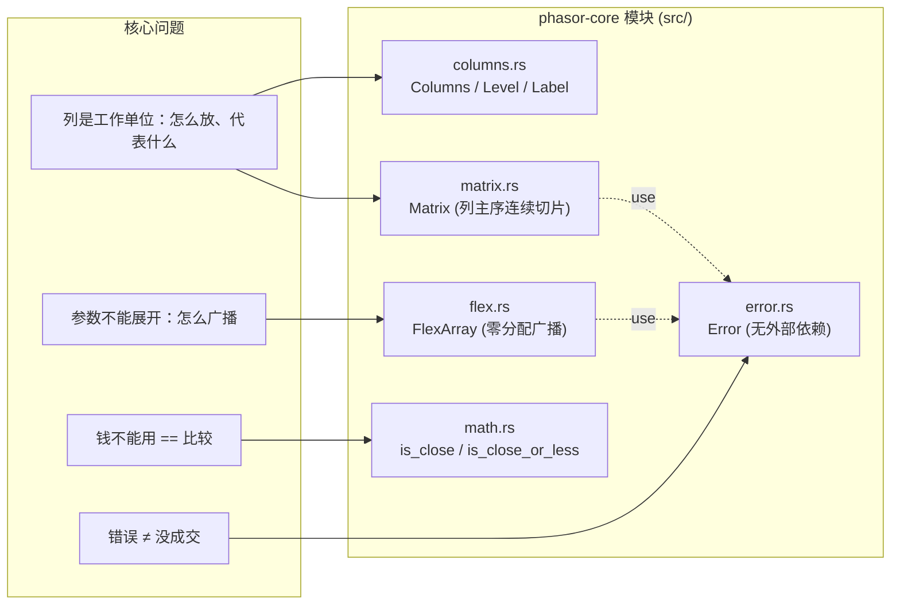
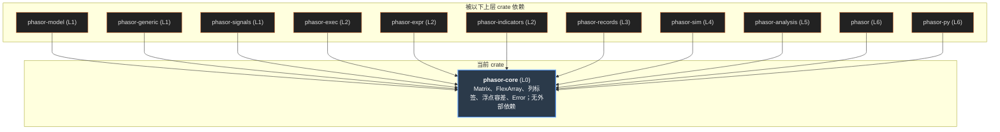
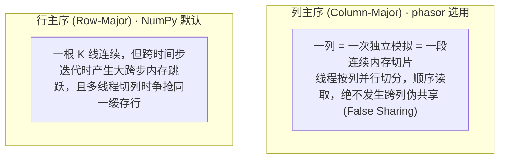
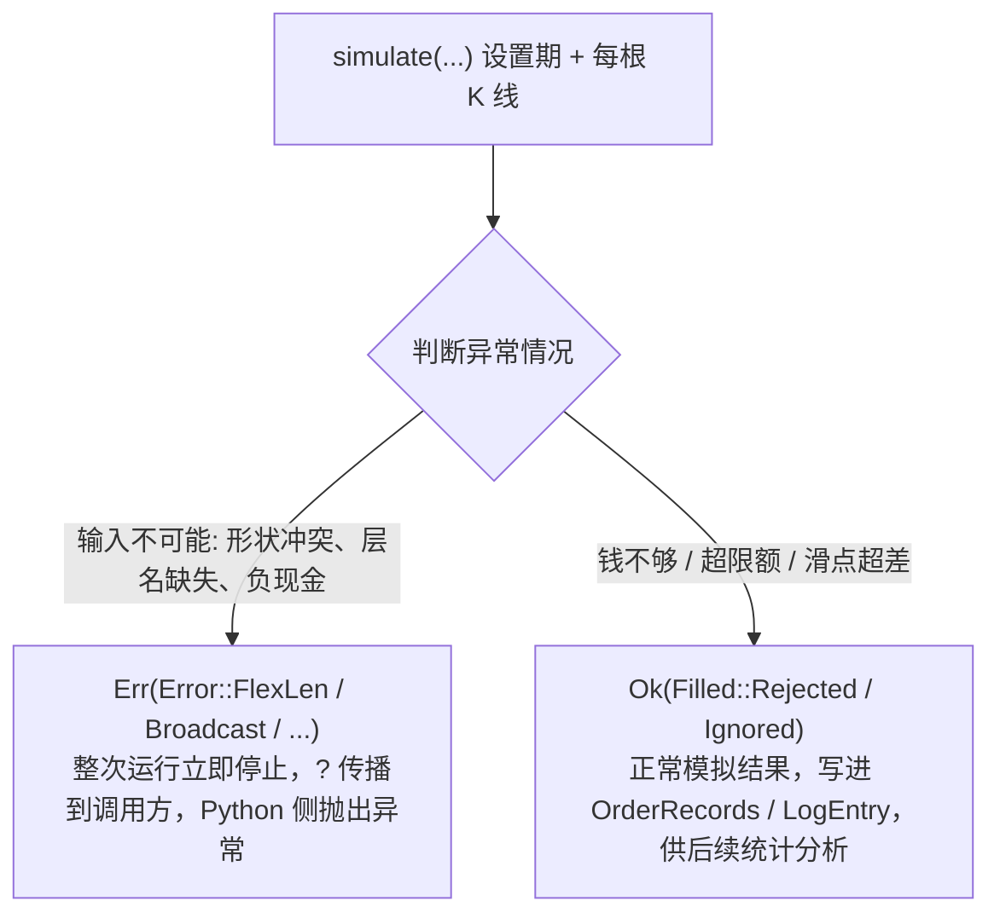
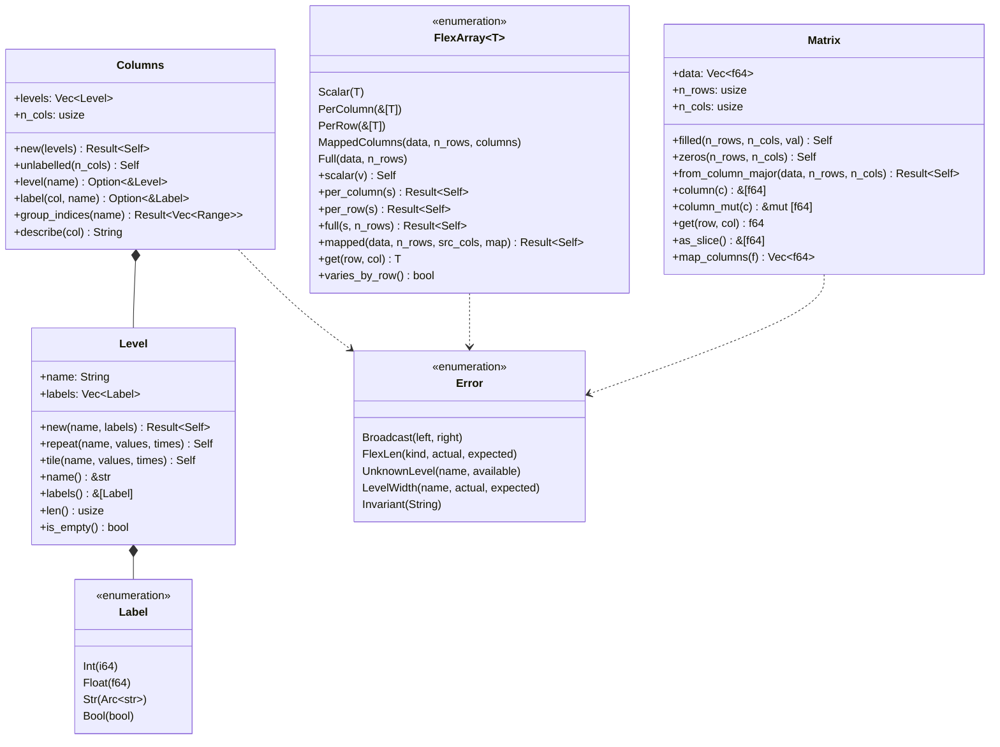

# phasor-core

地基。其它每个 crate 都站在它上面，而它只依赖 `std`。它回答四个“全引擎必须统一口径”的问题： 浮点数怎么比较（`math`），二维数据怎么放、参数怎么广播（`matrix`、`flex`）， 每一列代表什么（`columns`），以及什么算错误（`error`）。这些口径一旦不统一，下游每个数字都会悄悄偏掉。

> **核心特性与指标：**
> - **0 个外部依赖**：连 thiserror 都没有：Error 的 Display 是手写的，地基不引入任何第三方代码
> - **11 个 crate 直接依赖**：工作区 13 个 crate 中，除了它自己和 phasor-data，全部在 [dependencies] 里写了 phasor-core
> - **1,258 行 · 32 个测试**：五个模块；math 一个文件就有 13 个测试，因为它是整个引擎里最容易“差一分钱”的地方

<a id="concept"></a>

## 从第一性原理看：地基该放什么

先不看代码。一个向量化回测引擎，把“成千上万个参数组合 × 上百个标的”一次跑完。什么东西必须由所有层共享、只定义一次？

### 1. 列是工作单位

向量化回测的核心技巧，是把“参数”“标的”“因子”全部压进同一个**列轴**：每一列是一次彼此独立的模拟，模拟器只知道有 `n_cols` 列， 不知道某一列“是什么”。由此推出三件事：一列在内存里必须**连续**（扫描一列就是顺序读一段内存，线程按列切分不会抢同一条缓存行）——所以是**列主序**； 同一个参数组合的列必须**相邻**（共享资金的账户就是一段切片）；而且必须有一套**标签**把结果归因回“哪个参数、哪个标的”。

### 2. 参数不能展开

手续费、滑点、止损距离、下单量……每个参数都可以是一个标量、每列一个值、每行一个值或一整个矩阵。把它们全部展开成 `n_rows × n_cols`， 10 万根 K 线 × 2,000 列就是 1.6 GB **一个**参数，而参数有十几个。所以需要一个“看起来是矩阵、实际只借用原始形状”的类型，读的时候再算下标。

### 3. 钱不能用 == 比较

`0.1 + 0.2 != 0.3`。在回测里这不是学术问题：平仓后仓位剩下 `-1.1e-16`，这个仓位就“还开着”，下一根 K 线的逻辑全错； “现金够不够买”用 `<=` 判断，差一个舍入误差就拒单。而回测结果要能逐笔复现、能和固定的黄金输出逐位比较，所以容差的**语义**必须在整个引擎里只有一种， 一处不一致就是几千根 K 线之后的一分钱漂移。

### 4. 错误和“没成交”是两回事

形状对不上、要的标签层不存在、现金变成负数——这是调用方给了不可能的输入，应该停下来。 但“钱不够所以没买”是一次正常的模拟结果，要被记下来、被统计（“这次扫描为什么不交易”是用户最常问的问题）。把两者混在一个 `Err` 里， 要么一次拒单就中断整个扫描，要么真正的 bug 被当成拒单吞掉。

#### 示意 / 说明：四个问题，五个模块。箭头表示模块之间的 use：flex 和 matrix 都只用 error；math 和 error 互不依赖



### 如果从零实现，按这个顺序

1.  **先定错误类型，并划清边界。**只放“不变量被破坏”；拒单是返回值。手写 `Display`，让地基没有依赖。
2.  **定容差层，并用 lint 强制。**容差语义定为 PEP 485 的 `isclose`，外加“无穷永远不接近”，然后把 `clippy::float_cmp` 设成 deny，让 `==` 必须写理由。
3.  **定内存布局：列主序。**`column(c)` 必须是零拷贝切片；跨语言边界（NumPy 默认行主序）显式转置。
4.  **定广播：借用而不展开。**一个枚举覆盖标量 / 每列 / 每行 / 全矩阵 / 列映射，读的时候一次 `match`；构造时校验长度，而不是在模拟深处越界。
5.  **定列标签，并靠构造函数建立布局约定。**参数“重复”、标的“平铺”，使 `col = param_idx × n_symbols + symbol_idx`；用测试钉住，运行时不检查。

| 第一性原理的问题 | phasor-core 的回答 | 小节 |
|----|----|----|
| 一列代表什么 | `Columns { levels, n_cols }`，`Level::repeat` / `Level::tile`，`group_indices` | [列轴](#columns) |
| 参数怎么广播 | `FlexArray::{Scalar, PerColumn, PerRow, MappedColumns, Full}`，`get(row, col)`，`varies_by_row()` | [FlexArray](#flex) |
| 二维数据怎么放 | `Matrix { data, n_rows, n_cols }`，`data[col × n_rows + row]` | [Matrix](#matrix) |
| 浮点怎么比 | `is_close`（REL 1e-9 / ABS 1e-12，NaN 与 ±inf 永不接近）、`is_close_or_less`、`is_less`、`add` | [容差](#math) |
| 什么算错误 | `Error::{Broadcast, FlexLen, UnknownLevel, LevelWidth, Invariant}`；拒单不在其中 | [错误](#error) |

<a id="graph"></a>

## 依赖图

左边没有上游，只有 `std`。中间是五个模块，右边是直接 `use phasor_core::…` 的 crate（只统计 `src/`；测试里的用法写在说明里）。 点任一节点，只保留相关的线，图下面写出它用来做什么。

#### 示意 / 说明：线的颜色 = 被用到的模块。phasor-model 在 Cargo.toml 里声明了依赖，但 src/ 里一行都没有用到（虚线）



*说明：*

来源：各 crate 的 Cargo.toml 与 `src/` 中的 `use phasor_core::…`。phasor-data 不依赖 phasor-core（它只依赖 phasor-model）。

<a id="columns"></a>

## 列轴：参数重复，标的平铺

```text
参数 window ∈ [10, 20, 50] (Repeat=2), 标的 symbol ∈ [BTC, ETH] (Tile=3)
展平成 6 个独立模拟列 (n_cols = 6):

列号 (Column):       Col 0        Col 1        Col 2        Col 3        Col 4        Col 5
                 ┌────────────┬────────────┬────────────┬────────────┬────────────┬────────────┐
window (repeat)  │     10     │     10     │     20     │     20     │     50     │     50     │
symbol (tile)    │    BTC     │    ETH     │    BTC     │    ETH     │    BTC     │    ETH     │
                 └────────────┴────────────┴────────────┴────────────┴────────────┴────────────┘
列号计算公式:    col = param_idx × n_symbols + symbol_idx
```

| 列号 `col` | 参数 `window` | 标的 `symbol` | 内存切片偏移 `data[col*T .. (col+1)*T]` | 独立账户组归属 (`ungrouped`) |
| :---: | :---: | :---: | :---: | :---: |
| **0** | `10` | `BTC` | `data[0*T .. 1*T]` | 账户 0 |
| **1** | `10` | `ETH` | `data[1*T .. 2*T]` | 账户 1 |
| **2** | `20` | `BTC` | `data[2*T .. 3*T]` | 账户 2 |
| **3** | `20` | `ETH` | `data[3*T .. 4*T]` | 账户 3 |
| **4** | `50` | `BTC` | `data[4*T .. 5*T]` | 账户 4 |
| **5** | `50` | `ETH` | `data[5*T .. 6*T]` | 账户 5 |

`Level::repeat(name, values, times)` 把每个值连续重复 `times` 次：`[a, b], 3 → [a,a,a,b,b,b]`，用来建**参数**层； `Level::tile` 把整段序列平铺 `times` 次：`[a, b], 3 → [a,b,a,b,a,b]`，用来建**标的**层。两者合在一起得到 `col = param_idx × n_symbols + symbol_idx`：同一个参数组合的列相邻。改下面的输入，或者把参数层换成 tile 看看会坏在哪。

#### 示意 / 说明：Columns::new(\[Level::repeat("window", …), Level::tile("symbol", …)\])，JS 移植

*说明：*

点一列看 describe(col)。

### 布局是约定，不是检查

`Columns` 不知道哪一层是参数、哪一层是标的；相邻性完全来自构造顺序。测试 `one_parameter_combination_occupies_contiguous_columns` 钉住它，运行时没有任何断言。

### Label 是标识，不是测量

`Float` 按位比较和哈希：`NaN == NaN`，`0.0 ≠ -0.0`。这样浮点参数（分位数阈值）才能当 `HashMap` 的键。

### group_indices 保序

按第一次出现的顺序返回 `(Label, Vec<usize>)`，所以“每个参数的平均 Sharpe”出来的顺序和扫描的顺序一致，不依赖哈希顺序。

<a id="flex"></a>

## FlexArray：借用原始形状，读的时候算下标

```text
FlexArray<'a, T> 5 种存储变体在内存中的实际借用形式:

1. Scalar(v)           ──► [ v ] (8 字节, 调用处内联直接返回, 不访存)
2. PerColumn(&[T])     ──► [ c0 │ c1 │ c2 │ c3 │ ... │ cN-1 ] (长度 = n_cols)
3. PerRow(&[T])        ──► [ r0 │ r1 │ r2 │ r3 │ ... │ rT-1 ] (长度 = n_rows)
4. MappedColumns       ──► data: [ S0 标的列 │ S1 标的列 ] (仅借用源形状 S 列)
                           map:  [ 0 │ 1 │ 0 │ 1 │ 0 │ 1 ] (通过列索引映射取数)
5. Full(&[T], n_rows)  ──► [ Matrix 借用的完整连续列主序切片 ] (n_rows × n_cols)
```

| 变体类型 | 适用场景 | 实际物理内存占用 | 全展开矩阵占用 ($10^5 	imes 5000 	imes 8\text{B}$) | 节省比例 |
| :--- | :--- | :---: | :---: | :---: |
| **`Scalar`** | 固定手续费率、全局固定止损距离 | **8 Bytes** | 4.0 GB | **99.9999998%** |
| **`PerColumn`** | 每组参数不同（如不同均线周期） | **40 KB** | 4.0 GB | **99.999%** |
| **`PerRow`** | 随时间变化的全局利率、入金流 | **800 KB** | 4.0 GB | **99.98%** |
| **`MappedColumns`** | 100 个标的收盘价广播给 50 组参数 | **80 MB + 40 KB** | 4.0 GB | **97.9%** |
| **`Full`** | 动态每根 K 线每列独立的逐笔订单量 | **4.0 GB** | 4.0 GB | 0% (按需分配) |

下面是一个 4 行 × 6 列的逻辑矩阵（3 组参数 × 2 个标的）。选一种形状，左边是 `get(row, col)` 读出的值，右边是它**实际占用**的内存。 把鼠标移到左边任一格，右边高亮被读到的那个元素，并给出下标公式。

#### 示意 / 说明：FlexArray\<'a, T\>::get，JS 移植。get 是 `#[inline(always)]`：Scalar 在调用处直接返回，不访问内存；其余四种交给 get_array 的 match

逻辑视图：n_rows × n_cols

实际存储

*说明：*

### 省下多少内存

一次扫描里，每个参数都按“全展开”算是 `n_rows × n_cols × 8` 字节。改下面的规模，对比五种形状的真实占用。

#### 示意 / 说明：一个 f64 参数的内存：全展开 vs FlexArray

*说明：*

MappedColumns 就是 Python 里的 `column_map`：50 组参数 × 100 个标的是 5,000 个逻辑价格列，内存里只有 100 列价格加一个 5,000 长的 `usize` 映射表。

> [!NOTE]
> **为什么 Scalar 单独提前返回：**大多数运行的大多数参数是标量，模拟循环每根 K 线每列要读五个以上，函数调用本身比读值还贵。所以 `get` 标成 `#[inline(always)]`， 在调用处先判断 Scalar 直接返回，其余四种形状才调用 `get_array`（`#[inline]` 的 match）。它让 from_orders 功能全关时的指令数少了约 5%。

> [!NOTE]
> **为什么还要 `varies_by_row()`：**Scalar 和 PerColumn 沿行不变，调用方可以在进入一列的内循环之前读一次，然后在循环里复用； PerRow、Full、MappedColumns 返回 `true`，必须每行读。构造函数 `per_column` / `per_row` / `full` / `mapped` 校验长度并返回 `Error::FlexLen` 或 `Error::Invariant`；变体本身是 `pub` 的，直接写 `FlexArray::Full { .. }` 会绕过校验，这时越界就成了模拟深处的 panic。

<a id="matrix"></a>

## Matrix：一列就是一段连续内存

`Matrix { data: Vec<f64>, n_rows, n_cols }`，元素 `(row, col)` 在 `data[col × n_rows + row]`。 列主序不是偏好，而是“列是工作单位”的结果：`column(c)` 是零拷贝的 `&[f64]`，一个线程拿一段相邻的列，就拿到一段相邻的内存，不和别的线程共享缓存行。

#### 示意 / 说明：3 行 × 4 列。列主序（上）与行主序（下）的同一块缓冲区；两个线程各拿两列



*说明：*

NumPy 默认行主序，所以传进 Rust 的数组都必须是 Fortran 序（`order="F"`）；测试夹具生成器也显式这么做。`FlexArray::Full` 用的是同一个布局，Matrix 的缓冲区可以直接借给它。

| 方法 | 做什么 | 失败时 |
|----|----|----|
| `filled` / `zeros` | 分配并填值 | — |
| `from_column_major(data, n_rows, n_cols)` | 包装已有的列主序缓冲区，不复制 | `Error::FlexLen { kind: "matrix" }` |
| `column(c)` / `column_mut(c)` | 第 c 列的切片 | 越界 panic |
| `get(row, col)` | 单个元素 | 越界 panic |
| `as_slice` / `into_vec` | 整块缓冲区（借用 / 取走，不复制） | — |
| `map_columns(f)` | 每列归约成一个值，例如每列的总收益 | — |

<a id="math"></a>

## 容差层：所有关于钱的比较都走这里

| 测试用例 / 边界值 | 浮点运算真实值 | 朴素 `==` / `<=` 判定 | `math.rs` 容差判定 | 撮合内核语义与后果 |
| :--- | :--- | :---: | :---: | :--- |
| `0.1 + 0.2` vs `0.3` | `0.30000000000000004` | `false` ❌ | `is_close` → **`true`** ✅ | 平仓后净持仓 `-1e-16` 归零，不产生幽灵持仓 |
| `1.0` vs `1.0 + 5e-13` | 差值小于 `ABS_TOL (1e-12)` | `false` ❌ | `is_close` → **`true`** ✅ | 现金恰好足够购买，避免因浮点舍入拒单 |
| 净持仓归零 `pos = 0.0` | `is_close(pos, 0.0)` | — | **`true`** (直接置零) | 防止下一根 K 线按微小残差继续计息扣持仓费 |
| 市价单哨兵 `+inf` vs `+inf` | 正无穷 | `true` ⚠️ | `is_close` → **`false`** 🛡️ | **无穷永不接近**：防止市价哨兵与全仓哨兵被错误对消 |
| 缺失值 `NaN` vs `NaN` | 非数值 | `false` | `is_close` → **`false`** 🛡️ | NaN 永远不与任何值接近，强制走缺失检查分支 |
| 符号截断 `-0.0` vs `0.0` | 负零与正零 | `true` | `is_addition_zero` → **`true`** ✅ | 两数相加等于零时返回干净的正零 `+0.0` |

`math.rs` 只有五十来行有效代码，却是整个引擎里最承重的部分：撮合内核先用 `is_close` 把现金、仓位、负债、可用现金、估值价、净值**归零**， 再用 `is_close_or_less` 判断买不买得起；所有余额更新都用 `add`。语义是 PEP 485 的 `math.isclose`，只有一处故意的偏离： **无穷永远不接近，连它自己也不**——因为 `+inf` 在引擎里是活的哨兵值（`size=+inf` 表示“能买多少买多少”，`price=+inf` 表示“用收盘价”）， `is_close(inf, inf) = true` 会把两个不同含义的哨兵混为一谈。

#### 示意 / 说明：is_close / is_close_or_less / is_less / add，JS 移植（JS 的 Number 就是 f64，结果逐位一致）

| 调用 | 结果 | 朴素写法 | 朴素结果 |
|------|------|----------|----------|

*说明：*

### 残差会让平掉的仓位“还开着”

每根 K 线买入 0.1 个单位，买 10 次，然后一次卖出 1.0。左边用朴素的 `+`，右边用 `math::add`。

#### 示意 / 说明：仓位的逐步更新

*说明：*

朴素加法最后剩下 `-1.1e-16`：仓位是负的，引擎会认为这一列持有一个极小的空头，下一根 K 线的“是否有持仓”分支就走错了。`add` 发现两个操作数异号且量级接近，直接返回精确的 `0.0`。

### 异号时比大小，不求和

`is_addition_zero` 对异号操作数比较 `|a|` 与 `|b|`，而不是看 `a + b` 离 0 多远：两个几乎抵消的大数相加，有效数字几乎全丢，和的大小在相对容差下没有意义。

### sign 不是 signum

`f64::signum(0.0) = 1.0`、`signum(-0.0) = -1.0`，会把零操作数送进“异号”分支。这里的 `sign` 返回整数，两个零都是 0，NaN 单独是 `i8::MIN`。

### 容差内既不大也不小

`is_less(a, b)` 不等于 `!is_close_or_less(b, a)`：容差之内的两个数是“相等”，不是“小于”，也不是“大于”。

<a id="error"></a>

## 错误：只给不变量被破坏的情况

`Error` 只有五个变体，每个都把出问题的值写进消息（测试 `messages_name_the_offending_values`、`unknown_level_lists_the_alternatives` 钉住）。 “订单没能成交”**从来不是** `Err`：它是 phasor-exec 的 `OrderResult`，`status = Ignored | Rejected`，原因写在 phasor-model 的 `StatusInfo`（14 种）里，并进入日志记录。

#### 示意 / 说明：同一次模拟里的两条路



| 变体 | 字段 | 谁产生 | 消息 |
|----|----|----|----|
| `Broadcast` | `left, right: (usize, usize)` | 两个数组必须广播却对不上：phasor-generic 的逐元素运算、phasor-signals 的 `clean_enex` | cannot broadcast (3, 2) against (4, 2) |
| `FlexLen` | `kind, actual, expected` | `FlexArray` 的构造函数、`Matrix::from_column_major` | per-column array has length 3, expected 4 |
| `UnknownLevel` | `name, available` | `Columns::level` / `label` / `group_indices`；phasor-analysis 的按层汇总 | no column level named "windwo" (have: window, symbol) |
| `LevelWidth` | `name, actual, expected` | `Columns::new`：各层描述的列数不一致 | level "symbol" describes 4 columns, expected 6 |
| `Invariant` | `String` | 其余所有数值不变量：`FlexArray::mapped` 的映射越界、signals 的参数非法、records 的日志不一致、analysis 的输入不合法…… | invariant violated: … |

<a id="class"></a>

## 类图

五个模块的公开类型。实线箭头是“构造失败时返回”，虚线是“由……组成 / 借用”。

#### 示意 / 说明：phasor-core 的公开类型



<a id="table"></a>

## 谁依赖它，用来做什么

| crate | 用到的模块 | 用来做什么 |
|-------|------------|------------|

<a id="rules"></a>

## 不能绕开的规则

### 金融比较不用 == / \<=

工作区 lint 把 `clippy::float_cmp` 设为 deny。确实要精确比较的地方（`is_close_tol` 的短路、测试里断言精确的 `0.0`）必须局部 `#[expect]` / `#[allow]` 并写 `reason`。

### 容差是撮合语义的一部分

`REL_TOL`、`ABS_TOL` 和“无穷不接近”决定了哪些余额算零、哪些订单买得起。改它们不是调参，而是改变哪些订单成交；黄金输出 `tests/fixtures/*.tsv` 不能为了让改动通过而重新生成。

### 列布局靠构造，不靠检查

新的扫描入口（`SignalSweep`、`phasor.strategy.sweep`、`column_of`）必须保持“参数 repeat、标的 tile”。共享资金的 `group_lens` 只是长度，模拟器不会去验证这些列真的属于同一组参数。

### 地基不长依赖

`[dependencies]` 是空的。需要新能力时先问：它是不是所有层都必须统一口径的东西？不是，就放到上层。库 crate 也不下载、不写文件。

## 源文件

<table>
<thead>
<tr>
<th>文件</th>
<th>内容</th>
</tr>
</thead>
<tbody>
<tr>
<td colspan="2" class="small">行号对应 <a href="https://github.com/nivalume/phasor/tree/1d573df0430fa5cd3a2416300603c7147f3c6a13">1d573df</a>。</td>
</tr>
<tr>
<td class="mono"><a href="https://github.com/nivalume/phasor/blob/1d573df0430fa5cd3a2416300603c7147f3c6a13/crates/phasor-core/src/lib.rs">crates/phasor-core/src/lib.rs</a></td>
<td>三个“承重”模块的说明；再导出 <code>Error</code>、<code>Result</code>。</td>
</tr>
<tr>
<td class="mono"><a href="https://github.com/nivalume/phasor/blob/1d573df0430fa5cd3a2416300603c7147f3c6a13/crates/phasor-core/src/math.rs">src/math.rs</a></td>
<td>REL_TOL / ABS_TOL（<a href="https://github.com/nivalume/phasor/blob/1d573df0430fa5cd3a2416300603c7147f3c6a13/crates/phasor-core/src/math.rs#L24">:24</a>、<a href="https://github.com/nivalume/phasor/blob/1d573df0430fa5cd3a2416300603c7147f3c6a13/crates/phasor-core/src/math.rs#L31">:31</a>），is_close（<a href="https://github.com/nivalume/phasor/blob/1d573df0430fa5cd3a2416300603c7147f3c6a13/crates/phasor-core/src/math.rs#L39">:39</a>），is_close_tol（<a href="https://github.com/nivalume/phasor/blob/1d573df0430fa5cd3a2416300603c7147f3c6a13/crates/phasor-core/src/math.rs#L51">:51</a>），is_close_or_less（<a href="https://github.com/nivalume/phasor/blob/1d573df0430fa5cd3a2416300603c7147f3c6a13/crates/phasor-core/src/math.rs#L71">:71</a>），is_less（<a href="https://github.com/nivalume/phasor/blob/1d573df0430fa5cd3a2416300603c7147f3c6a13/crates/phasor-core/src/math.rs#L81">:81</a>），is_addition_zero（<a href="https://github.com/nivalume/phasor/blob/1d573df0430fa5cd3a2416300603c7147f3c6a13/crates/phasor-core/src/math.rs#L98">:98</a>），add（<a href="https://github.com/nivalume/phasor/blob/1d573df0430fa5cd3a2416300603c7147f3c6a13/crates/phasor-core/src/math.rs#L113">:113</a>），私有 sign（<a href="https://github.com/nivalume/phasor/blob/1d573df0430fa5cd3a2416300603c7147f3c6a13/crates/phasor-core/src/math.rs#L129">:129</a>）；13 个测试。</td>
</tr>
<tr>
<td class="mono"><a href="https://github.com/nivalume/phasor/blob/1d573df0430fa5cd3a2416300603c7147f3c6a13/crates/phasor-core/src/flex.rs">src/flex.rs</a></td>
<td>FlexArray 五个变体（<a href="https://github.com/nivalume/phasor/blob/1d573df0430fa5cd3a2416300603c7147f3c6a13/crates/phasor-core/src/flex.rs#L28">:28</a>），get（<a href="https://github.com/nivalume/phasor/blob/1d573df0430fa5cd3a2416300603c7147f3c6a13/crates/phasor-core/src/flex.rs#L60">:60</a>，<code>#[inline(always)]</code>，Scalar 直接返回），get_array（<a href="https://github.com/nivalume/phasor/blob/1d573df0430fa5cd3a2416300603c7147f3c6a13/crates/phasor-core/src/flex.rs#L72">:72</a>，其余四种的 match），varies_by_row（<a href="https://github.com/nivalume/phasor/blob/1d573df0430fa5cd3a2416300603c7147f3c6a13/crates/phasor-core/src/flex.rs#L91">:91</a>），mapped / scalar / per_column / per_row / full 构造函数。</td>
</tr>
<tr>
<td class="mono"><a href="https://github.com/nivalume/phasor/blob/1d573df0430fa5cd3a2416300603c7147f3c6a13/crates/phasor-core/src/matrix.rs">src/matrix.rs</a></td>
<td>Matrix（<a href="https://github.com/nivalume/phasor/blob/1d573df0430fa5cd3a2416300603c7147f3c6a13/crates/phasor-core/src/matrix.rs#L18">:18</a>）与它的构造、按列访问、map_columns。</td>
</tr>
<tr>
<td class="mono"><a href="https://github.com/nivalume/phasor/blob/1d573df0430fa5cd3a2416300603c7147f3c6a13/crates/phasor-core/src/columns.rs">src/columns.rs</a></td>
<td>布局约定的说明；Label（<a href="https://github.com/nivalume/phasor/blob/1d573df0430fa5cd3a2416300603c7147f3c6a13/crates/phasor-core/src/columns.rs#L35">:35</a>）按位比较的 Eq / Hash；Level::repeat（<a href="https://github.com/nivalume/phasor/blob/1d573df0430fa5cd3a2416300603c7147f3c6a13/crates/phasor-core/src/columns.rs#L150">:150</a>）/ tile（<a href="https://github.com/nivalume/phasor/blob/1d573df0430fa5cd3a2416300603c7147f3c6a13/crates/phasor-core/src/columns.rs#L167">:167</a>）；Columns（<a href="https://github.com/nivalume/phasor/blob/1d573df0430fa5cd3a2416300603c7147f3c6a13/crates/phasor-core/src/columns.rs#L207">:207</a>）、group_indices（<a href="https://github.com/nivalume/phasor/blob/1d573df0430fa5cd3a2416300603c7147f3c6a13/crates/phasor-core/src/columns.rs#L304">:304</a>）、describe（<a href="https://github.com/nivalume/phasor/blob/1d573df0430fa5cd3a2416300603c7147f3c6a13/crates/phasor-core/src/columns.rs#L332">:332</a>）。</td>
</tr>
<tr>
<td class="mono"><a href="https://github.com/nivalume/phasor/blob/1d573df0430fa5cd3a2416300603c7147f3c6a13/crates/phasor-core/src/error.rs">src/error.rs</a></td>
<td>Result 别名、Error 五个变体与手写 Display。</td>
</tr>
<tr>
<td class="mono"><a href="https://github.com/nivalume/phasor/blob/1d573df0430fa5cd3a2416300603c7147f3c6a13/crates/phasor-core/src/random.rs">src/random.rs</a></td>
<td>按键计算的随机数：mix（SplitMix64）、bits(seed, row, col, salt)、to_unit、to_unit_nonzero、uniform(seed, row, col)。phasor-sim 的 reject_prob 和 phasor-signals 的随机信号用 uniform，phasor-generic 的合成路径用 to_unit_nonzero。</td>
</tr>
</tbody>
</table>
