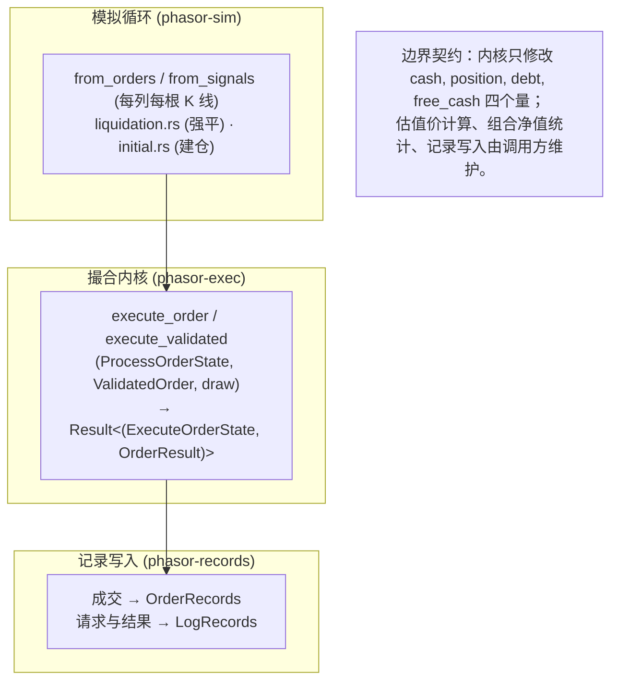
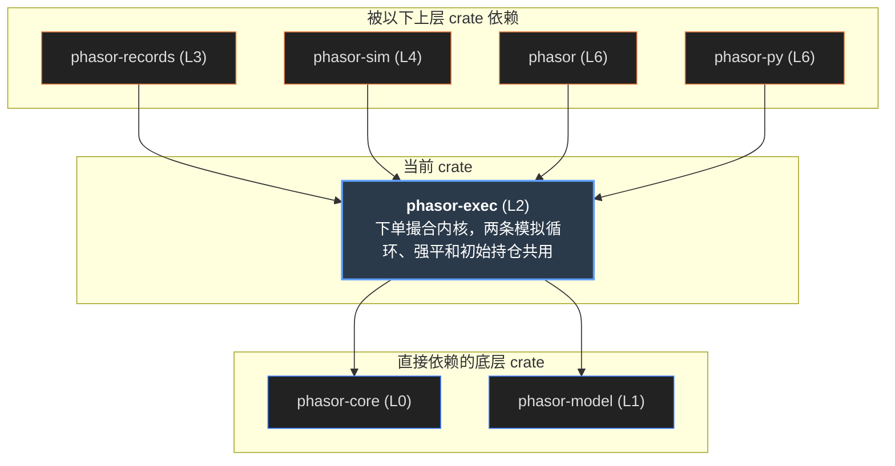
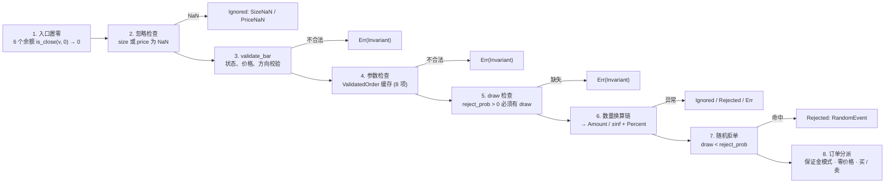
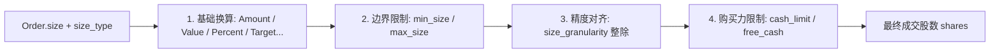
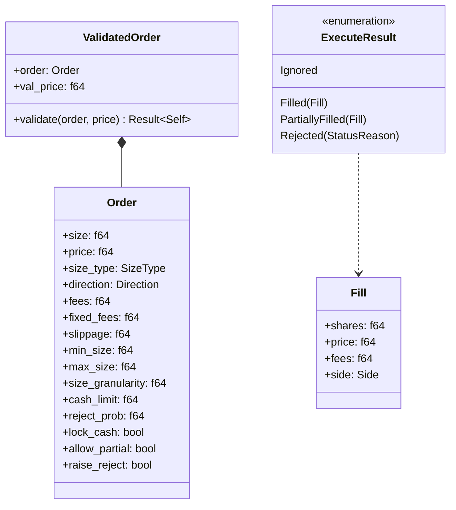

# phasor-exec

撮合内核。整个引擎里语义最密的地方：给定一个账户状态和一笔订单请求，算出成交了多少、什么价、多少手续费，以及新的现金、仓位、负债和可用现金—— 或者说明为什么没成交。两条模拟循环在每根 K 线上调用它，强平和初始持仓也走同一个函数。**正是这份共享**，让每一笔成交的语义只有一处定义，可以单独测试。

> **核心特性与指标：**
> - **1 个纯函数**：execute_order(state, order, reject_draw)：不读全局状态，随机数由调用方传进来，所以并行和串行逐位相同
> - **474 + 1,504 条黄金输出**：单次调用逐字段比较预期输出；链式调用把自己的输出喂给下一步，抓状态传递的错误
> - **3 种结局**：成交（Filled）、忽略 / 拒绝（Ignored / Rejected，带 14 种原因之一，状态不变）、错误（Err，不变量被破坏）

<a id="concept"></a>

## 从第一性原理看：一个撮合内核要回答什么

先不看代码。“按某个价格买 5 股”听起来是一行乘法；真正写下来，至少要先回答六个问题。

### 1. 它必须能对单根 K 线独立调用

两条模拟循环在一列上紧密循环调用它；强平、初始持仓、用户回调下的单也都经过它。如果各处各写一套撮合，就没有理由相信它们的结果一致。所以内核的签名只能依赖**这一刻**的账户状态和订单， 不能依赖“这一列后面还会发生什么”。同理，随机拒单不能去摸全局随机数生成器——那样结果会随线程数和列的遍历顺序变化——随机数要作为参数传进来。

### 2. 账户状态不止现金和仓位

做空会收到卖出所得，但这笔钱不能当成可以随便花的现金：平仓时要按市价买回来。于是需要记下空头“欠”多少（`debt`，按开仓均价计）， 以及扣掉保证金之后真正可用的现金（`free_cash`）。这两个量**依赖路径**——同样的现金和仓位，可以由不同的开平仓历史得到，对应不同的保证金占用—— 所以它们必须是显式状态，不能从现金和仓位推出来。

### 3. “买多少”有很多种说法

单位数、金额、可用现金的百分比、目标仓位、目标金额、目标权重……每种都写一套买卖逻辑会让分支爆炸。正确的做法是**先归一**：一条有固定顺序的换算链， 每一步把一种说法改写成更基础的一种，最后只剩“单位数”（或带比例的无穷大），再按符号分派给买或卖。

### 4. 手续费在现金上限之内

有 100 元、手续费 10% 加 1 元固定费，能买多少？不是 100 元的股票再另付手续费，而是**连手续费一起**不能超过 100：可买的名义金额是 `(100 − 1) / 1.1 = 90`。买不起全部时，必须按这个式子反解，而不是简单地截断。

### 5. 三种“没成交”要分开

数量是 NaN（这根 K 线没有信号）是**忽略**；钱不够、数量低于最小值是**拒绝**，要记下原因；现金为负、价格不是正数是**错误**，说明调用方给了不可能的输入，应当停止。 前两种不改变状态，要进入日志供统计；第三种必须中断，否则引擎会算出一条看似合理、实则错误的净值曲线。

### 6. 边界上的舍入误差会被放大

“现金刚好够”用 `<=` 判断，差 `1e-15` 就会走“钱不够”的反解分支，成交 4.9999999999 股而不是 5 股；如果还有交易单位（整手）， 这个差别会被放大成**整整一股**。所以可负担判断要用容差比较，而在别的地方（与零比较、符号判断）又**不能**随手换成容差。

#### 示意 / 说明：内核在引擎里的位置：两层调用同一个函数，结果写进同一套记录



### 如果从零实现，按这个顺序

1.  **先定状态和结果的形状。**状态 = 现金、有符号仓位、负债、可用现金；结果 = 成交量、成交价、手续费、方向、状态、原因。拒绝时原样返回状态。
2.  **先置零，再比较。**进入内核的每个余额先用容差吸附到精确的 0，否则平掉的仓位“还开着”，可负担判断会抖动。
3.  **忽略先于校验。**NaN 数量 / 价格表示“这根没有信号”，即使状态非法也应当被忽略——这也决定了后面能不能把校验提到循环外。
4.  **校验只报不变量。**负现金、非有限仓位、非正价格（没有 `allow_negative_price` 时）、参数越界 → 错误；其余一律走正常结果。
5.  **换算链归一数量。**TargetPercent → TargetValue → TargetAmount / Amount，−∞ → Percent(−1)，Percent → ±∞ 加比例；按符号分派。
6.  **买和卖各写一次，手续费包含在上限内。**买不起时反解名义金额，有交易单位时**再取整一次**；做空时同步更新负债和保证金。
7.  **随机拒单把随机数当参数。**调用方用 `(seed, row, col)` 生成；概率为 0 时根本不生成。
8.  **用黄金输出逐字段比较**，单次调用和链式调用各一套；用变异测试检验预期输出能不能抓住“把容差换成 \<=”这类改动。

| 第一性原理的问题 | phasor-exec 的回答 | 小节 |
|----|----|----|
| 单根 K 线可独立调用 | 纯函数 `execute_order`；随机数 `reject_draw: Option<f64>` 由调用方提供 | [流程](#flow) |
| 依赖路径的状态 | `ExecuteOrderState { cash, position, debt, free_cash }`；开空冻结 `2 × short_value` | [空头账本](#short) |
| 数量的多种说法 | 换算链，只有 `SizeType::Amount` 进入分派；0 和 NaN 走卖出分支 | [换算链](#cascade) |
| 手续费在上限内 | `max_req_cash = (cash_limit − fixed_fees) / (1 + fees)`，有 granularity 时二次取整 | [模拟器](#sim) |
| 三种“没成交” | `Ignored` / `Rejected` + `StatusInfo`；`Err(Error::Invariant)` | [流程](#flow) |
| 边界舍入 | 可负担用 `is_close_or_less`，与零比较保持精确；`math::add` 更新余额 | [容差边界](#tolerance) |
| 校验的成本 | `ValidatedOrder`：每列检查一次参数，每根 K 线只改四个字段 | [ValidatedOrder](#hoist) |

<a id="graph"></a>

## 依赖图

左边是两个上游：phasor-core 提供容差函数和错误类型，phasor-model 提供五个撮合枚举（lib.rs 把它们再导出，调用方不必再依赖 phasor-model）。 中间是两个私有模块，右边是 `src/` 里直接 `use phasor_exec` 的 crate。点任一节点，只保留相关的线。

#### 示意 / 说明：线的颜色 = 被用到的模块。phasor-sim 是唯一调用内核的 crate；phasor-records 只把请求和结果存进日志



*说明：*

来源：各 crate 的 Cargo.toml 与 `src/` 中的 `use phasor_exec::…`。phasor-analysis 和 phasor-py 不依赖它：分析层只读记录。

<a id="flow"></a>

## 一次调用的流程

| 阶段步骤 | 执行操作与核心逻辑 | 拦截与退出检查 | 状态变更与输出 |
| :---: | :--- | :--- | :--- |
| **1. 入口置零** | 对 `cash, position, debt, free_cash, val_price, value` 调用 `is_close(v, 0.0)` | 无 | 残差微小量强制归零 |
| **2. 忽略检查** | 检查当前订单 `size` 或 `price` 是否为 `NaN` | 若为 NaN 立即返回 `Ignored` (`SizeNaN` / `PriceNaN`) | 不改变任何状态 |
| **3. validate_bar** | 检查价格 $\le 0$（非保证金标的）、方向为 `None`、现金 $< 0$ | 破坏前置不变量返回 `Err(Invariant)` | 严重异常，中断运行 |
| **4. 参数检查** | 检查 `min_size > max_size`、`slippage < 0`、`fees < 0` 等 | 违反订单约束返回 `Err(Invariant)` | 严重异常，中断运行 |
| **5. draw 检查** | 检查 `reject_prob > 0` 时是否传入了随机抽样 `draw` | 缺少随机数生成器返回 `Err(Invariant)` | 保证多线程与串行确定性 |
| **6. 数量换算链** | `size_type` 换算为基础股数；应用 `min_size`、`size_granularity` 整除截断 | 换算结果 $\le 0$ 返回 `Ignored` / `Rejected` | 得到期望目标股数 `shares` |
| **7. 随机拒单** | 评估 `draw < reject_prob` | 若命中返回 `Rejected(RandomEvent)` | 模拟真实交易中网络或交易所拒单 |
| **8. 撮合分派** | 校验购买力并计算手续费；更新 `cash, position, debt, free_cash` | 资金不足返回 `Rejected(InsufficientCash)` | 产生成交结果 `Filled(shares, price, fees)` |

`execute_validated` 从上到下走一遍，任何一步都可能提前返回。顺序本身就是语义：忽略在校验之前，状态校验在参数校验之前（决定同时违反两者时报哪条错误）， 随机拒单在买卖之前（被拒的订单不会碰到只有无穷大请求才会触发的两个错误）。

#### 示意 / 说明：[kernel.rs:1192–1353](https://github.com/nivalume/phasor/blob/1d573df0430fa5cd3a2416300603c7147f3c6a13/crates/phasor-exec/src/kernel.rs#L1192-L1353)。灰色出口 = Ignored，红色 = Rejected，紫色 = Err



*说明：*

买卖两条腿内部还会产生拒绝：买入的 NoCashLong、CantCoverFees、MaxSizeExceeded、MinSizeNotReached、PartialFill，卖出另有 NoCashShort、NoOpenPosition；两条腿各有一个“无限做多 / 无限做空”的错误。分派先看账户类型：保证金列进 `margin_trade`，现金列价格 ≤ 0 进 `signed_price_trade`（见下），其余 size \> 0 买、否则卖。

<a id="negative"></a>

### 价格 ≤ 0：allow_negative_price

期货的价格可以跌到 0 以下（2020 年 4 月的 WTI）。`Order.allow_negative_price` 默认关，这时 `validate_bar` 把不是正有限数的价格当作坏输入（`Err`）。 打开后，有限的 0 和负价格也是价格。分派在换算链和随机拒单之后：保证金列照常进 `margin_trade`，现金列价格 ≤ 0 进 `signed_price_trade`，其余仍是 buy / sell，所以价格为正的订单逐位不变。

| 腿 | 价格 ≤ 0 时怎么算 |
|----|----|
| signed_price_trade | 现金列，`#[cold]`、不内联。只按单位下单：百分比或无穷大的数量、杠杆大于 1 都是 `Err`。可以买入，可以卖出持有的部分（LongOnly 卖得比持仓多时只卖持仓）；会开空或平空的订单是 `Err`，ShortOnly 或没有多头时的卖出被拒（NoOpenPosition）。max_size、size_granularity、min_size 照常。成交价是 `against(price, buying, slippage)`：价格 ± \|价格\| × 滑点，总是对交易不利；手续费 = 数量 × \|成交价\| × fees + fixed_fees。买入的成本或卖出的负所得加上手续费，大于 0 时不能超过 min(free_cash, cash_limit)，否则买入拒为 NoCashLong、卖出拒为 CantCoverFees。现金和可用现金一起变，debt、locked_cash 不变。 |
| margin_trade | 保证金列多空都可以。价格为正时成交价的算法不变；价格 ≤ 0 时用 `against`。手续费和保证金按成交价的绝对值算。持仓成本（debt）可以小于 0，所以 `balance_violation` 对允许负价格的保证金列接受负的 debt。 |

phasor-sim 把运行的 `allow_negative_price` 抄进每个订单，结束时写进 `OrderRecords`；交易视图只在这个标志打开时接受 ≤ 0 的成交价，收益按入场价值的绝对值算（见 [phasor-records](phasor-records.md#views)）。百分比止损距离、持仓费和强平仍按正价格设计。

<a id="cascade"></a>

## 数量换算链

每一步改写 `size_type`，只有 `Amount` 进入买卖分派。顺序不能换：TargetPercent 先乘组合价值变成 TargetValue，Value / TargetValue 再除估值价，TargetAmount 再减去当前仓位。 负无穷的 Amount 有特殊含义——“用 100% 的资源做空”——被改写成 `Percent(−1)`；Percent 最终变成“带比例的 ±∞”，由买卖腿按现金或可卖数量截断。

#### 示意 / 说明：[kernel.rs:1247–1324](https://github.com/nivalume/phasor/blob/1d573df0430fa5cd3a2416300603c7147f3c6a13/crates/phasor-exec/src/kernel.rs#L1247-L1324)。在下面的模拟器里改 size_type，可以在执行轨迹里看到每一步的改写



<a id="sim"></a>

## 撮合模拟器：execute_order 的 JS 移植

下面是 `kernel.rs` 的逐行移植（JS 的 Number 就是 f64；Rust 的 `f64::min` 忽略 NaN，移植里也一样）。选一个例子或改任意字段，右边给出结果、新状态和**执行轨迹**： 走了哪些分支、每一步的中间值。“把输出作为下一步”会把新状态填回左边，像 `golden_sequence.rs` 那样把调用串起来。

#### 示意 / 说明：输入可以写 inf、-inf、nan

ProcessOrderState

Order

执行轨迹

*说明：*

<a id="short"></a>

## 空头账本：debt 与 free_cash

```text
做空账本演变全流程 (初始: cash=100.0, position=0.0, debt=0.0, free_cash=100.0):
─────────────────────────────────────────────────────────────────────────────
Step 1: 开空 (Sell 2 股 @ 50.0, 无手续费)
  ├─ 收到沽出资金: +100.0          ──► cash = 200.0
  ├─ 借入证券计入负债: 2 × 50 = 100 ──► debt = 100.0
  ├─ 持仓变为负数:                 ──► position = -2.0
  └─ 可用现金: cash - debt         ──► free_cash = 100.0 (净购买力并未虚增)

Step 2: 浮动市价变动 (价格涨到 60.0, 产生浮亏 20.0)
  ├─ 现金结余未变:                 ──► cash = 200.0
  ├─ 借币市值上升: 2 × 60 = 120.0  ──► debt = 120.0
  └─ 可用现金承压: cash - debt     ──► free_cash = 80.0 (浮亏实时扣减购买力)

Step 3: 低位平空 (价格跌到 40.0, Buy 2 股 @ 40.0 平仓)
  ├─ 买入归还成本: 2 × 40.0 = 80.0 ──► cash = 200.0 - 80.0 = 120.0
  ├─ 归还借入证券: 负债清零        ──► debt = 0.0
  ├─ 持仓恢复平衡: -2.0 + 2.0 = 0  ──► position = 0.0
  └─ 最终结余现金:                 ──► free_cash = 120.0 (本金 100 + 净收益 20)
```

开空收到的钱进 `cash`，但同时记一笔 `debt`（按开仓价计的卖出所得），并让 `free_cash` 变化 `所得 − 2 × short_value`： 一次抵掉这笔所得本身，一次是为将来买回预留的保证金。平空时按 `debt / |position|`（开仓均价）按比例释放。下面的表用同一个移植逐步算出来。

#### 示意 / 说明：初始现金 100，无手续费。每一步的输入状态 = 上一步的输出

| 步  | 订单 | 结果 | cash | position | debt | free_cash | cash − debt |
|-----|------|------|------|----------|------|-----------|-------------|

*说明：*

> [!NOTE]
> **为什么不能只存现金和仓位：**同样是“现金 150、空 5 股”，可以是 10 元一次开空 5 股，也可以是先在 20 元开空再部分平掉……开仓均价不同，平仓时释放的保证金就不同。 `ExecuteOrderState` 的文档原话是“保证金占用依赖路径”，所以 `debt` 和 `free_cash` 是一等状态。

<a id="tolerance"></a>

## 容差边界：一个只差 1e-12 的变异

买单的可负担判断是 `is_close_or_less(total_req_cash, cash_limit)`。把它换成 `<=`，两者只在相对误差 1e-9 以内有区别——没有专门的边界情形时，这个变异**能通过所有测试**。 `size_granularity` 会把这点差别放大成整整一个单位，所以现在有专门的边界 fixture（`tolerance_boundary_*`）。拖动下面的超出量看看。

#### 示意 / 说明：现金 50 买 5 股 @ 10。让现金比需要的少一点点：cash = 50 × (1 − ε)

| 可负担判断 | 走的分支 | 成交数量 | 手续费 | 剩余现金 |
|------------|----------|----------|--------|----------|

*说明：*

### 与零比较是精确的

买卖两条腿里 `cash_limit == 0`、`adj_size == 0`、`position < 0` 这些判断故意不用容差：换成 `is_close` 会改变哪些订单成交，黄金输出会对不上。

### 但入口先吸附到零

进入内核时，`cash、position、debt、free_cash、val_price、value` 先经 `is_close(v, 0)` 吸附。于是后面的精确比较看到的是干净的 0，而不是 `1e-17`。

### 测的是 adj_size

买入腿的 SizeZero 检查测的是截断前的 `adj_size`，不是最终的 `final_size`，代码里专门注释了这一点。

<a id="hoist"></a>

## ValidatedOrder：把列常量的校验提出循环

校验分两半。`validate_bar` 读的是每根 K 线都会变的东西（状态、价格、方向）；`param_violation` 读的是一整列通常共享的参数（费率、滑点、数量上下限、粒度、拒单概率、现金上限）。 在真实策略里大多数 K 线不成交，这些 K 线几乎只做校验，所以把第二半每列做一次就是可观的提速：benchmarks/README.md 记录 `ValidatedOrder` 连同“每列构造一次订单”合计稀疏 +30%、稠密 +22%。

<table>
<thead>
<tr>
<th colspan="2">validate_bar（每根 K 线）</th>
</tr>
</thead>
<tbody>
<tr>
<td>cash</td>
<td>不是 NaN，且 ≥ 0</td>
</tr>
<tr>
<td>position</td>
<td>有限</td>
</tr>
<tr>
<td>debt</td>
<td>有限，且 ≥ 0</td>
</tr>
<tr>
<td>free_cash</td>
<td>不是 NaN（可以为负）</td>
</tr>
<tr>
<td>price</td>
<td>有限，且 &gt; 0</td>
</tr>
<tr>
<td>LongOnly</td>
<td>持仓不能为负</td>
</tr>
<tr>
<td>ShortOnly</td>
<td>持仓不能为正</td>
</tr>
</tbody>
</table>

<table>
<thead>
<tr>
<th colspan="2">param_violation（每列一次）</th>
</tr>
</thead>
<tbody>
<tr>
<td>fees / fixed_fees</td>
<td>有限</td>
</tr>
<tr>
<td>slippage</td>
<td>有限，且 ≥ 0</td>
</tr>
<tr>
<td>min_size</td>
<td>有限，且 ≥ 0</td>
</tr>
<tr>
<td>max_size</td>
<td>不是 NaN，且 &gt; 0（可以是 +inf）</td>
</tr>
<tr>
<td>size_granularity</td>
<td>NaN（不取整），或有限且 &gt; 0</td>
</tr>
<tr>
<td>reject_prob</td>
<td>在 [0, 1]</td>
</tr>
<tr>
<td>cash_limit</td>
<td>不是 NaN，且 ≥ 0</td>
</tr>
</tbody>
</table>

### 构造不会失败

`ValidatedOrder::new` 把违规**带着走**，到原本会报错的那一刻（状态校验之后）才报。因为内核先忽略 NaN 数量再校验：一列 NaN 数量 + 非法费率应当得到一串 Ignored，而不是错误。

### set_bar 只改四个字段

`size、price、size_type、direction` 每根 K 线都可能变，且都不在参数校验里，所以覆盖它们不会让缓存的结论失效。参数真的沿行变化时，调用方重建一个。

### 报错顺序固定

两半拆开后仍按一次检查时的顺序调用：同时违反状态和参数时报的是状态错误（测试 `a_bad_state_outranks_a_bad_parameter`）。违规存成 `&'static str`，让 ValidatedOrder 保持 `Copy`。

`param_violation` 有 9 项只看整列共享的字段（费用、固定费用、滑点、最小 / 最大数量、交易单位、杠杆、拒单概率、现金上限），保证金订单再加 2 项初始保证金的检查；代码注释估计每列检查一次在多数 K 线不成交的策略上省 12–15%。benchmarks/README.md 的交错复测里，提前检查和每列只构造一次订单请求合起来是稀疏负载 +30%、稠密 +22%。

<a id="class"></a>

## 类图

四个公开类型和三个公开函数。`kernel` 与 `types` 都是私有模块，lib.rs 把需要的东西再导出到 crate 根。

#### 示意 / 说明：phasor-exec 的公开接口



<a id="verify"></a>

## 验证：黄金输出逐字段比较

### tests/golden.rs · execute_order.tsv

474 次单独调用：每一种能触发的拒单原因、每一种数量类型、每一种方向、各个不变量错误、以及容差边界；其中 400 个是随机生成的状态和订单。逐字段比较输出状态和结果，出错时能定位到换算链的哪一步。

### tests/golden_sequence.rs · order_sequence.tsv

1,504 步链式调用（含 120 条随机序列）：每一步的输入是上一步的**自己的**输出。专门抓状态传递的错误，以及要晚一步才显形的残差——这正是入口置零机制的测试。

> [!NOTE]
> **黄金输出是由变异测试塑形的，不是凭感觉写的。**把可负担判断从 `is_close_or_less` 换成 `<=` 的变异，要靠 `tolerance_boundary_*` 这组情形才杀得死； 置零有两套冗余机制，只有链式测试能发现两者同时被删掉。比较时 NaN 与 NaN、同号无穷与同号无穷算一致（`tests/common/mod.rs` 的 `agree`），其余用 `is_close`。 预期输出提交在 `tests/fixtures/` 里，`cargo test` 直接回放，不需要 Python。

<a id="table"></a>

## 谁依赖它，用来做什么

| crate | 用到的模块 | 用来做什么 |
|-------|------------|------------|

<a id="rules"></a>

## 不能绕开的规则

### 语义由黄金输出钉住，哪怕写法不地道

不地道的写法加注释而不是“整理”。0 和 NaN 走卖出分支、SizeZero 测 `adj_size`、numpy 语义的 `sign`（0 和 NaN 都得 0），都是有意保留的。`tests/fixtures/*.tsv` 不能为了让改动通过而重新生成。

### 拒绝不是错误

被拒的订单原样返回状态，带一个 `StatusInfo`；只有不变量被破坏才返回 `Err`。`raise_reject` 是调用方（phasor-sim）把拒绝升级成错误的开关，内核自己不看它。

### 保持可单独调用

不要让内核读“这一列的其它部分”，也不要在里面写记录、维护估值价或生成随机数。这些都在调用方，任何调用方（两条循环、强平、初始持仓）才能直接复用它。

### 余额更新一律走 math::add

现金、仓位、负债、可用现金的每次更新都用 `add`，异号近似抵消时得到精确的 0；可负担判断用 `is_close_or_less`，严格小于用 `is_less`。见 [phasor-core · 容差](phasor-core.md#math)。

## 源文件

<table>
<thead>
<tr>
<th>文件</th>
<th>内容</th>
</tr>
</thead>
<tbody>
<tr>
<td class="mono"><a href="https://github.com/nivalume/phasor/blob/1d573df0430fa5cd3a2416300603c7147f3c6a13/crates/phasor-exec/src/lib.rs">crates/phasor-exec/src/lib.rs</a></td>
<td>两种失败、确定性、两套黄金输出的说明；再导出内核函数、四个类型和五个 phasor-model 枚举。</td>
</tr>
<tr>
<td colspan="2" class="small">行号对应 <a href="https://github.com/nivalume/phasor/tree/1d573df0430fa5cd3a2416300603c7147f3c6a13">1d573df</a>。</td>
</tr>
<tr>
<td class="mono"><a href="https://github.com/nivalume/phasor/blob/1d573df0430fa5cd3a2416300603c7147f3c6a13/crates/phasor-exec/src/types.rs">src/types.rs</a></td>
<td>ExecuteOrderState（debt / free_cash 的含义）、ProcessOrderState（flat）、Order 及其 Default（含 allow_negative_price，默认 false）、OrderResult。</td>
</tr>
<tr>
<td class="mono"><a href="https://github.com/nivalume/phasor/blob/1d573df0430fa5cd3a2416300603c7147f3c6a13/crates/phasor-exec/src/kernel.rs">src/kernel.rs</a></td>
<td>sign / floor_to；locked_cash_limit（<a href="https://github.com/nivalume/phasor/blob/1d573df0430fa5cd3a2416300603c7147f3c6a13/crates/phasor-exec/src/kernel.rs#L48">:48</a>）、buy（<a href="https://github.com/nivalume/phasor/blob/1d573df0430fa5cd3a2416300603c7147f3c6a13/crates/phasor-exec/src/kernel.rs#L91">:91</a>）、levered_buy_cost（<a href="https://github.com/nivalume/phasor/blob/1d573df0430fa5cd3a2416300603c7147f3c6a13/crates/phasor-exec/src/kernel.rs#L288">:288</a>）；sell_size_limit（<a href="https://github.com/nivalume/phasor/blob/1d573df0430fa5cd3a2416300603c7147f3c6a13/crates/phasor-exec/src/kernel.rs#L350">:350</a>）、repay_long（<a href="https://github.com/nivalume/phasor/blob/1d573df0430fa5cd3a2416300603c7147f3c6a13/crates/phasor-exec/src/kernel.rs#L412">:412</a>）、sell（<a href="https://github.com/nivalume/phasor/blob/1d573df0430fa5cd3a2416300603c7147f3c6a13/crates/phasor-exec/src/kernel.rs#L431">:431</a>）；unit_margin（<a href="https://github.com/nivalume/phasor/blob/1d573df0430fa5cd3a2416300603c7147f3c6a13/crates/phasor-exec/src/kernel.rs#L576">:576</a>）、margin_trade（<a href="https://github.com/nivalume/phasor/blob/1d573df0430fa5cd3a2416300603c7147f3c6a13/crates/phasor-exec/src/kernel.rs#L611">:611</a>）；against（<a href="https://github.com/nivalume/phasor/blob/1d573df0430fa5cd3a2416300603c7147f3c6a13/crates/phasor-exec/src/kernel.rs#L794">:794</a>）、signed_price_trade（<a href="https://github.com/nivalume/phasor/blob/1d573df0430fa5cd3a2416300603c7147f3c6a13/crates/phasor-exec/src/kernel.rs#L811">:811</a>）；validate_bar（<a href="https://github.com/nivalume/phasor/blob/1d573df0430fa5cd3a2416300603c7147f3c6a13/crates/phasor-exec/src/kernel.rs#L922">:922</a>）、balance_violation（<a href="https://github.com/nivalume/phasor/blob/1d573df0430fa5cd3a2416300603c7147f3c6a13/crates/phasor-exec/src/kernel.rs#L966">:966</a>）、param_violation（<a href="https://github.com/nivalume/phasor/blob/1d573df0430fa5cd3a2416300603c7147f3c6a13/crates/phasor-exec/src/kernel.rs#L994">:994</a>）；ValidatedOrder（<a href="https://github.com/nivalume/phasor/blob/1d573df0430fa5cd3a2416300603c7147f3c6a13/crates/phasor-exec/src/kernel.rs#L1056">:1056</a>，in_levered_account <a href="https://github.com/nivalume/phasor/blob/1d573df0430fa5cd3a2416300603c7147f3c6a13/crates/phasor-exec/src/kernel.rs#L1085">:1085</a>）；execute_order（<a href="https://github.com/nivalume/phasor/blob/1d573df0430fa5cd3a2416300603c7147f3c6a13/crates/phasor-exec/src/kernel.rs#L1141">:1141</a>）；percent_spelling（<a href="https://github.com/nivalume/phasor/blob/1d573df0430fa5cd3a2416300603c7147f3c6a13/crates/phasor-exec/src/kernel.rs#L1154">:1154</a>，不内联的冷函数，换算链在 TargetPercent 之前用一次比较把 ValuePercent 和三种 *100 写法交给它）；execute_validated（<a href="https://github.com/nivalume/phasor/blob/1d573df0430fa5cd3a2416300603c7147f3c6a13/crates/phasor-exec/src/kernel.rs#L1192">:1192</a>，换算链 <a href="https://github.com/nivalume/phasor/blob/1d573df0430fa5cd3a2416300603c7147f3c6a13/crates/phasor-exec/src/kernel.rs#L1247-L1324">:1247–1324</a>）；单元测试。</td>
</tr>
<tr>
<td class="mono"><a href="https://github.com/nivalume/phasor/blob/1d573df0430fa5cd3a2416300603c7147f3c6a13/crates/phasor-exec/tests/golden.rs">tests/golden.rs</a> · <a href="https://github.com/nivalume/phasor/blob/1d573df0430fa5cd3a2416300603c7147f3c6a13/crates/phasor-exec/tests/golden_sequence.rs">tests/golden_sequence.rs</a></td>
<td>单次与链式的黄金输出回归测试；tests/common/mod.rs 是 fixture 读取与 agree。</td>
</tr>
<tr>
<td class="mono"><a href="https://github.com/nivalume/phasor/blob/1d573df0430fa5cd3a2416300603c7147f3c6a13/tests/fixtures/execute_order.tsv">tests/fixtures/execute_order.tsv</a> · order_sequence.tsv</td>
<td>预期输出（黄金文件）。</td>
</tr>
</tbody>
</table>
