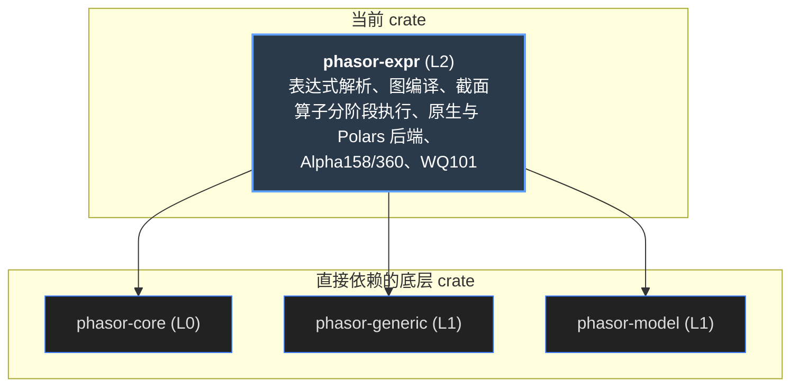
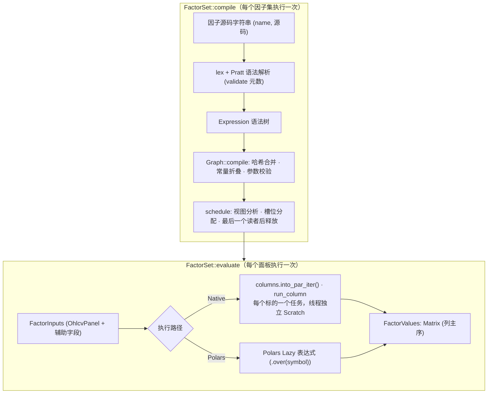
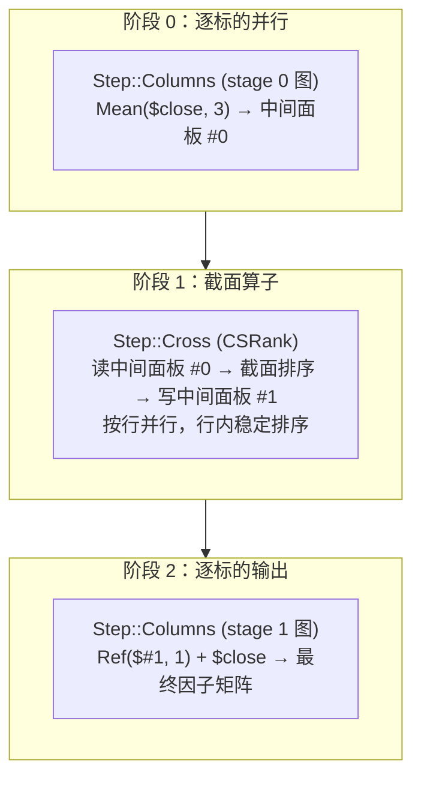

# phasor-expr

因子表达式。把 Qlib 风格的字符串——`$close / Mean($close, 20) - 1`——编译一次，然后对任意多个面板求值，结果直接是列主序的 `Matrix`（时间 × 标的）， 可以交给信号层和模拟层。它不是一个通用的解释器：整个因子集被编译成**一张**去重的依赖图，按标的并行求值，每个标的只需要几条暂存序列。 图里有截面算子（`CSRank`、`CSZScore`……一行读所有标的）时，图在这些节点处切成阶段，阶段内仍按标的并行，阶段之间逐行做截面。自带三套因子库：Alpha158、Alpha360、WorldQuant 101。

> **核心特性与指标：**
> - **158 → 357 节点 / 17 槽位**：Alpha158 编译后的图：148 个节点直接写进输出；Alpha360 是 722 个节点，只要 1 个槽位（354 个 Ref 是不占内存的视图）
> - **0 处不一致**：对 qlib 生成的两份 fixture（Alpha158 80 行 × 3 个标的、Alpha360 64 行）原生和 Polars 两个后端都要通过；这个页面的 JS 移植也逐格通过
> - **约 10× 快于 Polars**：2520 × 200 的 Alpha158：原生 0.60 s，Polars 后端 6.2 s。Polars 后端留着做独立的交叉验证

## 从第一性原理看：因子为什么要一门语言，又为什么要编译

先不看代码。一个因子是“面板 → 面板”的函数：输入是开高低收量（时间 × 标的），输出是同形状的一张表。要做这件事，有几个问题绕不过去。

### 1. 为什么不直接写 Rust 函数

研究的节奏是“改一个窗口、换一个分母、再跑一遍”，每次重新编译 Rust 太慢；而且业界大量现成的因子库（Qlib 的 Alpha158 / Alpha360）本来就是字符串。 一门小语言让因子成为**数据**：可以存进配置、从 Python 传进来、在报告里原样显示，并且和 Qlib 等因子库的公式逐字对应。

### 2. 因子之间大量重复

Alpha158 里几十个因子都用到 `Ref($close, 1)`，`Mean($close>Ref($close,1), d)` 在 CNTP 和 CNTD 里各出现一次；`a+b` 和 `Add(a,b)` 是同一个东西。 逐个解释每个因子的语法树，会把同一个子表达式算上几十遍。所以整个因子集应当被编译成一张**共享子表达式**的有向无环图：节点由“算子 + 输入节点”唯一确定（hash-consing）。

### 3. 内存应该由“同时活着的中间结果”决定，而不是由节点数决定

357 个节点如果每个都存一整张 2520 × 200 的矩阵，就是 357 × 4 MB。但几乎所有算子都是**逐标的**的时间序列运算：一个标的的结果从不读另一个标的。 于是可以一次只算一个标的，中间结果只是一条 2520 长的序列（约 20 KB）；再按依赖顺序排好节点，一条中间序列在它最后一个读者之后就可以被复用——像寄存器分配。 Alpha158 最后只需要 17 条暂存序列。

### 4. 平移不该复制数据

`Ref(x, k)` 只是“晚 k 行读 x”。把它物化成一条新序列，Alpha360 就要多复制 354 次。正确的做法是把它当成**视图**：消费者带着偏移量直接读 `x`。 负的 `k` 读的是未来，必须真的计算，并且要能被检测出来（`uses_future()`）——它只能出现在标签里，不能出现在信号里。

### 5. 错误要在编译期报

窗口是 2.5、分位数是 1.5、`Ref` 的偏移是一个字段——这些都应该在 `compile` 时、带着因子名报出来，而不是在算完前 150 个因子之后才在第 151 个上失败。 字段缺失也一样：求值前先解析所有字段，并行部分就没有出错路径。

### 6. 两个后端互相检验

一个手写的高速后端，和一个尽量直接地翻译成 Polars Lazy 的后端，在同一份 qlib fixture 上都必须通过。两者实现完全不同（增量累加器 vs 逐窗 UDF），同时出错的概率很小。

### 7. 有的因子要读同一行的所有标的

“今天的收益在所有股票里排第几”是截面运算：一行的输出读这一行每个标的的值。它打破了上面第 3 点的前提——一个标的不能再单独算完。 但它只在这些节点上打破：截面节点之前的部分可以照旧按标的并行算完，存成整块面板，逐行做截面，再把结果当成新的字段交给后面的逐标的部分。所以图要在截面节点处**分阶段**，而不是整个退回逐行计算。

| 第一性原理的问题 | phasor-expr 的回答 | 小节 |
|----|----|----|
| 因子是数据 | Qlib 语法：`$field`、中缀运算、44 个函数；Pratt 解析器，源码 ≤ 16 KiB，嵌套 ≤ 128 | [语言](#lang) |
| 共享子表达式 | `Graph`：按 `(Op, inputs)` 哈希合并；逐元素字面量常量折叠 | [编译器](#compiler) |
| 内存由活跃集决定 | `Graph::schedule`：依赖顺序 + 最后读者之后释放槽位；没人读的节点直接写输出 | [编译器](#compiler) |
| 平移不复制 | `k ≥ 0` 的 `Ref` 是视图（链式视图合并偏移）；`k < 0` 计算并使 `uses_future()` 为真 | [编译器](#compiler) |
| 编译期报错 | 参数必须是字面量；窗口为非负整数（0 = 扩展），分位数在 \[0, 1\]，EMA / Delta 参数非负；错误带因子名 | [编译器](#compiler) |
| 逐标的并行 | `rayon`：每个标的列一个任务，每个工作线程一份 `Scratch`，写各输出中互不相交的列切片 | [求值](#eval) |
| 快 | O(1) 增量累加器（定期重建、平移求和、常量窗口检测）、有序环 / 树状数组、单调队列 | [计算核心](#kernels) |
| 互相检验 | `ComputeBackend` trait：`NativeBackend` 与 `PolarsBackend`（feature） | [后端](#backends) |
| 截面 | `Op::Cross`；`Staged::plan` 给每个节点一个层号，跨层的序列存成面板；`run_staged` 逐层执行，截面节点逐行并行 | [截面与分阶段](#cross) |

## 依赖图

左边是上游：phasor-core 的 `Matrix` / `Error`，phasor-generic 的 `rolling_mean / max / min_1d`，phasor-model 的 `OhlcvPanel`，外部的 rayon 和可选的 polars。 中间是十一个私有模块（lib.rs 定义 `FactorSet` 并再导出公开项；`stage`、`cross` 负责截面算子，`wq101` 是 WorldQuant 101 的表），右边是使用者。点任一节点，只保留相关的线。

#### 示意 / 说明：线的颜色 = 被用到的模块。研究层不直接依赖这个 crate，而是经 Python 包调用（虚线）

*说明：*

来源：Cargo.toml 与各模块的 `use`。phasor-signals、phasor-sim 不依赖它：因子矩阵经调用方（例如门面的 `SignalSweep` 或 Python 的策略函数）变成布尔信号。

## 从字符串到 Matrix

#### 示意 / 说明：compile 一次（左半），evaluate 多次（右半）

## 语言

字段写作 `$name`（不区分大小写，统一小写）；OHLCV 由 `from_ohlcv` 提供，其他字段（例如 Alpha158 需要的 `vwap`）用 `with_field` 加入。 布尔结果是 `1.0 / 0.0`。运算符优先级从低到高：

\|\<&\<\> \< \>= \<= == !=\< + −\<\* /\<一元 + −\<\*\*（右结合）

所以 `-2**2` 是 `-(2**2) = -4`，和 Python 一样；`$a > 1 & $b < 2` 是 `($a>1) & ($b<2)`。单独的 `=` 或 `!` 是词法错误。

| 类别 | 函数 | 语义 |
|----|----|----|
| 逐元素 | `Abs Sign Log Not`；`Add Sub Mul Div Power Gt Ge Lt Le Eq Ne And Or`；`Greater Less`；`If(c, a, b)` | 函数写法和运算符写法编译成同一个节点。比较是 NumPy 式的精确比较：和 NaN 比较得 0。`Greater / Less` 遇 NaN 得 NaN。 |
| 逐元素（扩展） | `Exp Sqrt IsNan`；`FillNa(x, v)`、`Mask(x, c)`、`SignedPower(x, p)`；`Clip(x, lo, hi)` | `FillNa`：x 是 NaN 时取 v。`Mask`：c 为真（非 0 且非 NaN）时取 x，否则 NaN。`SignedPower` = sign(x)·\|x\|^p，x = 0 得 0。`Clip` 不是新节点，编译成 `Less(Greater(x, lo), hi)`：NaN 仍是 NaN，下限高于上限时得上限，和 NumPy 的 clip 一样。 |
| 平移 | `Ref(x, n)`、`Delta(x, n)` | `Ref` 正数读过去（视图），负数读未来；`Delta = x − Ref(x, n)`，n 不能为负。 |
| 平滑 | `EMA(x, p)` | `p < 1` 是 alpha，`p ≥ 1` 是 span（alpha = 2/(p+1)），`0` 是扩展窗口（每行重新加权，O(n)）。 |
| 滚动 `(x, N)` | `Mean Sum Std Var Max Min Med Mad Count Skew Kurt WMA Rank IdxMax IdxMin Slope Rsquare Resi` | `min_periods = 1`（qlib 语义：第 0 行就有值）；`N = 0` 是扩展窗口；NaN 占窗口位置但不参与计算。`Std/Var` 是样本（ddof = 1）；`Rank` 是最后一个值在窗口里的分位；`IdxMax/IdxMin` 从 1 开始。 |
| 滚动 `(x, N, q)` | `Quantile` | 线性插值，q ∈ \[0, 1\]。 |
| 成对 `(x, y, N)` | `Corr Cov` | 只用两边都不是 NaN 的行；`Corr` 在任一边的标准差 ≤ 2e-5 时为 NaN（qlib 的规则）。 |
| 滚动（扩展）`(x, N)` | `DecayLinear Prod` | `DecayLinear` 是 WorldQuant 的 decay_linear：权重 1..=N，最新的最重，只在有值的位置上归一化。`Prod` 是窗口里有值的数之积，全 NaN 为 NaN。两者都和其它滚动算子一样 minp = 1。 |
| 截面 | `CSRank CSZScore CSDemean`（x）；`Scale(x[, a])`；`IndNeutralize(x, g)`；`CSResi(y, x)` | 一行进、一行出，NaN 不参与统计、输出 NaN。`CSRank` 是百分位排名，并列取平均（pandas `rank(pct=True)`）；`CSZScore` 用样本标准差；`Scale` 让一行的绝对值之和等于 a（默认 1）；`IndNeutralize` 减去同组均值，组是 g 在这一行的精确值；`CSResi` 是 y 对 x 的截面最小二乘残差。 |

截面算子以外的算子都只读本标的，所以没有截面算子的图仍按标的并行；有截面算子的图怎么执行见[截面与分阶段](#cross)。新算子的元数在 `parse.rs` 的 `validate`（[:244](https://github.com/nivalume/phasor/blob/1d573df0430fa5cd3a2416300603c7147f3c6a13/crates/phasor-expr/src/parse.rs#L244)）登记，名字到节点的映射在 `graph.rs` 的 `Builder::call`（[:376](https://github.com/nivalume/phasor/blob/1d573df0430fa5cd3a2416300603c7147f3c6a13/crates/phasor-expr/src/graph.rs#L376)）。

## 编译器实验台

下面是 `parse.rs` 和 `graph.rs` 的移植：词法、Pratt 解析、元数检查、哈希合并、常量折叠、参数校验、视图解析和槽位调度。每行一个 `名字 = 表达式`。 它对 Alpha158 给出 357 个节点、17 个槽位、148 个直接写输出，对 Alpha360 是 722 个节点、1 个槽位。 移植只实现了逐标的的基本算子：截面算子和 `Exp`、`DecayLinear` 等算子在这里会报 unsupported operator，分阶段的执行看下面[截面与分阶段](#cross)一节。

#### 示意 / 说明：FactorSet::compile，JS 移植

*说明：*

依赖图（节点按依赖深度分列）

字段 字面量 视图（Ref k≥0，不计算） 计算，占槽位 sN 计算，直接写输出

*说明：*

把鼠标移到节点上看它的算子、输入、槽位和被哪些因子用到。

#### 示意 / 说明：槽位时间线：横轴是调度顺序（节点下标），每条带子是一个节点占用某个槽位直到它最后一个读者

> **图表：槽位时间线**

*说明：*

#### 示意 / 说明：语法树（compile 之前保留的 Expression）

### 节点表

| \#  | 算子 | 输入 | 视图 | 槽位 | 输出给 | 被读 |
|-----|------|------|------|------|--------|------|

## 求值：每个标的一个任务

上面编译出的因子集在一个合成面板上求值（2 个标的 × 80 根 K 线，`vwap` 由开高低收的均值近似）。求值器和原生后端的语义一致——同样的 `min_periods = 1`、同样的 NaN 规则、同样的 qlib 特例； 窗口统计用逐窗重算，而原生后端用增量累加器，两者在 1e-9 内一致（`eval.rs` 的测试正是这样对照的）。

#### 示意 / 说明：FactorSet::evaluate 在合成面板上，JS 移植

> **图表：因子值**

*说明：*

细线是两个标的的 close（右轴），粗线是所选因子（左轴）。“单独求值逐位相同”对应 Rust 测试 `each_symbol_evaluates_exactly_as_it_would_alone`：一个标的和别的标的放在一起算、还是单独算，结果的每一位都相同——这是按标的并行的前提。

### 没有锁，也没有 unsafe

每个输出先按列切成 `&mut [f64]`，第 c 个任务拿走每个输出的第 c 片。任务之间写的内存互不相交，借用检查器就能证明。

### 页面惰性清零

每个输出单独 `vec![0.0; n]`，由写入它的线程第一次触碰时才真正清零；原先克隆一个全零缓冲区，串行就要 350 ms。

### 峰值内存就是输出

中间结果是单个标的的序列（2,520 行约 20 KB），每个线程只有 `graph.slots` 条。2520 × 500 的 Alpha158 峰值 RSS 约 1.6 GB，几乎全是 158 个输出矩阵。

## 截面算子与分阶段执行

从 `stage.rs` 的模块注释和 `Staged::plan`（[:66](https://github.com/nivalume/phasor/blob/1d573df0430fa5cd3a2416300603c7147f3c6a13/crates/phasor-expr/src/stage.rs#L66)）读起。`FactorSet::compile` 编完整张图之后调一次 `plan`：图里没有 `Op::Cross` 节点就返回 None，求值走原来的路径，一点代价都没有；有，就把图切成阶段，存在 `FactorSet.plan` 里。

#### 示意 / 说明：Staged::plan 的三步，以 `Ref(CSRank(Mean($close, 3)), 1) + $close` 为例

### plan 里的数据

`Step::Columns { graph, sources, dests }`：一张阶段图，`sources` 说它的每个字段是原图的字段、常数还是面板，`dests` 说每个输出写到因子位置还是面板。`Step::Cross { op, inputs, panel, outputs }`：一个截面节点。`release[i]` 是第 i 步之后再没有人读的面板。

### run_staged（[eval.rs:312](https://github.com/nivalume/phasor/blob/1d573df0430fa5cd3a2416300603c7147f3c6a13/crates/phasor-expr/src/eval.rs#L312)）

按顺序执行每一步：Columns 步把面板借成字段调 `run_graph`（还是按标的并行），Cross 步调 `cross_panel`（[eval.rs:381](https://github.com/nivalume/phasor/blob/1d573df0430fa5cd3a2416300603c7147f3c6a13/crates/phasor-expr/src/eval.rs#L381)）。之后按 `release` 把面板置 None。因子既可能是阶段图的输出，也可能直接是截面节点（例如整个因子就是 `CSRank($close)`）。

### cross_panel：先转成行，再转回列

面板是列主序的，一行分散在 n_cols 个位置。`cross_panel` 先 `par_chunks_mut(n_cols)` 按行并行：每行把 x、y 收进连续的缓冲区，调 `cross::row` 写进一块行主序的结果；再按列并行转置回列主序。

### 为什么和线程数无关

一行的结果只由这一行决定，行内的和按标的顺序累加（`cross.rs` 的模块注释）；排名和分组用 `total_cmp` 再按下标排序，稳定。测试 `thread_count_does_not_change_staged_results` 在 1、2、4、7 个线程上逐位比较。

| 截面核心（cross.rs） | 读法 |
|----|----|
| row（[cross.rs:17](https://github.com/nivalume/phasor/blob/1d573df0430fa5cd3a2416300603c7147f3c6a13/crates/phasor-expr/src/cross.rs#L17)） | 按 `Cross` 分派；x 是第一个输入这一行的值，y 是第二个（IndNeutralize 的组、CSResi 的自变量），没有第二个输入时是 NaN。 |
| rank（[cross.rs:72](https://github.com/nivalume/phasor/blob/1d573df0430fa5cd3a2416300603c7147f3c6a13/crates/phasor-expr/src/cross.rs#L72)） | 有值的下标按值排序，相等的一段取平均名次 (start+1+end)/2，再除以有值的个数。相等是精确相等（局部 `#[allow(clippy::float_cmp)]`，和 pandas 一样）。 |
| mean_std（[cross.rs:45](https://github.com/nivalume/phasor/blob/1d573df0430fa5cd3a2416300603c7147f3c6a13/crates/phasor-expr/src/cross.rs#L45)） | ZScore 和 Demean 共用；少于两个值时标准差为 NaN，所以只有一个标的有值的行，ZScore 全是 NaN。 |
| neutralize（[cross.rs:96](https://github.com/nivalume/phasor/blob/1d573df0430fa5cd3a2416300603c7147f3c6a13/crates/phasor-expr/src/cross.rs#L96)） | 组标签是 g 在这一行的值，按 (g, 下标) 排序后一段一段地减组均值；g 是 NaN 的标的输出 NaN。组标签逐行读，所以行业可以随时间变。 |
| residual（[cross.rs:125](https://github.com/nivalume/phasor/blob/1d573df0430fa5cd3a2416300603c7147f3c6a13/crates/phasor-expr/src/cross.rs#L125)） | 只用两边都有值的标的；少于两个时整行 NaN。 |

代价：有截面算子时，跨层的序列都是整块面板，峰值内存不再只是输出；`evaluate_batches` 也只能先整块算完再分批交出（下一节）。 面板在最后一个读者之后就释放，所以只在一个截面节点附近用到的中间结果不会一直占着。

## 分批输出与窄面板

`FactorSet::evaluate`（[lib.rs:126](https://github.com/nivalume/phasor/blob/1d573df0430fa5cd3a2416300603c7147f3c6a13/crates/phasor-expr/src/lib.rs#L126) → [eval.rs:199](https://github.com/nivalume/phasor/blob/1d573df0430fa5cd3a2416300603c7147f3c6a13/crates/phasor-expr/src/eval.rs#L199)）现在在三条路径里选：有 plan 走 `run_staged`；没有 plan、标的数少于 rayon 线程数且不止一个因子，走 `run_parts`；其余走 `run_graph`（就是上面“每个标的一个任务”）。 另有 `evaluate_batches` 控制输出的峰值内存。

### evaluate_batches（[lib.rs:154](https://github.com/nivalume/phasor/blob/1d573df0430fa5cd3a2416300603c7147f3c6a13/crates/phasor-expr/src/lib.rs#L154)）

每次取 `batch` 个标的，把每个字段的那几列切出来（列主序，切片就是连续的一段）建一个小的 `FactorInputs`，求值后连同标的区间交给 `sink`。没有截面算子时同时只有一批在内存里。有截面算子时每一行都要全部标的，所以先整块求值，再用 `FactorValues::columns`（[eval.rs:162](https://github.com/nivalume/phasor/blob/1d573df0430fa5cd3a2416300603c7147f3c6a13/crates/phasor-expr/src/eval.rs#L162)）切成批交出。sink 返回 Err 就停。

### 窄面板：按因子切（[eval.rs:234–308](https://github.com/nivalume/phasor/blob/1d573df0430fa5cd3a2416300603c7147f3c6a13/crates/phasor-expr/src/eval.rs#L234-L308)）

只有一两个标的时，按标的并行只有一两个任务。`split` 把因子按原顺序切成至多 16 段，每段单独编译成一张图（`Part`）；`run_parts` 把每个（段，标的）当成一个任务。相邻的因子常共用子表达式（MA5、MA10 都读 close），所以按顺序切重复算得少。分段在第一次用到时建，存在 `FactorSet.parts`（`OnceLock`）。

### 为什么切了还逐位相同

一个节点在哪张图里算，输入和运算都一样，值就一样；切分只是让一些共享节点多算几次。测试 `a_narrow_panel_split_by_factor_matches_the_whole_graph` 在 1 个和 4 个线程上跑一两个标的的 Alpha158，逐位比较。单标的 5 万行的 Alpha158：1 线程约 111 ms，4 线程约 40 ms。

### 没有字段的因子集

`run_column` 用 `map_or_else` 取行数：如果写成 `map_or(fields[0].len(), …)`，参数会先求值，一个没有字段的因子集（例如只有 `1 + 1`）就会在 `fields[0]` 上越界。`stages_compose_and_match_the_factors_computed_one_at_a_time` 单独求值 `1 + 1` 时就会走到这里。

Python：`FactorSet.evaluate_batches(fields, batch, sink)` 调 `sink(start, stop, values)`；`FactorSet.to_parquet(path, fields, batch=256, index=, symbols=)` 每批写一个 row group，长格式（symbol、row 或 time、每个因子一列），要 pyarrow。见 [phasor-py](phasor-py.md#research)。

## 计算核心：每行 O(1) 的窗口

| 算子 | 实现 | 每行代价 |
|----|----|----|
| `Mean` | phasor-generic 的前缀和（`rolling_mean_1d`，minp = 1） | O(1) |
| `Max Min` | phasor-generic 的单调队列 | 均摊 O(1) |
| `Sum Std Var Skew Kurt WMA Slope Rsquare Resi Corr Cov Count` | `window.rs` 的增量累加器：进入窗口 push、离开 pop | O(1) |
| `Quantile Med Rank Mad` | `order.rs`：窗口 ≤ 256 用有序环（二分 + 移位），更长或扩展窗口用按排序位置建的树状数组 | O(window) 移位 / O(log n) |
| `IdxMax IdxMin` | `order.rs` 的单调队列 | 均摊 O(1) |
| `EMA` | 递推；`EMA(x, 0)` 每行重新加权整个前缀 | O(1)；扩展为 O(n) |
| `DecayLinear Prod` | `eval.rs` 的 `decay_into`（[:851](https://github.com/nivalume/phasor/blob/1d573df0430fa5cd3a2416300603c7147f3c6a13/crates/phasor-expr/src/eval.rs#L851)）、`prod_into`（[:868](https://github.com/nivalume/phasor/blob/1d573df0430fa5cd3a2416300603c7147f3c6a13/crates/phasor-expr/src/eval.rs#L868)）：每行直接对窗口求和 / 求积。WorldQuant 用的窗口短；累加和会带着早已离开窗口的舍入，累乘遇到 0 就没法再除回去 | O(window) |

### 每 N 行重建一次

加一个、减一个的舍入误差会累积。累加器每 `window` 行从窗口本身重算一次和，误差最多跨两个窗口；重建是 O(window)、每 window 行一次，总代价仍是 O(n)。

### 平移求和

值按“与第一个进入空窗口的值之差”求和：价格在 100 附近时，方差就不再是两个大平方数的小差，避免灾难性抵消。

### 常量窗口检测

qlib 在 `Corr` 的 `va == 0`、`Rsquare` 的 `yvar <= 0` 处做精确比较。增量和在全等的值上会留下残差，所以 `Moments` 记录末尾有多少个相同的观测，全相同时报告精确的 0 方差。

有序结构只存整数位置，所以 `Quantile / Med / Rank` 与对窗口排序的结果逐位相同；每个核心都在 NaN 段、常数段、高价位小波动、纯噪声上与逐窗重算对照（`incremental_windows_match_a_full_rescan`，容差 1e-9）。

## 两个后端

`ComputeBackend` 只有两个方法：`name()` 和 `evaluate(set, inputs)`。`NativeBackend` 是默认；`PolarsBackend` 在 `polars` feature 下可用， 长表格式 + `.over(symbol)`，每批 64 个因子，qlib 特有的算子用 `rolling_map` 调用和原生后端测试里同一组逐窗函数。它的用途是**独立交叉验证**，不是性能。 它只翻译 qlib 的算子：截面算子和为 WorldQuant 101 加的算子在 `polars_backend.rs` 里落到 `unsupported operator` 报错，所以 WorldQuant 101 只能用原生后端，它的交叉验证换成了下面的独立解释器。

#### 示意 / 说明：原生 vs Polars（4 线程，3 次取最好）。条长是对数刻度

*说明：*

Polars 慢在：每个算子都要重新按标的分组、qlib 算子是 O(window) 的 UDF、批次之间无法共享子表达式、`Option<f64>` 转换。原生后端的优势主要来自整张图只走一遍、共享节点和视图。

## Alpha158 与 Alpha360

`alpha158()` 和 `alpha360()` 按 qlib 的 `Alpha158DL / Alpha360DL.get_feature_config()` 生成表达式并编译：名字、顺序、公式都和 qlib 一致（不含归一化和标签）。 Alpha158 = 9 个 K 线形态 + 4 个当前价格比 + 29 个滚动族 × 5 个窗口（5、10、20、30、60），顺序按族排列（ROC5…ROC60，再 MA5…MA60）。点一个族，把它的五个因子放进上面的编译器。

| 族  | 窗口 | 公式（d = 窗口） |
|-----|------|------------------|

Alpha360 是 6 个字段 × 60 个滞后：`Ref($close, k)/$close`、开高低 vwap 同理，成交量除以 `$volume + 1e-12`。其中 354 个 `Ref` 都是视图，所以整个 Alpha360 编译后只需要 1 个槽位。 两个集合都需要显式的 `vwap` 字段（`required_fields()` 会列出它），都不读未来（`uses_future() = false`）。

## WorldQuant 101

`wq101.rs` 是一张表 `ALPHAS`（[:59](https://github.com/nivalume/phasor/blob/1d573df0430fa5cd3a2416300603c7147f3c6a13/crates/phasor-expr/src/wq101.rs#L59)）：101 个 `(名字, 论文原式, phasor 表达式)`。这张表不是手写的：`tests/generators/generate_wq101.py rust` 把论文附录 A 的原文（脚本里逐字保存，arXiv:1601.00991v3）解析成语法树，再翻译成 phasor 的语法打印出来。 同一棵树还交给一个独立的 NumPy 解释器求值，写成 `tests/fixtures/wq101.tsv`。所以要读的是三样东西：翻译规则、解释器、比较方式。

| 论文写法 | phasor 表达式 | 说明（generate_wq101.py 的模块文档） |
|----|----|----|
| rank(x) | CSRank(x) | 论文的 rank 是截面的 |
| ts_rank(x, d) | Rank(x, d) | 时间序列排名：最后一个值在窗口里的分位 |
| ts_argmax / ts_argmin | IdxMax / IdxMin | 从窗口最早的一根数起，从 1 开始（qlib 的约定） |
| min(x, d) / max(x, d) | Min / Max | 第二个参数是天数时是 ts_min / ts_max；两个序列（#71、#73……）时是逐元素 |
| decay_linear · product · scale · signedpower | DecayLinear · Prod · Scale · SignedPower | 为这张表加的算子 |
| 5.50322 天 | 5 | 非整数天数向下取整（论文 A.1） |
| adv{d} | Mean(\$volume, d) | 论文 A.2 说是成交额，但 \#7、#17、#21 等直接拿它和 volume 比；要按 A.2 读，就把成交额当作 \$volume 传 |
| returns · cap · IndClass.sector | \$close / Ref(\$close, 1) - 1 · \$cap · \$sector | 行业分类是每个标的每行一个组标签（\$sector、\$industry、\$subindustry），组内相等的任意数 |

时间序列窗口沿用 qlib 的语义（minp = 1、跳过 NaN、样本标准差、Corr 的 2e-5 阈值），和这个 crate 其它算子一致。`NEEDS_GROUPS`（[wq101.rs:17](https://github.com/nivalume/phasor/blob/1d573df0430fa5cd3a2416300603c7147f3c6a13/crates/phasor-expr/src/wq101.rs#L17)）列出读 `$cap` 或行业分类的 19 个； `wq101()`（[:27](https://github.com/nivalume/phasor/blob/1d573df0430fa5cd3a2416300603c7147f3c6a13/crates/phasor-expr/src/wq101.rs#L27)）去掉它们，剩 82 个，只读 open、high、low、close、volume、vwap；`wq101_all()`（[:44](https://github.com/nivalume/phasor/blob/1d573df0430fa5cd3a2416300603c7147f3c6a13/crates/phasor-expr/src/wq101.rs#L44)）是全部 101 个；`wq101_formula(k)`（[:50](https://github.com/nivalume/phasor/blob/1d573df0430fa5cd3a2416300603c7147f3c6a13/crates/phasor-expr/src/wq101.rs#L50)）返回论文原式。

### 并列标记：fixture 里的 `~`

一个两点的相关系数在精确算术下恰好是 1，排名序列的协方差恰好是 1/36 的倍数；浮点下它们差几个 ulp，两份实现差得不一样。之后的 rank、比较或 argmax 读到这些几乎相等的值，可能往任一边走，两边都对。 解释器给每个值带两个标记（`reference` 的文档字符串）：

- **精确性**：任何实现都用同样的 IEEE 运算、同样的顺序算出它，所以逐位相同——字段、字段上的逐元素运算、排名、比较、平移、窗口最值。
- **污染**：rank、比较、arg 最值、sign 看到了相差在 `EPS = 1e-9`（相对）以内的值（sign 是和 0 比），而这些值不是精确的；或者读到了被污染的值。截面算子污染整行。精确值之间的近似并列在哪里都按同样的方式决定，不算污染。

被污染的格子在 fixture 里前缀 `~`。`tests/wq101.rs` 把它读成无穷大并跳过，其余格子要求 `|got − want| / max(|want|, 1) ≤ 1e-9`，一边 NaN 一边不是算最大误差； 同时要求跳过的格子少于 10%（实际约 6%），否则比较就没什么意义了——#29、#45、#80、#96 在这个面板上几乎全是并列（#45 排的是两点相关系数，全是 ±1）。

### fixture 的面板

300 行 × 6 个标的，种子 101；alpha 只在第 255 行起每 3 行一个的 15 行上记（前面是长窗口的预热）。价格取 4 位小数、成交量取整，输入可以原样打印。各标的共享一条随机游走，再加一个均值回复的个体项，所以截面排名每天会变（各自独立游走时排名冻住，排名序列的相关系数全是 NaN）。行业：sector = 列 % 2，industry = 列 % 3，subindustry 嵌套在 sector 里，并且有只含一个标的的组。

### 重新生成之前

这份 fixture 的预期值来自生成脚本里的独立解释器。`generate_wq101.py fixture` 只要 NumPy；`generate_wq101.py rust` 打印表。和别的 fixture 一样，不能为了让改动通过而重新生成：改翻译规则要先说清楚是论文怎么读，再看 diff。

## 验证

### tests/parity_qlib.rs

`qlib_alpha158.tsv`（qlib 0.9.8，80 行 × 3 个标的）与 `qlib_alpha360.tsv`（64 行 × 1 个标的），原生和 Polars 后端各跑一遍。NaN 位置必须完全一致；数值容差 `1e-6 × max(|期望|, 1)`，`CORR / CORD` 放宽到 1e-4——qlib 的滚动相关用增量和，这边每个窗口在 f64 里重算。

### 这个页面的移植

同样两份 fixture、同样的容差：Alpha158 的 37,920 格和 Alpha360 的 23,040 格全部一致；graph.rs 的四个结构测试（共享、折叠、槽位复用、视图）和七个编译期错误也全部复现。

### 单元测试

lib.rs：字面量广播与共享节点、缺字段在任何计算前报错、单独求值逐位相同、Alpha158 的形状和字段、条件与扩展窗口、零偏移的 Ref / Delta。eval.rs：每个增量核心对全量重算。

### tests/cross_section.rs

`cs_rank_matches_a_row_by_row_rank` 对照逐行朴素排名；`stages_compose_and_match_the_factors_computed_one_at_a_time` 把十一个因子（截面套截面、截面后接 Ref、Corr 读两个截面、中性化、残差、Scale、裸字段、字面量、普通滚动）放在一起算和各自单独算逐位相同，并手算抽查；线程数不变性；新逐元素算子的值。

### tests/batches.rs · tests/wq101.rs

`batches_cover_every_symbol_once_and_match`：每个标的恰好出现在一批里，值和整块求值逐位相同；窄面板的切分见上。`every_alpha_matches_the_fixture` 和 `the_default_set_reads_only_prices_and_volume`（82 个、六个字段、不读未来）。

### 基准

`benches/backends.rs`（需要 `polars` feature）对比两个后端；`examples/scale.rs` 测大面板的耗时和内存。

## 谁依赖它，用来做什么

| 使用者 | 用到的模块 | 用来做什么 |
|--------|------------|------------|

## 不能绕开的规则

### 语义跟 qlib 走

min_periods = 1、样本标准差、和 NaN 比较得 0、`Corr` 的 2e-5 阈值、`WMA` 的权重包含 NaN 槽位——这些都是 qlib 的行为，不是“更合理”的选择。`tests/fixtures/qlib_*.tsv` 和 `wq101.tsv` 不能为了让改动通过而重新生成。

### 新算子先问：它只读本标的吗

按标的并行、每个标的一份 Scratch，都建立在“除了 `Op::Cross`，每个算子只读本标的”之上。读别的标的的算子必须是 `Op::Cross`，`Staged::plan` 才会在它前面切阶段；当成普通节点加进去，它会在按标的并行的列里读到别的线程正在写的数据。截面核心里的和必须按标的顺序累加，结果才和线程数无关。

### uses_future 的因子只能当标签

`Ref(x, -k)` 读未来。`FactorSet::uses_future()` 和 Python 的同名方法让调用方在把因子接到信号之前检查它。

### 参数必须是字面量

窗口、偏移、分位数、EMA 参数都在编译期解析成带类型的算子（`Rolling(kind, Window)`、`Ref(i64)`）；这样哈希合并才能识别相同的节点，错误才能在编译期报。

## 源文件

<table>
<thead>
<tr>
<th>文件</th>
<th>内容</th>
</tr>
</thead>
<tbody>
<tr>
<td colspan="2" class="small">行号对应 <a href="https://github.com/nivalume/phasor/tree/1d573df0430fa5cd3a2416300603c7147f3c6a13">1d573df</a>。</td>
</tr>
<tr>
<td class="mono"><a href="https://github.com/nivalume/phasor/blob/1d573df0430fa5cd3a2416300603c7147f3c6a13/crates/phasor-expr/src/lib.rs">crates/phasor-expr/src/lib.rs</a></td>
<td>FactorSet（<a href="https://github.com/nivalume/phasor/blob/1d573df0430fa5cd3a2416300603c7147f3c6a13/crates/phasor-expr/src/lib.rs#L40">:40</a>，plan 与 parts 两个字段）：compile（<a href="https://github.com/nivalume/phasor/blob/1d573df0430fa5cd3a2416300603c7147f3c6a13/crates/phasor-expr/src/lib.rs#L58">:58</a>，末尾调 Staged::plan）、names、required_fields（<a href="https://github.com/nivalume/phasor/blob/1d573df0430fa5cd3a2416300603c7147f3c6a13/crates/phasor-expr/src/lib.rs#L106">:106</a>）、uses_future（<a href="https://github.com/nivalume/phasor/blob/1d573df0430fa5cd3a2416300603c7147f3c6a13/crates/phasor-expr/src/lib.rs#L116">:116</a>）、evaluate（<a href="https://github.com/nivalume/phasor/blob/1d573df0430fa5cd3a2416300603c7147f3c6a13/crates/phasor-expr/src/lib.rs#L126">:126</a>）、evaluate_with（<a href="https://github.com/nivalume/phasor/blob/1d573df0430fa5cd3a2416300603c7147f3c6a13/crates/phasor-expr/src/lib.rs#L135">:135</a>）、evaluate_batches（<a href="https://github.com/nivalume/phasor/blob/1d573df0430fa5cd3a2416300603c7147f3c6a13/crates/phasor-expr/src/lib.rs#L154">:154</a>）与集成测试。</td>
</tr>
<tr>
<td class="mono"><a href="https://github.com/nivalume/phasor/blob/1d573df0430fa5cd3a2416300603c7147f3c6a13/crates/phasor-expr/src/parse.rs">src/parse.rs</a></td>
<td>Expression（<a href="https://github.com/nivalume/phasor/blob/1d573df0430fa5cd3a2416300603c7147f3c6a13/crates/phasor-expr/src/parse.rs#L5">:5</a>）、词法（lex <a href="https://github.com/nivalume/phasor/blob/1d573df0430fa5cd3a2416300603c7147f3c6a13/crates/phasor-expr/src/parse.rs#L81">:81</a>）、Pratt 解析（Parser <a href="https://github.com/nivalume/phasor/blob/1d573df0430fa5cd3a2416300603c7147f3c6a13/crates/phasor-expr/src/parse.rs#L167">:167</a>，优先级表）、validate 元数（<a href="https://github.com/nivalume/phasor/blob/1d573df0430fa5cd3a2416300603c7147f3c6a13/crates/phasor-expr/src/parse.rs#L244">:244</a>）。</td>
</tr>
<tr>
<td class="mono"><a href="https://github.com/nivalume/phasor/blob/1d573df0430fa5cd3a2416300603c7147f3c6a13/crates/phasor-expr/src/graph.rs">src/graph.rs</a></td>
<td>模块注释（截面节点与阶段）；Window（<a href="https://github.com/nivalume/phasor/blob/1d573df0430fa5cd3a2416300603c7147f3c6a13/crates/phasor-expr/src/graph.rs#L42">:42</a>）、UnaryOp（<a href="https://github.com/nivalume/phasor/blob/1d573df0430fa5cd3a2416300603c7147f3c6a13/crates/phasor-expr/src/graph.rs#L57">:57</a>）、BinaryOp（<a href="https://github.com/nivalume/phasor/blob/1d573df0430fa5cd3a2416300603c7147f3c6a13/crates/phasor-expr/src/graph.rs#L69">:69</a>）、Rolling（<a href="https://github.com/nivalume/phasor/blob/1d573df0430fa5cd3a2416300603c7147f3c6a13/crates/phasor-expr/src/graph.rs#L95">:95</a>）、Cross（<a href="https://github.com/nivalume/phasor/blob/1d573df0430fa5cd3a2416300603c7147f3c6a13/crates/phasor-expr/src/graph.rs#L124">:124</a>）、Op（<a href="https://github.com/nivalume/phasor/blob/1d573df0430fa5cd3a2416300603c7147f3c6a13/crates/phasor-expr/src/graph.rs#L141">:141</a>）、Node、Graph（<a href="https://github.com/nivalume/phasor/blob/1d573df0430fa5cd3a2416300603c7147f3c6a13/crates/phasor-expr/src/graph.rs#L177">:177</a>）、Graph::compile（<a href="https://github.com/nivalume/phasor/blob/1d573df0430fa5cd3a2416300603c7147f3c6a13/crates/phasor-expr/src/graph.rs#L191">:191</a>）、schedule（<a href="https://github.com/nivalume/phasor/blob/1d573df0430fa5cd3a2416300603c7147f3c6a13/crates/phasor-expr/src/graph.rs#L210">:210</a>，视图与槽位）；Builder（<a href="https://github.com/nivalume/phasor/blob/1d573df0430fa5cd3a2416300603c7147f3c6a13/crates/phasor-expr/src/graph.rs#L269">:269</a>：finish <a href="https://github.com/nivalume/phasor/blob/1d573df0430fa5cd3a2416300603c7147f3c6a13/crates/phasor-expr/src/graph.rs#L278">:278</a>、field <a href="https://github.com/nivalume/phasor/blob/1d573df0430fa5cd3a2416300603c7147f3c6a13/crates/phasor-expr/src/graph.rs#L290">:290</a>、intern <a href="https://github.com/nivalume/phasor/blob/1d573df0430fa5cd3a2416300603c7147f3c6a13/crates/phasor-expr/src/graph.rs#L301">:301</a>、fold <a href="https://github.com/nivalume/phasor/blob/1d573df0430fa5cd3a2416300603c7147f3c6a13/crates/phasor-expr/src/graph.rs#L323">:323</a>、node <a href="https://github.com/nivalume/phasor/blob/1d573df0430fa5cd3a2416300603c7147f3c6a13/crates/phasor-expr/src/graph.rs#L338">:338</a>、call <a href="https://github.com/nivalume/phasor/blob/1d573df0430fa5cd3a2416300603c7147f3c6a13/crates/phasor-expr/src/graph.rs#L376">:376</a>，CSRank 等 <a href="https://github.com/nivalume/phasor/blob/1d573df0430fa5cd3a2416300603c7147f3c6a13/crates/phasor-expr/src/graph.rs#L452">:452</a>，Clip <a href="https://github.com/nivalume/phasor/blob/1d573df0430fa5cd3a2416300603c7147f3c6a13/crates/phasor-expr/src/graph.rs#L478">:478</a>）；逐元素语义 unary（<a href="https://github.com/nivalume/phasor/blob/1d573df0430fa5cd3a2416300603c7147f3c6a13/crates/phasor-expr/src/graph.rs#L568">:568</a>）、binary（<a href="https://github.com/nivalume/phasor/blob/1d573df0430fa5cd3a2416300603c7147f3c6a13/crates/phasor-expr/src/graph.rs#L591">:591</a>）。</td>
</tr>
<tr>
<td class="mono"><a href="https://github.com/nivalume/phasor/blob/1d573df0430fa5cd3a2416300603c7147f3c6a13/crates/phasor-expr/src/stage.rs">src/stage.rs</a></td>
<td>模块注释；Source（<a href="https://github.com/nivalume/phasor/blob/1d573df0430fa5cd3a2416300603c7147f3c6a13/crates/phasor-expr/src/stage.rs#L21">:21</a>）、Dest（<a href="https://github.com/nivalume/phasor/blob/1d573df0430fa5cd3a2416300603c7147f3c6a13/crates/phasor-expr/src/stage.rs#L30">:30</a>）、Step（<a href="https://github.com/nivalume/phasor/blob/1d573df0430fa5cd3a2416300603c7147f3c6a13/crates/phasor-expr/src/stage.rs#L37">:37</a>）、Staged（<a href="https://github.com/nivalume/phasor/blob/1d573df0430fa5cd3a2416300603c7147f3c6a13/crates/phasor-expr/src/stage.rs#L55">:55</a>）、PANEL = '#'（<a href="https://github.com/nivalume/phasor/blob/1d573df0430fa5cd3a2416300603c7147f3c6a13/crates/phasor-expr/src/stage.rs#L62">:62</a>）、Staged::plan（<a href="https://github.com/nivalume/phasor/blob/1d573df0430fa5cd3a2416300603c7147f3c6a13/crates/phasor-expr/src/stage.rs#L66">:66</a>）。</td>
</tr>
<tr>
<td class="mono"><a href="https://github.com/nivalume/phasor/blob/1d573df0430fa5cd3a2416300603c7147f3c6a13/crates/phasor-expr/src/cross.rs">src/cross.rs</a></td>
<td>截面核心：Scratch（<a href="https://github.com/nivalume/phasor/blob/1d573df0430fa5cd3a2416300603c7147f3c6a13/crates/phasor-expr/src/cross.rs#L11">:11</a>）、row（<a href="https://github.com/nivalume/phasor/blob/1d573df0430fa5cd3a2416300603c7147f3c6a13/crates/phasor-expr/src/cross.rs#L17">:17</a>）、mean_std（<a href="https://github.com/nivalume/phasor/blob/1d573df0430fa5cd3a2416300603c7147f3c6a13/crates/phasor-expr/src/cross.rs#L45">:45</a>）、rank（<a href="https://github.com/nivalume/phasor/blob/1d573df0430fa5cd3a2416300603c7147f3c6a13/crates/phasor-expr/src/cross.rs#L72">:72</a>）、neutralize（<a href="https://github.com/nivalume/phasor/blob/1d573df0430fa5cd3a2416300603c7147f3c6a13/crates/phasor-expr/src/cross.rs#L96">:96</a>）、residual（<a href="https://github.com/nivalume/phasor/blob/1d573df0430fa5cd3a2416300603c7147f3c6a13/crates/phasor-expr/src/cross.rs#L125">:125</a>）与单元测试。</td>
</tr>
<tr>
<td class="mono"><a href="https://github.com/nivalume/phasor/blob/1d573df0430fa5cd3a2416300603c7147f3c6a13/crates/phasor-expr/src/eval.rs">src/eval.rs</a></td>
<td>FactorInputs（<a href="https://github.com/nivalume/phasor/blob/1d573df0430fa5cd3a2416300603c7147f3c6a13/crates/phasor-expr/src/eval.rs#L20">:20</a>）、FactorValues（<a href="https://github.com/nivalume/phasor/blob/1d573df0430fa5cd3a2416300603c7147f3c6a13/crates/phasor-expr/src/eval.rs#L115">:115</a>，columns <a href="https://github.com/nivalume/phasor/blob/1d573df0430fa5cd3a2416300603c7147f3c6a13/crates/phasor-expr/src/eval.rs#L162">:162</a>）、evaluate（<a href="https://github.com/nivalume/phasor/blob/1d573df0430fa5cd3a2416300603c7147f3c6a13/crates/phasor-expr/src/eval.rs#L199">:199</a>，选路径）、Part（<a href="https://github.com/nivalume/phasor/blob/1d573df0430fa5cd3a2416300603c7147f3c6a13/crates/phasor-expr/src/eval.rs#L234">:234</a>）、split（<a href="https://github.com/nivalume/phasor/blob/1d573df0430fa5cd3a2416300603c7147f3c6a13/crates/phasor-expr/src/eval.rs#L243">:243</a>）、run_parts（<a href="https://github.com/nivalume/phasor/blob/1d573df0430fa5cd3a2416300603c7147f3c6a13/crates/phasor-expr/src/eval.rs#L263">:263</a>）、run_staged（<a href="https://github.com/nivalume/phasor/blob/1d573df0430fa5cd3a2416300603c7147f3c6a13/crates/phasor-expr/src/eval.rs#L312">:312</a>）、cross_panel（<a href="https://github.com/nivalume/phasor/blob/1d573df0430fa5cd3a2416300603c7147f3c6a13/crates/phasor-expr/src/eval.rs#L381">:381</a>）、run_graph（<a href="https://github.com/nivalume/phasor/blob/1d573df0430fa5cd3a2416300603c7147f3c6a13/crates/phasor-expr/src/eval.rs#L422">:422</a>）、Scratch（<a href="https://github.com/nivalume/phasor/blob/1d573df0430fa5cd3a2416300603c7147f3c6a13/crates/phasor-expr/src/eval.rs#L456">:456</a>）、Arg / Seg（视图按偏移分段读）、run_column（<a href="https://github.com/nivalume/phasor/blob/1d573df0430fa5cd3a2416300603c7147f3c6a13/crates/phasor-expr/src/eval.rs#L553">:553</a>）、step（<a href="https://github.com/nivalume/phasor/blob/1d573df0430fa5cd3a2416300603c7147f3c6a13/crates/phasor-expr/src/eval.rs#L657">:657</a>）、rolling_into（<a href="https://github.com/nivalume/phasor/blob/1d573df0430fa5cd3a2416300603c7147f3c6a13/crates/phasor-expr/src/eval.rs#L811">:811</a>）、decay_into（<a href="https://github.com/nivalume/phasor/blob/1d573df0430fa5cd3a2416300603c7147f3c6a13/crates/phasor-expr/src/eval.rs#L851">:851</a>）、prod_into（<a href="https://github.com/nivalume/phasor/blob/1d573df0430fa5cd3a2416300603c7147f3c6a13/crates/phasor-expr/src/eval.rs#L868">:868</a>）、各逐窗参考函数。</td>
</tr>
<tr>
<td class="mono"><a href="https://github.com/nivalume/phasor/blob/1d573df0430fa5cd3a2416300603c7147f3c6a13/crates/phasor-expr/src/window.rs">src/window.rs</a> · <a href="https://github.com/nivalume/phasor/blob/1d573df0430fa5cd3a2416300603c7147f3c6a13/crates/phasor-expr/src/order.rs">src/order.rs</a></td>
<td>O(1) 累加器（Moments、Sum、Count、Deviation、Wma、Regression、Pair、Shape）；有序环、树状数组、arg-extreme 单调队列。</td>
</tr>
<tr>
<td class="mono"><a href="https://github.com/nivalume/phasor/blob/1d573df0430fa5cd3a2416300603c7147f3c6a13/crates/phasor-expr/src/backend.rs">src/backend.rs</a> · <a href="https://github.com/nivalume/phasor/blob/1d573df0430fa5cd3a2416300603c7147f3c6a13/crates/phasor-expr/src/polars_backend.rs">src/polars_backend.rs</a></td>
<td>ComputeBackend trait、NativeBackend；PolarsBackend（feature）。</td>
</tr>
<tr>
<td class="mono"><a href="https://github.com/nivalume/phasor/blob/1d573df0430fa5cd3a2416300603c7147f3c6a13/crates/phasor-expr/src/alpha158.rs">src/alpha158.rs</a> · <a href="https://github.com/nivalume/phasor/blob/1d573df0430fa5cd3a2416300603c7147f3c6a13/crates/phasor-expr/src/alpha360.rs">src/alpha360.rs</a></td>
<td>qlib 默认特征库的表达式。</td>
</tr>
<tr>
<td class="mono"><a href="https://github.com/nivalume/phasor/blob/1d573df0430fa5cd3a2416300603c7147f3c6a13/crates/phasor-expr/src/wq101.rs">src/wq101.rs</a></td>
<td>模块注释（论文的读法）；NEEDS_GROUPS（<a href="https://github.com/nivalume/phasor/blob/1d573df0430fa5cd3a2416300603c7147f3c6a13/crates/phasor-expr/src/wq101.rs#L17">:17</a>）、wq101（<a href="https://github.com/nivalume/phasor/blob/1d573df0430fa5cd3a2416300603c7147f3c6a13/crates/phasor-expr/src/wq101.rs#L27">:27</a>）、wq101_all（<a href="https://github.com/nivalume/phasor/blob/1d573df0430fa5cd3a2416300603c7147f3c6a13/crates/phasor-expr/src/wq101.rs#L44">:44</a>）、wq101_formula（<a href="https://github.com/nivalume/phasor/blob/1d573df0430fa5cd3a2416300603c7147f3c6a13/crates/phasor-expr/src/wq101.rs#L50">:50</a>）、ALPHAS（<a href="https://github.com/nivalume/phasor/blob/1d573df0430fa5cd3a2416300603c7147f3c6a13/crates/phasor-expr/src/wq101.rs#L59">:59</a>，生成的表）。</td>
</tr>
<tr>
<td class="mono"><a href="https://github.com/nivalume/phasor/blob/1d573df0430fa5cd3a2416300603c7147f3c6a13/crates/phasor-expr/tests/parity_qlib.rs">tests/parity_qlib.rs</a> · <a href="https://github.com/nivalume/phasor/blob/1d573df0430fa5cd3a2416300603c7147f3c6a13/crates/phasor-expr/benches/backends.rs">benches/backends.rs</a> · <a href="https://github.com/nivalume/phasor/blob/1d573df0430fa5cd3a2416300603c7147f3c6a13/crates/phasor-expr/examples/scale.rs">examples/scale.rs</a></td>
<td>Qlib 输出的回归测试、后端基准、规模测试。</td>
</tr>
<tr>
<td class="mono"><a href="https://github.com/nivalume/phasor/blob/1d573df0430fa5cd3a2416300603c7147f3c6a13/crates/phasor-expr/tests/cross_section.rs">tests/cross_section.rs</a> · <a href="https://github.com/nivalume/phasor/blob/1d573df0430fa5cd3a2416300603c7147f3c6a13/crates/phasor-expr/tests/batches.rs">tests/batches.rs</a> · <a href="https://github.com/nivalume/phasor/blob/1d573df0430fa5cd3a2416300603c7147f3c6a13/crates/phasor-expr/tests/wq101.rs">tests/wq101.rs</a></td>
<td>截面与分阶段、分批与窄面板、WorldQuant 101 对 fixture。</td>
</tr>
<tr>
<td class="mono"><a href="https://github.com/nivalume/phasor/blob/1d573df0430fa5cd3a2416300603c7147f3c6a13/tests/generators/generate_wq101.py">tests/generators/generate_wq101.py</a> · <a href="https://github.com/nivalume/phasor/blob/1d573df0430fa5cd3a2416300603c7147f3c6a13/tests/fixtures/wq101.tsv">tests/fixtures/wq101.tsv</a></td>
<td>论文原文、翻译规则、独立解释器（reference，带并列标记）、面板（panel）；生成的 fixture。</td>
</tr>
</tbody>
</table>
