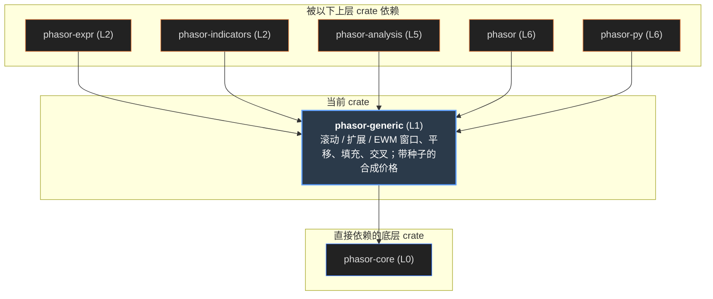

# phasor-generic

数组层。指标是有名字的滚动窗口，因子表达式是带解析器的滚动窗口，好几个分析指标是末尾多一步除法的滚动窗口——把它们放在一处，语义就只决定一次。 这一层的算术都很简单，难的是**边界**：窗口没满时报不报数、遇到 NaN 怎么办、哪些函数会偷看未来、浮点累加的最后几位是否每次都一样。

> **核心特性与指标：**
> - **只依赖 phasor-core**：用 Matrix 和 Error；每个函数先写一维 _1d 版本，矩阵版本逐列调用它
> - **1,650 条黄金输出**：13 条“故意别扭”的序列（前后缺口、全 NaN、常数、跨 16 个数量级……）× 18 个函数 × 参数组合，每条都有固定的预期结果
> - **3 个模块**：rolling 和 elementwise 被 indicators、expr、analysis、py 调用；synthetic 的三个生成器由 Python 包的 phasor.synthetic 暴露

<a id="concept"></a>

## 从第一性原理看：一个滚动窗口要先决定什么

先不看代码。“过去 20 根 K 线的均值”是一行公式；写成函数之前，至少有六件事要先定下来，而每一件选错都会悄悄改变策略看到的信号。

### 1. 窗口没满时报不报数（min_periods）

20 根均线在第 0 根 K 线上只有 1 个观测。如果这时就输出一个数，它和第 20 根以后的值放在同一个数组里，看起来完全一样，但含义完全不同—— 在它上面入场的策略，交易的是另一个信号。所以每个窗口函数都要一个 `minp`：至少有几个**非 NaN** 观测才输出数字，否则输出 NaN。保守的默认是 `minp = window`。

### 2. NaN 是缺失的信息，不是失败的计算

停牌、数据缺口、指标预热期都会产生 NaN。让它“传染”整个窗口（一个 NaN 就让 20 根的结果都变 NaN）会把一个小缺口放大成一大段空白；当成 0 又会把均值往下拉。 正确的语义是：NaN **缩小**窗口——它不计入总和，也不计入观测数，只要剩下的观测数还够 `minp`，就照常报数。

### 3. 增量计算和重新求和不是同一个答案

均值和标准差用前缀和：每根 K 线一次减法，O(1)。重新对窗口求和是 O(window)，而且在浮点里**最后几位不同**——当序列跨越很多个数量级时（1e8 和 1e-8 交替）， 差别可以到整个数值。下游的阈值比较只要差一位就可能翻转。要让结果在任何机器、任何线程数下逐位相同，并和黄金输出逐位比较，累加形式就必须固定下来。

### 4. 最大值不能“减掉”离开窗口的值

和不一样，最大值没有逆运算。但如果一根 K 线被后来更大的一根“压住”，它就再也不可能成为最大值，可以永远丢掉。于是维护一个**单调队列**： 每根 K 线进队一次、出队一次，均摊 O(1)，而且结果是比较出来的，和重新扫描窗口逐位相同。

### 5. 前瞻要标出来，而不是禁止

往回平移（`bshift`）和往回填充（`bfill`）按定义读取未来：第 i 根的结果用到了第 i 根之后的数据。它们有正当用途（给训练集打标签）， 所以不删，但必须在名字和文档里写明，并且**永远不能**出现在价格和信号之间。

### 6. 对照组需要可复现的随机数

真实价格无法区分“找到了优势”和“拟合了噪声”，因为真实过程未知。漂移为 0 的几何布朗运动**按构造**没有优势，在它上面跑出漂亮夏普的策略，测到的是自己的过拟合。 这样的对照组必须可复现：每个随机数是 `(seed, row, col)` 的纯函数，第 c 列和总共生成多少列无关。

| 第一性原理的问题 | phasor-generic 的回答 | 小节 |
|----|----|----|
| 窗口没满时报不报数 | `minp: Option<usize>`，默认等于 `window`；`minp > window` 或 `window = 0` → `Error::Invariant` | [滚动窗口](#rolling) |
| NaN 怎么处理 | 缩小窗口：只计非 NaN 的和与个数；`rolling_apply_1d` 例外——它把含 NaN 的整窗交给回调 | [滚动窗口](#rolling) |
| 增量 vs 重算 | 均值 / 标准差用前缀和与前缀 NaN 计数；标准差展开式外加 `abs()` 防止常数序列开方出 NaN（但残差仍可能留下 1e-9 量级的非零值） | [滚动窗口](#rolling) |
| 极值 | `VecDeque` 单调队列，每个下标进出各一次 | [单调队列](#deque) |
| 指数加权 | `span → alpha = 2 / (span + 1)`；`adjust` 两种形式；值不变时跳过更新，常数序列保持常数 | [EWM](#ewm) |
| 前瞻 | `bshift`、`bfill` 在文档里标注 **Looks ahead**；`fshift`、`ffill` 是安全方向 | [平移与填充](#shift) |
| 交叉 | `crossed_above_1d`：必须先严格在下方；相等只清计数不清记忆；NaN 全部重置 | [交叉](#cross) |
| 对照组 | `gbm`、`random_walk`、`ohlc_from_close`，SplitMix64 键控于 `(seed, row, col)` | [合成路径](#synthetic) |

<a id="graph"></a>

## 依赖图

左边是唯一的上游 phasor-core（`Matrix`、`Error`）。中间三个模块，右边是 `src/` 里直接调用它的 crate。点任一节点，只保留相关的线。

#### 示意 / 说明：线的颜色 = 被用到的模块。synthetic 到门面的虚线只是整体再导出，真正的调用方是 phasor-py



*说明：*

来源：各 crate 的 Cargo.toml 与 `src/` 中的 `use phasor_generic::…`（不含测试）。phasor-expr 的 `rolling_apply_1d` 只出现在它的测试里。

<a id="rolling"></a>

## 滚动窗口实验台

```text
单调双端队列 rolling_max (窗口 W = 3) 演进示意:

t=0, x=1.0:  入队 [1.0]                          ──► 窗口未满, 输出 NaN
t=1, x=3.0:  3.0 > 1.0, 1.0 弹出, 入队 [3.0]     ──► 窗口未满, 输出 NaN
t=2, x=2.0:  2.0 < 3.0, 保持单调, 入队 [3.0, 2.0] ──► 队首即最大值, 输出 3.0
t=3, x=5.0:  5.0 淘汰 3.0 与 2.0, 原队首亦超时出窗
             入队 [5.0]                          ──► 队首即最大值, 输出 5.0
t=4, x=4.0:  4.0 < 5.0, 保持单调, 入队 [5.0, 4.0] ──► 队首即最大值, 输出 5.0
```

| Bar $t$ | 输入 $x_t$ | 队列操作（队尾淘汰与队首过期） | 双端队列内部状态 `(idx, val)` | 当前窗口最大值 `rolling_max` | 当前窗口最小值 `rolling_min` |
| :---: | :---: | :--- | :--- | :---: | :---: |
| **0** | `1.0` | 队尾压入 `(0, 1.0)` | `[(0, 1.0)]` | `NaN` | `NaN` |
| **1** | `3.0` | $3.0 > 1.0$，队尾 `1.0` 出队，压入 `(1, 3.0)` | `[(1, 3.0)]` | `NaN` | `NaN` |
| **2** | `2.0` | $2.0 < 3.0$，保持单调递减，压入 `(2, 2.0)` | `[(1, 3.0), (2, 2.0)]` | **`3.0`** | **`1.0`** |
| **3** | `5.0` | $5.0 > 2.0, 3.0$ 清空队列；$t=0$ 超时 | `[(3, 5.0)]` | **`5.0`** | **`2.0`** |
| **4** | `4.0` | $4.0 < 5.0$，单调递减压入 `(4, 4.0)` | `[(3, 5.0), (4, 4.0)]` | **`5.0`** | **`2.0`** |

下面是 `rolling.rs` 的逐行移植（JS 的 Number 就是 f64，没有乘加融合，和 Rust 一样逐位）。改序列（`nan` 表示缺失）、窗口、`minp`， 把鼠标移到输出格子上看它的窗口和有效观测数。选“重新求和对比”可以看到增量形式和逐窗求和在哪些格子上不同。

#### 示意 / 说明：rolling\_\*\_1d / expanding\_\*\_1d / ewm\_\*\_1d，JS 移植

序列（分号分隔）

*说明：*

### 标准差的护栏和结合顺序

有效观测数等于 `ddof` 时输出 NaN；展开式在常数序列上会抵消成极小的负数，所以先 `abs()` 再开方——它防的是 NaN，不保证 0：常数 0.1 的第 4 根仍是 2.28e-9，黄金输出钉住的就是这个值（选 constant 序列看）。括号也是语义：`len * (mean * mean)` 写成 `len * mean * mean` 时结合顺序变成 `(len * mean) * mean`，常数序列上就是精确 0 和 1.07e-9 的差别，单元测试钉住了这一点。

### expanding 是窗口等于长度

`expanding_mean_1d` 就是 `rolling_mean_1d(a, len, Some(minp))`，所以 `minp > len` 会报错。代码注释承认这未必合理，但悄悄截断会让调用方拿到和参数不符的结果，所以直接报错。

### rolling_apply_1d 的两半

通用回调版本：`minp` 数的是**非 NaN** 个数，但回调拿到的是**含 NaN** 的整窗。phasor-analysis 的滚动指标都走它，每个指标自己处理 NaN，所以滚动形式和标量形式在满窗上总是一致。

<a id="deque"></a>

## 单调队列：rolling_max 怎么做到 O(1)

队列里存下标，对应的值从队首到队尾严格递减（求最小值时递增）。新值进来时，从队尾弹出所有“不比它大”的候选——它们被新值压住，永远不会再是最大值； 窗口滑过时，如果队首正好离开窗口就弹出。队首永远是当前窗口的最大值。拖动滑块逐根看。

#### 示意 / 说明：rolling_extremum_1d（kernel：[rolling.rs:221](https://github.com/nivalume/phasor/blob/1d573df0430fa5cd3a2416300603c7147f3c6a13/crates/phasor-generic/src/rolling.rs#L221)）在 wobble 序列上，window = 3

*说明：*

<a id="ewm"></a>

## 指数加权：adjust 改变整条序列

| 模式 | 递推 / 闭式公式 | 前 3 根 K 线的权重分布 ($lpha = 0.5$) | 适用场景 |
| :--- | :--- | :--- | :--- |
| **`adjust = false`** | $y_t = (1-\alpha) y_{t-1} + \alpha x_t$ (初始 $y_0 = x_0$) | $w_0 = 0.25, w_1 = 0.25, w_2 = 0.5$ (权重和为 1，直接递推) | 传统流式 EMA、技术分析指标 |
| **`adjust = true`** | $y_t = \frac{\sum_{i=0}^t (1-\alpha)^i x_{t-i}}{\sum_{i=0}^t (1-\alpha)^i}$ | $w_0 = \frac{0.25}{0.875}, w_1 = \frac{0.25}{0.875}, w_2 = \frac{0.5}{0.875}$ | Pandas 默认，消除初始值权重大于真实情况的偏差 |

`span` 换算成 `alpha = 2 / (span + 1)`。`adjust = false`（默认）是从第一个观测开始的普通递推；`adjust = true` 把早期的权重重新归一， 使它们加起来等于 1。两者的差别**不只在开头**——下图是同一条序列上的两种 EWM 和简单滚动均值。

#### 示意 / 说明：ewm_mean_1d(adjust=false) · ewm_mean_1d(adjust=true) · rolling_mean_1d，span = window

> **图表：EWM 对比**

*说明：*

两个容易漏掉的细节：值没变时跳过更新（`weighted_avg != cur` 的精确比较是有意的，否则常数序列会漂移）——但大多数常数怎么算都不漂移，0.1 就是，所以测试必须**搜出**一个会漂的值：span 10 下的 8.19478 就是一个（上面的指标是现场重算的）；乘加故意**不融合**（`mul_add` 只舍入一次，更准，但会改变最后一位）。后者的差别约一个 ulp，低于黄金输出比较的容差，所以有一个单元测试直接比较位模式。`ewm_std_1d` 总是偏差校正、第一根总是 NaN，不收 `ddof` 参数。

<a id="shift"></a>

## 平移、差分与填充：哪些会读未来

红色格子是**用到了未来数据**的输出：第 i 根的值依赖第 i 根之后的输入。改序列和 n 看看。

#### 示意 / 说明：elementwise.rs，JS 移植

*说明：*

`ffill` 用第 0 个元素做种子，所以开头的 NaN 保持 NaN——后面没有东西可以往前带。用 NaN 做种子结果完全相同（种子只在第 0 个元素本身是 NaN 时才被读到），变异测试也确认这个变异会存活；保留这个写法是因为它说出了意图。

<a id="cross"></a>

## 交叉：一个三状态的状态机

```text
三状态交叉状态机: Below (-1) ◄──► Equal (0) ◄──► Above (+1)

时间步 (t)   :   0       1       2       3       4       5
──────────────────────────────────────────────────────────
序列 a       :  10.0    10.0    10.0    10.5    10.0     9.5
序列 b       :  12.0    10.0    10.0    10.0    10.0    10.0
──────────────────────────────────────────────────────────
关系符号     :  Below   Equal   Equal   Above   Equal   Below
内部 State   :   -1  ──►  0  ──►  0  ──►  +1  ──►  0  ──► -1
──────────────────────────────────────────────────────────
crossed_above:    ·       ·       ·       ▲       ·       ·  (穿过 Equal 上穿成功)
crossed_below:    ·       ·       ·       ·       ·       ▼  (穿过 Equal 下穿成功)
```

`crossed_above_1d(a, b, wait)` 有三条规则容易写错：必须**先严格在下方**（一开始就在上方的序列永远不算交叉）；**相等**只重置计数、不清除“曾在下方”的记忆， 所以碰到之后再上穿也算；**NaN** 重置一切，数据缺口不能制造一次跨越缺口的交叉。`wait` 让信号在交叉之后第 wait 根才触发，前提是一直待在上方。

#### 示意 / 说明：crossed_above_1d，JS 移植；点格子在“上 / 等 / 下 / NaN”之间切换 a 相对 b 的位置

*说明：*

<a id="synthetic"></a>

## 合成路径：没有优势的对照组

`gbm` 用一步的**精确解** `S·exp((μ − σ²/2)dt + σ√dt·Z)`，不是欧拉近似，所以对数收益严格服从均值 `(μ − σ²/2)dt`、标准差 `σ√dt` 的正态分布； `μ = 0` 时价格期望不变。每个正态随机数由 Box–Muller 从两个均匀数得到，均匀数来自 SplitMix64 对 `(seed ⊕ salt, row, col)` 的三次链式混合——链式而不是异或， 所以 `(row, col)` 和 `(col, row)` 不会撞。

#### 示意 / 说明：gbm / random_walk，JS 移植（SplitMix64 用 BigInt 精确实现；Math.log / cos / exp 与 Rust 的 libm 可能差一个 ulp）

> **图表：合成路径**

*说明：*

改“列数”：第 0 列的路径不变——它只依赖 `(seed, row, 0)`，与总共要了多少列无关。`ohlc_from_close` 在同一布局上生成开高低：开盘 = 上一根收盘，高 = `max(o,c) + |max(o,c)|·spread·U`，低同理，所以即使随机游走穿过 0，也保持 `low ≤ min(o,c) ≤ max(o,c) ≤ high`。

> [!WARNING]
> **谁在用：**Rust 这边没有调用方；phasor-py 的 `research.rs` 把三个生成器绑定出去（[research.rs:427](https://github.com/nivalume/phasor/blob/1d573df0430fa5cd3a2416300603c7147f3c6a13/crates/phasor-py/src/research.rs#L427)、[:444](https://github.com/nivalume/phasor/blob/1d573df0430fa5cd3a2416300603c7147f3c6a13/crates/phasor-py/src/research.rs#L444)、[:462](https://github.com/nivalume/phasor/blob/1d573df0430fa5cd3a2416300603c7147f3c6a13/crates/phasor-py/src/research.rs#L462)），Python 端是 `phasor.synthetic` 的 `random_walk`、`gbm`、`ohlc_from_close`，用来造“按构造没有优势”的对照数据。 它们不在 `generic.tsv` 里；验证靠自己的性质测试（同种子逐位相同、列独立、对数收益的均值和方差、OHLC 不等式）。

<a id="api"></a>

## API 一览

每个函数先有一维版本，矩阵版本由宏或 `map_columns` 逐列调用它；lib.rs 把常用的再导出到 crate 根。

| 一维 | 矩阵 | 参数 | 失败 / 备注 | src 里的调用方 |
|------|------|------|-------------|----------------|

<a id="verify"></a>

## 验证：故意别扭的序列

`tests/golden_generic.rs` 回放 `tests/fixtures/generic.tsv`：1,650 条黄金输出，每条是一个函数、一条序列、一组参数和期望输出。 序列专挑边界。这个页面里的 JS 移植也拿同一份黄金输出跑过：1,650 条全部通过，1,645 条数值结果**逐位**相同，另 5 条是预期的错误（expanding 的 minp 超过序列长度等）。

| 序列 | 值  | 它在测什么 |
|------|-----|------------|

#### 示意 / 说明：每个函数的 fixture 条数

*说明：*

rolling_std 最多，因为它的参数最多（window × minp × ddof）。变异检查里存活的变异就是上面 ffill 种子那一个，已论证为等价。

<a id="table"></a>

## 谁依赖它，用来做什么

| crate | 用到的模块 | 用来做什么 |
|-------|------------|------------|

<a id="rules"></a>

## 不能绕开的规则

### 累加形式是固定的

均值和标准差必须用前缀和那种写法，EWM 不能换成 `mul_add`，值不变时必须跳过更新。“更准”的写法会改变最后几位，进而改变下游阈值比较的结果。`tests/fixtures/*.tsv` 不能为了让改动通过而重新生成。

### 想清楚 minp 再调用

indicators 用 `minp = window`（保守）；phasor-expr 有意用 `minp = 1`（qlib 的语义：从第 0 根就出值）。两者都对，但不能混用而不自知——它们在预热期给出的是不同的信号。

### 前瞻函数不进信号路径

`bshift`、`bfill` 只用于离线打标签；它们出现在价格和信号之间就是未来函数。代码评审里看到它们，第一个问题就是“这个结果会不会被交易”。

### 浮点相等是有意的

交叉里的 `a == b`、EWM 里的 `weighted_avg != cur` 都局部 `#[allow(clippy::float_cmp)]` 并写了理由：相等是一个独立的状态，加容差会凭空造出一条“既不在上也不在下”的带。

## 源文件

<table>
<thead>
<tr>
<th>文件</th>
<th>内容</th>
</tr>
</thead>
<tbody>
<tr>
<td colspan="2" class="small">本页的行号对应 <a href="https://github.com/nivalume/phasor/tree/1d573df0430fa5cd3a2416300603c7147f3c6a13">1d573df</a>。</td>
</tr>
<tr>
<td class="mono"><a href="https://github.com/nivalume/phasor/blob/1d573df0430fa5cd3a2416300603c7147f3c6a13/crates/phasor-generic/src/lib.rs">crates/phasor-generic/src/lib.rs</a></td>
<td>三个贯穿全局的决定（minp、NaN 缩小窗口、前瞻要标注）；再导出常用函数。</td>
</tr>
<tr>
<td class="mono"><a href="https://github.com/nivalume/phasor/blob/1d573df0430fa5cd3a2416300603c7147f3c6a13/crates/phasor-generic/src/rolling.rs">src/rolling.rs</a></td>
<td>resolve_minp（<a href="https://github.com/nivalume/phasor/blob/1d573df0430fa5cd3a2416300603c7147f3c6a13/crates/phasor-generic/src/rolling.rs#L34">:34</a>）、rolling_apply_1d（<a href="https://github.com/nivalume/phasor/blob/1d573df0430fa5cd3a2416300603c7147f3c6a13/crates/phasor-generic/src/rolling.rs#L71">:71</a>）、rolling_mean_1d（<a href="https://github.com/nivalume/phasor/blob/1d573df0430fa5cd3a2416300603c7147f3c6a13/crates/phasor-generic/src/rolling.rs#L107">:107</a>）、rolling_std_1d（<a href="https://github.com/nivalume/phasor/blob/1d573df0430fa5cd3a2416300603c7147f3c6a13/crates/phasor-generic/src/rolling.rs#L151">:151</a>）、rolling_extremum_1d（<a href="https://github.com/nivalume/phasor/blob/1d573df0430fa5cd3a2416300603c7147f3c6a13/crates/phasor-generic/src/rolling.rs#L221">:221</a>）、expanding_*、ewm_mean_1d（<a href="https://github.com/nivalume/phasor/blob/1d573df0430fa5cd3a2416300603c7147f3c6a13/crates/phasor-generic/src/rolling.rs#L329">:329</a>）、ewm_std_1d（<a href="https://github.com/nivalume/phasor/blob/1d573df0430fa5cd3a2416300603c7147f3c6a13/crates/phasor-generic/src/rolling.rs#L395">:395</a>）、矩阵包装宏；含不融合乘加的位级测试。</td>
</tr>
<tr>
<td class="mono"><a href="https://github.com/nivalume/phasor/blob/1d573df0430fa5cd3a2416300603c7147f3c6a13/crates/phasor-generic/src/elementwise.rs">src/elementwise.rs</a></td>
<td>fshift / bshift / diff / pct_change / ffill / bfill / fillna、crossed_above_1d / crossed_below_1d 与矩阵版本。</td>
</tr>
<tr>
<td class="mono"><a href="https://github.com/nivalume/phasor/blob/1d573df0430fa5cd3a2416300603c7147f3c6a13/crates/phasor-generic/src/synthetic.rs">src/synthetic.rs</a></td>
<td>SplitMix64、bits、uniform、Box–Muller normal、random_walk、gbm、ohlc_from_close 与性质测试。</td>
</tr>
<tr>
<td class="mono"><a href="https://github.com/nivalume/phasor/blob/1d573df0430fa5cd3a2416300603c7147f3c6a13/crates/phasor-generic/tests/golden_generic.rs">tests/golden_generic.rs</a> · <a href="https://github.com/nivalume/phasor/blob/1d573df0430fa5cd3a2416300603c7147f3c6a13/tests/fixtures/generic.tsv">tests/fixtures/generic.tsv</a></td>
<td>黄金输出回归测试：逐条回放预期输出。</td>
</tr>
</tbody>
</table>
