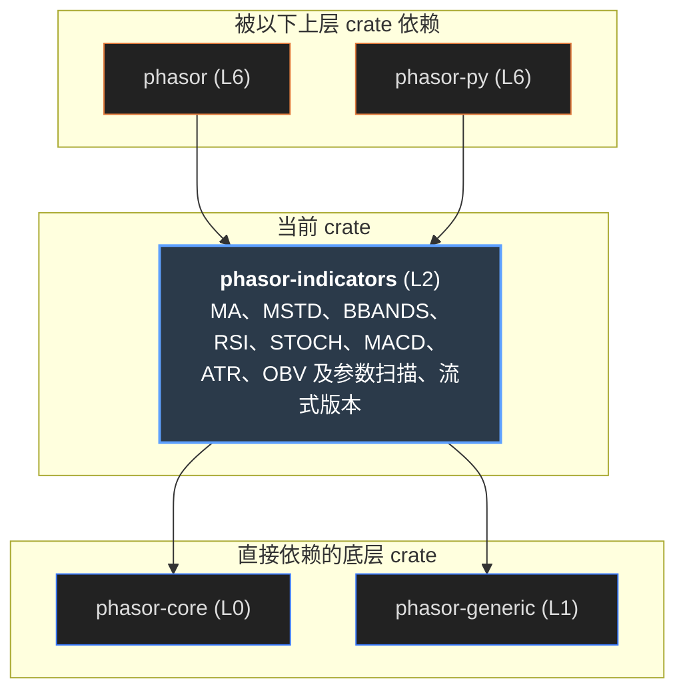

# phasor-indicators

技术指标，以及把参数扫描变成一次调用的那个约定。三个窗口 × 四个标的跑一次均线，返回的不是三份四列的结果，而是**一份十二列**的结果： 模拟器把它当作十二个互不相关的列，分到多个核上跑，完全不知道其中八列共享同一个标的。列标签负责把结果归因回“哪个窗口、哪个标的”。

> **核心特性与指标：**
> - **8 个指标**：MA、MSTD、BBANDS、RSI、STOCH、MACD、ATR、OBV——最常用的那八个；每个都按参数缓存昂贵的中间结果
> - **480 条 fixture，逐位一致**：10 种输入情形（含全涨、全跌、横盘、跳空、缺口、两个标的）× 各指标的参数组合，共 10,780 个值；这个页面的 JS 移植全部逐位复现
> - **批量和流式逐位相同**：Stream 一根一根地喂，每根的输出和批量函数在整段历史上算出的那一根逐位相同；下游是门面和 Python 包（phasor.indicators）

## 从第一性原理看：指标库真正要解决的问题

均线、RSI、MACD 的公式教科书上都有，算术不是难点。一个给回测引擎用的指标库，要先回答下面这些问题。

### 1. 指标是有名字的滚动窗口

MA 是滚动均值，MSTD 是滚动标准差，BBANDS 是两者的线性组合，RSI 是涨跌两条序列各自的均值之比，STOCH 是滚动最高最低之间的位置，MACD 是两条均线之差再平滑，ATR 是真实波幅的均值。 所以窗口的语义（预热期、NaN、累加形式）应当只在 [phasor-generic](phasor-generic.md) 里决定一次，这里只负责**组合**：哪个窗口喂给哪个均值。

### 2. 预热期必须是 NaN

20 根均线在第 19 根之前没有定义。这里所有均值都用 `minp = window`：一个在窗口没满时就开始报数的指标，报的是另一个指标。 这和 [phasor-expr](phasor-expr.md) 正好相反——qlib 的因子用 `minp = 1`，从第 0 根就有值。两种都对，但不能混用而不自知。

### 3. 参数和标的是同一个轴

扫描参数的朴素做法是一个外层循环：每组参数跑一次。但模拟器本来就把每一列当成独立的模拟；把“参数组合 × 标的”展平成一个列轴，整个扫描就变成**一次**调用、一张矩阵， 并行完全免费。代价是必须固定一个布局，让下游能从列下标算回参数：`col = 组合下标 × 标的数 + 标的下标`。

### 4. 扫描里大量计算是重复的

3 个快线窗口 × 3 个慢线窗口的 MACD 网格是 9 个组合，但最多只有 6 条不同的均线；BBANDS 的 3 个窗口 × 4 个 alpha 是 12 个组合，均值和标准差却只取决于窗口，只要算 3 次。 所以每个指标都按“真正决定这个中间结果的参数”做缓存——在宽网格上，这省掉的是大部分工作。

### 5. 交叉还是配对，必须由调用方说

三个窗口和三个 alpha，是 3 组还是 9 组？常见的做法是用一个带默认值的开关决定，这是意外的来源——没有哪个默认值对两种情况都对。这里不提供开关： `combinations(&[3, 3])` 显式生成笛卡儿积（最后一维变化最快），直接传等长的参数列表就是配对。

### 6. 退化的读数要从算术里自然得出

全涨的序列 RSI 恰好是 100：跌幅均值为 0，涨跌比是 +∞，`100 − 100/(1+∞) = 100`。横盘时 STOCH 是 0/0 = NaN。第一根 K 线没有前收盘，真实波幅退回到当根的高低差。 这些都**不写成特例**，而是让 IEEE 754 的算术自己给出——这也是容差层要把无穷当成有意义的值的原因之一。

| 第一性原理的问题 | phasor-indicators 的回答 | 小节 |
|----|----|----|
| 窗口语义只定一次 | 全部调用 phasor-generic：`rolling_mean/std/min/max_1d`、`ewm_mean/std_1d`、`diff_1d`、`fshift_1d` | [依赖图](#graph) |
| 预热期 | `moving_average` / `moving_std` 固定 `minp = window`（EWM 同样）；STOCH 的 min / max 用默认 minp = window | [实验台](#lab) |
| 参数 = 列 | `sweep_columns`：参数层 repeat、标的层 tile；`column_of(comb, s, n) = comb·n + s` | [扫描布局](#sweep) |
| 重复计算 | 每个指标一个 `Cache<K>`，键是决定中间结果的参数（例如 MACD 快慢线共用 `(window, ewm)` 键空间） | [缓存](#cache) |
| 交叉 vs 配对 | `combinations(sizes)` 给笛卡儿积；直接传参数切片就是配对；没有默认开关 | [扫描布局](#sweep) |
| 退化读数 | RSI 经 ∞ 得 100 / 经 0 得 0、STOCH 横盘 0/0 = NaN、首根 TR = 高 − 低、OBV 首根与 NaN 比较为假而计正 | [退化读数](#degenerate) |

## 依赖图

上游是 phasor-core（`Matrix`、`Columns / Label / Level`、`Error`）和 phasor-generic（窗口函数）。中间三个模块：`sweep` 建列轴，`indicators` 是八个指标， `stream` 是同样八个指标的逐根版本——它不调 phasor-generic，而是自己带着批量核心跨根携带的那部分状态（见[流式](#stream)）。 下游是门面和 phasor-py：`crates/phasor-py/src/indicators.rs` 把八个指标和 `Stream` 绑成 `phasor.indicators`。

#### 示意 / 说明：线的颜色 = 被用到的模块。示例 / 测试里的使用不计入

*说明：*

来源：Cargo.toml 与 `src/` 中的 `use phasor_indicators::…`。

## 扫描布局：参数组合 × 标的 = 列

选一个指标，填参数值，选“交叉”（`combinations` 的笛卡儿积）或“配对”（等长列表按位置组合），再填标的。下面是 `sweep_columns` 的移植： 每个参数层按组合 **repeat**，标的层按组合数 **tile**，所以同一组参数的列总是相邻。

#### 示意 / 说明：combinations + sweep_columns + column_of，JS 移植

标的（逗号分隔）

*说明：*

### 最后一维变化最快

`combinations(&[3, 2])` = `[0,0] [0,1] [1,0] [1,1] [2,0] [2,1]`，和 Python 的 `itertools.product` 一致。空的 sizes 给一个空组合（不扫描也是一次运行），任何一维为 0 则什么都没有。

### 布局是契约

模块注释原话是“是契约，不是惯例”：`Indicator` 的输出不经任何重排就交给模拟器，共享资金的 `group_lens` 也依赖同一组参数的列相邻。见 [phasor-core · 列轴](phasor-core.md#columns)。

### 两种错误

参数层描述的组合数不一致，或者某个参数层和输入层（`symbol`）重名，`sweep_columns` 返回 `Error::Invariant`。不扫描的指标（OBV）也有标签：只有 `symbol` 一层。

## 缓存：宽网格省掉的是大部分工作

同一个扫描里，缓存键只包含真正决定那个中间结果的参数。格子是每个组合需要的中间结果：橙色是第一次算，绿色是从缓存里取。

#### 示意 / 说明：各指标的 Cache 键，在上面那个扫描上实际发生的命中与未命中

*说明：*

| 指标 | 缓存什么 | 键 | 不缓存什么 |
|----|----|----|----|
| MA / MSTD | 整张均值 / 标准差矩阵 | `(window, ewm)` | — |
| BBANDS | 均值、标准差（两个缓存） | `(window, ewm)` | 上下轨：`middle ± alpha·std` 每组算一次，几乎不花时间 |
| RSI | RSI 值（涨跌均值一起算） | `(window, ewm)` | 涨跌序列本身整个扫描只算一次 |
| STOCH | %K（滚动最低 / 最高） | `k_window` | %D 的平滑每组都算 |
| MACD | 快线和慢线**共用一个**键空间 | `(window, macd_ewm)` | MACD 线与信号线每组都算 |
| ATR | 平滑后的真实波幅 | `(window, ewm)` | 真实波幅本身整个扫描只算一次 |

## 指标实验台

输入用的是 `tests/fixtures/indicators.tsv` 里的十种真实情形。选情形、指标和参数；图上是收盘价（右轴）和指标输出（左轴），下面是逐根的数值。 计算是 `indicators.rs` 的移植，叠在已由 `generic.tsv` 验证过的窗口函数上——`indicators.tsv` 的 480 行黄金输出在这里逐位复现。

#### 示意 / 说明：ma / mstd / bbands / rsi / stoch / macd / atr / obv，JS 移植

> **图表：指标**

*说明：*

## 退化读数：从算术里得出，而不是写成特例

下面每张卡片都是用 fixture 的输入现场算出来的。这些读数正是 `the_fixtures_still_cover_the_degenerate_readings` 要求 fixture 必须保留的。

## API 一览

| 函数 | 参数结构 | 输出 | 扫描层（按顺序） | 公式 |
|----|----|----|----|----|
| `ma` | `MaParams { window, ewm }` | ma | window, ewm, symbol | rolling_mean 或 ewm_mean，minp = window |
| `mstd` | `MaParams` + `ddof` | mstd | window, ewm, symbol | rolling_std(ddof) 或 ewm_std |
| `bbands` | `BbParams { window, ewm, alpha }` + `ddof` | middle, upper, lower | window, ewm, alpha, symbol | ma ± alpha · mstd |
| `rsi` | `MaParams` | rsi | window, ewm, symbol | 100 − 100 / (1 + MA(涨) / MA(跌))，涨跌来自 diff(close, 1) |
| `stoch` | `StochParams { k_window, d_window, d_ewm }` | percent_k, percent_d | k_window, d_window, d_ewm, symbol | %K = 100 (C − minL) / (maxH − minL)；%D = MA(%K, d_window) |
| `macd` | `MacdParams { fast, slow, signal, macd_ewm, signal_ewm }` | macd, signal | fast_window, slow_window, signal_window, macd_ewm, signal_ewm, symbol | MA(fast) − MA(slow)；信号线 = MA(macd, signal) |
| `true_range` | — | Matrix | — | max(H − L, \|H − C₋₁\|, \|L − C₋₁\|)；首根 = H − L |
| `atr` | `MaParams` | tr, atr | window, ewm, symbol | MA(true_range) |
| `obv` | 无参数 | obv | symbol | 累加 ±volume（收盘 \< 前收盘为负），NaN 计 0 |

每个函数还接 `adjust`（EWM 的调整开关）和可选的 `labels`（不给则标的标签是 0..n）；多输入的指标先做形状检查，不符时返回 `Error::Broadcast`。 结果是 `Indicator { columns, outputs }`，`get(name)` 取一个输出，名字不对时报错并列出现有的名字。

## 流式：一根一根地算

实盘每来一根 K 线，用批量函数重算整段历史是 O(n) 的；`src/stream.rs` 的 `Stream` 只带着批量核心从一根带到下一根的那部分状态，每根均摊 O(1)，状态是 O(window)。 它要守的不是“和批量差不多”，而是**逐位相同**：同一个序列逐根喂进去，每根的输出等于批量函数在整段历史上算出的那一根。做到这一点的办法是做同样的浮点运算、按同样的顺序。

### 从 `Prefix` 读起

phasor-generic 的 `rolling_mean_1d` / `rolling_std_1d` 是**整段历史的前缀和之差**，不是窗口内重新求和。所以 `Prefix` 保存累计的 sum、sum_sq、NaN 个数，以及最近 window 根时它们的快照（`VecDeque`），窗口和 = 现在的累计 − window 根前的快照。直接对窗口求和更“准”，但最后几位会不同。

### EWM 照抄批量核心的细节

`EwmMean` / `EwmStd` 保存 avg（或 mean、cov）、old_wt、sum_wt、sum_wt2、观测数。值没变时跳过更新（`avg != cur` 的精确比较，局部 `#[allow(clippy::float_cmp)]`）、`adjust=false` 时把权重归一回 1，都和 `ewm_mean_1d` / `ewm_std_1d` 一样；EwmStd 第一根没有偏差可报，返回 NaN。

### 最高最低用单调队列

`RollingExtremum` 存最近 window 个值和一列候选 `(bar, value)`：每个候选都严格优于它后面的；新值进来时弹掉不比它好的，过期的从队头出。STOCH 的 minL / maxH 用它。

### Stream = 种类 + 前收盘

`Stream` 是 `Kind`（八种，各自组合 `Average`、`Deviation`、`RollingExtremum`）加 `prev_close` 和三格输出。`update(Bar)` 返回这一根的输出切片，顺序是 `names()`。RSI 的涨跌、ATR 的真实波幅、OBV 的方向读 prev_close；第一根没有前收盘，RSI 得 NaN，TR 退回 H − L，和批量函数一样。

| 构造 | 读 Bar 的哪些字段 | 输出（names() 顺序） |
|----|----|----|
| `Stream::ma(MaParams, adjust)` | close | ma |
| `Stream::mstd(MaParams, adjust, ddof)` | close | mstd |
| `Stream::bbands(BbParams, adjust, ddof)` | close | middle, upper, lower |
| `Stream::rsi(MaParams, adjust)` | close | rsi |
| `Stream::stoch(StochParams, adjust)` | high, low, close | percent_k, percent_d |
| `Stream::macd(MacdParams, adjust)` | close | macd, signal |
| `Stream::atr(MaParams, adjust)` | high, low, close | tr, atr |
| `Stream::obv()` | close, volume | obv |

参数结构和批量函数相同，只是每个只有一组值；`Bar { high, low, close, volume }` 里指标不读的字段可以是 NaN，`Bar::close(x)` 只给收盘价。窗口为 0、min_periods 超过窗口时构造就报错。 Python 的 `phasor.indicators.Stream(kind, n_cols, **params)` 每列一个 Rust `Stream`，`update(close, high=, low=, volume=)` 一次给每列一根，见 [phasor-py](phasor-py.md#research)。

> [!NOTE]
> stream.rs 是对 phasor-generic 窗口核心的**第二份实现**。“窗口语义只在 generic 里决定一次”在这里有一个例外：改了 `rolling_*_1d` 或 `ewm_*_1d` 的算术，这里要跟着改。 守住它的是 `tests/stream.rs` 的 `every_stream_matches_its_batch_indicator`：一条带开头 NaN、缺口和一段横盘的序列，八个指标 × window ∈ {1, 2, 14} × ewm × adjust（mstd 再 × ddof），每根按位比较。

## 验证

### matches_the_golden_indicators

480 行，每行一个指标、一种情形、**一组**参数——这样不一致时报出的是参数组合，而不是扫描里的列下标。比较用对哨兵友好的 `agree`（NaN 对 NaN、同号无穷对同号无穷，其余 `is_close`）。预期输出固定 `adjust = false`、`ddof = 0`。

### a_sweep_equals_its_parts

窗口 \[2, 3, 5, 2\] 一次扫描，每个组合的每一列必须和单独运行逐位相同、落在 `column_of` 说的位置；重复的窗口 2 是独立的组合、值相同（由缓存提供）；标签能说出哪列是哪个窗口。这个页面的移植同样通过。

### the_fixtures_still_cover_the_degenerate_readings

要求 fixture 里仍然有 RSI 恰好为 100 和 0 的读数（精确比较，近似会把附近的普通值也算进去）、横盘 STOCH 的 NaN，以及所有输入情形。防止有人“清理”fixture 时把最有价值的行删掉。

### every_stream_matches_its_batch_indicator

`tests/stream.rs`：同一条序列分别交给批量函数和 `Stream`，每个输出每一根按位比较（NaN 对 NaN）。参数覆盖 window 1、2、14，SMA 和 EWM，`adjust` 两种，mstd 的 ddof 0 和 1。

### 窗口函数在下面一层验证

每个窗口函数已经在 phasor-generic 里逐个验证过（1,650 行黄金输出）；这里测的是**组合**：哪个窗口喂给哪个均值、哪个输出叫什么、退化的读数从哪来。

## 谁依赖它，用来做什么

| 使用者 | 用到的模块 | 用来做什么 |
|--------|------------|------------|

## 不能绕开的规则

### 布局只能是 comb·n + s

新指标必须用 `sweep_columns` 建标签、用 `place` / `column_of` 放输出。参数层 repeat、标的层 tile，换了顺序，`group_by` 的汇总和共享资金的分组都会悄悄错。

### 缓存键要恰好是决定因素

键里少了一个真正影响结果的参数，就会把错误的中间结果发给别的组合；多了一个无关参数，只是少省一些。新增参数时先问：它改变的是缓存的那一层，还是缓存之后的那一步？

### 不要给退化读数写特例

RSI 的 100、STOCH 的 NaN、首根 TR、OBV 首根都来自算术本身，并且被 fixture 钉住。加一个 `if down == 0 { 100 }` 看起来更清楚，但会在 NaN 输入上改变行为。

### 窗口语义在 generic 里改，stream 跟着改

这里不碰预热期、NaN 规则、累加形式；它们属于 phasor-generic，并由那边的 fixture 钉住。`stream.rs` 复写了同样的算术，generic 一改它就要跟着改，否则 `tests/stream.rs` 失败。`tests/fixtures/*.tsv` 不能为了让改动通过而重新生成。

## 源文件

<table>
<thead>
<tr>
<th>文件</th>
<th>内容</th>
</tr>
</thead>
<tbody>
<tr>
<td colspan="2" class="small">行号对应 <a href="https://github.com/nivalume/phasor/tree/1d573df0430fa5cd3a2416300603c7147f3c6a13">1d573df</a>。</td>
</tr>
<tr>
<td class="mono"><a href="https://github.com/nivalume/phasor/blob/1d573df0430fa5cd3a2416300603c7147f3c6a13/crates/phasor-indicators/src/lib.rs">crates/phasor-indicators/src/lib.rs</a></td>
<td>“一次调用的扫描”的说明，stream 一段（<a href="https://github.com/nivalume/phasor/blob/1d573df0430fa5cd3a2416300603c7147f3c6a13/crates/phasor-indicators/src/lib.rs#L29">:29</a>）；再导出八个指标、参数结构、扫描工具和 Bar / Stream（<a href="https://github.com/nivalume/phasor/blob/1d573df0430fa5cd3a2416300603c7147f3c6a13/crates/phasor-indicators/src/lib.rs#L48">:48</a>）。</td>
</tr>
<tr>
<td class="mono"><a href="https://github.com/nivalume/phasor/blob/1d573df0430fa5cd3a2416300603c7147f3c6a13/crates/phasor-indicators/src/sweep.rs">src/sweep.rs</a></td>
<td>combinations（<a href="https://github.com/nivalume/phasor/blob/1d573df0430fa5cd3a2416300603c7147f3c6a13/crates/phasor-indicators/src/sweep.rs#L42">:42</a>）、ParamLevel（<a href="https://github.com/nivalume/phasor/blob/1d573df0430fa5cd3a2416300603c7147f3c6a13/crates/phasor-indicators/src/sweep.rs#L60">:60</a>）、sweep_columns（<a href="https://github.com/nivalume/phasor/blob/1d573df0430fa5cd3a2416300603c7147f3c6a13/crates/phasor-indicators/src/sweep.rs#L101">:101</a>）、column_of（<a href="https://github.com/nivalume/phasor/blob/1d573df0430fa5cd3a2416300603c7147f3c6a13/crates/phasor-indicators/src/sweep.rs#L133">:133</a>）与布局测试。</td>
</tr>
<tr>
<td class="mono"><a href="https://github.com/nivalume/phasor/blob/1d573df0430fa5cd3a2416300603c7147f3c6a13/crates/phasor-indicators/src/indicators.rs">src/indicators.rs</a></td>
<td>Indicator（<a href="https://github.com/nivalume/phasor/blob/1d573df0430fa5cd3a2416300603c7147f3c6a13/crates/phasor-indicators/src/indicators.rs#L31">:31</a>）、moving_average / moving_std（minp = window）、Cache、place；ma（<a href="https://github.com/nivalume/phasor/blob/1d573df0430fa5cd3a2416300603c7147f3c6a13/crates/phasor-indicators/src/indicators.rs#L149">:149</a>）、mstd（<a href="https://github.com/nivalume/phasor/blob/1d573df0430fa5cd3a2416300603c7147f3c6a13/crates/phasor-indicators/src/indicators.rs#L192">:192</a>）、bbands（<a href="https://github.com/nivalume/phasor/blob/1d573df0430fa5cd3a2416300603c7147f3c6a13/crates/phasor-indicators/src/indicators.rs#L237">:237</a>）、rsi（<a href="https://github.com/nivalume/phasor/blob/1d573df0430fa5cd3a2416300603c7147f3c6a13/crates/phasor-indicators/src/indicators.rs#L306">:306</a>）、stoch（<a href="https://github.com/nivalume/phasor/blob/1d573df0430fa5cd3a2416300603c7147f3c6a13/crates/phasor-indicators/src/indicators.rs#L371">:371</a>）、macd（<a href="https://github.com/nivalume/phasor/blob/1d573df0430fa5cd3a2416300603c7147f3c6a13/crates/phasor-indicators/src/indicators.rs#L451">:451</a>）、true_range（<a href="https://github.com/nivalume/phasor/blob/1d573df0430fa5cd3a2416300603c7147f3c6a13/crates/phasor-indicators/src/indicators.rs#L518">:518</a>）、atr（<a href="https://github.com/nivalume/phasor/blob/1d573df0430fa5cd3a2416300603c7147f3c6a13/crates/phasor-indicators/src/indicators.rs#L543">:543</a>）、obv（<a href="https://github.com/nivalume/phasor/blob/1d573df0430fa5cd3a2416300603c7147f3c6a13/crates/phasor-indicators/src/indicators.rs#L588">:588</a>）。</td>
</tr>
<tr>
<td class="mono"><a href="https://github.com/nivalume/phasor/blob/1d573df0430fa5cd3a2416300603c7147f3c6a13/crates/phasor-indicators/src/stream.rs">src/stream.rs</a></td>
<td>check_window（<a href="https://github.com/nivalume/phasor/blob/1d573df0430fa5cd3a2416300603c7147f3c6a13/crates/phasor-indicators/src/stream.rs#L19">:19</a>）；Prefix（<a href="https://github.com/nivalume/phasor/blob/1d573df0430fa5cd3a2416300603c7147f3c6a13/crates/phasor-indicators/src/stream.rs#L35">:35</a>，push <a href="https://github.com/nivalume/phasor/blob/1d573df0430fa5cd3a2416300603c7147f3c6a13/crates/phasor-indicators/src/stream.rs#L58">:58</a>）、RollingMean（<a href="https://github.com/nivalume/phasor/blob/1d573df0430fa5cd3a2416300603c7147f3c6a13/crates/phasor-indicators/src/stream.rs#L83">:83</a>）、RollingStd（<a href="https://github.com/nivalume/phasor/blob/1d573df0430fa5cd3a2416300603c7147f3c6a13/crates/phasor-indicators/src/stream.rs#L112">:112</a>）、RollingExtremum（<a href="https://github.com/nivalume/phasor/blob/1d573df0430fa5cd3a2416300603c7147f3c6a13/crates/phasor-indicators/src/stream.rs#L145">:145</a>）、EwmMean（<a href="https://github.com/nivalume/phasor/blob/1d573df0430fa5cd3a2416300603c7147f3c6a13/crates/phasor-indicators/src/stream.rs#L210">:210</a>）、EwmStd（<a href="https://github.com/nivalume/phasor/blob/1d573df0430fa5cd3a2416300603c7147f3c6a13/crates/phasor-indicators/src/stream.rs#L284">:284</a>）；Average（<a href="https://github.com/nivalume/phasor/blob/1d573df0430fa5cd3a2416300603c7147f3c6a13/crates/phasor-indicators/src/stream.rs#L383">:383</a>）、Deviation（<a href="https://github.com/nivalume/phasor/blob/1d573df0430fa5cd3a2416300603c7147f3c6a13/crates/phasor-indicators/src/stream.rs#L406">:406</a>）；Bar（<a href="https://github.com/nivalume/phasor/blob/1d573df0430fa5cd3a2416300603c7147f3c6a13/crates/phasor-indicators/src/stream.rs#L430">:430</a>）、Kind（<a href="https://github.com/nivalume/phasor/blob/1d573df0430fa5cd3a2416300603c7147f3c6a13/crates/phasor-indicators/src/stream.rs#L451">:451</a>）、Stream（<a href="https://github.com/nivalume/phasor/blob/1d573df0430fa5cd3a2416300603c7147f3c6a13/crates/phasor-indicators/src/stream.rs#L486">:486</a>，构造 ma <a href="https://github.com/nivalume/phasor/blob/1d573df0430fa5cd3a2416300603c7147f3c6a13/crates/phasor-indicators/src/stream.rs#L507">:507</a> … obv <a href="https://github.com/nivalume/phasor/blob/1d573df0430fa5cd3a2416300603c7147f3c6a13/crates/phasor-indicators/src/stream.rs#L584">:584</a>，names <a href="https://github.com/nivalume/phasor/blob/1d573df0430fa5cd3a2416300603c7147f3c6a13/crates/phasor-indicators/src/stream.rs#L590">:590</a>，update <a href="https://github.com/nivalume/phasor/blob/1d573df0430fa5cd3a2416300603c7147f3c6a13/crates/phasor-indicators/src/stream.rs#L604">:604</a>）。</td>
</tr>
<tr>
<td class="mono"><a href="https://github.com/nivalume/phasor/blob/1d573df0430fa5cd3a2416300603c7147f3c6a13/crates/phasor-indicators/tests/golden_indicators.rs">tests/golden_indicators.rs</a> · <a href="https://github.com/nivalume/phasor/blob/1d573df0430fa5cd3a2416300603c7147f3c6a13/tests/fixtures/indicators.tsv">tests/fixtures/indicators.tsv</a></td>
<td>黄金输出回归测试、扫描布局测试、退化读数覆盖测试。</td>
</tr>
<tr>
<td class="mono"><a href="https://github.com/nivalume/phasor/blob/1d573df0430fa5cd3a2416300603c7147f3c6a13/crates/phasor-indicators/tests/stream.rs">tests/stream.rs</a></td>
<td>流式与批量逐位相同（every_stream_matches_its_batch_indicator，<a href="https://github.com/nivalume/phasor/blob/1d573df0430fa5cd3a2416300603c7147f3c6a13/crates/phasor-indicators/tests/stream.rs#L64">:64</a>）。</td>
</tr>
</tbody>
</table>
