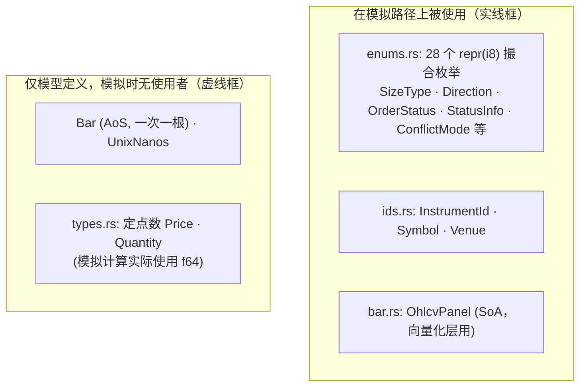
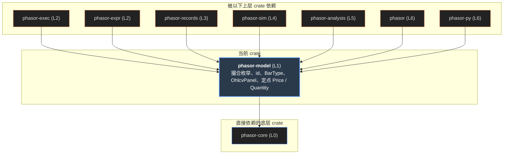
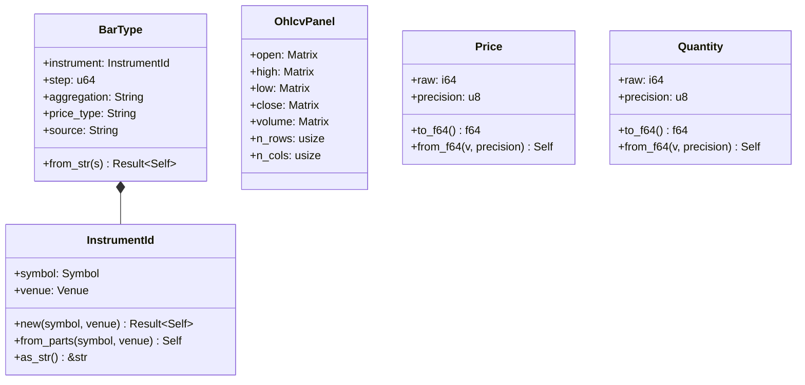

# phasor-model

领域模型。phasor-core 回答“数怎么存、怎么比”，这个 crate 回答“这些数**是什么**”：一笔订单可以怎样描述、一次撮合可能有哪些结果、 一个标的叫什么、一根 K 线长什么样、钱用什么类型存。它没有任何算法，只有类型；但这些类型的**判别值**被写进记录数组，是磁盘格式的一部分。

> **核心特性与指标：**
> - **28 个 repr(i8) 枚举**：判别值由测试固定：它们以整数写进订单记录和日志，被 Python 层和差分测试读回
> - **8 个 crate 直接依赖**：exec、sim、records、analysis、data、expr、py 和门面 phasor；向量化热路径只用到枚举和 OhlcvPanel
> - **三类类型**：撮合枚举（订单选项与结果）；标识与行情（InstrumentId、BarType、OhlcvPanel）；定点数（Price、Quantity）

## 从第一性原理看：领域模型该放什么

先不看代码。一个回测引擎的结果要在各层之间、在 Rust 和 Python 之间、在内存和磁盘之间读回，哪些概念必须有唯一、稳定的定义？

### 1. 订单的“语法”必须是有限集合

“买多少”可以是单位数、金额、可用现金的百分比，或者是目标仓位；同一根 K 线上进场和出场同时触发怎么办；止损按哪个价格挂、触发后按哪个价格成交…… 这些都不是数值，而是**选项**。把它们写成字符串，每根 K 线每一列都要比较一次字符串；写成布尔组合，非法组合无处不在。正确的形状是**枚举**， 而且因为结果要写进数组、跨语言读回，枚举必须有**固定的整数判别值**。

### 2. “没成交”要说清楚为什么

一次扫描跑了 5,000 列，其中 300 列一笔都没交易——用户第一个问题就是“为什么”。所以结果不能只有“成交 / 没成交”，还要有**原因码**： 价格是 NaN、钱不够、数量低于最小值、手续费都付不起……每一种原因单独一个值，才能按原因统计。

### 3. 钱和标识的类型

模拟为了速度全用 `f64`，靠 phasor-core 的容差层兜住误差。需要精确累加的场合（逐笔成交、交易所报价）要的是**定点数**： 百万笔成交在浮点里累加的漂移，和 alpha 是同一个量级。所以模型里另有一组定点类型：原始整数加每个实例自己的精度。 标的名在每次写记录时都会被比较，最好是可以按整数比较的句柄。

### 4. 行情有两种形状

一次只处理一根 K 线的代码需要一个 `Bar` 结构体（数组结构里的“一行”）。向量化引擎一次扫完一列：需要**结构体数组**， open、high、low、close 各自一块列主序缓冲区。两种形状都要有，而且不能互相冒充。

#### 示意 / 说明：两组概念，以及哪些类型在模拟路径上被用到。实线框：向量化路径在用；虚线框：模型提供，工作区里没有使用者

*说明：*

`InstrumentId` 的文本形式是 `SYMBOL.VENUE`；`BarType` 在它后面接步长、聚合方式、价格类型和来源，用 `-` 分隔。

### 如果从零实现，按这个顺序

1.  **先列出撮合的全部选项，写成固定判别值的枚举。**`#[repr(i8)]` + 显式 `= n`，再写一个测试断言判别值——改一个数就是改磁盘格式。
2.  **结果与原因分开。**`OrderStatus` 只有三种（成交 / 忽略 / 拒绝），原因另放在 `StatusInfo`；记录里存整数，再提供“整数 → 枚举 → 文字”的回路。
3.  **标识：先定类型，再优化。**调用方只看到不透明的 `InstrumentId`，内部先用 `Arc<str>`，等有性能数据再换成驻留句柄。
4.  **行情：两种形状都给。**向量化层用结构体数组 `OhlcvPanel`，一次一根的代码用 `Bar`；K 线带两个时间戳，回放只按“可用时间”排序。
5.  **钱：定点数，哨兵值代替 Option。**原始整数 + 精度；用 `i64::MAX` 表示“没有价格”，省掉内循环里的判别分支，代价是构造函数要负责把关。

## 依赖图

左边的上游是 phasor-core——但只是 Cargo.toml 里的声明：`src/` 里一行 `use phasor_core` 都没有（虚线）。中间是四个模块，右边是直接 `use phasor_model::…` 的 crate（只统计 `src/`）。点任一节点，只保留相关的线。

#### 示意 / 说明：线的颜色 = 被用到的模块。types 只有一条出边：门面 prelude 再导出 Price / Quantity，但没有人构造它们

*说明：*

来源：各 crate 的 Cargo.toml 与 `src/` 中的 `use phasor_model::…`。phasor-signals、phasor-generic、phasor-indicators 不依赖它。

## 28 个枚举，按它们在流水线里的位置

所有枚举都是 `#[derive(Debug, Clone, Copy, PartialEq, Eq, Hash)] #[repr(i8)]`，判别值从 0 起显式写出。 选一组，再点一个枚举，看它的变体、判别值和谁在读它。

#### 示意 / 说明：enums.rs 浏览器

*说明：*

### SizeType 是一条级联

phasor-exec 按固定顺序把 Percent、TargetPercent、TargetValue、Value、TargetAmount 逐级改写，直到只剩 `Amount`。ValuePercent 和三种 \*100 写法（6–9）在级联之前由一个冷函数改写成前面的类型。枚举本身只定义“数量怎么读”，换算在内核里。

### Rejected 不是 Err

`OrderStatus::Rejected` 是返回值里的普通结果，原因在 `StatusInfo`。`Err` 留给 phasor-core 的不变量错误。

### 三种交易视图共用一个 schema

`TradesType` 的三个值只改变成交如何归属到交易：按进场 FIFO、按出场平均、或按仓位聚合。这是实现交易记录时最容易弄错的地方。

## 拒单原因：从记录里的整数读回来

日志记录里 `res_status_info` 是一列 `i64`：成交的订单没什么要解释，写 `-1`；被忽略或被拒的订单写原因的判别值。 `StatusInfo::from_discriminant` 是回路，`describe` 给出人话。粘一列整数进来试试，再看按原因统计。

#### 示意 / 说明：StatusInfo::from_discriminant + describe，JS 移植

res_status_info（逗号分隔的整数）

| \#  | 值  | from_discriminant | describe() |
|-----|-----|-------------------|------------|

按原因计数（“这次扫描为什么不交易”）

*说明：*

phasor-records 的 `logs.rs` 就是这样把日志里的整数还原成原因的；超出 0..=13 的值（包括 -1）返回 `None`，不会被误读成某个原因。

## 标识：InstrumentId 与 BarType 的解析

`InstrumentId` 渲染为 `SYMBOL.VENUE`，用 `rsplit_once('.')` 解析——从**右边**切，所以 `BRK.B.NYSE` 的标的是 `BRK.B`。 `BarType` 是 `SYMBOL.VENUE-STEP-AGGREGATION-PRICE-SOURCE`，用 `rsplitn(5, '-')` 解析——同样从右边切，标的名里可以有 `-`（`BTC-USDT`）。 两者都是 phasor.data 的源键（目录名 `data/<schema>/<instrument>/` 里的那一段），所以解析时拒绝空白、控制字符和路径分隔符。

#### 示意 / 说明：FromStr for InstrumentId / BarType，JS 移植；成功时还验证 Display 能原样写回

字符串

### 按 BarType 解析

### 按 InstrumentId 解析

*说明：*

> [!NOTE]
> **标识没有驻留：**`Symbol`、`Venue` 是 `Arc<str>` 的包装，克隆共享字符串，比较和哈希读字符串内容；`InstrumentId` 只是 `Clone`。 `ids.rs` 的模块注释写的就是这个实情：驻留会把它们变成按整数比较的 `Copy` 句柄，只有当标识比较在记录路径上显出代价时才值得；类型是不透明的，换存储时调用方不用改。

## K 线：一行 vs 一列

行情只有 K 线一种粒度。向量化层**不用** `Bar` 结构体，而是读 `OhlcvPanel`：五个字段各一块 `n_rows × n_cols` 的列主序 `Vec<f64>`（空 Vec 表示没提供）。 原因是止损引擎分几趟分别读 open、high、low；数组结构体（AoS）每读一个字段都会把整行拉进缓存。

#### 示意 / 说明：同样 3 根 K 线 × 1 个标的：Bar（AoS，一次一根）与 OhlcvPanel（SoA，向量化层用）。高亮：止损检查一趟只读 low

> **图表：AoS 与 SoA**

*说明：*

`Bar` 带两个时间戳：`ts_event` 是 K 线在交易所收盘的时间，`ts_init` 是它到达引擎的时间。回放必须按 `ts_init` 排序，因为只有它不会泄露未来。

## 定点数：Price 与 Quantity

`Price { raw: i64, precision: u8 }`、`Quantity { raw: u64, precision: u8 }`。“没有价格”用 `Price::UNDEF`（`raw = i64::MAX`）， “算不出来”用 `Price::ERROR`（`raw = i64::MIN`），而不是 `Option`：内核在最内层循环读价格，`Option` 的判别值是每根 K 线每列一次分支。 代价是对哨兵做算术不会编译报错，所以构造函数是唯一的把关点。

#### 示意 / 说明：输入两个价格（十进制 + 精度），看 raw、derive 出来的 Eq / Ord，和真实数值比较

B 值 精度

|     | raw | precision | is_sentinel() | 该精度下的上限 |
|-----|-----|-----------|---------------|----------------|

*说明：*

### raw 按每个实例的精度缩放

测试里 `Price::from_raw(150_500, 3)` 是 150.500 JPY，`from_raw(6_500_012_345_678, 8)` 是 65,000.12345678：raw = 值 × 10precision。模块注释里“raw = 值 × 10PRECISION（9）”描述的是默认刻度，不是每个实例。

### derive 的比较只看字段

`Eq` 与 `Ord` 是 derive 的：先比 raw 再比 precision。精度不同时它们没有数值意义——`1.00` 与 `1.000` 不相等，`1.00` 还“大于” `5.0`。注释说“精度不同的价格做运算前必须先统一精度”，这个 crate 不提供统一精度的函数。

### 为什么要准备 i128

`PriceRaw` 是类型别名。9 位小数下 i64 的上限约 92 亿，价格够用，但链上 18 位小数的数量放不下；高精度变体（16 位小数，`i128`）只需改别名，不用重写。

## 类图

四个模块的公开类型。枚举只画出变体最多的几个，完整列表在上面的浏览器里。

#### 示意 / 说明：phasor-model 的公开类型；虚线框是工作区里没有使用者的类型

## 谁依赖它，用来做什么

| crate | 用到的模块 | 用来做什么 |
|-------|------------|------------|

## 不能绕开的规则

### 判别值是磁盘格式

枚举以整数写进 `OrderRecords`、日志和 `CashRecords`，被 Python 层和差分测试读回。测试 `discriminants_are_pinned` 固定了其中几个；新增变体只能追加在末尾，不能重排。

### 撮合枚举的语义由黄金输出钉住

每个撮合枚举的变体和含义都被 `tests/fixtures/*.tsv` 里的预期输出覆盖。想“改进”某个模式的语义，等于让这些黄金输出对不上——它们不能为了让改动通过而重新生成。新语义要加新变体（`StatusInfo` 只在末尾追加，例如 `NoCashLeverage`）。

### 解析从右边切

`InstrumentId` 用 `rsplit_once('.')`，`BarType` 用 `rsplitn(5, '-')`：标的名可以含 `.` 和 `-`，交易所名不能含 `.`（`from_parts` 显式拒绝）。改成从左边切会让 `BTC-USDT` 这类标的全部解析错。

### 定点类型不要直接比较大小

工作区里没有任何地方构造 `Price` / `Quantity`，这个 crate 也没有统一精度的运算。用它们时要先把两边换到同一精度再比较或计算，否则 derive 出的 `Ord` 会在精度不同时给出错误的大小关系。

## 源文件

<table>
<thead>
<tr>
<th>文件</th>
<th>内容</th>
</tr>
</thead>
<tbody>
<tr>
<td colspan="2" class="small">行号对应 <a href="https://github.com/nivalume/phasor/tree/1d573df0430fa5cd3a2416300603c7147f3c6a13">1d573df</a>。</td>
</tr>
<tr>
<td class="mono"><a href="https://github.com/nivalume/phasor/blob/1d573df0430fa5cd3a2416300603c7147f3c6a13/crates/phasor-model/src/lib.rs">crates/phasor-model/src/lib.rs</a></td>
<td>两条血统的说明；把 Bar、BarType、OhlcvPanel 和全部枚举再导出到 crate 根。</td>
</tr>
<tr>
<td class="mono"><a href="https://github.com/nivalume/phasor/blob/1d573df0430fa5cd3a2416300603c7147f3c6a13/crates/phasor-model/src/enums.rs">src/enums.rs</a></td>
<td>28 个枚举：SizeType（<a href="https://github.com/nivalume/phasor/blob/1d573df0430fa5cd3a2416300603c7147f3c6a13/crates/phasor-model/src/enums.rs#L14">:14</a>）、Direction（<a href="https://github.com/nivalume/phasor/blob/1d573df0430fa5cd3a2416300603c7147f3c6a13/crates/phasor-model/src/enums.rs#L41">:41</a>）、LeverageMode（<a href="https://github.com/nivalume/phasor/blob/1d573df0430fa5cd3a2416300603c7147f3c6a13/crates/phasor-model/src/enums.rs#L59">:59</a>）、AccountType（<a href="https://github.com/nivalume/phasor/blob/1d573df0430fa5cd3a2416300603c7147f3c6a13/crates/phasor-model/src/enums.rs#L73">:73</a>）、MarginBasis（<a href="https://github.com/nivalume/phasor/blob/1d573df0430fa5cd3a2416300603c7147f3c6a13/crates/phasor-model/src/enums.rs#L87">:87</a>）、MarginMode（<a href="https://github.com/nivalume/phasor/blob/1d573df0430fa5cd3a2416300603c7147f3c6a13/crates/phasor-model/src/enums.rs#L103">:103</a>）… StatusInfo（<a href="https://github.com/nivalume/phasor/blob/1d573df0430fa5cd3a2416300603c7147f3c6a13/crates/phasor-model/src/enums.rs#L147">:147</a>，from_discriminant <a href="https://github.com/nivalume/phasor/blob/1d573df0430fa5cd3a2416300603c7147f3c6a13/crates/phasor-model/src/enums.rs#L189">:189</a>，describe <a href="https://github.com/nivalume/phasor/blob/1d573df0430fa5cd3a2416300603c7147f3c6a13/crates/phasor-model/src/enums.rs#L212">:212</a>）… OrderType（<a href="https://github.com/nivalume/phasor/blob/1d573df0430fa5cd3a2416300603c7147f3c6a13/crates/phasor-model/src/enums.rs#L352">:352</a>）、LimitOrderPrice（<a href="https://github.com/nivalume/phasor/blob/1d573df0430fa5cd3a2416300603c7147f3c6a13/crates/phasor-model/src/enums.rs#L363">:363</a>）、DeltaFormat（<a href="https://github.com/nivalume/phasor/blob/1d573df0430fa5cd3a2416300603c7147f3c6a13/crates/phasor-model/src/enums.rs#L375">:375</a>）、PendingConflictMode（<a href="https://github.com/nivalume/phasor/blob/1d573df0430fa5cd3a2416300603c7147f3c6a13/crates/phasor-model/src/enums.rs#L391">:391</a>）、PriceType（<a href="https://github.com/nivalume/phasor/blob/1d573df0430fa5cd3a2416300603c7147f3c6a13/crates/phasor-model/src/enums.rs#L405">:405</a>）、PriceAreaVioMode（<a href="https://github.com/nivalume/phasor/blob/1d573df0430fa5cd3a2416300603c7147f3c6a13/crates/phasor-model/src/enums.rs#L417">:417</a>）、StopLadderMode（<a href="https://github.com/nivalume/phasor/blob/1d573df0430fa5cd3a2416300603c7147f3c6a13/crates/phasor-model/src/enums.rs#L429">:429</a>）、TradeDirection（<a href="https://github.com/nivalume/phasor/blob/1d573df0430fa5cd3a2416300603c7147f3c6a13/crates/phasor-model/src/enums.rs#L447">:447</a>）… TradesType（<a href="https://github.com/nivalume/phasor/blob/1d573df0430fa5cd3a2416300603c7147f3c6a13/crates/phasor-model/src/enums.rs#L471">:471</a>）、CashFlowKind（<a href="https://github.com/nivalume/phasor/blob/1d573df0430fa5cd3a2416300603c7147f3c6a13/crates/phasor-model/src/enums.rs#L488">:488</a>）；判别值测试。</td>
</tr>
<tr>
<td class="mono"><a href="https://github.com/nivalume/phasor/blob/1d573df0430fa5cd3a2416300603c7147f3c6a13/crates/phasor-model/src/ids.rs">src/ids.rs</a></td>
<td>Symbol（<a href="https://github.com/nivalume/phasor/blob/1d573df0430fa5cd3a2416300603c7147f3c6a13/crates/phasor-model/src/ids.rs#L13">:13</a>）、Venue（<a href="https://github.com/nivalume/phasor/blob/1d573df0430fa5cd3a2416300603c7147f3c6a13/crates/phasor-model/src/ids.rs#L30">:30</a>）、InstrumentId（<a href="https://github.com/nivalume/phasor/blob/1d573df0430fa5cd3a2416300603c7147f3c6a13/crates/phasor-model/src/ids.rs#L49">:49</a>，from_parts <a href="https://github.com/nivalume/phasor/blob/1d573df0430fa5cd3a2416300603c7147f3c6a13/crates/phasor-model/src/ids.rs#L58">:58</a>）、Display 与 FromStr。</td>
</tr>
<tr>
<td class="mono"><a href="https://github.com/nivalume/phasor/blob/1d573df0430fa5cd3a2416300603c7147f3c6a13/crates/phasor-model/src/bar.rs">src/bar.rs</a></td>
<td>UnixNanos（<a href="https://github.com/nivalume/phasor/blob/1d573df0430fa5cd3a2416300603c7147f3c6a13/crates/phasor-model/src/bar.rs#L15">:15</a>）、Bar（<a href="https://github.com/nivalume/phasor/blob/1d573df0430fa5cd3a2416300603c7147f3c6a13/crates/phasor-model/src/bar.rs#L23">:23</a>）、OhlcvPanel（<a href="https://github.com/nivalume/phasor/blob/1d573df0430fa5cd3a2416300603c7147f3c6a13/crates/phasor-model/src/bar.rs#L47">:47</a>）、BarType（<a href="https://github.com/nivalume/phasor/blob/1d573df0430fa5cd3a2416300603c7147f3c6a13/crates/phasor-model/src/bar.rs#L66">:66</a>）及其 FromStr / Display。</td>
</tr>
<tr>
<td class="mono"><a href="https://github.com/nivalume/phasor/blob/1d573df0430fa5cd3a2416300603c7147f3c6a13/crates/phasor-model/src/types.rs">src/types.rs</a></td>
<td>PriceRaw / QuantityRaw 别名、PRECISION、SCALAR、Price（<a href="https://github.com/nivalume/phasor/blob/1d573df0430fa5cd3a2416300603c7147f3c6a13/crates/phasor-model/src/types.rs#L42">:42</a>，UNDEF / ERROR 哨兵）、Quantity（<a href="https://github.com/nivalume/phasor/blob/1d573df0430fa5cd3a2416300603c7147f3c6a13/crates/phasor-model/src/types.rs#L87">:87</a>）。</td>
</tr>
</tbody>
</table>
