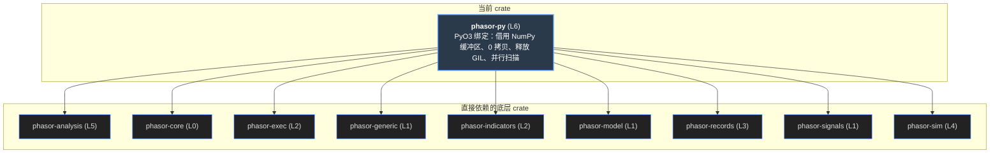
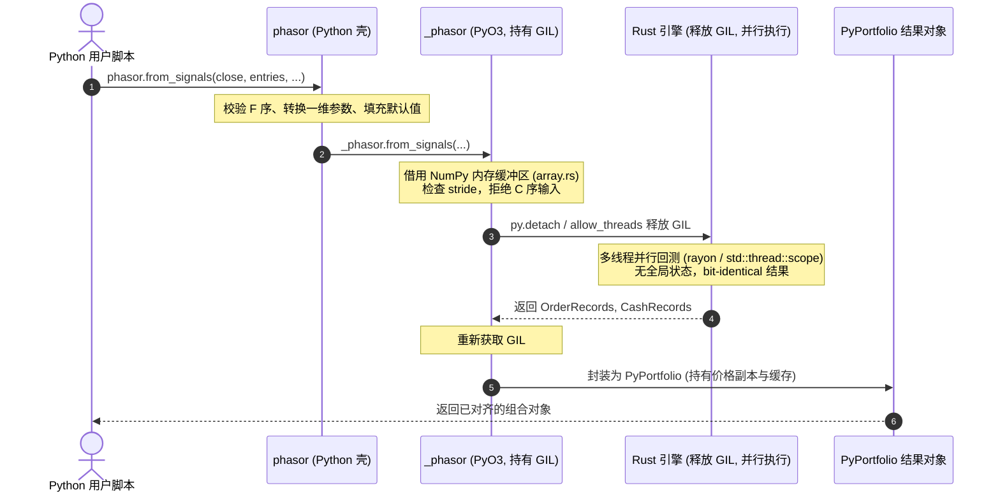

# phasor-py

Python 包。一个 wheel 里两层：Rust 扩展 `phasor._phasor`（PyO3 0.29 + rust-numpy，`abi3-py39`，maturin 构建）和包住它的纯 Python 壳 `python/phasor/`。会计算的东西全在 Rust 里，这一层只做三件事：把 NumPy 的缓冲区**按引擎读得懂的布局**交进去，把结果作为 NumPy 数组交出来， 在两门语言不同的生命周期之间搭桥。难点几乎都在第一件事上：引擎是列优先的，NumPy 默认是行优先的，而读反了的数组照样能跑出一份看起来正常的回测。

> **核心特性与指标：**
> - **110 格实测**：参数路由表的每一格都来自对已编译模块的真实调用：10 类参数 × 11 种输入 × 两层（phasor 与 phasor._phasor），记录的是转换、结果或报错原文
> - **433 通过 · 6 跳过**：uv run --with pytest python -m pytest crates/phasor-py/tests -q；跳过的是要装 TA-Lib、Ray、PyPortfolioOpt、plotly 等可选依赖才跑的测试。cargo test -p phasor-py 另有 18 个字符串映射测试（parse.rs）；整个工作区 cargo test --workspace 是 774 个
> - **整个 crate 没有 unsafe**：crate 根上 #![deny(unsafe_code)]，把 Arrow C Data 接口交给 Python 侧的 pyarrow 之后没有例外。Rust 6,903 行（12 个文件），Python 7,874 行（python/phasor/ 下 35 个文件）

<a id="concept"></a>

## 从第一性原理看：一层绑定要回答什么

先不看代码。把一个列优先、借用输入的 Rust 引擎暴露给 NumPy 用户，至少有六个问题绕不过去。

### 1. 读反了也能跑

`(3, 2)` 的数组 `0..6`，C 序的内存是 `[0,1,2,3,4,5]`，F 序是 `[0,2,4,1,3,5]`。把 C 序缓冲区当列优先读， 得到的不是乱码而是一条“价格序列”——它会成交、出报告、Sharpe 看起来很普通。连续性检查拦不住（C 序也是连续的），形状检查也拦不住（方阵转置后形状不变）。 唯一能区分的是 **stride**。所以布局要在 Rust 里按 stride 检查，而不是只靠 Python 壳去转换——`phasor._phasor` 是可以直接 import 的。

### 2. 借用跨不过 FFI

引擎的 `Portfolio` 借用收盘价：一次扫描里收盘价矩阵是最大的东西，结果没有理由再存一份。但 Python 可以在函数返回的下一刻就释放那个数组。 所以 `PyPortfolio` 在运行结束时把收盘价**按源宽度**复制一份（有 `column_map` 时是 S 列而不是 S × P 列），每次调用方法时在这份副本上重建借用视图。 派生出来的价值曲线、收益率、交易放在 pyclass 自己持有的 `Cache` 里，比每次的借用视图活得久。

### 3. 一维数组有两种意思

长度为 n 的一维数组，可以是“每根 K 线一个值”，也可以是“每列一个值”。在 `T ≠ C` 时长度能区分，在方阵上不能。所以每个调用点必须自己声明 `OneDim::PerRow` 还是 `OneDim::PerColumn`：交易参数是每列，现金流（入金、收益）是每根 K 线。这不是能推断出来的事。

### 4. 默认值只能有一份

`fees` 默认 0，`size` 默认 inf，`size_granularity` 默认 NaN，这些都写在 `FromSignals::default()` 里。 如果 Python 签名里再写一遍，就有了第二份会悄悄漂移的拷贝——没有任何测试会去找它。所以签名里只写 `None`，表示“没提供”，由 Rust 用引擎自己的默认值替换。

### 5. 计算时不需要 GIL

模拟、因子求值、组合派生都不碰任何 Python 对象，输入是 NumPy 缓冲区的只读借用。所以它们都包在 `py.detach` 里，GIL 释放，别的 Python 线程可以同时跑。 唯一的例外是数据加载：解码器是用户写的 Python 函数，Rust 侧在 GIL 外读文件，每一批再重新拿 GIL 调一次解码器。

### 6. 错误要带着能行动的信息过来

引擎的错误是“第 3 行第 1 列拒单：现金不足”这种句子。手写 C ABI 会把它压成错误码，丢掉的恰好是用户唯一能用的部分。这里每个 `phasor_core::Error` 原样变成 `ValueError`；字符串转枚举失败时，错误信息里既有可选值，也有用户传进来的那个值。

<a id="graph"></a>

## 依赖图

左边是引擎 crate，中间是 `_phasor` 的十二个 Rust 模块（research.rs 没画：事件研究、过拟合统计、标签、随机信号、合成价格），右边是 Python 壳（只画了和本页各节有关的文件）。点任一节点，只保留相关的线。

#### 示意 / 说明：线的颜色 = 被用到的 Rust 模块。虚线框的 Python 文件是纯 NumPy（或加 zoneinfo / pandas），不碰扩展



*说明：*

来源：`Cargo.toml`、`src/*.rs` 里的 `use phasor_…`、`python/phasor/*.py` 里的 `_phasor.…`。phasor（门面）不在依赖里。phasor-signals 除了 signal_fns.rs，还被没画出来的 research.rs 用（四种标签、随机信号）。

<a id="order"></a>

## 内存序陷阱

```text
NumPy C 序数组当成 Rust 列优先读的内存灾难:

数组形状 (3, 2), 元素为 [[0, 1], [2, 3], [4, 5]]

NumPy C-Order 物理内存:  [ 0  │  1  │  2  │  3  │  4  │  5 ]
                          ▲      ▲      ▲      ▲      ▲      ▲
                          │      │      │      │      │      │
Rust 列主序步长解释:    (0,0)  (1,0)  (2,0)  (0,1)  (1,1)  (2,1)

结果:
标的 0 看到的虚假价格序列: [0.0, 1.0, 2.0]  (完全失真，变成不同标的交叉混合的数据！)
标的 1 看到的虚假价格序列: [3.0, 4.0, 5.0]

防范机制:
crates/phasor-py/src/array.rs 严禁只检查 .is_contiguous()，
必须严格检查 PyArray::is_c_contiguous() 与 strides 步幅，遇 C-Order 立即报错或显式转置！
```

左边是你想表达的价格矩阵（每列一个标的），中间是它在内存里的样子，右边是一个列优先的读者按 `data[col * n_rows + row]` 读到的东西。 切换 C / F 看看；再切到方阵，看形状检查为什么帮不上忙。

#### 示意 / 说明：array.rs 的 `columns_of` 要防的事

*说明：*

### 第一道：Python 壳转换

`_matrix` / `_param` 对二维数组调 `np.asfortranarray`。已经是 F 序的 float64 原样返回（同一个对象），否则复制一份。复制是看得见的成本，不是悄悄的转置。

### 第二道：Rust 按 stride 拒绝

`columns_of` 判断 `n_rows == 1 || n_cols == 1 || strides[0] == 1`，不满足就报错并给出修法；不连续的切片（`x[:, ::2]`）也拒绝。bool 数组走 `flex_bool`，同样的检查。

### 为什么两道都要

只有壳：直接调 `phasor._phasor` 的人拿到的是转置后的回测。只有 Rust：每个 NumPy 默认数组都报错。两道一起，默认路径无感，绕过壳的人得到报错而不是错误答案。

<a id="routing"></a>

## 参数路由表（实测）

| 参数大类 | 典型参数示例 | 标量 `float` | 一维数组 `[T]` | 一维数组 `[C]` | 二维矩阵 `(T, C)` | 共享资金组传法 | 内部处理管道 |
| :--- | :--- | :---: | :---: | :---: | :---: | :---: | :--- |
| **交易参数** | `size`, `fees`, `slippage` | 🟢 标量广播 | 🔴 报长度错 | 🟢 每列对应 | 🟢 全量网格 | 🟢 每列独立 | `flex_or_f64` + `OneDim::PerColumn` |
| **初始资金** | `init_cash` | 🟢 单一资金 | 🔴 报长度错 | 🟢 每账户资金 | 🟡 仅取第 0 行 | 🟢 按组对应 | `init_cash_to_vec` |
| **时变现金流** | `cash_deposits`, `earnings` | 🟢 沿时间广播 | 🟢 每根 K 线 | 🔴 报长度错 | 🟢 全量网格 | 🟢 作用于组首列 | `OneDim::PerRow` |
| **标的行情** | `open`, `high`, `low` | 🔴 拒绝标量 | 🟢 自动升单列 | 🔴 拒绝单行 | 🟢 F-序直传 | 🟢 与 Close 对齐 | `column_map` 借用映射 |
| **布尔选项** | `lock_cash`, `allow_partial`| 🟢 单布尔值 | 🔴 报类型错 | 🟢 每列布尔 | 🟢 动态布尔阵 | 🟢 每列配置 | `FlexArray<bool>` |

一次 4 根 K 线 × 3 列的 `from_signals`。每一行是一类参数，每一列是一种传法。绿色是跑通了，红色是报错；黄色下划线表示 Python 壳为它复制了一份缓冲区。 切换“公开 API”和“直接调扩展”，点任一格看 Python 做了什么、Rust 怎么读、实际结果是什么。这些都是对编译好的模块调用出来的，不是从代码推出来的。

#### 示意 / 说明：phasor.from_signals vs phasor.\_phasor.from_signals · 收盘价 4 × 3

*说明：*

“交易参数”一行用的是 `size`；`fees`、`price`、`slippage`、`min_size`、`max_size`、`size_granularity`、`cash_limit`、`reject_prob`、`val_price`、止损止盈走同一条路（`flex_or_f64` + `OneDim::PerColumn`）。bool 参数一行用的是 `lock_cash`，`allow_partial`、`raise_reject`、`log`、`sl_trail` 相同。

### 一维的意思取决于参数

交易参数和 `init_cash` 的一维数组是**每列一个**（长度 4 报 `per-column array has length 4, expected 3`）；`cash_deposits`、`cash_earnings`、`debt_rate` 是**每根 K 线一个**（长度 3 报 `per-row … expected 4`）。在 T = C 的方阵上两种长度都能过，读这张表是唯一的办法。第三种是市场数据：`open`/`high`/`low`、`cash_dividends`、`mark_price`、`funding_rate`、两个 `*_financing_rate` 和 `borrow_rate` 属于标的，和 `close` 同形状、经过 `column_map`，一维数组读作一列；形状不对时报 `<名字> must have the source close shape`。

### 非共享 `init_cash` 收下矩阵，只读第 0 行

传一个 4 × 3 的 `init_cash`，各行不同：运行成功，三列的起始净值是 `[1000, 2000, 3000]`，正好是第 0 行；后面三行被静默忽略。`account_inputs` 用 `balances.get(0, group)` 取值，没有检查行数。

### 共享账户：入金按组，收益按列

共享时 `init_cash` 只能是标量或每组一个值；`cash_deposits` 的矩阵必须是 `(T, n_groups)`，经 `FlexArray::mapped` 映射到列上，不复制；`cash_earnings` 仍是 `(T, C)`。原因：引擎从组的第一列记一次入金，而收益（利息、费用）属于每一列的持仓。

### bool 参数没有一维形式；信号不收标量

`_flag` 把一维 bool 数组重塑成一列，只有单列的运行才对得上。公开 API 的 `entries`/`exits` 经 `_signals`，标量直接报错；扩展本身却收 bool 标量——壳比 Rust 更严格。整数数组正相反：壳把它转成 float64（复制），扩展拒绝，理由是“悄悄当成 float 读就得复制”。

<a id="defaults"></a>

## 默认值放在哪里

凡是会变成 `FlexArray` 的参数，Python 签名和 Rust 签名里的默认值都是 `None`；`flex_or_f64(&value, …, default)` 在没提供时用 `FromSignals::default()` 的字段。字符串和普通标量（`ann_factor`、`seed`、`threads`……）不经过 FlexArray， 它们的默认值在 Python 壳和 `#[pyo3(signature)]` 里**各写了一份**——目前一致，但这正是上面第 4 条想避免的那种拷贝。

| 参数 | 签名里 | 引擎默认（`FromSignals::default()`） | 意思 |
|------|--------|--------------------------------------|------|

<a id="life"></a>

## 一次调用的生命周期

从 `phasor.from_signals(...)` 到 `pf.sharpe_ratio()`，数据在哪里、谁拿着 GIL。

#### 示意 / 说明：四条泳道：Python 壳 · \_phasor（持 GIL） · 引擎（GIL 已释放） · PyPortfolio



*说明：*

共享资金的运行按执行顺序写成交；`assemble` 在这里排一次序（`sort_by_column`）存进 `sorted_orders`，以后每次重建都直接用，而不是每次都排。

### 实测

一台 8 核 macOS 机器，各跑一次的墙钟时间，只用来看量级和比例，不是基准测试。2,520 根 K 线 × 50 个标的 × 40 组参数（2,000 列），`strategy.sweep`。

| 测量 | 结果 | 说明 |
|------|------|------|

> [!NOTE]
> README 说“每个单独的指标访问器都会重建派生链……缓存每次都从空开始”，`metrics()` 的文档注释也说“分开要六个就做六倍的活”。 代码已经不是这样：`PyPortfolio` 自己持有 `cache: Cache`，第二次 `sharpe_ratio()` 从约 90 ms 降到约 19 ms，剩下的是重建借用视图和归约本身。 `metrics()` 仍然划算（一次重建、一次 GIL 往返），但不再是“六倍”。见[文档出入](#docs)。

<a id="callbacks"></a>

## 回调：`from_order_func` 与 `from_signals` 的 `*_func`

Python 回调是直接调用的：引擎照常在 `py.detach` 里跑，每调一次回调，`callbacks.rs` 用 `Python::attach` 拿回 GIL，调完再放。所以带 Python 回调的运行比数组驱动的慢几个数量级， 用来试规则和调试；值得大规模跑的规则应该写成 Rust 的 `OrderFunc` / `SignalFunc`（见 [phasor-sim · 回调](phasor-sim.md#callbacks)）。 `from_order_func(close, order_func, *, flexible=False, row_wise=False, pre_group_func=, pre_segment_func=, post_order_func=, post_segment_func=, size=nan, **kwargs)` 是 `from_orders` 的薄包装： `size` 默认 NaN（没有订单），其余参数原样交给 `from_orders`。

| 函数 | 什么时候调 | 返回什么 |
|----|----|----|
| pre_group_func(group, from_col, to_col) | 每组一次，第一根之前（两个入口都有） | 这一组的状态（没给这个函数时是 None），作为最后一个参数传给其他回调；要原地修改，回调的返回值不会替换它 |
| order_func(ctx, k, state) | from_order_func：按组的 call_seq 每列一次，k 是组内下标 | None 保留数组给的订单；一个数是 size；一个字典改它列出的字段：size、price（inf 是收盘价）、size_type、direction、fees、fixed_fees、slippage、min_size、max_size、size_granularity、leverage、initial_margin、cash_limit、reject_prob、lock_cash、allow_partial、raise_reject、log |
| order_func(ctx, call, state) | `flexible=True`：一根 K 线里反复调，call 从 0 数 | None 结束这根；`(k, order)`，order 同上，从这列这根的请求（带着这根的价格）开始改。任意列、任意顺序、任意笔数 |
| pre_segment_func(ctx, state) | from_order_func：这根的订单之前 | None、`"skip"`（这根不下单）或 `"stop"`（这一组不再下单） |
| signal_func(ctx, k, state) | from_signals：每根每列 | None 保留数组的；四元组 `(long_entry, long_exit, short_entry, short_exit)`；或字典：这四个（`entry` / `exit` 是 long\_\* 的别名）和 size、size_type。之后照常走冲突、累加、止损、限价单 |
| adjust_func(ctx, k, stops, state) | from_signals：测止损之前 | stops 是字典 sl_price、sl_stop、sl_trail、tp_price、tp_stop、tsl_price、tsl_stop、tsl_th；返回 None 或要改的字段 |
| post_order_func(ctx, k, result, state) | 每笔订单之后，成交与否 | result 是字典：filled、size、price、fees、side（"buy" / "sell" / None）、status、status_info；返回 None 或 `"stop"` |
| post_segment_func(ctx, state) | 每根收尾，收益和持仓费之后 | None 或 `"stop"` |

### phasor.Context

`PyContext`，冻结的 pyclass，每次调用新建一个快照：`group`、`row`、`from_col`、`to_col`、`cash`、`free_cash`、`value`，以及按组内下标排的列表 `position`、`debt`、`locked_cash`、`val_price`、`close`、`multiplier`。价格是策略的价格，不含合约乘数；`signal_func` 和 `adjust_func` 里的 val_price 是上一根的。

### pf.in_outputs

每组的状态，按组的顺序放在一个列表里，就是 `pre_group_func` 返回、回调原地改过的那些对象；没有回调的运行是 None。它是 `PyPortfolio` 的字段，不经过记录，所以分析层不读它。

### 异常原样抛出

回调抛出的第一个异常存在 `PyCallbacks` 里，引擎随之以错误结束；抛给调用方的是那个异常本身，不是包装后的 ValueError。返回值不合规（例如 `order_func` 返回字符串、flex 返回的列不在组里、没有的钩子名或字段名）是 ValueError；回调不可调用是 TypeError。

### row_wise 与 threads

`row_wise=True` 走 `Schedule::RowWise`：所有组的第 i 根跑完才进下一根，单线程，跨组共享状态的回调看到的顺序是对的，记录和不开时相同。否则按 `threads` 分组并行，和没有回调时一样（每次调用都要拿 GIL）。`flexible`、`row_wise` 只属于 from_order_func，扩展里的 `from_signals` 收到它们报错。

测试：`tests/test_callbacks.py`——order_func 和做出同样决定的数组逐笔相同；状态、flex 订单和停止；skip 和 stop；row_wise 按 K 线顺序跨组共享状态；回调的异常就是调用方看到的异常；signal_func 和数组相同；按风险定仓和保本止损。

<a id="builtin"></a>

### 内置规则：`risk=`、`risk_stop=`、`breakeven=`、`max_positions=`、`max_exposure=`

`from_signals` 有五个内置规则的关键字参数（[\_\_init\_\_.py:761](https://github.com/nivalume/phasor/blob/1d573df0430fa5cd3a2416300603c7147f3c6a13/crates/phasor-py/python/phasor/__init__.py#L761)，说明在 [:1164](https://github.com/nivalume/phasor/blob/1d573df0430fa5cd3a2416300603c7147f3c6a13/crates/phasor-py/python/phasor/__init__.py#L1164)），对应 phasor-sim 的 `Builtin`：按风险定仓、移到保本、全局预算，三条规则怎么算见 [phasor-sim · 内置回调](phasor-sim.md#builtin)。 它们在 Rust 里跑、不拿 GIL，和写成 Python 回调的同一规则逐笔相同，但没有每列每根一次的 GIL 往返。

参数怎么走到引擎：壳的 `_builtin`（[\_\_init\_\_.py:1301](https://github.com/nivalume/phasor/blob/1d573df0430fa5cd3a2416300603c7147f3c6a13/crates/phasor-py/python/phasor/__init__.py#L1301)）去掉值为 None 的项，一个都不剩时传 None，否则把字典作为 `builtin=` 交给扩展（[:1297](https://github.com/nivalume/phasor/blob/1d573df0430fa5cd3a2416300603c7147f3c6a13/crates/phasor-py/python/phasor/__init__.py#L1297)）。 扩展的 `from_signals` 在签名里多了 `builtin = None`（[lib.rs:1374](https://github.com/nivalume/phasor/blob/1d573df0430fa5cd3a2416300603c7147f3c6a13/crates/phasor-py/src/lib.rs#L1374)）；`builtin_of`（[lib.rs:2567](https://github.com/nivalume/phasor/blob/1d573df0430fa5cd3a2416300603c7147f3c6a13/crates/phasor-py/src/lib.rs#L2567)）把四个浮点参数读成 f64（None 是 NaN），`max_positions` 读成 usize（None 是 0）；`FromSignals` 建好之后再调 `Builtin::validate(args.use_stops)`（[lib.rs:1956](https://github.com/nivalume/phasor/blob/1d573df0430fa5cd3a2416300603c7147f3c6a13/crates/phasor-py/src/lib.rs#L1956)），不合格的变成 ValueError（例如只给 risk：“risk sizing needs both risk and risk_stop”）。 同时给了 Python 回调也报错（[:1958](https://github.com/nivalume/phasor/blob/1d573df0430fa5cd3a2416300603c7147f3c6a13/crates/phasor-py/src/lib.rs#L1958)，“cannot be combined; write the rule in the callback”）：两者都要占 `SignalFunc` 的位置。运行在 `py.detach` 里分派（[:1966](https://github.com/nivalume/phasor/blob/1d573df0430fa5cd3a2416300603c7147f3c6a13/crates/phasor-py/src/lib.rs#L1966)）：有内置规则走 `builtin_run`（[:2587](https://github.com/nivalume/phasor/blob/1d573df0430fa5cd3a2416300603c7147f3c6a13/crates/phasor-py/src/lib.rs#L2587)），按要不要日志选 `simulate_from_signal_func::<Journal, _>` 或 `::<OrderRecords, _>`，每组的规则状态丢掉，所以 `pf.in_outputs` 是 None；没有就照旧走 `signals_run`。

测试：`tests/test_builtin_rules.py`——按风险定仓和写成 `signal_func` 的同一规则逐笔相同，第一笔的风险正好是净值的 1%；保本止损和写成 `adjust_func` 的同一规则逐笔相同，且有交易恰好在入场价出场；预算让同时持仓不超过 2 个，敞口上限让订单变少；只给 risk、和回调一起用都报错；1 和 3 线程相同。

<a id="resume"></a>

## 续跑、存取和逐根推进：`resume=`、`save` / `load`、`Stepper`

三件事都建立在 phasor-sim 的状态快照上（见 [phasor-sim · 续跑](phasor-sim.md#resume)）：每个 `Portfolio` 都带着 `pf.last_state`，即这次运行最后一根之后的 `SimState`。 绑定层的代码在 `src/resume.rs`，`Stepper` 在纯 Python 的 `python/phasor/stepper.py`。

| 用法 | 怎么调 | 得到什么 |
|----|----|----|
| 续跑（`pf.update`） | `from_signals(..., resume=pf)`、`from_orders(..., resume=pf)`，`from_order_func` 也一样 | 传完整历史（旧 K 线加新 K 线）和同样的参数，只模拟 pf 之后的 K 线。返回整段历史的一个 `Portfolio`：pf 的记录接上新的（`Journal::chain`），和一次跑完相同，顺序也相同；起始现金用 pf 的 |
| 分段 | `resume=state`（一个 `phasor.SimState`）加 `row_offset=r`，数组从历史的第 r 行开始，带上回看的几行 | `phasor.Segment`：`orders()`、`cash_records()`（行号是整段历史的）和 `last_state`。不是组合：它从运行中间开始，不知道之前的现金 |
| 存取 | `phasor.save(pf, path)` / `phasor.load(path)`；组合底下是 `pf.to_bytes()` / `Portfolio.from_bytes()` | 载入的组合照常分析，也能再 `resume=`。save 也收别的研究对象，见[配置与命令行](#toolchain) |
| 逐根推进 | `phasor.Stepper` | 见下 |

### resume=pf 检查什么

`prior`：pf 要有状态；列数、源列数、`column_map` 相同；分组和 `cash_sharing` 相同；`close` 的行数不少于 pf 跑过的；pf 跑过的每一根收盘价逐位相同，否则报 “close differs from the portfolio's at bar r of column c”。其余参数不检查，用同样的参数是调用方的事。另外：`resume=pf` 不能带 `row_offset`（整段历史从第 0 行开始）；没有 `resume` 却给了 `row_offset` 报错；`init_cash="auto"` 不能续跑（壳里的 `_resume`）；`resume` 不是 Portfolio 或 SimState 是 TypeError；from_signals 的状态续不了 from_orders。

### 绑定里怎么接

`resume::resolve` 把参数读成 `Resumed::Portfolio` 或 `Resumed::State`，状态交给 `FromSignals` / `FromOrders` 的 `resume`。运行统一走 `signals_run` / `orders_run`，有无回调、有无日志的四种结果都换成同一个 `PyRun`（`Run<Journal, Py<PyAny>>`）。`resume=state` 时直接返回 `Segment`；否则 `finished` 用 `Journal::chain` 把 pf 的记录和新记录接起来、起始现金取 pf 的，组合存下 `last_state`。所以两个函数的返回类型是 `Py<PyAny>`。

### phasor.SimState

冻结的 pyclass：`next_row`、每组的 `cash` 和 `free_cash`、按列的 `position`，`to_bytes()` 和 `SimState.from_bytes()`（版本不对是 ValueError）。它只是 Rust 的 `SimState` 的包装，列状态的其余字段（止损、挂单）不单独暴露。

### 字节里有什么

`resume::to_bytes`：魔数 `PHPF`、版本 1，然后 n_rows、n_cols、source_cols、column_map、每列起始现金、组长度、cash_sharing、ann_factor、risk_free、incl_open、trades_type、源宽度的收盘价、`Journal` 的字节、状态的字节（可以没有）。回调状态 `in_outputs` 是 Python 对象，不存。`phasor.save` 存组合时写的就是这些字节；写文件的是 Python 壳，库 crate 不写文件。没有用 Arrow IPC。

### `phasor.Stepper`：一根一根地推进 from_orders

给实盘用：策略决定这一根的订单，`propose` 说回测会怎么成交；执行层下单、回报实际成交，`commit` 按回报记下，记录就是实际发生的而不是模拟的；`reconcile` 和券商的持仓对账。 `Stepper(n_cols, *, lookback=1, **params)`：`params` 是对每一根都成立的 `from_orders` 参数（init_cash、fees、leverage、group_lens……）；`size`、`close`、`resume`、`row_offset`、`from_ago` 不能在这里给。

| 方法 | 做什么 |
|----|----|
| propose(close, size=nan, \*\*bar) | 用这一根和之前 `lookback` 根跑一次 `from_orders(resume=上一根的状态, row_offset=)`，返回这一根的 `orders()`。什么都不记下。`bar` 是这一根的其他输入：price、open、high、low、费率等；回看的几根带着它们自己的行情，没有订单 |
| commit(fills=None) | 不给 fills：按提议记下。给 fills（每列 `size` 有符号、NaN 或 0 是没有，`price`，`fees` 是金额）：把这一根按回报重跑一次，订单换成 amount、both、回报的价格，`fixed_fees` 是回报的手续费，fees 和 slippage 为 0，数量限制、cash_limit、reject_prob、lock_cash 都关掉，`allow_partial=False`、`raise_reject=True`（`_FILL_ORDER`）。这一根的现金流和持仓费照常记。账户放不下的回报（现金不够、方向或保证金不允许）报错：phasor 的账户和券商的已经对不上了。然后存下状态，进到下一根 |
| reconcile(positions) | 券商的持仓减去 phasor 的，按列；一致的地方是 0 |
| position / cash | 最后提交的一根之后每列的持仓、每组的现金（读 `state`） |
| orders() / cash_records() | 提交过的全部成交和现金流，行号是整段历史的，按账户组稳定排序，和一次 from_orders 写出的顺序相同 |

每一根只跑这一根和回看的几根，所以成本不随历史变长。`lookback=1` 够 `price=-inf`（上一根收盘）用；不支持 `from_ago`，因为决定就是这一根的。同一列在一根里的几笔成交要合成一笔报：总数量、均价、总手续费。只支持 from_orders。

测试：`tests/test_resume.py`——from_signals 在 1、30、79 切开（止损、收益、共享现金、日志）续跑后，成交、净值、现金、日志和状态字节都和一次跑完相同；from_orders 和 from_order_func 带杠杆和随机拒单续跑相同；save / load 后统计相同、还能续跑，坏字节报错；状态字节往返和版本检查；resume 拒绝的各种情形；`resume=state, row_offset=39` 得到 Segment，成交等于一次跑完的后半段。`tests/test_stepper.py`——三组参数（price=-inf；杠杆加共享现金；随机拒单加收益）逐根 propose、commit() 之后，成交、现金流、持仓和状态字节与一次 from_orders 相同；回报的成交按回报记，下一根从记下的接着跑；没 propose 就 commit、放不下的回报都报错。

<a id="sweep"></a>

## 扫描布局：`@phasor.strategy`

`strategy.sweep(data, params=[...])` 对每组参数调一次你的函数，把信号按参数组横向拼起来：第 p 组参数、第 s 个标的落在列 `p · S + s`。 收盘价不复制：`column_map = tile(arange(S), P)` 让每一列指回源列。开了 `cash_sharing` 时，每组参数是一个账户（`group_lens = [S] * P`）。

#### 示意 / 说明：列布局与保留的价格内存

*说明：*

实测：6 根 K 线、2 个标的、3 组参数，`n_cols = 6`，`price_nbytes = 96`（= 6 × 2 × 8，源矩阵本身）；共享时 `group_lens = (2, 2, 2)`。大扫描 2,520 × 50 × 40：保留 1,008,000 字节，铺开会是 40,320,000 字节。

### `signal_delay`：信号晚一根执行

默认 `signal_delay=1`：第 t 根 K 线算出来的信号，在第 t + 1 根的收盘价成交，避免用当根收盘价决定、又按当根收盘价成交。实现是把信号整体下移 （`delayed[bars:] = array[:-bars]`），所以**最后 `delay` 根上的信号会被丢掉**——包括最后一根上的出场。

#### 示意 / 说明：一列：第 0 根进场、第 5 根出场（6 根 K 线）

*说明：*

实测：`signal_delay=0` 成交在第 0、5 根；`signal_delay=1` 只剩第 1 根的买入——第 6 根不存在，出场信号没了，仓位到最后都开着。

<a id="ranking"></a>

## 两个排名陷阱

### 从没交易过的列，Sharpe 是 inf

零收益除以零波动。实测两列，一列交易、一列信号从没触发：`sharpe_ratio() = [124.04, inf]`，`argmax` 选中的是那列**什么都没做**的。 `pf.traded_only(values)` 把没交易的列换成 NaN：`[124.04, nan]`，`nanargmax` 回到 0。这是定义好的答案（0/0 记作 +∞），不是 bug；这个方法是让排名说清楚它在排什么。

### `stats()` 里 NaN 和 None 不是一回事

28 行，顺序和标题固定（所以两次运行可以直接 diff）。NaN 表示算了、没有答案：只涨不跌的列里 `Max Drawdown [%]`、`Avg Losing Trade [%]`、`Calmar Ratio` 都是 NaN。 None 表示没人提供算它的输入：共享资金运行不设基准，`Benchmark Return [%]` 是 None。共享运行的序列要用 `group=`，传 `col=` 会报错。

<a id="enums"></a>

## 字符串到枚举

`parse.rs` 很小，测试却一个变体一个变体地写：映射表的典型错误是“明显对、但有一行错”——`"targetvalue"` 落到 `TargetAmount` 能编译、能跑， 只是回测结果不同，下游没有任何东西能察觉。区分大小写，失败时同时列出可选值和传入的值。输入一个字符串试试。

#### 示意 / 说明：parse.rs 的字符串映射，JS 移植

传入的字符串

*说明：*

### 两个循环收同样的 size type

`from_signals` 也收目标类（TargetAmount / TargetValue / TargetPercent 及 \*100 写法）：phasor-sim 的 `signals_to_target` 给它下了定义——进场把仓位移到目标（从空仓、从反方向一笔反手、或在累加允许时加仓），出场平仓。`signals_to_size` 本身不收这三种，分派在 `size_signals` 里做；`test_a_target_size_sets_where_the_signal_path_ends_up` 钉住这个定义。

### `direction` 默认值也不同

订单默认 `both`（数量的正负已经说明方向），信号默认 `longonly`。`"long"`、`"short"` 作为 `"longonly"`、`"shortonly"` 的别名接受；Python 壳另把 `accumulate=True / False` 翻译成 `"both"` / `"disabled"`。

<a id="guards"></a>

## 护栏：宁可报错，也不给一个看起来正常的错答案

这一层拒绝的每样东西，如果放行，都会得到一次能跑完的回测。报错原文来自实测。

| 情况 | 报错 | 放行会怎样 |
|------|------|------------|

<a id="validation"></a>

## 交叉验证与检验：`phasor.validation`

纯 NumPy，不碰扩展。在同一段 K 线上选参数又报告结果，衡量的是拟合而不是优势；这几个切分器只返回**行号**，所以可以切价格矩阵、喂给 `iloc`、喂给模型的 `fit`。 尺寸是显式的行数而不是比例：同一个调用用在更长的序列上，得到更多同样形状的切分，而不是形状变了。

#### 示意 / 说明：rolling / expanding / purged_kfold，JS 移植（432 个用例与 Python 逐一致）

*说明：*

■ train　■ test　┆ purge（测试段之前丢掉：标签向前看）　┆ embargo（测试段之后丢掉：特征向后看）

`walk_forward(fn, n, splits)` 在每个 train 上给整个参数网格打分、选一个键，再只保留这个键在 test 上的分数；其余 test 分数直接丢掉，免得它们影响选择。 NaN 分数永远不会被选中，平局取 `fn` 返回顺序里的第一个。

### 按日期和日历切分、三种显著性检验

同一个文件里还有七个函数，同样只用 NumPy。切分函数返回的都是 `Split(train, test)` 的列表，可以直接交给 `walk_forward`；三种检验各回答一个问题：仓位和收益的对齐是不是碰巧（置换检验），结果是不是靠读自己那根 K 线（延迟检验），策略是不是真在用收益的顺序（打乱价格）。 `research/phasor_lab` 有自己的 walk-forward，它是那个研究框架预注册协议的一部分，不用这里的实现。

| 函数 | 怎么读 | 要注意什么 |
|----|----|----|
| from_ranges(index, ranges) | [validation.py:382](https://github.com/nivalume/phasor/blob/1d573df0430fa5cd3a2416300603c7147f3c6a13/crates/phasor-py/python/phasor/validation.py#L382)。每段 `(train_start, train_stop, test_start, test_stop)`，左闭右开，`numpy.datetime64` 能读的都行（`"2024-01-01"`、`datetime`）。`_times`（[:364](https://github.com/nivalume/phasor/blob/1d573df0430fa5cd3a2416300603c7147f3c6a13/crates/phasor-py/python/phasor/validation.py#L364)）把 index 变成 datetime64 并检查有序，`_rows`（[:375](https://github.com/nivalume/phasor/blob/1d573df0430fa5cd3a2416300603c7147f3c6a13/crates/phasor-py/python/phasor/validation.py#L375)）用 `searchsorted` 找行 | 某一边没有 K 线、train 和 test 共用一根，都报错 |
| from_masks(train, test) | [validation.py:404](https://github.com/nivalume/phasor/blob/1d573df0430fa5cd3a2416300603c7147f3c6a13/crates/phasor-py/python/phasor/validation.py#L404)。布尔掩码，每行一个切分；一维就是一个 | 两个掩码形状不同、同一行两边都为 True，报错 |
| calendar(index, freq, train, test=1, step=None, expanding=False) | [validation.py:431](https://github.com/nivalume/phasor/blob/1d573df0430fa5cd3a2416300603c7147f3c6a13/crates/phasor-py/python/phasor/validation.py#L431)。`_period_ids`（[:419](https://github.com/nivalume/phasor/blob/1d573df0430fa5cd3a2416300603c7147f3c6a13/crates/phasor-py/python/phasor/validation.py#L419)）给每根 K 线一个周期号：W 是从周一开始的周（1970-01-01 是周四，所以先加 3 再除以 7），M / ME、Q / QE、Y / YE / A 都从月份数算；周期号变化的地方就是周期的边界。train 个周期训练、接下来 test 个周期测试，每次前进 step 个周期 | 周期按实际有 K 线的算，没有 K 线的月份不是一个周期。`allocation.rebalance_mask(freq=)` 也用这个周期号 |
| permutation_test(positions, returns, statistic="total", n=1000, block=1, seed=0) | [validation.py:459](https://github.com/nivalume/phasor/blob/1d573df0430fa5cd3a2416300603c7147f3c6a13/crates/phasor-py/python/phasor/validation.py#L459)。`positions[t]` 是持有第 t 根收益的仓位。收益按 block 根一块打乱 n 次：持仓的时间和收益的分布都不变，只打断两者的对齐。p = (1 + \#null ≥ observed) / (n + 1) | 对齐要调用方做：第 t 根的收益要配 t − 1 根就定下的仓位。NaN 收益当 0；`"sharpe"` 用 ddof = 1，标准差为 0 时记 0 |
| signal_delay_test(strategy, data, params, delays=(0, 1, 2), metric="total_return") | [validation.py:508](https://github.com/nivalume/phasor/blob/1d573df0430fa5cd3a2416300603c7147f3c6a13/crates/phasor-py/python/phasor/validation.py#L508)。对一个 `@phasor.strategy` 用每个 `signal_delay` 跑一次 `strategy.run`，返回 `{delay: 每列的指标}` | 延迟 0 比 1 好很多，多半是读了自己那根的收盘价；1 还在、2 就没了，赚的是一根的效应，执行延迟会把它吃掉 |
| shuffled_prices(close, n, block=1, seed=0) · shuffled_test(fn, close, n=100, block=1, seed=0) | [validation.py:529](https://github.com/nivalume/phasor/blob/1d573df0430fa5cd3a2416300603c7147f3c6a13/crates/phasor-py/python/phasor/validation.py#L529) / [558](https://github.com/nivalume/phasor/blob/1d573df0430fa5cd3a2416300603c7147f3c6a13/crates/phasor-py/python/phasor/validation.py#L558)。对数收益按块打乱，所有列用同一个排列（截面相关留下，趋势和顺序没了），每条路径从第一根收盘价起步，返回 `(n, rows, columns)`。`shuffled_test` 在每条路径上重跑 `fn`（比如一整次回测），p 值的算法同上 | 缺失的价格留在原位，但缺口两边的对数收益按 0 处理，跨缺口的涨跌打乱后就丢了；第一根是 NaN 的列整列都是 NaN |

<a id="params"></a>

## 参数搜索：`phasor.params`

纯 Python，不碰扩展。一个网格就是一个 dict 的列表，所以 `grid`、`random`、手写的、别处来的可以直接用 `+` 拼起来。`run` 对每个组合调一次任意函数，结果按网格的顺序放在 `ParamResults` 里，参数就是标签。 它和 [`@phasor.strategy` 的扫描](#sweep)不是一回事：那边把所有参数组拼成一次运行的列，这边是一个组合一次调用，函数里做什么都行。

| 函数 | 怎么读 | 要注意什么 |
|----|----|----|
| grid(\*, where=None, \*\*values) | [params.py:46](https://github.com/nivalume/phasor/blob/1d573df0430fa5cd3a2416300603c7147f3c6a13/crates/phasor-py/python/phasor/params.py#L46)。`itertools.product`，第一个参数在最外层、最后一个变得最快；标量当成只有一个值；`where` 过滤组合（条件网格） | 没有参数、某个参数没有值，报错 |
| random(n, \*, seed=0, where=None, max_tries=100, \*\*dists) | [params.py:106](https://github.com/nivalume/phasor/blob/1d573df0430fa5cd3a2416300603c7147f3c6a13/crates/phasor-py/python/phasor/params.py#L106)。每个参数是一个分布：`Choice`（[:64](https://github.com/nivalume/phasor/blob/1d573df0430fa5cd3a2416300603c7147f3c6a13/crates/phasor-py/python/phasor/params.py#L64)）、`Uniform`（[:74](https://github.com/nivalume/phasor/blob/1d573df0430fa5cd3a2416300603c7147f3c6a13/crates/phasor-py/python/phasor/params.py#L74)，\[low, high)）、`IntUniform`（[:85](https://github.com/nivalume/phasor/blob/1d573df0430fa5cd3a2416300603c7147f3c6a13/crates/phasor-py/python/phasor/params.py#L85)，\[low, high\]）、`LogUniform`（[:96](https://github.com/nivalume/phasor/blob/1d573df0430fa5cd3a2416300603c7147f3c6a13/crates/phasor-py/python/phasor/params.py#L96)）；列表当 Choice，其余当常量。一个 `default_rng(seed)` 按参数的顺序依次抽 | 同一个种子、同样的参数顺序得到同样的组合；改参数的顺序或加一个参数，抽到的数就变了。`where` 连续拒绝 max_tries 次报错 |
| run(func, combos, \*args, n_jobs=1, executor="thread", \*\*kwargs) | [params.py:213](https://github.com/nivalume/phasor/blob/1d573df0430fa5cd3a2416300603c7147f3c6a13/crates/phasor-py/python/phasor/params.py#L213)。每个组合调 `func(*args, **kwargs, **combo)`（`_call`，[:208](https://github.com/nivalume/phasor/blob/1d573df0430fa5cd3a2416300603c7147f3c6a13/crates/phasor-py/python/phasor/params.py#L208)）；`n_jobs > 1` 时交给线程池或进程池的 `map`，结果仍按 combos 的顺序 | 线程池有用，是因为 phasor 的回测在 `py.detach` 里释放 GIL；进程池要求函数和参数能 pickle，lambda 不行 |
| ParamResults | [params.py:142](https://github.com/nivalume/phasor/blob/1d573df0430fa5cd3a2416300603c7147f3c6a13/crates/phasor-py/python/phasor/params.py#L142)。`params`、`values` 两个列表；`column(key)`（[:163](https://github.com/nivalume/phasor/blob/1d573df0430fa5cd3a2416300603c7147f3c6a13/crates/phasor-py/python/phasor/params.py#L163)）把每个值（或 dict 值的 key 项）转成 float，转不了是 NaN；`table()`、`to_frame()`；`best(key, minimize=)`（[:193](https://github.com/nivalume/phasor/blob/1d573df0430fa5cd3a2416300603c7147f3c6a13/crates/phasor-py/python/phasor/params.py#L193)）；`select(**fixed)`（[:202](https://github.com/nivalume/phasor/blob/1d573df0430fa5cd3a2416300603c7147f3c6a13/crates/phasor-py/python/phasor/params.py#L202)） | `best` 不会选 NaN，平局取前面的，全是 NaN 报错。函数返回 dict 时每个键一列 |
| neighbors(results, key="value", names=None) | [params.py:241](https://github.com/nivalume/phasor/blob/1d573df0430fa5cd3a2416300603c7147f3c6a13/crates/phasor-py/python/phasor/params.py#L241)。每个参数的取值排好序，只改一个参数、差一档的组合就是邻居；返回每个组合的 `value`、邻居的 `mean`、`min`、`count` 和 `ratio = mean / value` | 峰值周围都差（ratio 低）多半是拟合了噪声。参数名不同的组合可以混在一起：缺某个参数的组合不在那条轴上找邻居，邻居也只在有同样参数的组合里找。value ≤ 0 时 ratio 的大小没有意义 |

<a id="allocation"></a>

## 组合权重：`phasor.allocation`

纯 NumPy 的权重层，最后落在 `from_orders` 上。数据流：`close` → 简单收益 `ret`（第 0 行 NaN）→ `rebalance_mask` 选出调仓的 K 线 → 在每个调仓的第 t 根取 `ret[max(1, t − lookback) : t]` 调权重函数 → `(T, N)` 的权重矩阵，其余行 NaN → `from_weights` → `from_orders(size=权重, size_type="targetpercent", cash_sharing=True, group_lens=[N], call_seq="auto")`：N 个资产一个共享现金的账户，NaN 行不下单，先卖后买。 窗口止于上一根，权重在第 t 根开盘时就能算出来；订单在第 t 根按收盘价（from_orders 的默认价）成交，用不到第 t 根自己的收益。权重之和不必是 1：剩下的是现金，负数是空头。

| 函数 | 怎么读 | 要注意什么 |
|----|----|----|
| rebalance_mask(n, \*, every=None, freq=None, index=None, offset=0) | [allocation.py:55](https://github.com/nivalume/phasor/blob/1d573df0430fa5cd3a2416300603c7147f3c6a13/crates/phasor-py/python/phasor/allocation.py#L55)。`every` 和 `freq` 二选一：每隔 every 根（从 offset 起），或每个日历周期的第一根（复用 validation 的 `_period_ids`，要 index） | 按 freq 时整段的第一根总是调仓 |
| weights(close, fn, \*, every, freq, index, lookback=60, min_periods=None) | [allocation.py:79](https://github.com/nivalume/phasor/blob/1d573df0430fa5cd3a2416300603c7147f3c6a13/crates/phasor-py/python/phasor/allocation.py#L79)。窗口不足 min_periods（默认 lookback）行的调仓 K 线跳过，那一行仍是 NaN | fn 返回的权重个数不等于资产数，报错 |
| from_weights(close, weights, \*\*kwargs) | [allocation.py:104](https://github.com/nivalume/phasor/blob/1d573df0430fa5cd3a2416300603c7147f3c6a13/crates/phasor-py/python/phasor/allocation.py#L104)。形状必须和 close 相同；其余关键字参数交给 `from_orders`，`call_seq` 默认 auto，可以覆盖 | 一个账户：所有资产共用现金，fees 等参数照 from_orders 的规则广播 |
| equal_weight · inverse_volatility · min_variance · max_sharpe · risk_parity | [allocation.py:140](https://github.com/nivalume/phasor/blob/1d573df0430fa5cd3a2416300603c7147f3c6a13/crates/phasor-py/python/phasor/allocation.py#L140) / [146](https://github.com/nivalume/phasor/blob/1d573df0430fa5cd3a2416300603c7147f3c6a13/crates/phasor-py/python/phasor/allocation.py#L146) / [172](https://github.com/nivalume/phasor/blob/1d573df0430fa5cd3a2416300603c7147f3c6a13/crates/phasor-py/python/phasor/allocation.py#L172) / [178](https://github.com/nivalume/phasor/blob/1d573df0430fa5cd3a2416300603c7147f3c6a13/crates/phasor-py/python/phasor/allocation.py#L178) / [188](https://github.com/nivalume/phasor/blob/1d573df0430fa5cd3a2416300603c7147f3c6a13/crates/phasor-py/python/phasor/allocation.py#L188)。协方差 `_cov`（[:130](https://github.com/nivalume/phasor/blob/1d573df0430fa5cd3a2416300603c7147f3c6a13/crates/phasor-py/python/phasor/allocation.py#L130)）只用每个资产都有收益的行，再加 1e-10 倍平均方差的岭，奇异时也能解。`min_variance`、`max_sharpe` 解 S⁻¹b（`_solve_long_only`，[:153](https://github.com/nivalume/phasor/blob/1d573df0430fa5cd3a2416300603c7147f3c6a13/crates/phasor-py/python/phasor/allocation.py#L153)）：long_only 时去掉解出负权重的资产再解，直到没有负权重，最后归一。`risk_parity` 是乘法迭代 w ← w · √(目标 / 贡献) | 完整的行少于两行报错。`max_sharpe` 在没有资产的均值超过 risk_free 时返回全 0（全部现金）；inverse_volatility 给波动为 0 的资产 0 |
| from_pypfopt · from_riskfolio · universal_weights | [allocation.py:216](https://github.com/nivalume/phasor/blob/1d573df0430fa5cd3a2416300603c7147f3c6a13/crates/phasor-py/python/phasor/allocation.py#L216) / [235](https://github.com/nivalume/phasor/blob/1d573df0430fa5cd3a2416300603c7147f3c6a13/crates/phasor-py/python/phasor/allocation.py#L235) / [254](https://github.com/nivalume/phasor/blob/1d573df0430fa5cd3a2416300603c7147f3c6a13/crates/phasor-py/python/phasor/allocation.py#L254)。前两个返回权重函数，第一次调用时才 import 那个库，窗口经 `_frame`（[:208](https://github.com/nivalume/phasor/blob/1d573df0430fa5cd3a2416300603c7147f3c6a13/crates/phasor-py/python/phasor/allocation.py#L208)）变成只含完整行的 DataFrame。`universal_weights` 不一样：Universal Portfolios 的算法自己按到上一根为止的价格走完整段，直接返回 `(T, N)` 的权重，交给 `from_weights` | Riskfolio 求解失败（返回 None）时给一行 NaN，那一根不调仓。三个库和 pandas 都是可选依赖，没装时报 ImportError |

测试：`tests/test_optimization.py`（参数、验证、权重三个模块共用）——网格、条件网格、随机搜索和结果表；`neighbors` 认出孤立的峰；在网格上用线程池跑回测；日历和日期切分；置换检验分得清本事和运气；延迟检验每个延迟各跑一次；五个权重函数；按日程调仓的权重和它的回测；装了优化库时的包装；打乱的价格保留收益的分布、丢掉顺序。

<a id="research"></a>

## 研究工具：指标、信号、收益序列、组合变换

几个 crate 里的研究工具也接到了 Python。Rust 这边是三个文件，各对一个引擎 crate：`src/indicators.rs` → phasor-indicators，`src/signal_fns.rs` → phasor-signals， `src/returns_fns.rs` → phasor-analysis 的 metrics / benchmark / rolling 和 phasor-records 的 `find_drawdowns`。三者一个样子：借一个 F 序的二维数组（`columns_of`），在 `py.detach` 里调引擎函数，返回 NumPy 数组或数组的 dict； 最后在 `_phasor`（[lib.rs:2928](https://github.com/nivalume/phasor/blob/1d573df0430fa5cd3a2416300603c7147f3c6a13/crates/phasor-py/src/lib.rs#L2928)）里各自 `register`。Python 这边每个文件一个模块：一维、二维的整理交给 `_columns.columns`（一维当一列，结果再还原成一维），参数展开在 Python 里做。 读的时候先读 Python 模块的模块文档，再看 Rust 文件的 `register`。

| Python | Rust（行号对应 [1d573df](https://github.com/nivalume/phasor/tree/1d573df0430fa5cd3a2416300603c7147f3c6a13)） | 怎么读 / 要注意什么 |
|----|----|----|
| phasor.indicators.ma / mstd / bbands / rsi / stoch / macd / atr / obv / true_range | indicators.rs：ind_ma（[:78](https://github.com/nivalume/phasor/blob/1d573df0430fa5cd3a2416300603c7147f3c6a13/crates/phasor-py/src/indicators.rs#L78)）… ind_obv（[:243](https://github.com/nivalume/phasor/blob/1d573df0430fa5cd3a2416300603c7147f3c6a13/crates/phasor-py/src/indicators.rs#L243)）、ind_true_range（[:257](https://github.com/nivalume/phasor/blob/1d573df0430fa5cd3a2416300603c7147f3c6a13/crates/phasor-py/src/indicators.rs#L257)） | 参数组合在 Python 的 `_grid` 里生成：默认 `itertools.product`（最后一个参数变得最快，和 Rust 的 `combinations` 一样），`product=False` 逐位配对、长度为 1 的广播。Rust 只收等长列表（`same_len`），一个组合一项。输出列按组合排：`col = 组合 × 输入列数 + 输入列`。结果是 `IndicatorResult`：`outputs`、每个输出列的参数标签 `columns`（Rust 的 symbol 层改名为 input），`select(window=20)` 按参数取列。默认 `adjust=True`，bbands 的 `ddof=0`。 |
| IndicatorFactory(func, inputs, params, outputs).run · from_talib / from_pandas_ta / from_ta / from_smc | 纯 Python | 任意函数按同样的布局扫描：每个组合 × 每个输入列调一次 `func`（一维进、一维出），所以是 Python 循环，慢在调用次数上。四个第三方库的包装在用到时才 import，没装时报 `pip install …`。 |
| phasor.indicators.Stream(kind, n_cols, \*\*params) | indicators.rs：PyStream（[:277](https://github.com/nivalume/phasor/blob/1d573df0430fa5cd3a2416300603c7147f3c6a13/crates/phasor-py/src/indicators.rs#L277)，new [:299](https://github.com/nivalume/phasor/blob/1d573df0430fa5cd3a2416300603c7147f3c6a13/crates/phasor-py/src/indicators.rs#L299)，update [:365](https://github.com/nivalume/phasor/blob/1d573df0430fa5cd3a2416300603c7147f3c6a13/crates/phasor-py/src/indicators.rs#L365)） | 每列一个 Rust `Stream`；`update(close, high=, low=, volume=)` 一次给每列一根，返回这一根的输出 dict，和批量函数在整段历史上的那一根逐位相同（[phasor-indicators](phasor-indicators.md#stream)）。默认值有两份：Python 的 `_STREAM_DEFAULTS` 把每个参数补齐后全部传下去，Rust 的 `param(…, default)` 是直接调 `_phasor._IndicatorStream` 时的后备。后备和 Python 函数一致：adjust=True，mstd 的 ddof=1，bbands 的 window=20、ddof=0（其他指标的 window 是 14）。两份仍要一起改：加参数或改默认值时，`_STREAM_DEFAULTS` 和 `param(…, default)` 都要动；`test_indicator_streams_match_the_batch` 拿原始绑定的 bbands 和 Python 的 bbands 比。 |
| phasor.signals.clean / exit_after / exit_on / ranges / rank / nth_index / normalized_average_index | signal_fns.rs：sig_clean_enex（[:38](https://github.com/nivalume/phasor/blob/1d573df0430fa5cd3a2416300603c7147f3c6a13/crates/phasor-py/src/signal_fns.rs#L38)）、sig_exit_after（[:63](https://github.com/nivalume/phasor/blob/1d573df0430fa5cd3a2416300603c7147f3c6a13/crates/phasor-py/src/signal_fns.rs#L63)）、sig_exit_on（[:80](https://github.com/nivalume/phasor/blob/1d573df0430fa5cd3a2416300603c7147f3c6a13/crates/phasor-py/src/signal_fns.rs#L80)）、sig_ranges（[:112](https://github.com/nivalume/phasor/blob/1d573df0430fa5cd3a2416300603c7147f3c6a13/crates/phasor-py/src/signal_fns.rs#L112)）、sig_rank（[:136](https://github.com/nivalume/phasor/blob/1d573df0430fa5cd3a2416300603c7147f3c6a13/crates/phasor-py/src/signal_fns.rs#L136)）、sig_nth_index（[:176](https://github.com/nivalume/phasor/blob/1d573df0430fa5cd3a2416300603c7147f3c6a13/crates/phasor-py/src/signal_fns.rs#L176)）、sig_normalized_average_index（[:187](https://github.com/nivalume/phasor/blob/1d573df0430fa5cd3a2416300603c7147f3c6a13/crates/phasor-py/src/signal_fns.rs#L187)） | `until` 的三个字符串 `"next_entry"`、`"end_skip"`、`"end"` 对应 `ExitWindow` 的三种；`rank(partition=True)` 走 `partition_rank`。布尔输入必须已经是 bool：`_columns.columns` 拒绝把浮点转成 bool，因为每个 NaN 都会变成 True。 |
| signals.calendar / stats / random_like | 纯 Python（stats 调 sig_nth_index、sig_ranges；random_like 调 random_n） | `calendar(index, "ME", which="first", n=)` 数的是实际有的 K 线：每月第一个交易日就是当月第一根。`stats` 是每列的次数、频率、首末位置、间隔和连续长度的均值 / 中位数 / 10% / 90% 分位。`random_like(keep="count")` 保持每列的信号数；`keep="gaps"` 还保持间隔，只打乱顺序和起点；随机数按 (seed, 列) 播种，同一列不管旁边生成了什么都得到同一个基线。 |
| labels.mean_labels · predictions.backtest / compare | 纯 Python | `mean_labels` = 从 t + wait 起 window 根收盘价的均值 / close\[t\] − 1，往前看 wait + window − 1 根，只能当训练目标。`backtest` 把预测按 `enter_above` / `exit_below` 变成信号跑 `from_signals`，同时跑 `"hold"`（第一根进、不出）和 `"random"`（进出场各自 `random_like(keep="gaps")`）两个基线；其余关键字参数三者共用。 |
| phasor.returns.metric / rolling / drawdowns / stats / value | returns_fns.rs：SOLO（[:26](https://github.com/nivalume/phasor/blob/1d573df0430fa5cd3a2416300603c7147f3c6a13/crates/phasor-py/src/returns_fns.rs#L26)）、PAIRED（[:42](https://github.com/nivalume/phasor/blob/1d573df0430fa5cd3a2416300603c7147f3c6a13/crates/phasor-py/src/returns_fns.rs#L42)）、scalar（[:68](https://github.com/nivalume/phasor/blob/1d573df0430fa5cd3a2416300603c7147f3c6a13/crates/phasor-py/src/returns_fns.rs#L68)）、rolling（[:102](https://github.com/nivalume/phasor/blob/1d573df0430fa5cd3a2416300603c7147f3c6a13/crates/phasor-py/src/returns_fns.rs#L102)）、drawdowns_dict（[:143](https://github.com/nivalume/phasor/blob/1d573df0430fa5cd3a2416300603c7147f3c6a13/crates/phasor-py/src/returns_fns.rs#L143)）、ret_metric（[:185](https://github.com/nivalume/phasor/blob/1d573df0430fa5cd3a2416300603c7147f3c6a13/crates/phasor-py/src/returns_fns.rs#L185)）、ret_rolling（[:221](https://github.com/nivalume/phasor/blob/1d573df0430fa5cd3a2416300603c7147f3c6a13/crates/phasor-py/src/returns_fns.rs#L221)）、ret_drawdowns（[:260](https://github.com/nivalume/phasor/blob/1d573df0430fa5cd3a2416300603c7147f3c6a13/crates/phasor-py/src/returns_fns.rs#L260)） | 外部来的收益序列（基金净值、别的引擎的结果），用和 Portfolio 同一份 Rust 指标，所以组合的 `returns()` 放进来得到同样的数。指标名单写了两份：`returns.py` 的 `_SOLO` / `_PAIRED` 和 Rust 的 `SOLO` / `PAIRED`，加指标两边都要改。`value` 复利时 NaN 收益当 0（净值不动）；`drawdowns` 在这条净值上找回撤。 |
| Portfolio.drawdowns() / rolling(metric, window) / stats(high=, low=) | lib.rs：drawdowns（[:551](https://github.com/nivalume/phasor/blob/1d573df0430fa5cd3a2416300603c7147f3c6a13/crates/phasor-py/src/lib.rs#L551)）、rolling（[:565](https://github.com/nivalume/phasor/blob/1d573df0430fa5cd3a2416300603c7147f3c6a13/crates/phasor-py/src/lib.rs#L565)）、stats（[:386](https://github.com/nivalume/phasor/blob/1d573df0430fa5cd3a2416300603c7147f3c6a13/crates/phasor-py/src/lib.rs#L386)）、bar_field（[:1033](https://github.com/nivalume/phasor/blob/1d573df0430fa5cd3a2416300603c7147f3c6a13/crates/phasor-py/src/lib.rs#L1033)） | `rolling` 对每个账户的收益调 `returns_fns::rolling`，要基准的六个指标用买入持有当基准，共享现金时没有“账户对应一个标的”，直接报错。`stats` 给了 high / low 就在 py.detach 里调 `excursion_stats`，在表后追加 `avg_mae_long` 等六项。high / low 走 `bar_field`：**复制**，C 序、F 序都按下标读——是“拒绝 C 序”规则的例外，因为它在运行之后只读一次，不在每根 K 线上读。 |
| Portfolio.from_records(orders, close, …) · close / column_map / init_cash / scoring | lib.rs：from_records（[:294](https://github.com/nivalume/phasor/blob/1d573df0430fa5cd3a2416300603c7147f3c6a13/crates/phasor-py/src/lib.rs#L294)）→ records_portfolio（[:2733](https://github.com/nivalume/phasor/blob/1d573df0430fa5cd3a2416300603c7147f3c6a13/crates/phasor-py/src/lib.rs#L2733)）；getter 在 [:236–256](https://github.com/nivalume/phasor/blob/1d573df0430fa5cd3a2416300603c7147f3c6a13/crates/phasor-py/src/lib.rs#L236-L256) | 从 dict 建 `OrderRecords` / `CashRecords`，逐条检查列、行在范围内，side 是 0 或 1，现金流种类在 0..=8（`CashFlowKind` 的判别值）；有 `debt` 字段时读全部余额列。最后立刻调一次 `core()`：分析层拒绝的成交在进来的地方就报错。四个 getter 正好是重建一个同样的组合要的东西。 |
| phasor.portfolios.select / column_stack / row_slice / resample / resample_bars | 纯 Python，落在 from_records 上 | “分析只从记录重建”的直接用法：改记录，再建一次。`row_slice(pf, start, stop)` 把 start 之前的持仓变成第 0 根、按 close\[start − 1\] 买入的初始持仓（成交加一条 kind = 8 的现金流），起始现金取 start − 1 根的现金；有借贷或保证金（记录里有 `debt`）时拒绝。`resample` 成交保留原价，行号换成粗周期的序号，收盘价取每个粗周期的最后一根。日志都不带过去。 |
| phasor.patterns.search / signals | 纯 NumPy | 窗口和形态缩放到同一尺度（默认 min-max 到 0..1，只比形状），相似度 = 1 − 平均绝对差；可以给几个窗口长度，形态线性插值拉伸。默认不重叠：按相似度从高到低贪心保留。一次匹配止于 `end_idx − 1`，`signals` 在 `end_idx` 给信号——形态完成之后，不会更早。 |
| phasor.frames · phasor.plotting | pandas / Plotly | 可选依赖（`pyproject.toml` 的 extras `pandas`、`plot`），在函数里才 import。frames 转记录、净值、收益、stats；plotting 画净值与回撤、成交标记、最深的几次回撤、滚动指标。 |
| phasor.wq101(all=False) / wq101_formula(k) · FactorSet.evaluate_batches / to_parquet | expr.rs：evaluate_batches（[:96](https://github.com/nivalume/phasor/blob/1d573df0430fa5cd3a2416300603c7147f3c6a13/crates/phasor-py/src/expr.rs#L96)）、wq101（[:168](https://github.com/nivalume/phasor/blob/1d573df0430fa5cd3a2416300603c7147f3c6a13/crates/phasor-py/src/expr.rs#L168)）、wq101_formula（[:181](https://github.com/nivalume/phasor/blob/1d573df0430fa5cd3a2416300603c7147f3c6a13/crates/phasor-py/src/expr.rs#L181)） | `evaluate_batches` 不释放 GIL：每批都要回调 Python 的 sink，sink 抛出的第一个异常存下来，引擎以错误结束后原样抛出。Python 包一层把每批的值 reshape 成 `(rows, stop − start)`。`to_parquet` 每批写一个 row group（长格式：symbol、row 或 time、每个因子一列），要 pyarrow。 |

测试：`tests/test_research_api.py`——指标与 Rust 批量函数、TA-Lib 的 SMA 和内置 MA（装了 TA-Lib 时，差 2e-13）、Stream 与批量逐位相同、信号函数、日历信号、匹配随机基线、收益序列与组合的指标一致、回撤、组合变换（select、column_stack、row_slice、resample 之后的净值和收益）、形态搜索、wq101 和分批输出、to_parquet。

<a id="scale"></a>

## 分块、分布式与缓存：`chunked`、`distributed`、`cache`

三个纯 Python 模块，都建立在两个保证上：续跑和一次跑完逐位相同（[续跑](#resume)），账户之间互不影响（每组独立）。所以一次运行可以按**行**切成接力的几段，也可以按**账户组**切成几份分头跑，最后拼回来的记录和一次跑完相同。 两条路最后都用 `Portfolio.from_records` 从记录重建组合，所以继承了它的限制：不支持杠杆和保证金账户的分析，不带日志，拼出来的组合没有 `last_state`，不能再 `resume=`（实测；distributed 只切出一份时直接返回那一个组合，不在此列）。

### chunked.run：按行接力，带检查点

`run(entry, close, *args, chunk, lookback=1, checkpoint=None, **kwargs)`（[chunked.py:77](https://github.com/nivalume/phasor/blob/1d573df0430fa5cd3a2416300603c7147f3c6a13/crates/phasor-py/python/phasor/chunked.py#L77)）。每段 `[start, stop)` 从 `start − lookback` 行开始切数组（第一段从 0），第一段直接调，之后每段加上 `resume=上一段的 last_state, row_offset=`。 `_cut`（[:45](https://github.com/nivalume/phasor/blob/1d573df0430fa5cd3a2416300603c7147f3c6a13/crates/phasor-py/python/phasor/chunked.py#L45)）决定切谁：行数等于 K 线数的二维数组；close 是一维时的一维数组；以及 `_PER_ROW_1D`（[:41](https://github.com/nivalume/phasor/blob/1d573df0430fa5cd3a2416300603c7147f3c6a13/crates/phasor-py/python/phasor/chunked.py#L41)）里那几个按根读的一维参数。每段的 `orders()` 和 `cash_records()` 收起来，`_concat`（[:55](https://github.com/nivalume/phasor/blob/1d573df0430fa5cd3a2416300603c7147f3c6a13/crates/phasor-py/python/phasor/chunked.py#L55)）拼接后按账户稳定排序，这正是 `OrderRecords::chain` 的顺序。 每段之后 `_save`（[:70](https://github.com/nivalume/phasor/blob/1d573df0430fa5cd3a2416300603c7147f3c6a13/crates/phasor-py/python/phasor/chunked.py#L70)）把状态的字节和已有的记录 pickle 到 `path.tmp`，再 `os.replace`；同一调用再跑时跳过做完的段。检查点里还存着已跑完的 K 线上全部输入的摘要（`prefix(done)`，[chunked.py:116](https://github.com/nivalume/phasor/blob/1d573df0430fa5cd3a2416300603c7147f3c6a13/crates/phasor-py/python/phasor/chunked.py#L116)），所以同一个检查点也能**延长**一次已经跑完的运行：历史变长后再调，前面的 K 线和其余参数摘要相同，就从 `done` 接着跑新的 K 线，结果和一次跑完整段相同。

### chunked 要注意

`resume`、`row_offset` 由它管，传了是 TypeError；`init_cash="auto"` 要看整段，拒绝。检查点的签名是入口、close 的列形状 `close.shape[1:]`、块长和回看行数（[chunked.py:114](https://github.com/nivalume/phasor/blob/1d573df0430fa5cd3a2416300603c7147f3c6a13/crates/phasor-py/python/phasor/chunked.py#L114)），另存已跑完的那些 K 线上数据和参数的 `cache.digest`；读检查点时签名、K 线数（不能比检查点跑过的少）和这份摘要都要对上（[:124](https://github.com/nivalume/phasor/blob/1d573df0430fa5cd3a2416300603c7147f3c6a13/crates/phasor-py/python/phasor/chunked.py#L124)）：换了块长、改了已跑过的 K 线（哪怕只改一根）、改了 fees 之类的参数，或者历史比检查点跑过的还短，都报 “is from another run”。只有往后加 K 线是允许的。检查点是 pickle，只读自己写的。库 crate 不写文件，检查点是 Python 壳写的。

### distributed.run：按账户组分到进程或 Ray

`run(entry, close, *args, n_chunks=4, backend="process", **kwargs)`（[distributed.py:76](https://github.com/nivalume/phasor/blob/1d573df0430fa5cd3a2416300603c7147f3c6a13/crates/phasor-py/python/phasor/distributed.py#L76)）。`chunks`（[:33](https://github.com/nivalume/phasor/blob/1d573df0430fa5cd3a2416300603c7147f3c6a13/crates/phasor-py/python/phasor/distributed.py#L33)）把连续的账户组切成至多 n_chunks 份、每份列数大致相等、每份至少一组；不共享现金时每列一组。`_cut`（[:54](https://github.com/nivalume/phasor/blob/1d573df0430fa5cd3a2416300603c7147f3c6a13/crates/phasor-py/python/phasor/distributed.py#L54)）切列数等于 close 列数的二维数组和长度等于列数的一维数组（K 线数等于列数时一维数组不切，当作按根读）；共享现金时再切 `group_lens` 和每组一个值的 `init_cash`。 backend 是 `serial`、`thread`、`process` 或 `ray`；进程和 Ray 里组合以 `to_bytes()` 的版本化字节传回，再 `from_bytes`（`_job`，[:62](https://github.com/nivalume/phasor/blob/1d573df0430fa5cd3a2416300603c7147f3c6a13/crates/phasor-py/python/phasor/distributed.py#L62)），最后 `portfolios.column_stack` 拼起来。

### distributed 要注意

`column_map` 不支持（TypeError），要先自己把列切好。共享现金时 `cash_deposits` 的 `(T, n_groups)` 矩阵按组切给每一份（[distributed.py:101](https://github.com/nivalume/phasor/blob/1d573df0430fa5cd3a2416300603c7147f3c6a13/crates/phasor-py/python/phasor/distributed.py#L101)）。Ray 是可选依赖，没装时 `backend="ray"` 不可用，测试里相应的一项会跳过。

### cache.Cache：按摘要记住结果

`digest`（[cache.py:74](https://github.com/nivalume/phasor/blob/1d573df0430fa5cd3a2416300603c7147f3c6a13/crates/phasor-py/python/phasor/cache.py#L74)）用 blake2b 对参数做摘要，`_feed`（[:42](https://github.com/nivalume/phasor/blob/1d573df0430fa5cd3a2416300603c7147f3c6a13/crates/phasor-py/python/phasor/cache.py#L42)）规定每种值怎么进摘要：数组是 dtype、形状和字节；列表、元组逐项（带类型标记）；dict 按键的 repr 排序；有 `to_bytes` 的对象（组合、SimState）用它的字节；其余用 repr。 `Cache`（[:82](https://github.com/nivalume/phasor/blob/1d573df0430fa5cd3a2416300603c7147f3c6a13/crates/phasor-py/python/phasor/cache.py#L82)）是 `OrderedDict` 的 LRU，给了目录就再存一份 `键.pkl`（先写 .tmp 再改名），组合存成版本化字节，其他 pickle。`get`（[:98](https://github.com/nivalume/phasor/blob/1d573df0430fa5cd3a2416300603c7147f3c6a13/crates/phasor-py/python/phasor/cache.py#L98)）先查内存再查磁盘，磁盘命中也放回内存；`memoize`（[:128](https://github.com/nivalume/phasor/blob/1d573df0430fa5cd3a2416300603c7147f3c6a13/crates/phasor-py/python/phasor/cache.py#L128)）的键是 `digest(fn, args, kwargs)`；`stats()`（[:144](https://github.com/nivalume/phasor/blob/1d573df0430fa5cd3a2416300603c7147f3c6a13/crates/phasor-py/python/phasor/cache.py#L144)）给命中、磁盘命中、未命中和命中率。

### cache 要注意

函数按 `模块.限定名` 加上它的字节码和常量进摘要（[cache.py:62](https://github.com/nivalume/phasor/blob/1d573df0430fa5cd3a2416300603c7147f3c6a13/crates/phasor-py/python/phasor/cache.py#L62)），改了函数体就换了键；但嵌套在里面的函数的代码、函数读的全局变量和闭包变量都不在键里，改了它们旧结果照样命中，要 `clear()`。浮点数按 repr，所以 0.1 和 0.1000000001 是两个键。模块文档自己也说：先量命中率，从来不命中的缓存只是多了哈希和存储。

测试：`tests/test_scale.py`——块长 1、37、100、300 的分块运行（from_signals 带止损、双向；from_orders）和一次跑完逐位相同；第三段时中断，用检查点接着跑仍然相同，换了块长再用这个检查点报错；按列分到 serial、thread、process（共享现金与否）和单进程逐位相同，`chunks` 不拆开组；缓存的命中计数、新进程从磁盘命中、`clear` 删掉文件；装了 Ray 时在 Ray 上跑一次；换了数据的检查点被拒绝，共享现金的入金按组切，改过的函数得到新的键；先在前 120 根上分块跑完，再用同一个检查点跑整段，结果和一次跑完相同，改了第 10 根的收盘价就被拒绝。

<a id="toolchain"></a>

## 配置文件、命令行和定时任务：`config`、`cli`、`schedule`、`save` / `load`、`tools`

这一层不碰扩展本身，只是把 Python API 换成文件和命令来调用。调用链：`phasor run x.toml` → `cli.main` → `config.load` 检查文件 → 包成 `schedule.Job`（带通知）→ `config.run` → `FactorSet.compile(...).evaluate` 算信号 → `from_signals` / `from_orders` → 按账户的 stats → 写 `[output]` 要的文件、打印一张表。 `pyproject.toml` 的 `[project.scripts]` 把 `phasor` 命令指向 `phasor.cli:main`；Python 3.11 以下读 TOML 要装 extra `config`（tomli）。

| 入口 | 怎么读 | 要注意什么 |
|----|----|----|
| config.load(path) | [config.py:60](https://github.com/nivalume/phasor/blob/1d573df0430fa5cd3a2416300603c7147f3c6a13/crates/phasor-py/python/phasor/config.py#L60)。只认 `_SECTIONS`（[:48](https://github.com/nivalume/phasor/blob/1d573df0430fa5cd3a2416300603c7147f3c6a13/crates/phasor-py/python/phasor/config.py#L48)）里的节；必须有 `[data]` 和 `[signals]`；`[backtest]` 的 `entry` 是 from_signals（要 entries、exits）或 from_orders（要 size）；`[signals]` 里每个 `{name}` 占位符都要在 `[sweep]` 里有值；记下文件所在目录 `_base`，相对路径都按它 | `[notify]` 的 `file`（相对配置文件）和 `command` 由 `phasor run` / `sweep` 读，`config.run` 本身不发通知 |
| config.load_data(section, base) | [config.py:85](https://github.com/nivalume/phasor/blob/1d573df0430fa5cd3a2416300603c7147f3c6a13/crates/phasor-py/python/phasor/config.py#L85)。三选一：`loader = "模块:函数"`（带 `args`），`path` 指 .npz，`csv` 指长格式（time、symbol、各字段），`_long_csv`（[:100](https://github.com/nivalume/phasor/blob/1d573df0430fa5cd3a2416300603c7147f3c6a13/crates/phasor-py/python/phasor/config.py#L100)）把它透视成每个字段一个 `(时刻, 标的)` 矩阵，缺的格子是 NaN | 不经过数据层 phasor.data，也就没有它的按时点对齐 |
| config.run(cfg) | [config.py:127](https://github.com/nivalume/phasor/blob/1d573df0430fa5cd3a2416300603c7147f3c6a13/crates/phasor-py/python/phasor/config.py#L127)。数据里所有二维数值数组都当字段（F 序 float64），必须有 close，open / high / low 有就带上；`_combos`（[:120](https://github.com/nivalume/phasor/blob/1d573df0430fa5cd3a2416300603c7147f3c6a13/crates/phasor-py/python/phasor/config.py#L120)）用 `params.grid` 展开 `[sweep]`；每个组合填好占位符、编译求值；`entries != 0` 当信号。每个账户一份 stats，经 `_plain`（[:166](https://github.com/nivalume/phasor/blob/1d573df0430fa5cd3a2416300603c7147f3c6a13/crates/phasor-py/python/phasor/config.py#L166)）把 inf / NaN 变成 None 才能写 JSON。`[output]` 的 `stats` 写 JSON，`portfolio` 用 `phasor.save` 存最后一个组合 | 不是 0 的值（包括 NaN）都是信号；比较算子在 NaN 上给 0，用比较写的信号不受影响。返回 `{params, portfolios, stats}` |
| phasor run / sweep / schedule / help / mcp | [cli.py:77](https://github.com/nivalume/phasor/blob/1d573df0430fa5cd3a2416300603c7147f3c6a13/crates/phasor-py/python/phasor/cli.py#L77)。run 和 sweep 都跑 `[sweep]` 的整个网格，sweep 多一个 `--set NAME=V1,V2` 替换某个参数的取值（`_value`，[:21](https://github.com/nivalume/phasor/blob/1d573df0430fa5cd3a2416300603c7147f3c6a13/crates/phasor-py/python/phasor/cli.py#L21)，按 int、float、true / false 的顺序试）。结果用 `schedule.Job` 包着跑，通知器来自 `_notifiers`：先是配置文件 `[notify]` 的 file 和 command，再是命令行的 `--notify-file`、`--notify-command`（[:30](https://github.com/nivalume/phasor/blob/1d573df0430fa5cd3a2416300603c7147f3c6a13/crates/phasor-py/python/phasor/cli.py#L30)）；打印 `--metric` 那一列（`_key`，[:50](https://github.com/nivalume/phasor/blob/1d573df0430fa5cd3a2416300603c7147f3c6a13/crates/phasor-py/python/phasor/cli.py#L50)：不分大小写、忽略空格、下划线和方括号里的单位，`sharpe_ratio` 就是 `Sharpe Ratio`） | 没有更新数据的命令：库不下载数据，下载脚本在 `examples/` 里 |
| schedule.Job · every · crontab | [schedule.py:69](https://github.com/nivalume/phasor/blob/1d573df0430fa5cd3a2416300603c7147f3c6a13/crates/phasor-py/python/phasor/schedule.py#L69) / [107](https://github.com/nivalume/phasor/blob/1d573df0430fa5cd3a2416300603c7147f3c6a13/crates/phasor-py/python/phasor/schedule.py#L107) / [124](https://github.com/nivalume/phasor/blob/1d573df0430fa5cd3a2416300603c7147f3c6a13/crates/phasor-py/python/phasor/schedule.py#L124)。通知器是任何 `(subject, text)` 可调用对象；库里只有 `Command`（[:35](https://github.com/nivalume/phasor/blob/1d573df0430fa5cd3a2416300603c7147f3c6a13/crates/phasor-py/python/phasor/schedule.py#L35)，shlex 拆命令，消息走标准输入）和 `File`（[:46](https://github.com/nivalume/phasor/blob/1d573df0430fa5cd3a2416300603c7147f3c6a13/crates/phasor-py/python/phasor/schedule.py#L46)，追加，带 UTC 时间戳）。`Job` 成功时发 `名字 done` 和摘要（`_summary`，[:57](https://github.com/nivalume/phasor/blob/1d573df0430fa5cd3a2416300603c7147f3c6a13/crates/phasor-py/python/phasor/schedule.py#L57)），失败时发 traceback 再把异常抛出去。`every` 按 `next_time`（[:95](https://github.com/nivalume/phasor/blob/1d573df0430fa5cd3a2416300603c7147f3c6a13/crates/phasor-py/python/phasor/schedule.py#L95)）睡到下一次（每天 HH:MM 或每隔几秒）。`crontab` 只打印一行 `分 时 * * 星期 python -m phasor.cli run 绝对路径` | 一个通知器出错只往 stderr 打一行，不掩盖任务的结果；`every` 吞掉任务的异常继续排下一次，失败只靠通知器报告。库不联网：Telegram、Slack 的通知器在 `examples/notifiers.py` |
| phasor.save(obj, path) · load(path) | [\_\_init\_\_.py:1321](https://github.com/nivalume/phasor/blob/1d573df0430fa5cd3a2416300603c7147f3c6a13/crates/phasor-py/python/phasor/__init__.py#L1321) / [1341](https://github.com/nivalume/phasor/blob/1d573df0430fa5cd3a2416300603c7147f3c6a13/crates/phasor-py/python/phasor/__init__.py#L1341)。组合照旧写 `to_bytes()`（魔数 PHPF）。其他对象（`ParamResults`、`IndicatorResult`、数组字典、组合列表）写 `PHOB\x01` 加 pickle：`_Persist`（[:1352](https://github.com/nivalume/phasor/blob/1d573df0430fa5cd3a2416300603c7147f3c6a13/crates/phasor-py/python/phasor/__init__.py#L1352)）的 `__reduce__` 把藏在 dict、list、tuple、对象 `__dict__` 里的每个组合换成 `("__phasor_portfolio__", 字节)`。`load` 看前缀决定怎么读 | 组合之外走 pickle：只 load 可信的文件。回调状态 `in_outputs` 仍然不存 |
| phasor.help(obj) · check_shapes(close, \*\*inputs) | [tools.py:34](https://github.com/nivalume/phasor/blob/1d573df0430fa5cd3a2416300603c7147f3c6a13/crates/phasor-py/python/phasor/tools.py#L34) / [61](https://github.com/nivalume/phasor/blob/1d573df0430fa5cd3a2416300603c7147f3c6a13/crates/phasor-py/python/phasor/tools.py#L61)。`help` 接对象或 `"indicators.rsi"` 这样的点路径（`_resolve`，[tools.py:21](https://github.com/nivalume/phasor/blob/1d573df0430fa5cd3a2416300603c7147f3c6a13/crates/phasor-py/python/phasor/tools.py#L21)），给签名、文档的第一段（`full=True` 给全部）和模块或类的公开成员。`check_shapes` 对每个输入说它会被当成标量、逐根、逐列还是整块；一维的含义按名字分三类：市场数据 `_MARKET`（[tools.py:14](https://github.com/nivalume/phasor/blob/1d573df0430fa5cd3a2416300603c7147f3c6a13/crates/phasor-py/python/phasor/tools.py#L14)，当一列）、逐根 `_PER_ROW`（[tools.py:18](https://github.com/nivalume/phasor/blob/1d573df0430fa5cd3a2416300603c7147f3c6a13/crates/phasor-py/python/phasor/tools.py#L18)），其余逐列。所有不合规的输入在一个 ValueError 里一次列出 | 只检查普通运行：`column_map`（市场数据是源形状）和共享现金的 `cash_deposits`（`(T, n_groups)`）不在模型里，它的文档也这么写（[tools.py:66](https://github.com/nivalume/phasor/blob/1d573df0430fa5cd3a2416300603c7147f3c6a13/crates/phasor-py/python/phasor/tools.py#L66)）。资金费、两种融资利率和借券费按市场数据算，和壳的 `_market` 一致 |

测试：`tests/test_toolchain.py`——配置文件跑出的结果和它描述的 Python 调用相同；配置的检查；长格式 CSV；CLI 的 run、sweep、schedule、help（含配置文件里的 `[notify]`）；Job 报告失败（文件和函数两种通知器），`next_time` 和用假时钟的 `every`；save / load 一个装着组合的 `ParamResults` 和数组字典；check_shapes（含一维 `funding_rate`）和 help。

<a id="ai"></a>

## 文档检索、MCP 服务和 agent skills：`docs`、`mcp`、`skills/`

给模型用的一层。`phasor.docs` 在本地给文档字符串建索引；`phasor.mcp` 把查文档、查 API、读源码、跑小回测做成 MCP 工具，并且刻意够不着 `research/`：连上来的模型可以学会用引擎，看不到研究结果。

### docs：BM25 检索

`Index`（[docs.py:127](https://github.com/nivalume/phasor/blob/1d573df0430fa5cd3a2416300603c7147f3c6a13/crates/phasor-py/python/phasor/docs.py#L127)）。`_docstrings`（[:78](https://github.com/nivalume/phasor/blob/1d573df0430fa5cd3a2416300603c7147f3c6a13/crates/phasor-py/python/phasor/docs.py#L78)）从 `phasor` 和它的每个公开子模块出发，取公开名字（`__all__`，或不以下划线开头的），跳过 `__module__` 不在 phasor 下的对象（导进来的 NumPy 函数），类再取一层公开成员；文档按空行切段，代码块并进介绍它的那一段（`_paragraphs`，[:97](https://github.com/nivalume/phasor/blob/1d573df0430fa5cd3a2416300603c7147f3c6a13/crates/phasor-py/python/phasor/docs.py#L97)）。`extra` 给的 Markdown 按标题切段（`_markdown`，[:109](https://github.com/nivalume/phasor/blob/1d573df0430fa5cd3a2416300603c7147f3c6a13/crates/phasor-py/python/phasor/docs.py#L109)）。 分词（`_words`，[:31](https://github.com/nivalume/phasor/blob/1d573df0430fa5cd3a2416300603c7147f3c6a13/crates/phasor-py/python/phasor/docs.py#L31)）：小写的字母数字和下划线串，带下划线的再拆开，中文一个字一个词。BM25 取 k1 = 1.2、b = 0.75，名字和标题的词计两次。`search`（[:163](https://github.com/nivalume/phasor/blob/1d573df0430fa5cd3a2416300603c7147f3c6a13/crates/phasor-py/python/phasor/docs.py#L163)）第一次调用时才建默认索引，只含文档字符串。不联网。

### mcp：协议

`Server.serve`（[mcp.py:235](https://github.com/nivalume/phasor/blob/1d573df0430fa5cd3a2416300603c7147f3c6a13/crates/phasor-py/python/phasor/mcp.py#L235)）逐行读标准输入，一行一个 JSON-RPC 2.0 消息，不依赖 SDK。`handle`（[:194](https://github.com/nivalume/phasor/blob/1d573df0430fa5cd3a2416300603c7147f3c6a13/crates/phasor-py/python/phasor/mcp.py#L194)）：没有 id 的通知不回；`initialize` 回客户端给的协议版本（默认 2025-06-18），声明只有 tools；`ping`；`tools/list` 回 `TOOLS`（[:53](https://github.com/nivalume/phasor/blob/1d573df0430fa5cd3a2416300603c7147f3c6a13/crates/phasor-py/python/phasor/mcp.py#L53)）；`tools/call` 交给 `_call`（[:221](https://github.com/nivalume/phasor/blob/1d573df0430fa5cd3a2416300603c7147f3c6a13/crates/phasor-py/python/phasor/mcp.py#L221)）。工具报的错（`ToolError`、参数不对的 TypeError）作为 `isError` 的结果返回；别的异常变成 −32603，服务不退出。启动：`phasor mcp [--source 检出目录]` 或 `python -m phasor.mcp`。

### mcp：四个工具

`search_docs`（[mcp.py:101](https://github.com/nivalume/phasor/blob/1d573df0430fa5cd3a2416300603c7147f3c6a13/crates/phasor-py/python/phasor/mcp.py#L101)）：上面的索引，给了 `--source` 再加检出目录的 `README.md`。`api_reference`（[mcp.py:114](https://github.com/nivalume/phasor/blob/1d573df0430fa5cd3a2416300603c7147f3c6a13/crates/phasor-py/python/phasor/mcp.py#L114)）就是 `phasor.help(name, echo=False)`。`read_source`（[mcp.py:122](https://github.com/nivalume/phasor/blob/1d573df0430fa5cd3a2416300603c7147f3c6a13/crates/phasor-py/python/phasor/mcp.py#L122)）：`name` 读 `phasor.<name>` 的 Python 源码，`path` 读检出目录里的文件；带行号，一次 400 行，末尾提示下一次的 `start`。`run_backtest`（[mcp.py:159](https://github.com/nivalume/phasor/blob/1d573df0430fa5cd3a2416300603c7147f3c6a13/crates/phasor-py/python/phasor/mcp.py#L159)）：from_signals，信号是 `$close`、`$high`、`$low` 上的因子表达式，返回每列（共享时每组）的 stats 和成交数。

### mcp：拒绝什么

`read_source` 的路径先 `resolve()`（符号链接跟到底），必须在检出目录里，第一段必须是 `_ALLOWED`（[mcp.py:45](https://github.com/nivalume/phasor/blob/1d573df0430fa5cd3a2416300603c7147f3c6a13/crates/phasor-py/python/phasor/mcp.py#L45)）里的 crates、examples、skills、benchmarks、tests，或者是根目录的 README.md、AGENTS.md（`_ALLOWED_FILES`，[mcp.py:46](https://github.com/nivalume/phasor/blob/1d573df0430fa5cd3a2416300603c7147f3c6a13/crates/phasor-py/python/phasor/mcp.py#L46)）；`research/`、`.git` 和其余一切都拒绝。没有 `--source` 就不能按路径读；name 和 path 必须恰好给一个。 `run_backtest` 的数据只能是合成的 GBM 价格或请求里内联的 close（此时 high = low = close），不读任何文件；不超过 `MAX_CELLS` = 200,000 格（合成数据在生成之前就检查）；`options` 里的 resume 和各个 `*_func` 回调被静默去掉，客户端不能让服务执行 Python 代码。

仓库的 `skills/` 下有五个 agent skill，各一个 `SKILL.md`，经符号链接出现在 `.claude/skills`、`.agents/skills`、`.grok/skills`。和引擎相关的三个：`phasor-strategy`（写信号、跑回测、扫参数，报告结果之前要跑的检验和对应的调用）、`phasor-feature`（代码放哪个 crate、不能破坏的约束、检查的顺序、同步更新本知识库）、`phasor-testing`（回放黄金输出、判断失败的原因、加覆盖、没有黄金文件时的性质测试和变异检查）；另外两个 `docs-canvas`、`mermaid-diagrams` 用来写文档。 它们是写给模型的操作说明，引用的都是上面这些公开函数；本页说的行为以代码为准。

测试：`tests/test_ai.py`——检索找到对的函数；MCP 握手和工具列表；四个工具各调一次；`research/phasor_lab/cli.py`、`../../etc/passwd`、根目录的 `pyproject.toml`、`/etc/hostname` 都读不到；超过 200,000 格的回测、没有 `--source` 时按路径读、给回测传 `path` 参数，都报错。

<a id="helpers"></a>

## 期货、外汇和按时间的参数：`futures`、`fx`、`_timing`

三个纯 Python 模块，在调用引擎之前把数据或参数换成引擎能读的样子。引擎每列只有一条价格序列，没有到期、没有货币、没有时间戳。

### phasor.futures

`roll_by_volume(volume)`：每根持有到当时为止成交量最大的合约，不回到更早的；`roll_by_expiry(expiry_rows, n_rows, before=)`：到期前 before 根换到下一个。`rolls(held)` 标出换月的 K 线。`continuous(prices, held, method=)` 在每次换月时量出新旧合约同一根的价差，把之前的 K 线整体加上（`"difference"`）或乘上（`"ratio"`）它，序列止于实际持有的合约；差值复权保留每个点的盈亏，早期价格可以小于 0（于是要 `allow_negative_price`）。`CONTRACTS` 是常用合约的乘数和最小变动价位（`ContractSpec`），`spec_params` 给出 multiplier 和 size_granularity = 1；保证金由交易所调整，不内置。

### phasor.fx

`convert(prices, rate, invert=)` 按每根 K 线的汇率把价格换成账户货币（汇率可以是标量、每根一个或和价格同形状，必须大于 0）；`cross(base_usd, quote_usd)` 经第三种货币求交叉汇率。用账户货币直接买的资产（股票、ETF、现金列里的币）是精确的；按报价货币结算的合约是近似：换算后的序列按每根的汇率给整个名义价值估值，而交易所只让盈亏暴露在汇率下。多币种现金账户不做。

### phasor.\_timing

`time_delta_format="index"`（或 None 时遇到字符串、timedelta、datetime 这类值）由它换算：时长（`"7D"`、`"90min"`）给 `td_stop` 和 `limit_tif`，`duration_rows` 对每个可能的起点算出要数几根；时刻（`"2024-03-01"`）、周期末（`"D"`、`"W"`、`"ME"`）或每天的某个时刻（`"18:00"`，按 index 的时区）给 `dt_stop` 和 `limit_expiry`，`deadline_rows` 算出那之后的第一根。字符串要 pandas。结果是 `(n_bars, n_cols)` 的行数矩阵，经过 column_map。

<a id="data"></a>

## 数据边界：读取全在 Python

### 不再有 Arrow C Data 接口

读文件、解码与对齐都在 `phasor.data`（Python）里，不经过 FFI：pyarrow 读批次时自己放下 GIL，用户的解码器是普通 Python 回调，面板拼装与 asof/window 用 NumPy。`phasor-py` 里只剩 `InstrumentId` 与 `BarType` 两个身份类型是 Rust 的绑定（`src/data.rs`）；Cargo 里的 `arrow-*` 依赖只服务 numpy 数组进出 FFI 的那条路，与本地数据无关。

### 一批解一次

`Source.load` 逐文件、逐批读出 `pyarrow.RecordBatch`，交给用户的解码器，再把结果的列按 `output` 投影并校验类型与可空性。CSV 与 Parquet 都只读 `input` 声明的列。

### 出来的面板是 F 序

`Dataset.prepare()` 用 `reshape((T, S), order="F")` 拼出面板——`close` 等五个数组直接就是 `from_signals` 想要的布局，不复制。库里只读本地文件；下载脚本在 `examples/`。

<a id="docs"></a>

## 文档与代码的出入

以下核对的是本页钉住的提交，结论都可以用上面的实测复现。

| 文档说 | 代码 / 实测 | 影响 |
|----|----|----|
| `crates/phasor-py/README.md`“Each individual metric accessor rebuilds the derivation chain … the cache starts empty each time”；`lib.rs` 的 `metrics()` 注释“asking for six of them separately does six times the work” | `PyPortfolio` 持有 `cache: Cache`，结构体自己的文档说“a curve computed for one call is still there for the next”；第二次 `sharpe_ratio()` 约 19 ms，第一次约 90 ms | 读者会以为必须用 `metrics()` 才不慢；实际上单独调用也会命中缓存 |
| README“`phasor.data` supplies Binance Spot download, CSV caching and aligned OHLCV arrays” | `python/phasor/data.py` 的模块文档是“Read-only local Arrow sources”，包里没有网络代码；下载在 `examples/fetch.py`、`download_binance_vision.py` | 与 AGENTS.md“库 crate 不下载、不写文件”的规则一致的是代码，不是这句文档 |
| README 第 3 行“zero-copy in” | 只对连续、F 序、float64 的输入成立。C 序、整数、步长切片都会被壳复制（路由表里黄色下划线的格子）；运行结束后 `PyPortfolio` 还会复制一次源宽度的收盘价 | “零拷贝”是一个条件，不是保证；大矩阵应该一开始就用 F 序构造 |
| “每个参数都可以是标量、每列一维或 `(T, C)`”的通常说法 | 非共享 `init_cash` 的 `(T, C)` 只读第 0 行；共享时 `init_cash` 不收矩阵、`cash_deposits` 要 `(T, n_groups)`；现金流的一维是每根 K 线；bool 参数没有一维形式 | 按文档传一个逐行变化的 `init_cash` 矩阵不会报错，只会被截成第一行 |
| `lib.rs` 的报错“with no range no stop can ever fire” | phasor-sim 的 `from_signals.rs` 在 open / high / low 为 NaN 时用收盘价重建它们，只给收盘价的止损照样触发（Rust 测试与 Python 实测都是成交在 \[0, 1, 2\]） | Python 用户被迫多传两个数组；只有收盘价的数据只能手工传 `high=close, low=close` |

<a id="reading"></a>

## 读码顺序

1.  **`python/phasor/__init__.py`**：模块文档的 Layout / Shapes 两节，然后 `_matrix`、`_param`、`_flag`、`_signals`——四个函数决定了路由表的“公开 API”一半。
2.  **`src/array.rs`**：模块文档讲为什么拒绝而不是转置；`columns_of`、`Borrowed`、`OneDim`、`flex_f64`、`borrow_opt_f64` 上关于默认值的注释。
3.  **`src/lib.rs` 的 `PyPortfolio`**：结构体文档（为什么拥有数组）、`core()`（为什么每次重建）、`assemble()`（为什么只排一次序）。
4.  **`from_signals`**：先借 `close` 定形状，止损必须配 `high`/`low`（一条与引擎不符的护栏，见[护栏](#guards)），`account_inputs`、`deposits_view`、`market_optional`，`resume::resolve`，`builtin_of`（内置规则和回调不能同时给），最后 `py.detach` 里的 `builtin_run` 或 `signals_run`（有无回调、有无日志）和 `finished`。
5.  **`src/params.rs`、`src/parse.rs`**：两个循环共用的 14 个参数；字符串映射和它一行一行的测试。
6.  **`src/callbacks.rs`、`from_order_func`**：`PyContext`、`PyCallbacks::call`（拿 GIL、存第一个异常）、`apply_order` / `apply_decision` / `apply_stops` 怎么把 Python 的返回值读成 Order、Decision 和 StopState；lib.rs 里有回调时怎么选 `Schedule`、把状态放进 `in_outputs`。
7.  **`src/resume.rs`、`python/phasor/stepper.py`**：模块文档（resume=pf 是什么、字节里有什么）、`prior` 的检查、`Segment`；Stepper 的 `_run` 怎么拼回看的几行、`commit` 怎么把回报变成订单。
8.  **`src/expr.rs`、`python/phasor/strategy.py`**：因子集和 `crossed_above` 怎么返回扁平的列优先数组；`sweep` 怎么拼列、映射收盘价、延迟信号。
9.  **`src/indicators.rs`、`src/signal_fns.rs`、`src/returns_fns.rs`**：三个文件同一个样子（借 F 序数组、`py.detach` 里调引擎、返回 NumPy 或 dict），先看各自的 `register` 列出了什么；再看 Python 那边同名的模块怎么准备参数（`indicators._grid`、`_columns.columns`）。然后 `python/phasor/portfolios.py`：所有变换都落在 `Portfolio.from_records` 上。
10. **`python/phasor/validation.py`、`params.py`、`allocation.py`**：都不碰扩展。先读切分器返回的 `Split`，再读 `params.run` 怎么保持网格顺序，最后读 `allocation.weights` 的窗口为什么止于上一根、`from_weights` 怎么变成一次 from_orders。
11. **`python/phasor/chunked.py`、`distributed.py`、`cache.py`**：`chunked.run` 的循环（切数组、`resume=state, row_offset=`、检查点）和 `_concat` 的排序；`distributed.chunks` 怎么不拆开组；`cache._feed` 每种值怎么进摘要。
12. **`python/phasor/cli.py` → `config.py` → `schedule.py`**：从 `cli.main` 跟到 `config.run`；然后 `tools.py`（help、check_shapes）、`__init__.py` 的 `save` / `load` / `_Persist`。
13. **`python/phasor/mcp.py`、`docs.py`**：先读模块文档里“不能读什么”，再读 `_read_checkout` 和 `run_backtest` 开头的检查；`docs.Index` 是一个很短的 BM25。
14. **`src/data.rs`、`python/phasor/data.py`**：Rust 侧只剩 `InstrumentId` 与 `BarType` 两个身份类型；读文件、解码、面板与对齐都在 Python 里（`Source`、`load`、`Dataset.prepare` / `asof` / `window`）。
15. **测试**：`test_research_api.py` 覆盖研究工具（指标对 Rust、Stream 对批量、信号函数、收益序列对组合、组合变换、wq101 和分批输出）；`test_builtin_rules.py`、`test_optimization.py`、`test_scale.py`、`test_toolchain.py`、`test_ai.py` 各对一节；`test_bindings.py` 里 `test_a_c_ordered_array_is_refused_rather_than_transposed`、`test_the_engine_does_not_write_through_a_borrowed_array`；`test_column_map.py` 证明映射与铺开在执行和分析上逐项一致，且改写或释放原数组不影响已返回的组合。
