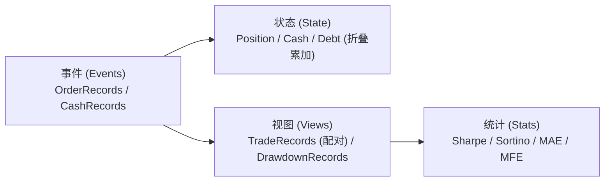
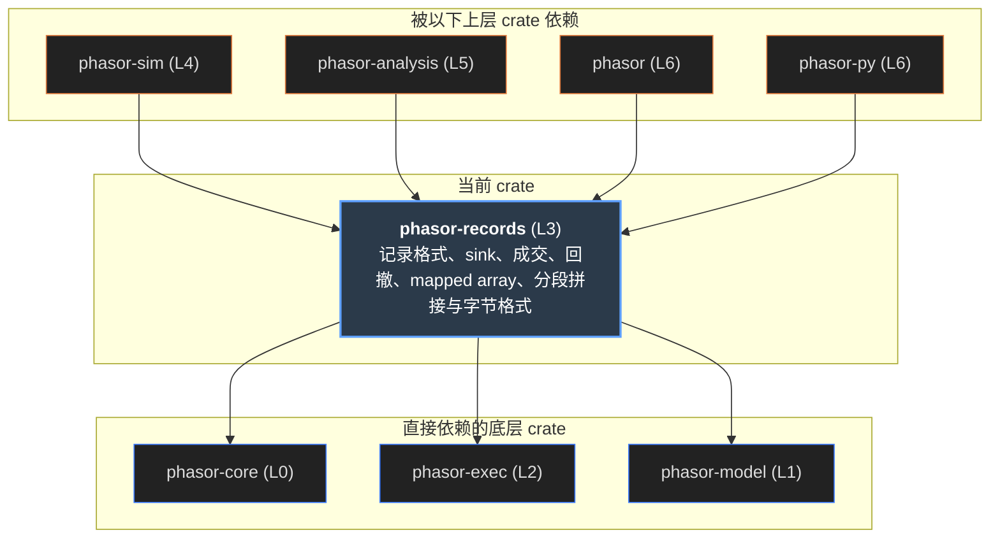
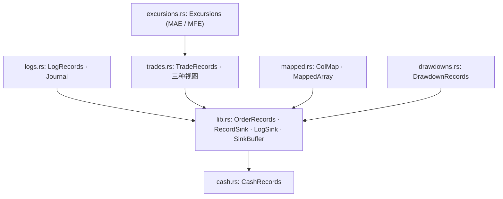
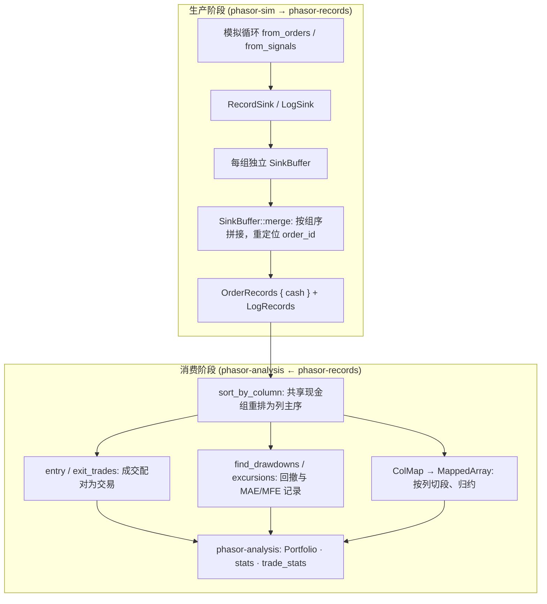
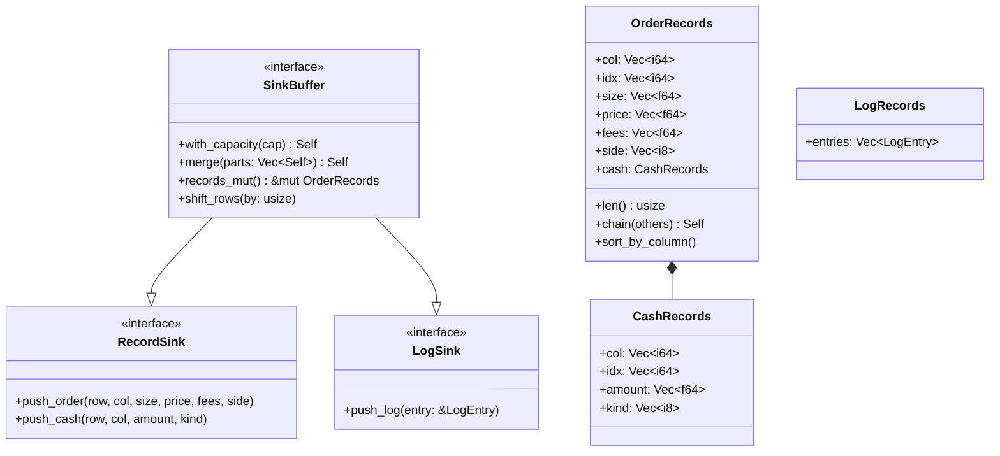
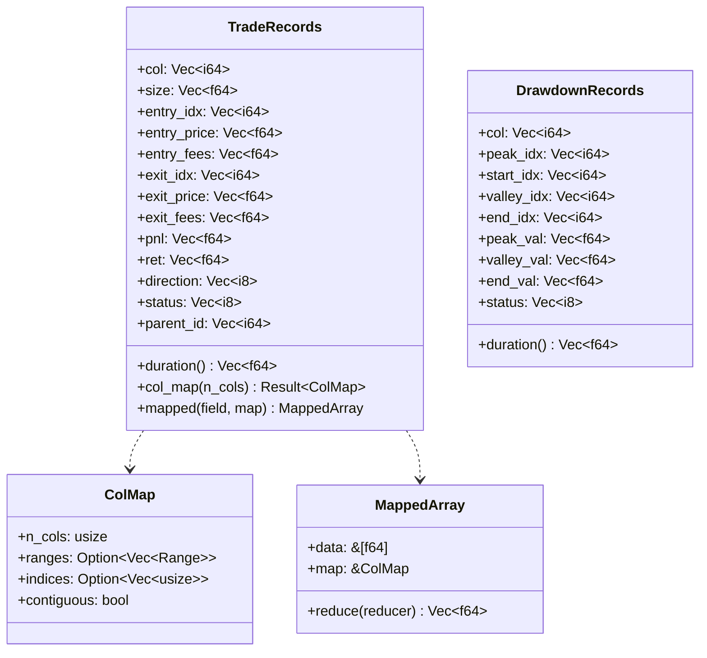

# phasor-records

记录层，是模拟和分析之间的契约。两条模拟循环（from_orders、from_signals）的写法完全不同，再加上强平、持仓费、分段续跑， 但它们**产出同样的记录**。统一的是输出，不是计算，所以分析层只需要写一次，而且只从记录重建账户。 这个 crate 定义记录的结构（成交、现金流、日志），并从记录派生交易、回撤和 MAE/MFE，再提供按列分段归约。

> **核心特性与指标：**
> - **7 / 46**：成交记录 7 个字段（含 id；带杠杆、保证金或持仓费的运行另有 5 列余额和标记），日志 46 个。日志默认关闭，按订单单独打开
> - **3 种视图 · 1 套结构**：entry_trades、exit_trades、positions 共用 TradeRecords，只是一条记录代表的东西不同
> - **3 份黄金输出**：trades、drawdowns、mapped 三份 TSV 存着预期结果，cargo test 直接回放，不需要 Python

<a id="concept"></a>

## 从第一性原理看：回测的账本

这一节先不看 phasor 的代码，只回答两个问题：这一层在量化研究里对应什么概念？如果从零开始实现，它的形状应该怎样一步步推出来？ 后面各节再讲 phasor 对每个问题的具体回答。

### 1. 回测真正产出的是什么

回测引擎本质上是一个**模拟的券商**。真实交易中，券商给你的东西只有两样：**成交回报**（哪个标的、什么时候、买卖多少、成交价、手续费）和**资金流水**（入金、出金、利息、分红）。 持仓、现金余额、净值曲线、每笔交易的盈亏、夏普、最大回撤，没有一样是券商“给”的，全都是你从这两样东西**算**出来的。 这正是会计里“原始凭证 → 账簿 → 报表”的分层，也是软件里的事件溯源（event sourcing）：**状态 = 对事件序列的折叠**，事件只追加、不修改。

#### 示意 / 说明：事件是唯一的事实来源；状态是事件的折叠；视图和统计量都是纯函数



| 层 | 会计 | 交易台 | 软件 | 这一层要提供的 |
|----|----|----|----|----|
| 事实 | 原始凭证 | 成交回报、资金划转单 | 事件，append-only | 成交记录、现金流记录的结构，以及写入接口 |
| 状态 | 账簿 | 持仓表、资金余额 | fold(事件) | 不存状态，但要保证状态能只从记录重建 |
| 报表 | 明细账、报表 | 交易明细、风险报告 | 派生视图（纯函数） | 交易配对、回撤段、MAE/MFE |
| 统计 | 财务指标 | 绩效归因 | group-by + reduce | 按列分组归约的通用内核 |
| 审计 | 审计轨迹 | OMS 委托日志 | 诊断日志 | 可选的委托日志：请求、前后状态、拒单原因 |

### 2. 为什么存记录，而不是存状态矩阵

最直接的做法是每根 K 线、每个标的存一份持仓和现金（行 × 列的矩阵）。它能用，但作为“事实”是错误的选择：

### 稀疏

成交只发生在少数 K 线上，持仓矩阵绝大多数格子是上一格的重复。记录的大小与**交易活动**成正比，而不是与 行 × 列 成正比；千列参数扫描时，这个差别是几个数量级。

### 可审计

状态矩阵只说明“现在是多少”，记录说明“为什么是这么多”。每一分钱都应该能追到一条事件，这是对账（reconciliation）的前提，也是回测结果可信的前提。

### 与循环无关

两条模拟循环的算法完全不同，但只要它们产出**同样的事件**，分析就只需写一次；分段跑完再拼起来的记录，和一次跑完的逐条相同。统一输出，不统一计算。

### 路径相关的事实无法重算

含滑点的成交价、部分成交、按当时可用资金封顶的出金，事后都无法从输入复原。由此得到一条硬规则：**凡是改变现金或持仓的事，都必须是一条记录**，否则从记录重建的账簿就和模拟器对不上。

### 3. 最小的事件结构是怎么推出来的

一笔成交要回答四个问题：**谁**（哪个账户/标的列）、**何时**（哪根 K 线）、**多少、什么方向**、**什么价格、付了多少成本**。每个字段怎么表示，都有可以说清的理由：

| 选择 | 理由 | 反面 |
|----|----|----|
| 时间用 K 线下标，不用时间戳 | 和价格矩阵天然对齐，查任一时刻的价格是 O(1) 的下标访问。 | 时间戳要再做一次对齐/查找，且多资产日历不一致时有歧义。 |
| 数量恒为正，方向单独一列 | “卖出”和“做空”是两个概念：卖出 1 可能是平多也可能是开空。方向显式存储，成交量可以直接求和。 | 带符号的数量让“平仓还是反手”要靠上下文推断。 |
| 价格存实际成交价（含滑点），费用单独一列 | PnL 可以拆成价格贡献和成本贡献，才能做交易成本分析、换费率重估。 | 把费用并进价格后，成本无法再分离出来。 |
| 非成交现金流是另一种事件 | 入金、利息、分红改变余额但没有成交，同样需要 谁 / 何时 / 多少 / 类型。金额记实际入账额，而不是请求额。 | 只从成交重建现金，入金和分红会让余额对不上。 |
| 记录的身份由确定的顺序决定 | id 应当是“排好序之后的位置”，而不是“谁先写进来”。 | 用共享计数器分配 id，并行时 id 取决于线程交错，结果不可复现。 |

### 4. 从成交到“交易”：配对问题

一笔成交不是一笔交易。要谈论“这笔交易赚了多少”，就必须决定**哪笔出场对应哪笔入场**。这就是税务和会计里的批次配对（lot matching）问题：先进先出（FIFO）、后进先出（LIFO）、平均成本、指定批次，都是被广泛使用的合法规则。 第一性原理给出一条不变量：

总 PnL = Σ 卖出金额 − Σ 买入金额 − Σ 费用 + 期末持仓按市价估值

右边只有现金流，没有任何配对信息，所以**总 PnL 与配对规则无关**。配对改变的只是**归因**：交易笔数、单笔收益、胜率、期望、持有期。 这意味着“胜率”“期望”这类统计量必须注明它基于哪种配对，否则不同系统之间无法比较。下面同一串成交，四种规则：

#### 示意 / 说明：成交：买 1@10（t0）、买 1@20（t1）、卖 1@25（t2）、卖 1@15（t3）

| 规则 | 配对 | 单笔 PnL | 胜率 | 总 PnL |
|----|----|----|----|----|
| FIFO | 10→25，20→15 | +15, −5 | 50% | 10 |
| LIFO | 20→25，10→15 | +5, +5 | 100% | 10 |
| 平均成本 | 均价 15 → 25，15 → 15 | +10, 0 | 50% | 10 |
| 整个仓位 | 空仓 → 空仓一段 | +10 | 100% | 10 |

*说明：*

在下面的[三种交易视图计算器](#views)里选“配对规则”预设，可以看到引擎实际给出的结果。

### 设计上要定的几件事

**提供哪些规则。**回测里常见的是平均成本类（按入场或按出场归因）加上“整个仓位”这种不需要配对的视图：从空仓到空仓算一段。\
\
**反手怎么处理。**多 1 时卖 3：一笔成交跨过了零点，必须拆成“平掉 1”和“新开 2”，费用按数量比例分摊，否则一个仓位里会出现两个方向。\
\
**期末未平仓怎么办。**用最后的价格标记，并显式标注“未平仓”，让统计可以选择是否纳入。\
\
**“全平”怎么判断。**浮点数下 0.1 + 0.2 卖出 0.3 不一定恰好归零。必须用容差判断，并把残差吸附到 0，否则会留下“灰尘仓位”和本该为 0 却是 1e-14 的“伪盈利”。

### 5. 只看终点不够：路径与风险

### 账户的路径：回撤段

最大回撤只是一个数字。把净值曲线切成一段段 **峰 → 谷 → 恢复**（或尚未恢复），得到的是一个分布：多深、跌了多久、爬回来用了多久。恢复通常比下跌慢，这才是回撤真正的代价。实现前要先定义边界：平台算不算新峰、恰好回到旧峰算不算恢复、缺失数据能否结束一段回撤。

### 单笔交易的路径：MAE / MFE

PnL 说明交易停在哪里，最大不利偏移（MAE）和最大有利偏移（MFE）说明它中途走了多远（Sweeney 提出的分析方法）。它需要 OHLC 行情，不只是成交，用来回答止损是不是放在噪声里、出场是不是放走了大部分行情。K 线内部没有路径信息，所以入场那根的高低点要不要计入，必须事先选定一个保守的约定。

### 6. 统计量：一律是按列分组归约

平均 PnL、每列交易数、最差交易发生在哪一行、收益前五名，本质都是同一个操作：把记录按账户/列分组，每组归约成一个值（split-apply-combine）。 与其为每个指标手写循环，不如实现**一个**分组内核加一组命名归约。这个内核要事先定死三件事：

### 空组也要有输出

没有交易的列也必须得到一个值（调用方给的填充值）。丢掉它，结果就和列标签错位，参数扫描的输出变成无法归因的数字。

### NaN 的语义逐个定义

count 计不计 NaN？全 NaN 的 sum 是 0 还是 NaN？argmax 遇到 NaN 跳过还是替换？每个归约都要明确，并用测试钉住。

### 顺序与平局确定

组内保持原始顺序（稳定），并列时取第一个还是最后一个要写清楚。否则同一份数据换个输入顺序，结果就变了。

### 7. 如果从零实现，按这个顺序

1.  **定事件结构。**成交和现金流两类，写清每个字段的单位、符号和取值范围。
2.  **定顺序与身份。**每个分区（列/组）内按时间追加，分区之间按固定顺序合并，id = 合并后的位置。这样串行和并行逐位相同。
3.  **写入接口与存储分离。**模拟循环只调用“记一笔成交 / 记一笔现金流”，具体存什么（只存成交，或成交加诊断日志）由类型参数决定，关掉诊断时零开销。
4.  **列式存储。**用结构数组而不是结构体数组：分析时通常只读一两个字段，交给 Arrow/NumPy 也不需要转置。
5.  **派生全部是纯函数。**事件 → 交易、净值 → 回撤段、交易 + 行情 → MAE/MFE。不回写事件，不持有隐藏状态。
6.  **统一数值政策。**配对中的“全平 / 部分平 / 反手”用容差判断，差值吸附到零。
7.  **一个分组归约内核。**覆盖空组、NaN、平局；有序输入走零拷贝快路径，乱序输入走 gather。
8.  **可选的诊断日志。**每张被考虑的委托记下请求、前后状态和结果原因，默认关闭，因为它比成交多得多。
9.  **用不变量验证。**各种配对的总 PnL 相等；从记录重建的现金等于模拟器内部的现金；“仓位的仓位”等于仓位；再用黄金输出逐字段回放。

### 带着这些问题读下文

| 第一性原理的问题 | phasor 的回答 | 小节 |
|----|----|----|
| 事件长什么样 | `OrderRecords`（6 列，可选 5 列余额，内嵌 `CashRecords`），结构数组 | [成交记录](#order) · [类型](#types) |
| 顺序与身份 | 列主序，id = 合并后下标，无共享计数器；共享现金组用 `sort_by_column` | [成交记录](#order) |
| 写入接口与存储分离 | `RecordSink` / `LogSink` / `SinkBuffer`，`OrderRecords` 或 `Journal` | [流程](#flow) · [类图](#class) |
| 配对规则 | `entry_trades`、`exit_trades`（平均成本，分别按入场/出场归因）和 `positions`；不提供 FIFO/LIFO | [三种交易视图](#views) |
| 路径与风险 | `find_drawdowns`、`excursions` | [回撤](#drawdowns) · [MAE/MFE](#excursions) |
| 分组归约内核 | `ColMap` + `MappedArray` | [分段归约](#mapped) |
| 诊断日志 | `LogRecords`，按委托的 `log` 标志开启 | [日志](#logs) |
| 不变量与黄金输出 | 三份黄金输出，总 PnL 一致性测试 | [黄金输出](#golden) |

<a id="graph"></a>

## 依赖图

左边是上游：phasor-core 提供容差、FlexArray、Matrix 和 Error；phasor-model 提供写进记录的 `repr(i8)` 枚举； phasor-exec 只出现在日志里，`LogEntry` 原样持有请求 `Order` 和结果 `OrderResult`。 中间是八个模块，右边是依赖它的 crate。线按模块着色。点任一节点，只保留相关的线，图下面会写出它用来做什么。

#### 示意 / 说明：phasor-records 位于执行内核之上、分析层之下；左边的线表示“模块用了上游的什么”，右边的线表示“下游用了哪个模块”



*说明：*

来源：各 crate 的 Cargo.toml，以及 src/ 中的 `use phasor_records::…`（不含 tests/、examples/）。 excursions 模块（`excursions`、`edge_ratio`）目前只是公开 API，工作区里没有 src 调用。 phasor 门面用 `pub use phasor_records as records` 整体再导出，图上只画出 prelude 里点名的两项。

### 点一个节点

模块：它依赖什么、被谁使用。上游 crate：它的哪一部分被拿来做什么。下游 crate：它在哪里读写记录。

## crate 内部

只有一条主干：几乎每种记录都通过 `mapped::ColMap` 按列切段。`OrderRecords` 内嵌 `CashRecords`，`Journal` 由成交和日志两半组成。

#### 示意 / 说明：模块之间的引用。箭头从使用方指向被用的类型



*说明：*

trades 是 `mod trades`（私有模块），对外只通过 crate 根的 `pub use` 暴露 `TradeRecords`、`entry_trades`、`exit_trades`、`positions`。其余七个模块都是 `pub mod`。bytes 没有画：它只给 `OrderRecords` 和 `Journal` 加上 `to_bytes` / `from_bytes`，见[拼接与字节](#chain)。

## 八个模块做什么

###  lib.rs：成交记录与写入口

`OrderRecords` 是结构数组：`col、idx、size、price、fees、side` 六列，加一个内嵌的 `cash`。`id` 不存储，就是记录在合并后数组里的位置。`RecordSink` 是模拟循环写成交和现金流的接口，`SinkBuffer` 再加上 `with_capacity` 和 `merge`，让同一份线程代码同时服务普通运行和带日志的运行；`records_mut` 让循环在结束时把运行的 `allow_negative_price` 写进成交记录，`shift_rows` 把分段运行的行号移回整次运行的行号。这个标志是整份记录一个，不是一列，`extend` 和 `concat` 取“或”。`chain` 把分段运行的记录排成一次运行写出的顺序。

###  cash：不是成交的现金流

入金/出金、利息、分红会改变余额，但没有成交。实际入账的金额与路径有关（出金要按当根 K 线的自由现金封顶），事后无法从输入重算，所以必须像成交一样记下来。它放在 `OrderRecords.cash` 里，所以已有的 sink、合并、排序、构造函数会一并带上它。

###  trades：成交 → 交易

一笔成交不等于一笔交易。把卖出归到哪些买入上有三种站得住的规则，所以这里三种都提供，结构相同，只是一条记录的含义不同。三者总 PnL 一致，但交易笔数、单笔收益、胜率、期望值都不同。这是整个设计里最容易写错的部分。

###  mapped：按列分段归约

平均 PnL、最差交易所在的行、每列交易数、收益前五名，都是同一个操作：把扁平数组按列切段，每段归约成一个值。`ColMap` 做切分（稳定计数排序），`MappedArray` 做归约。记录已按列排好时直接切子切片，不需要 gather，也不分配内存。

###  drawdowns：每段回撤一条记录

最大回撤只是一个数字。这里每段回撤一条记录，带峰值、谷底、结束位置以及是否已恢复，于是一列的回撤历史可以走普通的 mapped 归约。最后一段没回来的回撤标为 `Active`，它的恢复时长只是一个下界。

###  excursions：MAE / MFE

PnL 说明一笔交易最后停在哪，excursion 说明它中途走了多远。MFE 是持有期内最好看的时候，MAE 是最难看的时候，都从入场价量起。用来判断止损是不是放在了噪声里、出场是不是留下了大部分行情。`edge_ratio` 是平均 MFE 除以平均 \|MAE\|。

###  logs：一张订单的前后全貌

成交记录只说明发生了什么。日志记下“要求的是什么”，以及订单前后的账户状态，这样才能回答回测让人意外时最常见的问题：**这根 K 线为什么没成交？**没有日志时，唯一的证据是“没有成交记录”，可能的原因有十几种；有了日志，原因就是一个字段。`Journal` 把成交和日志放在一起，合并时负责重定位 `order_id`。

###  bytes：记录存成字节

带魔数和版本号的小端二进制，给 `OrderRecords` 和 `Journal` 加上 `to_bytes` / `from_bytes`，读的时候拒绝别的版本、截断和长度对不上的列。`Put`、`Get`、`Reader` 是公开的，phasor-py 用它们写整个组合。库只产出字节，不写文件。见[拼接与字节](#chain)。

<a id="flow"></a>

## 记录从哪来，到哪去

上面一行是生产：模拟循环通过 trait 写记录，每个组（并行时每个线程）各自拥有一个缓冲，结束后按组序合并。 下面一行是消费：分析层先把记录排成列主序，再从中派生交易和回撤，最后按列归约成统计量。

#### 示意 / 说明：一次运行的记录生命周期。没有共享计数器，id 在合并之后才确定



<a id="order"></a>

## 成交记录与排序契约

记录按**列主序**输出：先是第 0 列的全部成交，然后第 1 列，依此类推。`id` 就是记录在合并后数组里的下标。 这是并行模拟可复现的原因：每列（每组）往自己的缓冲里写，没有共享计数器，缓冲按列序拼接，id 在拼接之后才分配。 如果用一个共享的原子计数器，id 就会取决于线程的交错顺序。

#### 示意 / 说明：共享现金组：成交按执行顺序写入

| 写入序 | idx | col   | side | 说明                                |
|--------|-----|-------|------|-------------------------------------|
| 0      | 0   | 1 (B) | Buy  | 同一根 K 线内，调用顺序决定谁先下单 |
| 1      | 0   | 0 (A) | Buy  |                                     |
| 2      | 2   | 0 (A) | Sell |                                     |
| 3      | 3   | 1 (B) | Sell |                                     |

#### 示意 / 说明：sort_by_column 之后：按 (col, idx) 稳定排序

| id  | idx | col   | side | 说明                              |
|-----|-----|-------|------|-----------------------------------|
| 0   | 0   | 0 (A) | Buy  | 交易派生按列读连续切片            |
| 1   | 2   | 0 (A) | Sell |                                   |
| 2   | 0   | 1 (B) | Buy  | 同列同一根 K 线的成交保持执行顺序 |
| 3   | 3   | 1 (B) | Sell |                                   |

phasor-analysis 的 Portfolio 在构造时排序；phasor-py 只在组共享现金时另存一份排好序的副本。`CashRecords::sort_by_column` 同理，同列同一根 K 线上的入金和收益保持入账顺序。

### 余额列：只在可能借钱或设了合约乘数的运行里有

不带杠杆、没有保证金列、没有持仓费、合约乘数都是 1 的运行，余额由成交本身决定（多头不欠钱，空头占用两倍市值），不必存。否则可用现金依赖路径，成交之外还要记下每笔成交之后的状态： 模拟循环在 `push_order` 之后调一次 `push_balances(Balances)`，`Balances` 带六个字段，在 `OrderRecords` 里各是一列，要么每笔成交都有，要么全空。 `extend`、`concat`、`sort_by_column` 把它们和成交一起搬。

<table>
<thead>
<tr>
<th>列</th>
<th>现金列</th>
<th>保证金列</th>
</tr>
</thead>
<tbody>
<tr>
<td class="mono">debt</td>
<td>多头借的钱，或空头的开仓所得</td>
<td>持仓成本 |position| × 开仓均价（全仓列每根 K 线移到估值价）</td>
</tr>
<tr>
<td class="mono">locked_cash</td>
<td>多头自己出的钱，或空头的抵押</td>
<td>已押的初始保证金</td>
</tr>
<tr>
<td class="mono">margin</td>
<td>false</td>
<td>true</td>
</tr>
<tr>
<td class="mono">isolated</td>
<td>false</td>
<td>逐仓列为 true：盈亏不结算进账户现金，分析层按成本而不是市值加回可用现金</td>
</tr>
<tr>
<td class="mono">liquidation</td>
<td colspan="2">这笔成交是强平，不是策略的订单</td>
</tr>
<tr>
<td class="mono">multiplier</td>
<td colspan="2">这列的合约乘数：成交的现金流是 size × price × multiplier，price 仍是价格。<code>Balances::default()</code> 里是 1，这一列为空时 <code>multiplier_of(i)</code> 也返回 1</td>
</tr>
</tbody>
</table>

没有这些标记的手工记录按现金列、非强平处理。`CashRecords` 的 `kind` 有九种：入金、收益、分红、资金费、隔夜融资、利息、借券费、强平核销、初始持仓。初始持仓（判别值 8）是现金列 `init_position` 按 `init_price` 的成本，记在第一根，抵掉开仓的那笔成交；`is_deposit` 把它和入金一样当作投入的资本，不算收益。

### 并行合并：每段拷进互不相交的区间

稠密的并行运行每个线程会产出几百万条成交，在 join 之后的单个线程上把它们全部拷一遍，会占掉明显的一段墙钟时间。 超过 `PARALLEL_CONCAT = 1 << 16`（65,536）条时，`OrderRecords::concat` 先分配清零的输出（页面是惰性分配的，第一次触碰的线程就是拷贝它的线程）， 再用 `split_at_mut` 把每一列切成每段一个不相交的区间，在 `std::thread::scope` 里并行拷贝。现金流每根 K 线最多几条，串行拷一遍就够了。

#### 示意 / 说明：四段缓冲 → 一个输出。每个区间只有一个写者，所以不需要锁，结果与串行 extend 逐位相同

> **图表：并行 concat 示意**
>
> *核心要素：* part 0 · 40,000 · 0 · part 2 · 50,000 · 1 · out.col / idx / size / price / fees / side，各 90,001 个，每段一个线程 · ← 来自 lib.rs 的测试用例

<a id="chain"></a>

## 分段拼接与字节格式

一次运行可以切成几段，每段从上一段的状态接着跑（见 [phasor-sim · 续跑](phasor-sim.md#resume)）。要让几段的记录等于一次跑完的记录，记录层要做两件事： 把每段的行号放回整次运行的行号上，再把几段的记录排成一次运行会写出的顺序。

### shift_rows：行号放回原处

一段的数组可以从历史的第 `row_offset` 行开始，循环按数组下标写 `idx`。`OrderRecords::shift_rows(by)` 给每笔成交和每条现金流（`CashRecords::shift_rows`）的 `idx` 加上 `by`，`LogRecords::shift_rows` 对日志做同样的事；`by` 为 0 时什么都不做。`SinkBuffer` 也有 `shift_rows`，两个循环在运行结束时对整个缓冲调一次，所以 `Journal` 的成交和日志一起移。

### chain：排成一次运行的顺序

一次运行按账户组的顺序写：串行时一个缓冲里一组接一组，并行时每个线程写一段连续的组、最后按顺序拼接；组内按 K 线，同一根按执行顺序。几段接起来就是“段 1 的组 0、组 1……段 2 的组 0、组 1……”。`OrderRecords::chain(parts, group_of)` 先拼接，再按 `group_of[col]` **稳定**排序（`chain_order`），每组保持“先段 1、后段 2”，正好是一次运行写出的顺序；成交和现金流各排各的（`permute`）。因为顺序也相同，测试可以逐位比较。

#### 示意 / 说明：两段、两个组（组 0 = 列 0、1，组 1 = 列 2）：拼接 → 按组稳定排序

| 拼接后 | 段  | col | idx |
|--------|-----|-----|-----|
| 0      | 1   | 1   | 3   |
| 1      | 1   | 0   | 5   |
| 2      | 1   | 2   | 4   |
| 3      | 2   | 0   | 8   |
| 4      | 2   | 2   | 9   |

| chain 之后 | 段  | col | idx |
|------------|-----|-----|-----|
| 0          | 1   | 1   | 3   |
| 1          | 1   | 0   | 5   |
| 2          | 2   | 0   | 8   |
| 3          | 1   | 2   | 4   |
| 4          | 2   | 2   | 9   |

*说明：*

排序键是组，不是列：共享组里的成交按 K 线、同一根按执行顺序写，按列排就不是一次运行写出的顺序了（例子里组 0 先写了列 1）。要按列读的地方（交易派生、分析层）照常再 `sort_by_column`。

`Journal::chain` 对日志做同样的排序，并重编 `order_id`：先 `Journal::concat`（各段的 order_id 加上之前的成交数，−1 不变），再按成交的排序算出每笔成交的新位置，把日志里不为 −1 的 order_id 换成新位置，最后按组稳定排序日志。只排成交、不改 order_id，日志就会指向别的成交，而且长度、范围都对，看不出来。

### 字节格式：bytes.rs

`OrderRecords::to_bytes` / `from_bytes` 和 `Journal::to_bytes` / `from_bytes`，用来把一次运行的结果存下来再读回。小端二进制：4 字节魔数（成交 `PHOR`、带日志 `PHJN`）、u32 版本号 1，然后每一列写成长度（u64）加上各个值。 成交依次是 col、idx、size、price、fees、side、六个余额列、现金流的四列、`allow_negative_price`；Journal 在成交之后写日志的 46 列。库 crate 不写文件，字节交给调用方（phasor-py 的 `phasor.save` 写到文件里）。

### Put / Get / Reader

两个 trait：`Put` 把值追加到 `Vec<u8>`，`Get` 从 `Reader` 读回；f64、i64、i8、u8、bool、usize（按 u64 写）和它们的 `Vec` 都实现了。`Reader` 有 `take`、`get`、`header`、`end`，`put_header` 写魔数和版本。它们是公开的，phasor-py 用同一套写整个组合的格式。

### 读的时候拒绝什么

别的魔数或版本、读到一半没有字节了、读完还有剩下的；成交列长度不一致，余额列不是全空就要和成交一样长；日志各列长度不一致（`LogRecords::lens`）；bool 不是 0 或 1。都是 `Error::Invariant`。

### 坏的长度不会先分配

读 `Vec` 时按读到的长度预留空间，但不超过剩下的字节数，所以一个损坏的长度字段不会先申请一大块内存，而是在读值时报“cut short”。

phasor-sim 的 `SimState` 有自己的字节格式（魔数 `PHSS`），在 `snapshot.rs` 里，不依赖这个模块。

<a id="views"></a>

## 三种交易视图

```text
成交历史事件流 (4 笔成交):
t0: Buy 1 @ 10.0   (开仓 1 股)
t1: Buy 1 @ 20.0   (加仓 1 股, 累计持有 2 股)
t2: Sell 1 @ 25.0  (平仓 1 股, 剩余 1 股)
t3: Sell 1 @ 15.0  (完全平仓, 剩余 0 股)
```

| 交易配对模式 | 笔数 | 入场点 | 出场点 | 买入价 $\to$ 卖出价 | 实现盈亏 (PnL) | 收益率 (Return) | 说明 |
| :--- | :---: | :---: | :---: | :---: | :---: | :---: | :--- |
| **FIFO (先进先出)** | 交易 1 | $t_0$ | $t_2$ | $10.0 \to 25.0$ | **$+15.0$** | **$+150.0\%$** | 最早买入的单先平 |
| | 交易 2 | $t_1$ | $t_3$ | $20.0 \to 15.0$ | **$-5.0$** | **$-25.0\%$** | 较晚买入的单后平 |
| **LIFO (后进先出)** | 交易 1 | $t_1$ | $t_2$ | $20.0 \to 25.0$ | **$+5.0$** | **$+25.0\%$** | 最近买入的单先平 |
| | 交易 2 | $t_0$ | $t_3$ | $10.0 \to 15.0$ | **$+5.0$** | **$+50.0\%$** | 最早买入的单后平 |
| **Close-to-Close** | 连续 3 根 | $t_i$ | $t_{i+1}$ | 逐根盯市核算 | 浮动拆分 | 逐根收益 | 适合计算无偏夏普比率 |

同一串成交，三种归因规则。**entry_trades**：一条记录代表一笔入场成交，整个仓位的出场按数量加权平均后分摊给每笔入场。 **exit_trades**：一条记录代表一笔出场成交，用自己的价格，入场被平均进来。 **positions**：一条记录代表一个仓位，由前两者之一按 `parent_id` 聚合而成。 下面的计算器把 Rust 的三个函数逐行移植成了 JavaScript：改一下成交，看看笔数和胜率怎么变，总 PnL 怎么保持不变。

#### 示意 / 说明：单列成交。每行一笔：`行号 方向(B/S) 数量 价格 [手续费]`，行号必须递增

n_rows 最后一根收盘

> **图表：成交时间轴**

*说明：*

PnL = (出场价值 − 入场价值，空头取反) − 入场手续费 − 出场手续费；ret = PnL / \|入场价值\|（入场价可以 ≤ 0 时，收益仍是相对成本的大小）。差值用 `add` 而不是 `-`，所以同价往返恰好是 0。 持有长度：**已平仓按开区间** `exit − entry`，**未平仓按闭区间** `exit − entry + 1`。已平仓的出场那根 K 线属于下一段，未平仓的最后一根它仍然持有。 “胜率”这里只是 `pnl > 0` 的比例，用来演示三种视图的分歧，不是分析层的统计定义。

### 部分平仓：两边的处理不同

exit_trades 把剩余仓位的入场数量、金额、手续费**按比例缩小**，不是从前往后消耗，所以剩下部分的平均入场价不变。entry_trades 在部分平仓时什么都不输出，仓位结束时整体标为 Open，每笔入场都以“已出场部分 + 收盘价标记的剩余部分”的加权价出场。

### 反手：一笔成交被拆成两半

多 1 时卖 3：平掉多头的那 1 属于旧仓位，剩下的 2 开出新的空头仓位，手续费按数量比例分给两边。`parent_id` 加一。positions 因此永远不会在一个仓位里看到两个方向。

### 单笔仓位原样拷贝

仓位只含一笔交易时，positions 用 `push_copy` 原样复制，不重新推导。重新推导会算 `size × price / size`：`5.128 × 58.78 / 5.128 = 58.779999999999994`，PnL 末位跟着变。拷贝保证仓位与它唯一的交易逐位相同，`positions(positions(x)) == positions(x)`。

<a id="drawdowns"></a>

## 回撤记录

四个下标里只有三个是显然的。`peak_idx` 是下跌**之前**的最后一根 K 线，`start_idx` 是下跌的第一根，恒等于 `peak_idx + 1`，但仍然单独存储，因为两者度量的东西不同。 等于峰值算上涨：顶部的平台会延长峰值而不是开出新回撤；已经在水下时，恰好回到旧峰值**就算**恢复。结束一段回撤的那根 K 线就是下一段的峰值，所以 V 形反弹后紧接着再跌会产生两条记录。

#### 示意 / 说明：输入一列序列（逗号分隔，`nan` 表示缺失）。阴影是一段回撤，从 start 到 end

> **图表：回撤图**

*说明：*

`duration`：已恢复按开区间 `end − start`，仍在水下按闭区间 `end − start + 1`，与交易持有长度同一条规则。 `decline_duration` = `valley − start + 1`（从 start 而不是 peak 量，顶部那根平的不算下跌）； `recovery_duration` = `end − valley`（谷底那根属于下跌）。缺失的 K 线什么都不推进，也不能结束一段回撤：数据里的缺口不是策略的证据。

> [!WARNING]
> 最后一根是 `nan` 时，还在水下的那一段**不会**被标成 Active，而是不产生记录：判断“最后一根”的代码在 `continue` 之后。 `golden_drawdowns.rs` 专门枚举了带尾部缺口的路径，单元测试 `a_missing_bar_is_not_evidence_about_the_strategy` 也把它钉住了。选上面的“尾部缺口”预设可以看到。

<a id="excursions"></a>

## MAE / MFE

```text
多头交易期间价格包络线 (MAE / MFE 示意):

价格
 ▲                  最高价 High = 108 (MFE 最大顺行幅度 = +8.0)
 │                      ╭───╮
 │                      │   │       出场价 Exit = 104 (PnL = +4.0)
 │       入场价 Entry=100│   │        ╭───╮
 │          ┌───┐       │   │        │   │
 │          │   │  ╭─╮  │   │   ╭─╮  │   │
 │          │   │  │ │  │   │   │ │  └───┘
 │          └───┘  │ │  ╰───╯   │ │
 │                 ╰─╯          ╰─╯
 │              最低价 Low = 97 (MAE 最大不利逆行幅度 = -3.0)
 └───────────────────────────────────────────────► 时间
   判定指标: MAE = (97 - 100)/100 = -3.0% (承受的最大下潜风险)
            MFE = (108 - 100)/100 = +8.0% (曾经出现的最大理论盈利空间)
```

**MAE**（Maximum Adverse Excursion，最大不利偏移）是持有期间价格**朝亏损方向**走得最远的距离，即这笔交易最难看的时候浮亏有多深； **MFE**（Maximum Favorable Excursion，最大有利偏移）是持有期间价格**朝盈利方向**走得最远的距离，即最好看的时候浮盈有多高。两者都从入场价量起。 这套分析方法由 John Sweeney 在 1990 年代提出。

#### 示意 / 说明：例子（与下图相同）：做多，入场 100，持有期最低 97、最高 108，出场 104

|     | 计算                                    | 含义           |
|-----|-----------------------------------------|----------------|
| PnL | 104 − 100 = +4 | 最后赚了 4     |
| MFE | 108 − 100 = +8 | 中途最多浮盈 8 |
| MAE | 97 − 100 = −3  | 中途最多浮亏 3 |

*说明：*

做空时反过来：MFE = 入场价 − 最低价，MAE = 入场价 − 最高价。

### 为什么要看它们

PnL 只说明交易**最后停在哪**，MAE/MFE 说明它**中途走过哪**。\
\
**止损放得对不对：**把所有交易的 MAE 画出来，如果盈利交易的 MAE 普遍到过 −3，而止损设在 −2，止损就放在了正常波动里，会把本来能赚的交易提前砍掉。\
\
**出场早了还是晚了：**上例 MFE 是 8、最后只拿到 4，一半利润还了回去；大部分交易都这样，说明出场规则有改进空间。\
\
**edge ratio** = 平均 MFE / 平均 \|MAE\|。大于 1 表示入场后价格平均朝有利方向走得比不利方向远，入场本身有优势。

### phasor 的约定

按单位数量计，是价格距离而不是金额；`*_ret` 再除以入场价。MFE 永远 ≥ 0，MAE 永远 ≤ 0，多空都一样：两个极值都用入场价做初值，从未朝有利方向走过的交易 MFE 正好是 0。 窗口是入场那根到出场那根，两端都包含；未平仓交易按状态延伸到 `n_rows − 1`，不看记录里写的 exit。某根的 high 或 low 缺失时用该根 close 代替。

#### 示意 / 说明：入场那根 K 线的整个区间都算进去，尽管成交可能发生在收盘，高低点早已出现过

> **图表：MAE MFE 示例**

*说明：*

没有 K 线内部的路径能区分两种情况，所以这里宁可报大一点的 excursion。对 MAE 这是保守的一侧，而止损位置看的正是 MAE。出场那根同理。

<a id="mapped"></a>

## 分段归约：ColMap 与 MappedArray

`ColMap::build` 对记录下标按列做稳定计数排序，记录以什么顺序到达都能用。 但本引擎按构造输出列主序记录，此时一列就是一段连续切片，没有什么需要 gather。`build` 会顺手检测这一点， `for_each_column` 随后直接给出子切片，不分配内存。gather 路径仍然存在且正确，因为合并、过滤之后的记录不一定有序。

#### 示意 / 说明：列主序：contiguous = true，ranges = \[0..3, 3..3, 3..5, 5..6\]

col

01.002.003.0210.0220.03100.0

每列直接读 `&values[start..end]`；第 1 列是空区间

#### 示意 / 说明：乱序：contiguous = false，ranges() = None，走 gather

col

210.001.03100.002.0220.003.0

idxs = \[1, 3, 5 \| — \| 0, 4 \| 2\]，列内保持原相对顺序；复用一个 scratch 缓冲

`the_two_paths_agree` 钉住两条路径对同样的数据给出相同结果：快路径只是优化，不是第二套语义。 交易派生不同：它必须按时间顺序走一列的成交，没法退回 gather 路径，所以 `column_ranges` 遇到乱序记录直接返回 `Error::Invariant`。

### 空列也是一列

每个归约对每一列都返回一个值，包括没有任何记录的列：它们拿到调用方给的 fill，归约函数不会在空切片上被调用。丢掉它们会让结果和列标签错位，扫描输出就变成了无法归因的数字。

| 方法 | 空列 | NaN 的处理 | 备注 |
|----|----|----|----|
| count() | 0 | **计入** | 唯一计入 NaN 的归约。与其它归约配对，说明那个统计量实际基于多少条记录。 |
| sum() | 0 | 跳过；全 NaN 的列和为 0 | 没有值的和是 0，与 `nansum` 一致。用 count 区分“全缺失”和“真的持平”。 |
| mean() | NaN | 跳过；全 NaN 为 NaN |  |
| min() / max() | NaN | 跳过 | `fold(NaN, f64::min)`。 |
| std(ddof) | NaN | 跳过；有效数 ≤ ddof 为 NaN | 先求总体方差再缩放，`((ss / n) * n / (n − ddof)).sqrt()`，与 `ss / (n − ddof)` 末位不同。 |
| idxmax / idxmin | fill | **替换**成 −inf / +inf，不是跳过 | 并列取第一个。只有在一列同时有 NaN 和“输的那一侧”的真无穷时才和“跳过”不同。全 NaN 返回 `None` → fill，不抛异常。 |
| top_n_mask / bottom_n_mask | — | NaN 最后被选，从打破并列的那一端补齐 | top 从列尾开始打破并列（后出现的赢），bottom 从列首开始。这种不对称是有意的，由黄金输出钉住。 |
| stack_expand(fill) | 整列 fill | 原样 | max_col_len × n_cols 的矩阵，顶部对齐。第 i 行是该列第 i 条记录，**不是**K 线下标。 |
| value_counts(codes, k) | 全 0 | — | k × n_cols，第 k 行统计代码为 k 的记录，用来汇总方向、状态这类分类字段。 |

<a id="logs"></a>

## 日志：为什么这根没成交

日志对**每张被考虑的订单**写一行，而不是每笔成交：稀疏策略上行数是成交的二十倍，宽度是五倍，千列扫描就是几个 GB 没人看的数据。 所以它按订单开关，通过请求自己的 `log` 标志，而且像其它参数一样是 FlexArray。有用的形态只有三种：处处关闭（默认）、只开要排查的那一列、在一次扫描中只开某一行。

### 位置 · 3

group\
col\
idx

### 下单前 · 7

cash\
position\
debt\
locked_cash\
free_cash\
val_price\
value

### 请求 · 20

req_size · req_price\
req_size_type\
req_direction\
req_fees · req_fixed_fees\
req_slippage\
req_min_size · req_max_size\
req_size_granularity\
req_leverage · req_leverage_mode\
req_account_type\
req_initial_margin · req_margin_basis\
req_reject_prob\
req_lock_cash\
req_allow_partial\
req_raise_reject · req_log

### 下单后 · 7

new_cash\
new_position\
new_debt\
new_locked_cash\
new_free_cash\
new_val_price\
new_value

### 结果 · 9

res_size · res_price\
res_fees\
res_side（未成交 −1）\
res_status\
res_status_info（无 −1）\
order_id（未成交 −1）\
liquidation（强平写的行）\
multiplier（合约乘数）

46 列：基本的 37 列（请求、前后状态、结果），加上杠杆的 4 列（`locked_cash`、`new_locked_cash`、`req_leverage`、`req_leverage_mode`）、保证金的 3 列（`req_account_type`、`req_initial_margin`、`req_margin_basis`）、`liquidation` 和 `multiplier`；加上不存储的 `id` 共 47 个字段。价格字段（`val_price`、`req_price`、`res_price`、`new_val_price`）是价格，现金和净值是现金。模拟循环先填一个 `LogEntry` 结构体再交给 `push_log`，没有写成 38 个位置参数：`cash` 和 `free_cash` 挨着、都是 f64，最容易无声地传反。

#### 示意 / 说明：Journal::extend：order_id 随成交的偏移一起移动，−1 保持 −1

| 来源             | 日志行 | 缓冲内 order_id | 合并后 order_id |
|------------------|--------|-----------------|-----------------|
| 组 0（2 笔成交） | 0      | 0               | 0               |
|                  | 1      | −1              | −1              |
|                  | 2      | 1               | 1               |
| 组 1（1 笔成交） | 3      | −1              | −1              |
|                  | 4      | 0               | 0 + 2 = 2       |

*说明：*

写错时是无声的：数组长度对、下标都在范围内，join 只是指向了另一笔成交，属于更早的组、在别的 K 线上、数量看起来也合理。所以合并必须通过 Journal，而不是把两半分别拼接。

#### 示意 / 说明：从日志读原因

journal.logs.reasons() // \["filled", "not enough cash to go long", ...\] journal.logs.reason_counts(col, n_cols)? // 按次数降序；同次数按文字排序 // 一列交易远少于预期时，通常有一个原因占主导

已成交返回 `"filled"`；否则用 `StatusInfo::from_discriminant` 把判别值翻回 14 种原因之一，`-1` 为 `"no reason recorded"`。打开日志后，成交记录与不开日志的运行完全相同：日志是附加的，不是替代的。

`LogRecords` 派生了 `PartialEq`，这是个陷阱：被拒的订单没有成交，`res_size`、`res_price`、`res_fees` 是 NaN，而 `NaN != NaN`。只要拒过一单，这次运行连和**自己**都比较不相等。要判断“同一份日志”，比较 `Debug` 输出或关心的字段。

<a id="class"></a>

## 类图

写入侧：两个 trait、两个可合并的 sink。实心菱形是拥有，空心三角虚线是实现。字段都是 `pub Vec<…>`，`id` 不存储。

#### 示意 / 说明：sink 与成交、现金流、日志的结构



*说明：*

来源：[`lib.rs:52`](https://github.com/nivalume/phasor/blob/1d573df0430fa5cd3a2416300603c7147f3c6a13/crates/phasor-records/src/lib.rs#L52)（RecordSink）、[`lib.rs:125`](https://github.com/nivalume/phasor/blob/1d573df0430fa5cd3a2416300603c7147f3c6a13/crates/phasor-records/src/lib.rs#L125)（SinkBuffer）、[`lib.rs:212`](https://github.com/nivalume/phasor/blob/1d573df0430fa5cd3a2416300603c7147f3c6a13/crates/phasor-records/src/lib.rs#L212)（OrderRecords）、[`lib.rs:414`](https://github.com/nivalume/phasor/blob/1d573df0430fa5cd3a2416300603c7147f3c6a13/crates/phasor-records/src/lib.rs#L414)（chain）、[`cash.rs:24`](https://github.com/nivalume/phasor/blob/1d573df0430fa5cd3a2416300603c7147f3c6a13/crates/phasor-records/src/cash.rs#L24)、[`logs.rs:60`](https://github.com/nivalume/phasor/blob/1d573df0430fa5cd3a2416300603c7147f3c6a13/crates/phasor-records/src/logs.rs#L60)（LogEntry）、[`logs.rs:125`](https://github.com/nivalume/phasor/blob/1d573df0430fa5cd3a2416300603c7147f3c6a13/crates/phasor-records/src/logs.rs#L125)（LogRecords）、[`logs.rs:613`](https://github.com/nivalume/phasor/blob/1d573df0430fa5cd3a2416300603c7147f3c6a13/crates/phasor-records/src/logs.rs#L613)（Journal）、[`logs.rs:667`](https://github.com/nivalume/phasor/blob/1d573df0430fa5cd3a2416300603c7147f3c6a13/crates/phasor-records/src/logs.rs#L667)（Journal::chain）。

#### 示意 / 说明：派生侧：每种记录都能 col_map 成 ColMap，再借给 MappedArray 归约



*说明：*

来源：[`trades.rs:42`](https://github.com/nivalume/phasor/blob/1d573df0430fa5cd3a2416300603c7147f3c6a13/crates/phasor-records/src/trades.rs#L42)、[`drawdowns.rs:59`](https://github.com/nivalume/phasor/blob/1d573df0430fa5cd3a2416300603c7147f3c6a13/crates/phasor-records/src/drawdowns.rs#L59)、[`excursions.rs:40`](https://github.com/nivalume/phasor/blob/1d573df0430fa5cd3a2416300603c7147f3c6a13/crates/phasor-records/src/excursions.rs#L40)、[`mapped.rs:52`](https://github.com/nivalume/phasor/blob/1d573df0430fa5cd3a2416300603c7147f3c6a13/crates/phasor-records/src/mapped.rs#L52)（ColMap）、[`mapped.rs:196`](https://github.com/nivalume/phasor/blob/1d573df0430fa5cd3a2416300603c7147f3c6a13/crates/phasor-records/src/mapped.rs#L196)（MappedArray）。MappedArray 只借用，所以同一组值可以在不同分组下读，对一个字段归约时也不会拷贝其余字段。

<a id="types"></a>

## 核心类型与函数

### 派生函数

输入必须按列分组、列内按行升序（OrderRecords 已经保证）。这让派生在连续切片上工作，不需要下标映射

| 函数 | 签名 | 行为 |
|----|----|----|
| entry_trades | (&OrderRecords, &FlexArray\<f64\> close, n_rows, n_cols) -\> Result\<TradeRecords\> | 每笔入场一条。close 只读最后一行，用来给期末未平仓位标价。size ≤ 0、price 不是有限数（记录的 `allow_negative_price` 没打开时 ≤ 0 也算）、记录不按列分组时返回 Invariant。[`trades.rs:384`](https://github.com/nivalume/phasor/blob/1d573df0430fa5cd3a2416300603c7147f3c6a13/crates/phasor-records/src/trades.rs#L384) |
| exit_trades | 同上 | 每笔出场一条；差不多全平（`is_close`）时把记录的 size 吸附成仓位大小，避免留下灰尘仓位。期末未平仓追加一条 Open，出场手续费为 0。[`trades.rs:518`](https://github.com/nivalume/phasor/blob/1d573df0430fa5cd3a2416300603c7147f3c6a13/crates/phasor-records/src/trades.rs#L518) |
| positions | (&TradeRecords, n_cols) -\> Result\<TradeRecords\> | 按 parent_id 聚合连续记录：size 求和，价格按 size 加权，手续费求和，exit_idx、方向、状态取最后一条。只有一条时原样拷贝。[`trades.rs:658`](https://github.com/nivalume/phasor/blob/1d573df0430fa5cd3a2416300603c7147f3c6a13/crates/phasor-records/src/trades.rs#L658) |
| find_drawdowns | (ts: &\[f64\], n_rows, n_cols) -\> Result\<DrawdownRecords\> | 列主序序列，长度不是 `n_rows × n_cols` 时返回 `Error::Broadcast`。NaN 跳过。[`drawdowns.rs:247`](https://github.com/nivalume/phasor/blob/1d573df0430fa5cd3a2416300603c7147f3c6a13/crates/phasor-records/src/drawdowns.rs#L247) |
| excursions | (&TradeRecords, high, low, close, n_rows) -\> Result\<Excursions\> | 入场/出场越界、出场早于入场、入场价 ≤ 0 或 NaN 时返回 Invariant。high/low 缺失用 close 代替。[`excursions.rs:67`](https://github.com/nivalume/phasor/blob/1d573df0430fa5cd3a2416300603c7147f3c6a13/crates/phasor-records/src/excursions.rs#L67) |
| edge_ratio | (&Excursions) -\> f64 | mean(mfe_ret) / mean(\|mae_ret\|)。没有交易或从没逆向走过时为 NaN。[`excursions.rs:135`](https://github.com/nivalume/phasor/blob/1d573df0430fa5cd3a2416300603c7147f3c6a13/crates/phasor-records/src/excursions.rs#L135) |

### 记录结构

全部是结构数组：交给 Arrow 不需要转置，只读一个字段的查询也不会把另外六个字段拖进缓存

| 类型 | 字段 | 要点 |
|----|----|----|
| OrderRecords | col idx size price fees side · cash | size 永远为正，方向在 side（Buy=0, Sell=1）。price 是滑点之后的成交价。`len`、`ids` 只数成交，不数现金流。 |
| CashRecords | col idx amount kind | amount 有符号，是实际入账额（封顶之后），不是请求额。入金记在账户组的第一列（初始现金从那列读），属于某个标的的流水记在该标的列；按账户求和时两者都落进同一个账户。kind：Deposit=0, Earning=1, Dividend=2。 |
| TradeRecords | 14 列，见类图 | 三种视图一个结构。pnl 乘了合约乘数，ret 不受影响（分母的入场价值也乘了）。direction：Long=0, Short=1；status：Open=0, Closed=1。open 交易的 exit_idx 是最后一根，exit_price 是那根的收盘价。parent_id 跨列全局编号，单独就能标识一个仓位。 |
| DrawdownRecords | 9 列，见类图 | `drawdown()` 是负数：(valley − peak) / peak。`recovery_duration_ratio` 大于 1 表示爬回来比跌下去慢，这是常态，也是回撤代价高于其深度的原因。 |
| Excursions | mae mfe mae_ret mfe_ret | 顺序与输入交易相同。乘以 size 得到金额尺度。 |
| LogRecords / LogEntry | 46 列 / 结构体 | 见上节。`Journal` 是打开日志时传入的 sink。 |

### ColMap 与 MappedArray

mapped.rs · 记录名字里出现不存在的列号是产出方的 bug，返回 Invariant，不会悄悄丢掉

| 成员 | 含义 |
|----|----|
| ColMap::build(col, n_cols) | 三遍：数每列长度并检测是否非降序 → 前缀和得到 starts → 稳定地把记录下标放进各列段。列号 \< 0 或 ≥ n_cols 返回 Invariant。 |
| column(c) / lens() / col_len(c) | 第 c 列的记录下标（按产出顺序）、每列记录数。 |
| is_contiguous() / ranges() | 记录已按列分组时为 true，ranges 返回每列在原数组里的半开区间；否则 None。 |
| MappedArray::new(values, &map) | 长度与 map 的记录数不同返回 Invariant。 |
| for_each_column(f) | 连续时给子切片，否则给复用的 gather 缓冲；两者对 f 来说没有区别。空列跳过。 |
| reduce(fill, f) / reduce_to_idx(idx_arr, fill, f) | 每列一个值；后者让 f 返回列内位置，再经 idx_arr（通常是行号）翻译。f 返回 None 时留 fill，越界返回 Invariant。 |

## 不能绕开的规则

金额比较走 `phasor_core::math`：交易配对用 `is_close` / `is_less` / `is_close_or_less` 判断全平、部分平、反手，剩余量和 PnL 差值用 `add`。 测试里少数断言精确相等，是因为它们钉的是**精确性**：差异小于差分测试的容差，容差比较看不见。这三条测试都是变异测试幸存下来之后补上的。

id = 记录在合并后数组中的下标 // 不存储，没有共享计数器 记录顺序 = (col, idx) 列主序 // 交易派生要求，ColMap 快路径依赖 pnl = add(exit_val, -entry_val) … // 同价往返恰好 0.0，且不是 -0.0 dur = exit - entry + (status == Open) // 交易与回撤同一条开闭规则 Journal::extend: order_id += offset // -1 保持 -1 chain = 拼接后按组稳定排序 // 分段运行 = 一次运行，顺序也相同

### 刻意保留的细节

| 位置 | 细节 | 为什么保留 |
|----|----|----|
| find_drawdowns | 内层 `if cur >= peak_val` 是多余的：`started` 只会在外层判断失败时被置位，那时 peak_val 一定是数字。 | 变异测试确认删掉它不改变任何结果；留着是为了把条件写明。 |
| find_drawdowns | 最后一根为 NaN 时，未恢复的那一段不产生记录。 | 水下的一段遇到缺失数据不算结束；黄金输出枚举了尾部缺口。 |
| extreme_n_mask | `n >= col_len` 的捷径。在 `n == col_len` 时，通用路径也会得到全选。 | 变异测试确认改成 `>` 没有区别；省掉一次选择。 |
| std | 先求总体方差再缩放，而不是直接除以 n − ddof。 | 两者末位不同，这一层的任务是逐位一致。 |
| arg_extreme | NaN 替换成 ∓inf 而不是跳过；全 NaN 返回 None。 | 前者由黄金输出钉住；后者是刻意的：扫描里测不出值的列太常见，不该算异常。 |

<a id="table"></a>

## 谁依赖它，用来做什么

| crate | 用到的模块 | 用来做什么 |
|-------|------------|------------|

<a id="golden"></a>

## 黄金输出

三份黄金输出测试都直接喂记录，不跑模拟，所以失败一定出在派生上，而不是成交从哪来。预期结果提交在 `tests/fixtures/` 里， `cargo test` 回放时不需要 Python。按 AGENTS.md，不能为了让改动通过而重新生成这些文件。

| 测试 | fixture | 覆盖什么 |
|----|----|----|
| golden_trades.rs | tests/fixtures/trades.tsv · 268 行 | 三种视图逐字段比较；positions 无论从哪种视图来都一致；三种视图总 PnL 一致。部分用例的成交来自真实的 from_orders 运行，确认两者在真实输入上也一致。 |
| golden_drawdowns.rs | tests/fixtures/drawdowns.tsv · 999 行 | 三值字母表上长度 ≤ 5 的全部路径，加上二值加缺口、长度 ≤ 4 的全部路径。平台、恰好恢复、V 形反弹、尾部缺口都是确定覆盖，不靠运气。 |
| golden_mapped.rs | tests/fixtures/mapped.tsv · 28,368 行 | 最多 4 条记录分到最多 3 列的全部分配方式，乘上几组为各分支挑选的值向量。空列、交错列、并列、NaN 记录都不留给运气。另测列主序分配不需要 gather。 |

比较时 NaN 和无穷要当作一致：`is_close` 认为它们和什么都不接近，包括自己，因为它们是活哨兵。

## 源文件

<table>
<thead>
<tr>
<th>文件</th>
<th>内容</th>
</tr>
</thead>
<tbody>
<tr>
<td colspan="2" class="small">本页引用的行号对应 <a href="https://github.com/nivalume/phasor/tree/1d573df0430fa5cd3a2416300603c7147f3c6a13">1d573df</a>。</td>
</tr>
<tr>
<td class="mono"><a href="https://github.com/nivalume/phasor/blob/1d573df0430fa5cd3a2416300603c7147f3c6a13/crates/phasor-records/src/lib.rs">crates/phasor-records/src/lib.rs</a></td>
<td>契约说明（两层统一输出）、RecordSink（<a href="https://github.com/nivalume/phasor/blob/1d573df0430fa5cd3a2416300603c7147f3c6a13/crates/phasor-records/src/lib.rs#L52">:52</a>）、SinkBuffer（<a href="https://github.com/nivalume/phasor/blob/1d573df0430fa5cd3a2416300603c7147f3c6a13/crates/phasor-records/src/lib.rs#L125">:125</a>，含 records_mut 和 shift_rows）、chain_order（<a href="https://github.com/nivalume/phasor/blob/1d573df0430fa5cd3a2416300603c7147f3c6a13/crates/phasor-records/src/lib.rs#L148">:148</a>）、OrderRecords（<a href="https://github.com/nivalume/phasor/blob/1d573df0430fa5cd3a2416300603c7147f3c6a13/crates/phasor-records/src/lib.rs#L212">:212</a>，含 allow_negative_price 标志）、shift_rows（<a href="https://github.com/nivalume/phasor/blob/1d573df0430fa5cd3a2416300603c7147f3c6a13/crates/phasor-records/src/lib.rs#L386">:386</a>）、permute（<a href="https://github.com/nivalume/phasor/blob/1d573df0430fa5cd3a2416300603c7147f3c6a13/crates/phasor-records/src/lib.rs#L397">:397</a>）、chain（<a href="https://github.com/nivalume/phasor/blob/1d573df0430fa5cd3a2416300603c7147f3c6a13/crates/phasor-records/src/lib.rs#L414">:414</a>）、并行 concat。</td>
</tr>
<tr>
<td class="mono"><a href="https://github.com/nivalume/phasor/blob/1d573df0430fa5cd3a2416300603c7147f3c6a13/crates/phasor-records/src/cash.rs">src/cash.rs</a></td>
<td>CashRecords：九种不是成交的现金流；shift_rows（<a href="https://github.com/nivalume/phasor/blob/1d573df0430fa5cd3a2416300603c7147f3c6a13/crates/phasor-records/src/cash.rs#L99">:99</a>）、permute（<a href="https://github.com/nivalume/phasor/blob/1d573df0430fa5cd3a2416300603c7147f3c6a13/crates/phasor-records/src/cash.rs#L108">:108</a>）；is_deposit 把入金和初始持仓的成本算作投入的资本。</td>
</tr>
<tr>
<td class="mono"><a href="https://github.com/nivalume/phasor/blob/1d573df0430fa5cd3a2416300603c7147f3c6a13/crates/phasor-records/src/trades.rs">src/trades.rs</a></td>
<td>TradeRecords、trade_stats、entry_trades、exit_trades、positions、duration。价格检查读记录的 allow_negative_price；ret 除以入场价值的绝对值。</td>
</tr>
<tr>
<td class="mono"><a href="https://github.com/nivalume/phasor/blob/1d573df0430fa5cd3a2416300603c7147f3c6a13/crates/phasor-records/src/mapped.rs">src/mapped.rs</a></td>
<td>ColMap、MappedArray、各命名归约、top/bottom_n_mask、arg_extreme。</td>
</tr>
<tr>
<td class="mono"><a href="https://github.com/nivalume/phasor/blob/1d573df0430fa5cd3a2416300603c7147f3c6a13/crates/phasor-records/src/drawdowns.rs">src/drawdowns.rs</a></td>
<td>DrawdownStatus、DrawdownRecords 及其派生量、find_drawdowns。</td>
</tr>
<tr>
<td class="mono"><a href="https://github.com/nivalume/phasor/blob/1d573df0430fa5cd3a2416300603c7147f3c6a13/crates/phasor-records/src/excursions.rs">src/excursions.rs</a></td>
<td>Excursions、excursions、edge_ratio。</td>
</tr>
<tr>
<td class="mono"><a href="https://github.com/nivalume/phasor/blob/1d573df0430fa5cd3a2416300603c7147f3c6a13/crates/phasor-records/src/logs.rs">src/logs.rs</a></td>
<td>LogEntry、LogRecords（shift_rows <a href="https://github.com/nivalume/phasor/blob/1d573df0430fa5cd3a2416300603c7147f3c6a13/crates/phasor-records/src/logs.rs#L432">:432</a>、lens <a href="https://github.com/nivalume/phasor/blob/1d573df0430fa5cd3a2416300603c7147f3c6a13/crates/phasor-records/src/logs.rs#L441">:441</a>、permute <a href="https://github.com/nivalume/phasor/blob/1d573df0430fa5cd3a2416300603c7147f3c6a13/crates/phasor-records/src/logs.rs#L496">:496</a>）、LogSink、Journal（concat <a href="https://github.com/nivalume/phasor/blob/1d573df0430fa5cd3a2416300603c7147f3c6a13/crates/phasor-records/src/logs.rs#L655">:655</a>、chain <a href="https://github.com/nivalume/phasor/blob/1d573df0430fa5cd3a2416300603c7147f3c6a13/crates/phasor-records/src/logs.rs#L667">:667</a>，日志的 order_id 跟着成交的新位置走）。</td>
</tr>
<tr>
<td class="mono"><a href="https://github.com/nivalume/phasor/blob/1d573df0430fa5cd3a2416300603c7147f3c6a13/crates/phasor-records/src/bytes.rs">src/bytes.rs</a></td>
<td>Put（<a href="https://github.com/nivalume/phasor/blob/1d573df0430fa5cd3a2416300603c7147f3c6a13/crates/phasor-records/src/bytes.rs#L19">:19</a>）、Reader（<a href="https://github.com/nivalume/phasor/blob/1d573df0430fa5cd3a2416300603c7147f3c6a13/crates/phasor-records/src/bytes.rs#L71">:71</a>）、Get（<a href="https://github.com/nivalume/phasor/blob/1d573df0430fa5cd3a2416300603c7147f3c6a13/crates/phasor-records/src/bytes.rs#L77">:77</a>）、put_header（<a href="https://github.com/nivalume/phasor/blob/1d573df0430fa5cd3a2416300603c7147f3c6a13/crates/phasor-records/src/bytes.rs#L154">:154</a>）；OrderRecords 的 to_bytes（<a href="https://github.com/nivalume/phasor/blob/1d573df0430fa5cd3a2416300603c7147f3c6a13/crates/phasor-records/src/bytes.rs#L287">:287</a>）/ from_bytes（<a href="https://github.com/nivalume/phasor/blob/1d573df0430fa5cd3a2416300603c7147f3c6a13/crates/phasor-records/src/bytes.rs#L300">:300</a>），Journal 的 to_bytes（<a href="https://github.com/nivalume/phasor/blob/1d573df0430fa5cd3a2416300603c7147f3c6a13/crates/phasor-records/src/bytes.rs#L312">:312</a>）/ from_bytes（<a href="https://github.com/nivalume/phasor/blob/1d573df0430fa5cd3a2416300603c7147f3c6a13/crates/phasor-records/src/bytes.rs#L334">:334</a>）；魔数 PHOR、PHJN，版本 1。</td>
</tr>
<tr>
<td class="mono">tests/golden_*.rs</td>
<td>三份黄金输出回归测试，回放 tests/fixtures/ 下的 TSV。</td>
</tr>
</tbody>
</table>

设计背景见 `lib.rs`、`trades.rs`、`cash.rs` 的模块文档：统一的记录格式、三种交易视图、只从记录重建余额、并行无共享。
