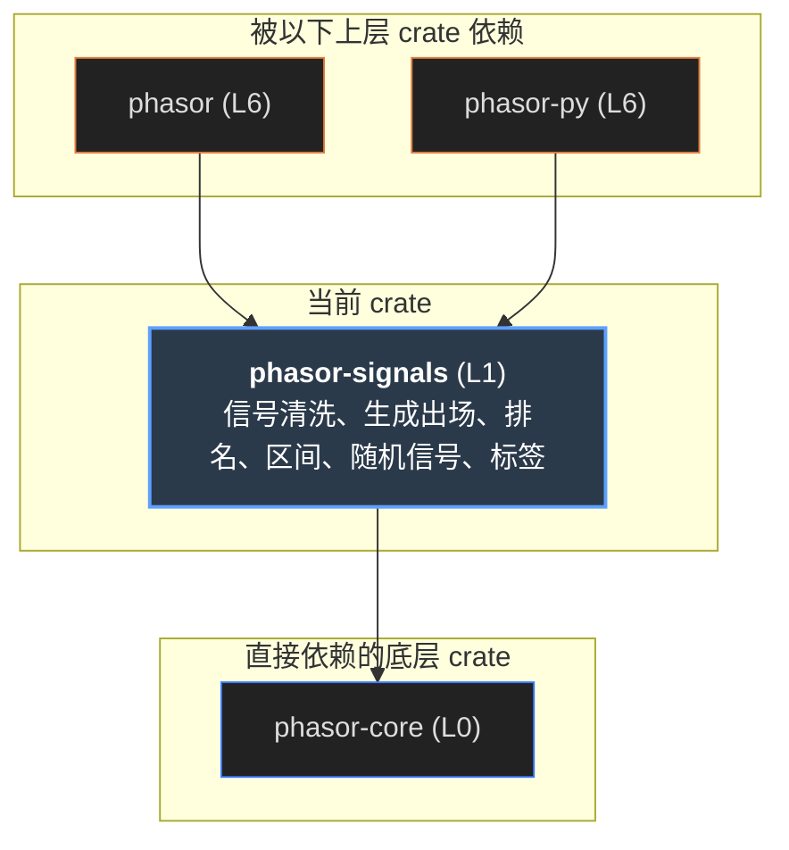
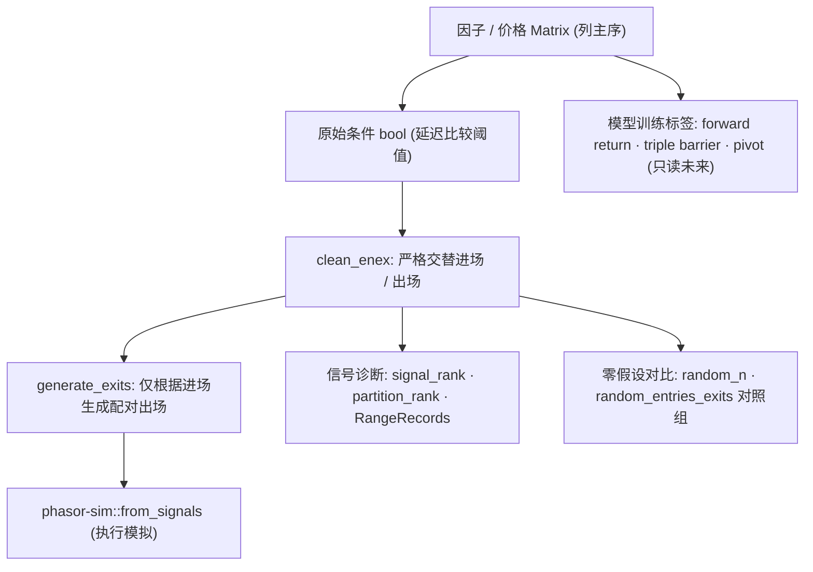

# phasor-signals

信号层。模拟引擎只**消费**进场和出场的布尔数组；这些数组从哪来，是这个 crate 的事。 这也是“能跑回测的引擎”和“能写策略的引擎”之间的差别。它做六件互不相同的事：把原始条件清洗成交替序列、从进场生成出场、 给信号在连续段里排名、把信号读成区间记录、为零假设生成可复现的随机信号，以及为机器学习生成会读未来的标签。

> **核心特性与指标：**
> - **只依赖 phasor-core**：输入输出都是列主序的 &amp;[bool] / &amp;[f64]，和模拟层只通过数组衔接，没有 crate 依赖
> - **5,782 行黄金输出**：长度 ≤ 6 的布尔数组全部枚举，每个都有固定的预期结果；cargo test 直接回放
> - **1 个模块读未来**：labels 是唯一的例外：它产出训练目标 y，永远不能当信号或特征喂给回测

<a id="concept"></a>

## 从第一性原理看：从信息到决策

先不看代码。这一节回答：信号在量化研究里对应什么概念？如果从零实现这一层，它的形状应该怎样推出来？后面各节再讲 phasor 的具体选择。

### 1. 信号是什么

一个系统化策略可以拆成三段：**信息**（价格、因子）→ **决策**（什么时候进、什么时候出）→ **执行**（下多少、成交在哪）。 信号就是中间那段的输出：一个以时间为索引的决策序列。它只有一个不能违反的约束——**因果性**： t 时刻的决策只能用 t 时刻已经知道的信息。用 t 收盘算出的因子，最早只能在 t+1 交易，这就是“延迟”（delay）。

#### 示意 / 说明：信号层位于信息和执行之间；它自己不碰价格之外的任何账户状态


### 2. 状态和事件不是一回事

“因子高于阈值”是一个**状态**：条件成立的每一根 K 线都是 true。但交易需要的是**事件**：条件**开始**成立的那一根。 把状态直接当信号，就是在条件持续期间每根 K 线都发一次“买入”。大多数会被忽略（已经有仓位），但不被忽略的那些（比如允许加仓时）会改变结果。 从状态到事件，就是信号处理里的**边沿检测**；而进场和出场两个数组一起，还需要一个**状态机**：空仓时只认进场，持仓时只认出场， 得到严格交替的 进、出、进、出。

| 需要事先决定的事 | 可选做法 | 推荐的默认 |
|----|----|----|
| 同一根 K 线既要进又要出 | 进优先 / 出优先 / 都不要 / 交给执行层 | 信号层两个都不要：数组没有表达意见，替它挑一个就是编造。真正的冲突要在知道仓位的执行层解决。 |
| 还没进过场就出现出场 | 丢掉 / 保留 | 默认丢掉：没有仓位的出场不是交易。只有偏空或已有持仓的列才需要保留。 |
| 序列开头就处在一段信号中间 | 照常处理 / 丢掉这段 | 按用途选：排名时，开头这段“已经进行到第几根”是未知的，丢掉更诚实。 |

### 3. 出场是进场的函数

进场通常来自外部条件，出场却往往依赖于**具体那笔进场**：持有 N 根后出场、从进场价跌 5% 止损、条件反转时出场。 所以出场生成的本质是：对每个进场，在它之后的一个**窗口**里，按某个**选择规则**挑一根 K 线。 时间出场、条件出场、随机出场，都是同一个循环配不同的选择函数。由此要回答三个问题：

### 窗口从哪开始

进场后至少等几根（wait）。等 0 根就允许同一根 K 线开仓又平仓，而大多数数据说不清那根 K 线内部先发生了什么，所以默认至少等 1 根。

### 窗口到哪结束

到下一个进场为止，每个出场就只属于一个进场；到列尾为止，窗口会重叠，一个出场可能同时“平掉”好几笔进场。要能回答“这个出场平的是哪笔”，只有第一种可以。

### 窗口里挑哪根

止损和阈值要第一根满足条件的；有些规则会选多根。选出窗口之外的 K 线是 bug，应当报错，而不是悄悄写进别人的窗口。

### 4. 信号本身也有结构

布尔序列回答的是“第 i 根有没有信号”，但人们真正问的是**区间**的问题：一段信号持续多久？两次信号隔多久？“连续第三个信号才进场”需要知道信号在段内排第几。 还有一个容易忽略的诊断：信号在样本里的**平均位置**。如果所有信号都挤在样本开头，常见原因是指标的预热期；挤在结尾，常见原因是未来函数，而不是发现了什么。 把区间做成记录（列、开始、结束、是否结束），就能和成交、交易用同一套统计工具；还在进行中的区间，其长度只是下界，不能和已结束的混在一起平均。

### 5. 零假设：和随机比

一个进场规则有没有价值，最直接的检验是：**同样数量**的随机进场能不能做到一样好。赢不了随机的规则只是样本。 随机数生成器的选择在这里是原则问题：顺序流（每次抽样依赖之前所有抽样）会让结果随列的遍历顺序、线程数、前面插入的列而变。 应该用**基于计数器**的生成：每次抽样是 `(seed, row, col)` 的纯函数，一列的结果与它旁边有什么无关，一个种子就命名唯一的答案。 更严格的零假设是“匹配的”：保持信号数量和段结构不变，只打乱位置。

### 6. 标签不是信号

机器学习需要训练目标 y：未来 N 根的收益、涨跌三分类、三重障碍（止盈、止损、时间上限谁先触发，López de Prado 提出）、zig-zag 拐点。 它们**按定义**读未来：t 时刻的标签由 t 之后的价格算出。所以它们与信号是对立的：信号必须因果，标签必须前瞻。 两件事要做对：标签绝不能流进回测；每个标签要说清楚它往前看了多远，因为训练集和测试集之间要留出至少这么长的间隔（purge），否则训练样本的标签会偷看到测试期的价格。

### 7. 如果从零实现，按这个顺序

1.  **统一数组约定。**列主序、`n_rows × n_cols`，每列独立处理，绝不跨列读数据；形状不对直接报错。
2.  **清洗：边沿检测 + 进出状态机。**输出严格交替；同根冲突两个都丢；“必须先进场”可配置。
3.  **出场生成：一个循环 + 可插拔的选择函数。**参数化 wait 和窗口边界；校验选择结果在窗口内。在有泛型的语言里，选择函数可以零开销内联。
4.  **排名：两种计数分开。**数信号（第几个 true）和数段（第几段），都支持外部重置和“跳过开头那段”。
5.  **区间：做成记录。**每段一条（列、开始、结束、状态），持续时长按“已结束开区间、未结束闭区间”算，平均只用已结束的。
6.  **随机：计数器式生成。**按概率、按精确数量、按交替的进出对三种；用性质测试（数量精确、严格交替、频率对）而不是和某个随机流逐位比较。
7.  **标签：隔离并标注前瞻长度。**放在单独的模块，每个函数的文档写明往前看多少根；三重障碍额外返回“在哪一根决定的”。
8.  **用穷举的黄金输出钉住行为。**布尔输入的难点在形状不在数值，所以短数组可以全部枚举，而不是随机抽样。

### 带着这些问题读下文

| 第一性原理的问题 | phasor 的回答 | 小节 |
|----|----|----|
| 状态 → 交替事件 | `clean_enex`，`FirstSignal::{EntryFirst, Either}`；同根冲突两个都丢 | [清洗](#clean) |
| 出场是进场的函数 | `generate_exits` + `ExitChoice` 回调；`exit_after`、`exit_on`；三种 `ExitWindow` | [生成出场](#generate) |
| 同时生成进出 | `generate_alternating`：两边各问一次“下一根在哪” | [生成出场](#generate) |
| 段内位置 | `signal_rank`（数信号）、`partition_rank`（数段）、`nth_index`、`normalized_average_index` | [排名](#rank) |
| 区间记录 | `RangeRecords`，三种读法；`mean_closed_duration` | [区间](#ranges) |
| 零假设 | `random_by_prob`、`random_n`、`random_entries_exits`，SplitMix64 键控于 `(seed, row, col)` | [随机](#random) |
| 标签 | `fixed_horizon_returns`、`trend_labels`、`triple_barrier`、`pivot_labels` | [标签](#labels) |
| 黄金输出 | 长度 ≤ 6 的数组全部枚举，5,782 行预期结果 | [黄金输出](#golden) |

<a id="graph"></a>

## 依赖图

左边只有一个上游：phasor-core，只用到 `Error` / `Result`（`Broadcast` 报形状错，`Invariant` 报参数错）。 中间是六个模块，右边是用到它的地方。点任一节点，只保留相关的线，图下面写出它用来做什么。

#### 示意 / 说明：phasor-signals 与模拟层之间没有 crate 依赖：它产出布尔数组，from_signals 消费布尔数组（虚线）



*说明：*

来源：各 crate 的 Cargo.toml 与 src/ 中的 `use phasor_signals::…`。依赖它的是门面 crate `phasor` 和 phasor-py（`research.rs` 调标签和随机信号，`signal_fns.rs` 调清洗、出场、排名和区间）；phasor-analysis 和 phasor-sim 都不依赖。 phasor 的测试 `tests/factor_path.rs` 用 `clean_enex` 走通“因子 → 信号 → from_signals”整条路径。

### 点一个节点

模块：它解决什么、谁在用。上游：用到了什么。下游：它在哪里接上信号。

<a id="flow"></a>

## 信号从哪来，到哪去

一条典型路径：因子矩阵按延迟取值、和阈值比较得到条件；条件经 `clean_enex` 变成交替的进出场，或者只取进场、再用 `exit_after` / `exit_on` 生成出场； 最后交给 phasor-sim 的 `from_signals`。排名和区间是诊断支路；随机信号是对照组；标签走向模型训练，不回到这条路上。

#### 示意 / 说明：一列信号的生命周期。所有函数都逐列独立，列与列之间不读对方的数据



<a id="clean"></a>

## 清洗：clean_enex

```text
时间步 (Bar) :   0   1   2   3   4   5   6   7   8   9  10
──────────────────────────────────────────────────────────
原始 Entry   :   ▲   ▲   ·   ·   ·   ▲   ·   ·   ▲   ▲   ·  (第 1, 9 步为多余进场)
原始 Exit    :   ·   ·   ▼   ▼   ·   ·   ·   ▼   ·   ·   ▼  (第 3 步为多余出场)
──────────────────────────────────────────────────────────
内部 Phase   :   0 ──► 1 ───────► 0 ────► 1 ─────► 0 ────► 1
                      (持仓中)         (持仓中)         (持仓中)
──────────────────────────────────────────────────────────
清洗后 Entry :   ▲   ·   ·   ·   ·   ▲   ·   ·   ▲   ·   ·  (过滤重复多余进场)
清洗后 Exit  :   ·   ·   ▼   ·   ·   ·   ·   ▼   ·   ·   ▼  (配对严格交替出场)
有效持仓周期 :       [───────]           [───]       [───►
```

阈值化的因子在条件成立的**每一根** K 线都发信号，而不是只在它开始成立的那一根。`clean_enex` 用一个三态状态机把一对数组压成严格交替： `phase = −1` 还没发过任何信号，`1` 持仓，`0` 空仓。空仓或未开始时只接受进场，持仓时只接受出场。 同一根两个都为 true 时**两个都丢**，而且这一根什么状态都不改。下面每格可以点击切换。

#### 示意 / 说明：点上面两行的格子切换输入；下面三行是 clean_enex_1d 的输出和每根 K 线之后的 phase

*说明：*

> [!NOTE]
> 同根冲突两个都丢“不是遗漏”。一个同时说“进”和“出”的数组什么都没说，替调用方挑一个就是编造意见。 `from_signals` 有五种可配置的冲突模式专门处理这件事，它们属于那里：那里有仓位可以参照，而这里没有可以“相邻”或“相反”的东西。

<a id="generate"></a>

## 生成出场：generate_exits

```text
对比三种出场生成模式 (给定 Entries = [0, 4], 候选 Exits = [2, 3, 5, 8]):

1. UntilNextEntry (默认):
   Entry 0 窗口: [0 .. 4) ──► 候选出场为 2, 3 ──► 命中第 2 根出场
   Entry 4 窗口: [4 .. n) ──► 候选出场为 5, 8 ──► 命中第 5 根出场
   生成 Exits: [2, 5]

2. ToEndSkippingResolved:
   Entry 0 扫描到尾部命中 2;
   Entry 4 扫描已解析区间之后的候选, 命中 5.

3. ToEnd:
   每个进场独立扫描到序列结束 (可能生成冲突出场, 需后续清洗).
```

出场生成器接受一个**选择函数**：给定半开窗口 `[from, to)` 和列号，返回要发信号的行。这是对的抽象：按时间、按止损、随机出场是同一个循环配不同的选择。 回调是泛型参数 `C: ExitChoice`，单态化之后零开销，任何 `FnMut(from, to, col, &mut Vec<usize>)` 都自动实现它。

#### 示意 / 说明：每个进场一条窗口：浅蓝是 \[from, to)，绿色是进场，红色是生成的出场；被跳过的进场用虚线框

*说明：*

### UntilNextEntry（默认）

窗口到下一个进场为止，所以每个出场恰好属于一个进场。只有这个模式能回答“这个出场平的是哪笔进场”，所以处处是默认。代价是：下一个进场来得太早时，前一个进场可能根本没有出场。

### ToEndSkippingResolved

窗口到列尾，但落在**已解决窗口**内（行号 ≤ 上一个出场）的进场直接跳过。否则重叠的窗口会让同一根 K 线平掉好几笔进场。

### ToEnd

每个进场各自找到列尾，完全独立。出场可以重合或交叉，于是没有一个出场属于某一笔进场。适合“每笔进场各算一次持有收益”的研究，不适合直接喂给单仓位模拟。

`exit_after(bars)` 把 wait 设为 bars、选择函数返回窗口第一根：**wait 就是持有期**。它是所有出场规则的零假设：出场赢不了“持有 n 根”的策略，只有进场规则和一个习惯。 `exit_on(condition, wait)` 取窗口里第一根 condition 为 true 的。两者都 `pick_first = true`。窗口超出列尾（`to ≤ from`）时这个进场没有出场。

**wait 不是细节。**同一根 K 线上生成的出场，意味着一个仓位在一根 K 线内开了又平，大多数数据支撑不了这个结论，大多数回测也不该声称它。 所以各处默认 wait = 1；0 是允许的，但不鼓励。

### generate_alternating：一起生成，而不是事后过滤

`clean_enex` **过滤**已经存在的数组；`generate_alternating` **构造**它们：每一步问一边“从 from 开始，下一根在哪”，再把答案交给另一边。 基于止损的出场属于这里，因为止损价取决于还没被选出来的那笔进场。选中第 r 根进场后，出场从 `r + exit_wait` 开始找；选中出场后，进场从 `r + entry_wait` 开始找； wait 为 0 时强制至少前进一根，否则同一根会被无限次选中。任一边找不到就结束这一列。

<a id="rank"></a>

## 排名：信号在段里排第几

“连续第三个信号才进场”、“每次重置后跳过前两个信号”，都需要知道信号**在段里的位置**。输出是每个 true 一个整数，其余为 −1。 两个问题很容易混淆：`signal_rank` 数**信号**（第一个 true 是 0，下一个是 1，不管隔多远）；`partition_rank` 数**段**（第一段里的所有 true 都是 0）。 两者都接受可选的重置数组，让计数可以在行情切换时重新开始。

#### 示意 / 说明：点格子切换；第二行是重置数组（黄色）。下面是三种排名和两个列级统计

*说明：*

### 重置落在段中间，就从那一根重新编号

乍看会以为重置要等这段结束才生效，其实不然：`XXXX` 配重置 `.X..`，得到 `[0, 0, 1, 2]`，第 1 根成为新的 0。为防止**过期**的重置（发生在上一段结束之前的）在这一段再次生效，判断里有 `reset_row > prev_run_end` 这一条守卫。

### LeadingRun::Skip

如果一列从一段信号的中间开始，它无从知道自己已经进入这段多远，此时的排名只是猜测。Skip 丢掉这一段，等到第一个 false 之后才开始计数：`XX.XX` 的 signal_rank 从 `[0, 1, −1, 2, 3]` 变成 `[−1, −1, −1, 0, 1]`。

`nth_index(n)`：每列第 n 个信号的行号，负数从尾部数（−1 是最后一个），没有则 −1。 `normalized_average_index`：信号平均行号缩放到 \[−1, 1\]，−1 全在开头、+1 全在结尾、0 均匀或居中；没有信号或只有一行时为 NaN。 它的 `n_rows <= 1` 判断是多余的（一行时缩放本来就除以零得 NaN），留着是为了把意图写明，变异测试确认删掉不改变结果。

<a id="ranges"></a>

## 区间：把信号读成记录

布尔列回答“第 i 根信号开着吗”，人们问的却是区间：一段持续多久、两次信号隔多久、规则安静了多少根。区间就是记录： `RangeRecords { col, start_idx, end_idx, status }`，结构数组，`id` 不存储，与成交、交易同一种形状，所以同样的归约都能用。 同一个数组有三种读法：

#### 示意 / 说明：点格子切换输入。每条横条是一条记录，从 start 到 end；虚线端表示 Open（到最后一根还没结束）

> **图表：三种区间读法**

*说明：*

**已结束按开区间、未结束按闭区间**：`end − start` 对 `end − start + 1`。已结束区间的 end 是结束它的那一根，属于之后；未结束的没有这样一根，最后一个下标仍被它覆盖。 交易和回撤的持续时长是同一条规则，两套约定混用会让每个平均值偏差最多一根。未结束区间的长度仍然只是下界，把它和已结束的一起平均是低估“规则开着多久”的标准方式， 所以 `mean_closed_duration` 只平均已结束的，没有则 NaN。

| 函数 | 一条记录是 | 状态 |
|----|----|----|
| partition_ranges | 一段连续的 true，从第一根到结束它的那根 false | 到最后一根还在进行的为 Open，end 是最后一根本身，不是它的下一根 |
| between_ranges | 相邻两个 true 之间：从一个信号到下一个信号 | 全部 Closed（两端都有信号）；只有一个信号的列没有记录 |
| between_partition_ranges | 一段的**最后一根**到下一段的**第一根** | 全部 Closed。`XX..XX`：between_ranges 有 3 条，这里只有 1 条（1 → 4） |

<a id="random"></a>

## 随机信号：键控，而不是流

流式生成器让每次抽样依赖之前的所有抽样，于是答案会随列的访问顺序、线程数、前面插入一列而改变。这里每次抽样都是 `(seed, row, col)` 的纯函数： SplitMix64 的输出混合函数套三层，`mix(mix(mix(seed) ^ row) ^ col)`，取高 53 位得到 `[0, 1)` 内可精确表示的浮点数。 所以一列的信号不管是单独生成还是作为扫描中的第一千列都一样，一个种子命名一个答案，也满足 AGENTS.md 里“串行和并行逐位相同”的规则。

#### 示意 / 说明：下面每格都是用 JavaScript BigInt 逐位移植的同一个算法算出来的。改列数，看已有的列有没有变

*说明：*

绿色是进场，红色是出场（random_entries_exits），灰色是信号（另外两个函数）。每行一列，横向是 K 线。

### random_by_prob

每根独立以概率 prob 触发，`uniform(seed,row,col) < prob`。每列的个数服从二项分布，不固定。prob 不在 \[0, 1\] 或为 NaN 时报错。

### random_n

每列恰好 n 个，位置无放回均匀抽取：部分 Fisher-Yates 洗牌，第 k 步把槽 k 与 `k..n_rows` 中抽到的槽交换，第 k 步的抽样键控于 `(seed, k, col)`。`n > n_rows` 报错。

### random_entries_exits

每列抽 2n 个不同的行，排序后依次分给 进、出、进、出：每个进场的出场都在下一个进场之前，且没有一根两者兼有。`2n > n_rows` 报错。

这些生成器的随机流是自己的：每一格是 `(seed, row, col)` 的函数，不依赖任何外部随机数库，所以没有可以逐位比较的外部结果。 它们按性质测试：数量精确、严格交替、频率符合概率（10 万格上误差 \< 0.01，约 7 个标准误）、同种子相同、换种子不同、一列不依赖它的邻居。

<a id="labels"></a>

## 标签：每个函数都读未来

> [!WARNING]
> 这些是**标签**，模型要学着预测的 y。t 时刻的值由 t 之后的价格算出，这正是它的意义，所以它们没有一个是信号，没有一个能作为进场、出场或特征喂给模拟。 这样做的回测不是“乐观”，而是**错的**：它在用当时看不到的价格交易。crate 的其余部分都是因果的，这个模块是例外，每个函数都写明往前看多远， 训练/测试划分要留的间隔（purge）可以直接从签名读出来。

#### 示意 / 说明：输入一列收盘价（逗号分隔，nan 表示缺失），调参数看四种标签

> **图表：价格与拐点**

*说明：*

图上的三角形是 pivot_labels 确认的拐点（▲ 波谷 +1，▼ 波峰 −1）。点表格里的某一行 t，图上会画出它的三重障碍：上下两条水平线、右边的时间上限，以及决定它的那一根。

| 函数 | 定义 | 往前看 | 边界 |
|----|----|----|----|
| fixed_horizon_returns(h) | `close[t+h] / close[t] − 1` | h 根 | 末尾 h 根和任一端为 NaN 时为 NaN；不会从下一列“借”价格。h = 0 报错：零根收益恒为 0，几乎总是调用方差一。 |
| trend_labels(h, θ) | 收益严格 \> θ 为 +1，严格 \< −θ 为 −1，否则 0 | h 根 | 收益未定义时为 0 而不是哨兵值（i8 没有 NaN），需要剔除的用 forward return 做掩码。θ 为负或 NaN 报错。恰好 ±θ 落在带内。 |
| triple_barrier(up, down, H) | 从 t+1 到 min(t+H, 末行) 逐根看，先 ≥ up 为 +1，先 ≤ −down 为 −1，都没有为 0 | 最多 H 根；第二个返回值写明在哪一根决定 | 只看收盘价：最高价穿过 up 但收在下面不算，比盘中止损保守。t 之后的 NaN 跳过而不是结束；t 本身是 NaN 或最后一根时标签 0、决定行 −1。up、down 必须为正有限，H ≥ 1。 |
| pivot_labels(θ) | zig-zag：+1 确认的波谷，−1 确认的波峰 | **无上限** | t 处的拐点只有等后面某根反转够 θ 才能确认，那一根可能任意远。最后一段的候选极值永不确认、为 0。相等的高点在第一根成为拐点。“在 zig-zag 波谷买入”回测非常漂亮，但无法交易。 |

<a id="types"></a>

## 核心类型与函数

所有数组都是列主序、长度 `n_rows × n_cols`；形状不对返回 `Error::Broadcast`，参数不合法返回 `Error::Invariant`。“排名”类函数输出 −1 表示“这里没有信号”。

### 枚举与 trait

| 类型 | 取值 | 说明 |
|----|----|----|
| FirstSignal | EntryFirst · Either | 只在一列还没发过信号时有意义。EntryFirst 是保守选择：没有仓位的出场不是交易，而是会计里一个等着发生的舍入误差。[`clean.rs:17`](https://github.com/nivalume/phasor/blob/1d573df0430fa5cd3a2416300603c7147f3c6a13/crates/phasor-signals/src/clean.rs#L17) |
| ExitChoice | fn choose(&mut self, from, to, col, out: &mut Vec\<usize\>) | 为所有 `FnMut(usize, usize, usize, &mut Vec<usize>)` 自动实现。返回空表示这个进场没有出场。[`generate.rs:27`](https://github.com/nivalume/phasor/blob/1d573df0430fa5cd3a2416300603c7147f3c6a13/crates/phasor-signals/src/generate.rs#L27) |
| ExitWindow | UntilNextEntry · ToEndSkippingResolved · ToEnd | 出场窗口能延伸多远。[`generate.rs:43`](https://github.com/nivalume/phasor/blob/1d573df0430fa5cd3a2416300603c7147f3c6a13/crates/phasor-signals/src/generate.rs#L43) |
| Gaps | Allow · ResetEachRun | signal_rank 跨段继续数，还是每段重新数。[`rank.rs:19`](https://github.com/nivalume/phasor/blob/1d573df0430fa5cd3a2416300603c7147f3c6a13/crates/phasor-signals/src/rank.rs#L19) |
| LeadingRun | Rank · Skip | 开头已在进行的那段要不要排。[`rank.rs:28`](https://github.com/nivalume/phasor/blob/1d573df0430fa5cd3a2416300603c7147f3c6a13/crates/phasor-signals/src/rank.rs#L28) |
| RangeStatus | Open = 0 · Closed = 1 | `repr(i8)`，判别值写进 `RangeRecords.status`。[`ranges.rs:22`](https://github.com/nivalume/phasor/blob/1d573df0430fa5cd3a2416300603c7147f3c6a13/crates/phasor-signals/src/ranges.rs#L22) |
| RangeRecords | col · start_idx · end_idx · status | 结构数组；`len`、`duration()`（[`ranges.rs:89`](https://github.com/nivalume/phasor/blob/1d573df0430fa5cd3a2416300603c7147f3c6a13/crates/phasor-signals/src/ranges.rs#L89)）、`mean_closed_duration()`（[`ranges.rs:101`](https://github.com/nivalume/phasor/blob/1d573df0430fa5cd3a2416300603c7147f3c6a13/crates/phasor-signals/src/ranges.rs#L101)）。[`ranges.rs:33`](https://github.com/nivalume/phasor/blob/1d573df0430fa5cd3a2416300603c7147f3c6a13/crates/phasor-signals/src/ranges.rs#L33) |

### 函数

| 函数 | 签名（省略 n_rows, n_cols） | 返回 |
|----|----|----|
| clean_enex | (entries, exits, first) | `Result<(Vec<bool>, Vec<bool>)>`；单列版 `clean_enex_1d` 不报错，按两者较短的长度处理。[`clean.rs:37`](https://github.com/nivalume/phasor/blob/1d573df0430fa5cd3a2416300603c7147f3c6a13/crates/phasor-signals/src/clean.rs#L37)` / `[`69`](https://github.com/nivalume/phasor/blob/1d573df0430fa5cd3a2416300603c7147f3c6a13/crates/phasor-signals/src/clean.rs#L69) |
| generate_exits | (entries, wait, window, pick_first, &mut choice) | 出场数组；选择返回窗口外的行时报 Invariant，否则会污染相邻进场的范围。[`generate.rs:70`](https://github.com/nivalume/phasor/blob/1d573df0430fa5cd3a2416300603c7147f3c6a13/crates/phasor-signals/src/generate.rs#L70) |
| exit_after | (entries, bars, window) | 进场后第 bars 根出场。[`generate.rs:142`](https://github.com/nivalume/phasor/blob/1d573df0430fa5cd3a2416300603c7147f3c6a13/crates/phasor-signals/src/generate.rs#L142) |
| exit_on | (entries, condition, wait, window) | 窗口里第一根 condition 为 true 的出场；condition 形状不对报 Broadcast。[`generate.rs:165`](https://github.com/nivalume/phasor/blob/1d573df0430fa5cd3a2416300603c7147f3c6a13/crates/phasor-signals/src/generate.rs#L165) |
| generate_alternating | (entry_wait, exit_wait, &mut entry_choice, &mut exit_choice) | `(entries, exits)`，进场先行。[`generate.rs:199`](https://github.com/nivalume/phasor/blob/1d573df0430fa5cd3a2416300603c7147f3c6a13/crates/phasor-signals/src/generate.rs#L199) |
| signal_rank | (a, reset_by: Option, gaps, leading) | `Vec<i64>`，−1 为无信号。[`rank.rs:87`](https://github.com/nivalume/phasor/blob/1d573df0430fa5cd3a2416300603c7147f3c6a13/crates/phasor-signals/src/rank.rs#L87) |
| partition_rank | (a, reset_by: Option, leading) | 同上，数段。[`rank.rs:121`](https://github.com/nivalume/phasor/blob/1d573df0430fa5cd3a2416300603c7147f3c6a13/crates/phasor-signals/src/rank.rs#L121) |
| nth_index | (a, n: i64) | 每列一个行号或 −1。[`rank.rs:148`](https://github.com/nivalume/phasor/blob/1d573df0430fa5cd3a2416300603c7147f3c6a13/crates/phasor-signals/src/rank.rs#L148) |
| normalized_average_index | \(a\) | 每列一个 \[−1, 1\] 的值或 NaN。[`rank.rs:187`](https://github.com/nivalume/phasor/blob/1d573df0430fa5cd3a2416300603c7147f3c6a13/crates/phasor-signals/src/rank.rs#L187) |
| partition_ranges · between_ranges · between_partition_ranges | \(a\) | `Result<RangeRecords>`。[`ranges.rs:132`](https://github.com/nivalume/phasor/blob/1d573df0430fa5cd3a2416300603c7147f3c6a13/crates/phasor-signals/src/ranges.rs#L132)` / `[`167`](https://github.com/nivalume/phasor/blob/1d573df0430fa5cd3a2416300603c7147f3c6a13/crates/phasor-signals/src/ranges.rs#L167)` / `[`189`](https://github.com/nivalume/phasor/blob/1d573df0430fa5cd3a2416300603c7147f3c6a13/crates/phasor-signals/src/ranges.rs#L189) |
| random_by_prob · random_n · random_entries_exits | (prob \| n, seed) | 布尔数组；最后一个返回一对。[`random.rs:51`](https://github.com/nivalume/phasor/blob/1d573df0430fa5cd3a2416300603c7147f3c6a13/crates/phasor-signals/src/random.rs#L51)` / `[`72`](https://github.com/nivalume/phasor/blob/1d573df0430fa5cd3a2416300603c7147f3c6a13/crates/phasor-signals/src/random.rs#L72)` / `[`99`](https://github.com/nivalume/phasor/blob/1d573df0430fa5cd3a2416300603c7147f3c6a13/crates/phasor-signals/src/random.rs#L99) |
| fixed_horizon_returns · trend_labels · triple_barrier · pivot_labels | (close, …) | `Vec<f64>` / `Vec<i8>` / `(Vec<i8>, Vec<i64>)` / `Vec<i8>`。[`labels.rs:48`](https://github.com/nivalume/phasor/blob/1d573df0430fa5cd3a2416300603c7147f3c6a13/crates/phasor-signals/src/labels.rs#L48)` / `[`89`](https://github.com/nivalume/phasor/blob/1d573df0430fa5cd3a2416300603c7147f3c6a13/crates/phasor-signals/src/labels.rs#L89)` / `[`146`](https://github.com/nivalume/phasor/blob/1d573df0430fa5cd3a2416300603c7147f3c6a13/crates/phasor-signals/src/labels.rs#L146)` / `[`234`](https://github.com/nivalume/phasor/blob/1d573df0430fa5cd3a2416300603c7147f3c6a13/crates/phasor-signals/src/labels.rs#L234) |

## 不能绕开的规则

列主序 n_rows × n_cols，每列独立 // 绝不跨列读：一列末尾的标签不会偷看下一列开头 同一根既进又出 → 两个都丢 // 冲突留给 from_signals 的冲突模式 wait 默认 1 // 0 允许同一根开平仓，不鼓励 排名里 −1 = 没有信号 区间时长 = end − start + (status == Open) // 与交易、回撤同一条规则 随机抽样 = f(seed, row, col) // 与线程数、列顺序、邻列无关 labels 读未来 // 永远不能当信号、出场或特征

<a id="table"></a>

## 谁依赖它，用来做什么

| 位置 | 用到的模块 | 用来做什么 |
|------|------------|------------|

<a id="golden"></a>

## 黄金输出：穷举短数组

布尔输入的难点在**形状**而不在数值：开头的段、结尾的段、交替的 K 线、空列。在这么小的尺寸下，形状可以穷举而不必抽样： 单列函数覆盖了长度不超过 6 的**每一个**数组。预期结果提交在 `tests/fixtures/signals_gen.tsv` 里，`cargo test` 直接回放，不需要 Python； 另有一个测试 `the_fixtures_still_enumerate_every_short_array` 检查 fixture 仍然覆盖了全部短数组。

<table>
<thead>
<tr>
<th>函数</th>
<th>fixture 行数</th>
<th>测试方式</th>
</tr>
</thead>
<tbody>
<tr>
<td class="mono">clean_enex</td>
<td>2,731</td>
<td rowspan="9">黄金输出：<code>tests/golden_signals_gen.rs</code> 回放 <code>tests/fixtures/signals_gen.tsv</code>（共 5,782 行）</td>
</tr>
<tr>
<td class="mono">exit_after</td>
<td>1,134</td>
</tr>
<tr>
<td class="mono">nth_index</td>
<td>630</td>
</tr>
<tr>
<td class="mono">signal_rank</td>
<td>520</td>
</tr>
<tr>
<td class="mono">partition_rank</td>
<td>260</td>
</tr>
<tr>
<td class="mono">partition_ranges</td>
<td>129</td>
</tr>
<tr>
<td class="mono">between_ranges</td>
<td>126</td>
</tr>
<tr>
<td class="mono">between_partition_ranges</td>
<td>126</td>
</tr>
<tr>
<td class="mono">normalized_average_index</td>
<td>126</td>
</tr>
<tr>
<td class="mono">random_*</td>
<td>—</td>
<td>性质测试：数量、交替、频率、种子、列独立</td>
</tr>
<tr>
<td class="mono">labels</td>
<td>—</td>
<td>手算的单元测试，包括恰好落在阈值上的边界（±25% 在二进制里精确）、NaN、列之间不泄漏</td>
</tr>
<tr>
<td class="mono">generate_exits / exit_on / generate_alternating</td>
<td>—</td>
<td>单元测试（exit_after 是它们共享的循环，已由 fixture 覆盖）</td>
</tr>
</tbody>
</table>

## 源文件

<table>
<thead>
<tr>
<th>文件</th>
<th>内容</th>
</tr>
</thead>
<tbody>
<tr>
<td colspan="2" class="small">行号对应 <a href="https://github.com/nivalume/phasor/tree/1d573df0430fa5cd3a2416300603c7147f3c6a13">1d573df</a>（上面两张表里的 <code>文件:行</code> 也是）。</td>
</tr>
<tr>
<td class="mono"><a href="https://github.com/nivalume/phasor/blob/1d573df0430fa5cd3a2416300603c7147f3c6a13/crates/phasor-signals/src/lib.rs">crates/phasor-signals/src/lib.rs</a></td>
<td>四件事的分工说明，随机信号为什么按 (seed, row, col) 播种，再导出。</td>
</tr>
<tr>
<td class="mono"><a href="https://github.com/nivalume/phasor/blob/1d573df0430fa5cd3a2416300603c7147f3c6a13/crates/phasor-signals/src/clean.rs">src/clean.rs</a></td>
<td>FirstSignal、clean_enex_1d、clean_enex。</td>
</tr>
<tr>
<td class="mono"><a href="https://github.com/nivalume/phasor/blob/1d573df0430fa5cd3a2416300603c7147f3c6a13/crates/phasor-signals/src/generate.rs">src/generate.rs</a></td>
<td>ExitChoice、ExitWindow、generate_exits、exit_after、exit_on、generate_alternating。</td>
</tr>
<tr>
<td class="mono"><a href="https://github.com/nivalume/phasor/blob/1d573df0430fa5cd3a2416300603c7147f3c6a13/crates/phasor-signals/src/rank.rs">src/rank.rs</a></td>
<td>Gaps、LeadingRun、共享的 rank_columns、signal_rank、partition_rank、nth_index、normalized_average_index。</td>
</tr>
<tr>
<td class="mono"><a href="https://github.com/nivalume/phasor/blob/1d573df0430fa5cd3a2416300603c7147f3c6a13/crates/phasor-signals/src/ranges.rs">src/ranges.rs</a></td>
<td>RangeStatus、RangeRecords、三种区间读法。</td>
</tr>
<tr>
<td class="mono"><a href="https://github.com/nivalume/phasor/blob/1d573df0430fa5cd3a2416300603c7147f3c6a13/crates/phasor-signals/src/random.rs">src/random.rs</a></td>
<td>SplitMix64 混合、uniform、below、部分 Fisher-Yates、三个随机函数。</td>
</tr>
<tr>
<td class="mono"><a href="https://github.com/nivalume/phasor/blob/1d573df0430fa5cd3a2416300603c7147f3c6a13/crates/phasor-signals/src/labels.rs">src/labels.rs</a></td>
<td>四种标签及其前瞻说明。</td>
</tr>
<tr>
<td class="mono"><a href="https://github.com/nivalume/phasor/blob/1d573df0430fa5cd3a2416300603c7147f3c6a13/crates/phasor-signals/tests/golden_signals_gen.rs">tests/golden_signals_gen.rs</a></td>
<td>黄金输出回归测试，并检查预期结果仍然覆盖全部短数组。</td>
</tr>
</tbody>
</table>

信号如何变成订单、止损和冲突模式在 [phasor-sim](phasor-sim.md)。区间记录的形状与 [phasor-records](phasor-records.md) 的记录一致。Python 怎么调这些函数（`phasor.signals`、`phasor.labels`）在 [phasor-py 的研究工具一节](phasor-py.md#research)。
