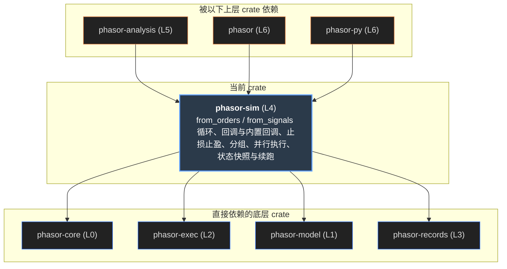

# phasor-sim

模拟循环。`from_orders` 被告知**交易什么**：每个元素是一笔下单请求。`from_signals` 只被告知**什么时候**：进场、出场、止损、止盈， 它要自己把信号收成订单——解决同一根 K 线上互相矛盾的信号、决定反手还是平仓、算出数量。两个循环每根 K 线都调用同一个 [撮合内核](phasor-exec.md)，把成交写进 [记录](phasor-records.md)；按账户组并行，串行和多线程结果逐位相同。

> **核心特性与指标：**
> - **4 份黄金输出，全部复现**：这个页面的 JS 移植在 Node 里重放：signals 5,088 行、from_orders 290 例（5,931 笔成交）、cash_sharing 48 例、from_signals 181 例（1,115 笔成交），一处不差
> - **并行单位是账户组**：独立的列各自一组，扫描天然可并行；共享资金的组内部按顺序执行，因为每笔成交都改变下一笔能用的钱
> - **稀疏负载 4 线程 3.6×**：20,000 × 256、每 20 根一笔成交：1 线程约 33 M 元素/s，4 线程约 121 M；每根都成交的稠密负载受内存带宽限制，只到 1.6×

<a id="concept"></a>

## 从第一性原理看：一个向量化回测循环要回答什么

先不看代码。“按信号买卖”在每根 K 线上要做的事情，比看起来多得多。

### 1. 时间方向上不能并行

第 t 根 K 线的状态（现金、仓位、负债、止损）取决于第 t − 1 根：`state[t] = f(state[t−1], bar[t])`。这条依赖切不断，所以“向量化”在这里不是 SIMD， 而是把**很多条互不相关的时间序列**放在列轴上一起跑。撮合内核是一棵有十几个提前返回的分支树，不同的列几乎每根 K 线都走不同的分支，SIMD 的通道会不断分叉； 按列（更准确地说按账户组）分给线程才是对的。SIMD 属于因子和分析层，那里没有这种依赖。

### 2. 共享资金把“列”变成“组”

默认每列有自己的现金，是一次独立的回测。几个标的共用一个账户时，它们就不再是 N 次模拟，而是**一次**覆盖 N 个标的的模拟：同一根 K 线里必须按某个顺序执行， 因为每笔成交都会改变后面的单能花多少钱。并行的单位于是从列变成组；单个共享账户就是一个单位，这是共享余额本身决定的，不是实现的缺陷。

### 3. 先卖后买

一次调仓里，买单如果排在为它筹钱的卖单前面，就会因为现金不够被拒——而且是**静默**的，那一列只是没交易。这是共享资金回测里最常见的意外。 所以需要一种“自动调用顺序”：按每笔单的近似金额排序，卖（负值）在前、买在后。

### 4. 一根 K 线要先整体决定，再执行

目标权重（TargetPercent）的单是组合净值的一个比例，而净值取决于**所有**标的的估值价。如果边执行边估值，同一根 K 线上的单会因为执行先后看到不同的净值。 所以一根 K 线分两遍：先为全组确定价格、估值价和净值，再按调用顺序执行；而且每一笔都按 K 线开始时的净值下单，成交只在 `update_value` 打开时才改变它。

### 5. 信号会互相矛盾

同一根 K 线上进场和出场同时为真；做多和做空同时为真；持多仓时来了一个做空信号（是平仓还是反手？）；已经有仓位时又来一个进场（加仓还是忽略？）。 订单数组表达不出这些歧义，信号数组可以。所以信号到订单之间要有一串**有固定顺序的**解决步骤——顺序换了，留下来的信号就不同。

### 6. 止损不是观点，是限额

止损触发时，它**替换**这根 K 线的信号，而不是和它们竞争。触发价也要讲究：开盘就跳空越过止损线，只能按开盘价成交；跟踪止损要在**测试之后**才更新， 否则一根创新高又回落的 K 线会被自己的回落止损出局。只有收盘价的序列也要能测止损：缺失的开高低由已知的价格补出来。

| 第一性原理的问题 | phasor-sim 的回答 | 小节 |
|----|----|----|
| 时间上的依赖 | 每个组一个 `simulate_group`，逐根 K 线调用 `execute_validated`；组之间无共享状态，作用域线程 | [并行](#parallel) |
| 共享资金 | `Groups { lens, starts }`，组内一个 cash / free_cash，每列自己的仓位、负债、估值价、止损 | [共享资金](#sharing) |
| 先卖后买 | `CallSeq::Auto`：`approx_order_value` 稳定插入排序，NaN 在后 | [共享资金](#sharing) |
| 整体决定再执行 | 两遍：先确定全组价格与估值价、开盘净值只算一次；净值在组内传递而不是重新求和 | [一根 K 线](#bar) |
| 信号矛盾 | `signals.rs` 的纯函数：from_stop → 进出冲突 → 多空冲突 → 反向进场 → signals_to_size | [信号管线](#pipeline) |
| 止损 | `stop_price`（跳空 → 开盘价）、先测试后跟踪、成交后重新布置或清除、`StopLimit` 不付滑点 | [止损](#stops) |

<a id="graph"></a>

## 依赖图

上游是 core（FlexArray、容差、错误）、exec（内核）、model（枚举）、records（sink 与记录）。中间是十二个主要模块（prices、stops、limit、state、stop_exits、initial 没画），右边是使用者。点任一节点，只保留相关的线。

#### 示意 / 说明：线的颜色 = 被用到的模块。margin、holding、liquidation、random 是私有模块



*说明：*

来源：Cargo.toml 与 `src/` 中的 `use phasor_sim::…`。phasor-signals 和 phasor-indicators 不依赖它：信号和指标经由数组（`FromSignals` 的字段）接进来。

<a id="bar"></a>

## 一根 K 线里发生了什么

#### 示意 / 说明：from_orders（上）与 from_signals（下）的一根 K 线，一个账户组

```mermaid
flowchart TD
    subgraph FromOrders["from_orders · 每根 K 线执行流程"]
        O1["1. 开盘现金流<br/>入金（组第一列）· 分红 × 开盘前持仓"] --> O2["2. 第一遍：确定价格<br/>+inf → 收盘价, −inf → 上一根收盘价"]
        O2 --> O3["3. 第一遍：计算估值价<br/>+inf → 订单价; NaN 沿用; 全仓保证金列结算"]
        O3 --> O4["4. 强平检查<br/>开盘 → 不利极值 或标记价格"]
        O4 --> O5["5. 计算开盘净值<br/>cash + Σ 持仓 × 估值价，每根只算一次"]
        O5 --> O6["6. 调用顺序重排<br/>Default：按列布局; Auto：按金额排序，先卖后买"]
        O6 --> O7["7. 第二遍：执行订单<br/>execute_validated，写成交记录 / 日志"]
        O7 --> O8["8. 收盘现金流<br/>收益（封顶）· 持仓费（不封顶）"]
    end

    subgraph FromSignals["from_signals · 每根 K 线每列 (prepare_order) 后执行"]
        S1["1. 确定价格<br/>+inf → 收盘价, −inf → 当根开盘价"] --> S2["2. 测止损条件<br/>SL 先，TP 后; 跳空 → 开盘价成交"]
        S2 --> S3["3. 跟踪止损更新<br/>测试之后，锚点移到新高 / 新低"]
        S3 --> S4["4. 读取信号<br/>止损触发 → from_stop 替换; 否则读 4 个信号数组"]
        S4 --> S5["5. 冲突消解<br/>进出冲突 → 多空冲突 → 反向进场"]
        S5 --> S6["6. 计算订单数量<br/>signals_to_size; 0 则不生成订单"]
        S6 --> S7["7. 强平检查 (全组)<br/>止损价先算，被强平的列订单作废"]
        S7 --> S8["8. 执行与重新布置<br/>开仓 / 反手：重新锚定止损; 加仓：按 update 模式"]
    end
```



*说明：*

入金和分红在开盘、价格确定之前入账，所以同一根 K 线上按目标仓位下的单会把它投进去；收益（利息、费用）和持仓费（资金费、隔夜融资、借款利息、借券费，`holding.rs`）在收盘、所有订单之后入账，没有信号的 K 线也入账。保证金列在估值价确定后结算（`margin.rs`），设了维持保证金的账户接着按这根 K 线的路径做强平检查（`liquidation.rs`），然后才估值、下单。这些都写成 `CashRecords` 或成交记录——分析层只从记录重建，现金流不写成记录就不存在。

<a id="pipeline"></a>

## 信号管线实验台

`signals.rs` 的五个纯函数，按 `from_signals` 调用它们的顺序排好。设定持仓、信号和各个模式，看每一步留下了什么、最后变成什么订单。 这些函数的移植在 `signals.tsv` 的 5,088 行上（穷举了持仓、信号组合与模式）全部一致。

#### 示意 / 说明：from_stop / resolve_signal_conflict / resolve_dir_conflict / resolve_opposite_entry / signals_to_size，JS 移植

*说明：*

### Both 下的 exit 是开空

旧约定 `entries / exits + direction` 里，双向列的一对信号表示“做多或做空”，不是“进或出”：exit 被读成 **short entry**。两种约定按位或合并，所以一列可以同时用两种。

### 没有仓位就谈不上相邻

进出冲突的 `Adjacent / Opposite` 是相对持仓而言的；空仓时两个信号**都丢**，而不是随便挑一个——那会凭空造出一笔信号没要的交易。

### 反手是一笔单

反手发出一笔数量 = \|持仓\| + 新开仓量的单。所以百分比数量不能反手：是平掉那部分的百分比，还是新开那部分的？报错。数量必须非负，方向只由信号表达。

<a id="stops"></a>

## 止损实验台

```text
价格跳空跌破与跟踪止损演化:

价格
 ▲           K线 1        K线 2 (创新高)     K线 3 (开盘跳空低开)
 │           ┌─┐             ┌─┐
 │           │ │ ◄ 最高价    │ │ ◄ 新高 110
 │           │ │             │ │
 │ 追踪止损: ─┼─┼─────────────┼─┼────────┐ (原止损价 100 随新高上移至 105)
 │           │ │             │ │        │
 │           └─┘             └─┘        │
 │                                      ▼ (K线 3 开盘价 Open = 98 已经低于 105)
 │                                      ┌─┐
 │                                      │ │ ◄ 成交价为 98 (跳空以开盘价执行, 绝不超现实成交在 105)
 │                                      └─┘
 └────────────────────────────────────────────────► 时间
   核心规则: 
   1. 必须【先测试止损、后更新跟踪】：防止当前 K 线由于自身冲高回落直接触发刚刚抬高的跟踪止损。
   2. 【跳空缺口】：若 Open < StopPrice，撮合成交价使用 Open 而非 StopPrice，贴合真实滑点。
```

`from_signals` 的完整移植（价格解析 → 测止损 → 信号 → 冲突 → 数量 → 内核 → 重新布置止损），在 `tests/fixtures/from_signals.tsv` 的 61 个命名情形上运行。 图上是 K 线（细线为高低，横线为开收）、止损 / 止盈线、成交点；下表逐根列出止损测试和成交，最后一行是和黄金输出里的成交是否一致。

#### 示意 / 说明：simulate_from_signals，JS 移植（第 0 列）

> **图表：K 线与止损**

*说明：*

### stop_price

多头的止损线是 `anchor × (1 − sl_stop)`。开盘已经在线下（跳空）→ 按**开盘价**；否则线落在 \[low, high\] 内 → 按线价；都不是 → 不触发。空头、止盈对称。止损先测，止盈只在止损没触发时才测。

### 先测试，再跟踪

`sl_trail` 的止损在本根测试**之后**才把锚点移到新高 / 新低，所以这根 K 线是按上一根为止的峰值判断的。先跟踪会让一根创新高的 K 线被自己的回落止损出局。

### 成交后怎么布置

开仓或反手：用 `stop_entry_price` 选的锚点重新布置；加仓：按 `upon_stop_update`（Keep / Override / OverrideNaN）决定是否更新；减仓：不动；平仓：清除。挂在触发价上的 `StopLimit` 单另用一个无滑点的订单模板。

<a id="orders"></a>

## from_orders：价格与估值价

`from_orders` 的每个元素是一笔请求（size 为 NaN 表示不下单）。两个哨兵：`price = +inf` 是当根收盘，`−inf` 是上一根收盘；`val_price = +inf` 是订单价格，`−inf` 是上一根收盘。 `ffill_val_price` 让缺失的估值价沿用上一个有效值；`update_value` 在每笔成交后按成交价重新估值。下面是 `from_orders.tsv` 的 40 个命名情形。

#### 示意 / 说明：simulate_from_orders，JS 移植（第 0 列逐根）

*说明：*

<a id="sharing"></a>

## 共享资金与调用顺序

```text
共享账户 (Initial Cash = 100.0) 在同一根 K 线上的 3 笔调仓:
  订单 A: 买入股票 1 (需现金 80.0)
  订单 B: 买入股票 2 (需现金 80.0)
  订单 C: 卖出股票 3 (产生现金 100.0)

─────────────────────────────────────────────────────────────────────────────
模式 1: Default (按标的列顺序执行: A ──► B ──► C)
  1. 执行 A: 买入 80.0 ──► cash 剩余 20.0 (成功)
  2. 执行 B: 需 80.0, 但 cash 仅剩 20.0 ──► ❌ 严重拒单 (静默无法成交！)
  3. 执行 C: 卖出 100.0 ──► cash 增至 120.0
  结果: 股票 2 漏单，导致资产组合偏离目标配置！

模式 2: CallSeq::Auto (自动重排: 负金额在前，先卖后买: C ──► A ──► B)
  1. 先执行卖单 C: 释放资金 +100.0 ──► cash 增至 200.0
  2. 再执行买单 A: 买入 80.0      ──► cash 剩余 120.0 (成功)
  3. 后执行买单 B: 买入 80.0      ──► cash 剩余 40.0  (成功！)
  结果: 3 笔订单全部完美成交，彻底解决共享资金账户下的买卖资金饥饿死锁。
```

`cash_sharing.tsv` 的每个情形都跑两遍：布局顺序（`CallSeq::Default`）和按订单金额排序（`CallSeq::Auto`）。左右并排看同一组输入在两种顺序下成交有什么不同； 中间一行是 Auto 每根 K 线的 `approx_order_value` 与执行顺序。

#### 示意 / 说明：groups + CallSeq + from_orders，JS 移植

Default（布局顺序）的成交

| col | bar | side | size | price |
|-----|-----|------|------|-------|

Auto（先卖后买）的成交

| col | bar | side | size | price |
|-----|-----|------|------|-------|

*说明：*

### approx_order_value

Amount × 估值价、Value 原样、Percent 按现金（卖出按持仓价值，平空还要算上释放的保证金）、Target\* 减去当前持仓价值。ShortOnly 列的数量先取反。有杠杆或保证金列的运行里，再经 `approx_cash_need` 换成订单对可用现金的影响：减仓的部分释放，开仓的部分占用（现金列按 1 / leverage，保证金列按初始保证金）。它只用来排序，不影响下单量。

### 稳定排序、NaN 在后

插入排序：金额相同的保持布局顺序；没有订单的列（NaN）排到最后。换成不稳定的排序会在平局时改变成交，黄金输出会对不上。

### 记录按列重排

共享组的成交按执行顺序写出，但每条记录带着自己的列；调用方按 `(col, idx)` 排序，所以记录的布局和执行顺序无关。

<a id="parallel"></a>

## 并行：按组切块

`Groups::chunks(n_threads)` 按**总列数**的等分点把连续的组切成块，每个线程一块、自带 sink 和计数器；合并时按块的顺序拼接并重新编号，所以和线程怎么交错无关——串行与多线程逐位相同（有测试）。 宽的组自成一块。改下面的组长度和线程数看看。

#### 示意 / 说明：Groups::chunks，JS 移植

*说明：*

| scaling（20,000 × 256，4 核 Xeon） |      1 线程 |       4 线程 |  加速 |
|------------------------------------|------------:|-------------:|------:|
| 稀疏（每 20 根 1 笔成交）          | 33 M 元素/s | 121 M 元素/s | 3.62× |
| 稠密（每根都成交）                 | 15 M 元素/s |  25 M 元素/s | 1.63× |

稠密负载受内存带宽限制（约 245 MB 的记录写入），纯计算可扩展到 3.96×。记录缓冲区按成交上界预分配（size 可用的单元数；信号置位单元数的两倍），而不是 n_rows × n_cols——后者在 100k × 2,000 的扫描上要预留 8 GB 地址空间。每列只构建一次 `ValidatedOrder`，稀疏 +30%、稠密 +22%。

<a id="bench"></a>

### 基准：`examples/bench.rs`

基准的运行器是 `examples/bench.rs`。它读 `benchmarks/workloads.tsv`（from_orders）和 `benchmarks/workloads_signals.tsv`（from_signals，Python 层调得最多的那条循环）， 每行按公式生成价格和信号，输出里带生成数组的校验和与成交数，`compare.py` 据此核对串行和多线程做的是不是同一份工作，做的不一样就中止。`--once NAME` 单线程、不计时地跑一次，是 instructions.py 在 callgrind 下跑的东西。

workloads_signals.tsv 有一列 `features`。`SignalWorkload`（[examples/bench.rs:145](https://github.com/nivalume/phasor/blob/1d573df0430fa5cd3a2416300603c7147f3c6a13/crates/phasor-sim/examples/bench.rs#L145)）带 `features` 字段；`parse_signal_workloads`（[:195](https://github.com/nivalume/phasor/blob/1d573df0430fa5cd3a2416300603c7147f3c6a13/crates/phasor-sim/examples/bench.rs#L195)）按表头找这一列（[:211](https://github.com/nivalume/phasor/blob/1d573df0430fa5cd3a2416300603c7147f3c6a13/crates/phasor-sim/examples/bench.rs#L211)），没有这一列或者写 `-` 时为空（[:230](https://github.com/nivalume/phasor/blob/1d573df0430fa5cd3a2416300603c7147f3c6a13/crates/phasor-sim/examples/bench.rs#L230)）。 `main` 里 `on(name)`（[:387](https://github.com/nivalume/phasor/blob/1d573df0430fa5cd3a2416300603c7147f3c6a13/crates/phasor-sim/examples/bench.rs#L387)）决定 `FromSignals` 的几个字段：`limit` 是离收盘价 0.2% 的限价单，`leverage` 是 2 倍杠杆，`margin` 是保证金账户（初始 10%、维持 5%、资金费 0.0001），`timestop` 是 7 根的时间止损并打开 `use_stops`（[:424](https://github.com/nivalume/phasor/blob/1d573df0430fa5cd3a2416300603c7147f3c6a13/crates/phasor-sim/examples/bench.rs#L424)）；不认识的名字直接 panic（[:388](https://github.com/nivalume/phasor/blob/1d573df0430fa5cd3a2416300603c7147f3c6a13/crates/phasor-sim/examples/bench.rs#L388)）。 四行 `signals_limit` / `_leverage` / `_margin` / `_timestop` 和 `signals_both` 形状相同（20,000 × 100、Both、fees 0.001），各自只多一个功能，和它一比就是这个功能打开时的代价。

`benchmarks/baseline.tsv` 只收 from_orders 的负载；`compare.py --check-baseline` 以 10% 阈值只检查单线程的行，不在基线里的行列在 “Not in the baseline” 下面。关掉的功能最多可以多花 3% 的指令，由 `benchmarks/instructions.py` 在 callgrind 下数。

<a id="callbacks"></a>

## 回调：在 K 线循环里给用户代码留的位置

回调不是事件驱动。循环还是逐根 K 线的那个循环，用同一个撮合内核、写同样的记录；`callbacks.rs` 只是在每根 K 线的固定位置调用用户代码，让它改掉循环在那里本来要做的事。 回调通过只读的 `Context` 看账户，改变账户只能靠下单：改变现金或持仓的东西仍然经过内核、落成记录。 入口是 `simulate_from_order_func`（`OrderFunc`）和 `simulate_from_signal_func`（`SignalFunc`），返回 `Run`：记录（`OrderRecords` 或带日志的 `Journal`）、每组的回调状态和结束时的 `SimState`。

| 钩子 | from_orders | from_signals | 在一根 K 线的什么位置 |
|----|----|----|----|
| `pre_group` | ✓ | ✓ | 每组第一根之前调一次，返回这一组的 `State`（唯一没有默认实现的方法） |
| `pre_segment` | ✓ | — | 价格、估值价、保证金结算、强平检查、组净值和调用顺序都定了之后，任何订单之前；返回 `SkipSegment` 这根不下单 |
| `adjust` | — | ✓ | 每根每列，测止损之前：改止损距离和价位（移到保本、收紧阶梯、撤掉）；只有持仓的止损会被测 |
| `order` / `flex_order` | ✓ | — | 按 call_seq 的顺序，每列一次：`order` 收到数组给出的请求（NaN 数量是没有订单），改完就执行。`FLEX = true` 时改调 `flex_order`：一根 K 线返回任意多笔“(组内列号, 订单)”，任意列、任意顺序，返回 `None` 为止 |
| `signals` | — | ✓ | 每列这根的四个信号和 size、size_type（`Decision`），代替数组给的；之后照常走冲突、累加、止损、限价单和 `order_mode` |
| `post_order` | ✓ | ✓ | 每笔订单执行之后，成交与否都调；结果里的价格是策略的价格 |
| `post_segment` | ✓ | ✓ | 每根收尾：收益和持仓费之后 |

### Flow：继续、跳过、停止

钩子返回 `Flow`：`Continue`；`SkipSegment`，只在 `pre_segment` 里有意义；`StopGroup`，这一组不再下单、不再调回调，但剩下的 K 线照常记现金流、持仓费和强平，因为它们属于还开着的仓位。任何钩子返回错误都结束运行。

### Context：只读的账户

`group`、`row`、`cols`、`cash`、`free_cash`、`value`（按估值价的组净值，from_orders 里一根之内只有 update_value 才变），按组内下标 k 读 `position`、`debt`、`locked_cash`、`close`、`val_price`、`stops`、`order(k)`。价格是策略写的价格：from_orders 的列状态里估值价乘过合约乘数，Context 除回去。from_signals 的 adjust 和 signals 在本根价格确定之前调用，val_price 是上一根的。

### 每组一个 State

`pre_group` 返回，按组的顺序和记录一起返回（Python 里是 `pf.in_outputs`）。回调对象本身是共享的 `&self`，并行入口要求它 `Sync`；各组照常并行，所以要跨组共享状态的回调得用 `Schedule::RowWise`。不需要 `pre_sim`：回调对象在运行前就构造好了。

### NoCallbacks：不用时没有代码

两个循环对回调类型泛型。`NoCallbacks` 把关联常量 `ON` 设为 false，每个调用点都在 `if C::ON` 后面，所以普通入口（`simulate_from_orders` 等都传 `&NoCallbacks`）跑的那份实例里没有回调的代码。调用回调的辅助函数（`callback_order`、`post_order`、`decide`、`segment_end`）都是 `#[cold]`、不内联。

### 回调不能绕过记录

`callback_order` 把回调的订单变成 `ValidatedOrder`：价格的 ±inf 和数组里同义（+inf 当根收盘，−inf 上一根收盘），乘上合约乘数。在没有杠杆和保证金列的运行里要杠杆或保证金账户、或改掉某列的账户类型，都报错：记录要么每笔带余额、要么都不带，这在运行前就定了。

### from_signals 的决定走完整条管线

`decide` 调 adjust 和 signals，得到的 `Decision` 传进 `prepare_order` → `user_order`（以及止损成交后的 `follow_up`），代替 `read_signals` 和 size 的读取。有回调时走 `EXTENDED` 实例，不预先检查 size（要检查的是回调给的）。和非 0 的 `from_ago` 一起用报错：回调在自己那根上决定，要滞后就在回调里做。

### row_wise 与 Group::run_rows

from_orders 的 K 线循环拆成了结构体 `Group`：`Group::new` 建好一个组第一根之前的状态（现金、各列 `ColumnState`、每列的 `ValidatedOrder`、保证金和乘数，并开好初始持仓；续跑时现金和列状态取自 `resume`，见[续跑](#resume)），`Group::run_rows` 跑一段行，`Group::finish` 交出结束时的 `GroupState`。 `group_loop` 对一个组只调一次 `run_rows(start..n_rows)`，`start` 不续跑时是 0。`Schedule::RowWise`（`row_wise` 函数）先为每组建一个 `Group`，再对每根 i 依次调各组的 `run_rows(i..i + 1)`：单线程，每组写自己的缓冲区，最后按组顺序合并，和并行路径合并线程块一样，所以回调不跨组共享状态时，记录和 `Schedule::Groups` 相同。 `run_rows` 接受一段行而不是一根，是为了把账户和各个开关在一次调用里只读进局部变量一次，并先把各个 `Vec` 取成切片，让指针和长度留在寄存器里。

### fill! 宏

一笔订单的执行——`execute_validated`、`raise_reject`、`update_value`、写成交和余额、写日志、更新列状态——有两处要用：K 线循环的第二遍，和 flex 路径的 `execute`。 写成内联函数时，没有回调的循环每根 K 线多花约 23 条指令（列状态被借第二次，结果经 `Result` 带出来），所以写成宏 `fill!`：两处共用一份文本，在循环里仍是内联的。 `execute` 本身 `#[inline(always)]`，把 `post_order` 留在里面，成交结果不带出去。加上 `FlexArray::get` 的标量快路径（见 [phasor-core](phasor-core.md#flex)），功能全关时 from_orders 的指令数保持在 3% 的预算以内。

按风险算仓位：`risk_size(value, risk, entry, stop, multiplier)` = `risk × value / (|entry − stop| × multiplier)`，距离为 0 或不是有限数时是 NaN（内核忽略）。在 `order` 或 `signals` 里把订单的 size 设成它，size_type 用 Amount；不想自己写的话，下面的 `Builtin` 就是这样用它的。

<a id="builtin"></a>

### 内置回调：`Builtin`

`builtin.rs` 把三个常见的 from_signals 回调写成 Rust 里的一个 `SignalFunc`，参数就是结构体 `Builtin`（[builtin.rs:36](https://github.com/nivalume/phasor/blob/1d573df0430fa5cd3a2416300603c7147f3c6a13/crates/phasor-sim/src/builtin.rs#L36)）的五个字段，NaN 或 0 表示关，默认全关（[:51](https://github.com/nivalume/phasor/blob/1d573df0430fa5cd3a2416300603c7147f3c6a13/crates/phasor-sim/src/builtin.rs#L51)）。 它没有自己的入口：和用户的回调一样交给 `simulate_from_signal_func(&args, &rules, threads)`，所以走的是带回调的 `EXTENDED` 实例，决定经过同一条管线（冲突、累加、止损、限价单）。 每组的状态 `BuiltinState`（[:101](https://github.com/nivalume/phasor/blob/1d573df0430fa5cd3a2416300603c7147f3c6a13/crates/phasor-sim/src/builtin.rs#L101)）只有两个数：它记的是哪一根，这一根已经放行了几笔开仓。Python 的 `from_signals(risk=, risk_stop=, breakeven=, max_positions=, max_exposure=)` 就是它，见 [phasor-py · 回调](phasor-py.md#callbacks)。

| 规则 | 参数 | 钩子 | 怎么算 |
|----|----|----|----|
| 按风险定仓 | `risk`、`risk_stop`：要么都给，要么都不给（`validate`，[builtin.rs:71](https://github.com/nivalume/phasor/blob/1d573df0430fa5cd3a2416300603c7147f3c6a13/crates/phasor-sim/src/builtin.rs#L71)） | `signals`（[:165](https://github.com/nivalume/phasor/blob/1d573df0430fa5cd3a2416300603c7147f3c6a13/crates/phasor-sim/src/builtin.rs#L165)） | 只改开仓和反手的单：`long_entry` 且持仓 ≤ 0，或 `short_entry` 且持仓 ≥ 0。假设止损在这一根收盘价的 `1 ∓ risk_stop` 处，`size = risk_size(ctx.value, risk, close, stop, multiplier)`，`size_type` 改成 Amount。加仓和平仓不改 |
| 移到保本 | `breakeven` | `adjust`（[builtin.rs:124](https://github.com/nivalume/phasor/blob/1d573df0430fa5cd3a2416300603c7147f3c6a13/crates/phasor-sim/src/builtin.rs#L124)） | 入场价取 `stops.tp_price`：开仓或反手时循环把止盈的锚点设成入场价（`stop_entry_price` 选的价，默认收盘价），设没设止盈都一样（[from_signals.rs:2095](https://github.com/nivalume/phasor/blob/1d573df0430fa5cd3a2416300603c7147f3c6a13/crates/phasor-sim/src/from_signals.rs#L2095)；加仓时按 `upon_stop_update` 可能换成新的价）。浮盈用 `ctx.val_price`，也就是上一根的估值价；达到 `breakeven` 后 `sl_price` 设成入场价、`sl_stop` 设成 0（Target 格式下就是入场价本身）、关掉 `sl_trail`。已经比入场价更紧的止损（`sl_level`，[:104](https://github.com/nivalume/phasor/blob/1d573df0430fa5cd3a2416300603c7147f3c6a13/crates/phasor-sim/src/from_signals.rs#L104)）不动。没有设 `sl_stop` 的持仓也会因此多出一个止损 |
| 全局预算 | `max_positions`、`max_exposure` | `signals` 里的 `room`（[builtin.rs:209](https://github.com/nivalume/phasor/blob/1d573df0430fa5cd3a2416300603c7147f3c6a13/crates/phasor-sim/src/builtin.rs#L209)） | 只拦从空仓开新仓的信号：组里持仓数加上这一根已经放行的开仓数达到 `max_positions`，或者 Σ\|持仓 × 估值价 × 乘数\| 达到 `max_exposure × ctx.value` 时，清掉这一列的 `long_entry` 和 `short_entry`。平仓和反手不拦 |

### 为什么要数“这一根已经放行的”

from_signals 先对组里每一列做决定，再按调用顺序执行，所以做决定时 `ctx.position` 还是这一根开始时的持仓：同一根上两列都来进场信号，看到的持仓数一样。`state.opened` 补上这一根已经放行的开仓；它在这一根的第一次 `signals` 调用时按 `ctx.row` 归零（[builtin.rs:172](https://github.com/nivalume/phasor/blob/1d573df0430fa5cd3a2416300603c7147f3c6a13/crates/phasor-sim/src/builtin.rs#L172)）。数的是放行的信号，不是成交：放行后被冲突规则去掉或被拒的单也占一个名额。

### 为什么线程数和续跑都不改变结果

三条规则只读本组的 `Context`，组之间不共享任何东西，所以照常按组并行。`BuiltinState` 撑不过一根 K 线，续跑时 `pre_group`（[builtin.rs:117](https://github.com/nivalume/phasor/blob/1d573df0430fa5cd3a2416300603c7147f3c6a13/crates/phasor-sim/src/builtin.rs#L117)）重新建一个空的就够了，`SimState` 里不用存它。`tests/resume.rs` 的 `the_built_in_rules_continue_and_ignore_the_thread_count`：risk 0.02、risk_stop 0.03、breakeven 0.01、max_positions 2，两组情形，先断言规则确实改变了记录，再要求 3 线程和 5 个切点续跑的记录、状态都和一次跑完相同。

### 不偷看

`adjust` 在这一根的价格确定之前调用，读到的估值价是上一根的；所以“浮盈够了”最早在下一根才生效，触发它的那根 K 线的范围不会马上去测刚移过来的止损。定仓用的收盘价是这一根的，和默认的成交价（收盘价）相同。

### 检查参数是调用方的事

保本止损要靠止损测试才有用，所以 `validate` 带上运行的 `use_stops`（[builtin.rs:71](https://github.com/nivalume/phasor/blob/1d573df0430fa5cd3a2416300603c7147f3c6a13/crates/phasor-sim/src/builtin.rs#L71)）：`use_stops = false` 时给了 breakeven 就报错（“breakeven moves a stop, and this run does not test stops”）。`simulate_from_signal_func` 对任何 `SignalFunc` 都一样，不会替你调 `validate`：Python 绑定在建好 `FromSignals` 之后调（phasor-py 的 [lib.rs:1956](https://github.com/nivalume/phasor/blob/1d573df0430fa5cd3a2416300603c7147f3c6a13/crates/phasor-py/src/lib.rs#L1956)），直接用 Rust 的调用方要自己调。

<a id="resume"></a>

## 续跑与状态：从上一次结束的地方接着跑

```text
SimState 序列化字节布局 (魔数 PHSS, 固定 8 字节对齐):
┌──────────────┬──────────────┬──────────────┬──────────────┬────────────────────────┐
│ Magic (4B)   │ Version (4B) │ row_off (8B) │ next_row(8B) │ GroupStates [ 0 .. N ] │
│  b"PHSS"     │     0x01     │ 数组起始行号 │ 下次开始行号 │ 每个账户组的状态快照   │
└──────────────┴──────────────┴──────────────┴──────────────┴────────────────────────┘
GroupState 结构:
  ├─ cash: f64, free_cash: f64 (账户总现金与可用额度)
  ├─ positions: Vec<f64>       (各列当前持仓股数)
  ├─ debts: Vec<f64>           (各列当前融券负债)
  ├─ val_prices: Vec<f64>      (各列最新估值价)
  └─ stops: Vec<Option<Stop>>  (各列当前生效的止损止盈状态机)
```

一次运行在 K 线之间带着的只有两样东西：每个账户组的现金和可用现金，每列的 `ColumnState`（持仓、负债、锁定现金、估值价、止损、挂着的限价单）。 `snapshot.rs` 把它们收成 `SimState` 交回来；下一次运行把它传进 `resume`，从它的 `next_row` 开始，不再读 `init_cash` 和 `init_position`（初始持仓也不再开）。 在任意一行切开、这样接起来的两段，写出的记录和一次跑完逐位相同，用 `OrderRecords::chain` 拼好之后顺序也相同（见 [phasor-records · 拼接](phasor-records.md#chain)）。

| 字段 | 内容 | 为什么 |
|----|----|----|
| `source: Loop` | `FromOrders`（也是 from_order_func）或 `FromSignals` | 状态只能续写它的那个循环：from_orders 的列状态里估值价乘过合约乘数，from_signals 存的是价格，互相换算不精确 |
| `next_row` | 续跑的第一行，等于 `row_offset + n_rows` | 整次运行的行号，不是数组的下标 |
| `levered` | 前一段的记录带不带余额 | 续跑沿用它，记录要么每笔都带余额、要么都不带。前一段不带、这一段却要借钱、保证金或持仓费，报错：要在第一段就带上这些设置（`run_levered`） |
| `groups: Vec<GroupState>` | 每组 `cash`、`free_cash`、按组内顺序的 `columns`、`stopped` | `stopped` 是回调停掉了这一组的交易；续跑的那段仍然不下单 |

### 行号是绝对的

状态里的行号都是整次运行的：时间止损的 `td_row`、`dt_row`，挂单的 `created`、`last_row`。循环仍从 0 读自己的数组，只在状态和记录进出时换算：`group_for` 减去 `row_offset`（早于数组起点的变成 0），`Group::finish` / `snapshot::finish` 加回去，记录在 `finish_run` 里 `shift_rows(row_offset)`。表示“永不”的 `usize::MAX` 不动；挂单槽位空着时它的两个行号只是占位，也不动，只有挂着的限价单的行号会移。

### resume 与 row_offset

两种续法。只给 `resume`：数组还是整段历史，从 `next_row` 跑到末尾，前面的行只被回看。再给 `row_offset`：数组覆盖 `row_offset..row_offset + n_rows`，长历史可以一段一段跑，不必整段放进内存。这时数组要带上 `next_row` 之前被回看的几行：`price = −inf` 读上一根收盘，`from_ago` 读更早的；不带的话，这一段开头几根读到 NaN。`start_in` 检查来源循环、组数，以及 `next_row` 落在数组覆盖的行内；`group_for` 检查每组的列数。

### 随机数用整次运行的行

随机拒单的抽签是 `uniform(seed, i + row_offset, col)`。用数组下标 `i` 的话，同一根 K 线在分段运行里会抽到另一个数，被拒的单就不同了。这和“串行与多线程逐位相同”是同一条规则：随机数只能是 (seed, 行, 列) 的函数。

### 不在状态里的

回调自己的状态：带回调的运行续跑时再调一次 `pre_group`，带状态的回调在那里重建。记录也不在：状态是下一根要的，记录是过去做的。

### Run

`simulate_from_orders_run` / `simulate_from_signals_run`（按组分到 n_threads 个线程）返回 `Run { records, states, last_state }`；`simulate_from_order_func` / `simulate_from_signal_func` 也返回 `Run`，`states` 是每组的回调状态，没有回调时是 `()`。串行、并行和带日志的四个入口只返回记录。

### 字节

`to_bytes` 写小端二进制：魔数 `PHSS`、版本 1、来源、`next_row`、`levered`，然后每组、每列的每个字段。`from_bytes` 拒绝别的魔数或版本、截断的、后面还多出字节的。库 crate 不写文件，字节写到哪里是调用方的事（Python 的 `phasor.save`）。

### 怎么证明逐位相同：tests/resume.rs

90 行 × 6 列的随机行情，两个循环各 4 组功能。from_orders：默认；共享现金、Auto 调用顺序、update_value、`price = −inf`、收益；杠杆、随机拒单、`from_ago = 1`、借款利息；保证金列、维持保证金、资金费、合约乘数和会触发强平的大单。 from_signals：默认；止损、止盈、移动止损、时间止损，双向；限价单、有效期、随机拒单；共享现金的保证金组、强平、收益。 每组在 5 个切点（1、2、23、57、89）切成两段，后一段用两种续法各跑一次：整段数组从切点续（用 2 或 3 个线程），数组从切点前 2 行开始（`LOOKBACK = 2`：上一根收盘和 `from_ago = 1`）。 比较 `Journal::chain` 拼好的记录（比 Debug 字符串，NaN 也算相等）和最终状态的字节，必须和一次跑完的相同。 `many_pieces_are_one_run` 把 90 行切成每段 7 行一路续下去，最后的状态经过字节往返也不变；`a_state_that_does_not_fit_is_refused` 检查数组不够长、分组不同、换了循环、后一段才要杠杆都报错。

变异：去掉 `rebase` 里时间止损的两行，或把随机数的行号从 `i + row_offset` 改成 `i`，测试都失败（前者在 from_signals 情形 1、切点 23、数组从第 21 行起的那次比较失败，后者三个双段 / 多段测试都失败）。 两种错误只在 `row_offset` 不为 0 时才出现，所以第二种续法不能省。 代价：功能全关时，续跑支持让指令数多出约 1%（from_orders）到 1.6%（from_signals）。

<a id="defaults"></a>

## 默认值

<table>
<thead>
<tr>
<th>参数</th>
<th>from_orders</th>
<th>from_signals</th>
<th>备注</th>
</tr>
</thead>
<tbody>
<tr>
<td><code>init_cash</code></td>
<td>100</td>
<td>100</td>
<td>共享组只读第一列</td>
</tr>
<tr>
<td><code>size</code> / <code>price</code></td>
<td>+inf / +inf</td>
<td>+inf / +inf</td>
<td>全部 / 当根收盘；from_signals 的 −inf 是<strong>当根开盘</strong>，from_orders 的 −inf 是上一根收盘</td>
</tr>
<tr>
<td><code>direction</code></td>
<td>Both</td>
<td>LongOnly</td>
<td>两个循环不一样</td>
</tr>
<tr>
<td><code>min_size</code></td>
<td>1e-8</td>
<td>1e-8</td>
<td><code>DEFAULT_MIN_SIZE</code>，不是内核的 0；日志字段 <code>req_min_size</code> 记的就是它</td>
</tr>
<tr>
<td><code>val_price</code> / <code>ffill_val_price</code> / <code>update_value</code></td>
<td>+inf / true / false</td>
<td>+inf / true / false</td>
<td></td>
</tr>
<tr>
<td>冲突 / 反向进场</td>
<td>—</td>
<td>Ignore / ReverseReduce</td>
<td><code>upon_long_conflict</code>、<code>upon_short_conflict</code>、<code>upon_dir_conflict</code></td>
</tr>
<tr>
<td><code>accumulate</code></td>
<td>—</td>
<td>Disabled</td>
<td></td>
</tr>
<tr>
<td>止损</td>
<td>—</td>
<td>sl / tp = NaN，stop_entry_price = Close，stop_exit_price = StopLimit，upon_stop_exit = Close，upon_stop_update = Override</td>
<td><code>use_stops = true</code>，但没有止损距离就不会布置</td>
</tr>
<tr>
<td><code>groups</code> / <code>call_seq</code></td>
<td>每列一组 / Default</td>
<td>None（每列一组）/ Default</td>
<td><code>CallSeq::Explicit</code> 是列主序的组内下标，每行每组一个排列，同一行重复报错；有杠杆或保证金列的运行里 Auto 按 <code>approx_cash_need</code>（减仓释放、开仓占用的现金）排序</td>
</tr>
<tr>
<td>现金流</td>
<td colspan="2">cash_deposits、cash_dividends、cash_earnings 全为 0</td>
<td>默认关闭时每根 K 线没有额外开销</td>
</tr>
<tr>
<td>杠杆与保证金</td>
<td colspan="2">leverage = 1，account_type = Cash，initial_margin = NaN（= 1 / leverage），margin_basis = Notional，margin_mode = Cross</td>
<td>只要有一列杠杆大于 1 或是保证金列，整次运行走 <code>const LEV: bool</code> 那份实例</td>
</tr>
<tr>
<td>持仓费</td>
<td colspan="2">funding_rate、long / short_financing_rate、debt_rate、borrow_rate 全为 0，mark_price = NaN（= 收盘价）</td>
<td>用了任一持仓费也走 <code>LEV</code> 实例：持仓费不封顶，现金可以小于 0</td>
</tr>
<tr>
<td>强平</td>
<td colspan="2">maintenance_margin = 0，liquidation_fee = 0；from_orders 的 open / high / low = NaN；cash_maintenance_margin、margin_tier_notional / margin_tier_rate、liquidation_step = NaN，auto_deleverage = false</td>
<td>只有保证金列且设了维持保证金（或分档、或 ADL）的账户，或设了 cash_maintenance_margin 的账户才检查；缺 OHLC 时按收盘价检查。liquidation_step 为 NaN 是一次全平</td>
</tr>
<tr>
<td>限价单</td>
<td>—</td>
<td>order_type = Market，limit_delta = NaN，delta_format = Percent，limit_reverse = false，limit_order_price = Limit，limit_delay = false，limit_tif / limit_expiry = NaN</td>
<td>没有限价单的账户组走 <code>prepare_order::&lt;false&gt;</code>，不含挂单代码</td>
</tr>
<tr>
<td>挂单冲突</td>
<td>—</td>
<td>upon_adj_limit_conflict = KeepIgnore，upon_opp_limit_conflict = CancelExecute，upon_adj / opp_stop_conflict = KeepIgnore</td>
<td>止损冲突的默认值：止损替换当根信号</td>
</tr>
<tr>
<td>价格选项</td>
<td colspan="2">price_type = Price，from_ago = 0（<code>FlexArray&lt;usize&gt;</code>，可以按根按列），bid_price / ask_price = NaN，price_area_vio_mode = Ignore</td>
<td>都没用时 from_orders 走不读这些数组的路径，from_signals 走不含这些代码的实例</td>
</tr>
<tr>
<td>强制平仓</td>
<td colspan="2">force_exit = false（标量）</td>
<td>from_orders 的 plain 快路径要求它是标量 false；from_signals 打开时走扩展实例</td>
</tr>
<tr>
<td>订单模式</td>
<td>—</td>
<td>order_mode = false</td>
<td>打开时 size 就是订单，和 from_orders 一样；走扩展实例</td>
</tr>
<tr>
<td>更多止损</td>
<td>—</td>
<td>tsl_stop / tsl_th / td_stop / dt_stop = NaN，stop_ladder = Disabled，stop_order_type = Market，stop_limit_delta = NaN</td>
<td>没布置这些止损时只走基本的止损、止盈和跟踪逻辑</td>
</tr>
<tr>
<td>合约乘数</td>
<td colspan="2">multiplier = 1</td>
<td>不为 1 时也走 <code>LEV</code> 实例：把该列按"价格 × 乘数"交给内核，记录和日志写回原价；同一列内不能变</td>
</tr>
<tr>
<td>初始持仓</td>
<td colspan="2">init_position = 0，init_price = NaN（= 第一根收盘价）</td>
<td><code>initial.rs</code>：第一根上一笔无手续费、无滑点的成交，经过内核；现金列另记一条 <code>InitialPosition</code> 现金流抵掉成本，现金仍是 init_cash。不为它布置止损</td>
</tr>
<tr>
<td>负价格</td>
<td colspan="2">allow_negative_price = false</td>
<td>打开时价格 ≤ 0 也是价格（内核的 <code>signed_price_trade</code> 和 <code>margin_trade</code>，见 <a href="phasor-exec.md#negative">phasor-exec</a>）；运行结束时写进记录的 <code>allow_negative_price</code>，交易视图才接受这样的价格</td>
</tr>
<tr>
<td>回调</td>
<td colspan="2"><code>NoCallbacks</code></td>
<td>普通入口都传它，回调的代码不在实例里；有回调时用 <code>simulate_from_order_func</code> / <code>simulate_from_signal_func</code>，见<a href="#callbacks">回调</a></td>
</tr>
<tr>
<td>续跑</td>
<td colspan="2">resume = None，row_offset = 0</td>
<td>从头跑一次运行；给了状态就从它的 <code>next_row</code> 接着跑，不读 init_cash、init_position，见<a href="#resume">续跑</a></td>
</tr>
</tbody>
</table>

> [!WARNING]
> **注释与实现的差距：**`lib.rs` 里 `DEFAULT_MIN_SIZE` 的说明写“拒单原因是 `SizeTooSmall`”。phasor-model 里没有这个值，实际返回的是 `StatusInfo::MinSizeNotReached`（判别值 12）。

<a id="verify"></a>

## 验证

### golden_signals.rs · signals.tsv

5,088 行，穷举五个纯函数的输入：持仓 ∈ {−5, 0, 5} × 信号组合 × 模式 × 累积模式 × 数量类型。包括应当报错的组合（负数量、百分比反手）。

### golden_from_orders.rs · from_orders.tsv

290 例（250 个随机）：价格哨兵、估值价的前向填充、update_value、各种数量类型和方向、费用与滑点、粒度、上下限、lock_cash、按列 / 按行 / 全矩阵的参数广播。比较每条记录的列、行、数量、价格、费用、方向，并检查并行版本与串行逐位相同。

### golden_cash_sharing.rs · cash_sharing.tsv

24 个情形 × {布局顺序, 自动顺序}。另有一个测试要求“排序会改变成交”至少在一个情形上成立——否则一个完全忽略 `CallSeq::Auto` 的实现也能通过整套测试。

### golden_from_signals.rs · from_signals.tsv

181 例（120 个随机）：两种信号约定、各种冲突与反向进场模式、累积、止损的跳空 / 触及、止盈、跟踪、四种退出价、四种退出模式、三种更新模式、没有高低价的止损、两列分叉、按列止损。

另有 `order_controls.rs`（cash_limit、reject_prob、raise_reject 等订单控制），以及 phasor-analysis 的 `cash_flows.rs`：每条订单日志里的现金和可用现金，必须等于从记录重建出来的余额，独立账户与共享账户都测，线程数不影响结果。没有黄金输出的账户功能各有手算测试：`leverage.rs`、`margin.rs`、`holding.rs`（四种持仓费、不封顶、费率为 0 时成交逐位不变）、`limit_orders.rs`（限价单和挂单冲突在五根 K 线上手算；限价等于订单价的限价单就是不加滑点的市价单）、`price_options.rs` 和 `stop_extensions.rs`（价格选项、移动止损、时间止损、阶梯、止损限价单，逐项手算）、`liquidation.rs`（精确强平价、跳空和穿仓核销、止损先于强平、全仓一起平、逐仓单独平且亏损封顶、对冲按标记价格）；phasor-analysis 的同名测试逐根检查重建出的权益等于循环里的权益。之后：`order_extensions.rs`（按根的 from_ago、显式调用顺序决定谁拿到现金、Auto 让保证金列先平后开）、`account_extensions.rs`（初始持仓是第一根的成交加抵消它的现金流、两个循环和保证金列、与线程数无关；负价格只在允许时成交）、`callbacks.rs`（什么都不改的回调不改任何记录；回调做出的决定和数组做出同样决定时逐笔相同；flex 订单、停止的组照常记收益；row_wise；回调做不到的事报错；不论乘数，回调看到的都是策略的价格；按风险定仓和保本止损；回调里的动态阶梯）、`resume.rs`（任意切点分两段或分成多段，记录和最终状态与一次跑完逐位相同，见[续跑](#resume)；内置回调也在这里比，见[内置回调](#builtin)）。phasor-py 的 `test_builtin_rules.py` 把同样的规则写成 Python 回调，要求和内置回调逐笔相同。

<a id="table"></a>

## 谁依赖它，用来做什么

| 使用者 | 用到的模块 | 用来做什么 |
|--------|------------|------------|

<a id="rules"></a>

## 不能绕开的规则

### 串行与多线程逐位相同

每个组写自己的缓冲区，记录 id 在按组顺序合并之后才分配；随机拒单的随机数是 `(seed, row, col)` 的函数（row 是整次运行的行号，分段运行也一样），只在概率不为 0 时生成。任何依赖线程交错的东西都会破坏这一点。

### 现金的变化必须是记录

入金、分红、收益、持仓费、穿仓核销和初始持仓的成本都写成 `CashRecords`，强平写成带 `liquidation` 标记的成交，因为分析层只从记录重建余额。只改了循环里的 cash 而不写记录，净值曲线会悄悄错。保证金结算是例外：它只在持仓和现金之间挪钱，不改变权益，所以不留记录。

### 阶段的顺序是语义

先多头进出冲突、再空头进出冲突、再多空冲突、最后反向进场；先测止损再跟踪；先确定全组价格再执行。换顺序就会换掉留下来的信号或成交，fixture 会抓到。`tests/fixtures/*.tsv` 不能为了让改动通过而重新生成。

### 保持 Send、无全局状态

状态如果放在进程全局的 `Rc<RefCell<..>>` 后面，就只能顺序扫描；这里每个引擎实例都必须 `Send`，这是代码库的硬约束（`lib.rs` 模块文档）。

## 源文件

<table>
<thead>
<tr>
<th>文件</th>
<th>内容</th>
</tr>
</thead>
<tbody>
<tr>
<td colspan="2" class="small">行号对应 <a href="https://github.com/nivalume/phasor/tree/1d573df0430fa5cd3a2416300603c7147f3c6a13">1d573df</a>；其余条目只写符号名。</td>
</tr>
<tr>
<td class="mono"><a href="https://github.com/nivalume/phasor/blob/1d573df0430fa5cd3a2416300603c7147f3c6a13/crates/phasor-sim/src/lib.rs">crates/phasor-sim/src/lib.rs</a></td>
<td>账户组独立、为什么不用 SIMD；count_where（成交上界）；any_levered（也数乘数不为 1 的列）、margin_columns、isolated_columns、multipliers、unscale_log；DEFAULT_MIN_SIZE = 1e-8；再导出入口、builtin、callbacks 和 snapshot 的公开类型（<code>pub use builtin::{Builtin, BuiltinState}</code>）。公开模块：builtin、callbacks、cash、from_orders、from_signals、groups、limit、signals、snapshot、state、stop_exits。</td>
</tr>
<tr>
<td class="mono"><a href="https://github.com/nivalume/phasor/blob/1d573df0430fa5cd3a2416300603c7147f3c6a13/crates/phasor-sim/src/from_orders.rs">src/from_orders.rs</a></td>
<td>FromOrders 与默认值（<a href="https://github.com/nivalume/phasor/blob/1d573df0430fa5cd3a2416300603c7147f3c6a13/crates/phasor-sim/src/from_orders.rs#L40">:40</a>；resume <a href="https://github.com/nivalume/phasor/blob/1d573df0430fa5cd3a2416300603c7147f3c6a13/crates/phasor-sim/src/from_orders.rs#L224">:224</a>、row_offset <a href="https://github.com/nivalume/phasor/blob/1d573df0430fa5cd3a2416300603c7147f3c6a13/crates/phasor-sim/src/from_orders.rs#L228">:228</a>）、start_row（<a href="https://github.com/nivalume/phasor/blob/1d573df0430fa5cd3a2416300603c7147f3c6a13/crates/phasor-sim/src/from_orders.rs#L351">:351</a>）、run_levered（<a href="https://github.com/nivalume/phasor/blob/1d573df0430fa5cd3a2416300603c7147f3c6a13/crates/phasor-sim/src/from_orders.rs#L364">:364</a>）、last_state（<a href="https://github.com/nivalume/phasor/blob/1d573df0430fa5cd3a2416300603c7147f3c6a13/crates/phasor-sim/src/from_orders.rs#L378">:378</a>）、build_order（<a href="https://github.com/nivalume/phasor/blob/1d573df0430fa5cd3a2416300603c7147f3c6a13/crates/phasor-sim/src/from_orders.rs#L409">:409</a>）、updated_value（<a href="https://github.com/nivalume/phasor/blob/1d573df0430fa5cd3a2416300603c7147f3c6a13/crates/phasor-sim/src/from_orders.rs#L540">:540</a>）、simulate_group（<a href="https://github.com/nivalume/phasor/blob/1d573df0430fa5cd3a2416300603c7147f3c6a13/crates/phasor-sim/src/from_orders.rs#L593">:593</a>）→ group_loop（<a href="https://github.com/nivalume/phasor/blob/1d573df0430fa5cd3a2416300603c7147f3c6a13/crates/phasor-sim/src/from_orders.rs#L622">:622</a>，从 start_row 跑到最后一根）；Group（<a href="https://github.com/nivalume/phasor/blob/1d573df0430fa5cd3a2416300603c7147f3c6a13/crates/phasor-sim/src/from_orders.rs#L637">:637</a>）、fill!（<a href="https://github.com/nivalume/phasor/blob/1d573df0430fa5cd3a2416300603c7147f3c6a13/crates/phasor-sim/src/from_orders.rs#L673">:673</a>，一笔订单的执行，循环和 flex 路径共用；随机数用 i + row_offset，<a href="https://github.com/nivalume/phasor/blob/1d573df0430fa5cd3a2416300603c7147f3c6a13/crates/phasor-sim/src/from_orders.rs#L701">:701</a>）、Group::new（<a href="https://github.com/nivalume/phasor/blob/1d573df0430fa5cd3a2416300603c7147f3c6a13/crates/phasor-sim/src/from_orders.rs#L828">:828</a>，建账户、开初始持仓；续跑时从状态里的组开始，不开初始持仓）、Group::finish（<a href="https://github.com/nivalume/phasor/blob/1d573df0430fa5cd3a2416300603c7147f3c6a13/crates/phasor-sim/src/from_orders.rs#L964">:964</a>）、Group::run_rows（<a href="https://github.com/nivalume/phasor/blob/1d573df0430fa5cd3a2416300603c7147f3c6a13/crates/phasor-sim/src/from_orders.rs#L983">:983</a>，一段行：开盘现金流、两遍、强平、调用顺序、回调、收盘现金流）；execute（<a href="https://github.com/nivalume/phasor/blob/1d573df0430fa5cd3a2416300603c7147f3c6a13/crates/phasor-sim/src/from_orders.rs#L1459">:1459</a>，flex 路径）、callback_order（<a href="https://github.com/nivalume/phasor/blob/1d573df0430fa5cd3a2416300603c7147f3c6a13/crates/phasor-sim/src/from_orders.rs#L1523">:1523</a>）、post_order（<a href="https://github.com/nivalume/phasor/blob/1d573df0430fa5cd3a2416300603c7147f3c6a13/crates/phasor-sim/src/from_orders.rs#L1580">:1580</a>）、order_at（<a href="https://github.com/nivalume/phasor/blob/1d573df0430fa5cd3a2416300603c7147f3c6a13/crates/phasor-sim/src/from_orders.rs#L1651">:1651</a>，force_exit 的 K 线上换成 Both 方向的 TargetAmount 0）、liquidate（<a href="https://github.com/nivalume/phasor/blob/1d573df0430fa5cd3a2416300603c7147f3c6a13/crates/phasor-sim/src/from_orders.rs#L1683">:1683</a>，分轮的部分强平、ADL）；finish_run（<a href="https://github.com/nivalume/phasor/blob/1d573df0430fa5cd3a2416300603c7147f3c6a13/crates/phasor-sim/src/from_orders.rs#L1902">:1902</a>，标记 allow_negative_price、shift_rows、交出状态）；串行 / 并行 / 带日志入口；Schedule（<a href="https://github.com/nivalume/phasor/blob/1d573df0430fa5cd3a2416300603c7147f3c6a13/crates/phasor-sim/src/from_orders.rs#L1991">:1991</a>）、simulate_from_order_func（<a href="https://github.com/nivalume/phasor/blob/1d573df0430fa5cd3a2416300603c7147f3c6a13/crates/phasor-sim/src/from_orders.rs#L2018">:2018</a>，返回 Run）、row_wise（<a href="https://github.com/nivalume/phasor/blob/1d573df0430fa5cd3a2416300603c7147f3c6a13/crates/phasor-sim/src/from_orders.rs#L2040">:2040</a>）、simulate_from_orders_run（<a href="https://github.com/nivalume/phasor/blob/1d573df0430fa5cd3a2416300603c7147f3c6a13/crates/phasor-sim/src/from_orders.rs#L2159">:2159</a>）。</td>
</tr>
<tr>
<td class="mono"><a href="https://github.com/nivalume/phasor/blob/1d573df0430fa5cd3a2416300603c7147f3c6a13/crates/phasor-sim/src/from_signals.rs">src/from_signals.rs</a></td>
<td>FromSignals 与默认值（<a href="https://github.com/nivalume/phasor/blob/1d573df0430fa5cd3a2416300603c7147f3c6a13/crates/phasor-sim/src/from_signals.rs#L75">:75</a>；resume <a href="https://github.com/nivalume/phasor/blob/1d573df0430fa5cd3a2416300603c7147f3c6a13/crates/phasor-sim/src/from_signals.rs#L347">:347</a>、row_offset <a href="https://github.com/nivalume/phasor/blob/1d573df0430fa5cd3a2416300603c7147f3c6a13/crates/phasor-sim/src/from_signals.rs#L351">:351</a>）、stop_price（<a href="https://github.com/nivalume/phasor/blob/1d573df0430fa5cd3a2416300603c7147f3c6a13/crates/phasor-sim/src/from_signals.rs#L494">:494</a>）、should_update_stop、read_signals（<a href="https://github.com/nivalume/phasor/blob/1d573df0430fa5cd3a2416300603c7147f3c6a13/crates/phasor-sim/src/from_signals.rs#L547">:547</a>）、start_row（<a href="https://github.com/nivalume/phasor/blob/1d573df0430fa5cd3a2416300603c7147f3c6a13/crates/phasor-sim/src/from_signals.rs#L717">:717</a>）、run_levered（<a href="https://github.com/nivalume/phasor/blob/1d573df0430fa5cd3a2416300603c7147f3c6a13/crates/phasor-sim/src/from_signals.rs#L725">:725</a>）、finish_run（<a href="https://github.com/nivalume/phasor/blob/1d573df0430fa5cd3a2416300603c7147f3c6a13/crates/phasor-sim/src/from_signals.rs#L739">:739</a>）、prepare_order（<a href="https://github.com/nivalume/phasor/blob/1d573df0430fa5cd3a2416300603c7147f3c6a13/crates/phasor-sim/src/from_signals.rs#L898">:898</a>，<code>const EXTENDED</code>，价格 → 止损 → 信号 → 冲突 → 数量）、user_order（<a href="https://github.com/nivalume/phasor/blob/1d573df0430fa5cd3a2416300603c7147f3c6a13/crates/phasor-sim/src/from_signals.rs#L1199">:1199</a>，信号 → 冲突 → 数量，回调的 Decision 在这里代替数组）、signal_order、follow_up（<a href="https://github.com/nivalume/phasor/blob/1d573df0430fa5cd3a2416300603c7147f3c6a13/crates/phasor-sim/src/from_signals.rs#L1322">:1322</a>，止损成交后按新持仓再执行信号）、test_resting、route_limit、stop_limit_order、place_limit；simulate_group（<a href="https://github.com/nivalume/phasor/blob/1d573df0430fa5cd3a2416300603c7147f3c6a13/crates/phasor-sim/src/from_signals.rs#L1575">:1575</a>）→ group_loop（<a href="https://github.com/nivalume/phasor/blob/1d573df0430fa5cd3a2416300603c7147f3c6a13/crates/phasor-sim/src/from_signals.rs#L1606">:1606</a>，续跑时从状态里的组开始，<a href="https://github.com/nivalume/phasor/blob/1d573df0430fa5cd3a2416300603c7147f3c6a13/crates/phasor-sim/src/from_signals.rs#L1626">:1626</a>；逐根 start..n_rows，<a href="https://github.com/nivalume/phasor/blob/1d573df0430fa5cd3a2416300603c7147f3c6a13/crates/phasor-sim/src/from_signals.rs#L1768">:1768</a>：决定、结算、强平、按调用顺序执行与重新布置止损、收盘现金流；结束时 snapshot::finish，<a href="https://github.com/nivalume/phasor/blob/1d573df0430fa5cd3a2416300603c7147f3c6a13/crates/phasor-sim/src/from_signals.rs#L2247">:2247</a>）；decide（<a href="https://github.com/nivalume/phasor/blob/1d573df0430fa5cd3a2416300603c7147f3c6a13/crates/phasor-sim/src/from_signals.rs#L2255">:2255</a>）、segment_end（<a href="https://github.com/nivalume/phasor/blob/1d573df0430fa5cd3a2416300603c7147f3c6a13/crates/phasor-sim/src/from_signals.rs#L2279">:2279</a>）、liquidate（<a href="https://github.com/nivalume/phasor/blob/1d573df0430fa5cd3a2416300603c7147f3c6a13/crates/phasor-sim/src/from_signals.rs#L2352">:2352</a>）；simulate_from_signal_func（<a href="https://github.com/nivalume/phasor/blob/1d573df0430fa5cd3a2416300603c7147f3c6a13/crates/phasor-sim/src/from_signals.rs#L2621">:2621</a>，返回 Run）、simulate_from_signals_run（<a href="https://github.com/nivalume/phasor/blob/1d573df0430fa5cd3a2416300603c7147f3c6a13/crates/phasor-sim/src/from_signals.rs#L2635">:2635</a>）。Stops 在 state.rs；force_exit 在扩展实例里：这根没有止损触发时，丢掉信号和挂着的限价单、清掉止损，按订单价平掉持仓。</td>
</tr>
<tr>
<td class="mono"><a href="https://github.com/nivalume/phasor/blob/1d573df0430fa5cd3a2416300603c7147f3c6a13/crates/phasor-sim/src/snapshot.rs">src/snapshot.rs</a></td>
<td>GroupState（<a href="https://github.com/nivalume/phasor/blob/1d573df0430fa5cd3a2416300603c7147f3c6a13/crates/phasor-sim/src/snapshot.rs#L43">:43</a>）、Loop（<a href="https://github.com/nivalume/phasor/blob/1d573df0430fa5cd3a2416300603c7147f3c6a13/crates/phasor-sim/src/snapshot.rs#L59">:59</a>）、SimState（<a href="https://github.com/nivalume/phasor/blob/1d573df0430fa5cd3a2416300603c7147f3c6a13/crates/phasor-sim/src/snapshot.rs#L68">:68</a>，source、next_row、levered、groups）、MAGIC（<a href="https://github.com/nivalume/phasor/blob/1d573df0430fa5cd3a2416300603c7147f3c6a13/crates/phasor-sim/src/snapshot.rs#L80">:80</a>）、VERSION（<a href="https://github.com/nivalume/phasor/blob/1d573df0430fa5cd3a2416300603c7147f3c6a13/crates/phasor-sim/src/snapshot.rs#L81">:81</a>）、group_for（<a href="https://github.com/nivalume/phasor/blob/1d573df0430fa5cd3a2416300603c7147f3c6a13/crates/phasor-sim/src/snapshot.rs#L87">:87</a>，换成数组的行号并检查列数）、start_in（<a href="https://github.com/nivalume/phasor/blob/1d573df0430fa5cd3a2416300603c7147f3c6a13/crates/phasor-sim/src/snapshot.rs#L115">:115</a>，检查来源、组数、行）、to_bytes（<a href="https://github.com/nivalume/phasor/blob/1d573df0430fa5cd3a2416300603c7147f3c6a13/crates/phasor-sim/src/snapshot.rs#L147">:147</a>）、from_bytes（<a href="https://github.com/nivalume/phasor/blob/1d573df0430fa5cd3a2416300603c7147f3c6a13/crates/phasor-sim/src/snapshot.rs#L173">:173</a>）、Run（<a href="https://github.com/nivalume/phasor/blob/1d573df0430fa5cd3a2416300603c7147f3c6a13/crates/phasor-sim/src/snapshot.rs#L227">:227</a>）、finish（<a href="https://github.com/nivalume/phasor/blob/1d573df0430fa5cd3a2416300603c7147f3c6a13/crates/phasor-sim/src/snapshot.rs#L238">:238</a>，行号换回整次运行的）、rebase（<a href="https://github.com/nivalume/phasor/blob/1d573df0430fa5cd3a2416300603c7147f3c6a13/crates/phasor-sim/src/snapshot.rs#L259">:259</a>，只移时间止损和挂着的限价单的行，不动 usize::MAX）。</td>
</tr>
<tr>
<td class="mono"><a href="https://github.com/nivalume/phasor/blob/1d573df0430fa5cd3a2416300603c7147f3c6a13/crates/phasor-sim/src/callbacks.rs">src/callbacks.rs</a></td>
<td>Flow、Context（只读，价格不含乘数）、OrderFunc（pre_group、pre_segment、order、flex_order、post_order、post_segment；<code>ON</code>、<code>FLEX</code>）、Decision、SignalFunc（pre_group、adjust、signals、post_order、post_segment）、NoCallbacks、risk_size。</td>
</tr>
<tr>
<td class="mono"><a href="https://github.com/nivalume/phasor/blob/1d573df0430fa5cd3a2416300603c7147f3c6a13/crates/phasor-sim/src/builtin.rs">src/builtin.rs</a></td>
<td>Builtin（<a href="https://github.com/nivalume/phasor/blob/1d573df0430fa5cd3a2416300603c7147f3c6a13/crates/phasor-sim/src/builtin.rs#L36">builtin.rs:36</a>，五个参数，NaN 或 0 是关）、Default（<a href="https://github.com/nivalume/phasor/blob/1d573df0430fa5cd3a2416300603c7147f3c6a13/crates/phasor-sim/src/builtin.rs#L51">:51</a>）、validate（<a href="https://github.com/nivalume/phasor/blob/1d573df0430fa5cd3a2416300603c7147f3c6a13/crates/phasor-sim/src/builtin.rs#L71">:71</a>，<code>validate(use_stops)</code>：不测止损的运行拒绝 breakeven；risk 和 risk_stop 成对；其余非负有限）、BuiltinState（<a href="https://github.com/nivalume/phasor/blob/1d573df0430fa5cd3a2416300603c7147f3c6a13/crates/phasor-sim/src/builtin.rs#L101">:101</a>）、sl_level（<a href="https://github.com/nivalume/phasor/blob/1d573df0430fa5cd3a2416300603c7147f3c6a13/crates/phasor-sim/src/builtin.rs#L107">:107</a>，现在止损所在的价位）、impl SignalFunc（<a href="https://github.com/nivalume/phasor/blob/1d573df0430fa5cd3a2416300603c7147f3c6a13/crates/phasor-sim/src/builtin.rs#L114">:114</a>）：pre_group（<a href="https://github.com/nivalume/phasor/blob/1d573df0430fa5cd3a2416300603c7147f3c6a13/crates/phasor-sim/src/builtin.rs#L117">:117</a>）、adjust（<a href="https://github.com/nivalume/phasor/blob/1d573df0430fa5cd3a2416300603c7147f3c6a13/crates/phasor-sim/src/builtin.rs#L124">:124</a>，移到保本）、signals（<a href="https://github.com/nivalume/phasor/blob/1d573df0430fa5cd3a2416300603c7147f3c6a13/crates/phasor-sim/src/builtin.rs#L165">:165</a>，预算与按风险定仓）；room（<a href="https://github.com/nivalume/phasor/blob/1d573df0430fa5cd3a2416300603c7147f3c6a13/crates/phasor-sim/src/builtin.rs#L209">:209</a>，持仓数与总敞口）。</td>
</tr>
<tr>
<td class="mono"><a href="https://github.com/nivalume/phasor/blob/1d573df0430fa5cd3a2416300603c7147f3c6a13/crates/phasor-sim/src/initial.rs">src/initial.rs</a></td>
<td>init_position / init_price：any、Columns、open——第一根按 init_price 的成交，无手续费和滑点，经过内核；现金列再记一条 InitialPosition 现金流抵掉成本，保证金列的保证金从可用现金出。</td>
</tr>
<tr>
<td class="mono"><a href="https://github.com/nivalume/phasor/blob/1d573df0430fa5cd3a2416300603c7147f3c6a13/crates/phasor-sim/src/limit.rs">src/limit.rs</a></td>
<td>公开模块。限价单的纯函数：limit_price（四种 delta_format 和 limit_reverse）、last_row（limit_tif、limit_expiry 按行数）、fill_price（从起点检查跳空，再看当根范围；Limit / HardLimit / Close）。</td>
</tr>
<tr>
<td class="mono"><a href="https://github.com/nivalume/phasor/blob/1d573df0430fa5cd3a2416300603c7147f3c6a13/crates/phasor-sim/src/prices.rs">src/prices.rs</a></td>
<td>Quotes（price_type、买卖价、price_area_vio_mode）、order_price、buys（from_orders 按持仓判断目标类订单的方向）、source_row（from_ago）。buys 也认 ValuePercent 和 *100 仓位类型。</td>
</tr>
<tr>
<td class="mono"><a href="https://github.com/nivalume/phasor/blob/1d573df0430fa5cd3a2416300603c7147f3c6a13/crates/phasor-sim/src/stops.rs">src/stops.rs</a></td>
<td>Inputs、level（按 delta_format 读距离：Percent、Percent100、Absolute、Target）、test（时间止损在开盘，再依次是止损、移动止损、止盈）、trail（sl_trail 和移动止损的最好价、门槛）、arm / update（布置和加仓时更新）、ladder_exit（阶梯每级平掉的份额；sl、tsl、tp 都可以是阶梯，Adapt* 按触发时的持仓分）。</td>
</tr>
<tr>
<td class="mono"><a href="https://github.com/nivalume/phasor/blob/1d573df0430fa5cd3a2416300603c7147f3c6a13/crates/phasor-sim/src/stop_exits.rs">src/stop_exits.rs</a></td>
<td>OhlcStopExits、generate_ohlc_stop_exits：每个入场在收盘布置止损，用 stops::test / trail 逐根检查；until_next、skip_until_exit 关、开时等于 from_signals 的止损出场。阶梯每级一次出场（<code>size</code> 是平掉的份额）；stop_order_type = Limit 时出场在止损限价单成交的那根，可能更晚或没有，不能和阶梯同用；delta_format 同 from_signals。</td>
</tr>
<tr>
<td class="mono"><a href="https://github.com/nivalume/phasor/blob/1d573df0430fa5cd3a2416300603c7147f3c6a13/crates/phasor-sim/src/state.rs">src/state.rs</a></td>
<td>ColumnState（两个循环共用：持仓、负债、locked_cash、估值价、StopState、LimitOrder），公开的纯数据结构；StopState 另有 tsl_step（移动止损阶梯的当前级）和 delta_format。账户组的现金还在循环的局部变量里。</td>
</tr>
<tr>
<td class="mono"><a href="https://github.com/nivalume/phasor/blob/1d573df0430fa5cd3a2416300603c7147f3c6a13/crates/phasor-sim/src/signals.rs">src/signals.rs</a></td>
<td>Signals、from_direction_mode、from_stop、resolve_signal_conflict、resolve_dir_conflict、resolve_opposite_entry、signals_to_size、resolve_pending_conflict；signals_to_target 和分派用的 size_signals（目标类仓位交给 signals_to_target，signals_to_size 拒绝它们）。</td>
</tr>
<tr>
<td class="mono"><a href="https://github.com/nivalume/phasor/blob/1d573df0430fa5cd3a2416300603c7147f3c6a13/crates/phasor-sim/src/groups.rs">src/groups.rs</a></td>
<td>Groups（ungrouped、from_lens、range、chunks）、CallSeq（Default / Auto / Explicit）、approx_order_value（先把 *100 写法除以 100，ValuePercent 按 size × value）、approx_cash_need（有杠杆或保证金列时把订单价值换成它占用或释放的现金）、insert_argsort。</td>
</tr>
<tr>
<td class="mono"><a href="https://github.com/nivalume/phasor/blob/1d573df0430fa5cd3a2416300603c7147f3c6a13/crates/phasor-sim/src/cash.rs">src/cash.rs</a> · <a href="https://github.com/nivalume/phasor/blob/1d573df0430fa5cd3a2416300603c7147f3c6a13/crates/phasor-sim/src/random.rs">src/random.rs</a></td>
<td>cash 是公开模块：开盘的入金与分红（deposit、pay_dividends、at_open）、收盘的收益（earn，负数封顶于可用现金）；book 给自定义循环记任意一种现金流并写记录。random：不内联的 uniform，转调 <code>phasor_core::random::uniform(seed, row, col)</code>，只在 reject_prob &gt; 0 时用到。</td>
</tr>
<tr>
<td class="mono"><a href="https://github.com/nivalume/phasor/blob/1d573df0430fa5cd3a2416300603c7147f3c6a13/crates/phasor-sim/src/margin.rs">src/margin.rs</a></td>
<td>保证金列的 owed、unsettled、settle：每根 K 线把盈亏结算进现金，成本移到估值价；逐仓列不结算。</td>
</tr>
<tr>
<td class="mono"><a href="https://github.com/nivalume/phasor/blob/1d573df0430fa5cd3a2416300603c7147f3c6a13/crates/phasor-sim/src/holding.rs">src/holding.rs</a></td>
<td>Rates、Held、charge：收盘按订单之后的持仓收资金费、隔夜融资、借款利息、借券费，不封顶，按 mark_price（否则收盘价）乘合约乘数算名义价值。逐仓列从自己的保证金（locked_cash）付，可用现金不变；账户现金低于 0、超出现金列多头借款的部分按第一列的 debt_rate 计息，记到第一列。</td>
</tr>
<tr>
<td class="mono"><a href="https://github.com/nivalume/phasor/blob/1d573df0430fa5cd3a2416300603c7147f3c6a13/crates/phasor-sim/src/liquidation.rs">src/liquidation.rs</a></td>
<td>Inputs、Column、test（路径从开盘到不利极值或标记价格，权益和维持保证金按 α 线性，求第一次跌破的点；分档 maintenance_margin_tiers 时维持保证金分段线性，用二分法求）、fill（TargetAmount(0) 或部分平仓、liquidation_fee、记录标记）、ROUNDS = 64 与 step_size（liquidation_step 的部分强平，沿 K 线剩下的路径继续检查）、write_off / write_off_account（穿仓核销）。cash_maintenance_margin 让借钱或借券的现金列和保证金列一起强平。路径上的价格乘合约乘数。两个循环各有一个不内联的 liquidate，ADL（auto_deleverage 标记的 K 线上按标记价格、不收手续费平掉保证金列开着的仓位，不看盈亏；交易所先平哪些仓位，由调用方标哪些 K 线表达）也在那里。</td>
</tr>
<tr>
<td class="mono">tests/*.rs · <a href="https://github.com/nivalume/phasor/blob/1d573df0430fa5cd3a2416300603c7147f3c6a13/crates/phasor-sim/examples/bench.rs">examples/bench.rs</a> · <a href="https://github.com/nivalume/phasor/blob/1d573df0430fa5cd3a2416300603c7147f3c6a13/crates/phasor-sim/examples/scaling.rs">examples/scaling.rs</a></td>
<td>四份黄金输出回归测试与订单控制测试；callbacks.rs、order_extensions.rs、account_extensions.rs 等手算测试；resume.rs（分段续跑与一次跑完逐位相同，含内置回调）；基准运行器（读 workloads.tsv 和 workloads_signals.tsv，后者的 features 列见<a href="#bench">基准</a>）与线程扩展。</td>
</tr>
<tr>
<td class="mono"><a href="https://github.com/nivalume/phasor/blob/1d573df0430fa5cd3a2416300603c7147f3c6a13/benchmarks/workloads_signals.tsv">benchmarks/workloads_signals.tsv</a></td>
<td>from_signals 的负载：形状、进出场间隔、方向、止损、费用，以及 features 列（limit、leverage、margin、timestop）和对应的四行。</td>
</tr>
</tbody>
</table>
