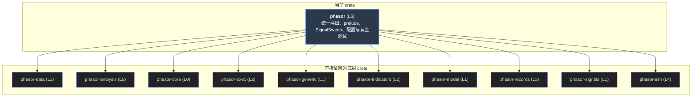

# phasor（门面 crate）

整个工作区对外的那一个名字。`lib.rs` 70 行：把十一个 crate 以短名重新导出（`phasor::sim`、`phasor::analysis`……），再给一个 `prelude`。唯一有逻辑的是 `sweep.rs` 里的 `SignalSweep`：把一张 `(时间 × 标的)` 的因子表，按一组参数“情形”展开成 `情形 × 标的` 列的进出场信号，并给每一列贴上能追溯回参数的标签。执行设置一个都不碰，全部留给 `FromSignals`。

> **核心特性与指标：**
> - **400 例逐位一致**：页面里 SignalSweep 的 JS 移植，对照一个只依赖 phasor 的临时 crate 生成的 400 个随机情形（含 NaN / ±inf、各种 delay）：信号、标签、展开后的收盘价全部相同，四条报错原文也相同
> - **prelude 78 个名字**：来自 10 个 crate（打开 polars feature 再加 PolarsBackend）；phasor-generic 和 phasor-data 一个都没有进 prelude
> - **没有 crate 依赖它**：工作区里它是叶子：phasor-py 直接依赖各个 crate。用到它的只有自己的 3 个测试文件、1 个例子——cargo test -p phasor 9 个测试全过

## 从第一性原理看：门面要回答什么

### 1. 一个依赖，而不是十一个

用户写 `phasor = "0.1"`，就拿到版本一致的整套引擎。各 crate 以短名挂在门面下面：`phasor::core::flex::FlexArray` 与 `phasor_core::flex::FlexArray` 是同一个类型。代价是：门面之外的东西（工作区内部的 `use phasor_model::…`）对下游不可见，下游必须走 `phasor::model::…`——这一点门面自己的例子没有照顾到，见[文档出入](#docs)。

### 2. 重的东西放在 feature 后面

`data` feature 才引入 phasor-data（Arrow、Parquet 一整套依赖）；`polars` feature 打开 phasor-expr 的 Polars 后端。默认什么都不加： 只想跑模拟和指标的人不该为一个 Parquet 读取器付编译时间。

### 3. prelude 是“一个端到端脚本要的名字”

因子（`FactorSet`、`alpha158`）→ 指标（`ma`）→ 信号（`clean_enex`）→ 模拟（`FromSignals`、 `simulate_from_signals_parallel`）→ 分析（`Portfolio`、`best_column`）。它不是“全部公开类型”，是一条路径上要的那些； 所以它也有缺口——`from_orders` 那条路径的名字一个都不在里面。

### 4. SignalSweep 只拥有信号和标签

手续费、仓位、止损、资金……这些设置在 `FromSignals` 里已经有唯一的来源。`SignalSweep::args` 只填 `n_rows`、`n_cols`、 `close`、`entries`、`exits` 五个字段，其余用 `..FromSignals::default()`；调用者再用结构体更新语法叠上自己的设置。 如果 SignalSweep 也收一个 `fees`，就会有两个地方能设手续费。

### 5. 不清洗信号，延迟放在策略里

规则对每根 K 线都可能说“进场”。SignalSweep 不做 `clean_enex`：持仓真实是什么，要等成交、拒单、止损之后才知道，只有模拟器能据此判断一个进场信号算不算数。 测试 `continuous_entry_condition_can_reenter_after_a_stop` 钉住了这一点：一个一直为真的进场条件，在止损之后的下一根重新进场。延迟同理： 收盘价算出来的因子要到下一根才能交易，这个时序决定属于策略，不属于表达式引擎（`tests/factor_path.rs` 的注释原话是 keeps that timing decision in the strategy）。

## 依赖图

左边是十一个依赖，中间是门面的两个文件，右边是用到它的地方。点任一节点看细节。

#### 示意 / 说明：线的颜色 = 门面里的哪个文件用到它。虚线框：可选依赖（feature）

*说明：*

来源：`crates/phasor/Cargo.toml`、`src/lib.rs` 的 `pub use`、`src/sweep.rs` 的 `use`。工作区里没有别的 crate 在 Cargo.toml 里写 `phasor`。

## prelude 里有什么

按来源 crate 分组。输入一个名字过滤；右边一栏是“这条路径上常用、但 prelude 里没有”的名字，要写全路径。

#### 示意 / 说明：`use phasor::prelude::*;`

过滤

| 来源 | 个数 | 名字 | 不在 prelude 里 |
|------|------|------|-----------------|

*说明：*

## SignalSweep 实验台

规则和例子 `factor_sweep.rs` 一样：`(score > entry, score < exit)`。第 `row` 根的信号读的是 `factor[row − delay, symbol]`； 前 `delay` 根、以及因子不是有限数的格子，不调用规则、不发信号。改因子、改情形、改 delay，看列怎么排、标签怎么贴。

#### 示意 / 说明：SignalSweep::from_factor + columns + expand，JS 移植（400 个 Rust 生成的用例逐位一致）

因子（每个标的一行，逗号分隔；可以写 nan、inf）

情形：标签 · entry 阈值 · exit 阈值

*说明：*

格子里的数是这一格**读到的**因子值（已经按 delay 错开）。绿 = 进场，红 = 出场，双色 = 同时为真（交给模拟器的冲突规则），虚线 = 非有限值或 delay 区，不调用规则。

### 列号 = case · S + symbol

与指标扫描、Python 的 `strategy.sweep` 同一个约定：一个情形的所有标的连续排在一起。标签用 `Level::repeat` 建参数层（\[a, b\] → a a b b），`Level::tile` 建标的层（\[x, y\] → x y x y）。

### 标签让结果能追溯

`columns().describe(col)` 给出 `factor=momentum, case=strict, symbol=ETH`。排名、`best_column`、`group_by` 都靠它把一个数字送回产生它的参数。情形标签重复会报错，因为那样两列就无法区分。

### 报错（实测原文）

## expand 的代价

`args(&close)` 要的是**已经展开**的收盘价 `(T, C · S)`，所以要先 `expand`：把每个标的的收盘价按情形数复制一遍。 这和“扫描不复制价格”的做法（`FlexArray::MappedColumns`，Python 的 `column_map`）走的是不同的路。`expand` 的文档说 “对很大的扫描，一个重复列视图……可以替换这个方法”——这个视图其实已经存在，phasor-py 就在用。

#### 示意 / 说明：保留的收盘价内存（f64，8 字节）

*说明：*

信号矩阵两边都是 `T × C × S` 个 bool（进、出各一份），本来就每列不同，不存在映射的问题；能省的只有价格。phasor-py 对同样 2,520 × 50 × 40 的扫描实测 `price_nbytes = 1,008,000`。

## 端到端：`examples/factor_sweep.rs`

    // 1. 因子只算一次（240 根 × 3 个标的）
    let factors = FactorSet::compile([("momentum",
        "Mean($close / Ref($close, 20) - 1, 5)")])?;
    let values = factors.evaluate(&FactorInputs::from_ohlcv(&panel)?)?;
    let momentum = values.get("momentum").expect("…");

    // 2. 展开成 2 个情形 × 3 个标的 = 6 列信号
    let cases = [(Label::from("loose"),  (0.02, 0.00)),
                 (Label::from("strict"), (0.05, 0.01))];
    let sweep = SignalSweep::from_factor(("momentum", momentum),
        &symbols, &cases, 1,
        |score, &(entry, exit)| (score > entry, score < exit))?;

    // 3. 价格复制成 6 列；执行设置用结构体更新语法叠上去
    let swept_close = sweep.expand(&close)?;
    let args = FromSignals {
        init_cash: FlexArray::scalar(10_000.0),
        fees: FlexArray::scalar(0.001),
        ..sweep.args(&swept_close)?
    };

    // 4. 一次并行运行，结果按标签读回
    let portfolio = Portfolio::from_signals(&args, threads)?;

实测输出（`cargo run -p phasor --example factor_sweep`）：

> [!NOTE]
> 每个标的里 loose 都比 strict 高。这只说明这条合成价格（正弦扰动加 0.1% 漂移）上门槛越低、在场越久越好，不说明任何关于真实市场的事——例子的价格是生成器造的。

结构体更新语法里写在 `..` 前面的字段覆盖 `args()` 的值。`args()` 已经设了 `n_rows`、`n_cols`、`close`、`entries`、`exits`，再覆盖它们就绕开了 `args()` 做的形状检查。

## 测试钉住了什么

| 测试 | 钉住的性质 |
|----|----|
| sweep::tests::expands_cases_symbols_and_delay_in_column_order | 列顺序 case · S + symbol；delay 1 时第 0 根无信号；NaN 不发信号；`label(2, "case") = high`、`label(3, "symbol") = ETH` |
| sweep::tests::rejects_invalid_setup_and_shapes | 空因子名、标签数不对、没有情形、重复情形标签、`expand` / `args` 形状不符都报错 |
| sweep::tests::non_finite_scores_do_not_call_the_rule | NaN、+inf、−inf 三格规则一次都没被调用（用 `Cell` 计数，4 格只调了 1 次） |
| factor_sweep::swept_columns_match_individual_runs_and_parallel_execution | 扫描里的每一列 = 单独跑那个 (情形, 标的) 的成交，逐项相同；4 线程与串行完全相同 |
| factor_sweep::continuous_entry_condition_can_reenter_after_a_stop | 只有收盘价也能止损（引擎重建 high / low）；止损后一直为真的进场条件在下一根重新进场：成交在 \[0, 1, 2\] |
| factor_path::a_factor_drives_the_existing_signal_simulator | 表达式 → 手工延迟一根 → `clean_enex` → `Portfolio::from_signals`，至少完成一笔交易 |
| sweep::a_sweep_is_one_run_of_every_combination | 3 组均线 × 4 个标的是一次 12 列的运行，标签能追溯到 `fast=5`、`slow=20` |
| sweep::threading_does_not_change_the_answer | 多线程逐位相同 |
| sweep::a_column_that_never_traded_tops_a_naive_ranking | 没交易过的列 Sharpe 为 +inf，朴素排名会把它排第一——陷阱本身被钉住 |

## 文档与代码的出入

| 文档说 | 代码 / 实测 | 影响 |
|----|----|----|
| `tests/sweep.rs` 文件头“`examples/sweep.rs` is the readable version” | 没有这个文件。crate 里只有 `examples/factor_sweep.rs`；`lib.rs` 指的 `examples/sweep.py` 在仓库根目录，由 phasor-py 的 `test_examples.py` 运行 | 两份文档各指一个“可读版本”，其中一个不存在 |
| `expand` 文档“a repeated-column view … can replace this method” | Rust 门面的路径是复制：`args()` 只收展开后的收盘价并用 `FlexArray::full`；`MappedColumns` 已经在 phasor-core 里，phasor-py 的 `column_map` 用的就是它 | 同一个扫描，走 Python 不复制价格，走 Rust 门面复制 C 倍 |
| `examples/factor_sweep.rs`、`tests/factor_path.rs` 写 `use phasor_model::OhlcvPanel;` | 只在工作区里能编译。一个只依赖 `phasor` 的 crate 写这一行得到 `E0432 unresolved import`（实测）；要写 `phasor::model::OhlcvPanel`，它也不在 prelude 里 | 照着例子写的第一个下游程序编译不过 |
| 重复情形标签的报错 | 原文是 `duplicate signal sweep case label Str("same")`——用的是 `Label` 的 Debug 形式 | 小事；其他报错都用人读的形式 |
| phasor-py：“sl_stop or tp_stop was given without high and low … no stop can ever fire” | 上面的 `continuous_entry…` 测试就是反例：只给收盘价，止损照样触发 | 见 [phasor-py · 护栏](phasor-py.md#guards) |

## 读码顺序

1.  **`src/lib.rs`**：模块文档的四条要点，然后十一行 `pub use` 和 `prelude`。
2.  **`src/sweep.rs`**：`from_factor`（校验 → 三重循环 → 三层标签）、`expand`、`args`；最后三个单元测试。
3.  **`examples/factor_sweep.rs`**：表达式 → SignalSweep → 结构体更新 → `Portfolio::from_signals`。
4.  **`tests/factor_sweep.rs`**：扫描 = 单独运行的拼接；止损后再进场。
5.  **`tests/sweep.rs`**：不走 SignalSweep、手工用 `ma` + `crossed_above_1d` 拼的扫描，以及“没交易的列排第一”的陷阱。
6.  回到 [phasor-sim](phasor-sim.md) 看 `FromSignals` 的其余字段，或者 [phasor-py](phasor-py.md#sweep) 看同一个扫描布局在 Python 里怎么不复制价格。

## 源文件

<table>
<thead>
<tr>
<th style="width: 30%">文件</th>
<th>内容</th>
</tr>
</thead>
<tbody>
<tr>
<td colspan="2" class="small">行号对应 <a href="https://github.com/nivalume/phasor/tree/1d573df0430fa5cd3a2416300603c7147f3c6a13">1d573df</a>。</td>
</tr>
<tr>
<td class="mono"><a href="https://github.com/nivalume/phasor/blob/1d573df0430fa5cd3a2416300603c7147f3c6a13/crates/phasor/src/lib.rs">crates/phasor/src/lib.rs</a></td>
<td>模块文档的四条要点（<a href="https://github.com/nivalume/phasor/blob/1d573df0430fa5cd3a2416300603c7147f3c6a13/crates/phasor/src/lib.rs#L6-L12">lib.rs:6–12</a>）、十一行再导出（<a href="https://github.com/nivalume/phasor/blob/1d573df0430fa5cd3a2416300603c7147f3c6a13/crates/phasor/src/lib.rs#L28-L39">:28–39</a>，phasor_data 在 <code>data</code> feature 之后，<a href="https://github.com/nivalume/phasor/blob/1d573df0430fa5cd3a2416300603c7147f3c6a13/crates/phasor/src/lib.rs#L30">:30</a>）、<code>pub mod sweep</code>（<a href="https://github.com/nivalume/phasor/blob/1d573df0430fa5cd3a2416300603c7147f3c6a13/crates/phasor/src/lib.rs#L41">:41</a>）、prelude（<a href="https://github.com/nivalume/phasor/blob/1d573df0430fa5cd3a2416300603c7147f3c6a13/crates/phasor/src/lib.rs#L44">:44</a>）。</td>
</tr>
<tr>
<td class="mono"><a href="https://github.com/nivalume/phasor/blob/1d573df0430fa5cd3a2416300603c7147f3c6a13/crates/phasor/src/sweep.rs">src/sweep.rs</a></td>
<td>SignalSweep（<a href="https://github.com/nivalume/phasor/blob/1d573df0430fa5cd3a2416300603c7147f3c6a13/crates/phasor/src/sweep.rs#L20">sweep.rs:20</a>）、from_factor（<a href="https://github.com/nivalume/phasor/blob/1d573df0430fa5cd3a2416300603c7147f3c6a13/crates/phasor/src/sweep.rs#L42">:42</a>，校验 → 三重循环 → 三层标签）、columns（<a href="https://github.com/nivalume/phasor/blob/1d573df0430fa5cd3a2416300603c7147f3c6a13/crates/phasor/src/sweep.rs#L127">:127</a>）、expand（<a href="https://github.com/nivalume/phasor/blob/1d573df0430fa5cd3a2416300603c7147f3c6a13/crates/phasor/src/sweep.rs#L141">:141</a>）、args（<a href="https://github.com/nivalume/phasor/blob/1d573df0430fa5cd3a2416300603c7147f3c6a13/crates/phasor/src/sweep.rs#L170">:170</a>）；三个单元测试（<a href="https://github.com/nivalume/phasor/blob/1d573df0430fa5cd3a2416300603c7147f3c6a13/crates/phasor/src/sweep.rs#L207">:207</a>、<a href="https://github.com/nivalume/phasor/blob/1d573df0430fa5cd3a2416300603c7147f3c6a13/crates/phasor/src/sweep.rs#L250">:250</a>、<a href="https://github.com/nivalume/phasor/blob/1d573df0430fa5cd3a2416300603c7147f3c6a13/crates/phasor/src/sweep.rs#L271">:271</a>）。</td>
</tr>
<tr>
<td class="mono"><a href="https://github.com/nivalume/phasor/blob/1d573df0430fa5cd3a2416300603c7147f3c6a13/crates/phasor/examples/factor_sweep.rs">examples/factor_sweep.rs</a></td>
<td>端到端例子，输出见<a href="#e2e">端到端</a>：main（<a href="https://github.com/nivalume/phasor/blob/1d573df0430fa5cd3a2416300603c7147f3c6a13/crates/phasor/examples/factor_sweep.rs#L19">examples/factor_sweep.rs:19</a>）。</td>
</tr>
<tr>
<td class="mono"><a href="https://github.com/nivalume/phasor/blob/1d573df0430fa5cd3a2416300603c7147f3c6a13/crates/phasor/tests/factor_sweep.rs">tests/factor_sweep.rs</a> · <a href="https://github.com/nivalume/phasor/blob/1d573df0430fa5cd3a2416300603c7147f3c6a13/crates/phasor/tests/factor_path.rs">tests/factor_path.rs</a> · <a href="https://github.com/nivalume/phasor/blob/1d573df0430fa5cd3a2416300603c7147f3c6a13/crates/phasor/tests/sweep.rs">tests/sweep.rs</a></td>
<td>扫描等于单独运行的拼接（<a href="https://github.com/nivalume/phasor/blob/1d573df0430fa5cd3a2416300603c7147f3c6a13/crates/phasor/tests/factor_sweep.rs#L17">tests/factor_sweep.rs:17</a>）、止损后再进场（<a href="https://github.com/nivalume/phasor/blob/1d573df0430fa5cd3a2416300603c7147f3c6a13/crates/phasor/tests/factor_sweep.rs#L92">:92</a>）；因子驱动现有的信号模拟（<a href="https://github.com/nivalume/phasor/blob/1d573df0430fa5cd3a2416300603c7147f3c6a13/crates/phasor/tests/factor_path.rs#L9">tests/factor_path.rs:9</a>）；一次运行覆盖每个组合（<a href="https://github.com/nivalume/phasor/blob/1d573df0430fa5cd3a2416300603c7147f3c6a13/crates/phasor/tests/sweep.rs#L137">tests/sweep.rs:137</a>）、线程数不改变结果（<a href="https://github.com/nivalume/phasor/blob/1d573df0430fa5cd3a2416300603c7147f3c6a13/crates/phasor/tests/sweep.rs#L156">:156</a>）、没交易的列排第一（<a href="https://github.com/nivalume/phasor/blob/1d573df0430fa5cd3a2416300603c7147f3c6a13/crates/phasor/tests/sweep.rs#L216">:216</a>）。</td>
</tr>
<tr>
<td class="mono"><a href="https://github.com/nivalume/phasor/blob/1d573df0430fa5cd3a2416300603c7147f3c6a13/crates/phasor/Cargo.toml">Cargo.toml</a></td>
<td>依赖除 phasor-py 以外的全部引擎 crate；<code>data</code> 和 <code>polars</code> 两个 feature。</td>
</tr>
</tbody>
</table>
