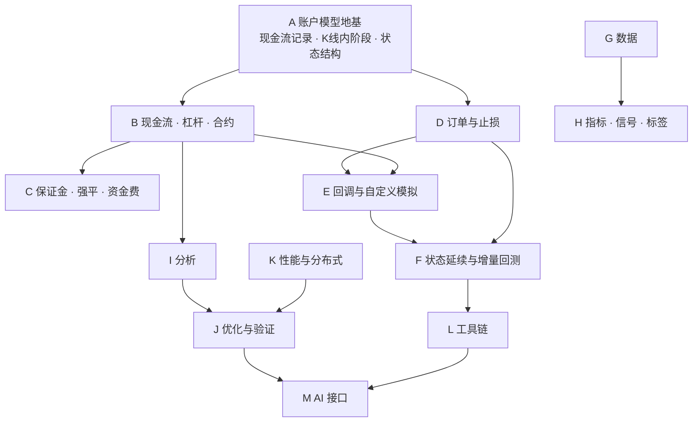

# barq 功能扩展计划：对齐 VectorBT PRO

目标：把 VectorBT PRO（下称 PRO）公开文档里列出的功能在 barq 里全部实现，并补上
PRO 没有、但加密货币回测需要的保证金、强平和资金费。

本文是计划，不是设计定稿。每个阶段开工前，相关小节要细化成
`docs/ARCHITECTURE.md` 里对应章节的改动，落地后再更新 §17。

功能清单来自 2026-10 对 [vectorbt.pro/features](https://vectorbt.pro/features/overview/)
各页面的整理。PRO 页面没有写明参数名的功能，下文只描述行为。

## 进度

| 项 | 状态 | 位置 |
|---|---|---|
| A1 现金流记录 | 已完成 | `barq-records/src/cash.rs` |
| A2 K 线内阶段 | 部分完成（开盘入金/分红、收盘收支） | `barq-sim/src/cash.rs` |
| A3 状态结构 | 推迟到阶段 D | — |
| A4 `locked_cash` | 并入 B4 | — |
| B1 / B2 / B3 入金、收支、分红 | 已完成 | `barq-sim/src/cash.rs` |
| B9 `cash_limit`、`reject_prob` | 已完成 | `barq-exec`、`barq-sim/src/random.rs` |
| B10 敞口指标 | 已完成 | `Portfolio::allocations` 等 |
| G5 合成数据 | 已完成 | `barq-generic/src/synthetic.rs` |
| H6 随机信号 | 已完成 | `barq-signals/src/random.rs` |
| H7 机器学习标签 | 已完成 | `barq-signals/src/labels.rs` |
| I1 MAE/MFE | 已完成（未接到 `Portfolio` 和 Python） | `barq-records/src/excursions.rs` |
| I6 事件研究 | 已完成（未接到 Python） | `barq-analysis/src/events.rs` |
| J2 交叉验证切分 | 已完成 | `barq/validation.py` |
| J3 稳健性检验 | 已完成（未接到 Python，打乱价格重跑未做） | `barq-analysis/src/robust.rs` |
| 其余各项 | 未开始 | — |

性能：功能关闭时比 main 慢约 2%（`from_orders` 1.6%，`from_signals` 3.8%，后者超出 §0 的 3% 上限，待处理）。

---

## 目录

0. [约束](#0-约束)
1. [现状与差距](#1-现状与差距)
2. [阶段划分与依赖](#2-阶段划分与依赖)
3. [阶段 A：账户模型地基](#3-阶段-a账户模型地基)
4. [阶段 B：现金流、杠杆、合约](#4-阶段-b现金流杠杆合约)
5. [阶段 C：保证金、强平、资金费（超出 PRO）](#5-阶段-c保证金强平资金费超出-pro)
6. [阶段 D：订单与止损](#6-阶段-d订单与止损)
7. [阶段 E：回调与自定义模拟](#7-阶段-e回调与自定义模拟)
8. [阶段 F：状态延续与增量回测](#8-阶段-f状态延续与增量回测)
9. [阶段 G：数据](#9-阶段-g数据)
10. [阶段 H：指标、信号、标签](#10-阶段-h指标信号标签)
11. [阶段 I：分析](#11-阶段-i分析)
12. [阶段 J：优化与验证](#12-阶段-j优化与验证)
13. [阶段 K：性能与分布式](#13-阶段-k性能与分布式)
14. [阶段 L：工具链](#14-阶段-l工具链)
15. [阶段 M：AI 接口](#15-阶段-mai-接口)
16. [验证策略](#16-验证策略)
17. [待决定事项](#17-待决定事项)
18. [里程碑](#18-里程碑)
- [附录：PRO 功能对照表](#附录pro-功能对照表)

---

## 0. 约束

下面几条是硬约束，所有阶段都要遵守。

| 约束 | 内容 |
|---|---|
| 默认行为不变 | 新参数的默认值必须让结果和现在逐位一致。`tests/fixtures/` 下现有的对照 fixture（vectorbt 1.1.0 和 Qlib）不允许因为新功能而重新生成 |
| 关闭时不变慢 | 新功能全部关闭时，`cargo run --release --example bench -p barq-sim` 的吞吐下降不超过 3%。做法和现在一致：用 `FlexArray::Scalar` 快速路径，按列判断一次是否启用，不在每根 K 线上分支 |
| 不抄代码 | PRO 是闭源付费软件。只根据公开文档描述的行为独立实现。参数名尽量沿用 PRO 的公开名字，方便迁移，和附录 A 对 NautilusTrader 的做法一致：方法名相同，代码独立 |
| 记录是唯一来源 | 分析层只从记录重建余额（§10.2）。凡是改变现金或持仓的东西，都必须落成记录，不能只在模拟循环里改状态 |
| 库不联网 | `crates/` 下的库既不下载也不写文件（§4）。联网的数据源放在单独的可选包里，见阶段 G |
| 可并行 | 不引入 `Rc`、`RefCell` 或进程级全局状态（§11.5）。新增的模拟状态都要按列或按账户组局部存放 |
| 线程数不影响结果 | 串行和多线程的输出逐位一致，新功能同样要测 |

---

## 1. 现状与差距

barq 目前的能力大致等于 vectorbt 开源版的子集，外加因子 DSL 和多线程。和 PRO 的主要差距：

| 领域 | barq 现在有 | 缺什么 |
|---|---|---|
| 模拟入口 | `from_orders`、`from_signals` | `from_order_func`、各类回调、自定义模拟循环 |
| 账户 | 现金账户，做空冻结 2 倍市值，共享现金 | 杠杆、合约乘数、入金出金、现金收支、分红、初始持仓、负价格 |
| 订单 | 市价单 | 限价单、突破单、有效期、挂单冲突处理、`nextopen` 等价格选项、买卖价分离 |
| 止损 | `sl_stop`、`sl_trail`、`tp_stop` | 独立的 `tsl_stop`、`tsl_th`、时间止损、分批止损、止损后反手或挂限价单 |
| 仓位 | `from_signals` 只支持 Amount/Value/Percent | 所有仓位类型、`valuepercent`、目标仓位驱动信号（`order_mode`）、`cash_limit` |
| 状态 | 一次性回测 | 增量更新、状态保存、分段拼接、逐根推进（stepper） |
| 数据 | CSV/Parquet 本地目录，按时点对齐 | 数据源连接器、数据库存储、增量更新、多周期重采样、合成数据 |
| 指标 | 8 个 Rust 指标（Python 不可调用），Alpha158/360 | 第三方指标库、自定义指标工厂、流式指标、WorldQuant 101、ML 标签 |
| 分析 | 指标、交易、回撤、按层级汇总 | MAE/MFE、形态搜索、事件研究、组合切片/拼接/重采样、敞口、图表 |
| 优化 | 参数扫描，研究模块里有 walk-forward | 通用参数化、交叉验证切分器、稳健性检验、组合优化 |
| 性能 | 账户组多线程 | 分块和内存上限、断点续跑、多进程、Ray |
| 工具 | 无 | 配置文件、持久化、CLI、定时任务、通知 |
| AI | `barq_lab` 研究协议 | 文档检索、MCP 服务 |

PRO 也没有的：保证金率、强平、内置资金费结算、订单簿撮合、实盘下单。前三项放进阶段 C；后两项不在本计划范围内，属于 §17.1 的 phase 2。

---

## 2. 阶段划分与依赖

阶段 A–F 改的是模拟内核，必须按顺序做。G、H、I、K 和内核基本无关，可以并行推进。

优先级按当前需求（资金费套利）排：**A → B → C** 是关键路径，完成后就能在 barq 里准确回测
现货多 + 永续空的组合。

工作量记号：S 约几天，M 约 1–2 周，L 约 3–5 周，XL 超过 5 周。这是粗估，用来排顺序，不是承诺。

---

## 3. 阶段 A：账户模型地基

后面的阶段都要在这几项改动之上实现。这一阶段本身不对外增加功能，但需要先定下来。

### A1. 现金流记录（M）— 已完成

实现与下面的原计划有三处不同：记录作为 `OrderRecords.cash` 字段存放，不另开一路输出；`kind` 目前只有 `Deposit` 和 `Earning`，其余类型在对应功能落地时追加；收益率公式改为把入金计入期初，见下文。细节见 `docs/ARCHITECTURE.md` §8.5、§9.1、§10.2。

**问题**：分析层只用 `OrderRecords` 重建现金（`series.rs:cash_flow`）。入金、利息、分红、资金费都不是成交，现在没有地方记录。

**做法**：在 `barq-records` 增加 `CashRecords`，struct-of-arrays：

| 字段 | 含义 |
|---|---|
| `col` | 产生这笔现金流的列（资金费、分红按品种列记；入金和账户级利息记在账户组的第一列） |
| `idx` | K 线行号 |
| `amount` | 带符号金额，正数为流入 |
| `kind` | `Deposit`、`Earning`、`Dividend`、`Funding`、`Interest`、`Liquidation`（`#[repr(i8)]`，和其他枚举一样由测试固定判别值） |

- `RecordSink` 增加 `push_cash`；`OrderRecords` 和 `Journal` 的实现在不启用时什么都不做，开销为零。
- `series.rs`：`cash_flow` = 成交现金流 + `CashRecords` 按 `(col, idx)` 汇总。
- **收益率要扣掉入金**：入金在开盘入账，所以算作当根 K 线的期初资金，`returns[t] = value[t] / (value[t−1] + deposit[t]) − 1`。入金不是收益，其余几类现金流都算收益。
- `Portfolio` 增加 `cash_records()`，Python 返回 dict of arrays。
- 多线程合并和 `OrderRecords::concat` 一样，按块的顺序拼接。

**验收**：没有现金流时，所有现有 fixture 逐位不变；有现金流时满足守恒式
`final_cash = init_cash + Σ成交现金流 + Σcash_records`。

### A2. K 线内的处理阶段（M）— 部分完成

入金在开盘、现金收支在收盘这两步已经按下面的顺序实现；限价单和止损相关的阶段等阶段 D 再做。

**问题**：现在每根 K 线只有"先看止损，再看信号"两步。限价单、时间止损、现金收支入账都需要明确的先后顺序。

**做法**：把一根 K 线拆成固定的阶段，写进 §8：

1. **开盘**：入金/出金入账；以开盘价成交的订单（`price="open"`/`"nextopen"`）；跳空触发的止损和限价单。
2. **盘中**：用 high/low 判断止损和限价单是否触发。同一根 K 线里多个价位都被触及时，和现在一样按保守规则处理，并写清楚规则。
3. **收盘**：信号订单（默认收盘价）；收盘入账的现金流（`cash_earnings`、利息、资金费）；强平检查（阶段 C）；估值。

每个阶段是 `simulate_group` 里的一个独立函数，开销只在启用对应功能时产生。

### A3. 显式的模拟状态结构（S）— 推迟到阶段 D

现在没有使用方，先定义结构是空转。阶段 D 加挂单时一起做，那时挂单状态是第一个使用方。

**问题**：每列的状态（现金、持仓、负债、止损、`val_price`）现在散落在循环的局部变量里。阶段 D 要加挂单，阶段 F 要能保存和恢复状态。

**做法**：定义 `ColumnState` 和 `GroupState`：纯数据，可以 `Clone`，并且可以序列化，阶段 F 会用到。模拟循环改成读写这两个结构。这一步只做重构，不改行为，用现有 fixture 验证。

### A4. 内核状态扩展预留（S）— 并入 B4

单独加一个永远为 0 的字段会改变日志格式却没有用处，和杠杆一起做。

`ExecuteOrderState { cash, position, debt, free_cash }` 需要为杠杆增加 `locked_cash`（被杠杆仓位占用的自有资金）。先把字段和 `LogRecords` 的列加上，默认值为 0。这一步不改任何计算。

---

## 4. 阶段 B：现金流、杠杆、合约

### B1. `cash_deposits`（S）— 已完成

- 每根 K 线的入金/出金数组，`FlexArray`，按账户组生效（共享现金时取组内第一列，规则和 `init_cash` 一样）。
- 开盘阶段入账。出金不超过 `free_cash`，超出部分截断；`CashRecords` 记录实际入账的金额，和输入对比就能看出截断。
- Python 侧共享账户传 `(T, n_groups)`，一维数组表示每根 K 线一个值。
- 写 `CashRecords(kind=Deposit)`。

### B2. `cash_earnings`（S）— 已完成

- 每根 K 线、每列的现金金额，收盘阶段入账，用于利息、管理费等。
- 负值同样不超过 `free_cash`（PRO 的规则是"负的 cash earnings 以可用现金为限"）。到了阶段 C，这个限制会改成计入保证金，账户可以扣成负权益并触发强平。
- 写 `CashRecords(kind=Earning)`。

### B3. `cash_dividends`（S）— 已完成

按开盘时（当根 K 线下单之前）的持仓派发，在开盘入账，当根的调仓可以再投资；空头支付分红。Python 里和价格同形状，经过 `column_map`。

- 每股金额 × 当时持仓（带符号：空头支付分红），收盘入账。
- 写 `CashRecords(kind=Dividend)`。

### B4. 杠杆 `leverage` / `leverage_mode`（L）

本阶段最大的一项，改的是 `barq-exec`。

- `leverage ≥ 1`，按列可变。`leverage_mode`：
  - `Lazy`（默认）：先用自有现金，用完后再借，借款上限为 `自有资金 × (leverage − 1)`。
  - `Eager`：每笔订单都按 `1/leverage` 的比例出自有资金，其余借入。
- 多头借款计入 `debt`；空头沿用现有的 `debt` 语义。`locked_cash` 记录被占用的自有资金，`free_cash` 相应减少。
- 手续费只从自有现金支付。
- 仓位类型怎么占用借款额度：`percent` 用满带杠杆的购买力，`valuepercent` 按权益的 100% 计算。
- 新增 `StatusInfo`：`NoCashLeverage`（借款额度不足）。追加在现有 14 个之后，不改原有判别值。
- **`leverage = 1` 时，`execute_order.tsv` 和 `order_sequence.tsv` 必须逐行一致。**

### B5. `valuepercent` 和 `*100` 仓位类型（S）

- `SizeType` 增加 `ValuePercent`、`Percent100`、`ValuePercent100`、`TargetPercent100`。
- 尺寸换算链（§7.3）各加一级。`from_signals` 的 `signals_to_size` 放开到全部仓位类型，这一项和 D7 一起做。

### B6. 合约乘数 `multiplier`（M）

- 按列设置。订单价值、现金流、盈亏、`asset_value` 都乘以它。
- 涉及内核（成本计算）、`series.rs`（`asset_value = assets × close × multiplier`）、`trades.rs`（pnl）。
- 和 PRO 一样，不处理合约换月，用户需要自己提供连续合约或用信号换月。

### B7. 负价格（M）

- `validate_bar` 现在要求 `price > 0`。增加 `allow_negative_price` 开关（默认关闭，保持现状）。
- 需要定义的语义：负价格下的 `percent`/`value` 仓位（价值为负时怎么换算数量）、收益率的分母为负时怎么处理。先写成文档，再实现。

### B8. 初始持仓 `init_position` / `init_price`，以及 `init_cash="auto"`（M）

- 初始持仓按 `init_price` 计入成本，生成 `idx = -1` 的虚拟成交，或者单独的初始状态记录。两种方案选一种，交易视图需要能正确配对。
- `init_cash="auto"`：先用无限现金模拟，再根据最低现金倒推需要多少初始资金，然后重算净值。和 vectorbt 开源版的 `init_cash='auto'` 语义一致，可以用 vectorbt 1.1.0 做对照。

### B9. `cash_limit` 和 `reject_prob`（S）— 已完成

`cash_limit` 只限制买单，在 `percent` 之前生效，不写进日志（日志格式和参考实现保持一致）。随机数用 SplitMix64 从 `(seed, row, col)` 计算，Python 参数 `seed`。

- `cash_limit`：单笔订单可用现金上限，内核里 `cash_limit` 已经是中间变量，只需要暴露出来。
- `reject_prob`：已知问题（§17.4），把调用方提供的随机数接进两个模拟循环。随机数按 `(seed, col, row)` 派生，保证多线程结果一致。

### B10. 敞口指标（S）

`allocations`、`gross_exposure`、`net_exposure`（可按方向分）、`position_coverage`，全部从 `assets` 和 `value` 推导，放在 `barq-analysis`。

---

## 5. 阶段 C：保证金、强平、资金费（超出 PRO）

PRO 没有这三项。它的做法是让用户在回调里写入 `cash_earnings`，并且不做强平。
barq 原生支持，原因是资金费套利、做市、CTA 这类策略的结果主要取决于它们。

### C1. 保证金账户模型（L）

- 新增账户类型参数 `account_type = "cash" | "margin"`，默认 `"cash"`，也就是现状。
- `margin` 账户：
  - 每列设置 `initial_margin`、`maintenance_margin`（比例），或者用 `leverage` 换算（`initial_margin = 1/leverage`）。
  - 开仓占用 `|position| × price × multiplier × initial_margin` 作为保证金，不再按现金账户的 2 倍市值冻结。
  - 持仓的未实现盈亏计入账户权益。
  - 保证金模式：`cross`（全仓，账户组内共享）和 `isolated`（逐仓，每列独立）。先做 `cross`。
- 和 B4 的区别：B4 是"借钱买现货"的现金账户杠杆，C1 是"合约保证金"。两者可以同时存在：同一个账户组里现货列用 `cash`，永续列用 `margin`。这需要一个"按列设置账户类型、按组共享现金"的模型，在 C1 细化时确定。

### C2. 强平（L）

- 盘中阶段用不利一侧的价格（多头看 low，空头看 high；或者用 C4 的标记价格）判断维持保证金率。
- 触发后按强平价成交，扣强平手续费（`liquidation_fee`），写 `OrderRecords`，并在日志里标明原因。
- 全仓模式下，按账户组判断，强平顺序要明确定义（例如亏损最大的列先平）。
- 新增 `StatusInfo` 或单独的成交标记，表示"这笔是强平"。交易视图里要能区分。
- 可选：穿仓损失进入 `CashRecords(kind=Liquidation)`。

### C3. 资金费（M）

- 输入：
  - `funding_rate`：`[T, C]` 或 `[T, S]` 加 `column_map`，非结算时点为 NaN。
  - 可选 `funding_price`：结算价格，默认用收盘价，有标记价格时用标记价格。
- 结算：收盘阶段，`payment = −position × funding_price × multiplier × rate`。费率为正时多头付、空头收。
- 写 `CashRecords(kind=Funding)`。保证金账户里会影响权益，可能触发强平。
- 数据侧配合：阶段 G 的 Binance 连接器提供资金费率历史；按时点对齐已经有了（`Dataset.asof`）。
- `research/barq_lab` 的 `funding_modeled` 改成真实开关，报告里的"未计入资金费"提示随之更新。

### C4. 标记价格和借贷利息（M）

- `mark_price`：可选输入，用于估值、资金费和强平判断。不传时用收盘价。
- `debt_rate`：借款按 K 线计息，写 `CashRecords(kind=Interest)`。现货杠杆（B4）和做空借券都适用。

### C5. 外部对照（M）

PRO 没有这三项，vectorbt 开源版也没有，没有现成的参照实现。验证方式：

- 手算 fixture：几十个小场景，逐笔写出预期的保证金、权益、强平价。
- 守恒式：`权益 = 现金 + Σ未实现盈亏`，资金费在多空之间对称。
- 和 NautilusTrader 的保证金账户在相同的成交序列上对照（放在外部环境里运行，和现在对 vectorbt 的做法一样）。具体对照哪些字段，取决于它当前版本的资金费支持情况，开工前确认。

---

## 6. 阶段 D：订单与止损

### D1. 挂单状态（M）

- `ColumnState` 增加挂单槽：类型、方向、价格、数量、创建行、到期行、`delay` 标志。
- 每列同时最多一张挂单（和 PRO 一致），简化状态管理。

### D2. 限价单与突破单（L）

| 参数 | 行为 |
|---|---|
| `order_type = "market" \| "limit"` | 默认 `market` |
| `limit_delta` | 相对 `price` 的偏移；正值时买单挂在下方、卖单挂在上方 |
| `limit_reverse` | 反转触发方向，即突破单（价格涨到某个价位才买） |
| `limit_order_price = "autolimit" \| "limit"` | 跳空时成交价规则 |
| `limit_delay` | 下一根 K 线才开始检查 |
| `limit_tif` | 按 K 线数或时长到期 |
| `limit_expiry` | 按日期或周期边界到期（当日有效、GTC、GTD） |
| `time_delta_format = "index" \| "rows"` | 时长按时间还是按行数计算 |
| `delta_format = "percent" \| "percent100" \| "absolute" \| "target"` | 偏移量的单位；止损同样适用 |

限价单不加滑点，这条和 PRO 一致。

### D3. 挂单冲突（M）

`upon_adj_limit_conflict`、`upon_opp_limit_conflict`、`upon_adj_stop_conflict`、`upon_opp_stop_conflict`。
每个参数的取值和决策表先写成纯函数，用穷举测试覆盖，做法和现在的 `signals.rs` 一样（§14.3 `signals.tsv`）。

### D4. 价格选项（M）

- `price` 支持 `"open"`、`"close"`、`"nextopen"`、`"nextclose"` 和数组。
- `from_ago`：从前 N 根 K 线读订单信息，用来防止用到未来数据。
- `price_area_vio_mode = "ignore" | "cap" | "error"`：成交价超出当根 K 线范围时怎么处理。
- 买卖价分离：允许分别传入买价（ask）和卖价（bid）数组。

### D5. 止损扩展（L）

| 参数 | 行为 |
|---|---|
| `tsl_stop` | 独立的移动止损，`sl_stop + sl_trail` 继续作为兼容写法 |
| `tsl_th` | 盈利达到阈值后才启动移动止损 |
| `td_stop` | 持仓时长止损 |
| `dt_stop` | 到某个日期、周期或时刻出场 |
| `stop_ladder` | 分批止损/止盈，模式 `uniform`、`weighted`、自适应 |
| `stop_exit_type = "close" \| "reverse"` | 止损后是否反手 |
| `stop_exit_price = "stop" \| "hardstop" \| "close"` | 在现有 `StopExitPrice` 上补齐选项 |
| `stop_order_type = "market" \| "limit"`、`stop_limit_delta` | 止损触发后挂限价单（依赖 D2） |
| `stop_entry_price` | 增加 `fillprice` 选项 |
| `upon_stop_update` | 已有，补齐选项 |

### D6. 不经模拟生成止损信号（S）

`generate_ohlc_stop_exits`：在 `barq-signals` 里根据 OHLC 和止损参数生成出场信号，用于研究阶段。复用 D5 的止损判定函数，保证和模拟循环的结果一致。

### D7. `from_signals` 的仓位扩展（M）

- `signals_to_size` 支持全部仓位类型。
- `order_mode=True`：用目标仓位数组代替进出场信号，同时可以继续使用止损和限价单。
- 累加模式（`accumulate`）已有，检查是否和 PRO 描述的"减仓而不是反手"一致。

### D8. 多分辨率模拟（M）

- 信号在粗周期上算，在细周期上模拟：提供把粗周期信号对齐到细周期的工具（按 `available_time`，复用 §4.4 的规则）。
- `Portfolio.resample(freq)`：把细周期的结果聚合回粗周期，包括净值、收益和记录的行号映射。和 I4 一起做。

### D9. 交易时段（S）

- 时段掩码工具：按时区和时刻生成布尔数组，和信号组合使用。
- 时段结束强制平仓（`session_end`）。
- `missing_index = "drop"`：`nextopen` 不在空行上成交。

---

## 7. 阶段 E：回调与自定义模拟

这一阶段和 §17.1（Nautilus 风格的 phase 2）高度重叠，要一起设计：
`order_func(OrderContext) -> Order` 和 `on_bar` 是同一种形状（§2.2）。

### E1. Rust 回调 trait（L）

- `trait OrderFunc`，以及在模拟各环节调用的钩子：`pre_sim`、`post_sim`、`pre_group`、`post_group`、`pre_segment`、`post_segment`（每根 K 线一次，包括没有订单的 K 线）、`order`、`post_order`。
- 上下文结构体：只读视图（价格、当前列和账户组的 `ColumnState`、最近成交）加一个可写的 `in_outputs` 区域。
- 泛型单态化，不用 `dyn`，保证没有回调时零开销。
- 回调状态按账户组局部存放，满足 `Send`，因此照常多线程。

### E2. `from_order_func`（L）

- 一根 K 线可以下多笔订单（flex 模式，用 `call_idx` 循环）。
- `stop_group_sim`：提前结束某个账户组的模拟。
- `row_wise=True`：按时间逐行推进所有账户组，用于跨组协调（这时组间不能并行，需要写进文档）。

### E3. `from_signals` 的回调（M）

`signal_func`（替代信号数组）、`adjust_func`（每根 K 线调整止损和仓位）、`post_order_func`、`post_segment_func`。

### E4. 自定义模拟循环（M）

公开 `execute_order`、`ColumnState`、挂单和止损的判定函数，以及记录写入接口，让用户可以在 Rust 里自己写循环，产出的 `Portfolio` 和内置循环的一样。

### E5. Python 回调（L，方案待定）

Python 回调每次调用都要拿 GIL，每列每根 K 线调用一次会把速度拖慢几个数量级。候选方案：

| 方案 | 优点 | 缺点 |
|---|---|---|
| a. 直接调用 Python 函数 | 最灵活 | 慢，无法多线程 |
| b. 用表达式 DSL 写常见回调（冷却期、持仓上限、风险仓位） | 快，可以并行，复用 barq-expr | 表达能力有限 |
| c. 用户写 Rust 回调，编译成插件，Python 加载 | 快 | 用户要会 Rust |
| d. 支持 Numba `cfunc` 指针 | 和 vectorbt 用户习惯一致 | 多一个依赖，ABI 要固定 |

建议先做 b 和 c，a 作为调试模式（单线程，结果和其他方式一致）。见 §17 待决定事项。

---

## 8. 阶段 F：状态延续与增量回测

依赖 A3（状态结构）、D1（挂单）和 E（回调状态）。

| 项 | 内容 | 量 |
|---|---|---|
| F1 状态快照 | `SimState`：全部 `ColumnState`/`GroupState` 加回调状态，可以序列化。`Portfolio.last_state` | M |
| F2 增量更新 | `pf.update(new_bars, entries=…, exits=…)`：从快照继续，只算新增的 K 线。`stack=False` 只返回新段 | M |
| F3 分段拼接 | `Portfolio.row_stack([...], chained=True)`，记录行号平移，现金连续 | M |
| F4 持久化 | `pf.save(path)` / `Portfolio.load(path)`：记录和输入存成 Arrow IPC 或 Parquet，状态存成带版本号的二进制格式 | M |
| F5 Stepper | 逐根推进的 API（Rust 和 Python），可以保存检查点。实盘时由外部执行层回报成交，barq 只负责模拟和对账 | L |
| F6 长历史分批 | 按时间分批模拟，批与批之间传递状态，控制内存。和 K1 一起做 | S |

**验收**：在任意位置切开、分两段跑再拼接，结果必须和一次性跑完逐位一致。用随机切点做穷举测试。

---

## 9. 阶段 G：数据

### G0. 包结构（待定）

"库不联网"是现有原则。建议：

- `crates/barq-data` 保持只读本地文件。
- 新增 Python 可选包 `barq-connectors`（或 `barq[connectors]` extra），负责下载和写入目录（catalog）。
- 数据库存储放进 `barq-store`（Rust crate，可选依赖 DuckDB 等），或者放在 Python 层。

### G1. 数据源连接器（XL，按优先级分批）

| 批次 | 数据源 | 说明 |
|---|---|---|
| 1 | Binance（现货、U 本位、币本位）：K 线、**资金费率历史**、**标记价格 K 线**、指数价格、溢价指数；Binance Vision 批量文件 | 资金费套利直接需要；`examples/download_binance_vision.py` 迁移进来 |
| 1 | CCXT | 覆盖 100 多个交易所 |
| 2 | Yahoo Finance、Alpaca、Polygon（Massive）、Databento | 股票、期货、期权 |
| 3 | Alpha Vantage、Nasdaq Data Link、TradingView、findatapy（含 Dukascopy tick） | |
| — | 自定义数据源基类 | 对应 PRO 的 `RemoteData` |

每个连接器的输出统一为目录（catalog）格式，加一个 `DataSchema`，下游不需要知道数据从哪里来。

### G2. 存储后端（M）

DuckDB、SQL（SQLAlchemy）、ArcticDB 的读写；读取时只加载需要的列和时间段。

### G3. 增量更新（S）

`update()`：只下载目录里缺失的时间段，追加写入。定时运行见 L3。

### G4. 多周期（M）

- 带 `available_time` 的 OHLCV 重采样（例如 1m → 1h），重采样后的可用时间是周期结束时刻。
- 粗周期指标对齐到细周期，复用 §4.4 的按时点对齐。

### G5. 合成数据（S）

随机游走、GBM、合成 OHLC、对已有序列打乱或扰动（`randomize`）。全部带种子，结果可复现。

---

## 10. 阶段 H：指标、信号、标签

| 项 | 内容 | 量 |
|---|---|---|
| H1 暴露现有能力 | 8 个指标和 `barq-signals` 绑定到 Python（§12.4 的"未暴露"列表） | S |
| H2 指标工厂 | Python 函数或 Rust trait 定义指标，自动支持参数网格和标签层级，输出列布局遵守 §3.1 | M |
| H3 第三方指标库 | TA-Lib、pandas-ta、ta、smartmoneyconcepts 的包装：按列、按参数批量调用，GIL 允许时多线程。常用的指标逐步用 Rust 重写 | M |
| H4 WorldQuant 101 | 依赖截面算子（`CSRank`、`Scale`、行业中性化），也就是 §17.2 的分阶段图计算。先做截面算子，再实现 101 个因子，对照公开公式手算 fixture | L |
| H5 流式指标 | 逐根更新的累加器，结果必须和批量计算逐位一致（对 `barq-generic` 的滚动/指数窗口逐个实现） | M |
| H6 信号生成 | 带种子的随机信号、按日历生成的信号、按阈值和交叉生成的信号；信号统计（间隔、长度） | S |
| H7 ML 标签 | 固定周期收益、均值、局部极值、趋势、三重障碍标签；用模型预测做回测并和简单基线对比 | M |

---

## 11. 阶段 I：分析

| 项 | 内容 | 量 |
|---|---|---|
| I1 MAE / MFE | 每笔交易持仓期间的最大不利和最大有利变动；edge ratio；按多空分开统计 | M |
| I2 暴露现有能力 | 回撤记录、滚动指标绑定到 Python | S |
| I3 外部收益序列分析 | 不经模拟，直接对一条收益或净值序列算全部指标 | S |
| I4 组合切片、拼接、重采样 | 按时间或列切 `Portfolio`；`column_stack` / `row_stack`；`resample` | L |
| I5 形态搜索 | 在价格历史里找和给定形态相似的窗口（多种距离度量、缩放方式），统计之后的走势 | L |
| I6 事件研究 | 给定事件日期，统计事件之后的价格路径分布 | M |
| I7 图表 | 可选 extra `barq[plot]`（Plotly）：净值、回撤、价格上标出交易、参数热力图、多图仪表盘 | M |
| I8 结果转 pandas | 带多级列标签的 DataFrame 输出，方便和现有 pandas 代码配合 | S |

---

## 12. 阶段 J：优化与验证

| 项 | 内容 | 量 |
|---|---|---|
| J1 通用参数化 | 装饰器包住任意 Python 函数：网格、带条件的网格、随机搜索；结果带参数标签；可选分块执行（K1） | M |
| J2 交叉验证切分器 | 滚动、扩展、按日历、purged k-fold、embargo、自定义切分；对每个切分运行函数；训练集选参、测试集评估。`barq_lab` 的 walk-forward 迁移到这里 | L |
| J3 稳健性检验 | 置换检验、deflated Sharpe、PBO（CSCV）、邻近参数比较、延迟信号、在打乱的价格上重跑 | M |
| J4 组合优化 | 自定义权重函数和调仓计划；PyPortfolioOpt、Riskfolio-Lib、Universal Portfolios 包装（可选 extra）；权重转 `from_orders(targetpercent)`；等权基线 | M |

J2 和 J3 会被 `barq_lab` 使用。它的规则（LLM 不接触结果、预先登记）不受影响：这些工具只是被 harness 调用。

---

## 13. 阶段 K：性能与分布式

| 项 | 内容 | 量 |
|---|---|---|
| K1 分块 | 大规模参数扫描按块执行，设置内存上限；块的结果写盘，支持断点续跑 | M |
| K2 多进程和 Ray | Python 层把块分发到多个进程或 Ray 集群，结果合并后和单进程逐位一致 | M |
| K3 跨运行缓存 | 因子结果按（表达式哈希，数据哈希）缓存（§17.3 已列为待评估，先做测量） | M |
| K4 基准 | 每个新功能加入 `benchmarks/workloads*.tsv`：开启和关闭各测一次。和 vectorbt 开源版对照有对应功能的部分 | 持续 |

PRO 的"按实测选择后端"不需要做：barq 只有一个 Rust 后端。

---

## 14. 阶段 L：工具链

| 项 | 内容 | 量 |
|---|---|---|
| L1 配置文件 | TOML 描述一次回测或扫描（数据、因子、参数网格、成本），可以复现 | S |
| L2 持久化 | 研究对象压缩保存和加载（复用 F4） | S |
| L3 定时任务与通知 | 定时更新数据、定时运行；Telegram、Slack webhook 通知（可选 extra） | S |
| L4 CLI | `barq run config.toml`、`barq data update`、`barq sweep` | M |
| L5 开发者工具 | `barq.help(obj)` 打印签名和文档；检查准备好的输入（广播后形状、`column_map`） | S |

---

## 15. 阶段 M：AI 接口

| 项 | 内容 | 量 |
|---|---|---|
| M1 文档检索 | 对 `docs/`、docstring、示例建索引，支持关键词检索，向量检索可选 | M |
| M2 MCP 服务 | 给编码助手用：查 API、查文档、读源码、运行一次小回测、读取记录 | M |
| M3 Agent skills | 仓库内的 `.claude/skills/`：如何写策略、如何加新功能、如何跑对照测试 | S |

**注意和 `barq_lab` 的冲突**：研究协议规定 LLM 不能看到结果。M2 的"运行回测"只用于开发调试，不能接到 `barq_lab` 的数据和账本上。这条要写进 M2 的文档和代码检查里。

---

## 16. 验证策略

PRO 闭源，无法像现在对 vectorbt 1.1.0 那样做差分测试。按功能来源分三类：

| 类别 | 例子 | 对照方式 |
|---|---|---|
| vectorbt 开源版也有 | `init_cash="auto"`、信号生成器、ML 标签、部分止损选项 | 照旧：外部环境运行 vectorbt 1.1.0，生成 TSV fixture |
| 只有 PRO 有 | 杠杆、限价单、时间止损、分批止损、`cash_*`、增量更新 | 手算 fixture，加下面的性质测试 |
| PRO 也没有 | 保证金、强平、资金费 | 手算 fixture、性质测试，加 NautilusTrader 对照（C5） |

性质测试（每个内核功能都要有）：

- **退化一致**：`leverage=1`、`multiplier=1`、现金流全为 0、没有挂单时，结果和现有实现逐位一致。
- **守恒**：`final_cash = init_cash + Σ成交现金流 + Σcash_records`；`value = cash + Σassets × price × multiplier − debt`（按账户类型写出对应公式）。
- **线性**：`multiplier=k` 等价于数量乘以 k（在不触发整数粒度的情况下）。
- **切分不变**：F 阶段的任意切点续跑和一次跑完结果相同。
- **线程不变**：1、3、N 线程逐位一致。
- **变异测试**：沿用 §14.4 的做法，记录存活的变异。

是否购买 PRO 授权并用它的输出做对照，见 §17。

---

## 17. 待决定事项

| # | 问题 | 选项 | 建议 |
|---|---|---|---|
| 1 | Python 回调方式（E5） | 直接调用 / 表达式 DSL / Rust 插件 / Numba cfunc | DSL 和 Rust 插件先做；直接调用作为调试模式 |
| 2 | 联网代码放哪里（G0） | 新的可选包 / 放进 `barq` 主包的 extra | 单独的包，保持"库不联网" |
| 3 | 保证金和强平的时机 | 和 B 一起做 / B 之后单独做 | B4 完成后马上做 C，资金费套利需要 |
| 4 | 现货和永续放在同一个账户组时的账户模型（C1） | 按列设置账户类型 / 按组设置 | 按列，现金按组共享；细节在 C1 设计时定 |
| 5 | 是否用 PRO 的输出做对照 | 不用 / 购买授权后在外部环境生成 fixture | 需要先确认 PRO 的许可条款是否允许 |
| 6 | 负价格下 `percent` 仓位的语义（B7） | 待定 | 先写文档，评审后再实现 |
| 7 | 图表依赖（I7） | Plotly / 其他 | Plotly，作为可选 extra |
| 8 | 文档语言 | 本计划用中文；落地后的架构文档改动按现有惯例中英两份 | — |

---

## 18. 里程碑

每个里程碑都要可以独立发布：测试通过，文档更新，基准没有退步。

| 里程碑 | 内容 | 达成后能做什么 |
|---|---|---|
| **M1 现金流** | A1–A4，B1–B3，B9（A1、B1、B2、B3、B9 已完成，A2 部分完成，A3 推迟到阶段 D，A4 并入 B4） | 入金出金、利息、分红；在回调之外手动传入资金费金额 |
| **M2 杠杆与合约** | B4–B8，B10 | 现货杠杆、期货乘数、初始持仓、敞口分析 |
| **M3 合约账户** | C1–C5 | 资金费套利、永续 CTA 的准确回测，包括强平 |
| **M4 订单与止损** | D1–D9 | 限价单、突破单、时间止损、分批止盈、多周期模拟 |
| **M5 数据** | G0–G5（Binance 和 CCXT 优先，可以提前到 M3 之前并行） | 不再依赖示例脚本下载数据 |
| **M6 回调** | E1–E5 | 和账户状态相关的策略逻辑；为 phase 2 打基础 |
| **M7 增量与持久化** | F1–F6，L2 | 回测接新数据，长历史分批 |
| **M8 指标与分析** | H1–H7，I1–I8 | 补齐研究工具 |
| **M9 优化与验证** | J1–J4，K1–K3 | 大规模参数搜索和稳健性检验 |
| **M10 工具与 AI** | L1–L5，M1–M3 | 配置化运行、CLI、MCP |

M5、M8 可以和 M1–M4 并行，因为它们不改模拟内核。

---

## 附录：PRO 功能对照表

"阶段"列指本计划中的编号。

| PRO 功能（公开文档） | barq 现状 | 阶段 |
|---|---|---|
| `from_orders` | 有 | — |
| `from_signals` | 有 | D7、E3 扩展 |
| `from_order_func` / `from_def_order_func` | 无 | E2 |
| 自定义模拟循环 | 无 | E4 |
| `signal_func_nb`、`adjust_func_nb`、`post_order_func_nb`、`post_segment_func_nb`、`pre_*` 钩子 | 无 | E1、E3 |
| `in_outputs` | 无 | E1 |
| 限价单、突破单（`order_type`、`limit_delta`、`limit_reverse`、`limit_order_price`、`limit_delay`） | 无 | D2 |
| 订单有效期（`limit_tif`、`limit_expiry`、`time_delta_format`） | 无 | D2 |
| 挂单冲突（`upon_*_conflict`） | 无 | D3 |
| `delta_format` | 无 | D2 |
| `price` 的 `nextopen`/`nextclose`，`from_ago`，`price_area_vio_mode`，买卖价分离 | 部分 | D4 |
| `call_seq="auto"` 和自定义顺序 | 有（`Explicit` 只在 Rust 里可用） | E 中暴露到 Python |
| `sl_stop`、`tp_stop` | 有 | — |
| `tsl_stop`、`tsl_th` | 无（有 `sl_trail`） | D5 |
| `td_stop`、`dt_stop` | 无 | D5 |
| `stop_ladder` | 无 | D5 |
| `stop_exit_type`、`stop_exit_price`、`stop_order_type`、`stop_limit_delta`、`stop_entry_price`、`upon_stop_update` | 部分 | D5 |
| `generate_ohlc_stop_exits` | 无 | D6 |
| 全部仓位类型、`*100` 变体、`valuepercent` | 部分 | B5、D7 |
| `order_mode=True` | 无 | D7 |
| 基于风险的仓位 | 无 | E3 |
| `min_size`、`max_size`、`size_granularity`、`allow_partial`、`raise_reject`、`log` | 有 | — |
| `cash_limit` | 无 | B9 |
| `reject_prob` | 参数存在但未接入 | B9 |
| `leverage`、`leverage_mode` | 无 | B4 |
| `multiplier` | 无 | B6 |
| 负价格 | 无 | B7 |
| `cash_sharing`、`group_by` | 有（`group_lens`） | — |
| `cash_deposits` | 无 | B1 |
| `cash_earnings` | 无 | B2 |
| `cash_dividends` | 无 | B3 |
| `init_position`、`init_price`、`init_cash="auto"` | 无 | B8 |
| 敞口（`allocations`、`gross_exposure`、`net_exposure`、`position_coverage`） | 无 | B10 |
| 订单、日志、交易、持仓记录 | 有 | — |
| 用细周期数据判断止损、tick、交易时段 | 部分（tick 可以直接跑） | D8、D9 |
| 增量回测（`pf.update`）、`last_state`、`save`/`load`、`row_stack(chained=True)`、stepper | 无 | F |
| 数据源：YF、Binance、CCXT、Alpaca、Polygon、Databento、Alpha Vantage、NDL、TradingView、findatapy | 无（只有示例脚本） | G1 |
| 存储：文件、DuckDB、SQL、ArcticDB | 部分（CSV、Parquet 读取） | G2 |
| 数据增量更新 | 无 | G3 |
| 多周期对齐 | 部分（`asof`、`window`） | G4 |
| 合成数据 | 无（仅示例） | G5 |
| 指标库：TA-Lib、pandas-ta、ta、SMC、WorldQuant 101 | 无 | H3、H4 |
| 自定义指标（指标工厂、表达式） | 部分（因子 DSL） | H2 |
| 流式指标 | 无 | H5 |
| 信号生成与清洗 | 部分（Rust 有，Python 未暴露） | H1、H6 |
| ML 标签 | 无 | H7 |
| 收益与风险指标、基准对比、滚动指标 | 有（滚动指标 Python 未暴露） | I2 |
| 回撤分析 | 有（Python 未暴露记录） | I2 |
| 交易分析、MAE/MFE、edge ratio | 部分（无 MAE/MFE） | I1 |
| 形态搜索、事件研究 | 无 | I5、I6 |
| 组合切片、拼接、重采样 | 无 | I4 |
| 记录与 mapped array | 有 | — |
| Plotly 图表 | 无 | I7 |
| 参数扫描（网格、条件、随机） | 部分 | J1 |
| 交叉验证（滚动、扩展、日历、purged、embargo） | 部分（研究模块） | J2 |
| 稳健性检验（置换、deflated Sharpe、打乱价格） | 无 | J3 |
| 组合优化（PyPortfolioOpt、Riskfolio-Lib、Universal Portfolios） | 无 | J4 |
| 分块、断点续跑、多线程、多进程、Ray、缓存 | 部分（账户组多线程） | K |
| Rust 回调、steppers | 无 | E1、F5 |
| 配置文件、持久化、CLI、定时任务、Telegram | 无 | L |
| 文档检索、ChatVBT、MCP 服务、agent skills | 无 | M |
| **保证金、强平、资金费、标记价格、借贷利息** | **无（PRO 也无）** | **C** |
