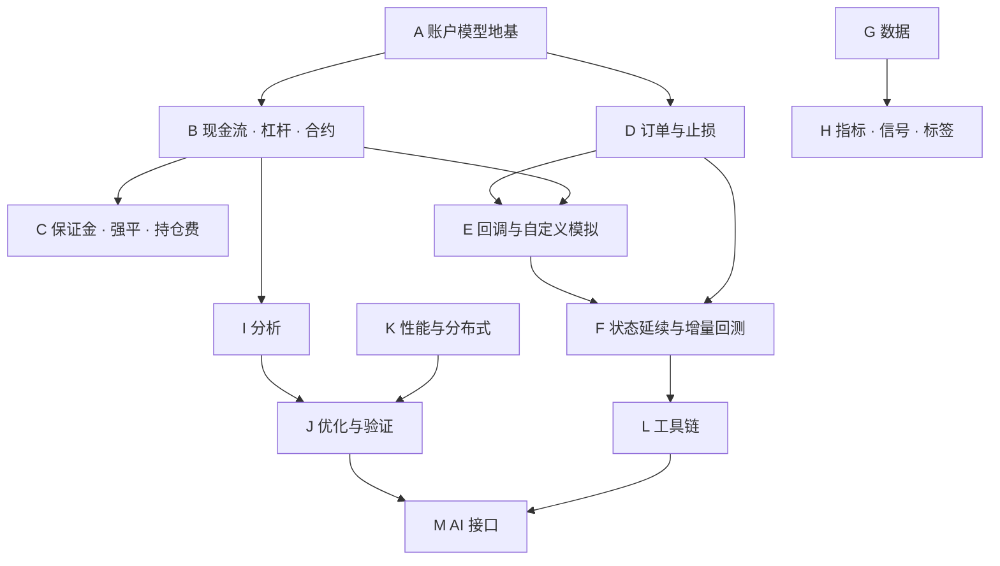

# phasor 功能扩展计划：对齐 VectorBT PRO

目标：把 VectorBT PRO（下称 PRO）公开文档里列出的功能在 phasor 里全部实现，并补上
PRO 没有的保证金账户、强平和持仓费（永续资金费、隔夜融资、借贷利息）。这几项不只用于加密货币，
期货、外汇、CFD 和股票融资融券也要用。

功能清单来自 2026-10 对 [vectorbt.pro/features](https://vectorbt.pro/features/overview/)
各页面的整理。PRO 页面没有写明参数名的功能，下文只描述行为。

## 怎么读

- 每项任务一个复选框：`[x]` 做完，`[ ]` 没做完。只做了一部分的任务，标题后写"部分完成"，
  下面的子任务分别勾选。
- 每项任务写清楚：
  - **为什么**：解决什么问题，谁需要它。
  - **做什么** / **做了什么**：具体内容。没做完的列出子任务。
  - **位置**：做完的部分在哪个文件。
  - **验收**：怎样才算做完（只在不显然时写）。
- 编号：A–M 是功能阶段，P 是维护和技术债。工作量 S 约几天，M 约 1–2 周，L 约 3–5 周，
  XL 超过 5 周，只用来排顺序。
- 状态以代码为准。最后核对：2026-10-16，分支 `claude/dreamy-dijkstra-39adnh`。
- 设计细节落地后写进 `docs/ARCHITECTURE.md`（中英两份），本文只记任务。

---

## 总览

| 阶段 | 内容 | 完成 | 部分完成 | 未开始 |
|---|---|---:|---:|---:|
| P | 维护与技术债 | 3 | 0 | 0 |
| A | 账户模型地基 | 2 | 1 | 1 |
| B | 现金流、杠杆、合约 | 6 | 0 | 4 |
| C | 保证金账户、强平、持仓费（PRO 没有） | 3 | 1 | 1 |
| D | 订单与止损 | 0 | 0 | 9 |
| E | 回调与自定义模拟 | 0 | 1 | 4 |
| F | 状态延续与增量回测 | 0 | 0 | 6 |
| G | 数据 | 0 | 1 | 5 |
| H | 指标、信号、标签 | 0 | 2 | 5 |
| I | 分析 | 1 | 1 | 6 |
| J | 优化与验证 | 0 | 2 | 2 |
| K | 性能与分布式 | 0 | 1 | 3 |
| L | 工具链 | 0 | 0 | 5 |
| M | AI 接口 | 0 | 0 | 3 |
| **合计** | | **15** | **10** | **54** |

### 下一步（按优先级）

1. **B6 合约乘数**：保证金账户（C1）、强平（C2）、持仓费和借贷利息（C3、C4）都已完成，期货回测还差每手的点值，现在一手期货的价值就是价格，保证金、持仓费和强平都按它算。
2. **C5 外部对照**：手算场景和守恒检查已经有一部分（各功能的性质测试），差 NautilusTrader 保证金账户的对照。
3. **D1–D2 挂单、限价单**：PRO 功能里最大的一块空缺。

---

## 约束

所有任务都要遵守，违反了要当作缺陷处理。

| 约束 | 内容 |
|---|---|
| 默认行为不变 | 新参数取默认值时，结果和之前逐位一致。`tests/fixtures/` 下的对照 fixture（vectorbt 1.1.0 和 Qlib）不允许因为新功能而重新生成 |
| 关闭时不变慢 | 新功能全部关闭时，`cargo run --release --example bench -p phasor-sim` 的吞吐下降不超过 3%（和 main 交替多轮测量，看中位数） |
| 不抄代码 | PRO 是闭源软件，只根据公开文档描述的行为独立实现。参数名尽量沿用 PRO 的公开名字，代码独立（同 `ARCHITECTURE.md` 附录 A 对 NautilusTrader 的做法） |
| 记录是唯一来源 | 分析层只从记录重建余额。凡是改变现金或持仓的东西，都要落成记录 |
| 库不联网 | `crates/` 下的库既不下载也不写文件。联网的数据源放在单独的可选包里（G0） |
| 可并行 | 不引入 `Rc`、`RefCell` 或进程级全局状态；新的模拟状态按列或按账户组局部存放 |
| 线程数不影响结果 | 串行和多线程输出逐位一致，每个新功能都要测 |

---

## 任务清单

### P. 维护与技术债

- [x] **P1 `from_signals` 性能回到约束以内**（S）
  - 为什么：大多数运行不用新参数，不该为它们付出代价。原先记录的是功能全关时 `from_orders` 慢 1.6%，`from_signals` 慢 3.8%；修之前在 Apple M4 Pro 上复测，三次各交替 8 轮，单线程中位数是 `from_orders` 慢 3.2%–4.0%，`from_signals` 慢 4.5%–4.6%。
  - 做了什么：
    - 两个循环各按"这次运行有没有现金流"实例化成两份（`const FLOWS: bool`），没有现金流的那份里根本没有这段代码。这是主要的一步：入金、分红、利息的分支从不触发，标志整次运行不变，却让两个循环分别慢约 5% 和 6%。`from_orders` 拆开前后指令数几乎不变，所以这部分代价不是执行了多少指令。
    - 撮合内核里少走的分支拆成不内联的冷函数：`lock_cash` 买入的现金上限（`locked_cash_limit`），`lock_cash` 卖出和无穷百分比卖出的上限（`sell_size_limit`）。费用反解在 `from_signals` 里是热路径，没有拆。`buy`/`sell` 强制内联；`is_addition_zero` 也强制内联，因为 `buy`/`sell` 内联后编译器不再内联它，两个循环的指令数各多 1.1%–1.3%。
    - `benchmarks/instructions.py`：和 base 版本比较每个 workload 的 callgrind 指令数，按循环取几何平均，超过 3% 就失败。macOS 上用 `benchmarks/callgrind.Dockerfile` 的容器跑。`bench` 例子加了 `--once NAME`，只跑一个 workload 一次。
  - 结果（和 main 比，单线程，交替 8 轮的中位数；区间是两次以上的测量）：

    | | `from_orders` 指令数 | `from_orders` 时间 | `from_signals` 指令数 | `from_signals` 时间 |
    |---|---:|---:|---:|---:|
    | 修之前 | +4.2% | +3.2% ~ +4.0% | +1.1% | +4.5% ~ +4.6% |
    | 只拆循环 | +4.5% | −1.9% | −3.5% | −1.8% |
    | 拆循环 + 内核改动（最终） | +0.5% | −3.7% ~ −4.1% | −4.5% | −2.0% ~ −2.4% |

  - 教训：指令数和时间可以不一致，两个方向都出现了。只改内核时 `from_orders` 指令数回到 +0.2%，时间只少了 0.4–2.7 个百分点，`from_signals` 在四次测量里有两次反而更慢；拆循环则相反。验收看时间，指令数用来发现变化。详见 `benchmarks/README.md` 的 "Instruction counts"。
  - 位置：`crates/phasor-sim/src/{from_orders,from_signals,cash}.rs`，`crates/phasor-exec/src/kernel.rs`，`crates/phasor-core/src/math.rs`，`benchmarks/instructions.py`，`benchmarks/callgrind.Dockerfile`。

- [x] **P2 新功能接到 Python**（M）
  - 为什么：这些功能原来只能从 Rust 调用，Python 是主要使用入口。
  - 做了什么：
    - [x] `Portfolio` 的敞口方法：`allocations`、`long_exposure`、`short_exposure`、`net_exposure`、`gross_long_short` 一次返回整张 `(n_rows, …)` 矩阵（F 序，不复制），`allocations` 按列、其余按账户；`position_coverage` 每列一个值（B10）。整张返回是因为这些不缓存，按列取会对每列重算一遍全矩阵。
    - [x] MAE/MFE 和 edge ratio（I1），作为 `Portfolio` 方法：`pf.excursions(high, low)` 返回 `mae`、`mfe`、`mae_ret`、`mfe_ret`，和 `pf.trades()` 逐行对齐；`pf.edge_ratio(high, low)` 每个账户一个值，口径和 `trade_stats` 一样。组合只存收盘价，所以 high/low 由调用方传入（形状同 `close`，C 序 F 序都行，经 `column_map` 映射）；不传就只用收盘价，结果只会偏小。
    - [x] 事件研究：`phasor.events.forward_paths` 返回 `EventPaths`，`paths` 是 `(事件数, before + after + 1)`，`mean_path()`、`median_path()`、`hit_rate(offset)` 是它的方法（I6）。
    - [x] 稳健性：`phasor.robust` 的 `probabilistic_sharpe`、`expected_max_sharpe`、`deflated_sharpe`、`pbo_cscv`。一维收益返回一个数，二维每列一个（J3）。
    - [x] 标签 `phasor.labels`、随机信号 `phasor.signals`（H6、H7），合成价格 `phasor.synthetic`（G5）。一维进一维出，二维进二维出；`shape` 传整数得到一维。
    - [x] `from_signals` 的止损参数：`upon_stop_exit`（含 `reverse`）、`stop_entry_price`（含 `fillprice`）、`stop_exit_price`、`upon_stop_update`。取值是枚举名的小写连写，`None` 用引擎默认值。
  - 位置：`crates/phasor-py/src/{lib,research,parse,array}.rs`，`crates/phasor-py/python/phasor/{events,robust,labels,signals,synthetic,_columns}.py`；Rust 侧新增 `Portfolio::excursions`、`Portfolio::edge_ratio`（`crates/phasor-analysis/src/portfolio.rs`）和 `edge_ratio_by_column`（`crates/phasor-records/src/excursions.rs`）。测试 `crates/phasor-py/tests/{test_portfolio_analysis,test_research,test_stop_modes}.py`；`test_bindings.py` 的止损对照用例加了这四个参数（需要 vectorbt）。

- [x] **P3 合并三份 SplitMix64 随机数实现**（S）
  - 为什么：`phasor-sim/src/random.rs`、`phasor-signals/src/random.rs`、`phasor-generic/src/synthetic.rs` 各有一份。并行开发时各自写的，以后改一处容易漏另外两处。
  - 做了什么：
    - [x] 先加测试，按位固定三处原来的输出：sim 和 signals 的 `[0, 1)` 随机数；synthetic 的 64 位哈希、加 0.5 的随机数和正态随机数（salt 取 0 和代码里的四个）。键取 5 组 `(seed, row, col)`，含 `u64::MAX`、`usize::MAX`。另外固定 `random_by_prob`、`random_n`、`random_entries_exits`、`random_walk`、`gbm`、`ohlc_from_close` 各一小段完整输出。合并后这些测试原样通过。
    - [x] `phasor_core::random` 提供混合步骤 `mix`、带 salt 的链式哈希 `bits(seed, row, col, salt)`、两种映射 `to_unit`（`[0, 1)`）和 `to_unit_nonzero`（加 0.5），以及不带 salt 的 `uniform(seed, row, col)`。三处改为调用它；sim 保留一个不内联的薄包装，两个循环的代码不变。`mix` 用 SplitMix64 参考实现种子 0 的前四个输出测试。
  - 顺带发现：synthetic 的映射原来注释写的是开区间 `(0, 1)`，其实是 `(0, 1]`。2⁵² 以上加的 0.5 放不进 `f64`，按偶数舍入，最高一档成了恰好 1.0（2⁵³ 次里一次）。对 Box–Muller 和 OHLC 都无害，为了不改已有结果保持不变，只改了注释。
  - 位置：`crates/phasor-core/src/random.rs`；调用处 `crates/phasor-sim/src/random.rs`、`crates/phasor-signals/src/random.rs`、`crates/phasor-generic/src/synthetic.rs`。

### A. 账户模型地基

后面的阶段都建立在这几项之上。

- [x] **A1 现金流记录**（M）
  - 为什么：分析层只从记录重建余额。入金、利息、分红、资金费都不是成交，没有记录就进不了现金和净值。
  - 做了什么：
    - `CashRecords { col, idx, amount, kind }`，作为 `OrderRecords.cash` 字段存放。这样 sink、多线程合并、排序、`Portfolio` 构造函数不用改接口就会带上它。
    - `kind`：`Deposit`、`Earning`、`Dividend`。持仓费、利息、强平在对应功能落地时追加。
    - 分析层的现金和可用现金都计入这些记录。入金不算收益：`returns[t] = value[t] / (value[t−1] + deposit[t]) − 1`。有入金时，总收益改为逐根连乘，回撤在扣掉入金后的曲线上计算。
  - 位置：`crates/phasor-records/src/cash.rs`，`crates/phasor-analysis/src/series.rs`，`ARCHITECTURE.md` §8.5、§9.1、§10.2。

- [ ] **A2 K 线内的处理阶段**（M，部分完成）
  - 为什么：限价单、时间止损、现金收支、强平都需要在一根 K 线里有明确的先后顺序，否则同一组输入在不同实现里结果不同。
  - 做什么：
    - [x] 开盘：入金/出金、分红入账，早于下单量的计算。
    - [x] 收盘：`cash_earnings` 入账，在所有订单之后，没有信号的 K 线也入账。
    - [x] 现有止损 `sl_stop`/`tp_stop`：跳空时按开盘价成交，盘中按 high/low 触发，同一根 K 线上止损先于止盈；`price=-inf` 按开盘价成交。这部分原本就有，和 vectorbt 1.1.0 对照过（`from_signals.rs` 的 `stop_price` 和止损检查）。
    - [ ] 限价单和新止损类型（`td_stop`、`stop_ladder` 等）在开盘、盘中阶段的处理（随 D2、D5 做）。
    - [ ] 止损成交和开盘现金流之间的先后顺序写进文档。
    - [x] 估值价确定后、计算组净值前：保证金持仓结算当根盈亏（C1），没有信号的 K 线也结算。
    - [x] 收盘：持仓费、借贷利息入账，在 `cash_earnings` 之后，没有信号的 K 线也入账（C3、C4）。
    - [x] 强平检查：在价格确定、全仓列结算之后，估值和下单之前，按这根 K 线的路径检查带进来的持仓（C2）。
  - 位置：入账函数在 `crates/phasor-sim/src/cash.rs`；先后顺序由 `crates/phasor-sim/src/from_orders.rs`、`from_signals.rs` 的 K 线循环决定。

- [ ] **A3 显式的模拟状态结构**（S，推迟到 D1）
  - 为什么：D 要加挂单，F 要保存和恢复状态，都需要一个公开的、可以序列化的状态结构。
  - 现状：两个循环各有一个私有的 `ColumnState`（`from_orders.rs` 里是持仓、负债、估值价；`from_signals.rs` 里另加止损），字段不同，都不能序列化；账户组的现金和可用现金仍是局部变量。
  - 为什么推迟：现在没有使用方，先定义结构是空转。D1 加挂单时一起做，那时挂单是第一个使用方。
  - 做什么：把两份 `ColumnState` 合并成一个公开、可序列化的结构，新增 `GroupState` 存放现金和可用现金。只重构，不改行为，用现有 fixture 验证。

- [x] **A4 内核状态加 `locked_cash`**（S，随 B4 完成）
  - 为什么：杠杆需要记录被占用的自有资金。
  - 为什么并入 B4：单独加一个永远为 0 的字段，会改变日志格式却没有用处。
  - 做了什么：见 B4。多头存被占用的自有资金，空头存保证金；`leverage = 1` 时多头为 0，空头等于 `debt`。

### B. 现金流、杠杆、合约

- [x] **B1 入金/出金 `cash_deposits`**（S）
  - 为什么：定投、出金、多策略之间调拨资金都需要。PRO 有这个参数。
  - 做了什么：开盘入账，按账户组读取（同 `init_cash` 的规则）；出金最多扣到可用现金，记录里存实际金额。Python 里共享账户传 `(T, n_groups)`，一维数组表示每根 K 线一个值。
  - 位置：`crates/phasor-sim/src/cash.rs`。

- [x] **B2 现金收支 `cash_earnings`**（S）
  - 为什么：利息、管理费，以及在 C3 做完之前事先算好的资金费，都要能计入现金和收益。
  - 做了什么：收盘按列入账；扣款最多扣到可用现金。
  - 位置：`crates/phasor-sim/src/cash.rs`。

- [x] **B3 分红 `cash_dividends`**（S）
  - 为什么：股票回测不算分红会低估收益。
  - 做了什么：每股金额 × 当根 K 线下单之前的持仓，开盘入账（所以除息日买入拿不到，卖出不丢）；空头支付分红。Python 里和价格同形状，经过 `column_map`。
  - 位置：`crates/phasor-sim/src/cash.rs`。

- [x] **B4 杠杆 `leverage` / `leverage_mode`**（L）
  - 为什么：股票融资融券、外汇和加密货币的现货杠杆都需要；原来做空要冻结 2 倍市值，资金占用和真实账户差很多。也是 C1 的前提。
  - 做了什么：
    - [x] `leverage ≥ 1`，按列设置（标量、每列、`(T, C)`）。`lazy`（默认）：自有现金用完再借；`eager`：每笔都按 `1/leverage` 出自有资金。
    - [x] 多头借款计入 `debt`；`locked_cash` 记录被占用的自有资金（A4）；手续费只从自有现金付。买回空头的部分不加杠杆，按全价付。卖出多头按比例还借款、释放 `locked_cash`。
    - [x] 做空占用按 `leverage` 换算：占用 = 卖出所得 + 市值 / `leverage`。`debt` 仍是按均价计的卖出所得，`locked_cash` 是市值 / `leverage`。`leverage = 1` 就是原来的 2 倍市值，`leverage = 2` 是美股 Reg T 做空要求的 150%。
    - [x] `percent` 用满带杠杆的购买力。`valuepercent` 按权益的 100%，随 B5 做。
    - [x] 新增 `StatusInfo::NoCashLeverage`（14），追加在原有 14 个之后：带杠杆的买入没有自有现金可出时拒单。
    - [x] 日志加 4 列：`locked_cash`、`new_locked_cash` 和请求的 `leverage`、`leverage_mode`，共 41 列。带杠杆的运行里，成交记录另存每笔成交后的 `debt` 和 `locked_cash`，分析层据此重建可用现金。
    - 分析层：`value()` 是权益，扣掉多头借款；`cash()` 是自有现金减多头借款，借钱买入时为负。所以 2 倍多头的 `gross_exposure` 是 2。
    - 模拟循环按"这次运行有没有杠杆"再实例化一份（`const LEV: bool`，和 `FLOWS` 并列），不用杠杆的运行不经过这些代码；只要有一列带杠杆，整次运行的订单都按带杠杆的账户处理，`leverage = 1` 的列结果不变。
    - Python：`from_orders`、`from_signals` 加 `leverage=None, leverage_mode="lazy"`；带杠杆时 `orders()` 多出 `debt`、`locked_cash` 两列。
  - 验收：`leverage = 1` 时 `execute_order.tsv`、`order_sequence.tsv` 逐行一致。另外和改动前（d0c23d1）比，10 组模拟（含共享账户、`call_seq="auto"`、`lock_cash`、随机拒单、止损、入金分红）的成交记录、现金记录、日志按位一致，串行和多线程一致。
  - 性能（功能全关，和 d0c23d1 比，单线程）：

    | | `from_orders` | `from_signals` |
    |---|---:|---:|
    | 指令数（几何平均，各 workload 区间） | +1.43%（+0.90% ~ +2.38%） | +1.06%（+0.62% ~ +1.97%） |
    | 时间（两次交替 8 轮的中位数） | −0.94%、−1.44% | −2.82%、−2.97% |

  - 教训：第一版指令数多了 9.95% 和 3.13%，几乎都在功能全关时也要走的路径上：
    - aarch64 上 `!x.is_finite() || x < 0.0` 编译成对浮点数的整数分类，约 17 条指令。每根 K 线都校验 `debt` 和 `locked_cash`，改成一次判断两个（`!(a + b).is_finite() || a.min(b) < 0.0`），放过的情况两个精确检查也会放过；报错的精确检查放进冷函数。
    - 卖出多头时调用不内联的 `add()`，每次约 70 条指令。改成普通算术；有借款时的还款放进冷函数。
    - 去掉成交后对 `locked_cash` 的归零修正：它只按持仓比例读取，内核不会在里面留残差。
  - 没做：借款利息、维持保证金、强平、持仓费（C1–C4）；`call_seq="auto"` 估算订单价值时不考虑杠杆。
  - 位置：`crates/phasor-exec/src/{kernel,types}.rs`，`crates/phasor-model/src/enums.rs`，`crates/phasor-records/src/{lib,logs}.rs`，`crates/phasor-sim/src/{from_orders,from_signals,lib}.rs`，`crates/phasor-analysis/src/{series,portfolio}.rs`，`crates/phasor-py/src/{lib,params,parse}.rs`，`crates/phasor-py/python/phasor/__init__.py`；`ARCHITECTURE.md` §7.7。测试 `crates/phasor-sim/tests/leverage.rs`、`crates/phasor-analysis/tests/leverage.rs`、`crates/phasor-py/tests/test_order_controls.py`，内核单元测试在 `kernel.rs`。

- [ ] **B5 `valuepercent` 和 `*100` 仓位类型**（S）
  - 为什么：按权益比例下单、用百分数写参数，都是常见用法。
  - 做什么：`SizeType` 加 `ValuePercent`、`Percent100`、`ValuePercent100`、`TargetPercent100`；换算链各加一级。`from_signals` 放开全部仓位类型随 D7 做。

- [ ] **B6 合约乘数 `multiplier`**（M）
  - 为什么：期货一点的价值不是 1（例如 ES 每点 50 美元），不乘就算错盈亏和保证金。
  - 做什么：按列设置；订单价值、现金流、盈亏、持仓市值都乘以它。涉及内核、`series.rs`、`trades.rs`。不处理换月。
  - 验收：`multiplier = k` 和数量乘以 k 的结果相同（不触发整数粒度时）。

- [ ] **B7 负价格**（M）
  - 为什么：2020 年 4 月 WTI 原油期货跌到负价。现在有两处会拒绝非正价格：撮合内核（`kernel.rs` 的价格校验），以及生成交易记录时（`trades.rs`，`pf.trades()` 和 `stats()` 会因此报错）。
  - 做什么：
    - [ ] 先写文档：负价格下 `percent`/`value` 仓位怎么换算数量，收益率分母为负怎么处理（待决定事项 6）。
    - [ ] `allow_negative_price` 开关，默认关闭；打开时内核、交易记录、收益率和统计一起放开，并加测试。

- [ ] **B8 初始持仓 `init_position` / `init_price`，`init_cash="auto"`**（M）
  - 为什么：接着已有持仓继续回测；`auto` 用来回答"这个策略至少要多少本金"。
  - 做什么：
    - [ ] 初始持仓的记账方式：`idx = -1` 的虚拟成交，或单独的初始状态记录，二选一，交易视图要能正确配对。
    - [ ] `init_cash="auto"`：先用无限现金模拟，再按最低现金倒推。vectorbt 1.1.0 有这个功能，可以生成对照 fixture。

- [x] **B9 单笔现金上限 `cash_limit`，随机拒单 `reject_prob`**（S）
  - 为什么：`cash_limit` 限制单笔买单的资金；`reject_prob` 测试成交失败时策略的表现，它原来是已知问题（参数存在但没接进循环）。
  - 做了什么：`cash_limit` 只限制买单，在 `percent` 之前生效，不写进日志（日志格式和参考实现一致）。随机数由 `(seed, row, col)` 经 SplitMix64 算出，和线程数、分组无关。内核改为在买卖之前判断随机拒单。
  - 位置：`crates/phasor-exec/src/kernel.rs`、`crates/phasor-sim/src/random.rs`（随机数本身在 `crates/phasor-core/src/random.rs`，见 P3）。

- [x] **B10 敞口指标**（S）
  - 为什么：看仓位占比、多空敞口、净敞口，是检查组合风险的基本工具。
  - 做了什么：`Portfolio` 上的方法。`allocations`（按列）和 `long_exposure`、`short_exposure`、`net_exposure`、`gross_long_short`（按账户）的分母是账户总净值，已有的 `gross_exposure` 分母是可用现金加持仓市值，保持不变；`position_coverage` 是每列持有非零仓位的 K 线占比。Python 见 P2。
  - 位置：`crates/phasor-analysis/src/portfolio.rs`，测试 `crates/phasor-analysis/tests/exposure.rs`。

### C. 保证金账户、强平、持仓费（PRO 没有）

PRO 让用户在回调里自己写资金费，也不做强平。phasor 原生支持，因为这几类策略的结果主要取决于这几项：永续的资金费套利和 CTA，期货，外汇和 CFD 的隔夜持仓，股票融资融券。名字沿用各市场的叫法，内核里是几种通用的记账动作：押保证金，维持保证金不够时强平，按持仓的名义价值收付持仓费，借钱借券按时间付利息。各市场不同的只是参数。

- [x] **C1 保证金账户模型**（L）
  - 为什么：期货、永续、CFD 只押保证金，不像现金账户那样付全款或冻结 2 倍市值；资金占用错了，收益率和可用资金都错。
  - 做了什么：
    - [x] `account_type = "cash" | "margin"`，默认 `cash`（现状）。按列设置，整次运行不变，在一列中途变化报错。
    - [x] `initial_margin`，`NaN`（默认）按 `1 / leverage` 换算，所以只设 `leverage` 就是对应倍数的永续。未实现盈亏每根 K 线结算进现金：估值价确定后、计算组净值前，把上一根以来的盈亏挪进组的现金和可用现金，持仓成本移到估值价（`margin.rs` 的 `settle`），`from_signals` 没有信号的 K 线也结算。结算不改变权益，不是现金流，不留记录。`maintenance_margin` 移到 C2，和强平一起做。
    - [x] 保证金两种给法，`margin_basis = "notional" | "unit"`：名义价值的比例，或每单位数量的固定金额（必须给出）。都可以逐根 K 线变化，成交时确定，之后改参数只影响之后的成交（待决定事项 11）。
    - [x] 全仓 `cross`：一个组里所有保证金列共用可用现金。逐仓 `isolated` 没做，移到 C2。
    - [x] 现货列和永续列放在同一个账户组：按列设置账户类型、按组共享现金（待决定事项 4）。
    - 内核：保证金列走单独的 `margin_trade`（冷函数，不内联）。`debt` 是持仓成本（`|position|` × 开仓均价），`locked_cash` 是已押的初始保证金，`free_cash` 是权益减保证金。平仓总是允许，按均价实现盈亏、释放保证金；开仓从可用现金押保证金并付手续费，上限把平掉反向持仓释放的钱算进去，所以反手一笔就能完成；`cash_limit`、`percent`、`max_size`、粒度、`min_size`、`allow_partial` 照常生效，`leverage_mode`、`lock_cash` 不起作用。亏损可以让现金小于 0，这时只能平仓，开仓被拒（`NoCashLong` / `NoCashShort`），没有新增拒单原因。
    - 模拟循环：沿用 B4 的 `const LEV: bool` 实例，`any_levered` 也把保证金列算进去；组净值里保证金持仓按未结算盈亏计，`update_value` 减去成交新增的持仓成本。同一次运行里的现金列仍按 B4 记账。
    - 记录：成交记录加 `margin` 一列（这列是不是保证金列），和 `debt`、`locked_cash` 一起，只在带杠杆或有保证金列的运行里有。日志加 3 列：`req_account_type`、`req_initial_margin`、`req_margin_basis`，共 44 列（Python 里 45 个键）。
    - 分析层：成交按全价计现金流，所以 `value = cash + position × close` 就是结算累加出的权益，不用改。`free_cash_flow` 把保证金列成交的 `locked_cash` 当作占用；`Portfolio::free_cash` 再加回保证金列的 `position × close`，得到权益减已押保证金，和模拟里的可用现金一致。`free_cash_flow` 读不到 `margin` 时按现金列处理，手工构造的旧记录不会出错。
    - Python：`from_orders`、`from_signals` 加 `account_type=None`（字符串，或每列一个）、`initial_margin=None`（和其他参数同样的形状）、`margin_basis="notional"`；`orders()` 多出 `margin` 列；`Portfolio.free_cash()`。
  - 验收：
    - 手算场景：内核单元测试 11 个（多空开仓、按均价平仓、反手、可用现金和 `cash_limit` 上限、单边方向、按单位保证金、参数校验）；模拟 10 个（逐根结算、亏穿现金后只能平仓、现货多 + 永续空同组、`update_value`、没有信号的 K 线也结算、账户类型中途变化报错、保证金运行里的现金列不变、串行和多线程一致）；分析层 5 个（权益、现金、可用现金、`gross_exposure`、同组对冲）；Python 5 个加 7 个参数报错用例。
    - 和改动前（d79f0f5）比：14 组模拟（含共享账户、`call_seq="auto"`、`lock_cash`、随机拒单、止损、入金分红和 4 组带杠杆的场景）的成交记录、余额记录、现金记录、日志按位一致；`execute_order.tsv`、`order_sequence.tsv` 内核输出按位一致；串行和多线程一致。
  - 性能（功能全关，和 d79f0f5 比，单线程）：

    | | `from_orders` | `from_signals` |
    |---|---:|---:|
    | 指令数（几何平均，各 workload 区间） | −2.60%（−3.02% ~ −1.79%） | +0.57%（+0.51% ~ +0.63%） |
    | 时间（两次交替 8 轮的中位数） | −1.77%、−2.05% | −0.76%、−0.96% |

    `from_orders` 少掉的指令不是有意优化，没有细查原因，不当作收益。
  - 教训：
    - 结算和路径无关：单列里不管中间结算几次，最后的现金都一样，所以只看一列测不出没有信号的 K 线有没有结算。测试改成共享账户里两列，第二列开仓的数量取决于第一列在没有信号的 K 线上结算出的盈亏。
    - 现金列在带杠杆的运行里按 B4 记账：现货多头的 `locked_cash` 是自己出的钱，不是 0。同组对冲的测试一开始按 0 写错了预期。
    - `uv sync` 不会重新编译 Python 扩展，改了 Rust 后要 `uv sync --reinstall-package phasor`，否则 pytest 跑的是旧扩展。
  - 没做：`maintenance_margin`、逐仓、强平（C2）；资金费和隔夜融资（C3）；标记价格（C4）；合约乘数（B6），现在期货一手的价值就是价格；`call_seq="auto"` 按名义价值排序，不按保证金；Python 的 `margin_basis` 只接受标量。
  - 位置：`crates/phasor-exec/src/{kernel,types,lib}.rs`，`crates/phasor-model/src/enums.rs`，`crates/phasor-records/src/{lib,logs}.rs`，`crates/phasor-sim/src/{margin,from_orders,from_signals,lib}.rs`，`crates/phasor-analysis/src/{series,portfolio}.rs`，`crates/phasor-py/src/{lib,params,parse}.rs`，`crates/phasor-py/python/phasor/__init__.py`；`ARCHITECTURE.md` §7.8、§8.4、§9.1、§10.2、§12.3。测试 `crates/phasor-sim/tests/margin.rs`、`crates/phasor-analysis/tests/margin.rs`、`crates/phasor-py/tests/test_order_controls.py`，内核单元测试在 `kernel.rs`，结算的单元测试在 `margin.rs`。

- [x] **C2 强平**（L）
  - 为什么：杠杆策略的最大风险是爆仓，不模拟强平就看不到。
  - 做了什么：
    - [x] 维持保证金 `maintenance_margin`（按 `margin_basis`：名义价值的比例，必须小于 1；或每单位固定金额；`NaN` 或 0 表示不设），只对保证金列。每根 K 线在价格确定、全仓列结算之后、估值和下单之前检查带进这根 K 线的持仓：每列从开盘价走到检查价（有 `mark_price` 用它，否则多头取最低价、空头取最高价，缺 OHLC 时用收盘价），各列按同一比例 `α` 一起走，权益和维持保证金都是 `α` 的线性函数，第一次跌破的那一点就是强平价；开盘就已跌破时在开盘价成交（跳空）。只有一个持仓时就是通常的强平价公式。`from_orders` 为此新增 `open`、`high`、`low` 输入。
    - [x] 强平经内核以 `TargetAmount(0)` 在强平价成交，不加滑点，手续费为 `liquidation_fee × 名义价值`（不再收该列的手续费）。成交记录加 `liquidation` 一列，日志加 `liquidation` 一列（共 45 列，Python 里 46 个键）。没有新增拒单原因。
    - [x] 全仓：检查整个账户；现金列计入权益但不被平；带维持保证金的全仓列一起平掉，按布局顺序，各自在路径上自己的那一点成交，写进 `ARCHITECTURE.md` §8.7。没有标记价格时对冲的两条腿各按自己的极值检查，这比真实情况严，文档里写明对冲账户应该给标记价格。
    - [x] 逐仓 `margin_mode = "isolated"`（C1 移过来的）：按列设置、整次运行不变。逐仓列不把盈亏结算进账户现金，成本一直是开仓价；单独检查（权益 = 已押保证金 + 未实现盈亏），账户的检查不计它；分析层的可用现金加回它的成本而不是市值，所以盈亏都不算可用现金。成交记录加 `isolated` 一列。
    - [x] 穿仓：逐仓列平仓后拿回的钱小于 0，或全仓账户平仓后没有全仓列和现金列的持仓、现金又少于逐仓持仓押着的保证金，差额记为正数的 `CashRecords(kind=Liquidation)`（判别值 7），像交易所风险保障基金承担一样，权益停在 0；全仓的亏损不会吃掉逐仓的保证金。
    - [x] 止损和强平的先后（`from_signals`）：当根触发的止损是走向极值路上碰到的，所以该列按检查价和止损价中较有利的那个检查：止损在强平价之内先成交，在强平价之外救不了。被强平的列当根待执行的订单作废、止损清空；`from_orders` 的订单照常执行。
  - 没做：带杠杆的现金列（股票融资融券）的追保和强平；分步减仓式的部分强平、按仓位分档的维持保证金、自动减仓（ADL）；逐仓列的持仓费仍从账户现金扣。
  - 验收：
    - 手算场景：强平单元测试 10 个（多头精确强平价、跳空按开盘价、空头按最高价、按单位维持保证金、标记价格、止损在强平价之内和之外、逐仓只看自己的保证金且不占用账户权益、对冲按极值强平而按标记价格不强平、参数校验、成交和核销记录）；模拟 14 个（含两个循环、全仓两列一起平且等于解析解 `α = 8/21`、逐仓列单独平且不结算、逐仓亏损封顶、全仓穿仓不动逐仓保证金、穿仓核销后不能再开仓、没有信号的 K 线也检查、维持保证金不触发时成交逐位不变、串行和多线程一致）；分析层 4 个，其中两个是性质测试：有强平和穿仓核销的运行里，独立账户和共享账户每根 K 线重建出的权益都等于循环里的权益；Python 15 个。
    - 和改动前（2b05c36）比，默认参数下 `tests/fixtures/` 的对照测试原样通过。
  - 性能（功能全关，和 2b05c36 比，单线程）：

    | | `from_orders` | `from_signals` |
    |---|---:|---:|
    | 指令数（几何平均，各 workload 区间） | −0.58%（−0.67% ~ −0.42%） | +0.43%（+0.23% ~ +0.52%） |
    | 时间（交替 10 轮的中位数） | +0.87% | +2.28% |
    | 时间，和 C3 之前的 dbf2625 比（C2–C4 合计） | +0.41% | −3.15% |

    `from_signals` 的 +2.28% 里指令数只占 0.43%，连同 C3、C4 一起和 dbf2625 比是 −3.15%，看作布局变化带来的噪声。

  - 位置：`crates/phasor-sim/src/liquidation.rs`（检查、成交和核销，单元测试也在这里），`crates/phasor-sim/src/{from_orders,from_signals,lib}.rs`，`crates/phasor-model/src/enums.rs`（`MarginMode`，`CashFlowKind::Liquidation`），`crates/phasor-records/src/{lib,logs}.rs`（`Balances`，`isolated`、`liquidation` 列），`crates/phasor-analysis/src/portfolio.rs`（逐仓的可用现金），`crates/phasor-py/src/{lib,params,parse}.rs`，`crates/phasor-py/python/phasor/__init__.py`；`ARCHITECTURE.md` §7.8、§8.7、§9.1、§10.2。测试 `crates/phasor-sim/tests/liquidation.rs`、`crates/phasor-analysis/tests/liquidation.rs`、`crates/phasor-py/tests/test_liquidation.py`。

- [ ] **C3 持仓费：资金费、隔夜融资**（M，部分完成）
  - 为什么：资金费套利的收益主要就是资金费。外汇隔夜利息、CFD 隔夜融资是同一类现金流：按持仓的名义价值，在结算时点收付。原来只能事先算好金额传进 `cash_earnings`，没法按模拟中的实际持仓结算。
  - 做了什么：
    - [x] 多头、空头两个费率序列 `long_financing_rate`、`short_financing_rate`（非结算时点为 NaN 或 0），按持仓方向取费率，`payment = −|position| × price × rate`，正数表示付出，记为 `CashRecords(kind=Financing)`。原计划的可选 `funding_price` 并入 C4 的 `mark_price`：持仓费和强平用同一个价格。
    - [x] 永续资金费 `funding_rate` 是单独的一个输入（Rust 和 Python 都是），`payment = −position × price × rate`，费率为正时多头付、空头收，记为 `CashRecords(kind=Funding)`。做成单独的输入，而不是在 Python 里把它展开成"空头费率 = −多头费率"，是因为两种费用的记录类型不同，同一次运行里可以一列是永续、一列是 CFD。
    - [x] 收盘结算：在当根订单和 `cash_earnings` 之后，按订单之后的持仓，没有信号的 K 线也结算。持仓费不封顶（`cash_earnings` 的扣款最多扣到可用现金），所以只要用了任一持仓费，整次运行走 B4 的 `const LEV: bool` 实例：现金可以小于 0，之后只能平仓；成交记录带上余额。杠杆为 1 的列成交不变。
    - [ ] `research/phasor_lab` 的 `funding_modeled` 改成真实开关：研究模块的数据目录只有 K 线，没有资金费率历史，要等 G1 第 1 批的资金费率下载。
  - 没做：合约乘数（B6），公式里还没有 `multiplier`。
  - 位置：`crates/phasor-sim/src/holding.rs`（四种持仓费的计算和单元测试），`crates/phasor-sim/src/{from_orders,from_signals,lib,cash}.rs`，`crates/phasor-model/src/enums.rs`（`CashFlowKind` 加 `Funding`、`Financing`、`Interest`、`BorrowFee`，判别值 3–6）；`ARCHITECTURE.md` §8.6。测试和性能见 C4。

- [x] **C4 标记价格和借贷利息**（M）
  - 为什么：交易所按标记价格算资金费和强平；借来的钱和券要付利息，股票融资融券的结果对利息很敏感。
  - 做了什么：
    - [x] `mark_price` 输入（Python 里和 `close` 同形状，经过 `column_map`），用于持仓费的名义价值；`NaN`（默认）时用收盘价，两者都是 NaN 时用该列最近的估值价，都没有就不收。
    - [x] 强平用标记价格：给了 `mark_price` 时，强平检查按它而不是 K 线的极值（C2）。
    - [x] 估值不用标记价格（决定）：循环仍按 `val_price` 定数量和结算，分析层仍按收盘价估值。分析层只存一条价格序列，成交、交易记录和净值都用它；要按标记价格定数量，传 `val_price=mark_price`。
    - [x] 借钱的利息 `debt_rate` 按现金列多头的借款额（B4 的 `debt`）计；借券费 `borrow_rate` 按现金列空头的市值（`|position| × price`）计，Python 里和 `close` 同形状，所以每只股票可以不同。分别记为 `CashRecords(kind=Interest)` 和 `CashRecords(kind=BorrowFee)`。保证金列既不借钱也不借券，不收这两项。
    - [x] 内核只收每根 K 线的费率，覆盖到下一根 K 线为止的时间（待决定事项 10）。Python 的 `phasor.rates.per_bar(annual, index, days_per_year=365)` 按时间戳换算：日线周五那根算 3 天，假日同理，最后一根为 0；带时区的 pandas 索引先转成 UTC，夏令时不影响天数。
    - [x] 分析层：持仓费是现金记录，不用改就进现金、可用现金、净值和收益。新增 `Portfolio::cash_flow_by_kind`（Python `pf.cash_flows(kind)`），按 K 线和列给出某一种现金流。
  - 没做：负现金本身的利息（亏穿后账户欠的钱不计息）；`call_seq="auto"` 不考虑持仓费。
  - 验收：
    - 手算场景：持仓费单元测试 5 个；模拟 11 个（多头付资金费、空头按标记价格收、现货多 + 永续空同组收资金费、多空隔夜融资费率不同、杠杆多头付利息而保证金列不付、现金空头付借券费且成交不变、扣款不封顶后开仓被拒、没有信号的 K 线也收、费率为 0 时成交逐位不变、无穷费率报错、串行和多线程一致）；分析层 3 个，其中两个是性质测试：独立账户和共享账户里，每根 K 线重建出的权益都等于循环定数量时的净值减当根手续费加当根持仓费（覆盖四种持仓费、杠杆、保证金列、标记价格）；Python 15 个，加 1 个需要 pandas 的用例。
    - 默认参数下 `tests/fixtures/` 的对照测试原样通过。
  - 性能（功能全关，和 dbf2625 比，单线程；x86_64 云主机，4 核）：

    | | `from_orders` | `from_signals` |
    |---|---:|---:|
    | 指令数（几何平均，各 workload 区间） | +0.73%（+0.53% ~ +0.84%） | +0.09%（+0.04% ~ +0.23%） |
    | 时间（交替 8 轮、10 轮的中位数） | +2.45%、+0.08% | −1.00%、−2.59% |

    新代码在功能全关的那份实例里被编译掉了；`from_orders` 每根 K 线多出的约 5 条指令来自寄存器分配和循环布局的变化（callgrind 逐条对比热循环），不是多执行的工作。第一次计时时机器上还有别的任务，`sweep_deep` 一项差了 11%，指令数只差 0.84%，安静时重测为 +2.75%。

  - 位置：同 C3；`crates/phasor-analysis/src/{series,portfolio}.rs`，`crates/phasor-py/src/{lib,params,parse}.rs`，`crates/phasor-py/python/phasor/{__init__,rates}.py`。测试 `crates/phasor-sim/tests/holding.rs`、`crates/phasor-analysis/tests/holding.rs`、`crates/phasor-py/tests/test_holding.py`。

- [ ] **C5 外部对照**（M）
  - 为什么：vectorbt 和 PRO 都没有这几项，没有现成的参照实现，只靠自己写的测试容易错得一致。
  - 做什么：
    - [ ] 手算 fixture：几十个小场景，逐笔写出保证金、权益、强平价。覆盖永续、期货（每手固定保证金）、外汇隔夜利息（多空费率不同）、跨周末计息。
    - [ ] 守恒检查：权益 = 现金 + 未实现盈亏；永续资金费在多空之间对称、总和为零。其他持仓费不要求对称。
    - [ ] 和 NautilusTrader 的保证金账户在相同成交序列上对照（外部环境运行）。

### D. 订单与止损

- [ ] **D1 挂单状态**（M）
  - 为什么：限价单、突破单要跨 K 线存在，需要按列保存挂单。
  - 做什么：在 A3 合并后的 `ColumnState` 里加挂单槽（类型、方向、价格、数量、创建行、到期行），每列最多一张。和 A3 一起做。

- [ ] **D2 限价单与突破单**（L）
  - 为什么：只有市价单时，挂单入场、突破入场这类策略没法回测。
  - 做什么：`order_type`、`limit_delta`、`limit_reverse`（突破单）、`limit_order_price`（跳空时的成交价）、`limit_delay`、`limit_tif`、`limit_expiry`、`time_delta_format`、`delta_format`。限价单不加滑点。

- [ ] **D3 挂单冲突**（M）
  - 为什么：挂单还没成交时又来新信号，保留、重挂还是取消，结果差别很大，必须有明确规则。
  - 做什么：`upon_adj_limit_conflict`、`upon_opp_limit_conflict`、`upon_adj_stop_conflict`、`upon_opp_stop_conflict`，写成纯函数并穷举测试。

- [ ] **D4 价格选项**（M）
  - 为什么：`nextopen` 是避免用到未来数据最常用的写法；买卖价分离能模拟点差。
  - 做什么：`price` 支持 `"open" | "close" | "nextopen" | "nextclose"`；`from_ago`；`price_area_vio_mode`；买价、卖价分开传。

- [ ] **D5 止损扩展**（L）
  - 为什么：时间止损、分批止盈、移动止盈都是常用的出场方式。
  - 现状：止损后反手和按成交价锚定止损已有，名字沿用 vectorbt 1.x：`upon_stop_exit=Reverse/ReverseReduce`（PRO 叫 `stop_exit_type`）、`stop_entry_price=FillPrice`。Python 的 `from_signals` 也能设（P2）。
  - 做什么：`tsl_stop`、`tsl_th`、`td_stop`、`dt_stop`、`stop_ladder`、`stop_order_type="limit"` 和 `stop_limit_delta`；可选：PRO 同名的参数别名。

- [ ] **D6 不经模拟生成止损信号**（S）
  - 为什么：研究阶段想先看止损信号的分布，不必跑完整模拟。
  - 做什么：`generate_ohlc_stop_exits`，复用 D5 的止损判定函数，保证和模拟循环结果一致。

- [ ] **D7 `from_signals` 的仓位扩展**（M）
  - 为什么：`from_signals` 现在只接受 Amount/Value/Percent，不能按目标仓位调仓。
  - 做什么：全部仓位类型；`order_mode=True`（用目标仓位代替进出场信号，同时可以用止损和限价单）。

- [ ] **D8 多分辨率模拟**（M）
  - 为什么：在小时线上判断止损时，同一根 K 线里先碰止损还是先碰止盈分不清，结果会偏；用分钟线模拟能解决。
  - 做什么：粗周期信号按 `available_time` 对齐到细周期；`Portfolio.resample` 聚合回粗周期（和 I4 一起做）。

- [ ] **D9 交易时段**（S）
  - 为什么：日内策略要在收盘前平仓、跳过非交易时段。
  - 做什么：时段掩码工具；时段结束强制平仓；`missing_index="drop"`。

### E. 回调与自定义模拟

和 `ARCHITECTURE.md` §17.1 的事件驱动层（Nautilus 风格）要一起设计：`order_func(OrderContext) -> Order` 和 `on_bar` 是同一种形状。

- [ ] **E1 Rust 回调 trait**（L）
  - 为什么：冷却期、持仓上限、按账户状态调仓这类逻辑，没法事先写成数组。
  - 做什么：`trait OrderFunc` 和各环节的钩子（`pre_sim`、`pre_group`、`pre_segment`、`post_segment`、`order`、`post_order` 等）；只读上下文加可写的 `in_outputs`；泛型单态化，不用时零开销；按账户组存放状态，照常多线程。

- [ ] **E2 `from_order_func`**（L）
  - 为什么：一根 K 线下多笔单、按状态决定下单，是 PRO 的核心入口之一。
  - 做什么：flex 模式（一根 K 线多笔）；`stop_group_sim`；`row_wise=True`（跨组协调，此时组间不能并行）。

- [ ] **E3 `from_signals` 的回调**（M）
  - 为什么：保留信号数组的便利，只在少数地方插入自定义逻辑（例如按风险算仓位）。
  - 做什么：`signal_func`、`adjust_func`、`post_order_func`、`post_segment_func`。

- [ ] **E4 自定义模拟循环**（M，部分完成）
  - 为什么：内置循环满足不了时，让用户自己写循环，但仍然输出同样的记录、用同一套分析。
  - 做什么：
    - [x] 已公开：撮合内核和内核状态（`execute_order`、`execute_validated`、`ValidatedOrder`、`ExecuteOrderState`、`ProcessOrderState`），止损判定（`stop_price`、`from_stop`），记录写入（`RecordSink`、`LogSink`），从记录构造 `Portfolio`（`Portfolio::from_records`）。
    - [ ] 现金流入账函数（`phasor-sim` 的 `cash` 模块，目前私有）。
    - [x] 按 `(seed, row, col)` 取随机数的函数：`phasor_core::random::uniform`（P3）。两个循环给 `reject_prob` 的就是它，自定义循环调用它会拒掉同样的单。
    - [ ] 列和账户组状态（A3）、挂单判定（D1、D2）。

- [ ] **E5 Python 回调**（L，方案待定）
  - 为什么：大多数用户写 Python。但每列每根 K 线调用一次 Python 函数，要拿 GIL，会慢几个数量级。
  - 做什么：
    - [ ] 先决定方案（待决定事项 1）。建议先做表达式 DSL 写常见回调、Rust 插件，直接调用 Python 只作为调试模式。

### F. 状态延续与增量回测

依赖 A3、D1、E。

- [ ] **F1 状态快照**（M）
  - 为什么：F2–F5 都要从某个状态继续跑。
  - 做什么：`SimState`（全部列和账户组状态加回调状态），可序列化；`Portfolio.last_state`。
- [ ] **F2 增量更新 `pf.update`**（M）
  - 为什么：每来一根新 K 线就从头重跑整段历史太浪费，实盘跟踪也需要。
  - 做什么：从快照继续，只算新增 K 线；`stack=False` 只返回新段。
- [ ] **F3 分段拼接 `row_stack(chained=True)`**（M）
  - 为什么：长历史分段跑完后要拼成一段完整结果。
- [ ] **F4 持久化 `save` / `load`**（M）
  - 为什么：回测结果要能跨进程、跨机器保存和读回。
  - 做什么：记录存 Arrow IPC 或 Parquet，状态存带版本号的二进制。
- [ ] **F5 Stepper**（L）
  - 为什么：实盘时由外部执行层回报成交，phasor 逐根推进模拟并对账。
- [ ] **F6 长历史分批**（S）
  - 为什么：控制内存。和 K1 一起做。

验收（整个阶段）：在任意位置切开分两段跑再拼接，结果和一次跑完逐位一致，用随机切点测试。

### G. 数据

- [ ] **G0 联网代码的包结构**（S，待决定）
  - 为什么："库不联网"是现有原则，下载代码要有地方放。
  - 做什么：建议新建可选 Python 包 `phasor-connectors`；数据库读写放 `phasor-store` 或 Python 层（待决定事项 2）。

- [ ] **G1 数据源连接器**（XL，分批）
  - 为什么：现在只有 `examples/` 里的下载脚本。
  - 做什么：
    - [ ] 第 1 批：Binance（现货、U 本位、币本位 K 线，**资金费率历史**，**标记价格 K 线**，指数价、溢价指数，Vision 批量文件），CCXT。资金费套利直接需要。
    - [ ] 第 2 批：Yahoo Finance、Alpaca、Polygon（Massive）、Databento。
    - [ ] 第 3 批：Alpha Vantage、Nasdaq Data Link、TradingView、findatapy。
    - [ ] 自定义数据源基类。

- [ ] **G2 存储后端**（M）
  - 为什么：数据量大时，只读需要的列和时间段。
  - 做什么：DuckDB、SQL、ArcticDB 读写。

- [ ] **G3 增量更新**（S）
  - 为什么：每天只下载新数据，不重下整段历史。

- [ ] **G4 多周期重采样与对齐**（M）
  - 为什么：日线指标配小时线进场这类策略，要按数据实际可用的时间对齐，不然会用到未来数据。
  - 做什么：带 `available_time` 的 OHLCV 重采样；粗周期对齐到细周期（复用已有的按时点对齐）。

- [ ] **G5 合成数据**（S，部分完成）
  - 为什么：在已知性质的价格路径上测试策略。例如漂移为 0 的 GBM 上不应该有超额收益，有就说明策略或回测有问题。
  - 做什么：
    - [x] `random_walk`、`gbm`、`ohlc_from_close`，带种子可复现，某一列的结果不随列数变化。
    - [ ] 对已有序列打乱或扰动（`randomize`），J3 的"打乱价格重跑"要用。
  - 位置：`crates/phasor-generic/src/synthetic.rs`。Python：`phasor.synthetic`（P2）。

### H. 指标、信号、标签

- [ ] **H1 现有指标和信号函数接到 Python**（S）
  - 为什么：8 个 Rust 指标（MA、MSTD、BBANDS、RSI、STOCH、MACD、ATR、OBV）和 `phasor-signals` 的函数 Python 都调用不了。

- [ ] **H2 指标工厂**（M）
  - 为什么：用户自定义的指标也要能做参数网格、带参数标签输出。

- [ ] **H3 第三方指标库**（M）
  - 为什么：TA-Lib、pandas-ta、ta、smartmoneyconcepts 覆盖了大部分常用指标，没必要全部重写。
  - 做什么：按列、按参数批量调用的包装；常用的逐步用 Rust 重写。

- [ ] **H4 WorldQuant 101**（L）
  - 为什么：常用的公开因子集。
  - 做什么：
    - [ ] 先做截面算子（`CSRank`、`Scale`、中性化），即 `ARCHITECTURE.md` §17.2 的分阶段图计算。
    - [ ] 实现 101 个因子，对照公开公式手算 fixture。

- [ ] **H5 流式指标**（M）
  - 为什么：实盘和增量回测（F2）要逐根更新指标，结果必须和批量计算一致。

- [ ] **H6 信号生成**（S，部分完成）
  - 为什么：随机信号是检验策略的基线：一个策略如果赢不过同样次数的随机进出场，就没有优势。
  - 做什么：
    - [x] 带种子的随机信号：`random_by_prob`、`random_n`、`random_entries_exits`。
    - [ ] 按日历生成的信号（每月第一个交易日等）。
    - [x] 信号间隔和连续长度：原本就有，`ranges.rs` 的 `partition_ranges`、`between_ranges`、`between_partition_ranges`，加上 `duration`、`mean_closed_duration`（Python 未接，见 H1）。
    - [ ] 一张信号汇总统计表（次数、间隔和长度的均值与分位数）。
    - [ ] 匹配型随机基线：信号数量和分布与原策略相同，只打乱位置。
  - 位置：`crates/phasor-signals/src/random.rs`。Python：`phasor.signals`（P2）。

- [ ] **H7 机器学习标签**（M，部分完成）
  - 为什么：训练预测模型需要目标值。
  - 做什么：
    - [x] `fixed_horizon_returns`、`trend_labels`、`triple_barrier`、`pivot_labels`。这些读取未来数据，只能作训练目标，文档里写明。
    - [ ] 均值类标签（未来一段的均值相对当前）。
    - [ ] 用模型预测值回测，并和简单基线比较的辅助函数。
  - 位置：`crates/phasor-signals/src/labels.rs`。Python：`phasor.labels`（P2）。

### I. 分析

- [ ] **I1 MAE / MFE**（M，部分完成）
  - 为什么：看每笔交易持仓期间最多亏过多少、最多赚过多少，用来调止损止盈、判断出场是否太早。
  - 做什么：
    - [x] `excursions`（每笔交易的 MAE/MFE，价格距离和收益率）、`edge_ratio`。
    - [x] 作为 `Portfolio` 方法：`excursions(high, low)`、`edge_ratio(high, low)`（按账户）。组合只存收盘价，high/low 仍由调用方传入，传 `FlexArray::Scalar(NaN)` 就只用收盘价。Python 见 P2。
    - [ ] 多空分开统计，加进统计表。
  - 位置：`crates/phasor-records/src/excursions.rs`，`crates/phasor-analysis/src/portfolio.rs`。

- [ ] **I2 回撤记录和滚动指标接到 Python**（S）
  - 为什么：Rust 里有，Python 拿不到。

- [ ] **I3 外部收益序列分析**（S）
  - 为什么：别处来的收益或净值序列，也想用同一套指标评估。
  - 现状：Rust 里 `metrics.rs`、`benchmark.rs` 的函数都直接接收收益数组，已经可以评估任意序列。
  - 要做：Python 入口（接收收益或净值数组）；一张不需要订单和交易记录的收益序列统计表（现在的统计表需要这些记录）。

- [ ] **I4 组合切片、拼接、重采样**（L）
  - 为什么：只看某段时间、某几列的结果，或把分钟级结果汇总成日级。

- [ ] **I5 形态搜索**（L）
  - 为什么：找历史上和当前走势相似的片段，看之后怎么走。

- [x] **I6 事件研究**（M）
  - 为什么：财报、新闻、信号等事件之后价格一般怎么走，是判断事件有没有信息量的直接方法。
  - 做了什么：`forward_paths`（每个事件前后相对事件当根收盘价的收益路径 `close[t+k]/close[t] − 1`，范围 `−before..=after`；靠近边界的事件保留并用 NaN 补齐）、`mean_path`、`median_path`、`hit_rate`。读取未来数据，只用于分析。Python：`phasor.events`（P2）。
  - 位置：`crates/phasor-analysis/src/events.rs`。

- [ ] **I7 图表**（M）
  - 为什么：净值、回撤、交易点位、参数热力图，看图比看数字快。
  - 做什么：可选 extra `phasor[plot]`（Plotly）。

- [ ] **I8 结果转 pandas**（S）
  - 为什么：方便接到用户已有的 pandas 代码。

### J. 优化与验证

- [ ] **J1 通用参数化**（M）
  - 为什么：任意 Python 函数都能按网格、条件网格、随机搜索扫参数，结果带参数标签。

- [ ] **J2 交叉验证切分**（L，部分完成）
  - 为什么：只在一段数据上选参数，会把噪声当成规律。要在训练段选、在测试段检验。
  - 做什么：
    - [x] `rolling`、`expanding`、带 purge 和 embargo 的 `purged_kfold`、`walk_forward`（在训练集上选参，报告所选参数的测试集得分）。纯 NumPy。
    - [x] 自定义切分：手工构造 `Split(train, test)` 传给 `walk_forward`，会检查范围和重叠。
    - [ ] 从日期区间或布尔掩码生成切分，包括按日历切分（每月、每季度）。
    - [ ] `research/phasor_lab` 的 walk-forward 改用这个模块。这不是直接替换，要先处理三点：最后一段不完整的窗口（`rolling` 现在丢弃，研究模块保留），零波动和 NaN 的选取规则，以及重跑子区间还是切片全程收益。验收：研究模块的输出逐位不变，或者变化有明确记录。
  - 位置：`crates/phasor-py/python/phasor/validation.py`，用 `phasor.validation` 调用。

- [ ] **J3 稳健性检验**（M，部分完成）
  - 为什么：扫了很多参数之后，最好的结果很可能是运气。要知道它有多大概率是过拟合。
  - 做什么：
    - [x] `probabilistic_sharpe`、`deflated_sharpe`、`expected_max_sharpe`、`pbo_cscv`（Bailey 与 López de Prado）。
    - [ ] 置换检验。
    - [ ] 邻近参数比较（最优参数附近是否也好）。
    - [ ] 延迟信号检验：延迟机制已经有（`phasor.strategy` 的 `signal_delay`），缺把 delay=k 和 k+1 的结果并排比较、给出结论的函数。
    - [ ] 在打乱的价格上重跑（依赖 G5 的 `randomize`）。
  - 位置：`crates/phasor-analysis/src/robust.rs`。Python：`phasor.robust`（P2）。

- [ ] **J4 组合优化**（M）
  - 为什么：多资产配置的权重怎么定。
  - 做什么：自定义权重函数和调仓计划；PyPortfolioOpt、Riskfolio-Lib、Universal Portfolios 包装；权重转 `from_orders(targetpercent)`；等权基线。

### K. 性能与分布式

- [ ] **K1 分块执行**（M）
  - 为什么：大规模参数扫描受内存限制，中途失败要能续跑。
- [ ] **K2 多进程和 Ray**（M）
  - 为什么：单机核数不够时分发到多进程或集群，结果要和单进程一致。
- [ ] **K3 跨运行缓存**（M）
  - 为什么：相同因子在不同运行里重复计算。先测量值不值得做。
- [ ] **K4 基准覆盖**（持续，部分完成）
  - 为什么：每个新功能都要证明关闭时不变慢、开启时代价可知。
  - 做什么：
    - [x] 现金流、`cash_limit`、`reject_prob` 关闭时和 main 对比过（墙钟时间和 callgrind 指令数）。
    - [ ] 把新功能写进 `benchmarks/workloads*.tsv`，开启和关闭各测一次。
    - [x] 指令数回归检查：`benchmarks/instructions.py`（P1）。

### L. 工具链

- [ ] **L1 配置文件**（S）
  - 为什么：用 TOML 描述一次回测，可以复现、可以版本管理。
- [ ] **L2 持久化**（S）
  - 为什么：研究对象压缩保存和读回。复用 F4。
- [ ] **L3 定时任务与通知**（S）
  - 为什么：定时更新数据、定时跑策略，有结果时发 Telegram 或 Slack。
- [ ] **L4 CLI**（M）
  - 为什么：不写 Python 也能跑回测、更新数据：`phasor run`、`phasor data update`、`phasor sweep`。
- [ ] **L5 开发者工具**（S）
  - 为什么：`phasor.help(obj)` 查签名和文档；检查广播后的输入形状，排查形状错误。

### M. AI 接口

- [ ] **M1 文档检索**（M）
  - 为什么：让人和编码助手都能快速查到 API 和用法。
- [ ] **M2 MCP 服务**（M）
  - 为什么：编码助手可以查 API、读源码、跑一次小回测。
  - 注意：`research/phasor_lab` 规定模型不能看到研究结果。MCP 的回测只用于开发调试，不能接到 `phasor_lab` 的数据和账本上，这条要写进文档和代码检查。
- [ ] **M3 Agent skills**（S）
  - 为什么：仓库里写好"怎么写策略、怎么加功能、怎么跑对照测试"，编码助手按规矩做。

---

## 依赖与里程碑

A–F 改的是模拟内核，要按顺序做；G、H、I、J、K 基本不碰内核，可以并行。

| 里程碑 | 包含 | 状态 | 达成后能做什么 |
|---|---|---|---|
| M1 现金流 | A1–A4、B1–B3、B9 | 大部分完成（A2 部分完成，A3 推迟，A4 随 B4 完成） | 入金出金、利息、分红；把事先算好的资金费传进 `cash_earnings` |
| M2 杠杆与合约 | B4–B8、B10 | B4、B10 完成，其余未开始 | 现货杠杆、期货乘数、初始持仓、敞口分析 |
| M3 保证金账户 | C1–C5 | C1、C2、C4 完成，C3 部分完成（研究模块的开关等 G1），C5 未开始 | 资金费套利、永续和期货 CTA、外汇和 CFD 隔夜持仓、融资融券利息的准确回测，包括强平 |
| M4 订单与止损 | D1–D9 | 未开始 | 限价单、突破单、时间止损、分批止盈、多周期模拟 |
| M5 数据 | G0–G5 | G5 部分完成 | 不再依赖示例脚本下载数据 |
| M6 回调 | E1–E5 | E4 部分完成（内核、止损判定、记录接口已公开） | 和账户状态相关的策略逻辑 |
| M7 增量与持久化 | F1–F6、L2 | 未开始 | 回测接新数据，长历史分批 |
| M8 指标与分析 | H1–H7、I1–I8 | H6、H7、I1 部分完成，I6 完成 | 补齐研究工具 |
| M9 优化与验证 | J1–J4、K1–K4 | J2、J3、K4 部分完成 | 参数搜索和稳健性检验 |
| M10 工具与 AI | L1–L5、M1–M3 | 未开始 | 配置化运行、CLI、MCP |

每个里程碑都要能独立发布：测试通过、文档更新、基准没有退步。

---

## 验证策略

PRO 闭源，没法像对 vectorbt 1.1.0 那样做差分测试。按功能来源分三类：

| 类别 | 例子 | 对照方式 |
|---|---|---|
| vectorbt 开源版也有 | `init_cash="auto"`、部分止损选项 | 外部环境运行 vectorbt 1.1.0，生成 TSV fixture |
| 只有 PRO 有 | 杠杆、限价单、时间止损、`cash_*`、增量更新 | 手算 fixture 加性质测试 |
| PRO 也没有 | 保证金、强平、持仓费 | 手算 fixture、性质测试，加 NautilusTrader 对照（C5） |

每个内核功能都要有的性质测试：

- **退化一致**：新参数取默认值时，结果和之前逐位一致。
- **守恒**：期末现金 = 初始现金 + 成交现金流 + 现金流记录；净值 = 现金 + 持仓市值（按账户类型写出对应公式）。现金流已经有：订单日志里每笔订单看到的现金，等于从记录重建出来的余额。
- **线性**：`multiplier = k` 等价于数量乘以 k。
- **切分不变**：任意切点续跑和一次跑完相同（F）。
- **线程不变**：1、3、N 线程逐位一致。
- **变异测试**：沿用 `ARCHITECTURE.md` §14.4 的做法。

---

## 待决定事项

| # | 问题 | 建议 | 状态 |
|---|---|---|---|
| 1 | Python 回调方式（E5） | 先做表达式 DSL 和 Rust 插件，直接调用 Python 作为调试模式 | 未定 |
| 2 | 联网代码放哪里（G0） | 单独的可选包，保持"库不联网" | 未定 |
| 3 | 保证金和强平的时机 | B4 完成后马上做 C。C1–C4 已按此完成 | 已定 |
| 4 | 现货和永续在同一账户组时的账户模型（C1） | 按列设置账户类型（整次运行不变），按组共享现金；保证金列每根 K 线把盈亏结算进组的现金。C1 按此实现 | 已定 |
| 5 | 是否用 PRO 的输出做对照 | 先确认 PRO 许可条款是否允许 | 未定 |
| 6 | 负价格下 `percent` 仓位的语义（B7） | 先写文档，评审后再实现 | 未定 |
| 7 | 图表依赖（I7） | Plotly，作为可选 extra | 未定 |
| 8 | 文档语言 | 本计划用中文；架构文档中英两份 | 已定 |
| 9 | 持仓费的参数形式（C3） | `long_financing_rate`、`short_financing_rate` 两个费率序列，正数表示付出；永续用单独的 `funding_rate`（费率为正时多头付、空头收），记录类型不同。C3 按此实现 | 已定 |
| 10 | 费率怎么对应时间（C3、C4） | 内核只收每根 K 线的费率，覆盖到下一根 K 线为止；年化换算放在 Python（`phasor.rates.per_bar`），按时间索引的实际间隔计天数。C4 按此实现 | 已定 |
| 11 | 保证金的给法（C1） | 名义价值比例（`NaN` 表示 `1 / leverage`）或每单位固定金额，用 `margin_basis` 选，都可以随时间变化，成交时确定。按仓位大小分档的保证金、跨品种抵扣的组合保证金先不做。C1 按此实现 | 已定 |
| 12 | 换到其他市场还需要、计划里没有的功能 | 多币种账户、币本位（反向）合约、期货换月、A 股的 T+1 和涨跌停、期权。先记在这里，有需要时单独立项 | 未定 |

---

## 附录：PRO 功能对照表

"任务"列是本计划的编号。

| PRO 功能（公开文档） | phasor 现状 | 任务 |
|---|---|---|
| `from_orders` | 有 | — |
| `from_signals` | 有 | D7、E3 扩展 |
| `from_order_func` / `from_def_order_func` | 无 | E2 |
| 自定义模拟循环 | 部分（内核、止损判定、记录写入接口已公开） | E4 |
| `signal_func_nb`、`adjust_func_nb`、`post_order_func_nb`、`post_segment_func_nb`、`pre_*` 钩子 | 无 | E1、E3 |
| `in_outputs` | 无 | E1 |
| 限价单、突破单（`order_type`、`limit_delta`、`limit_reverse`、`limit_order_price`、`limit_delay`） | 无 | D2 |
| 订单有效期（`limit_tif`、`limit_expiry`、`time_delta_format`） | 无 | D2 |
| 挂单冲突（`upon_*_conflict`） | 无 | D3 |
| `delta_format` | 无 | D2 |
| `price` 的 `nextopen`/`nextclose`，`from_ago`，`price_area_vio_mode`，买卖价分离 | 部分 | D4 |
| `call_seq="auto"` 和自定义顺序 | 有（`Explicit` 只在 Rust 里可用） | E |
| `sl_stop`、`tp_stop` | 有 | — |
| `tsl_stop`、`tsl_th` | 无（有 `sl_trail`） | D5 |
| `td_stop`、`dt_stop` | 无 | D5 |
| `stop_ladder` | 无 | D5 |
| `stop_exit_type`、`stop_exit_price`、`stop_order_type`、`stop_limit_delta`、`stop_entry_price`、`upon_stop_update` | 部分（反手、按成交价锚定、`stop_exit_price`、`upon_stop_update` 已有，名字沿用 vectorbt 1.x） | D5 |
| `generate_ohlc_stop_exits` | 无 | D6 |
| 全部仓位类型、`*100` 变体、`valuepercent` | 部分 | B5、D7 |
| `order_mode=True` | 无 | D7 |
| 基于风险的仓位 | 无 | E3 |
| `min_size`、`max_size`、`size_granularity`、`allow_partial`、`raise_reject`、`log` | 有 | — |
| `cash_limit` | **有** | B9 |
| `reject_prob` | **有**（带种子） | B9 |
| `leverage`、`leverage_mode` | **有** | B4 |
| `multiplier` | 无 | B6 |
| 负价格 | 无 | B7 |
| `cash_sharing`、`group_by` | 有（`group_lens`） | — |
| `cash_deposits` | **有** | B1 |
| `cash_earnings` | **有** | B2 |
| `cash_dividends` | **有** | B3 |
| `init_position`、`init_price`、`init_cash="auto"` | 无 | B8 |
| 敞口（`allocations`、`gross_exposure`、`net_exposure`、`position_coverage`） | **有** | B10 |
| 订单、日志、交易、持仓记录 | 有 | — |
| 用细周期数据判断止损、tick、交易时段 | 部分（tick 可以直接跑） | D8、D9 |
| 增量回测（`pf.update`）、`last_state`、`save`/`load`、`row_stack(chained=True)`、stepper | 无 | F |
| 数据源：YF、Binance、CCXT、Alpaca、Polygon、Databento、Alpha Vantage、NDL、TradingView、findatapy | 无（只有示例脚本） | G1 |
| 存储：文件、DuckDB、SQL、ArcticDB | 部分（CSV、Parquet 读取） | G2 |
| 数据增量更新 | 无 | G3 |
| 多周期对齐 | 部分（`asof`、`window`） | G4 |
| 合成数据 | **部分**（随机游走、GBM、OHLC；无打乱已有序列） | G5 |
| 指标库：TA-Lib、pandas-ta、ta、SMC、WorldQuant 101 | 无 | H3、H4 |
| 自定义指标（指标工厂、表达式） | 部分（因子 DSL） | H2 |
| 流式指标 | 无 | H5 |
| 信号生成与清洗 | 部分（带种子随机信号 Rust、Python 都有；清洗只在 Rust） | H1、H6 |
| ML 标签 | **部分**（四种标签） | H7 |
| 收益与风险指标、基准对比、滚动指标 | 有（滚动指标 Python 未接） | I2 |
| 回撤分析 | 有（Python 未接记录） | I2 |
| 交易分析、MAE/MFE、edge ratio | **部分**（MAE/MFE、edge ratio 是 `Portfolio` 方法；未分多空，未进统计表） | I1 |
| 形态搜索 | 无 | I5 |
| 事件研究 | **有** | I6 |
| 组合切片、拼接、重采样 | 无 | I4 |
| 记录与 mapped array | 有 | — |
| Plotly 图表 | 无 | I7 |
| 参数扫描（网格、条件、随机） | 部分 | J1 |
| 交叉验证（滚动、扩展、日历、purged、embargo） | **部分**（滚动、扩展、purged、embargo、walk-forward；无日历） | J2 |
| 稳健性检验（置换、deflated Sharpe、打乱价格） | **部分**（PSR、deflated Sharpe、PBO） | J3 |
| 组合优化（PyPortfolioOpt、Riskfolio-Lib、Universal Portfolios） | 无 | J4 |
| 分块、断点续跑、多线程、多进程、Ray、缓存 | 部分（账户组多线程） | K |
| Rust 回调、steppers | 无 | E1、F5 |
| 配置文件、持久化、CLI、定时任务、Telegram | 无 | L |
| 文档检索、ChatVBT、MCP 服务、agent skills | 无 | M |
| **保证金、强平、持仓费（资金费、隔夜融资）、标记价格、借贷利息** | **有（全仓和逐仓保证金、强平、持仓费、标记价格、借贷利息；PRO 都没有）** | **C** |
