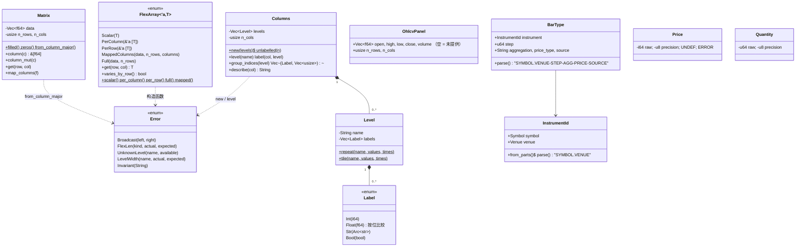
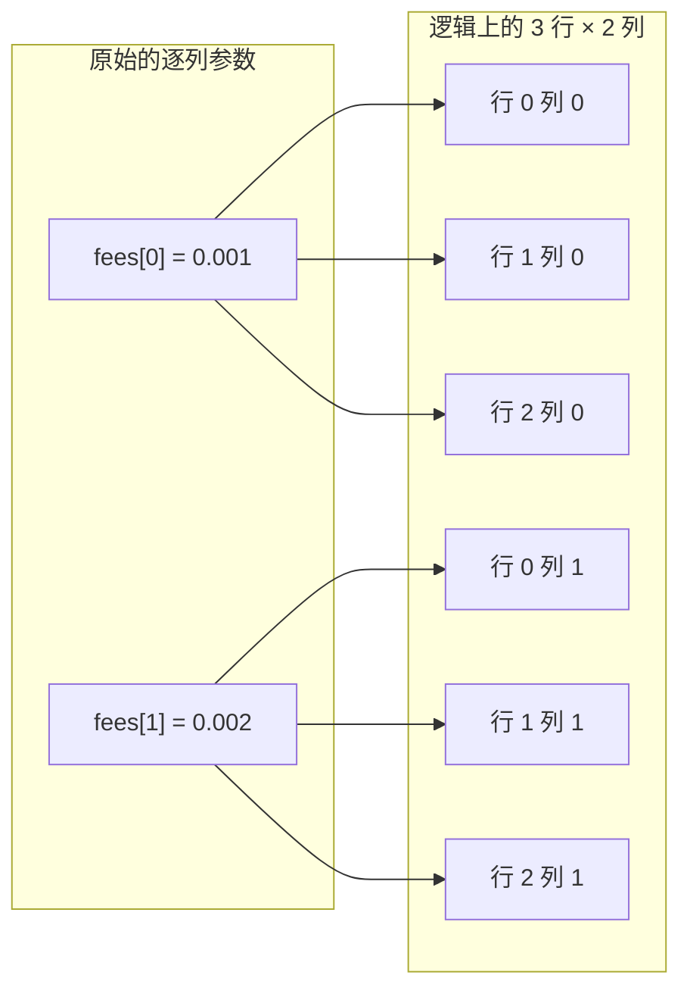
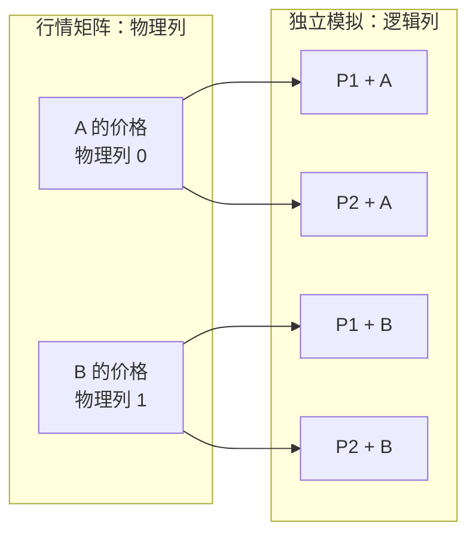

# 第 1 章 基础层：`barq-core` 与 `barq-model`

[← 总览](README.md) · [下一章：撮合内核](02-exec-kernel.md)

## 1.1 定位

`barq-core` 没有任何外部依赖，定义了所有 crate 共用的四样东西：**数组长什么样**（`Matrix`）、**参数怎么广播**（`FlexArray`）、**列怎么贴标签**（`Columns`）、**浮点怎么比较**（`math`）。
`barq-model` 在它之上放领域词汇：撮合用的枚举（来自 vectorbt）、标的与 K 线标识（来自 NautilusTrader）、面板 `OhlcvPanel`，以及为第二阶段预留的定点数。

两个 crate 合计约 2,000 行，其中一半是测试。读完这一章，后面每个 crate 里的 `get(row, col)`、`is_close`、`Level::repeat` 都不用再查。

## 1.2 文件与阅读顺序

| 顺序 | 文件 | 行数 | 读什么 | 第一遍可跳过 |
|---|---|---:|---|---|
| 1 | `barq-core/src/error.rs` | 117 | 模块文档 1–11 行："`Error` 是不变量被破坏，拒单永远不是 `Err`" | `Display` 实现 |
| 2 | `barq-core/src/math.rs` | 256 | 文档 1–20 行、`is_close_tol` 52–64、`add`/`is_addition_zero`/`sign` 94–135；**测试 142–255 行就是规格** | — |
| 3 | `barq-core/src/matrix.rs` | 162 | 第 113 行 `data[col * n_rows + row]`、第 85 行 `column()` | `map_columns` |
| 4 | `barq-core/src/flex.rs` | 236 | 五个变体 29–49、`get` 61–73、`varies_by_row` 80–85、`mapped` 90–109 | — |
| 5 | `barq-core/src/columns.rs` | 461 | `Label` 按位相等 54–88、`Level::repeat`/`tile` 151–179、`group_indices` 305–325；对照测试夹具 `sweep()` 350–358 | `Display`/`From` 实现 90–129 |
| 6 | `barq-model/src/enums.rs` | 366 | 当表查：16 个 `#[repr(i8)]` 枚举，判别值是磁盘格式 | — |
| 7 | `barq-model/src/ids.rs` → `bar.rs` → `types.rs` | 116 / 148 / 134 | `InstrumentId` 的 `rsplit_once('.')`、`BarType` 的 `rsplitn(5,'-')`、`OhlcvPanel` 的 SoA | `Bar` 结构体（无人使用）、`Price`/`Quantity`（第二阶段才用，**没有算术**） |

## 1.3 类图



`math` 是一组自由函数：`is_close`、`is_close_tol`、`is_close_or_less`、`is_less`、`add`、`is_addition_zero`（私有 `sign`）。

## 1.4 核心算法一：容差比较 `is_close`（`math.rs:52-64`）

```text
is_close_tol(a, b, rel_tol=1e-9, abs_tol=1e-12):
    a 或 b 是 NaN           → false
    a 或 b 是 ±inf          → false       ← 在 a == b 之前！
    a == b                  → true
    |a − b| ≤ max(rel_tol × max(|a|, |b|), abs_tol)
```

最后一行就是 PEP 485 的"弱对称相对容差"。
和 Python `math.isclose` 唯一的差别在第二行：`math.isclose(inf, inf)` 是 `True`，这里是 `false`。
原因（文档 13–20 行）：`+inf` 在 barq 里是活的哨兵——`size = +inf` 表示"能买多少买多少"，`price = +inf` 表示"用收盘价"。两个不同含义的哨兵如果被容差判成"相等"，就是无声的 bug。
vectorbt 的 `utils/math_.py::is_close_nb` 也这么做，所以这是和 PEP 485 的偏差，不是和参考实现的偏差。

派生出两个三值比较（`math.rs:72-84`）：

| 函数 | 定义 | 用途 |
|---|---|---|
| `is_close_or_less(a, b)` | `is_close(a,b) \|\| a < b` | "买得起吗"——差一个舍入误差也算买得起 |
| `is_less(a, b)` | `!is_close(a,b) && a < b` | "真的小于"——容差内算相等，不算小于 |

注意 `is_less(a,b)` **不是** `!is_close_or_less(b,a)`：容差内是第三种状态"相等"。

## 1.5 核心算法二：余额更新的零钉 `add`（`math.rs:94-135`）

```text
sign(x):  NaN → i8::MIN；x > 0 → 1；x < 0 → −1；0.0 和 −0.0 → 0       （不用 f64::signum，它把 −0.0 算 −1）
is_addition_zero(a, b):
    sign(a) != sign(b)  → is_close(|a|, |b|)        异号：比较绝对值
    否则                → is_close(a + b, 0.0)       同号：只有两者都≈0 时和才≈0
add(a, b) = is_addition_zero(a, b) ? 0.0 : a + b
```

为什么异号要比绝对值而不是比 `a + b` 和 0：两个几乎相消的大数相加会发生灾难性抵消，`a + b` 的结果相对 0 的距离没有意义，相对容差失效；直接比 `|a|` 和 `|b|` 保住了相对容差。
测试 `addition_snaps_near_cancellation_to_zero`（214 行）：`add(1e9, −(1e9+1)) == 0.0`。
所以 `add` 不是通用加法，只用于现金、持仓、负债、可用现金这些**应该能归零**的余额；第 2 章的内核每一处余额更新都用它。

## 1.6 核心算法三：列主序与列轴布局

**索引公式**：`(row, col) ↦ data[col * n_rows + row]`，出现在 `matrix.rs:113`、`flex.rs:71`、`barq-data/src/lib.rs:388、548`。一列是 `data[col*n_rows .. (col+1)*n_rows]`，`Matrix::column(c)` 零拷贝返回它。

**为什么列主序**（`matrix.rs:1-12`）：列是工作单位——模拟扫一列（或相邻的一组），因子按标的（列）求值，一个线程拥有一段列。列连续，就没有跨线程共享的缓存行。

**列轴布局**（`columns.rs:10-23`）：`col = param_idx × n_symbols + symbol_idx`。


```text
Level::repeat("window", [10,20,50], times=2)  → [10,10,20,20,50,50]    参数"重复"
Level::tile  ("symbol", [BTC,ETH],  times=3)  → [BTC,ETH,BTC,ETH,BTC,ETH] 标的"平铺"
```

结果：一组参数占据**相邻**的列，所以共享账户就是一个切片（`group_lens=[2,2,2]`）；同一标的的列是跨步的 `[0,2,4]`。
这只是构造函数约定，没有运行时检查（`columns.rs:21-23`），由测试 `one_parameter_combination_occupies_contiguous_columns`（399 行）钉住。
同一公式还出现在 `barq-indicators/src/sweep.rs:135-137` 的 `column_of`，以及 Python 里的 `column_map = np.tile(np.arange(S), n_params)`。

## 1.7 核心算法四：`FlexArray` 广播（`flex.rs:61-73, 90-109`）

```text
get(row, col):
    Scalar(v)                         → v                       不访存
    PerColumn(v)                      → v[col]
    PerRow(v)                         → v[row]
    MappedColumns{data,n_rows,columns}→ data[columns[col] * n_rows + row]
    Full{data,n_rows}                 → data[col * n_rows + row]
varies_by_row() = PerRow | Full | MappedColumns
```

**逐列广播**：两个手续费值被逻辑上复用到 3 × 2 个格子里；每个格子读取时仍指向原来的列值。



动机（ARCHITECTURE §3.3）：100k × 2,000 的参数矩阵是 1.6 GB，而模拟有十几个这样的参数，物化不可行。`FlexArray` 只借用调用者给的形状，由 `get` 做下标运算。
`varies_by_row()` 让循环把按列不变的参数提到 bar 循环外（`from_orders.rs:148-159`、`from_signals.rs:419-426` 用它决定是否每根 K 线重建 `ValidatedOrder`）。

`MappedColumns` 把**逻辑模拟列**映射到行情矩阵的**物理数据列**。例如有两个标的 A、B 和两组参数 P1、P2，模拟要跑四条独立路径：P1+A、P1+B、P2+A、P2+B。参数会不同，但同一标的在两组参数下读的价格相同：



因此映射是 `columns = [0, 1, 0, 1]`。读取逻辑列 2 的第 `row` 行时，`get` 先找到 `columns[2] == 0`，再从原行情矩阵读取 A 的第 `row` 行。P1+A 与 P2+A 的仓位、成交和收益仍分别计算；共享的只有相同的价格输入。

扩展到 50 组参数 × 100 个标的，会有 5,000 个逻辑模拟列，但行情物理矩阵仍只有 100 列。单个 100k × 100 的 `f64` 行情字段约 80 MB；复制 50 份约 4 GB，而 `MappedColumns` 只需原矩阵和列映射。它省掉的是重复存储与复制，不会省掉 5,000 条模拟路径本身的计算。`barq-sim/src/lib.rs:58-92` 的 `count_where` 对它特殊处理，每个物理列只数一次。

细节：枚举里**不存 `n_cols`**，逻辑宽度由调用方隐含；`mapped` 用 `checked_mul` 校验形状（96 行），`full` 没有（157 行）。`T: Copy` 而不是只支持 `f64`，因为 `barq-sim` 把枚举也当参数传：`FlexArray::Scalar(StopEntryPrice::Close)`。

## 1.8 核心算法五：列标签、`Columns` 与 `group_indices`（`columns.rs:54-88, 208-343`）

矩阵列保存数值；`Columns` 保存每一列“代表什么”的标签，不复制矩阵数据。标签按层级（`Level`）组织，例如参数扫描中的 `window` 和 `symbol`。每个层级必须恰好有 `n_cols` 个标签，否则 `Columns::new` 返回 `Error::LevelWidth`。

```rust
let windows = [10_i64, 20, 50];
let symbols = ["BTC", "ETH"];
let columns = Columns::new(vec![
    Level::repeat("window", &windows, symbols.len()),
    Level::tile("symbol", &symbols, windows.len()),
]).unwrap();
```

`repeat` 让每个参数值占相邻列，`tile` 让每个参数块都包含所有标的，因此列标签是：

| 列号 | window | symbol |
|---:|---:|---|
| 0 | 10 | BTC |
| 1 | 10 | ETH |
| 2 | 20 | BTC |
| 3 | 20 | ETH |
| 4 | 50 | BTC |
| 5 | 50 | ETH |

因此 `columns.describe(3)` 得到 `window=20, symbol=ETH`；`columns.group_indices("symbol")` 得到 BTC 对应 `[0, 2, 4]`、ETH 对应 `[1, 3, 5]`，可用于按标的聚合每列的收益等指标。查询不存在的层级会返回 `Error::UnknownLevel`。

`Label::key()` 把 `Float(v)` 折成 `(1, v.to_bits())`，`PartialEq` 和 `Hash` 都走 `key()`。于是 `Float(NaN) == Float(NaN)`、`Float(0.0) != Float(-0.0)`——和 IEEE 相反，但有意为之（文档 32–34 行："标签是标识符，不是测量值"），这样 `0.8, 0.9, 0.95` 这类分位数阈值才能当 `HashMap` 键。
`group_indices(level)`：一趟扫描建 `HashMap<Label, Vec<usize>>`，同时记录首次出现顺序，再按该顺序输出。它是第 5 章按参数聚合（`aggregate.rs:144`）的基础。

## 1.9 领域模型要点（`barq-model`）

- **枚举**（`enums.rs`）：16 个，全部 `#[repr(i8)]`、判别值显式写出，因为记录数组里存的是整数（`trades.rs:217` 的 `direction as i8`）。`StatusInfo::from_discriminant(-1) == None` 表示"成交了，没有原因"。判别值与 vectorbt `portfolio/enums.py` 1:1 对应，否则对照 fixture 无法重放。测试 `discriminants_are_pinned`（330 行）。
- **`InstrumentId`**（`ids.rs:85-99`）：`rsplit_once('.')`，所以 venue 是最后一段，symbol 可以含点；`from_parts` 明确拒绝含点的 venue，避免 `("ADA", "BINANCE.SPOT")` 被重新解释。模块文档承诺的 interning 还没做（ARCHITECTURE §17.4）。
- **`BarType`**（`bar.rs:75-119`）：`rsplitn(5, '-')` 从右切最多 5 段，后四段词汇固定（STEP / AGGREGATION / PRICE / SOURCE），所有前导的 `-` 都留在第 5 段给 `InstrumentId`，所以 `BTC-USDT.BINANCE-1-MINUTE-LAST-EXTERNAL` 能正确解析。它是数据目录的键（第 8 章）。
- **`OhlcvPanel`**（`bar.rs:48-63`）：五个独立的列主序 `Vec<f64>`，空 `Vec` 表示"未提供"。结构体数组（SoA）而不是数组结构体（AoS），因为止损引擎分别扫 O/H/L。
- **`Price` / `Quantity`**（`types.rs`）：按 NautilusTrader 的形状做的定点数（`raw × 10^precision`，`PRECISION = 9`），用 `i64::MAX`/`MIN` 做 `UNDEF`/`ERROR` 哨兵而不是 `Option`（内层循环省一个分支）。**目前没有任何算术、没有 `from_f64`，也没人构造它**；第一阶段全是 `f64`。

## 1.10 阅读陷阱

1. `is_close(x, f64::INFINITY)` 永远是 `false`；判断无限要用 `is_infinite()`。
2. `add` 会把相对差 `1e-9` 以内的结果钉成 0，只用于余额，不要当通用加法。
3. `Matrix::from_column_major` 会接受长度正确的 C 序缓冲区并产出转置的垃圾；Python 边界（第 9 章）因此拒绝 C 序数组而不是转置。
4. `FlexArray` 的公开变体可以绕过检查构造，长度错了在模拟中途 panic 而不是返回 `Error`。
5. `Label::Float(-0.0)` 和 `Float(0.0)` 是两个组。
6. `Columns::new(vec![])` 得到 `n_cols = 0`，不是错误。
7. `barq-data` 不用 `barq_core::Error`，用 `ArrowError`（第 8 章）。
8. 枚举判别值是磁盘格式；加新变体只能追加在末尾（`plan.md` B4 的 `NoCashLeverage` 就是"追加在 14 个之后"）。

## 1.11 与参考实现的对应

| barq | vectorbt 1.1.0 | NautilusTrader |
|---|---|---|
| `math::is_close_tol`、`is_close_or_less`、`is_less`、`add`、`is_addition_zero` | `utils/math_.py` 的 `is_close_nb`、`is_close_or_less_nb`、`is_less_nb`、`add_nb`、`is_addition_zero_nb`，同公式同容差 | — |
| `FlexArray::get(row, col)` | `base/reshape_fns.py` 的 `flex_select_nb` / `flex_select_auto_nb`、`broadcast(keep_raw=True)`；`MappedColumns` 无对应 | — |
| `Level::repeat` / `tile`、`Columns::group_indices` | `base/index_fns.py` 的 `repeat_index` / `tile_index`；pandas `MultiIndex` 与 `groupby(level).indices` | — |
| `enums.rs` 的 15 个撮合/记录枚举 | `portfolio/enums.py` 同名枚举，判别值一致；`CashFlowKind` 是 barq 新增 | — |
| `Price`、`Quantity`、`UNDEF`/`ERROR` | — | `nautilus_core/model/src/types/{price,quantity}.rs`，`FIXED_PRECISION = 9` |
| `Symbol`、`Venue`、`InstrumentId` | — | `identifiers/*.rs`（Nautilus 用 `Ustr` interning） |
| `BarType` 字符串语法 | — | `data/bar.rs::BarType`，同样 `rsplitn(5, '-')` |
| `OhlcvPanel` | `simulate_from_signals_nb` 接收分开的 open/high/low/close 二维数组 | — |

## 1.12 延伸资料

- PEP 485：<https://peps.python.org/pep-0485/>（相对容差为什么取两者绝对值的最大值；为什么零附近需要绝对容差）。
- IEEE 754 的 NaN 非自反、有符号零、`total_cmp`：Rust 文档 `f64::total_cmp`；David Goldberg, "What Every Computer Scientist Should Know About Floating-Point Arithmetic"（1991），§灾难性抵消。
- 行主序 / 列主序：Wikipedia "Row- and column-major order"；NumPy 文档 "Internal memory layout of an ndarray"（`order="F"`、`flags.f_contiguous`）。
- 结构体数组 vs 数组结构体：Mike Acton, "Data-Oriented Design and C++"（CppCon 2014，视频）；Richard Fabian, *Data-Oriented Design*（免费在线书）。
- NumPy 广播与 `as_strided`：NumPy 文档 "Broadcasting"；vectorbt 文档 `base.reshape_fns`。
- 中文：《Rust 语言圣经》的"枚举与模式匹配"、"生命周期"章节（`FlexArray<'a, T>` 的借用）；OI Wiki 无直接对应，本章不涉及算法竞赛结构。
- NautilusTrader 文档 "Instruments"、"Bars"（`BarType` 语法）、"Precision modes"。
- 更多见 [11-references.md](11-references.md) §A。

## 1.13 自测

1. 不看代码写出 `is_close_tol` 的四行，并说明为什么 inf 的检查在 `a == b` 之前。
2. `add(0.0, -0.0)` 走哪个分支？返回什么？（提示：`sign` 对两个零都返回 0，同号分支，`is_close(0.0, 0.0)` 为真 → `0.0`。）
3. 3 组参数 × 4 个标的，列 7 是哪组参数、哪个标的？共享账户的 `group_lens` 应该是什么？
4. `FlexArray::MappedColumns` 的 `columns` 数组长度是逻辑列数还是物理列数？
5. 为什么 `Label::Float` 要按位比较而不是按值？举一个按值比较会出错的例子。
