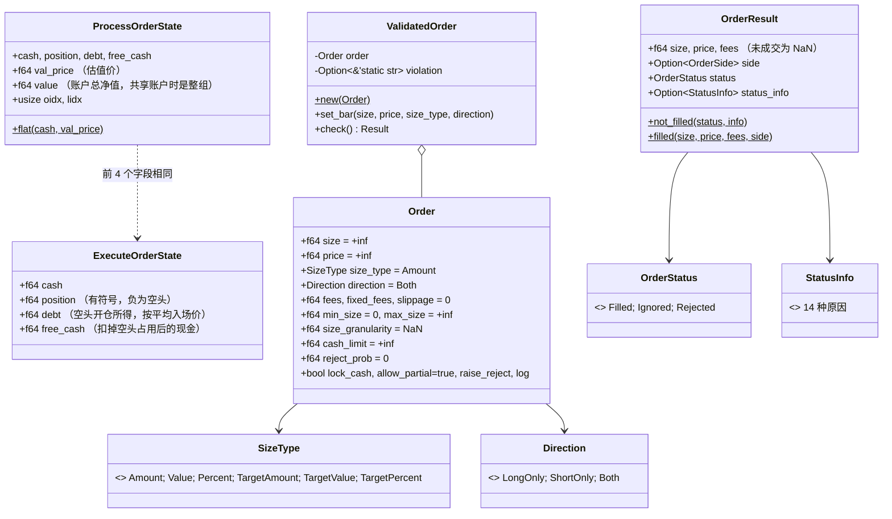
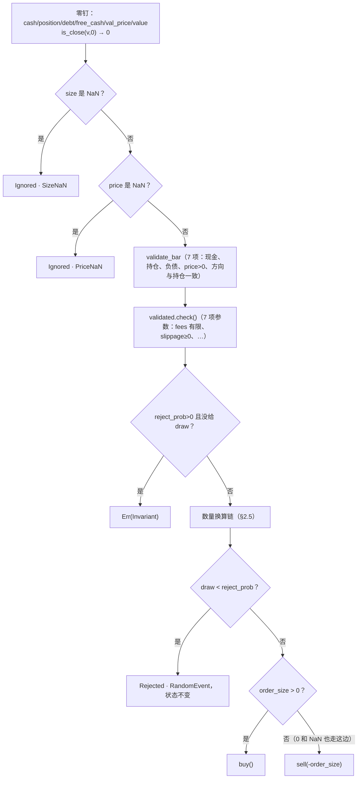

# 第 2 章 撮合内核：`barq-exec`

[← 总览](README.md) · [上一章：基础层](01-foundations.md) · [下一章：模拟循环](03-sim.md)

## 2.1 定位

`barq-exec` 只做一件事：**一笔订单，对一个账户，在一根 K 线上，算出成交或不成交**。
它不知道时间轴、不知道别的列、不知道止损和信号；这些都在 `barq-sim`。
把它单独拆出来的原因写在 `crates/barq-exec/src/lib.rs:3-10`：向量化层和将来的事件驱动层都调用同一个 `execute_order`，
所以两层的结果才可以逐列互相验证。

读这个 crate 的收获：理解 vectorbt `execute_order_nb` 的全部语义，包括 14 种拒单原因、做空的保证金记账和费用反解。
它也是仓库里**对浮点容差最敏感**的地方（§2.6）。

## 2.2 文件与阅读顺序

| 顺序 | 文件 | 行数 | 读什么 |
|---|---|---:|---|
| 1 | `src/lib.rs` | 53 | 模块文档：两种失败、确定性、验证策略 |
| 2 | `src/types.rs` | 190 | 四个类型；重点是 `ExecuteOrderState` 的 `debt` / `free_cash` 注释（`types.rs:5-17`）和 `Order::default` 里的哨兵值（`types.rs:118-139`） |
| 3 | `src/kernel.rs:528-701` | — | `execute_order` → `execute_validated`：零钉、忽略检查、校验、换算链、随机拒单、分发。先读这一段再读买卖 |
| 4 | `src/kernel.rs:41-221` | — | `buy` |
| 5 | `src/kernel.rs:223-379` | — | `sell` |
| 6 | `src/kernel.rs:381-526` | — | `validate_bar` / `param_violation` / `ValidatedOrder`（性能优化，可最后读） |
| 7 | `tests/parity.rs`、`tests/parity_sequence.rs` | — | 看 fixture 怎么被重放、`agree` 怎么比较 |
| 8 | `tests/fixtures/execute_order.tsv` | 474 行 | 挑 `buy_plain`、`*fees*`、`*granularity*`、`*short*` 几行手算 |

第一遍可以跳过 `ValidatedOrder`，把 `execute_validated` 当 `execute_order` 读。

## 2.3 类图



`execute_order(&ProcessOrderState, &Order, Option<f64>) -> Result<(ExecuteOrderState, OrderResult)>` 是唯一入口；
`execute_validated` 是跳过参数校验的同义入口（`kernel.rs:559`）。

## 2.4 核心算法一：`execute_validated` 的固定顺序

位置：`kernel.rs:559-701`。顺序不能换，每一步都有 fixture 钉住。



三个容易漏掉的点：

1. **忽略检查在校验之前**（`kernel.rs:583-596`）。一列全是 NaN 的 size 配上非法的 fees，结果是整列 Ignored 而不是报错。这正是 `ValidatedOrder` 把违例"带着走"而不是构造时就报错的原因（`kernel.rs:468-474`）。
2. **先 bar 后参数**（`kernel.rs:598-602`）。两组校验独立，但一个订单同时违反两边时报哪条消息由顺序决定，测试 `a_bad_state_outranks_a_bad_parameter` 钉住。
3. **随机拒单在分发之前**（`kernel.rs:679-693`）。参考实现是在买卖之后覆盖结果；这里提前决定，省掉回滚。唯一的可观测差异：被随机拒掉的订单不会再触发"无限做多/做空"那两个 `Err`。

## 2.5 核心算法二：数量换算链

位置：`kernel.rs:610-677`。每一步都把 `size_type` 改写成更"低级"的类型，最终只有 `Amount` 到达买卖分支。


| 步骤 | 条件 | 变换 | 可能的提前返回 |
|---|---|---|---|
| 0 | `direction == ShortOnly` | `size = -size`（空头列里正数表示"再空一些"） | — |
| 1 | `TargetPercent` | `size *= value`；类型 → `TargetValue` | `value` NaN → Ignored·ValueNaN；`value <= 0` → Rejected·ValueZeroNeg |
| 2 | `Value` 或 `TargetValue` | `size /= val_price`；`Value` → `Amount`，`TargetValue` → `TargetAmount` | `val_price` 无限或 ≤ 0 → Err；NaN → Ignored·ValPriceNaN |
| 3 | `TargetAmount` | `size -= position`；→ `Amount` | — |
| 4 | `Amount` 且可做空且 `size == -inf` | `size = -1`；→ `Percent`（"空掉全部资源"） | — |
| 5 | `Percent` | `percent = |size|`；`size = sign(size) × inf` | `sign(0) × inf = NaN`，后面走 sell 分支并以 SizeZero 被忽略 |

注意 `sign` 是 NumPy 语义（`kernel.rs:25-33`）：`sign(NaN) = 0`，所以 `0 × inf = NaN` 和参考实现一致。

## 2.6 核心算法三：`buy`

位置：`kernel.rs:48-221`。输入 `size > 0`（可为 `+inf`）、`percent`（NaN 表示没有）。

```text
adj_price = price × (1 + slippage)

cash_limit =
  if lock_cash:
     position ≥ 0 → free_cash
     position < 0 → 先算"平掉空头要多少钱" cover_req；
                    够平且有余 → free_cash + 2·debt
                    不够平     → 解出最多能平多少（见下）
                    恰好够     → cash
  else: cash
cash_limit = min(cash_limit, cash, order.cash_limit)        # cash_limit 是 barq 新增，参考实现没有
if percent 给定: cash_limit = min(cash_limit, percent × cash_limit)

LongOnly/Both:  cash_limit == 0 → Rejected·NoCashLong
                size 与 cash_limit 都是 inf → Err（无限做多）
ShortOnly:      position == 0 → Rejected·NoOpenPosition   # 只能平空，不能开多

adj_size = ShortOnly ? min(-position, size) : size
adj_size == 0            → Ignored·SizeZero
adj_size > max_size      → allow_partial ? adj_size = max_size : Rejected·MaxSizeExceeded
有粒度                    → adj_size = floor(adj_size / g) × g

req_cash  = adj_size × adj_price
req_fees  = req_cash × fees + fixed_fees
total     = req_cash + req_fees

if is_close_or_less(total, cash_limit):                      # 买得起
    final = adj_size, fees_paid = req_fees, spend = total
else:                                                        # 买不起：反解
    max_req_cash = add(cash_limit, -fixed_fees) / (1 + fees)
    max_req_cash ≤ 0 → Rejected·CantCoverFees
    max_acq_size = max_req_cash / adj_price
    无粒度 → final = max_acq_size, fees_paid = cash_limit − max_req_cash, spend = cash_limit
    有粒度 → final = floor(max_acq_size / g) × g，重算 req_cash 与 fees   # 粒度第二次生效

is_close(adj_size, 0)                 → Ignored·SizeZero      # 注意测的是 adj_size 不是 final
is_less(final, min_size)              → Rejected·MinSizeNotReached
size 有限 且 final < size 且 !allow_partial → Rejected·PartialFill

new_cash     = add(cash, -spend)
new_position = add(position, final)
position < 0（在平空）：
    short_size = new_position < 0 ? final : |position|
    avg_entry  = debt / |position|
    debt_diff  = short_size × avg_entry
    new_debt      = add(debt, -debt_diff)
    new_free_cash = add(free_cash + 2·debt_diff, -spend)      # 释放的保证金是 2 倍
否则：new_free_cash = add(free_cash, -spend)
```

**费用反解**为什么是 `(cash_limit − fixed_fees) / (1 + fees)`：费用在上限*之内*。设可花名义金额 `x`，则 `x + x·fees + fixed = cash_limit`，解得 `x = (cash_limit − fixed)/(1 + fees)`。
例：现金 100、`fees=0.1`、`fixed_fees=1`、`price=10`、`size=+inf` → `x = 99/1.1 = 90`，买 9 股，付费 10，现金归零。这就是总览自测题的答案。

**`lock_cash` 下不够平空时的求解**（`kernel.rs:72-79`）：设最多能平 `s` 股，花费 `s·p·(1+fees) + fixed`，同时每平 1 股释放 `2·avg_entry` 的保证金，于是
`free_cash + 2·avg_entry·s = s·p·(1+fees) + fixed` → `s = (free_cash − fixed) / (p(1+fees) − 2·avg_entry)`。

## 2.7 核心算法四：`sell`

位置：`kernel.rs:228-379`。输入 `size > 0`。

```text
adj_price = price × (1 − slippage)

size_limit =
  LongOnly                         → min(position, size)                # 只能卖持有的
  lock_cash 或 (size=inf 且有 percent) →
      long_size  = max(position, 0)
      long_cash  = long_size × adj_price × (1 − fees)                  # 卖多头能回多少
      total_free = add(free_cash, long_cash)
      total_free ≤ 0 → position ≤ 0 ? Rejected·NoCashShort : 上限 = long_size
      否则 max_short = add(total_free, -fixed) / (adj_price × (1 + fees))
           limit = long_size + max_short；limit ≤ 0 → Rejected·CantCoverFees
      lock_cash 时在这里就把 percent 用掉（置 NaN）
  其他                              → size

percent 未用掉 → size_limit *= percent
size_limit > max_size → allow_partial ? = max_size : Rejected·MaxSizeExceeded
Short/Both: size_limit 无限 → Err（无限做空）
LongOnly:   position == 0 → Rejected·NoOpenPosition
粒度取整；is_close(size_limit,0) → Ignored·SizeZero；< min_size → MinSizeNotReached；部分成交检查

acq_cash  = size_limit × adj_price
fees_paid = acq_cash × fees + fixed
final_acq = add(acq_cash, -fees_paid)；< 0 → Rejected·CantCoverFees

new_cash     = cash + final_acq
new_position = add(position, -size_limit)
new_position < 0（有一部分变成空头）：
    short_size  = position < 0 ? size_limit : |new_position|            # 只有净空头部分产生负债
    short_value = short_size × adj_price
    new_debt      = debt + short_value
    new_free_cash = add(free_cash, add(final_acq, -2·short_value))
否则：new_free_cash = free_cash + final_acq
```

**为什么是 `2 × short_value`**（`types.rs:9-17`）：开空收到 `short_value` 的现金，但同时要为"将来买回"预留等值现金，再为空头本身的敞口占用一次，所以 `free_cash` 净变化是 `proceeds − 2·short_value`。
平空时按 `debt / |position|` 的平均入场价对称释放。
这个预留是路径相关的（取决于每次开空的价格），只靠 `cash` 和 `position` 推不出来，所以 `debt` 和 `free_cash` 必须是显式状态。
测试 `shorting_records_debt_and_reserves_margin`（`kernel.rs:883-897`）：100 现金、空 5 股 @10 → `cash=150, debt=50, free_cash=50`。

## 2.8 14 种 `StatusInfo` 的触发点

| `StatusInfo` | 状态 | 触发位置 |
|---|---|---|
| `SizeNaN` / `PriceNaN` | Ignored | `kernel.rs:585-596`，校验之前 |
| `ValueNaN` / `ValueZeroNeg` | Ignored / Rejected | TargetPercent 阶段 `kernel.rs:620-635` |
| `ValPriceNaN` | Ignored | Value/TargetValue 阶段 `kernel.rs:643-648` |
| `RandomEvent` | Rejected | 分发前 `kernel.rs:686-692` |
| `NoCashLong` | Rejected | buy，`cash_limit == 0` `kernel.rs:94-98` |
| `NoOpenPosition` | Rejected | buy（ShortOnly 无空头可平）`kernel.rs:105-110`；sell（LongOnly 无多头可卖）`kernel.rs:309-314` |
| `SizeZero` | Ignored | buy `kernel.rs:119-124, 172-177`；sell `kernel.rs:320-325` |
| `MaxSizeExceeded` | Rejected | buy `kernel.rs:126-134`；sell `kernel.rs:293-301` |
| `CantCoverFees` | Rejected | buy 反解 ≤ 0 `kernel.rs:151-156`；sell 两处 `kernel.rs:259-264, 342-347` |
| `MinSizeNotReached` | Rejected | buy `kernel.rs:178-183`；sell `kernel.rs:326-331` |
| `PartialFill` | Rejected | buy `kernel.rs:185-190`；sell `kernel.rs:332-337` |
| `NoCashShort` | Rejected | sell `kernel.rs:245-252` |

枚举定义和判别值在 `crates/barq-model/src/enums.rs`，记录里存的是整数，所以判别值被测试钉死。

## 2.9 性能结构：`ValidatedOrder`

位置：`kernel.rs:416-526`。14 项校验里有 7 项只看整列通常不变的字段（fees、slippage、min/max_size、granularity、reject_prob、cash_limit）。
`ValidatedOrder::new` 做一次，之后每根 K 线只 `set_bar` 四个会变的字段（size、price、size_type、direction）。
在稀疏工作负载上值 12–15%（`kernel.rs:456-462`），`benchmarks/README.md` 记录了 +30% 稀疏 / +22% 密集。
两个循环都用它（第 3 章）。

## 2.10 容差为什么在这里最要命

`kernel.rs:144`：`is_close_or_less(total_req_cash, cash_limit)` 而不是 `<=`。两者只在 `1e-9` 以内不同，
把它换成 `<=` 的变异一开始通过了全部测试（`ARCHITECTURE.zh-CN.md §7.5、§14.4`）。
解决办法有两层：用 `math.nextafter` 构造刚好在边界两侧的 fixture；再用 `size_granularity` 把 `1e-9` 的差异放大成一整手（5.0 对 4.0）。
相反，`buy`/`sell` 里对零的比较（`cash_limit == 0.0`、`adj_size == 0.0`、`position == 0.0`）是**精确**比较（`kernel.rs:43-44`），因为状态在入口已经被零钉过，再用 `is_close` 反而会改变哪些订单成交。

## 2.11 与 vectorbt 1.1.0 的对应

| barq | vectorbt (`vectorbt/portfolio/nb.py`) | 差异 |
|---|---|---|
| `execute_order` | `execute_order_nb(state, order)` | 多了 `reject_draw` 参数；随机拒单提前到分发前 |
| `buy` / `sell` | `buy_nb` / `sell_nb` | `cash_limit` 是新增字段，不进日志 |
| `validate_bar` + `param_violation` | `execute_order_nb` 开头的校验 | 拆成两半以便每列只做一次 |
| `ExecuteOrderState` / `ProcessOrderState` | `ExecuteOrderState` / `ProcessOrderState` | 同名同义 |
| `Order` 默认值 | `order_nb` 的默认参数 | 同 |
| `StatusInfo` 14 项 | `OrderStatusInfo` | 顺序和判别值一致 |

## 2.12 延伸资料

- vectorbt 文档 `Portfolio` 一节对 `size_type`、`direction`、`lock_cash`、`allow_partial` 的解释：<https://vectorbt.dev/api/portfolio/base/>；`nb` 模块：<https://vectorbt.dev/api/portfolio/nb/>。读 barq 的 `buy`/`sell` 前先把这两页的参数表看一遍。
- PEP 485（`math.isclose` 的相对 / 绝对容差定义）：<https://peps.python.org/pep-0485/>。
- 做空保证金的直观解释：Investopedia "Short Selling: Margin Requirements"，以及 Reg T 的 150% 规则；barq 的 `2 × short_value` 就是"收到的钱 + 等额保证金"的简化模型。
- 变异测试入门：Pitest 的 "Basic concepts" 页（概念与 Rust 无关）；Rust 工具 `cargo-mutants`。
- 更多见 [11-references.md](11-references.md) §B。

## 2.13 自测

1. `ShortOnly` 列里 `size = 5` 的订单走的是 `buy` 还是 `sell`？（提示：`kernel.rs:615-618` 翻一次符号，第 3 章 `prepare_order` 还翻一次。）
2. `percent = 0.5`、`cash = 100`、`cash_limit = 60` 时，买入最多花多少？（先 `min(100, 60)` 再乘 0.5 → 30。）
3. 为什么 `is_close(adj_size, 0.0)` 测的是粒度取整之后、反解之前的 `adj_size`？去 fixture 里找一行 `granularity` 的案例验证你的答案。
4. 平掉一半空头时 `free_cash` 变化多少？用 `avg_entry_price` 写出式子。
