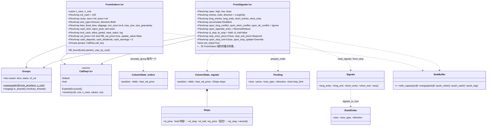
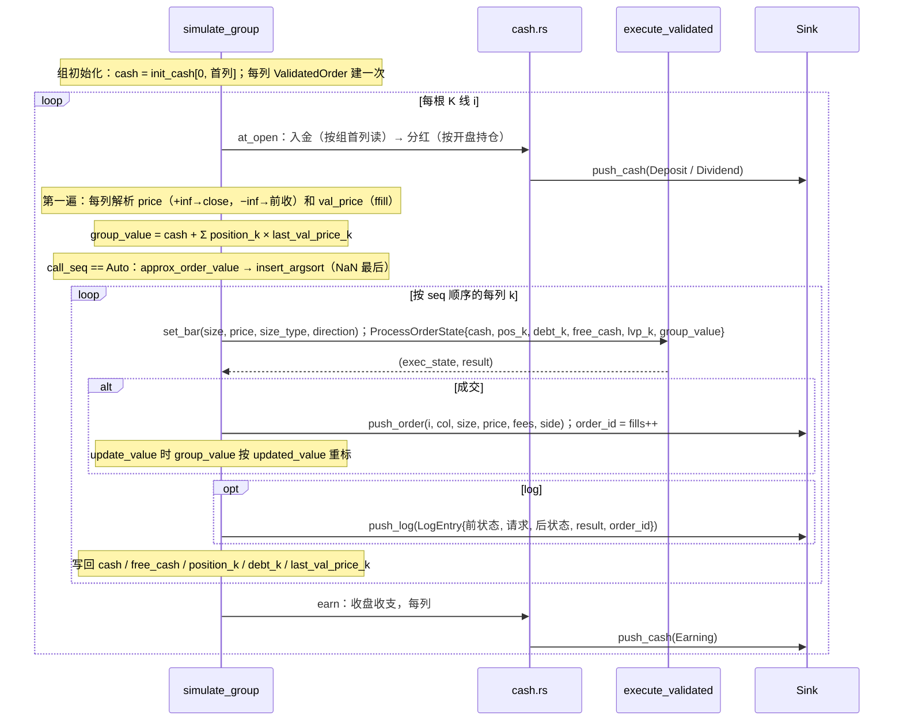
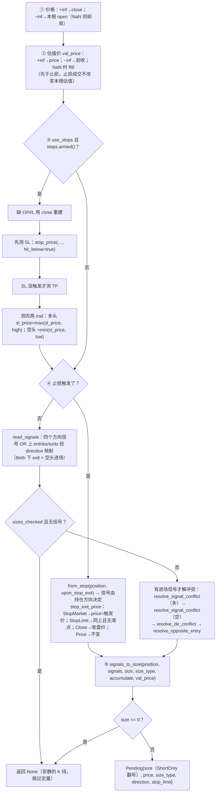

# 第 3 章 模拟循环：`barq-sim`

[← 总览](README.md) · [上一章：撮合内核](02-exec-kernel.md) · [下一章：记录](04-records.md)

## 3.1 定位

`barq-sim` 驱动第 2 章的内核：沿时间轴、沿列、沿账户组，把输入数组变成成交记录。两条循环：

- **`from_orders`**：被告知"交易什么"——每个 `(row, col)` 一个订单请求（`size` 为 NaN 表示没有）。简单，是另一条的模板。
- **`from_signals`**：被告知"什么时候交易"——进出场布尔信号，它自己算出方向、数量、止损、冲突。复杂，是仓库里最难的文件之一。

两条循环各有 plain / logged / serial / parallel 四种入口，并行单位是**账户组**（共享现金的相邻列）。
读这个 crate 的收获：一根 K 线内的事件顺序（入金 → 定价 → 止损 → 信号 → 排序 → 执行 → 收盘收支），以及"线程数不改变结果"是怎么做到的。

## 3.2 文件与阅读顺序

| 顺序 | 文件 | 行数 | 读什么 | 第一遍可跳过 |
|---|---|---:|---|---|
| 1 | `src/lib.rs` | 121 | crate 文档：为什么账户组是并行单位、为什么不用 SIMD；`DEFAULT_MIN_SIZE = 1e-8`（112 行）；`count_where`（57–93） | `count_where` 的 `MappedColumns` 分支 |
| 2 | `src/groups.rs` | 465 | `Groups`（47–175）、`CallSeq::resolve`（213–249）、`approx_order_value`（262–297）、`insert_argsort`（309–322） | `CallSeq::Explicit`（230–246） |
| 3 | `src/from_orders.rs` | 1,151 | 参数结构与默认值 29–240、`updated_value` 254–275、**`simulate_group` 328–591**、驱动 615–757 | 测试 759–1151（挑名字看） |
| 4 | `src/cash.rs` | 240 | 顶部的时序表、`apply`、`at_open`、`earn` | — |
| 5 | `src/random.rs` | 43 | 全部 | — |
| 6 | `src/signals.rs` | 734 | 1–401 按文件顺序读：文件顺序就是流水线顺序 | 测试 |
| 7 | `src/from_signals.rs` | 1,504 | 参数 64–256、`stop_price` 276–316、`Stops` 329–353、`read_signals` 356–385、**`prepare_order` 502–704**、**`simulate_group` 711–993**、驱动 995–1107 | 测试 1109–1504（但 `a_trailing_stop_follows_the_high_but_only_from_the_next_bar` 等名字值得全读一遍） |
| 8 | `tests/parity_cash_sharing.rs`、`tests/parity_signals.rs` | — | 看共享账户 fixture 怎么分别按布局顺序和 `Auto` 顺序重放；看 5,088 行穷举怎么钉住纯函数 | — |

## 3.3 类图



关键的一句话在 `from_orders.rs:282-296` 的注释：**一个账户组 = 每列一个 `ColumnState` + 一对共享的 `cash`/`free_cash`**。共享现金在类型层面就是这个意思。

## 3.4 核心算法一：`from_orders` 的一根 K 线（`from_orders.rs:328-591`）




为什么分两遍（`from_orders.rs:305-312`）：组的净值依赖所有列的估值价，而执行顺序可能与布局顺序不同，所以必须先把所有列的价格解析完、算出 `group_value`，再按 `seq` 执行。
`value` 是**穿线**的，不是每笔成交后重算：一根 K 线内所有订单都以开盘时的净值定大小，只有 `update_value=true` 时用 `updated_value`（254–275）按成交价重标：`value' = value + Δcash + (position' × price − position × val_price)`。

预分配：`S::with_capacity(fill_bound)`，`fill_bound` 数"size 非 0 非 NaN 的格子"而不是 `n_rows × n_cols`（100k × 2000 会是 8 GB）。

## 3.5 核心算法二：`call_seq="auto"`（`groups.rs:213-322`）

共享账户里，一根 K 线先卖后买才能让买单用上卖单释放的现金。`Auto` 用**估算的订单金额**排序：

```text
approx_order_value(size, size_type, direction, cash, position, free_cash, val_price, value):
    ShortOnly → size = −size
    asset_value = position × val_price
    Amount        → size × val_price
    Value         → size
    Percent       → size ≥ 0 ? size × cash
                  : LongOnly ? size × asset_value
                  : size × (2 × max(asset_value, 0) + max(free_cash, 0))    平空要买回 + 释放保证金，所以多头侧翻倍
    TargetAmount  → size × val_price − asset_value
    TargetValue   → size − asset_value
    TargetPercent → size × value − asset_value
正 = 花钱，负 = 回钱；估不出来 → NaN
```

然后 `insert_argsort`（309–322）：升序、稳定、**NaN 排最后**（"不知道值多少钱"的放在所有回钱的之后），用插入排序因为一组只有几个标的。它是逐字照参考实现写的，包括"已经在位的 NaN 总是右移而不比较"这个细节。
`CallSeq::Default` 按布局顺序；`Explicit` 从列主序的 `&[usize]` 读组内下标。

## 3.6 核心算法三：`from_signals::prepare_order` 的决策顺序（`from_signals.rs:502-704`）




**`stop_price`**（276–316）：

```text
downward = (多头 & SL) 或 (空头 & TP)：level = anchor × (1 − stop)
    open ≤ level            → 跳空：按 open 成交
    low ≤ level ≤ high      → 触及：按 level 成交
    否则                     → NaN
upward   = (空头 & SL) 或 (多头 & TP)：level = anchor × (1 + stop)，对称
```

去掉跳空分支，所有跳空都会变成"完美执行的止损"（260–269 行注释）。

**先测后 trail**（595–601）：本根 K 线用上一根为止的峰值判定；先 trail 的话，一根创新高又回落的 K 线会在当根就把自己打出来。测试 `a_trailing_stop_follows_the_high_but_only_from_the_next_bar`（1224–1251）。

**重新布防**（`simulate_group` 902–943）：只在成交后。`position == 0` → 清空；新开仓或反向 → 以 `stop_entry_price` 选的锚（`ValPrice` / `Price` / `FillPrice` / `Close`）重设 SL 与 TP；加仓 → 按 `upon_stop_update`（`Keep` 不动 / `Override` 新值非 NaN 才覆盖 / `OverrideNaN` 总是覆盖，NaN 可清除）；减仓未平 → 不动。止损在成交的**下一根**才开始被测试。

**两个 `ValidatedOrder`**（737–744）：普通一个，再一个 `slippage = 0` 的给挂在止损价上的限价单用（`StopLimit` 无滑点，`StopMarket` 有）。

## 3.7 核心算法四：信号冲突解析链（`signals.rs`）

四个纯函数，顺序固定（文件注释 13–20 行：先解方向冲突再解进出冲突，幸存的信号会不同）。全部用 5,088 行 fixture 穷举对照。

| 阶段 | 函数 | 解决什么 | 规则摘要 |
|---|---|---|---|
| 1 | `from_stop(position, mode, acc)` 85–120 | 止损触发后发什么信号 | 由持仓方向决定：`Close` → 退出 + 关闭累加；`CloseReduce` → 退出；`Reverse` → 反向进场 + 关闭累加；`ReverseReduce` → 反向进场 |
| 2 | `resolve_signal_conflict(position, entry, exit, dir, mode)` 129–172 | 同方向进出同时触发 | `Entry`/`Exit` 二选一；`Adjacent`/`Opposite` 相对于持仓，空仓时两者都丢；`Ignore` 都丢 |
| 3 | `resolve_dir_conflict(position, long_entry, short_entry, mode)` 176–208 | 多头进场和空头进场同时触发 | `Long`/`Short`/`Adjacent`（跟持仓同向）/`Opposite`/`Ignore` |
| 4 | `resolve_opposite_entry(position, signals, mode, acc)` 217–258 | 进场信号与持仓相反 | `Ignore` 丢掉；`Close` 改成退出 + 关闭累加；`CloseReduce` 改成退出；`Reverse` 保留 + 关闭累加；`ReverseReduce` 不变 |
| 5 | `signals_to_size(position, signals, size, size_type, acc, val_price)` 290–401 | 算出有符号数量 | 见下表 |

`signals_to_size` 只接受 `Amount | Value | Percent`，`size` 必须非负（方向由信号表达）。`adds = Both|AddOnly`，`removes = Both|RemoveOnly`：

| 持仓 | 信号 | removes / adds | 结果 |
|---|---|---|---|
| 多 | short_entry | removes | `−size`（减仓） |
| 多 | short_entry | 否则 | 反向：`−|position| − size`（`Value` 时 `size/val_price`），类型改 `Amount`；`Percent` 反向是 `Err` |
| 多 | long_exit | removes / 否则 | `−size` / `−|position|`，`LongOnly` |
| 多 | long_entry | adds | `+size`，`LongOnly`；否则 0 |
| 空 | 镜像 | | `ShortOnly` |
| 平 | long_entry / short_entry | | `+size` / `−size` |

反向是**一笔**订单（平掉 + 开反向），这就是百分比不能反向的原因："百分比是相对于被平掉的仓位还是新开的仓位？"

## 3.8 核心算法五：并行执行与确定性合并


1. **切块**（`Groups::chunks`，156–175）：`total = Σ lens`，第 `t` 个线程的目标是 `total × t / n_threads`，沿组累加到目标为止；最后一个线程扫尾。按**列数**而不是组数均衡，所以一个宽组自成一块：`[6,1,1,1,1,1,1].chunks(2) == [(0,1),(1,7)]`。
2. **`std::thread::scope`**（`from_orders.rs:703-757`）：每块一个线程，各自 `S::with_capacity(fill_bound(块内列))`、各自的 `fills` 计数器，跑 `simulate_group`。作用域线程强制参数是 `Sync`、状态按列本地。没有共享可变状态、没有锁、没有归约。
3. **合并**：结果按块顺序收集，最小编号块的错误胜出；`S::merge(parts)` → `OrderRecords::concat`（超过 65,536 条并行拷贝）或 `Journal::concat` → `extend`：`offset = 已有订单数`，追加日志里每个非负 `order_id += offset`，`−1` 保持。
4. **为什么逐位一致**：记录按 `(col, idx)` 定位、id 是合并后的位置、随机数只依赖 `(seed, row, col)`。测试 `the_parallel_path_is_identical_to_the_serial_one`。

扩展性（`examples/scaling.rs`，4 核）：稀疏负载 3.62×，密集负载 1.63×（内存带宽受限，~245 MB 记录写入）。

## 3.9 核心算法六：成交之外的现金流（`cash.rs`）

| 输入 | 入账时点 | 读取位置 | 记录 |
|---|---|---|---|
| `cash_deposits` | 开盘，先于定价与定量 | 组首列（同 `init_cash`） | `Deposit` |
| `cash_dividends` | 开盘，入金之后；每股金额 × 开盘持仓（空头支付） | 每列 | `Dividend` |
| `cash_earnings` | 收盘，所有订单之后，安静的 K 线也入账 | 每列 | `Earning` |

`is_off`：标量 0 或 NaN → 整个输入跳过，每组只判一次，所以不用时零开销。
`apply`：负数最多扣到 `max(free_cash, 0)`，两个余额都用 `add` 更新，记录里存**实际**入账的金额。`±inf` 是 `Err`，NaN 是"无流"。
`at_open`/`earn` 标了 `#[inline(never)]`：循环里活跃变量比寄存器多，把分支挪出去每根 K 线省几条指令。

## 3.10 核心算法七：无状态随机数（`random.rs`）

```text
mix(z) = SplitMix64 输出函数（64 位双射）
uniform(seed, row, col) = mix(mix(mix(seed) ^ row) ^ col) 取高 53 位 / 2^53  → [0, 1) 内精确值
```

共享生成器的第 n 次抽样取决于之前抽了多少次，而那取决于分组和线程数；`(seed, row, col)` 的函数两者都不依赖。只在 `reject_prob > 0` 时才抽（`from_orders.rs:485-486`）。`plan.md` P3 记录了三份相同实现待合并到 `barq-core`。

## 3.11 阅读陷阱

1. **`min_size` 默认值不一致**：循环默认 `DEFAULT_MIN_SIZE = 1e-8`（参考实现的值），内核 `Order::default()` 是 0。`5e-9` 的订单经循环是 `MinSizeNotReached`，直接调内核会成交。这个差异是靠比对日志的 `req_min_size` 发现的。
2. **共享组的记录是执行顺序**，不是列主序；分析层用 `sort_by_column` 按 `(col, idx)` 稳定重排。id 是位置，排序会改变 id；`Journal.order_id` 指向排序前的缓冲下标。
3. **`price = −inf` 在两条循环里含义不同**：`from_orders` 是前收，`from_signals` 是本根开盘（缺开盘再退到前收）。第 0 根 `−inf` 解析成 NaN → `Ignored·PriceNaN`。
4. **`val_price` 在止损之前解析**，止损成交不改变本根估值。
5. **`Direction::Both` 下 `exits` 是空头进场**，默认 `upon_opposite_entry = ReverseReduce` 使它成为反向。
6. **ShortOnly 翻两次号**：`prepare_order` 翻一次，内核再翻一次（照参考实现）；`approx_order_value` 也翻。
7. **`params_vary_by_row` 必须包含 `log`**，否则按行变化的 log 标志会一直用第 0 根的值（测试 969–998）。
8. **`from_signals` 的日志只记到达内核的订单**，安静的 K 线没有日志行；`from_orders` 每个格子都有。
9. **`CallSeq::Explicit` 的校验是惰性的**，坏序列可能跑到一半才报错。
10. **`free_cash` 可以是负的**（高于入场价平空之后），此时出金被截到 0 且不记录。
11. `Journal` 派生的 `PartialEq` 在有拒单时永远是 false（NaN 字段），测试通过 `Debug` 比较。

## 3.12 与 vectorbt 1.1.0 的对应

| barq | vectorbt `portfolio/nb.py` | 差异 |
|---|---|---|
| `from_orders::simulate_group` + 驱动 | `simulate_from_orders_nb` | 两遍扫描结构相同；`ValidatedOrder` 提升；现金流钩子 |
| `from_signals::simulate_group` + `prepare_order` | `simulate_from_signals_nb` | `−inf` 价格 → 开盘；不保留 `sl_init_i` 等回调层状态 |
| `signals.rs` 的 `from_stop` / `resolve_*` / `signals_to_size` | `generate_stop_signal_nb` / `resolve_signal_conflict_nb` / `resolve_dir_conflict_nb` / `resolve_opposite_entry_nb` / `signals_to_size_nb` | 逐行穷举对照 |
| 第二遍的订单处理 | `process_order_nb` | 结构镜像 |
| `updated_value` | `update_value_nb` | 同 |
| `approx_order_value` + `insert_argsort` | `approx_order_value_nb` + `sort_call_seq_nb` / `insert_argsort_nb` | NaN 最后的写法照抄 |
| `stop_price` + 重新布防 | `simulate_from_signals_nb` 内联的 SL/TP 逻辑 | 抽成函数 |
| `should_update_stop` | `should_update_stop_nb` | 同 |
| `Groups` / `CallSeq` | `group_lens` + `cash_sharing` / `call_seq` 数组 + `CallSeqType` | 同 |
| `cash.rs`、`random.rs`、`cash_limit` | 无 | barq 新增，用手算测试和守恒检查验证 |

## 3.13 延伸资料

- vectorbt 文档 "Portfolio" 页的 `from_signals` 参数说明（`accumulate`、`upon_*_conflict`、`upon_opposite_entry`、`sl_stop`/`sl_trail`/`tp_stop`、`stop_entry_price`/`stop_exit_price`/`upon_stop_exit`/`upon_stop_update`）和 "Grouping / cash sharing / call_seq" 小节：<https://vectorbt.dev/api/portfolio/base/>。
- 止损与跳空：Investopedia "Stop-Loss vs. Stop-Limit"、"Gap Risk"；trailing stop 的 high-water mark 概念。
- 按目标仓位再平衡：vectorbt 文档的 `TargetPercent` 示例；Robert Carver, *Systematic Trading*（2015）第 10–11 章讲按波动率定仓位。
- SplitMix64：Steele, Lea & Flood, "Fast Splittable Pseudorandom Number Generators"（OOPSLA 2014）；Salmon et al., "Parallel Random Numbers: As Easy as 1, 2, 3"（SC 2011，计数器式随机数的思想）。
- Rust `std::thread::scope`（RFC 3151，Rust 1.63）的官方文档；`Send`/`Sync` 的中文讲解见《Rust 语言圣经》并发章节。
- 插入排序的稳定性与 NaN 排序：任何算法教材；这里只需知道"稳定"意味着估值相同的列保持布局顺序。
- 更多见 [11-references.md](11-references.md) §C。

## 3.14 自测

1. 共享账户两列，`call_seq = Auto`，第 0 列要买 `TargetPercent(0.5)`、第 1 列要卖 `Amount(−10)`：写出 `approx_order_value` 的两个值和执行顺序。
2. 多头 `sl_stop = 0.1`、锚 100，下一根 K 线 `open = 95, low = 92, high = 101`：止损以什么价成交？如果 `open = 88` 呢？
3. 多头持仓，`long_entry` 和 `short_entry` 同时触发，`upon_dir_conflict = Adjacent`、`upon_opposite_entry = Close`：最终的 `Signals` 是什么？
4. 两个线程切 `[1,1,1,1,1]` 五个组，`chunks(2)` 返回什么？`[6,1,1,1,1,1,1].chunks(2)` 呢？
5. 把 `random::uniform` 换成共享的 `rand::thread_rng()`，哪条测试会先失败？
