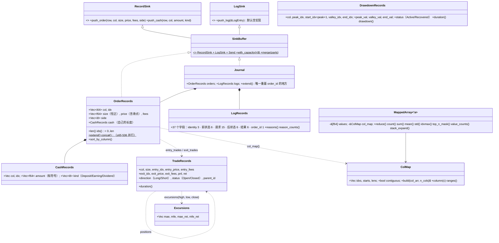

# 第 4 章 记录：`barq-records`

[← 总览](README.md) · [上一章：模拟循环](03-sim.md) · [下一章：分析](05-analysis.md)

## 4.1 定位

`barq-records` 是模拟层和分析层之间的**契约**，也是将来事件驱动层与向量化层之间的契约：两层都只产出这里定义的记录格式，分析层只读这里定义的格式。
里面有两类东西：

- **原始记录**：`OrderRecords`（成交）、`CashRecords`（非成交的现金流）、`LogRecords`（每笔被考虑的订单的前后状态），以及把它们收进去的 `RecordSink` / `SinkBuffer` trait。
- **派生视图**：`TradeRecords`（三种交易视图）、`DrawdownRecords`（回撤段）、`Excursions`（每笔交易的 MAE/MFE），以及按列分组的工具 `ColMap` / `MappedArray`。

全部是结构体数组（SoA），列主序发出，**id 就是下标**（`lib.rs:1-29`）。

## 4.2 文件与阅读顺序

| 顺序 | 文件 | 行数 | 读什么 | 第一遍可跳过 |
|---|---|---:|---|---|
| 1 | `src/lib.rs` | 383 | 1–29 行三个契约（SoA、列主序发出、`id == index`）；`RecordSink`/`SinkBuffer` 55–94；`OrderRecords` 136–157；`extend` 210–218；`sort_by_column` 220–243；`concat` 252–305 | — |
| 2 | `src/cash.rs` | 135 | 全部；`CashRecords` 藏在 `OrderRecords.cash` 里的理由（19–23） | — |
| 3 | `src/mapped.rs` | 991 | `ColMap::build` 72–110、`ranges` 175–181、`MappedArray::for_each_column`/`reduce` 240–269 | `extreme_n_mask` 358–458、`arg_extreme` 607–627（第二遍） |
| 4 | `src/trades.rs` | 957 | 先 `trade_stats` 78–94（PnL 公式），再 `exit_trades` 502–628（默认视图）、`entry_trades` 368–486、`positions` 639–697 | — |
| 5 | `src/drawdowns.rs` | 462 | `find_drawdowns` 247–324，再访问器 137–206 | — |
| 6 | `src/excursions.rs` | 375 | 57–146 | — |
| 7 | `src/logs.rs` | 729 | 只读 `Journal::extend` 464–474（`order_id` 重基）；37 个字段当表查 | 其余 |
| 8 | `tests/parity_trades.rs`、`tests/parity_mapped.rs` | — | 看 28,367 行 mapped fixture 怎么钉住平局规则 | — |

测试名是最好的边界说明：`a_break_even_round_trip_has_exactly_zero_pnl`、`an_exit_one_ulp_short_closes_the_whole_position`。

## 4.3 类图



## 4.4 核心算法一：合并每线程缓冲（`lib.rs:252-305`、`logs.rs:464-484`）

```text
OrderRecords::concat(parts):
    total < 65,536 或 parts < 2 → 逐个 extend（含各自的 cash）
    否则：六个 Vec 用零填充到 total（calloc 惰性映射，首次写入的线程拥有物理页）
          cash 串行拼接；std::thread::scope 里每个 part 一个线程，
          split_at_mut 切出互不重叠的区间，copy_from_slice —— 借用检查器证明不相交，没有 unsafe
Journal::extend(other):
    offset = self.orders.len()   ← 追加之前
    追加 orders 与 logs；本次追加的日志里 order_id ≥ 0 的加 offset，−1 不动
```

每个线程的缓冲从 0 开始编号成交；不重基，日志会指向一个"看起来合理但错误"的成交。只有 `Journal` 知道偏移，`LogRecords::concat` 自己**不**重基。

## 4.5 核心算法二：`ColMap::build` 稳定计数排序（`mapped.rs:72-110`）

```text
第一趟：校验 0 ≤ c < n_cols；lens[c] += 1；遇到 c < 上一个 c 就标记 contiguous = false
第二趟：starts = lens 的前缀和（独占）
第三趟：按原始顺序把记录下标散列到 idxs[starts[c] + filled[c]]   ← 按原顺序访问，所以稳定
```

O(n + n_cols)。`ranges()` 只在 `contiguous` 时返回 `Some`，此时 `for_each_column` 直接把 `&values[start..end]` 交给闭包，零拷贝；否则收集到一个按 `max_col_len` 预分配、跨列复用的暂存区。两条路径结果相同（测试 `the_two_paths_agree`）。这个引擎按构造就是列主序发出，所以几乎总走快路径；慢路径给合并过、过滤过、外来的记录用。

`MappedArray` 的归约细节：`count` 连 NaN 一起数（唯一一个）；`sum` 全 NaN 给 0（同 `nansum`）；`std(ddof)` 先算总体方差再按 `n/(n−ddof)` 缩放，为了和参考实现逐位一致；`idxmax` 把 NaN 替换成 −inf 而不是跳过；`top_n_mask` 用 `select_nth_unstable_by` 找第 k 个顺序统计量（期望 O(n)），平局从**末尾**取，`bottom_n_mask` 从**开头**取——这是 vectorbt `top_n_inout_map_nb` 的不对称性，由 fixture 钉死。

## 4.6 核心算法三：三种交易视图（`trades.rs`）

共用的 PnL 公式（78–94）：

```text
entry_val = size × entry_price；exit_val = size × exit_price
val_diff  = add(exit_val, −entry_val)        ← 容差加法：盈亏平衡的往返精确为 0
Short 则 val_diff = −val_diff
pnl = val_diff − entry_fees − exit_fees
ret = pnl / entry_val
```

没有 `add`，一次平手往返的残差是 5.7e-14，会被 `pnl > 0` 数成一次"盈利"。

前置条件：记录按列分组、行递增（`column_ranges` 要求 `ColMap` 连续，否则 `Err`）；`size > 0`、`price > 0`。`Buy` 开多、`Sell` 开空；与持仓同向的成交是进场，否则是出场。

| 视图 | 一条记录 = | 分配规则 | 关键细节 |
|---|---|---|---|
| `entry_trades` 368–486 | 一笔**进场**成交 | 出场按 FIFO 回填到各进场 | 所有进场共享一个加权平均出场价和一个 `exit_idx`；出场费按进场数量比例分摊；一笔成交同时平仓又反向时，平仓部分取 `remaining/size × fees`，剩余部分开新仓且 `first_entry_size = opened`（同一个成交下标成为新仓的 `first`，`flush` 用它避免被按全额计数） |
| `exit_trades` 502–628 | 一笔**出场**成交 | 进场取加权平均 | `entry_price = entry_gross_sum / entry_size_sum`；出场数量与持仓差一个 ULP 时钉成整仓；部分出场后三个进场累加量按 `kept = (entry_size_sum − size)/entry_size_sum` 缩放，剩余仓位保持平均成本并卸掉已归属的费用；反向时平掉的部分带走全部 `entry_fees_sum` |
| `positions` 639–697 | 一个 `parent_id` | 把上面任一视图里连续相同 `parent_id` 的记录合并 | 单条记录 `push_copy` 逐位复制（避免 `5.128 × 58.78 / 5.128 != 58.78`）；多条时数量求和、价格按数量加权、费用求和、方向与状态取最后一条 |

未平仓位在末尾按最后一根 `close` 标记：`exit_idx = n_rows − 1`、无出场费、状态 `Open`。
三种视图只在 **Σ pnl** 上一致，数量、每笔 `ret`、胜率都可以不同（`trades.rs:11-19`）。`parent_id` 跨列全局递增；`positions` 的输出 `parent_id` 等于输出下标，所以 positions 的 positions 是恒等。

## 4.7 核心算法四：回撤段（`drawdowns.rs:247-324`）

```text
每列：started=false，peak=(−1, ts[0])，valley=peak
对每个非 NaN 的 bar i：
    cur ≥ peak_val（或 peak 是 NaN）：
        started → 记一段 Recovered（等于峰值也算恢复）
        否则     → 延长峰值（平顶延长峰值，不开新段）
    否则 started → cur < valley_val 时更新谷底
    否则          → 开一段：started=true，valley=(i, cur)
    最后一根仍 started → 记一段 Active
    记录后：peak = valley = (i, cur)   ← 关闭一段的那根是下一段的峰
```

`start_idx = peak_idx + 1`。时长规则：`duration = end − start`（Recovered，结束那根已回到水面之上）/ `end − start + 1`（Active，最后一根仍在水下）；一条规则套两种会把平均偏掉一根。`drawdown = (valley − peak)/peak`。陷阱：末尾是 NaN 的列，"最后一根"的判断不会执行，尚未结束的那段会被**丢弃**。

## 4.8 核心算法五：MAE / MFE（`excursions.rs:67-127`）

每笔交易在 `entry..=exit` 上（`Open` 以状态为准延伸到最后一根）：`hi = lo = entry_price` 起步，逐行 `hi = max(hi, high 或 close)`、`lo = min(lo, low 或 close)`；多头 `mfe = hi − entry`、`mae = lo − entry`，空头镜像；再除以 `entry_price` 得收益率版本。进场与出场那根的整个区间都算进去，对 MAE 偏保守。`edge_ratio = mean(mfe_ret) / mean(|mae_ret|)`。

## 4.9 阅读陷阱

1. **id 是隐式的**：四种记录的 `ids()` 都是 `0..len`，任何过滤或重排都改 id。`LogRecords.order_id` 是唯一存储的交叉引用，相对于写入它的缓冲区。
2. **共享组重排后日志失配**：`Portfolio::from_grouped_records` 对订单按 `(col, idx)` 重排，日志不动，之后 `order_id` 不再索引排序后的订单。
3. **拒单的日志 `res_*` 是 NaN**，`LogRecords: PartialEq` 因此在任何有拒单的运行里对自己都不相等；`res_side`、`res_status_info` 用 −1 表示无。
4. **默认交易视图是 `ExitTrades`**（`Scoring.trades_type`），`Positions` 从出场视图构建。
5. **未平仓交易**计入 `Total Trades` 和 `Σ pnl`，但除非 `incl_open` 否则不进质量指标；`duration` 对开仓交易加 1。
6. `top_n` 平局从末尾取、`bottom_n` 从开头取。
7. 回撤段在末尾 NaN 处被丢弃。
8. `Journal::with_capacity` 不预分配日志（理由在 `lib.rs:111-116`）。

## 4.10 与 vectorbt 1.1.0 的对应

| barq | vectorbt | 证据 |
|---|---|---|
| `entry_trades` / `exit_trades` / `positions` | `portfolio/nb.py::get_entry_trades_nb` / `get_exit_trades_nb` / `get_positions_nb` | `tests/parity/generate_trades.py` |
| `find_drawdowns` | `generic/nb.py::drawdowns_nb` | `generate_drawdowns.py` |
| `ColMap::build` | `records/nb.py::col_map_nb` | `generate_mapped.py` |
| `MappedArray::reduce` / `reduce_to_idx` / `top_n_mask` / `bottom_n_mask` / `idxmax` | `reduce_mapped_nb` / `reduce_mapped_to_idx_nb` / `top_n_inout_map_nb` / `bottom_n_inout_map_nb` / `argmax_reduce_nb` | 同上，28,367 行 |
| `LogRecords` 37 字段 | `log_dt` 的 38 字段去掉 `id` | `logs.rs:681-728` |
| `CashRecords`、`Excursions`、`edge_ratio` | 无 | barq 新增 |
| `reduce_to_idx` 全 NaN 列返回 `fill` | 参考实现抛异常 | `mapped.rs:278-281` |

## 4.11 延伸资料

- vectorbt 文档 "Trades"（EntryTrades / ExitTrades / Positions 的区别）与 "Records / MappedArray"：<https://vectorbt.dev/api/portfolio/trades/>、<https://vectorbt.dev/api/records/>。
- FIFO 与平均成本的交易匹配：任何券商的盈亏计算说明（例如 Interactive Brokers 的 "FIFO vs. LIFO vs. Average Cost"）。
- John Sweeney, *Maximum Adverse Excursion*（1996）；Curtis Faith, *Way of the Turtle*（2007）的 E-ratio 一节（`edge_ratio` 的来源）。中译本《海龟交易法则》。
- 计数排序：CLRS 第 8.2 节；OI Wiki "计数排序"。CSR（compressed sparse row）布局是 `ColMap` 的同构物。
- Rust `split_at_mut` 与作用域线程做无 `unsafe` 的并行拷贝：Rust 标准库文档。
- 更多见 [11-references.md](11-references.md) §D。

## 4.12 自测

1. 一列成交：买 10@100、卖 4@110、卖 6@90。写出 `entry_trades` 与 `exit_trades` 各有几条记录、各自的 `pnl` 和 `ret`。
2. 同一列：买 10@100、卖 15@110（反向）。两种视图里 `parent_id` 怎么分配？第二笔的费用怎么拆？
3. 净值 `[100, 110, 105, 110, 120, 115]`：`find_drawdowns` 产生几段？各自的 `duration`？
4. 为什么 `ColMap::build` 要三趟而不是直接 `sort_by_key`？稳定性在哪一趟保证？
5. 两个线程各产生 3 条日志，第二个线程的 `order_id = [0, −1, 1]`，合并后变成什么？
