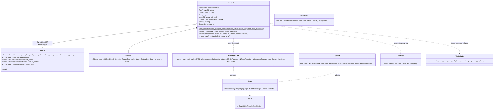

# 第 5 章 分析：`barq-analysis`

[← 总览](README.md) · [上一章：记录](04-records.md) · [下一章：因子引擎](06-expr.md)

## 5.1 定位

`barq-analysis` 只做一件事：**从记录重建一切**。`Portfolio` 存的只有订单记录、借来的收盘价、形状、账户组、初始现金和评分设置；现金、持仓、净值、收益、回撤、交易、指标都是按需从记录派生并缓存在 `OnceLock` 里。
这是"记录是唯一来源"这条约定的落地：凡是改变现金或持仓的事情（成交、入金、分红、收支）都已经是记录，分析层不需要知道模拟层的任何参数。

内容分五块：重建链（`series.rs`、`portfolio.rs`）、指标（`metrics.rs`、`benchmark.rs`、`rolling.rs`、`trade_stats.rs`）、统计表注册表（`stats.rs`）、扫描结果汇总（`aggregate.rs`）、独立的稳健性与事件研究（`robust.rs`、`events.rs`）。

## 5.2 文件与阅读顺序

| 顺序 | 文件 | 行数 | 读什么 | 第一遍可跳过 |
|---|---|---:|---|---|
| 1 | `src/series.rs` | 597 | 6–11 行的链路图；然后按顺序 `asset_flow`→`assets`→`cash_flow`→`cash`→`asset_value`→`value`→`period_return`→`returns_with_deposits`（74–380） | `free_cash_flow` 191–242（回放负债） |
| 2 | `src/portfolio.rs` | 1,246 | `Scoring` 56–88、`Cache` 98–112、`Portfolio` 146–157、`build` 263–314、链路方法 534–662、`trades`/`drawdowns` 773–813、`stats_input` 942–968、敞口 664–764 | `from_borrowed` 240–260（第 9 章再看） |
| 3 | `src/metrics.rs` + `src/percentile.rs` | 535 + 237 | 每个指标的公式；`percentile` 43–79 的 Numba 拼写 | `extreme_with_infinities` 117–147 |
| 4 | `src/trade_stats.rs` | 185 | 51–98 | — |
| 5 | `src/stats.rs` | 939 | 类型与 `Select` 45–235；注册表 323–557 | 单元测试 |
| 6 | `src/benchmark.rs`、`src/rolling.rs` | 269、364 | 公式；`rolling_apply_1d` 在 `barq-generic/src/rolling.rs:71-99` | 宏体 |
| 7 | `src/aggregate.rs` | 262 | 16–37 行的 +inf 陷阱；`group_by`、`best_column` | — |
| 8 | `src/robust.rs`、`src/events.rs` | 562、334 | 独立模块，只依赖 `nanmean`/`nanstd` | `erfc` 内部 62–89 |
| 9 | `tests/cash_flows.rs`、`tests/exposure.rs`、`tests/shared_accounts.rs` | — | 手算账户、守恒检查 | — |

## 5.3 类图



## 5.4 核心算法一：重建链（`series.rs`、`portfolio.rs:534-662`）


```text
asset_flow(orders, direction)      每笔成交：signed = ±size；new_position = add(position, size)；
                                    Both 下流量 = size；LongOnly/ShortOnly 下用 long_size/short_size 把反向拆成平仓腿和开仓腿；
                                    同一格累加用 add，所以一根 K 线内平手往返精确为 0；换列时持仓重置（依赖列主序）
assets          = 每列 asset_flow(Both) 的 add 累计
cash_flow       = 每笔成交 −size × price − fees，再加上 CashRecords 的 amount
deposits        = 只取 Deposit 类的流（没有则 None → 无入金路径与旧链逐位一致）
cash            = running = init_cash；running = add(running, flow[t])            按账户组求和后再跑
asset_value     = close × assets；共享账户时 assets == 0 的格子钉 0（防 NaN 收盘价污染整组），再按组求和
value           = cash + asset_value                                            （普通 +，不是 add）
period_return   = (after − before)/before；before == 0 时：after == 0 → 0，否则 ±inf；before < 0 时翻号
returns         = r[t] = value[t] / (value[t−1] + deposit[t]) − 1，第 0 根从 init_cash + deposit[0] 起
```

有入金时的三条调整（`portfolio.rs`）：总收益改为 `Π(1 + r) − 1` 连乘而不是 `end/init − 1`；回撤在 `compounded_value = init × Π(1 + r)` 上找（"出金不是回撤，入金不是恢复"）；没有入金时这些路径逐位等于旧链。

`free_cash_flow`（191–242）从记录回放内核的 `debt`：开空 `debt += short_size × price`、`diff = add(final_cash, −2 × short_value)`；平空 `avg_entry = debt/|position|`、`diff = add(2 × debt_diff, final_cash)`。`tests/cash_flows.rs` 检查每条日志里内核看到的 `cash`/`free_cash` 等于从记录重建的余额——这是"记录是唯一来源"的守恒测试。

敞口家族（664–764）：`allocations = column_asset_value / value[group]`；`long_exposure`/`short_exposure` 分别对 `max(v,0)`、`max(−v,0)` 按组求和再除以总净值；`net = long − short`，`gross_long_short = long + short`；旧的 `gross_exposure` 分母是 `|asset_value| + free_cash`，保持不变。`position_coverage` 是按**标的列**而不是按账户。

## 5.5 核心算法二：指标公式（`metrics.rs`、`benchmark.rs`、`trade_stats.rs`）

记 `r` 为收益列、`n` 为非 NaN 根数、`A = ann_factor`（默认 365）、`rf = risk_free`（每根）。

| 指标 | 公式 | 边界 |
|---|---|---|
| `nanstd(r, ddof)` | `sqrt(Σ(x−mean)²/n × n/(n−ddof))` 先总体再缩放（参考实现的拼写） | `n ≤ ddof` → NaN |
| `total_return` | `Π(1+r) − 1` | |
| `annualized_return` | `(Π(1+r))^(A / len) − 1`，**`len` 含 NaN 根** | 空 → NaN |
| `annualized_volatility` | `nanstd(r,1) × √A` | `len < 2` → NaN |
| `max_drawdown` | `cum = Π(1+r)`，`level = 100 × cum`，`dd = level/runmax − 1` 的**NaN 传播**最小值 | 唯一传播 NaN 的指标：净值到无穷的列不能答 0 |
| `sharpe_ratio` | `nanmean(r − rf) / nanstd(r − rf, 1) × √A`（不分配，`nanmean_nanstd_shifted`） | `std == 0` → **+inf** |
| `downside_risk` | `sqrt(Σ min(r − req, 0)² / count) × √A` | |
| `sortino_ratio` | `nanmean(r − req) × A / downside_risk` | `risk == 0` → +inf；注册表传 `req = 0` |
| `calmar_ratio` | `annualized_return / |max_drawdown|` | `mdd == 0` → NaN |
| `omega_ratio` | `Σ(r − rf − thr)⁺ / Σ(r − rf − thr)⁻`，`thr = (1+req)^(1/A) − 1` | 分母 0 → +inf |
| `tail_ratio` | `|P95| / |P5|` | |
| `value_at_risk` | 去 NaN 后 `percentile(5%)` | |
| `cond_value_at_risk` | **不去 NaN**，`cutoff = floor((len−1) × 0.05)`，NaN 排最后，取前 `cutoff+1` 个的均值 | 尾部有 NaN → NaN |
| `percentile(v, q)` | `rank = 1 + (n−1)q/100`，`lower × (1−m) + upper × m`——NumPy 默认线性插值（Hyndman–Fan type 7）的 Numba 拼写 | 任一 NaN → NaN |
| `information_ratio` | `nanmean(r − b) / nanstd(r − b, 1)` | std 0 → +inf |
| `beta` | `b` 在 `r` 为 NaN 处也置 NaN；`cov = nanmean((b − mean b) × r)`，`var = nanmean((b − mean b)²)` | `var < 1e-30` → NaN |
| `alpha` | `(nanmean((r − rf) − β(b − rf)) + 1)^A − 1` | |
| `up/down_capture` | 只取 `b > 0` / `b < 0` 的根，年化收益之比 | |
| `TradeStats` | `wins = pnl > 0`、`losses = pnl < 0`（平手两边都不算）；`profit_factor = Σwins/|Σlosses|`；`expectancy = win_rate × avg_win − (1 − win_rate) × |avg_loss|`；**`sqn = √count × mean(pnl) / std(pnl, 1)`** | 无亏损 → +inf |

`rolling.rs` 的每个滚动指标都是标量版在每个尾窗上**朴素**地跑（`rolling_apply_1d`，O(n·w)，百分位类 O(n·w·log w)），因为百分位、回撤、回归需要整个窗口在手；最后一个完整窗口与标量版逐位相等。

## 5.6 核心算法三：统计表注册表（`stats.rs:323-557`）

`static DEFAULT_METRICS: &[Metric]`，28 行，每行 `key / title / tags / compute`，顺序和标题是 vectorbt `Portfolio.stats()` 的，由 `tests/parity_stats.rs` 逐行钉住。
`Select` 过滤：`keys ∧ 全部 require 标签 ∧ 无 exclude 标签`，未入选的指标**不计算**。
"合格交易"（266–274）= 本列已平仓的交易，除非 `incl_open`；它作用于第 16–24 行（胜率、最好/最差、平均盈亏、时长、盈亏比、期望），不作用于三个计数和未平仓盈亏。
`Max Drawdown [%]` 被取反成正数（其他所有回撤数字都是负的）。`BENCHMARK_METRICS`（568–614）另成一表：`beta, alpha, information_ratio, up_capture, down_capture`。

## 5.7 核心算法四：扫描汇总与 +inf 陷阱（`aggregate.rs`）

`group_by(columns, level, values, Reduce)` 用第 1 章的 `group_indices` 按标签归约；`best_column` 用 `argmax` 并用 `columns.describe(col)` 命名赢家。
陷阱（16–37）：没交易的列收益 0、波动 0 → Sharpe `+inf`，`argmax` 和 `Reduce::Mean` 都不跳过无穷，于是它登顶并把组均值变成无穷。解法是先 `Portfolio::traded_only(&values)`，把零交易的列置 NaN（所有归约都跳过 NaN）。`sortino`、`omega`、`tail_ratio`、`information_ratio`、`capture`、`profit_factor` 都有同样的 +inf 出口。

## 5.8 核心算法五：过拟合检验（`robust.rs`）

这里的 Sharpe 都是**每根 K 线**的 `mean/std(ddof=1)`，不年化、无无风险利率。

```text
PSR(SR*) = Φ( (SR − SR*) × √(n−1) / √(1 − γ₃·SR + (γ₄ − 1)/4 · SR²) )
           γ₃ = m₃/m₂^1.5，γ₄ = m₄/m₂²（总体中心矩；γ₄ 是原始峰度，正态 = 3）
E[max SR] ≈ √V × ( (1−γ) Φ⁻¹(1 − 1/N) + γ Φ⁻¹(1 − 1/(N·e)) )，γ = 0.5772…（Euler–Mascheroni）
           N 次真实 Sharpe 为 0 的独立试验，仅凭运气会看到的最大 Sharpe；N = 1 → 0
DSR      = PSR(E[max SR])，N 与 V 来自全部试验的 Sharpe（非 NaN 个数与 ddof=1 方差）
PBO (CSCV)：
    行切成 S 个（≤ 16，偶数）近等长块；预计算每列每块的和与计数
    枚举所有 C(S, S/2) 种"取一半块做样本内"的划分：
        样本内赢家 = 样本内**平均收益**最高的列（不是 Sharpe：短块的 Sharpe 噪声大，零方差列会以 ∞ 取胜）
        它在样本外的平均排名 rank ∈ [1, n_cols]（1 最差，并列取平均）；ω = rank/(n_cols+1)；λ = ln(ω/(1−ω))
    PBO = #{λ ≤ 0} / #划分
```

数值细节：`norm_cdf = ½ erfc(−x/√2)` 保住下尾的相对精度；`erfc` 在 `|z| < 2.5` 用全正项级数，否则用 Laplace 连分式（100 项）；`norm_ppf` 用 Acklam 有理逼近（相对误差 < 1.15e-9）再做一步 Halley 迭代，往返精度约 1e-13。

## 5.9 核心算法六：事件研究（`events.rs`）

`forward_paths(close, events, before, after)`：对每个 `events[t]` 为真的 `(col, t)`，在偏移 `−before..=after` 上记录 `close[t+k]/close[t] − 1`，越界补 NaN（边界事件保留而不是丢弃）；输出行主序，一事件一行。`mean_path`/`median_path` 按偏移聚合，`hit_rate(offset)` 是该偏移上 `> 0` 的比例（恰好 0 不算命中）。它**读未来**，只做分析，不能喂给信号。

## 5.10 调用链

```text
simulate_* ──记录──▶ Portfolio::from_orders / from_signals（threads > 1 走并行）
                     └─ from_grouped_records：共享组则 sort_by_column
                          └─ build：校验分组、ColMap、行数、现金记录；group_init_cash 取组首列
Cache（OnceLock，每个序列只算一次）：
  assets ← series::assets(orders)
  cash   ← series::cash(sum_groups(cash_flow(orders)), group_init_cash)
  column_asset_value ← close × assets（共享时 assets==0 处钉 0）
  asset_value ← 共享 ? sum_groups(column_asset_value) : column_asset_value
  value ← cash + asset_value；deposits ← sum_groups(series::deposits)
  returns ← returns_with_deposits(value, init, deposits)
  trades ← 按 scoring.trades_type；account_trades ← 共享时 col ↦ group
  drawdowns ← find_drawdowns(有入金 ? compounded_value : value)
每账户指标：map_returns(metrics::*)；trade_stats::per_column(account_trades)
stats_input(col) → stats::stats(&input, &Select) → Vec<(title, Value)>
扫描：Vec<f64> → traded_only → aggregate::group_by / best_column
```

`from_borrowed(&OrderRecords, &Cache)`（240–260）是 Python 层的路径：Python 对象拥有价格与记录，每次调用重建一个借用它们的 `Portfolio<'a>`，派生结果留在调用方的 `Cache` 里供下次复用。它要求记录已经是列主序（不排序，因为排序要每次重复）。`with_scoring` 改 `trades_type` 时，借来的缓存会换成私有缓存而不是改动出借方的。

## 5.11 阅读陷阱

1. **`ann_factor` 默认 365**（加密货币），股票约 252。
2. `annualized_return` 的指数分母**含 NaN 根**；`cond_value_at_risk` 的 cutoff 也数 NaN 根，但 `value_at_risk` 去掉它们。
3. `max_drawdown` 是唯一传播 NaN 的指标；`percentile` 任一 NaN 就 NaN。
4. `beta` 对方差 < 1e-30 返回 NaN 而不是 +inf（那条 inf 分支不可达）。
5. 统计表里 `Max Drawdown [%]` 是正数，其余回撤数字是负数。
6. `buy_and_hold()` 按标的列，`with_benchmark` 要的是每**组**一列。
7. 共享组无入金时 `account_total_return` 用 `(end − init)/init`（跨缺失估值根保住 PnL），有入金时连乘。
8. 第 4 章的所有记录陷阱（隐式 id、视图不一致、未平仓标记）在这里都会表现为"数字对不上"。

## 5.12 与 vectorbt 1.1.0 的对应

| barq | vectorbt | fixture |
|---|---|---|
| `series::asset_flow / assets / cash_flow / cash / asset_value / value` | `portfolio/nb.py::asset_flow_nb / cumsum / cash_flow_nb / cash_nb / asset_value_nb / value_nb` | `generate_analysis.py` |
| `series::returns` | `returns/nb.py::returns_nb` | 同上 |
| `metrics::*` | `returns/nb.py::{annualized_return, annualized_volatility, max_drawdown, sharpe_ratio, sortino_ratio, calmar_ratio, downside_risk, ...}_nb`（血统是 Quantopian 的 empyrical） | `generate_metrics.py` |
| `rolling::rolling_*`（18 个） | `returns/nb.py::rolling_*_nb` | 同上 |
| `stats::DEFAULT_METRICS` | `Portfolio.stats()` 的 28 行 | `generate_stats.py` |
| `percentile` | Numba 编译的 `np.percentile` | `percentile.rs:9-22` |
| `CashRecords` 相关、敞口家族（除 `gross_exposure`）、`robust.rs`、`events.rs` | 无 | 手算测试 |
| `Value::Missing`、`Start`/`End` 为 bar 下标、`ann_factor` 代替 `freq` | 形式差异 | — |

## 5.13 延伸资料

- Bailey & López de Prado, "The Sharpe Ratio Efficient Frontier"（*Journal of Risk*, 2012）—— PSR。
- Bailey & López de Prado, "The Deflated Sharpe Ratio: Correcting for Selection Bias, Backtest Overfitting and Non-Normality"（*Journal of Portfolio Management*, 2014）—— E[max SR] 与 DSR。
- Bailey, Borwein, López de Prado & Zhu, "The Probability of Backtest Overfitting"（*Journal of Computational Finance*, 2017；SSRN 2014）—— CSCV 与 PBO。
- López de Prado, *Advances in Financial Machine Learning*（Wiley, 2018）第 11–14 章。作者在 SSRN 上有配套的 Cornell ORIE 5256 课程幻灯片（"Advances in Financial Machine Learning: Lecture 1/10" 等，共 9 讲）；同作者的《面向资产管理者的机器学习》有机械工业出版社中译本（2021）。
- Peter J. Acklam, "An algorithm for computing the inverse normal cumulative distribution function"（2003，网页）；Abramowitz & Stegun §7.1（erf/erfc）；Numerical Recipes §6.2。
- Keating & Shadwick, "A Universal Performance Measure"（2002）—— Omega；Sortino & van der Meer (1991)；Terry Young, "Calmar Ratio"（*Futures*, 1991）；Rockafellar & Uryasev (2000) —— CVaR。
- Van Tharp, *Trade Your Way to Financial Freedom* —— SQN 与期望值；中译本《通向财务自由之路》。
- MacKinlay, "Event Studies in Economics and Finance"（*JEL*, 1997）。
- Hyndman & Fan, "Sample Quantiles in Statistical Packages"（*American Statistician*, 1996）—— `percentile` 的 type 7。
- empyrical 源码（Quantopian）：`vectorbt.returns.nb` 的公式出处。
- 更多见 [11-references.md](11-references.md) §E。

## 5.14 自测

1. 两根 K 线、收盘 `[10, 12]`、`init_cash = 100`、第 0 根买 5@10（无费用）：手工写出 `assets`、`cash`、`value`、`returns`。
2. 同上，但第 1 根开盘入金 50：`returns[1]` 是多少？总收益是多少？
3. 为什么 `pbo_cscv` 的样本内赢家用平均收益而不是 Sharpe？
4. 1,000 组参数、每根 Sharpe 的方差 0.01：`E[max SR]` 约等于多少？（用 `norm_ppf(0.999) ≈ 3.09`、`norm_ppf(1 − 1/(1000e)) ≈ 2.78` 估算。）
5. 一列从未交易，`sharpe_ratio` 返回什么？`group_by(Mean)` 会怎样？怎么避免？
