# 第 6 章 因子表达式引擎：`barq-expr`

[← 总览](README.md) · [上一章：分析](05-analysis.md) · [下一章：信号 · 指标 · 通用算子](07-generic-indicators-signals.md)

## 6.1 定位

`barq-expr` 把 Qlib 风格的表达式字符串（`"$close / Mean($close, 20) - 1"`）变成时间 × 标的的因子矩阵。四个阶段：

1. **解析**（`parse.rs`）：Pratt 解析器 → `Expression` 语法树。
2. **编译**（`graph.rs`）：整组因子合并成一张去重的依赖图，常量折叠，`Ref` 视图，暂存槽位调度。
3. **求值**（`eval.rs` + `window.rs` + `order.rs`）：按标的（列）用 rayon 并行走图，每个算子一个 O(1)/行或 O(log n)/行的核。
4. **Polars 后端**（`polars_backend.rs`，可选特性）：独立交叉验证。

它是仓库里**算法密度最高**的 crate：一个 Pratt 解析器、一个带寄存器分配味道的调度器、八个增量累加器、一个单调队列、一个有序环和一棵树状数组。读完它等于读完一本小型"数值计算 + 编译器"实践教材。

```rust
let factors = FactorSet::compile([("trend", "$close / Mean($close, 20) - 1")])?;
let values  = factors.evaluate(&FactorInputs::from_ohlcv(&panel)?)?;
let trend: &Matrix = values.get("trend").unwrap();     // time × symbol
```

## 6.2 文件与阅读顺序

| 顺序 | 文件 | 行数 | 读什么 | 第一遍可跳过 |
|---|---|---:|---|---|
| 0 | `ARCHITECTURE.zh-CN.md §5` | — | 作者自己的两页总结；先读它，代码就是印证而不是惊讶 | — |
| 1 | `src/lib.rs` | 378 | `FactorSet` 四个入口 34–128；测试 131–378 钉住的算子语义（`Ref(x,0)` 恒等、`Mean(x,0)` 扩展、`If` 与 `&`） | — |
| 2 | `src/parse.rs` | 291 | 从头到尾；绑定力表 224–232 | — |
| 3 | `src/graph.rs` | 629 | 类型 37–154 → `Builder::node`/`call` 288–451 → `intern`/`fold` 251–286 → **`schedule` 185–240** → 5 个测试 541–629（调度器最清楚的规格） | — |
| 4 | `src/eval.rs` | 1,133 | `evaluate` 169–216 → `run_column` 318–403 → `Arg`/`Seg`/`segments` 238–315 → `step` 420–472 → `binary_series` 510–546 → `rolling_into` 556–588 | 参考归约器 590–849（但它们是每个增量核必须匹配的"可执行定义"，第二遍务必回来读）；压力测试 851–1133 |
| 5 | `src/window.rs` | 564 | 模块文档 1–22 → `slide_into` 49–70 → `Moments` 75–163 → `Sum`/`Count` → `Deviation` → `Wma` → `Regression` → `Pair` → `Shape` | — |
| 6 | `src/order.rs` | 354 | 文档 1–28 → `ordered_into` 40–62 → `ring` 69–118 → `Ordered` 120–241 → `rolling_arg_extreme_into` 246–298 | 树状数组只在窗口 > 256 时用，Alpha158 永远碰不到 |
| 7 | `src/alpha158.rs`、`src/alpha360.rs`、`tests/parity_qlib.rs` | 130、118 | 特征集怎么生成、Qlib 预言机怎么用 | — |
| 8 | `src/polars_backend.rs` | 466 | 最后读；路线图说它"只在下游需要 Polars 时存在" | — |
| 9 | `crates/barq-py/src/expr.rs`、`python/barq/__init__.py:64-176` | — | Python 路径 | — |

## 6.3 类图

```mermaid
classDiagram
  direction TB
  class Expression {
    <<enum>>
    Number(u64 bits)
    Field(String 小写)
    Unary(char, Box)
    Binary(String, Box, Box)
    Call(String, Vec)
    +fields() uses_future()
  }
  class FactorSet {
    -Vec~(String, Expression)~ factors
    -Graph graph
    +compile(iter)$ names() required_fields() uses_future()
    +evaluate(&FactorInputs) FactorValues
    +evaluate_with(&dyn ComputeBackend)
  }
  class FactorInputs~'a~ { -n_rows, n_cols; -HashMap~String, &[f64]~ fields; +new()$ from_ohlcv()$ with_field() }
  class FactorValues { -Vec~String~ names; -Vec~Arc~Matrix~~ values; +get(name) iter() into_matrices() }
  class Graph { +Vec~Node~ nodes（依赖序）; +Vec~NodeId~ outputs; +Vec~String~ fields; +usize slots; +compile()$ -schedule() }
  class Node { +Op op; +Vec~NodeId~ inputs; +Option~usize~ slot; +Vec~usize~ outputs; +bool read; +Option~(NodeId, usize)~ view }
  class Op {
    <<enum>>
    Field(usize)
    Const(u64)
    Unary(UnaryOp) Binary(BinaryOp) If
    Ref(i64) Delta(usize)
    Ema(Option~u64~)
    Rolling(Rolling, Window)
    Pair(corr, window)
  }
  class Builder { -nodes; -HashMap~(Op, Vec~NodeId~), NodeId~ interned; -fields; +intern() fold() node() call() }
  class ComputeBackend { <<trait>> +name() +evaluate(&FactorSet, &FactorInputs) }
  class NativeBackend
  class PolarsBackend
  class Scratch { +Vec~Vec~f64~~ slots（graph.slots 个）; +Vec~Vec~f64~~ spare（2 个） }
  class Accumulator~T~ { <<trait>> +rebuild(window, start) +push(row, v) +pop(row, v) +value(window, start) }
  class Moments { +shift; +count; +sum; +sum_sq; +last; +run; +constant() centered_sq() std(ddof) }
  class Ordered { +Vec~f64~ sorted; +Vec~Option~usize~~ position; +Vec~u32~ counts（BIT）; +Vec~f64~ sums（BIT）; +kth(k) prefix(end) quantile(q) rank(v) mad() }

  FactorSet *-- Expression
  FactorSet *-- Graph
  Graph *-- Node
  Node --> Op
  Builder ..> Graph : compile
  FactorSet ..> FactorInputs
  FactorSet ..> FactorValues
  ComputeBackend <|.. NativeBackend
  ComputeBackend <|.. PolarsBackend
  NativeBackend ..> Scratch : for_each_init
  Accumulator <|.. Sum
  Accumulator <|.. Count
  Accumulator <|.. Deviation
  Accumulator <|.. Wma
  Accumulator <|.. Regression
  Accumulator <|.. Pair
  Accumulator <|.. Shape
  Deviation *-- Moments
  Regression *-- Moments
  Pair *-- Moments : ×4
  Shape *-- Moments
```



## 6.4 核心算法一：Pratt 解析器（`parse.rs:67-242`）

入口 `parse(source)`：长度 ≤ 16 KiB → `lex` → `expression(min_bp=0, depth=0)` → 必须到达 `End` → `validate`（算子名与元数）。
词法：`$name` 小写化；数字接受 `1e-3`；标识符大小写敏感（`mean(` 在 `validate` 失败）；裸的 `close` 是错误，字段必须写 `$close`。

绑定力表（224–232），`(left_bp, right_bp)`：

| 算子 | left | right | 结合 |
|---|---|---|---|
| `\|` | 1 | 2 | 左 |
| `&` | 3 | 4 | 左 |
| `> < >= <= == !=` | 5 | 6 | 左（`a<b<c` = `(a<b)<c`） |
| `+ -` | 7 | 8 | 左 |
| `* /` | 9 | 10 | 左 |
| 前缀 `+ -` | — | 11 | 操作数以 `min_bp = 11` 解析 |
| `**` | 12 | 11 | **右**（left > right） |

机制：先解析一个前缀/原子（数字、字段、一元、括号、`Name(args)`），然后循环：看一个运算符，查 `(l, r)`；`l < min_bp` 就停；否则吃掉它，以 `min_bp = r` 递归解析右边，折成 `Binary`。
右结合的 `**`：`a ** b ** c` 里，第一个 `**` 以 11 递归，里面遇到第二个 `**` 的 `l = 12 ≥ 11`，被吸收 → `a ** (b ** c)`。
一元负号的操作数以 11 解析，所以 `-2**2 = -(2**2)`，但 `-a*b = (-a)*b`。
深度 > 128 报错（防 `((((…))))` 爆栈）。`uses_future()` 只检测 `Ref(x, 负字面量)`，够用，因为非字面量偏移在编译期就被拒绝。

## 6.5 核心算法二：图编译与槽位调度（`graph.rs`）


**哈希合并**（`intern`，251–270）：键是 `(Op, Vec<NodeId>)`。`Op` 把所有参数都带在身上（`Const(bits)`、`Ref(k)`、`Rolling(kind, Window)`、`Quantile(bits)`），操作数是已经 intern 过的节点 id，所以"结构相同"就是"同一个节点"。`a+b` 和 `Add(a,b)` 是一个节点；Alpha158 里几十个因子共用的 `Ref($close,1)` 只算一次。依赖序是免费的：节点在它的输入之后才被 push（后序）。

**常量折叠**（`fold`，273–286）：`Unary`/`Binary`/`If` 的输入全是 `Const` 时，用运行时同一套标量函数算出来再 intern 成 `Const`。滚动/`Ref`/`EMA`/`Pair` 不折叠（运行时物化成常量序列）。

**调度**（`schedule`，185–240），三趟：

```text
① 视图解析：Op::Ref(k ≥ 0) 且输入不是 Const
      输入本身是视图 (base, s) → view = (base, s + k)      视图可以复合：Ref(Ref(x,1),2) = x 平移 3
      否则                     → view = (input, k)
   k < 0（读未来）永远不是视图，正常计算
② 活跃性：对每个节点的每个输入：read = true；last_read[base(input)] = 当前节点    读视图 = 读它的底座
③ 槽位：线性扫描
      computed = 不是 Field/Const 且不是视图
      computed && read  → 从 free 栈弹一个槽，否则 slots += 1         ← 先分配，再释放本节点的输入
      computed && !read → 不要槽：直接写进自己的输出列
      然后：对每个 last_read == 当前节点 的输入底座，把它的槽 push 回 free
```

"先分配再释放"保证节点永远不会写进自己正在读的槽（测试 `slots_are_reused_after_the_last_read`）；这个不变量在 `run_column` 里是承重的（`std::mem::take` 会把目标槽掏空）。
`Window::All` 到运行时才解析成 `n_rows.max(1)`，所以图与形状无关。

实测（本指南作者在未改动的副本上验证）：

| 特征集 | 节点 | 槽位 | 直写输出 | 视图 | 字段 |
|---|---:|---:|---:|---:|---|
| Alpha158 | 357 | 17 | 148 | 7 | close high low open vwap volume |
| Alpha360 | 722 | 1 | 360 | 354 | 同上 |

Alpha158 里不直写的 10 个输出是 `CNTP{d}`/`CNTN{d}`，因为 `CNTD{d} = CNTP − CNTN` 还要读它们。Alpha360 的 722 = 6 字段 + 354 视图 + 360 除法 + `1e-12` + `$volume + 1e-12`；唯一的槽是 `$volume + 1e-12`（被 60 个节点读）。所以 Alpha360 每个因子一趟、每个标的约 20 KB 暂存。

## 6.6 核心算法三：原生求值（`eval.rs:169-472`）


```text
evaluate(graph, inputs):
    ① 先解析全部字段 → 缺字段在此报错；并行区没有错误路径
    ② 每个输出单独 vec![0.0; n_rows × n_cols]（不是克隆一个零缓冲），让写它的线程首次触碰页
    ③ 把每个输出 chunks_mut(n_rows) 切成 n_cols 个 &mut [f64]，第 c 个塞进 columns[c]
       → 任务 c 拥有**每个输出**的第 c 列；借用检查器证明不重叠，没有 unsafe
    ④ columns.into_par_iter().for_each_init(|| Scratch::new(slots, n_rows), |scratch, (col, out)| run_column(...))
       Scratch = slots 个暂存序列 + 2 个备用，每个 rayon 任务初始化一次、跨列复用
run_column：按 nodes 顺序走
    源节点（Field/Const/视图）：不算；只有当它本身是输出时才物化到 out[first]，再 split_at_mut 复制到其他输出位
    计算节点：收集 ≤ 3 个 Arg；有槽 → step(op, args, 槽) 再复制到输出位；无槽 → step 直接写 out[first]
Arg = Scalar | Series(&[f64]) | Shifted{values, offset}
segments：每个 Shifted 操作数在 offset 处"换形"（之前是 NaN 标量，之后是切片）；按所有切点分段，
          每段内每个操作数都是纯标量或纯切片 → 逐元素算子不物化平移序列（Alpha360 的收益来源）
binary_series：dispatch! 宏对每个 BinaryOp 展开一个 match 臂，臂内对 (Slice|Scalar)² 四种组合各一个紧循环
          → 算子和操作数形态都在行循环**之外**解决，每个 case 编译成可自动向量化的直线循环
step：Ref(k<0) 复制 column[|k|..] 再 NaN 填尾；Delta(k) = Sub(x, x.shifted(k))；Ema/Rolling 先物化到 spare[0]；
      Pair 两边物化后 zip 成 Vec<(f64,f64)>
rolling_into：Mean/Max/Min 转给 barq_generic；其余 → window.rs 累加器 / order.rs / rolling_arg_extreme_into
```

每列代价 Σ 节点 O(n_rows)（例外：`EMA(x,0)` O(n²)，树状数组路径 O(n log n)）。内存由输出主导（所有输出同时在内存，2520 × 500 的 Alpha158 ≈ 1.6 GB）。

## 6.7 核心算法四：O(1)/行的滚动累加器（`window.rs`）


**驱动 `slide_into`**（49–70）：每行 `start = (row+1) − window`；`row == 0` 或 `row − rebuilt ≥ window` 时 `rebuild(window切片)`，否则 `push(新行)`、`pop(离开行)`；再 `value()`。**每 `window` 行重建一次**：一次 O(window)，摊到 `window` 行 → 总 O(n)；加减带来的舍入漂移不会累积超过约两个窗口。`Window::All` 只在第 0 行重建一次。

**`Moments`**（75–163）是共用的"平移求和"状态：

```text
shift = 空窗口推入的第一个非 NaN 值（每次 rebuild、或 pop 把窗口掏空后都重新锚定）
d = x − shift；sum += d；sum_sq += d²；pop 对称减
run = 最近连续等于 last 的推入次数；constant() = run ≥ count       ← pop 不动 run 仍正确：窗口里就是最近 count 次推入
centered_sq() = Σ(x − mean)² = sum_sq − sum²/count，钳 ≥ 0，constant 时精确 0
std(ddof) = sqrt(centered_sq / (count − ddof))，count ≤ ddof 时 NaN
NaN：push/pop 都忽略——占一个窗口位，但不进任何和
```

为什么要 `shift`：100 附近价格的方差，否则是两个大平方的小差（灾难性抵消）。为什么要常量检测：Qlib 在 `Corr` 里测 `va == 0`、`Rsquare` 里测 `yvar <= 0`，是**精确**比较，运行和在常量序列上会留下残差而不是 0。

| 累加器 | 状态 | `value()` |
|---|---|---|
| `Sum` | count, sum | sum；全 NaN → NaN |
| `Count` | count | count；0 → NaN |
| `Deviation`（Std/Var） | `Moments` | `std(1)`；`Var = std²`（继承 sqrt 的舍入） |
| `Wma` | origin, count, sum, `weighted = Σ(row − origin)·x` | 权重 `1..=len` 归一化（含 NaN 位），`(weighted − lag·sum)/weight_sum/count`，`lag = (start − origin) − 1` |
| `Regression`（Slope/Rsquare/Resi） | origin，y: `Moments`，`sx sxx`（整数，精确），`sxy = Σx(y − shift)` | 换到 1-based 窗口位置：`sx' = sx − lag·n`，`sxx' = sxx − 2·lag·sx + lag²·n`，`sxy' = sxy − lag·sy'`；`xvar = n·sxx' − sx'²`；`cov = n·sxy' − sx'·sy'`（y 常量时精确 0）；`slope = cov/xvar`；`Rsquare = cov²/(xvar·yvar)`，`sample_std ≤ 2e-5` 时 NaN（Qlib 的掩码）；`Resi = (last − shift) − (slope·len + intercept)` |
| `Pair`（Corr/Cov） | 四个 `Moments`（两边各自的全部非 NaN；两边配对行）+ `cross = Σ(a − shift_a)(b − shift_b)` | `Corr` 先看任一边**自身**的 `std(1) ≤ 2e-5` → NaN；`cov = cross − n·mean_a·mean_b`（任一边常量时精确 0）；`Cov = cov/(n−1)`；`Corr = cov/√(va·vb)` |
| `Shape`（Skew/Kurt） | `Moments` + `Σd³`、`Σd⁴` | `m3 = s3 − 3μs2 + 2nμ³`，`Skew = n√(n−1)/(n−2) · m3/m2^1.5`（pandas G1）；`m4 = s4 − 4μs3 + 6μ²s2 − 3nμ⁴`，`Kurt = (n−1)/((n−2)(n−3)) · ((n+1)(n·m4/m2² − 3) + 6)`（pandas G2）；常量窗口 NaN |

`Mean` 在 `barq_generic::rolling::rolling_mean_1d`：前缀和 + 前缀 NaN 计数，O(n)，不做周期重建。
`min_periods = 1` 处处如此；`N = 0` 是扩展窗口；全 NaN 窗口返回 NaN。
精度钉住：`incremental_windows_match_a_full_rescan`（`eval.rs:963-1046`）在 6 条压力序列（NaN 空洞、全 NaN 段、常量段、1e4 水平上的 1e-3 波动、阶跃）× 窗口 `{1,2,3,5,20,61,299,300,1000}` 上以 1e-9 相对误差对照朴素重扫。

## 6.8 核心算法五：单调队列（极值与极值位置）

**Max/Min**（`barq-generic/src/rolling.rs:208-257`）：`candidates: VecDeque<usize>` 存"仍可能是答案"的下标，每个都严格优于其后所有元素。进入新值时从队尾弹出所有不优于它的；离开窗口的下标如果在队首就弹掉。输出 `a[front]`。每个下标入队出队各一次 → 均摊 O(1)；是比较不是累加，所以与重扫逐位相同。

**IdxMax/IdxMin**（`order.rs:246-298`）：Qlib 用 `np.argmax`，语义是**窗口里有 NaN 就返回第一个 NaN 的位置**，否则第一个极值的位置，1-based。实现：一个 FIFO 的 `nans` 队列 + 一个单调队列（比较用严格 `<`，所以平局保留最早的），输出 `(best − start + 1)`，`best = nans.front() 或 candidates.front()`。Alpha158 的 `IMAX = IdxMax($high, d)/d`。

## 6.9 核心算法六：顺序统计量（`order.rs`）

`Quantile`、`Med`、`Rank`、`Mad` 都要窗口有序。每行重排是 O(w log w)，这里按窗口长度二选一：

**有序环**（窗口 ≤ 256，`ring` 69–118）：一个升序 `Vec<f64>`；离开值用 `partition_point(total_cmp)` 找到并 `remove`，进入值同样找位 `insert`。O(log w) 查找 + O(w) 搬移，256 个 f64 是 2 KB、几条缓存线。Alpha158 的所有窗口 ≤ 60，所以永远走这条路。

**树状数组**（窗口 > 256 或扩展窗口，`Ordered` 120–241）：整列的非 NaN 值排序一次（并列按行号打破，得到全序），每行一个固定的 `position`；两棵 1-based BIT：`counts`（窗口成员资格）和 `sums`（`value − shift`）。

```text
update(row, insert)：rank = position[row]；沿 i += i & −i 更新 counts[i] ±1、sums[i] ±d       O(log n)
kth(k)：二进制提升——at = 0，remaining = k + 1，step = 最高的 2 的幂；
        step 逐次减半，若 counts[at + step] < remaining 则 at += step，remaining −= counts[at]；返回 sorted[at]   O(log n)
prefix(end)：标准 BIT 前缀查询，返回 (count, 平移和)
quantile(q)：index = (count − 1)·q；kth(floor) 与 kth(ceil) 线性插值（NumPy 默认，Hyndman–Fan type 7）
rank(last)：below = prefix(#{v < last}).count；not_above = prefix(#{v ≤ last}).count；
            (below + (equal + 1)/2) / count        ← scipy percentileofscore(kind='rank')：当前行在自己尾窗里的百分位
mad()：kth(0) == kth(count−1) → 0；mean = total/n；用 prefix 在 mean 处切开，Σ|v − mean| 由两侧的和与计数闭式算出   O(log n)
```

两条路径是同一定义的两种实现，`ring_and_tree_agree_bit_for_bit` 在含 NaN、`0.0`、`−0.0` 的 700 行序列上对窗口 `{1,2,3,30,60,255,256}` 断言逐位相等。

## 6.10 其余算子

- **EMA**（`graph.rs:423-437`，`eval.rs:686-730`）：`p < 1` 当 alpha，`p ≥ 1` 当 span（`alpha = 2/(p+1)`），`p == 0` 扩展。实现是 pandas `ewm(adjust=True, ignore_na=False, min_periods=1)`：`num *= decay; den *= decay; 非 NaN 则 num += x; den += 1`。`EMA(x,0)` 是 Qlib 的自定义扩展权重，每行重算，**O(n²)**。
- **Polars 后端**（`polars_backend.rs`）：长表 + `__barq_expr_symbol` 列，每个因子表达式 `.over(symbol)`，64 个因子一批 `lazy().select().collect()`。直接编译语法树而不是图，所以没有槽位/视图。`Mean Std Sum Max Min Var Quantile Med EMA Cov` 用 Polars 原生滚动，`Rank IdxMax IdxMin Slope Rsquare Resi Skew Kurt Mad Count WMA` 用 `rolling_map` 调 `eval.rs` 里的参考归约器，`Corr` 用 `map_multiple` 每窗重算以得到 2e-5 掩码。用途：独立交叉验证（Qlib fixture 在两个后端上都跑）。慢 3–15×。
- **Alpha158**（`alpha158.rs`）：9 个 K 线形态 + 4 个价格比 + 5 个窗口 × 29 族 = 158；先按窗口生成再按算子重排以匹配 Qlib 的 `ROC5..ROC60, MA5..` 顺序。**Alpha360**：5 个价格字段 × 60 个滞后的 `Ref($f,k)/$close` + 60 个 `Ref($volume,k)/($volume+1e-12)`。两者都不含标签与标准化处理器，`vwap` 必须由调用方提供。

## 6.11 阅读陷阱

1. **优先级与 Python 不同**：这里比较比 `&`/`|` 绑得紧，`$a>=2&$a<4` 是 `($a>=2)&($a<4)`；Python/Qlib 里 `&` 更紧，所以 Qlib 公式都加了括号，照搬即可。
2. **`Ref(x,0)` 是恒等、`Delta(x,0)` 是 0**；Qlib 里 `Ref(x,0)` 是广播首日值。有意偏离，测试钉住。
3. **参数必须是数字字面量**（可带负号）：`Mean($close, 2*5)`、`Ref($close, $n)` 编译失败。
4. **布尔是 1.0/0.0**，`Not` 是精确 `== 0`，`&`/`|` 是逻辑而非按位；`If(NaN, a, b)` 选 `a`（`NaN != 0`），同 `np.where`。
5. **`min_periods = 1`**：60 日 `Std` 的第 0 行是 NaN（要 2 个样本），第 1 行是两样本标准差，没有警告。
6. **`Rank` 是时间序列百分位**，不是截面排名；没有截面算子。
7. **`IdxMax` 遇到 NaN 就指向 NaN**；`Mad` 是关于均值；`Corr` 看的是任一边**自身**的标准差。
8. **`Ref(常量, k≥0)` 不是视图**，掉进"未来 `Ref`"分支，NaN 出现在末尾而不是开头。真实公式不会写 `Ref(5,1)`。
9. **`run_column` 依赖调度器不变量**：目标槽被 `mem::take` 掏空，节点若拿到输入的槽就读到空 `Vec`。
10. **增量核与重扫不逐位相同**（`Sum Std Var Skew Kurt WMA Slope Rsquare Resi Corr Cov` 允许 1e-9），但同一标的的结果与面板宽度无关、逐位相同。
11. `eval.rs:590-849` 的参考归约器只在 `cfg(any(test, feature = "polars"))` 下编译。
12. **WMA 的权重定义请对照你的 Qlib 版本**：barq 用 `(i+1)/(N(N+1)/2)` 再除以 `count`；某些 Qlib 版本用 `0..N−1`。WMA 不在 Alpha158 里，fixture 没有钉它。

## 6.12 与 Qlib 的对应

| barq | Qlib `qlib/data/ops.py` | 备注 |
|---|---|---|
| `$close` | `Feature("close")` | 小写化 |
| 算术/比较/逻辑算子与同名函数 | `Add Sub … Gt … And Or`（`PairOperator`） | 同一节点 |
| `Not Abs Sign Log`、`Greater Less`、`If` | `NpElemOperator`、`np.maximum/minimum`、`np.where` | |
| `Ref` / `Delta` | `series.shift(N)` / `x − Ref(x,N)` | N=0 不同 |
| `Mean Sum Std Var Max Min Count Med Skew Kurt Quantile` | pandas `rolling(N, min_periods=1).<fn>()` | 同 |
| `Mad` / `Rank` | `np.mean(np.abs(x − x.mean()))` / `percentileofscore(x, x[-1])/100` | 同 |
| `IdxMax IdxMin` | `rolling.apply(lambda x: x.argmax()+1)` | NaN 规则是 NumPy 的 |
| `Slope Rsquare Resi` | Cython `rolling.pyx` 的增量原始和 + `Rsquare` 的 2e-5 掩码 | 对照精度 1e-6 |
| `Corr Cov` | `rolling.corr/cov` + 任一边 std `isclose(0, atol=2e-5)` 掩码 | 对照精度 1e-4（Qlib 自己的增量和也有误差） |
| `EMA` | `ewm(alpha / span)`，`N=0` 自定义扩展权重 | 同 |
| `alpha158()` / `alpha360()` | `Alpha158DL` / `Alpha360DL.get_feature_config()` | 无标签、无处理器 |
| — | `Mask`、`ChangeInstrument`、`PRef`、`TResample`、`CSRankNorm` | 不支持 |

Qlib 按表达式字符串缓存、逐标的在 pandas Series 上求值；barq 的对应物是哈希合并的图加按标的并行。Qlib 的 `get_extended_window_size`（"我需要多少历史"）没有对应：barq 从你给的面板第一行起用 `min_periods=1`，预热行要调用方自己补。

## 6.13 延伸资料

**解析**
- Vaughan Pratt, "Top Down Operator Precedence"（1973）。
- Alex Kladov（matklad），"Simple but Powerful Pratt Parsing"（2020 博客）：`parse.rs:224-232` 的 `(left_bp, right_bp)` 写法直接来自这篇。
- Bob Nystrom, *Crafting Interpreters* 第 17 章 "Compiling Expressions"（在线免费，有中译）。

**图与调度**
- Filliâtre & Conchon, "Type-Safe Modular Hash-Consing"（ML Workshop 2006）。
- 龙书 *Compilers: Principles, Techniques, and Tools* §6.1.2（表达式的 DAG 表示）、§9.4（常量折叠）。
- Poletto & Sarkar, "Linear Scan Register Allocation"（TOPLAS 1999）：`schedule` 的"最后读者释放"就是线性扫描的活跃区间到期。

**滚动统计数值**
- Welford 在线方差；Chan, Golub & LeVeque, "Algorithms for Computing the Sample Variance"（1983）；Wikipedia "Algorithms for calculating variance → Computing shifted data"（`Moments.shift` 的来源）。
- Higham, *Accuracy and Stability of Numerical Algorithms* 第 4 章（求和的误差）。
- pandas `_libs/window/aggregations.pyx`（同样是加减 + 周期校正）；pandas 文档 "Windowing operations"、"Exponentially weighted windows"（`adjust`、`ignore_na`）。
- Joanes & Gill, "Comparing measures of sample skewness and kurtosis"（1998）：pandas 的 G1/G2。
- Hyndman & Fan（1996）type 7；`scipy.stats.percentileofscore` 文档。

**数据结构**
- 单调队列：OI Wiki "单调队列"（<https://oi-wiki.org/ds/monotonous-queue/>）；LeetCode 239 Sliding Window Maximum。
- Fenwick, "A New Data Structure for Cumulative Frequency Tables"（1994）；OI Wiki "树状数组"（含"第 k 小"的倍增）；cp-algorithms "Fenwick Tree"。
- `f64::total_cmp`（IEEE 754 totalOrder）、`Vec::partition_point`。

**Rust 并行**
- Niko Matsakis, "Rayon: data parallelism in Rust"（2015 博客）；rayon 文档 `for_each_init`。
- `slice::chunks_mut`、`split_at_mut`、`std::mem::take`：无 `unsafe` 的借用拆分。

**Qlib**
- Qlib 文档 "Data Layer → Feature → Operators"；源码 `qlib/data/ops.py`、`qlib/data/_libs/rolling.pyx`、`qlib/contrib/data/loader.py`。
- Yang et al., "Qlib: An AI-oriented Quantitative Investment Platform"（arXiv 2020）。
- Kakushadze, "101 Formulaic Alphas"（2016）：因子表达式库这一体裁；路线图 H4 的目标。

更多见 [11-references.md](11-references.md) §F。

## 6.14 自测

1. 画出 `($close - Mean($close, 5)) / Std($close, 5)` 的图：几个节点？哪些占槽？哪个直写输出？
2. `Ref(Ref($close, 2), 3) * 2` 里视图的 `(base, shift)` 是什么？乘法在哪一行之前读到的是 NaN 标量？
3. 窗口 `[1, 1, 1, 1]` 的 `Std` 为什么能精确返回 0？去掉 `run` 字段会发生什么？
4. 用手跑一遍 `kth(2)`：`sorted = [1,2,3,4,5,6,7]`，窗口里有 `{2,3,5,7}`。
5. `a ** b ** c` 和 `-a ** b` 各解析成什么？在绑定力表上指出原因。
6. 为什么 `evaluate` 不能在并行区里报"缺字段"错误？
