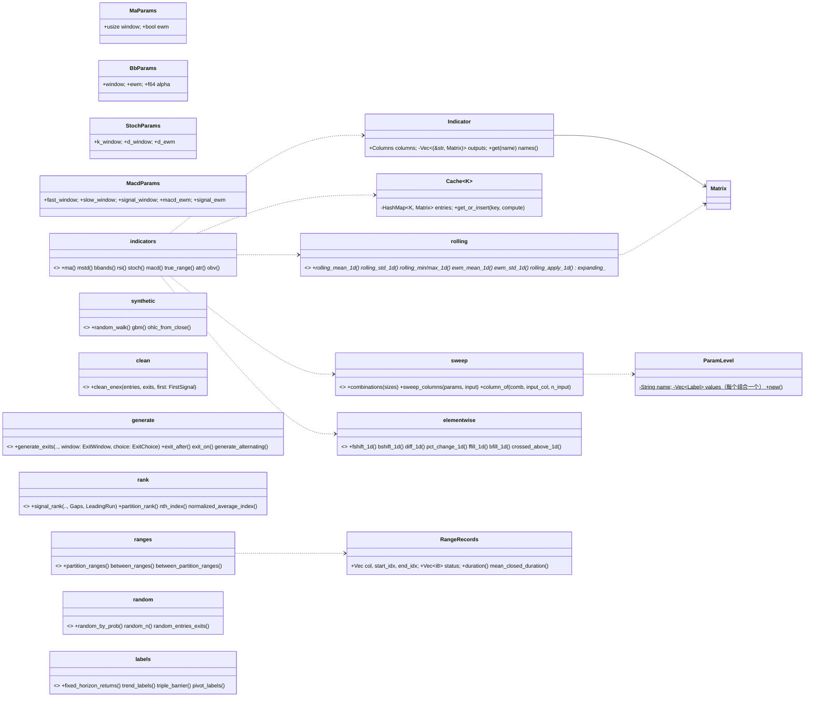

# 第 7 章 通用算子、技术指标与信号：`barq-generic`、`barq-indicators`、`barq-signals`

[← 总览](README.md) · [上一章：因子引擎](06-expr.md) · [下一章：数据层](08-data.md)

## 7.1 定位

三个小 crate，都是"数组进、数组出"的纯函数库，没有状态、没有并行：

| crate | 做什么 | 被谁用 |
|---|---|---|
| `barq-generic` | 滚动 / 扩展 / 指数加权窗口，平移、填充、差分、交叉；带种子的合成价格 | `barq-expr`（Mean/Max/Min）、`barq-analysis`（滚动指标）、`barq-indicators`、`barq-py`（`crossed_above`） |
| `barq-indicators` | MA、MSTD、BBANDS、RSI、STOCH、MACD、ATR、OBV 与参数网格 | `barq` 门面、测试；Python 未接（`plan.md` H1） |
| `barq-signals` | 信号清洗、出场生成、排名、区间、带种子的随机信号、ML 标签 | `barq` 门面、`crates/barq/tests/factor_path.rs`；Python 未接（P2） |

三条贯穿的语义约定写在 `barq-generic/src/lib.rs` 的 40 行里：`min_periods` 默认等于窗口；**NaN 让窗口缩小，不污染窗口**；**前视是被标注的，不是被阻止的**。

## 7.2 文件与阅读顺序

| 顺序 | 文件 | 行数 | 读什么 | 第一遍可跳过 |
|---|---|---:|---|---|
| 1 | `barq-generic/src/lib.rs` | 40 | 三条语义决定 | — |
| 2 | `barq-generic/src/rolling.rs` | 698 | 1–45 模块文档与 `resolve_minp`；`rolling_mean_1d` 107–141（前缀和模式，`std` 与 `apply` 复用）；`rolling_extremum_1d` 221–258；`ewm_mean_1d` 329–377；测试 607–675 讲相等守卫和故意不融合的乘加 | `matrix_wrapper!` 宏、`expanding_*` |
| 3 | `barq-generic/src/elementwise.rs` | 338 | `crossed_above_1d` 110–156：文档里的三条规则就是整个函数 | 平移/填充 |
| 4 | `barq-indicators/src/sweep.rs` | 242 | 全部：`col = comb × n_input + input_col` 的契约、`combinations`、`sweep_columns` | — |
| 5 | `barq-indicators/src/indicators.rs` | 902 | `Indicator`/`Cache`/`per_column`/`place` 29–133；`ma` 149–169 是模板；再 `bbands` 237–292、`rsi` 306–353、`macd` 451–511 看缓存键共享 | `true_range`/`obv` 最后 |
| 6 | `barq-signals/src/lib.rs`、`clean.rs` | 55、190 | `clean_enex_1d` 37–62：最小的状态机 | — |
| 7 | `barq-signals/src/generate.rs` | 395 | `generate_exits` 72–133；`exit_after`/`exit_on` 是 10 行特化；`generate_alternating` 201–249 | — |
| 8 | `barq-signals/src/rank.rs` | 303 | 先读测试 `a_reset_inside_a_run_renumbers_from_that_bar`（257–266），语义反直觉；再 `rank_columns` 39–80 和两个 `step` | `nth_index`、`normalized_average_index` |
| 9 | `barq-signals/src/ranges.rs` | 305 | `duration` 89–97 是唯一微妙处 | — |
| 10 | `barq-signals/src/random.rs` + `barq-generic/src/synthetic.rs` | 276 + 457 | 一起读：同一个 SplitMix64 思路，两个略不同的 `uniform` | — |
| 11 | `barq-signals/src/labels.rs` | 497 | 先读模块文档 1–23 和每个函数的 "Look-ahead" 段 | — |

输入输出约定：`barq-generic` 的 `*_1d` 收 `&[f64]` 回 `Vec<f64>`，无后缀版本按列套在 `&Matrix` 上；`barq-indicators` 收 `&Matrix` + 已展开的参数组合切片 + 可选标签，回 `Indicator`；`barq-signals` 全是扁平列主序 `&[bool]`/`&[f64]` + 显式 `n_rows, n_cols`，形状不符回 `Error::Broadcast`。

## 7.3 类图

## 7.4 核心算法一：`barq-generic` 的窗口核（`rolling.rs`）

| 函数 | 算法 | 要点 |
|---|---|---|
| `rolling_mean_1d` 107–141 | 单趟前缀和：存每个下标的 `cumsum`（只加非 NaN）和 `nancnt`；`i ≥ window` 时窗口和 = `cumsum − cumsum_arr[i−window]`，有效长度 = `window − (nancnt − nancnt_arr[i−window])` | 均值只对有效根算；`< minp` 给 NaN。**不是**数值上更好的写法——是参考实现的写法，`wide_scale` fixture（1e8 旁边放 1e-8）能把"重新求和"和"相减"区分开 |
| `rolling_std_1d` 151–201 | 同样的前缀和加 `cumsum_sq`；方差用展开式 `E[x²] − 2·mean·Σx + len·mean²`，套 `.abs()` 防常量序列抵消成负数 | `ddof` 是调用方参数（0 总体，1 样本）；`window_len == ddof` 也给 NaN。不是 Welford，为了对照 |
| `rolling_extremum_1d` 221–258 | 单调队列（第 6 章同款）；相等时用 `>=`/`<=` 弹出，即平局被更新的 K 线替代 | 全 NaN 窗口返回当前 NaN 而不是 ±inf；比较不是累加，所以与重扫逐位一致 |
| `expanding_*` 268–310 | `rolling_*(a, len, minp)` | `minp > len` 是 `Err`，参考实现如此，"不明显正确但避免无声分歧" |
| `ewm_mean_1d` 329–377 | 只有 `span` 参数：`alpha = 2/(span+1)`；`old_wt *= (1−α)` **每根都衰减，包括 NaN 根**（pandas `ignore_na=False`）；`adjust=true` 时 `old_wt += new_wt`，否则 `old_wt = 1` | 两个数值细节：相等守卫 `weighted_avg != cur` 不是优化——重算不变的值会引入 ~2e-15 漂移（测试里 span 10 的常量 8.19478 就漂）；`old_wt·avg + new_wt·cur` **故意不用 `mul_add`**，融合只舍入一次而参考舍入两次，差 1 ulp |
| `ewm_std_1d` 395–464 | 跟踪 `mean`、加权方差 `cov`、`sum_wt`、`sum_wt2`；输出 `sqrt(sum_wt²/(sum_wt² − sum_wt2) · cov)`（pandas `bias=False`） | 第 0 根永远 NaN；参考实现收一个从不读的 `ddof`，这里去掉了 |
| `rolling_apply_1d` 71–99 | 通用逃生口：用前缀 NaN 计数判断 `valid ≥ minp`，然后把**含 NaN 的整个窗口**交给闭包 | O(n·w·cost)；`barq-analysis` 的滚动指标全走它 |

**`crossed_above_1d`**（`elementwise.rs:131-156`）：状态 `was_below`、`crossed_ago`。任一边 NaN → 两个都清；`a > b` 且曾在下方 → `crossed_ago += 1`，`== wait` 时输出 true；`a == b` → 计数清零但记忆保留；`a < b` → `was_below = true`。三条规则：**严格**（开头就在上方永远不算交叉）；**相等**（触碰后再上穿算，上方触碰重启等待）；**只有 NaN 清除记忆**（缺口不能制造交叉）。

**`synthetic.rs`**：无状态 SplitMix64，`bits(seed,row,col,salt)` 链式哈希（`(row,col)` 与 `(col,row)` 不同），四个 salt 让同一格的不同抽样独立；`uniform` 取高 53 位 `+0.5` 后缩放，严格在 `(0,1)` 内（`ln` 有限）；`normal` 用 Box–Muller。`random_walk`：`x_t = x_{t−1} + σ·Z`；`gbm`：精确一步解 `S_t = S_{t−1}·exp((μ − σ²/2)dt + σ√dt·Z)`，不是 Euler；`ohlc_from_close`：`open = 前收`，`high = max(o,c) + |·|·spread·U`，`low` 对称，用绝对值保证负价格下仍 `low ≤ min ≤ max ≤ high`。某一列的结果不随 `n_cols` 变化。

## 7.5 核心算法二：指标与参数网格（`barq-indicators`）

**列布局契约**（`sweep.rs`）：指标函数不做笛卡尔积，调用方先用 `combinations(&[sizes])` 展开（最后一级变化最快）再映射成参数结构体；组合 `i`、输入列 `s` 的输出列是 `column_of(i, s, n_input) = i × n_input + s`。`sweep_columns` 用 `Level::repeat(param, values, n_input)` 和 `Level::tile("symbol", labels, n_combs)` 生成标签——就是第 1 章的公式。

**共享中间量缓存**：`Cache<K> = HashMap<K, Matrix>`。`ma`/`mstd`/`atr` 键 `(window, ewm)`；`bbands` 两个缓存都键 `(window, ewm)`，`alpha` 不进键，扫 `alpha` 只付带状算术；`rsi` 缓存成品；`stoch` 只按 `k_window` 缓存 `%K`；`macd` **一个**缓存同时服务快慢窗口，某窗口在一行当快、另一行当慢只算一次。每次用都 `.clone()` 出来再 `place`（借用冲突），多一份 `n_rows × n_input` 拷贝。

公式（`moving_average` 的 `minp` 永远等于 `window`）：

| 指标 | 公式 | 注意 |
|---|---|---|
| MA | `ewm ? ewm_mean_1d(x, w, w, adjust) : rolling_mean_1d(x, w, Some(w))` | |
| MSTD | 同上的 std，`ddof` 共享 | |
| BBANDS | `middle = MA`，`upper/lower = middle ± alpha × MSTD` | `alpha` 是 `Label::Float` |
| RSI | `delta = diff(close,1)`；`up = max(δ,0)`、`down = max(−δ,0)`（写法让 NaN 两边都保持 NaN）；`rs = MA(up)/MA(down)`；`rsi = 100 − 100/(1+rs)` | **不是 Wilder 的 RSI**：`ewm=true` 是 span 平滑 α = 2/(w+1)，`ewm=false` 是简单平均（Cutler）；无下跌 → `rs = +inf` → RSI 恰好 100"经由无穷而不是特判" |
| STOCH | `%K = 100 × (close − min(low,k)) / (max(high,k) − min(low,k))`，`%D = MA(%K, d)` | 平盘区间 0/0 = NaN，fixture 钉住 |
| MACD | `fast − slow`，`signal = MA(macd, signal_window)` | |
| TR / ATR | `row 0: h − l`；否则 `max(h−l, |h−c_prev|, |l−c_prev|)`（`f64::max` 忽略 NaN）；`atr = MA(tr)` | `tr` 整个扫描只算一次 |
| OBV | `signed = close < prev ? −v : +v`；`nancumsum` | 第 0 根与 NaN 比较为假 → 算正 |

## 7.6 核心算法三：信号工具箱（`barq-signals`）

**`clean_enex_1d`**（`clean.rs:37-62`）：`phase ∈ {−1 尚未开始, 1 持多, 0 平}`。同一根同时有进有出 → `continue`，**两个都不发**（不在这里替 `from_signals` 解冲突）；进场只在 `phase ∈ {−1, 0}` 时接受，出场只在 `phase == 1`（或 `Either` 且 `phase == −1`）时接受。输出严格交替，连续信号坍缩成第一根；`EntryFirst` 丢掉开头的出场。

**`generate_exits`**（`generate.rs:72-133`）：每个进场在 `[row + wait, to)` 里请 `choice` 挑出场，`to` 由 `ExitWindow` 决定：`UntilNextEntry` 到下一个进场（每个出场只属于一个进场，`to ≤ from` 的进场没有出场）；`ToEnd` 窗口可重叠；`ToEndSkippingResolved` 落在活窗口里的进场被跳过。`exit_after(bars)` 的 choice 返回 `from`（等待就是持有期）；`exit_on` 返回第一个满足条件的行。`generate_alternating` 用两个 choice 交替生成进出场，每次只取第一个，`from` 强制 ≥ `row + 1` 防零等待死循环——止损类出场需要这个形状，因为止损依赖刚选出的进场。

**`rank.rs`**：分区（run）= 连续 `true` 的最大段。`signal_rank` 给信号编号、`partition_rank` 给分区编号，`false` 处写 −1。共用走表 `rank_columns`：状态 `counter, reset_row, prev_run_end, run_start, seen_false`。`signal_rank` 的 `step`：`reset_here = reset_row > prev_run_end && max(reset_row, run_start) == i`（`> prev_run_end` 的守卫防一个陈旧的 reset 在下一段再触发）；`ResetEachRun` 时每段从 0；**段内的 reset 立刻从那根重新编号**（`XXXX` 在第 1 根 reset → `[0,0,1,2]`）。`LeadingRun::Skip` 整段丢掉开头已在进行的 run。

**`ranges.rs`**：`partition_ranges` 每段一条，闭合段 `end_idx` 是段后第一个 `false`（排他），末尾未结束的段 `Open` 且 `end_idx = n_rows − 1`（包含）；`duration = end − start`（closed）/ `+1`（open）——与交易、回撤同一条规则；`mean_closed_duration` 只平均闭合段。

**`random.rs`**：`random_by_prob` 每格 `uniform < prob`（每列二项分布）；`random_n` 用**部分 Fisher–Yates**（不是拒绝采样）：第 `k` 步的抽样键是 `(seed, k, col)`，`O(n_rows)`，恰好 `n` 个、无放回、列间独立，而且 `random_n(n)` 是 `random_n(m)` 的前缀；`random_entries_exits` 取 `2n` 个不同行排序后交替分配，严格交替、每个进场配一个出场。

**`labels.rs`**（全部读未来，只能做 `y`）：

| 函数 | 定义 | 前视 |
|---|---|---|
| `fixed_horizon_returns(h)` | `close[t+h]/close[t] − 1`，尾部 NaN | `h` 根 |
| `trend_labels(h, θ)` | 上式 `> θ` → +1，`< −θ` → −1，否则 0；**未定义也是 0** | `h` 根 |
| `triple_barrier(up, down, max_hold)` | 固定百分比障碍（不按波动率缩放）：从 `t+1` 走到 `min(t+max_hold, 末尾)`，先碰 `r ≥ up` → +1、先碰 `r ≤ −down` → −1、都没碰 → 0；返回 `(label, 决定行)`，决定行是 purge 切分要用的东西；只看收盘价，不看盘中高低 | ≤ `max_hold` |
| `pivot_labels(θ)` | 收盘价上的 zig-zag：`Leg::{Unknown, Up{peak}, Down{trough}}` 状态机，反向 θ 确认前一个候选为峰（−1）/谷（+1）；最后一段的候选永不确认 | **无界** |

## 7.7 阅读陷阱

1. **`min_periods` 默认因调用方而异**：`barq-generic` 默认 `window`，指标硬编码 `window`，`barq-expr` 传 `Some(1)`。`Mean($close,20)` 与 `ma(window=20)` 前 19 根不同。
2. **NaN 让窗口缩小**，这不是 pandas `rolling().mean()` 的默认；全 NaN 或 `cnt < minp` 才 NaN；EWM 的权重穿过 NaN 继续衰减；`ewm_std` 第 0 根恒 NaN。
3. **`ddof`**：`rolling_std`/`mstd`/`bbands` 显式传，vectorbt 默认 0，pandas 默认 1；`ewm_std` 完全不看 ddof。
4. **RSI 不是 Wilder 的**；`rs = +inf` 是活值，用 parity 测试里的 `agree` 而不是 `is_close` 比较。
5. **标签里 0 一词多义**：`trend_labels` 的"未定义"也是 0，`triple_barrier` 的"没碰到"也是 0；用 `fixed_horizon_returns` 或 `decided == −1` 区分。
6. `bshift`、`bfill`、整个 `labels.rs` 读未来；`pivot_labels` 的前视无界；即使因果因子变信号也要延迟一根。
7. `clean_enex` 丢掉同根双信号；`SignalSweep` 根本不清洗——先搞清你的信号走了哪条路再推理 `from_signals` 的冲突模式。
8. 随机数不是 NumPy 的流，无法复现 vectorbt 的随机信号；三份 SplitMix64 副本待合并（P3）；两个 `uniform` 一个带 salt 在 `(0,1)`、一个不带在 `[0,1)`。
9. `clippy::float_cmp` 全局 deny，`ewm_*` 和 `crossed_above_1d` 里的精确相等守卫带 `#[allow]` 和理由——别"修"成容差。

## 7.8 与 vectorbt 的对应

| barq | vectorbt | 差异 |
|---|---|---|
| `rolling_mean_1d` / `rolling_std_1d` / `rolling_min/max_1d` / `expanding_*` / `ewm_mean_1d` / `ewm_std_1d` | `generic/nb.py` 同名 `*_1d_nb` | 极值用单调队列（逐位一致）；`ewm_std` 去掉未读的 `ddof` |
| 平移/填充/差分/交叉 | `fshift_1d_nb` 等、`crossed_above_1d_nb` | 同 |
| `ma mstd bbands rsi stoch macd atr obv` | `indicators/nb.py` 的 `*_nb`、`*_cache_nb`/`*_apply_nb`；`vbt.MA.run` 等 | 扫描用显式组合而不是 `IndicatorFactory` 的 `param_product`；标签用 `Columns` 而不是 `MultiIndex` |
| `clean_enex` | `signals/nb.py::clean_enex_1d_nb(entry_first)` | `FirstSignal` 枚举 |
| `generate_exits` | `generate_ex_nb(wait, until_next, skip_until_exit, pick_first, choice)` | `ExitWindow` 三个变体对应 `(until_next, skip_until_exit)` 的三种组合；回调是 Rust 泛型 |
| `generate_alternating` | `generate_enex_nb` | 未钉 fixture |
| `signal_rank` / `partition_rank` / `nth_index` / `normalized_average_index` | `rank_nb(sig_pos_rank_nb / part_pos_rank_nb)`、`nth_index_nb`、`norm_avg_index_nb` | `Gaps::Allow ↔ allow_gaps`，`LeadingRun::Skip ↔ after_false` |
| `partition_ranges` 等 | `partition_ranges_nb`、`between_ranges_nb`、`between_partition_ranges_nb` | 无 `id` 字段 |
| `random_*`、`synthetic.rs`、`labels.rs` | `generate_rand_*_nb`、无、`vectorbt.labels`（概念邻居） | **有意不移植**，性质测试 |

## 7.9 延伸资料

- pandas 文档 "Windowing operations"、"Exponentially weighted windows"（`span`/`com`/`alpha`、`adjust`、`ignore_na`、`bias`）；pandas `_libs/window/aggregations.pyx` 的 `ewma`/`ewmcov`（vectorbt 移植的源头）。
- J. Welles Wilder, *New Concepts in Technical Trading Systems*（1978）：RSI、TR/ATR 的原始定义，对照这里的 Cutler/EMA 变体；John Bollinger, *Bollinger on Bollinger Bands*（2001）；Gerald Appel 的 MACD；Joseph Granville 的 OBV。
- 单调队列：OI Wiki "单调队列"；Fisher–Yates：Knuth TAOCP 卷 2 算法 P（Durstenfeld 版本）；对照蓄水池抽样（Algorithm R）。
- Box–Muller 变换；GBM 的精确离散化与 Euler–Maruyama 的区别：Glasserman, *Monte Carlo Methods in Financial Engineering*（2003）第 3 章。
- López de Prado, *Advances in Financial Machine Learning*（Wiley, 2018）第 3 章（三重障碍、元标签）、第 7 章（purge 与 embargo）。
- Zig-zag 指标与"重绘"问题：任何技术分析教材；关键词 "ZigZag indicator repainting"。
- White, "A Reality Check for Data Snooping"（*Econometrica*, 2000）：随机基线与零漂移 GBM 上的回测为什么是必要的对照。
- vectorbt 文档 `signals.accessors`（`pos_rank`、`partition_ranges`、`between_ranges`）、`IndicatorFactory`。
- 更多见 [11-references.md](11-references.md) §G。

## 7.10 自测

1. `rolling_mean_1d([1, NaN, 3, 4], 2, None)` 返回什么？把 `minp` 改成 `Some(1)` 呢？
2. 为什么 `ewm_mean_1d` 里 `weighted_avg != cur` 的精确比较不能换成 `is_close`？
3. `combinations(&[3, 2])` 的顺序是什么？`column_of(4, 1, 2)` 是哪一列？它对应哪组参数？
4. `entries = [T, F, T, T, F]`、`exits = [F, T, T, F, T]`，`clean_enex_1d(EntryFirst)` 输出什么？
5. `triple_barrier` 为什么要返回决定行？它和第 9 章 `purged_kfold` 的 `purge` 参数是什么关系？
6. `random_n(seed, n=3)` 的结果为什么是 `random_n(seed, n=5)` 的前缀？
