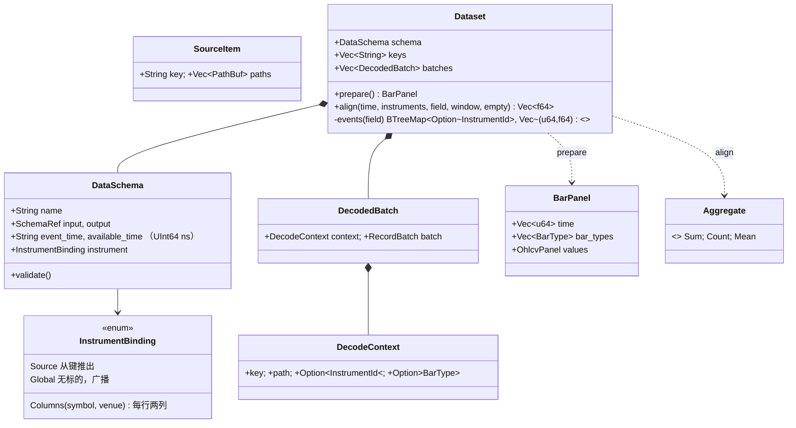
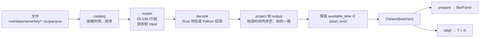

# 第 8 章 数据层：`barq-data` 与 `barq.data`

[← 总览](README.md) · [上一章：信号 · 指标 · 通用算子](07-generic-indicators-signals.md) · [下一章：Python 层与门面](09-python-and-facade.md)

## 8.1 定位

`barq-data` 把本地的 CSV / Parquet 读成 Arrow 批次，再变成 `BarPanel`（时间 × 标的的 OHLCV 面板），并把任意辅助数据（资金费率、新闻、基本面）**按发布时间**对齐到面板的时间轴上。
它**从不下载、从不写文件**；下载器在 `examples/` 里。
整个 crate 是一个 560 行的 `lib.rs`，没有内联测试，行为由 `crates/barq-py/tests/test_data.py` 钉住。

读它的收获：理解"按时点"（point-in-time）数据为什么必须用 `available_time` 而不是 `event_time`，以及一个 O(T + E) 的双指针对齐怎么写。

## 8.2 文件与阅读顺序

| 顺序 | 位置 | 读什么 |
|---|---|---|
| 1 | `lib.rs:21-78` | 类型：`InstrumentBinding`、`DataSchema` + `validate`、`DecodeContext`、`SourceItem` |
| 2 | `lib.rs:80-123` | `component` 路径守卫、`catalog` 目录列举 |
| 3 | `lib.rs:125-201` | `project`（按名取列、校验类型和可空性、从不转换）、`reader`（Parquet 按根索引投影；CSV 把未知列当 `Utf8`） |
| 4 | `lib.rs:217-332` | `load`：逐批次 读 → 投影到 input → 解码 → 投影到 output → 校验 → 按 `available_time` 过滤 |
| 5 | `lib.rs:343-414` | `prepare`：时间轴 = `available_time` 的有序并集 |
| 6 | `lib.rs:456-484` | `events`：按标的分桶并稳定排序 |
| 7 | `lib.rs:487-552` | `align`：双指针 as-of / 窗口聚合 |
| 8 | `crates/barq-py/python/barq/data.py` | 薄壳：`Catalog`、`files`、`Source`、`Dataset.asof/window`、`BarPanel._from_native` 的 `order="F"` |
| 9 | `crates/barq-py/src/data.rs` | 在哪里 `py.detach` 释放 GIL，解码器怎么按批次重新拿 GIL |
| 10 | `examples/multi_data.py` | 端到端：K 线 + 资金费 + 新闻 → 因子 → `from_signals(column_map=…)` |

第一遍可跳过 `reader` 的 CSV 分支和 `instrument_at`。

## 8.3 类图与数据流





## 8.4 核心算法一：`load`（`lib.rs:217-332`）

```text
schema.validate()                                   name 是单个路径分量；时间列是 UInt64；Columns 绑定的两列是 Utf8
items 非空，start < end
for item in items:
    key 唯一、paths 非空
    bar_type   = key.parse::<BarType>().ok()
    instrument = bar_type.instrument 或 key.parse::<InstrumentId>().ok()
    binding == Source 且 instrument 为 None → Err
    for path in paths:
        for raw in reader(path, input):             65,536 行一批
            raw   = project(raw, input)
            batch = project(decode(raw, &ctx)?, output)     ← 用户解码器在这里
            event_time / available_time 不得有 null
            Columns 绑定：每行拼出 InstrumentId 校验；键是 BarType 时每行标的必须等于它
            有 start/end：take_record_batch 保留 available_time ∈ [start, end)
            batches.push(DecodedBatch{ctx, batch})
```

过滤放在解码**之后**，因为解码器可能改时间单位（`multi_data.py:28-36` 把交易所的毫秒改成纳秒）。
批次不拼接，`Dataset.batches` 是列表，峰值内存被 65,536 行一批限制住。
解码器是 `FnMut`，Python 回调从 `py.detach` 的外层循环里按批次 `Python::attach` 重新拿 GIL（`barq-py/src/data.rs:238-250`）。

## 8.5 核心算法二：`prepare`（`lib.rs:343-414`）

```text
每个 key 必须能解析成 BarType；Global 绑定 → Err；output 必须有 Float64 的 open/high/low/close/volume
times: BTreeSet<u64> = 所有批次 available_time 的并集          有序、去重
time  = times 转成 Vec；n_rows = |time|；n_cols = |keys|
fields = 5 × vec![NaN; n_rows × n_cols]；present = vec![false; …]
for batch:
    col = keys.position(batch.key)                             列顺序 = 调用方给的键顺序
    for (r, t) in available_time:
        index = col × n_rows + time.binary_search(t)           列主序
        present[index] → Err("duplicate bar")
        五个字段逐个写入；null 保持 NaN
BarPanel { time, bar_types, values }
```

行轴是 **`available_time`**；缺失的 `(key, time)` 保持 NaN；同一 `(key, available_time)` 出现两次是错误，跨文件也算。复杂度 O(N log N)。Python 侧用 `order="F"` reshape 成 `(T, S)`（`data.py:58`）。

## 8.6 核心算法三：`align` 的双指针 as-of / 窗口聚合（`lib.rs:487-552`）

先 `events(field)`（`lib.rs:456-484`）：把该字段转成 `Float64`，按 `instrument_at(batch, row)` 分桶成 `BTreeMap<Option<InstrumentId>, Vec<(available_time, value)>>`（`None` 键是全局事件），每桶 `sort_by_key(时间)`——Rust 的 `sort_by_key` 是**稳定**排序，所以同一时刻的事件按"源 → 文件（已排序）→ 行"的顺序保留。

然后对每个输出列做一次**双指针扫描**，不是二分查找：

```text
rows = events[Global ? None : Some(instrument)]
left = right = 0; sum = 0; count = 0
for (i, t) in time:                                      time 严格递增
    while right < rows.len() && rows[right].t <= t:      进入窗口：available_time ≤ t（闭）
        if finite(v): sum += v; count += 1
        right += 1
    if 有窗口 (width, agg):
        if boundary = t.checked_sub(width):              u64 下溢 → 永不驱逐
            while left < right && rows[left].t <= boundary:   离开窗口：≤ t − width
                if finite(v): sum −= v; count −= 1
                left += 1
        if count == 0: sum = 0.0                          防漂移
        value = Count → right − left（含 NaN 行）
                count == 0 → empty
                Sum → sum；Mean → sum / count
    else:
        value = right == 0 ? NaN : rows[right−1].v        as-of：最后一个 available_time ≤ t 的值
    output[col × T + i] = value
```

窗口是**左开右闭** `(t − width, t]`：刚好 `width` 之前的事件被驱逐，刚好在 `t` 的事件被纳入。
`test_data.py:100-110` 的例子：事件 `available=[10,20,20,35]`、值 `[1,2,4,8]`、面板 `[0,10,20,30,40]`、宽 20 → as-of `[NaN,1,4,4,8]`（t=20 时并列事件取最后一个），sum `[0,1,7,6,8]`，count `[0,1,3,2,1]`。

为什么双指针：`time` 和 `rows` 都有序，两个指针单调前进，每个标的 O(T + E) 而不是 O(T log E)，运行和与计数让每个输出格 O(1)。全局事件对每一列重走同一个 `rows`，这就是"广播"。
数值上没有 Kahan 补偿，靠 `count == 0 → sum = 0` 在窗口清空时归零。

## 8.7 阅读陷阱

1. **一切都用 `available_time`**：过滤、面板行轴、对齐。`event_time` 只校验类型和非空，从不读取。`test_availability_ties_...` 把所有 `event_time` 设成 0 来证明这一点。
2. 带 `start` 加载会**丢掉**更早的历史，`start` 附近的 as-of 结果是 NaN。
3. `Count` 把 NaN 行也数进去；`Sum`/`Mean` 跳过 NaN；as-of 若最新事件值为 null 返回 NaN。
4. `prepare` 要求每个键都是 `BarType`；用普通 `InstrumentId` 当键的数据集名叫 `bars` 也会报 `expected SYMBOL.VENUE-STEP-...`。
5. `project` 从不转换类型：CSV 推断成 `Int64` 而 schema 写 `Float64` 是硬错误；非空字段里有一个 null 也是错误。
6. `events()` 每次 `align` 都重新排序（`lib.rs:455` 的注释标记了缓存是将来的事）。
7. `Columns` 绑定下每行分配一个 `InstrumentId`（两个 `Arc<str>`），大表上很贵。
8. 错误类型是 `ArrowError::InvalidArgumentError`，不是 `barq_core::Error`。

## 8.8 与参考实现的对应

| barq | 对应 |
|---|---|
| 目录 `root/data/<name>/<key>/*.parquet` | NautilusTrader `ParquetDataCatalog` 的 `<root>/data/<data_cls>/<instrument_id>/*.parquet` |
| `available_time` / `event_time` | Nautilus `Bar.ts_init` / `ts_event`；回放按 `ts_init`，因为只有它不泄露未来 |
| `align` as-of | pandas `merge_asof(direction="backward")`、`DataFrame.asof`；vectorbt `generic/nb.py::realign_nb` |
| `align` 窗口 | pandas `rolling("20ns", closed="right")` |
| 解码器回调 | 无直接对应；是 barq 把"schema、字符串、回调留在循环外"原则在数据层的体现 |

## 8.9 延伸资料

- 前视偏差与按时点数据：Marcos López de Prado, *Advances in Financial Machine Learning* 第 2 章（数据结构）与第 11 章（回测的危险）；pandas `merge_asof` 文档；kdb+ 的 `aj`（as-of join）概念。
- Apache Arrow：官方 "Arrow Columnar Format" 与 Rust `arrow-rs` 文档（`RecordBatch`、`ProjectionMask`、`take`、`cast`）；Arrow C Data Interface（第 9 章 `arrow.rs` 用到）。
- 双指针 / 滑动窗口：LeetCode "Sliding Window" 标签任意一题；OI Wiki "尺取法"（<https://oi-wiki.org/>）。
- PyO3 的 `Python::detach` / `attach`：PyO3 用户指南 "Parallelism" 一节。
- 更多见 [11-references.md](11-references.md) §H。

## 8.10 自测

1. 面板时间 `[0,10,20,30]`，事件 `(5, 1.0)、(20, 2.0)、(20, NaN)`，as-of 在 t=20 返回什么？`Count` 窗口宽 15 在 t=20 返回什么？
2. 为什么过滤 `[start, end)` 要放在解码之后？
3. 把双指针改成对每个 `t` 二分查找 `rows`，复杂度变成多少？窗口聚合还能 O(1) 吗？
4. 一个数据集的 `instrument` 绑定是 `Global`，三个标的的面板对齐后三列是否相同？在代码里指出原因。
