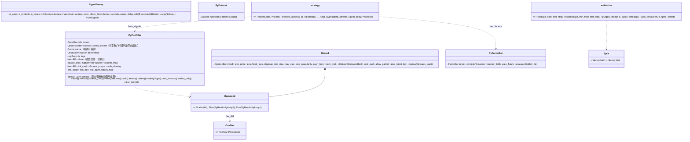

# 第 9 章 门面与 Python 层：`barq`、`barq-py`、`barq.strategy`、`barq.validation`

[← 总览](README.md) · [上一章：数据层](08-data.md) · [下一章：研究协议 · 验证 · 基准](10-research-verification-benchmarks.md)

## 9.1 定位

- **`barq`**（Rust 门面，364 行）：把所有 crate 以短名重新导出（`barq::sim`、`barq::expr`…），提供 `prelude`，以及 `SignalSweep`——"参数和标的共用一条列轴"的最小完整表达。
- **`barq-py`**：PyO3 扩展 `barq._barq` + Python 包 `barq`。Rust 侧只做三件事：**零拷贝借用 NumPy 数组**（拒绝 C 序）、**把标量 / 一维 / 二维翻译成 `FlexArray`**、**在 GIL 释放的情况下调引擎**。Python 侧做参数规范化、`@barq.strategy` 扫描、纯 NumPy 的时间序列交叉验证。

读这一层的收获：理解 Python 用户的一次 `barq.from_signals(...)` 调用在 Rust 里经过了什么，以及为什么 `Portfolio` 对象能跨调用复用派生结果。

## 9.2 文件与阅读顺序

| 顺序 | 文件 | 行数 | 读什么 | 第一遍可跳过 |
|---|---|---:|---|---|
| 1 | `barq-py/python/barq/__init__.py:1-32`、`barq-py/src/array.rs:1-37` | — | 两段文档：引擎列主序、NumPy 行主序、Rust 侧**拒绝而不是转置** | — |
| 2 | `barq/src/lib.rs` | 71 | crate 地图与 `prelude` | — |
| 3 | `barq/src/sweep.rs` | 293 | `SignalSweep::from_factor` 42–123：`out_col = case_idx × n_symbols + symbol`；标签 107–113；`args` 170–186 | `expand` |
| 4 | `barq-py/src/array.rs`、`params.rs`、`parse.rs` | 321、118、154 | 三个翻译模块：`columns_of` 82–108、`flex_f64` 117–145、`OneDim`、`Shared::borrow`、枚举解析 | — |
| 5 | `barq-py/src/lib.rs:732-1025` | — | `from_signals`，配 `account_inputs`/`deposits_view` 649–719 和 `market_array` 1268–1303；`from_orders` 1041–1266 形状相同 | — |
| 6 | `barq-py/src/lib.rs:75-197` | — | `PyPortfolio` 拥有什么、`core()` 127–151、`assemble()` 159–196 | `#[pymethods]` 的 getter、`logs()` 字段表 469–521 |
| 7 | `barq-py/python/barq/__init__.py:64-274`、`:277-454` | — | 规范化函数；`from_signals` 包装器的 docstring 是用户手册 | — |
| 8 | `barq-py/python/barq/strategy.py` | 149 | 全部 | — |
| 9 | `barq-py/python/barq/validation.py` | 345 | 全部，纯 NumPy | — |
| 10 | `barq-py/src/expr.rs`、`data.rs`、`arrow.rs` | 128、253、67 | 因子与数据边界；`arrow.rs` 是整个工作区唯一的 `unsafe` | 不用数据层可跳过 |

## 9.3 类图



## 9.4 核心算法一：数组零拷贝跨界与 F 序检查（`array.rs`）

```text
columns_of(array: &PyReadonlyArray2<f64>) -> (&[f64], n_rows, n_cols):
    f_ordered = n_rows == 1 || n_cols == 1 || strides[0] == 1       ← 列主序沿 axis 0 步长为 1（单位：元素）
    否则 ValueError，报出 shape、strides 和修法 np.asfortranarray(x)
    to_slice_memory_order() 失败（不连续）→ ValueError
```

为什么拒绝而不是转置：一个 `(3,2)` 的 `0..6` 数组 C 序是 `[0,1,2,3,4,5]`，F 序是 `[0,2,4,1,3,5]`；把 C 序字节按列主序读，第 0 列变成 `[0,1,2]` 而不是 `[0,2,4]`——**回测了转置后的序列却报出一个正常模样的结果**。检查放在 Rust 里，因为 `barq._barq` 可以被直接导入。

一维数组的含义由调用点声明（`OneDim::{PerRow, PerColumn}`），"按长度猜多数时候对、少数时候无声地错"。整数数组被拒绝（当浮点看会拷贝）。`None` 表示"引擎默认"，由 `FromSignals::default()` 补，所以 Python 签名不重复任何默认值。

| 参数 | 标量 | 一维 | 二维 |
|---|---|---|---|
| 交易参数（size、fees、price、sl_stop…） | `Scalar` | `PerColumn`（长度 `n_cols`） | `Full`（`(n_rows, n_cols)`） |
| `cash_earnings`、非共享 `cash_deposits` | `Scalar` | `PerRow`（长度 `n_rows`） | `Full` |
| `init_cash` | `Scalar` | 按组（长度 `n_groups`） | 共享时拒绝 |
| 市场数据（close/open/high/low/cash_dividends） | — | 一列 | `(n_rows, source_cols)`，有 `column_map` 时 `FlexArray::mapped` |
| 共享 `cash_deposits` | `Scalar` | `PerRow` | `(n_rows, n_groups)`，`mapped(group_of)` |

Python 侧的 `_matrix`（1-D → **一列**，`asfortranarray`）、`_param`（Python 数字保持数字走免分配路径；1-D 只 `ascontiguousarray`，含义到 Rust 决定）、`_flag`、`_accumulate`（`True`→`both`）、`_group_lens`、`_column_map`。

## 9.5 核心算法二：`PyPortfolio` 与跨调用缓存（`lib.rs:75-197`）

Python 可能在调用返回后立即释放数组，所以 `PyPortfolio` **拥有**记录、源宽度的收盘价拷贝、初始现金、分组；每个方法：

```text
core():
    close = market_array(&self.close, n_rows, source_cols, column_map)      → FlexArray::full 或 ::mapped
    cash  = FlexArray::per_column(&self.init_cash, n_cols)
    CorePortfolio::from_borrowed(sorted_orders 或 orders, close, cash, n_rows, n_cols, Scoring{..}, groups, &self.cache)
```

`from_borrowed` 不克隆记录，派生结果落进出借的 `Cache`（13 个 `OnceLock`），所以一次调用算出的净值曲线供下一次用；`clear_cache()` 释放这些 `bars × accounts` 的矩阵。共享账户的记录在 `assemble` 时 `sort_by_column()` **一次**，存成 `sorted_orders`（整份克隆）。

GIL：`from_signals`/`from_orders`、`stats`、`metrics`、`sharpe_ratio`、`value`、`returns`、`cash`、`trades`、`_FactorSet.evaluate`、`crossed_above`、`_Dataset.prepare/align`、`load_data` 全部 `py.detach`；只有 NumPy 转换持有 GIL。`trades()` 在持 GIL 时先建 `core()` 再 detach。

`stats()` 返回 dict：`Value::Count → int`、`Float → float`、`Missing → None`（NaN 是"算了但没答案"，None 是"输入没给"）；非共享时附带买入持有基准。`value/returns/cash(col=None, *, group=None)`：共享时必须用 `group=`，拒绝 `col=`。

## 9.6 核心算法三：`@barq.strategy` 的扫描（`strategy.py:79-149`）

```text
sweep(data, *, params, signal_delay=1, **options):
    ① signal_delay 非负整数（拒绝 bool）；options 里不许出现 close/entries/exits/open/high/low/column_map/group_lens
    ② close = asarray(data["close"])，1-D → (T,1)
    ③ 对每组参数：signature.bind(data, **group)（未知参数在跑之前就是 TypeError）→ 调函数 → 必须返回 (entries, exits)
       → _signal（bool，形状 == close.shape）→ _delay(bars)：delayed[bars:] = array[:-bars]，顶部补 False
    ④ market = data 里有的 open/high/low
    ⑤ cash_sharing 时 group_lens = [S] × n_params（每组参数一个账户）
    ⑥ from_signals(close, concatenate(entries, axis=1), concatenate(exits, axis=1), column_map = tile(arange(S), n_params), **market, **options)
    结果列 = p × S + s（参数优先，标的其次）
```

`factors(data, **exprs)` 编译 `FactorSet` 并拒绝 `uses_future`；`crossed_above` 走引擎的相等/NaN 规则（第 7 章）。`_delay(1)` 配合默认 `price = +inf`（本根收盘）意味着"在 `t` 决定、在 `t+1` 的收盘成交"。`tile(arange(S), P)` 把逻辑列 `p×S+s` 映射到源列 `s`，价格永远不被平铺（`Portfolio.price_nbytes == panel.close.nbytes`）。

## 9.7 核心算法四：时间序列交叉验证（`validation.py`）

```text
rolling(n, train, test, step=test):   s = 0, step, …；train = [s, s+train)，test = [s+train, s+train+test)；装不下整窗的尾巴丢掉
expanding(n, min_train, test, step):   e = min_train, …；train = [0, e)，test = [e, e+test)
purged_kfold(n, k, purge=0, embargo=0):
    folds = array_split(arange(n), k)（前 n % k 个多一行）
    对每个 fold [start, stop)：keep = rows < start − purge  |  rows ≥ stop + embargo
    train = rows[keep]，test = fold
    ← purge 去掉标签向前看会碰到测试段的训练行；embargo 去掉特征向后看会碰到测试段的训练行（AFML 第 7 章）
walk_forward(fn, n, splits, *, select=argmax):
    对每个 split：校验非空、在 [0,n) 内、不相交
    train_scores = fn(split.train)；chosen = select(train_scores)（NaN 永不胜出，平局取 fn 顺序的第一个）
    test_scores = fn(split.test)；只记录 test_scores[chosen]，其余测试分数丢弃——它们不能影响选择
```

第 7 章 `triple_barrier` 返回的"决定行"就是 `purge` 的依据：标签在 `t` 的决定发生在 `t + h`，训练集里 `[start − h, start)` 的行会泄露测试段。

## 9.8 `SignalSweep`（Rust 门面）

```text
from_factor((name, &factor), symbols, cases, delay, rule):
    for case_idx, params in cases: for symbol: out_col = case_idx × n_symbols + symbol
        for row in delay..n_rows: score = factor[row − delay, symbol]；有限时 (entry, exit) = rule(score, params)
    labels：factor = repeat(name, n_cols)；case = repeat(cases, n_symbols)；symbol = tile(symbols, n_cases)
args(&expanded_close) → FromSignals { close, entries, exits, ..default }   ← 费用、止损用结构体更新语法补
```

它**不清洗**信号，让模拟器对真实持仓解冲突。示例 `crates/barq/examples/factor_sweep.rs`。

## 9.9 阅读陷阱

1. **一维的含义有三种**（见 9.4 的表）；`init_cash` 共享时按组、二维被拒绝。
2. `direction` 默认：`from_signals` 是 `longonly`，`from_orders` 是 `both`；`from_signals` 拒绝三种 target 仓位类型（vectorbt 也拒绝）。
3. 止损需要 `high` 和 `low`，否则报错而不是无声地不止损。
4. 未交易列 `+inf` Sharpe 赢 `argmax`：`pf.traded_only(...)` 再 `np.nanargmax`。
5. `barq-py/README.md:394-398` 说"缓存每次从空开始"已**过时**：代码把一个 `Cache` 跨调用出借，`clear_cache()` 正因此存在。
6. 共享运行内存翻倍（`sorted_orders` 是整份克隆）；`price_nbytes` 只数源收盘价。
7. `load_data` 的 Python 解码器每批重新拿 GIL，重 Python 逻辑会在那里串行化。
8. `@barq.strategy` 直接调用返回**未延迟**的信号，`sweep` 默认 `signal_delay=1`；`uses_future` 只检查 DSL 表达式，不检查策略里的任意 Python。
9. 会跳过的测试：vectorbt 差分测试（`needs_reference`）、pyarrow、研究层 `importorskip("barq")`；`test_validation.py` 按路径加载，不需要 Rust 构建。
10. wheel 是 `abi3-py39`，但开发环境固定 Python 3.14，`research` 要 ≥ 3.10。

## 9.10 延伸资料

- PyO3 用户指南（0.29）：`#[pyclass]`、`Bound<'py, T>`、`Python::detach`/`attach`、`abi3`：<https://pyo3.rs>。
- rust-numpy（`numpy` crate）：`PyReadonlyArray`、`to_slice_memory_order`、`IntoPyArray`。
- maturin 用户指南（`maturin develop`、混合 Rust/Python 布局）；uv 工作区与 `[tool.uv.sources]`。
- NumPy 文档 "Internal memory layout of an ndarray"、"Indexing / views vs copies"；`np.asfortranarray`、strides。
- Apache Arrow C Data Interface 与 PyCapsule 协议（`__arrow_c_schema__`/`__arrow_c_array__`）：<https://arrow.apache.org/docs/format/CDataInterface.html>。
- López de Prado, *Advances in Financial Machine Learning* 第 7 章（purged k-fold、embargo）；Robert Pardo, *The Evaluation and Optimization of Trading Strategies*（2008）第 11 章（walk-forward analysis）。
- 中文：《Rust 语言圣经》"Rust 与 Python 互操作"相关章节；PyO3 中文翻译（搜索 "PyO3 用户指南 中文"）。
- 更多见 [11-references.md](11-references.md) §I。

## 9.11 自测

1. 一个 `(100, 3)` 的 C 序 `close` 传进 `barq.from_signals` 会发生什么？Python 包装器做了什么让它通常不会发生？
2. `size=[1, 2, 3]`（一维）和 `cash_deposits=[1, 2, 3]`（一维）分别被解释成什么形状？
3. 4 组参数 × 3 个标的、`cash_sharing=True`：`column_map`、`group_lens`、输出列数各是什么？
4. `purged_kfold(100, 5, purge=3, embargo=2)` 第 2 折的训练集去掉了哪些行？
5. `walk_forward` 为什么丢掉未选中参数的测试分数？不丢会出什么问题？
