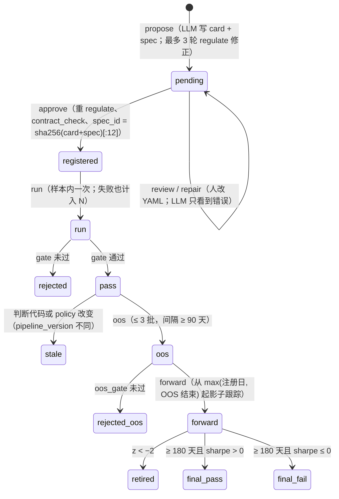
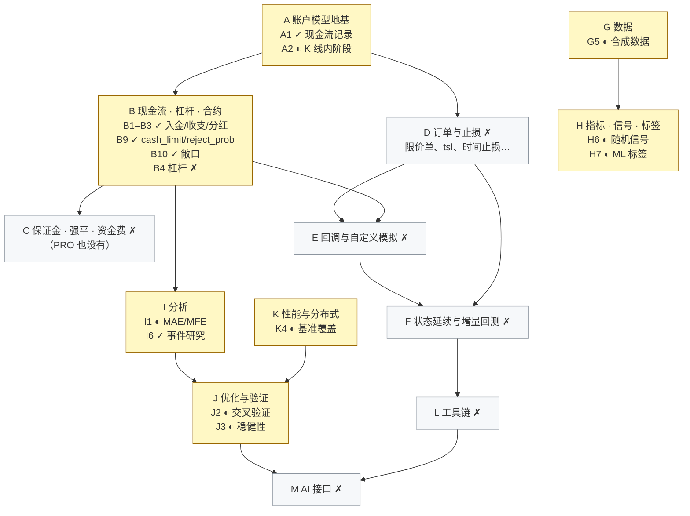

# 第 10 章 研究协议、验证与基准：`research/barq_lab`、`tests/parity`、`benchmarks`

[← 总览](README.md) · [上一章：Python 层与门面](09-python-and-facade.md) · [下一章：延伸资料](11-references.md)

## 10.1 定位

这一章是"围绕引擎的三件外围设施"：

- **`research/barq_lab`**（2,459 行 Python）：一个预注册的因子研究协议。LLM 写假设与规格，固定的流程做判断，**模型永远看不到结果**，所以它不可能把数据拟合进去；一个健康的流水线大多数时候在拒绝。
- **`tests/parity`**：差分测试基础设施。参考实现（vectorbt 1.1.0 / Qlib）在外部环境里跑出 TSV fixture 提交进仓库，`cargo test` 不需要 Python 就能重放。
- **`benchmarks`**：和 vectorbt 的 Numba / Rust 后端逐工作负载对比的协议，重点是"同样的工作"（校验和）和"诚实的比例"（核对核、best-of-7、基线门槛）。

 

## 10.2 文件与阅读顺序

| 顺序 | 文件 | 行数 | 读什么 |
|---|---|---:|---|
| 1 | `research/README.md` | — | 命令与流程 |
| 2 | `research/barq_lab/protocol/policy.py` | 78 | 全部参数：周期、数据、成本、门槛、OOS 预算、forward 规则；`version()` |
| 3 | `protocol/ledger.py` | 143 | 哈希链 32–34、68–89；`_read` 校验 58–66 |
| 4 | `pipeline.py` | 374 | 阶段：`propose` 78–99、`approve` 101–131、`run` 155–203、`oos` 211–241、`forward` 245–283、`report` 287–338、`calibrate` 352–374 |
| 5 | `types/factor_ts/__init__.py` | 184 | 门槛 115–136、跨资产 96–109 |
| 6 | `types/factor_ts/harness.py` | 454 | `evaluate` 29–39、`zscore` 42–51、`position` 64–83、`composite` 336–353、`targets` 143–155、`backtest` 158–190、`contract_check` 429–454 |
| 7 | `types/factor_ts/spec.py` | 481 | `ARITY` 17–33（镜像 `parse.rs:validate`）、`regulate` 421–481、`common_subtree` 212–249 |
| 8 | `propose.py`、`protocol/cards.py`、`calibration.py`、`llm.py` | — | LLM 看到什么、卡片被拒绝的正则 |
| 9 | `tests/parity/README.md:1-104` | — | 框架；之后的变异测试表当参考读 |
| 10 | `benchmarks/README.md`、`benchmarks/compare.py` | — | 协议与门槛 |
| 11 | `docs/plan.md` | 647 | 路线图：做了什么、没做什么、为什么 |

第一遍可跳过：`spec.py:71-173` 的词法/语法分析（只需知道它镜像 `barq-expr` 的语法并把 `{param}` 变成参数节点）、`harness.py:228-323`（IC 与 Alpha158 相关性，"仅供参考"，从不作为门槛）、`tests/parity/README.md:104-776` 的逐层变异表。

## 10.3 研究协议的状态机



每一步都向 `ledger.jsonl` 追加一条并 git 提交；账本记录 N（样本内测试数）和 OOS 批次数。

## 10.4 核心算法一：哈希链账本（`ledger.py`）

```text
entry = { seq, time(UTC ISO 秒), kind, prev_hash = 上一条的 hash 或 GENESIS("0"×64), …payload }
entry.hash = sha256( json.dumps(除 hash 外的全部字段, sort_keys=True, ensure_ascii=False) )
追加到 ledger.jsonl → git add → git -c user.name=barq-lab commit（连同 reports/）
打开时 _read 逐行校验 prev_hash == 上一条.hash 且 hash == digest(entry)，否则 LedgerError("ledger chain broken at line N")
```

`test_ledger.py` 做篡改测试（改一行、删一行）。`pipeline_version = sha256(policy_version + barq_lab 下除 llm/pdf/cli/propose 外所有 .py 的路径与字节)`：改判断代码让旧的通过变"stale"，改提示词不影响。

## 10.5 核心算法二：评估框架（`harness.py`）

```text
evaluate：FactorSet.compile(expressions)；uses_future → 报错；非有限 → NaN
zscore：一次 barq 调用算 ($x − Mean($x,w)) / Std($x,w)，前 w 行置 NaN（因果）
position：sign → sign(direction × factor)
          zscore → clip(direction × z / scale, −1, 1)
          band → 多头状态 = ffill({z > entry: 1, z < exit: 0})，空头对称；side 裁剪到 [0,1] 或 [−1,0]
          card 的 direction 由框架施加，从不搜索
members：spec.expand 的网格；相同表达式只算一次；负对照用 random（N(0,1)）/ shuffle（720 根块置换）/ leak（close[t+25]/close[t+1] − 1）替换
composite：ensemble → mean(positions)；walk_forward → 每个成员 1× 成本回测，按 lookback 窗口的 sharpe/mean_return 选 argmax，
           每 refit 根重选，前 lookback 根空仓（因果性由 test_harness.py:81-96 断言）
targets：weights = round(positions/step)·step / symbols；只在变化时下单（否则 NaN，持仓漂移）；out[1:] = orders[:-1]（t 决定，t+1 执行）
backtest：所有 (targets × 成本倍数) 块横向拼接，一次 from_orders(size_type="targetpercent", cash_sharing=True,
          group_lens=[symbols]×groups, call_seq="auto", column_map=tile(arange(symbols), groups), ann_factor=8760, threads=4)
stats：日收益取每个 UTC 日最后一根；t = mean/std(ddof=1)·√days；sharpe = mean(hourly)/std·√8760；max_drawdown = min(values/cummax − 1)
```

**合同检查**（`contract_check`）：800 根合成 GBM 面板，`cut = 600`；每个表达式在全长和前 600 行上各算一次；拒绝"后 600 行里非有限比例 > 50%"、"常量"、以及 **`!allclose(前缀结果, 全长结果[:600])`——加了后面的 K 线会改变前面的值 = 前视**。然后跑一遍完整链路证明能执行。

## 10.6 核心算法三：门槛与多重比较（`policy.py:64-68`、`factor_ts/__init__.py:115-136`）

```text
t_required(N, α, two_sided) = Φ⁻¹(1 − α/(2N))（双侧）或 Φ⁻¹(1 − α/N)（单侧）     ← Bonferroni
    α = 0.05：N=1 → 1.96，N=10 → 2.81，N=50 → 3.29
样本内 gate（全部必须通过）：
    net_t_stat ≥ Φ⁻¹(1 − α/2N)，N = 账本里的样本内测试数 + 1（运行时固定为 tests_at_run）
    not_suspicious：t ≤ 8（更高视为前视）
    sharpe_at_2x_cost：2× 成本下 sharpe > 0
    grid_members_positive：成员 sharpe > 0 的比例 ≥ 0.6
    cross_asset_positive：单资产 sharpe > 0 的比例 ≥ 0.75
OOS gate：单侧 Bonferroni（M = 已用 OOS 测试数 + 本批候选数）、not_suspicious、sharpe_2x > 0
forward：z = (mean(daily_fwd) − daily_mean_IS) / (daily_std_IS / √n_fwd)；z < −2 → retired；≥ 180 天按 sharpe > 0 定 final
```

`calibrate` 跑负对照：leak 规格必须被 regulator 拒绝（负 `Ref`）；random/shuffle/leak 对照以最松的 `tests=1` 运行且必须被拒绝，leak 必须触发 `not_suspicious`。

**原创性检查**（`spec.py:212-249`）：`common_subtree` 是最大自顶向下公共子树（数字和 `{param}` 是可互换的自由节点，可选地统一所有价格字段，交换律算子两种顺序都试）；`same_structure ⇔ size(a) == size(b) == common_subtree(a, b, unify_prices=True)`，所以把 `$close` 换成 `$vwap` 或重新扫参数不算新东西。

## 10.7 差分测试（`tests/parity`）

| 项 | 内容 |
|---|---|
| 生成 | `.venv-parity` 装 `vectorbt==1.1.0` 和 `plotly<6`（这个 pin 是承重的）；每个 `generate_<x>.py` 写恰好一个 fixture；Qlib 的在 conda 环境里用确定性假 provider 生成 |
| 格式 | TSV + `#` 头注释；数组参数带广播前缀 `s:`（标量）、`c:a;b;c`（按列）、`r:`（按行）、`f:`（全矩阵，**列主序**）；浮点用 `repr(float(x))` 让 Rust `from_str` 能往返 `nan`/`inf`；枚举按名字；期望输出 `;` 连接 |
| 三层循环 | `execute_order.tsv`（单次内核调用，能定位到换算链的哪一级）→ `order_sequence.tsv`（链式调用，把自己的输出喂回去，抓状态穿线与残差）→ `from_orders.tsv`（整条循环） |
| 比较 | 每个 Rust 测试定义 `agree(a, b)`：NaN 只与 NaN 一致，无穷只与同号无穷一致，其余 `is_close`（1e-9 / 1e-12）；整数精确 |
| 输入 | 手选边界 + 固定种子 20260918 的随机用例；**不是** property-based，所以重新生成后的 diff 就是发现 |
| 变异测试 | 手工施加变异，幸存者论证不可达或等价；矩阵在 `tests/parity/README.md`；收获的 bug：内核 `is_close_or_less → <=` 幸存者、`min_size` 默认 0 对 1e-8、`order_id` 跨组未重基、时长差一、毛敞口分母、`max_drawdown` 跳 NaN、Numba 与 NumPy 的 percentile 拼写、`np.sum` 对 `nansum` |
| 不覆盖 | `reject_prob > 0`（消耗 NumPy 全局 RNG；Rust 侧用注入的 draw 测） |

完整的 fixture 表在 `ARCHITECTURE.zh-CN.md §14.3`。

## 10.8 基准协议（`benchmarks`）

| 规则 | 为什么 |
|---|---|
| 两个 runner 读同一份 `workloads.tsv`，用逐位相同的公式生成输入 | 可比 |
| 每个 runner 报 `checksum`（close 与 size 位模式的 wrapping u64 和）和成交数；`compare.py` 不一致就退出码 2 | "同样的工作，否则不比" |
| 只比 `kernel` 层（`simulate_from_orders_nb` 对 barq 循环），`api` 层的包装约 2× | 诚实的比例 |
| Rust 侧 best-of-7 | 单线程噪声地板 ~1.3%（best-of-3 最差 9.5%） |
| `--check-baseline`：只看单线程行，容差 10%；`looks_uniform` 检测"整机一起慢" | 多线程离散度曾达 47% |
| 比例是区间不是数字 | Numba 循环在忙机器上掉得比 barq 多，机器越空 barq 越好看 |

结果（4 核 Xeon，三次 sitting）：对 vectorbt Numba 2.6×–3.3×，对 vectorbt Rust 3.5×–4.9×，4 线程对 Numba 9.7×–12.1×，vectorbt Rust 对 Numba 0.74×–0.82×。`plan.md` P1 记录了 `from_signals` 在新功能全关时慢 3.8%（超过 3% 约束）和待做的 callgrind 指令数回归门槛。

## 10.9 路线图（`docs/plan.md` 摘要）

目标：对齐 VectorBT PRO 公开功能清单，并补上 PRO 没有的保证金、强平、资金费。状态以代码为准（2026-10-11）：**7 完成、8 部分、64 未开始**。



下一步优先级：**P1**（`from_signals` 性能回到 3% 以内）→ **P2**（新功能接到 Python）→ **B4 → C1–C4**（杠杆、保证金、强平、资金费，资金费套利的关键路径）。
七条约束（违反即缺陷）：默认行为逐位不变且 fixture 不许重生成；功能全关时吞吐下降 ≤ 3%；不抄 PRO 代码；记录是唯一来源；库不联网；不引入 `Rc`/`RefCell`/全局状态；线程数不影响结果。

## 10.10 阅读陷阱

1. 账本默认在仓库**旁边**的 `../barq-ledger`；`pending/` 被 git 忽略；改任何判断模块或 `policy.yaml` 会让旧的通过变 stale，重跑算新测试。
2. "OOS 期对流水线是样本外，对 LLM 不是"（`policy.py:19-21`）。
3. `funding_modeled: False` 是文档标志，不是模型（`plan.md` C3 要把它变成真开关）。
4. 卡片被拒绝的正则包括任何四位年份和月份名，含中文"年"/"月"。
5. `harness.composite` 的 walk-forward 和 `barq.validation.walk_forward` 是两套（J2 计划合并）。
6. 重新生成 fixture 后必须读 diff；`plotly<6` 的 pin；vectorbt 没设频率会无声丢掉四行年化统计。
7. `research/tests/test_pipeline.py::test_proposals_never_see_results` 才是"模型看不到结果"的检查（`propose.py` 的注释引用的路径是旧的，ARCHITECTURE §17.4 列为已知问题）。

## 10.11 延伸资料

- 预注册：Nosek et al., "The preregistration revolution"（*PNAS*, 2018）。
- 多重比较：Bonferroni 校正；Harvey, Liu & Zhu, "…and the Cross-Section of Expected Returns"（*RFS*, 2016）对 t 统计量门槛随试验数上调的论证；White, "A Reality Check for Data Snooping"（2000）。
- López de Prado, *Advances in Financial Machine Learning* 第 11 章"回测的危险"、第 12 章"通过交叉验证回测"、第 13 章"合成数据回测"（零漂移 GBM 对照的来源）。
- 哈希链 / 时间戳：Haber & Stornetta, "How to Time-Stamp a Digital Document"（1991）。
- 差分测试：McKeeman, "Differential Testing for Software"（1998）；变异测试：Jia & Harman, "An Analysis and Survey of the Development of Mutation Testing"（2011）；Rust 工具 `cargo-mutants`。
- 基准方法：Mytkowicz et al., "Producing Wrong Data Without Doing Anything Obviously Wrong!"（ASPLOS 2009）——为什么要 best-of-N 和"整机一起慢"的检测；callgrind 文档。
- Kakushadze, "101 Formulaic Alphas"（2016）；Yang et al., "Qlib"（2020）——研究层的表达式来源。
- 更多见 [11-references.md](11-references.md) §J。

## 10.12 自测

1. 账本里已有 9 次样本内测试，新规格的 t 统计量要超过多少才通过（α = 0.05）？
2. 为什么 `contract_check` 用"前缀一致"而不是直接检查 `uses_future`？举一个 `uses_future` 抓不到但前缀检查能抓到的例子。
3. 为什么 PBO（第 5 章）和这里的 Bonferroni 门槛解决的是同一个问题的两个面？
4. `compare.py` 的校验和为什么要包含 `size` 而不只是 `close`？
5. 把 `policy.yaml` 里的 `suspicious_t` 从 8 改成 10，之前通过的规格会怎样？
