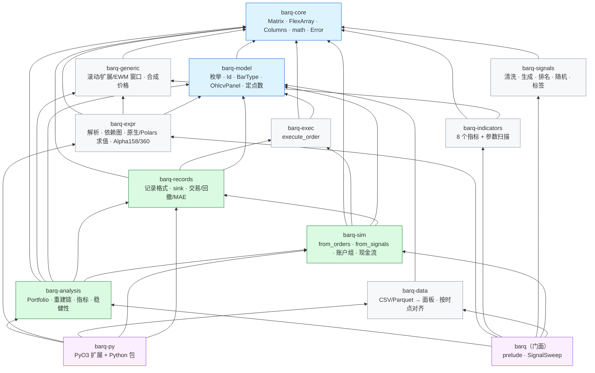
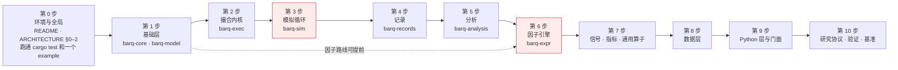

# barq 源码阅读指南

> 这是一份"怎么读"的文档，不是"是什么"的文档。
> "是什么"在 [`docs/ARCHITECTURE.zh-CN.md`](../ARCHITECTURE.zh-CN.md)（设计与决策，自上而下）；
> 本指南回答三个问题：**按什么顺序读、每段代码的核心算法是什么、看不懂时去哪里补课**。
> 代码以分支 `claude/kind-mayer-lp439i`（提交 `cffa4f1`）为准，所有 `path:line` 都指向这个版本。

## 目录

| 章 | 文件 | 覆盖的代码 | 难度 | 预计用时 |
|---|---|---|---|---|
| 0 | 本文 | 全局地图、阅读路线、通用方法 | — | 1 小时 |
| 1 | [01-foundations.md](01-foundations.md) | `barq-core`、`barq-model` | ★★ | 0.5–1 天 |
| 2 | [02-exec-kernel.md](02-exec-kernel.md) | `barq-exec` 撮合内核 | ★★★ | 1 天 |
| 3 | [03-sim.md](03-sim.md) | `barq-sim` 两条模拟循环、止损、账户组、现金流、并行 | ★★★★ | 2–3 天 |
| 4 | [04-records.md](04-records.md) | `barq-records` 记录、三种交易视图、回撤、MAE/MFE | ★★★ | 1 天 |
| 5 | [05-analysis.md](05-analysis.md) | `barq-analysis` 重建链、指标、统计表、过拟合检验、事件研究 | ★★★ | 1.5 天 |
| 6 | [06-expr.md](06-expr.md) | `barq-expr` 因子表达式引擎（解析、图编译、O(1) 窗口核、顺序统计量） | ★★★★★ | 2–3 天 |
| 7 | [07-generic-indicators-signals.md](07-generic-indicators-signals.md) | `barq-generic`、`barq-indicators`、`barq-signals` | ★★ | 1 天 |
| 8 | [08-data.md](08-data.md) | `barq-data`、`barq.data` | ★★ | 0.5 天 |
| 9 | [09-python-and-facade.md](09-python-and-facade.md) | `barq`、`barq-py`、`barq.strategy`、`barq.validation` | ★★★ | 1 天 |
| 10 | [10-research-verification-benchmarks.md](10-research-verification-benchmarks.md) | `research/barq_lab`、`tests/parity`、`benchmarks` | ★★ | 0.5–1 天 |
| 11 | [11-references.md](11-references.md) | 延伸资料总表（论文、文档、视频、中英文） | — | 按需 |
| 12 | [12-exercises.md](12-exercises.md) | 每章的动手练习与自测题 | — | 穿插 |

每一章的结构固定：**定位 → 文件清单与阅读顺序 → 类图 → 核心算法（位置 / 思路 / 步骤 / 复杂度 / 数值技巧 / 为什么这么做）→ 调用链 → 阅读陷阱 → 与参考实现的对应 → 延伸资料 → 自测**。

---

## 0.1 先建立全局地图

### 数据流

```
本地文件 ─▶ BarPanel(时间 × 标的) ─▶ 因子矩阵 ─▶ 信号(时间 × 列) ─▶ 模拟循环 ─▶ 记录 ─▶ 分析
   barq-data        barq-model      barq-expr    barq-signals     barq-sim    barq-records  barq-analysis
                                    (按标的并行)   barq/sweep      (按账户组并行)   (SoA)      (Portfolio)
```


整条流水线里没有 DataFrame：阶段之间传的是内存里的 `Vec<f64>`（列主序）、`FlexArray` 借用和结构体数组（SoA）。
这也是为什么几乎每个 crate 都要先读 `barq-core`：它定义了所有阶段共用的"数组长什么样"。

### Crate 依赖与分层



箭头方向是"依赖于"。读的时候**自下而上**：被依赖得越多的 crate，越早读、越值得读透。

### 代码规模（`src/` 行数，含单元测试）

| crate | 行数 | 文件数 | 一句话 |
|---|---:|---:|---|
| barq-core | 1,258 | 6 | 数组、广播、列标签、浮点容差、错误 |
| barq-model | 793 | 5 | 领域枚举与 Id，和 vectorbt / Nautilus 对齐 |
| barq-data | 560 | 1 | Arrow 读取、面板、按 `available_time` 对齐 |
| barq-exec | 1,152 | 3 | 一笔订单对一个账户在一根 K 线上的撮合 |
| barq-sim | 4,258 | 7 | 驱动内核的两条循环、止损、账户组、并行 |
| barq-records | 4,032 | 7 | 记录格式与派生视图 |
| barq-analysis | 5,578 | 12 | 从记录重建净值、全部指标 |
| barq-expr | 4,089 | 10 | 因子 DSL 全链路 |
| barq-generic | 1,533 | 4 | 通用窗口算子 |
| barq-indicators | 1,188 | 3 | 技术指标与参数网格 |
| barq-signals | 2,021 | 7 | 信号工具箱 |
| barq | 364 | 2 | 门面 |
| barq-py | 2,367 Rust + 1,257 Python | 7 + 4 | Python 边界 |
| research/barq_lab | 2,459 Python | 22 | 预注册因子研究协议 |

---

## 0.2 阅读路线图

### 总路线



红色的两步（`barq-sim` 与 `barq-expr`）是整个仓库最难的两处，也是花时间最值的两处。

### 两条可选路线

| 路线 | 顺序 | 适合谁 |
|---|---|---|
| **交易路线**（推荐先走） | core → model → exec → sim → records → analysis | 想弄清"一笔信号怎么变成净值曲线"的人；这是主流水线 |
| **因子路线** | core → generic → expr → signals → `barq::sweep` → sim | 想弄清"一个表达式怎么变成信号矩阵"的人；可以独立于交易路线 |

两条路线在 `barq-sim` 汇合：因子路线产出 `FromSignals` 的输入，交易路线消费它。

### 用时规划（甘特图，按一个人全职阅读估计）

```mermaid
gantt
  title barq 源码阅读计划（约 12 个工作日）
  dateFormat  D
  axisFormat  第%d天
  section 准备
  环境、全局地图、跑通测试          :a0, 1, 1d
  section 交易路线
  barq-core + barq-model             :a1, after a0, 1d
  barq-exec 撮合内核                 :a2, after a1, 1d
  barq-sim 模拟循环                  :a3, after a2, 3d
  barq-records                       :a4, after a3, 1d
  barq-analysis                      :a5, after a4, 1d
  section 因子路线
  barq-expr 因子引擎                 :b1, after a5, 2d
  generic / indicators / signals     :b2, after b1, 1d
  section 外围
  barq-data                          :c1, after b2, 1d
  barq / barq-py / validation        :c2, after c1, 1d
  research · parity · benchmarks     :c3, after c2, 1d
```



---

## 0.3 贯穿全仓库的 7 个约定

这些约定在每个 crate 里都会反复出现，先记住它们，后面每一章会少走很多弯路。

| # | 约定 | 一句话 | 第一次出现 |
|---|---|---|---|
| 1 | **列轴** | 一列 = 一个被模拟的序列（一个标的，或一个 `(参数组, 标的)` 对）；`col = param_idx × n_symbols + symbol_idx`，参数**重复**（repeat）、标的**平铺**（tile） | `barq-core/src/columns.rs` |
| 2 | **列主序** | `(row, col)` 存在 `data[col * n_rows + row]`；一列是连续切片，所以"一列"是并行与缓存的工作单位；NumPy 数组进 Rust 必须是 Fortran 序 | `barq-core/src/matrix.rs` |
| 3 | **`FlexArray` 广播** | 参数不物化：标量 / 按列 / 按行 / 列映射 / 全矩阵，五种变体同一个 `get(row, col)` | `barq-core/src/flex.rs` |
| 4 | **浮点容差层** | 金融比较不用 `==`、`<=`；用 `is_close`/`is_close_or_less`/`is_less`，余额更新用 `add` 把接近 0 的结果钉成 0；`inf` 是活的哨兵（`size=+inf` = 全仓，`price=+inf` = 收盘价），所以 `inf` 永远不"接近" | `barq-core/src/math.rs` |
| 5 | **拒单不是错误** | `Err(Error::Invariant)` 表示不变量被破坏（负现金、坏参数），整个运行停止；撮合不成功只是 `OrderResult { status: Rejected/Ignored, status_info }` | `barq-exec/src/kernel.rs` |
| 6 | **记录是唯一来源** | 分析层只从 `OrderRecords`（含 `CashRecords`）重建现金、持仓、净值；凡是改变现金或持仓的事情都必须落成记录 | `barq-records`、`barq-analysis/src/series.rs` |
| 7 | **线程数不影响结果** | 串行与多线程输出逐位一致；随机数由 `(seed, row, col)` 决定，不依赖线程或分组；每个并行点都有测试钉住这一点 | `barq-sim/src/random.rs`、`from_orders.rs` |

还有一条贯穿研究层与信号层的红线：**延迟**。在 `t` 的收盘价算出的因子，`t` 才知道，在 `t` 交易就是用了未来数据。所有信号工具默认延迟一根 K 线或把延迟当参数；`labels.rs` 里读未来的函数只能做训练目标，绝不能做信号。

---

## 0.4 读一个 crate 的通用方法

每个 crate 都按同一套步骤读，每章的"阅读顺序"表只是把这套方法具体化：

1. **先读 `lib.rs` 顶部的模块文档**。这个仓库的 `//!` 注释写得很认真，往往直接写出设计意图和"为什么不这么做"。
2. **再读类型，不读函数体**。把 `pub struct` / `pub enum` / `pub trait` 的字段抄到纸上，画出谁拥有谁、谁借用谁。每章给出的类图就是这一步的结果。
3. **读 `tests/` 里的测试名**。测试名是用英文句子写的（`a_gap_through_the_stop_fills_at_the_open`），一组测试名就是一份行为规格。
4. **挑一个 fixture 行，手工跟一遍**。`tests/fixtures/*.tsv` 的每一行都是参考实现（vectorbt 1.1.0 / Qlib）的真实输出；拿一行当输入，在脑子里（或加 `dbg!`）跑一遍核心函数。
5. **最后才读核心函数体**，带着"它在哪一步会偏离我的预期"的问题读。
6. **用 `cargo doc` 做导航**：`cargo doc --workspace --no-deps --open`，文档注释里的 `[`链接`]` 会把类型和函数串起来。

```bash
# 环境（mise.toml 固定了 Rust / Python / uv 版本）
cargo test --workspace                       # 全部 Rust 测试（含对照 fixture 重放）
cargo test -p barq-exec -- --nocapture       # 单个 crate
cargo doc --workspace --no-deps --open       # 文档导航
cargo run --release --example factor_sweep -p barq      # Rust 端到端示例
uv sync && uv run python examples/sweep.py   # Python 端到端示例
```

读代码时随手记三件事：**它调用了谁、谁调用了它、它和参考实现（vectorbt / Qlib / Nautilus）的哪个函数对应**。每章末尾的"对应表"可以直接核对。

---

## 0.5 全局类图（只画跨 crate 的骨架）

```mermaid
classDiagram
  direction LR
  class Matrix {
    +Vec~f64~ data
    +usize n_rows
    +usize n_cols
    +column(c) &[f64]
  }
  class FlexArray~T~ {
    <<enum>>
    Scalar(T)
    PerColumn(&[T])
    PerRow(&[T])
    MappedColumns
    Full
    +get(row, col) T
    +varies_by_row() bool
  }
  class OhlcvPanel {
    +Vec~f64~ open/high/low/close/volume
    +n_rows, n_cols
  }
  class FactorSet {
    +compile(exprs)
    +evaluate(&FactorInputs) FactorValues
    -Graph graph
  }
  class FromSignals~'a~ {
    +FlexArray close/open/high/low
    +FlexArray entries/exits/...
    +FlexArray size/fees/sl_stop/...
    +Groups groups
  }
  class FromOrders~'a~ {
    +FlexArray size/price/size_type/...
  }
  class ValidatedOrder {
    -Order order
    -Option~&str~ violation
    +set_bar(size, price, type, dir)
  }
  class execute_order {
    <<fn>>
    (ProcessOrderState, &Order, draw) → (ExecuteOrderState, OrderResult)
  }
  class OrderRecords {
    +Vec col/idx/size/price/fees/side
    +CashRecords cash
    +concat(parts)
  }
  class Journal {
    +OrderRecords orders
    +LogRecords logs
  }
  class RecordSink {
    <<trait>>
    +push_order(...)
    +push_cash(...)
  }
  class Portfolio~'a~ {
    -OrderRecords records
    -&[f64] close
    -Groups groups
    -OnceLock 派生序列...
    +value() returns() sharpe()...
    +stats(Select)
  }
  class TradeRecords
  class DrawdownRecords

  OhlcvPanel --> FactorSet : FactorInputs.from_ohlcv
  FactorSet --> Matrix : FactorValues
  Matrix --> FromSignals : SignalSweep / strategy.sweep
  FromSignals --> ValidatedOrder : build_order 每列一次
  FromOrders --> ValidatedOrder
  ValidatedOrder --> execute_order : execute_validated
  execute_order --> RecordSink : push_order
  RecordSink <|.. OrderRecords
  RecordSink <|.. Journal
  OrderRecords --> Portfolio : from_records
  Portfolio --> TradeRecords : trades()
  Portfolio --> DrawdownRecords : drawdowns()
  FlexArray <.. FromSignals
  FlexArray <.. FromOrders
```



---

## 0.6 各章核心算法一览

读完本指南你应该能脱稿讲清楚下面每一项。括号里是所在章。

| 算法 / 机制 | 为什么值得单独学 | 章 |
|---|---|---|
| 列轴布局与 `FlexArray::MappedColumns` | 参数扫描不复制价格的根本原因 | 1 |
| PEP 485 容差 + `inf` 哨兵 + `add` 零钉 | 变异测试里唯一的幸存者就死在这里 | 1 |
| 数量换算链（TargetPercent → … → Amount）与买卖分支 | 内核的全部语义；14 种拒单原因各在哪一行 | 2 |
| 做空的 `debt` / `free_cash` 记账（2 × 空头市值） | 路径相关的状态为什么要显式保存 | 2 |
| 费用反解 `(cash_limit − fixed) / (1 + fees)` + 二次粒度取整 | 费用在上限之内而不是之上 | 2 |
| 一根 K 线两遍扫描：先定价/止损/排序，再执行 | 共享账户的 `call_seq="auto"` 为什么需要两遍 | 3 |
| 止损引擎：跳空按开盘、触及按价位、测完再 trail | 先 trail 后测会在新高当根就被打出来 | 3 |
| 信号冲突解析链（4 个纯函数的固定顺序） | 顺序一换，幸存的信号就不同 | 3 |
| `std::thread::scope` 按账户组切块 + 顺序合并 + `order_id` 重基 | 线程数不改变输出 | 3 |
| SplitMix64 对 `(seed,row,col)` 的无状态抽样 | 可复现、可并行的随机拒单 | 3 |
| 三种交易视图（entry FIFO / exit 平均 / position 分组） | 同一组成交，三种统计口径 | 4 |
| 稳定计数排序 `ColMap` + `MappedArray` 归约 | 记录按列分组的零拷贝快路径 | 4 |
| 重建链 `asset_flow → assets → cash_flow → cash → value → returns` | 分析只信记录 | 5 |
| 含入金的收益 `value[t] / (value[t−1] + deposit[t]) − 1` | 入金不是收益，出金不是回撤 | 5 |
| PSR / 期望最大 Sharpe / DSR / PBO-CSCV | 扫了一千组参数后"最好"的那组有多少是运气 | 5 |
| Pratt 解析器 | 优先级与右结合 `**` 的最小实现 | 6 |
| 哈希合并（hash-consing）+ 常量折叠 + 最后读者释放槽位 | 357 个节点只用 17 个暂存序列 | 6 |
| `Ref` 视图：平移读而不计算 | Alpha360 的 354 个节点一个槽位 | 6 |
| 滚动累加器：平移求和、每 N 行重建、常量窗口精确零 | O(1)/行，但要和 Qlib 的 `== 0` 逐位一致 | 6 |
| 单调队列求窗口极值 / 极值位置 | 均摊 O(1) | 6 |
| 有序环 + 树状数组求分位数 / 排名 / MAD | 窗口 ≤ 256 走环，否则 O(log n) 树 | 6 |
| 三重障碍标签、pivot 标签、固定期收益 | 读未来的函数只能做标签 | 7 |
| 按 `available_time` 的 as-of / 窗口对齐 | 防止用到晚发布的数据 | 8 |
| Fortran 序零拷贝进 Rust、GIL 释放、`Cache` 跨调用复用 | Python 边界的三个规则 | 9 |
| purged k-fold + embargo、walk-forward 在训练集选参 | 时间序列交叉验证 | 9 |
| 哈希链账本 + 预注册 + Bonferroni 门槛 | 模型永远看不到结果 | 10 |
| 差分测试：外部环境生成 TSV fixture，`cargo test` 重放 | 没有 Python 也能验证到参考实现 | 10 |

---

## 0.7 阅读进度自测

把下面每项都能做到，就可以认为读懂了对应层：

- [ ] **基础层**：不看代码写出 `FlexArray::get` 五个分支；解释为什么 `is_close(inf, inf)` 是 `false`。
- [ ] **内核**：给定 `cash=100, fees=0.1, fixed_fees=1, size=+inf, price=10`，手算成交数量（答案在第 2 章）。
- [ ] **模拟**：画出共享账户一根 K 线的时序图（入金 → 定价 → 止损 → 信号 → 排序 → 执行 → 收盘收支）。
- [ ] **记录**：对同一组成交，说出 `entry_trades` 和 `exit_trades` 的胜率为什么可以不同。
- [ ] **分析**：从 `OrderRecords` 手工重建一个两根 K 线、一笔成交的净值序列，并算出收益率。
- [ ] **因子**：把 `($close - Mean($close, 5)) / Std($close, 5)` 画成依赖图，标出哪些节点占槽位。
- [ ] **信号**：解释 `clean_enex` 对"同一根 K 线同时有进有出"的处理。
- [ ] **数据**：说出 `event_time` 和 `available_time` 的区别，以及对齐用哪个。
- [ ] **Python**：说出 C 序数组进 Rust 为什么会被拒绝而不是转置。
- [ ] **研究**：复述一个假设从 `propose` 到 `report` 的全部状态，以及为什么 LLM 看不到结果。

练习题在 [12-exercises.md](12-exercises.md)。
