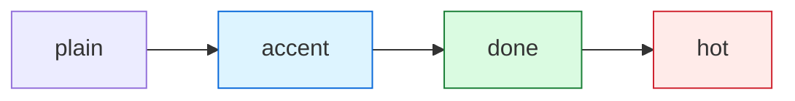
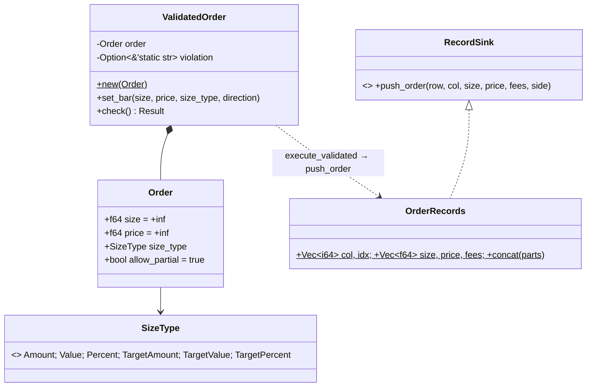
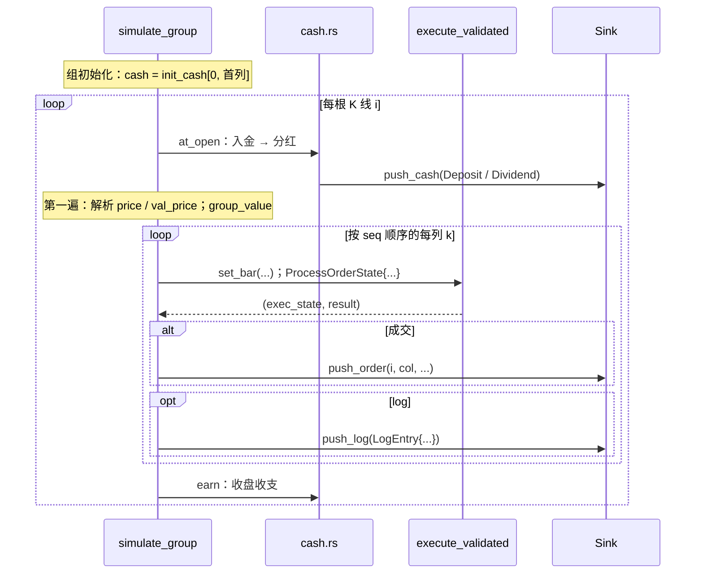
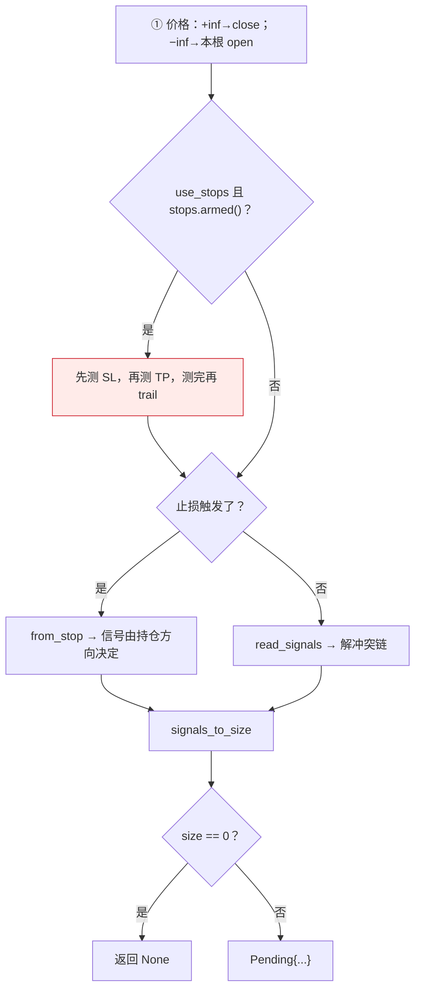
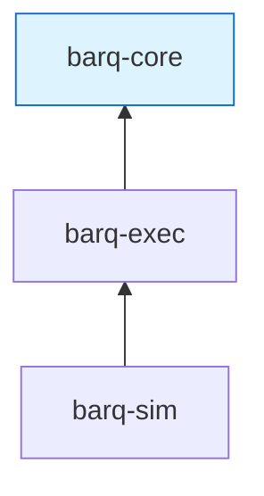
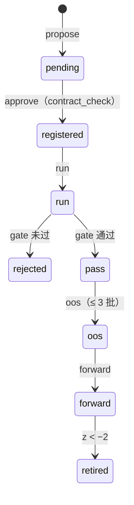

# Diagram types: when to use each, and templates that render

All templates below were rendered with mermaid-cli 11.4.2 (the parser GitHub
uses). Copy the skeleton, replace the identifiers, keep the structure.

## Style (shared)

Palette, matching `docs/img/generate.py` so Mermaid and the generated SVGs look
like one family:

| role | fill | stroke | use |
|---|---|---|---|
| plain | `#f6f8fa` | `#8c959f` | default boxes |
| accent (基础 / 强调) | `#ddf4ff` | `#0969da` | foundations, the thing the diagram is about |
| ok / done | `#dafbe1` | `#1a7f37` | finished, top layer |
| warn / hot (难点) | `#ffebe9` | `#cf222e` | the hard or risky step |
| purple / shell | `#fbefff` | `#8250df` | façades, external boundary |
| amber / partial | `#fff8c5` | `#9a6700` | partially done |

Stereotypes in class diagrams: `<<enum>>`, `<<trait>>`, `<<mod>>`, `<<fn>>`.
State `direction LR` or `TB` explicitly. Keep one idea per diagram.

## classDiagram — types and their relationships

Use for: ownership (`*--`), aggregation (`o--`), implementation (`<|..`),
inheritance (`<|--`), "uses / creates" (`..>`), plain association (`-->`).

Rules of thumb:

- Members: `+` public, `-` private, `$` static after the member, `Vec~T~` for
  generics, a comment after a member goes in parentheses or Chinese
  parentheses（…）but never `{}`.
- Several members on one line separated by `;` inside the braces is fine and
  keeps big classes short.
- Relation labels after ` : ` may not contain another `:`; use `.` for paths.
- Enum variants without parentheses land in the attribute compartment (what
  you want); with parentheses they are drawn as methods (harmless but odd).

## sequenceDiagram — one unit of work, step by step

Use for: "what happens in one bar / one request / one call", especially when
several participants take turns.

Rules of thumb: `->>` call, `-->>` return, `Note over A,B:` for state, `loop` /
`alt` / `opt` / `par` blocks; keep ≤ 6 participants; put formulas in notes, not
in message text.

## flowchart — decisions and fixed stage order

Use for: a function with a fixed order of checks (`prepare_order`,
`execute_validated`), a pipeline, a dependency graph (`flowchart BT`).

Rules of thumb: always quote node text (`["…"]`, `{"…"}`) so `|()[]{}` and
` ` are safe; edge labels with `-- 文本 -->` or `-->|文本|`; number the
stages (①②③) when the order is the point; `classDef` + `class` for the
palette; `subgraph` for layers.

Dependency graph variant (`flowchart BT`, arrows mean "depends on"):

## stateDiagram-v2 — lifecycle of one thing

Use for: a protocol, an order's life, a position's stop state.

Rules of thumb: transition labels after ` : `; no colons inside; keep ≤ 12
states; use `state X { ... }` for nesting only when it clarifies.

## gantt — a plan in time

Use for: reading plans, roadmaps with durations. Tip: `dateFormat D` with
`axisFormat 第%d天` gives "day N" labels without real dates.

```mermaid
gantt
  title 阅读计划
  dateFormat  D
  axisFormat  第%d天
  section 准备
  环境与全局地图        :a0, 1, 1d
  section 交易路线
  barq-core + barq-model :a1, after a0, 1d
  barq-sim               :a3, after a1, 3d
```

Rules of thumb: tasks need an id to be referenced by `after`; sections group
rows; keep under ~15 rows.
